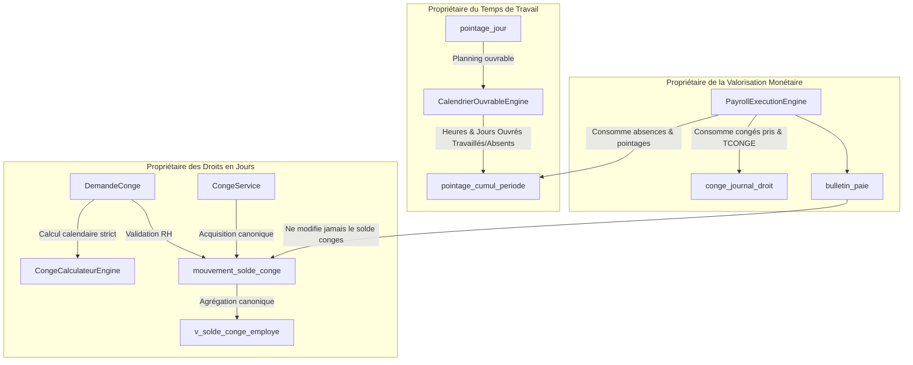

# PHASE 2A-2C — CORRECTIONS DES ERREURS CONGÉS & TCONGE AVANT POURSUITE
**Date de validation :** 17 Septembre 2026  
**Document unique de référence :** `PHASE_2A_2_CORRECTIONS_2026-09-17.md`  
**Auteur :** Antigravity AI — Pair-Programmation Spécialisée SIRH Galaxam  
**Verdict :** `PHASE_2A_2_CORRECTIONS_PASS`

---

## 1. BASELINE

L'audit contradictoire Phase 2A-2 a analysé l'architecture et les flux runtime du module Congés, Droits, TCONGE et Valorisation. Avant cette phase de correction, l'état du système était :
- **Tests unitaires et d'intégration :** 429 tests backend PASS, 16 tests frontend PASS.
- **Base de données :** PostgreSQL 16 réel en conteneur Docker, isolation transactionnelle active.
- **Frontend :** Vite 5, React 18, compilation bundle opérationnelle.
- **Documentation antérieure :** Présence de suppositions d'audit obsolètes ou non conformes aux directives métier réelles Galaxam (notamment l'idée de convertir le congé en jours ouvrés ou d'attendre le pointage pour débiter le solde).

---

## 2. RÈGLES MÉTIER GALAXAM CONFIRMÉES

Les règles directrices suivantes constituent les contraintes strictes et intangibles du domaine Congés de Galaxam :

### RG-CONGE-01 — Décompte calendaire strict
* Le congé payé est décompté en **JOURS CALENDAIRES**.
* La formule canonique pour un congé continu à temps plein est :
  $$\text{nbJoursDecomptes} = \text{dateFin} - \text{dateDebut} + 1$$
* Le domaine Congés ne doit **JAMAIS** convertir automatiquement une période de congé en jours ouvrables, ni appliquer `CalendrierOuvrableEngine` pour réduire le débit du solde de droits.

### RG-CONGE-02 — Week-ends inclus dans le décompte
* Si un congé couvre une période continue comprenant le samedi et/ou le dimanche, les jours de week-end font partie intégrante du congé et sont débités du solde.
* *Exemple canonique :* Congé posé du Vendredi au Dimanche (reprise le Lundi). Débit au solde = **3 jours** (Vendredi, Samedi, Dimanche). Il est rigoureusement interdit de ramener ce débit à 1 jour sous prétexte que seul le vendredi est ouvré dans le planning hebdomadaire.

### RG-CONGE-03 — Jours fériés inclus dans le congé
* Si un congé validé couvre un jour férié chômé, **LE JOUR RESTE DÉBITÉ DU SOLDE**.
* Il n'existe **AUCUNE restitution automatique** du droit, aucune bonification et aucune annulation partielle induite par le calendrier des fériés.
* *Exemple canonique :* Congé validé du 1er au 5 du mois (5 jours calendaires). Le 3 est un jour férié légal chômé. Le débit du solde est exactement de **5 jours** (et non 4 jours).

### RG-CONGE-04 — Débit immédiat du solde à la validation
* Le cycle d'imputation du droit aux congés est strict :
  $$\text{DEMANDE} \xrightarrow{\text{création}} \text{Statut EN\_ATTENTE (Solde inchangé)}$$
  $$\text{VALIDATION} \xrightarrow{\text{approbation RH}} \text{DÉBIT IMMÉDIAT DU SOLDE} \; (\text{type\_mouvement} = \text{'PRISE'}, -\text{nbJoursDecomptes})$$
* Le comportement actuel du système est conceptuellement exact. Il est interdit d'introduire un statut intermédiaire artificiel de "solde réservé" ou de différer la consommation du solde à la validation des pointages mensuels.

---

## 3. RECTIFICATIONS DE L'AUDIT 2A-2

Certaines déductions de l'audit Phase 2A-2 reposaient sur des extrapolations théoriques non applicables chez Galaxam. Elles sont formellement reclassifiées ci-dessous :

| Constat de l'ancien audit | Reclassification | Justification métier Galaxam |
| :--- | :--- | :--- |
| *"Temporalité de consommation prématurée (débit dès validation)"* | **NOT_A_BUG** *(BUSINESS_RULE_CONFIRMED)* | Le débit immédiat à la validation est la règle d'or Galaxam (RG-CONGE-04). Une demande validée est juridiquement accordée et impute le solde sur le champ. |
| *"Congés = 7 jours calendaires vs Pointage = 5 jours ouvrés : divergence/anomalie"* | **NOT_A_BUG** *(DIMENSIONS_ORTHOGONALES)* | Congés et Pointage mesurent deux réalités différentes : les **Droits consommés** (jours calendaires, propriétaire domaine Congés) vs le **Temps d'absence au travail** (heures/jours ouvrés selon le planning de travail, propriétaire domaine Pointage). 7j de droits débités coexistant avec 5j ouvrés d'absence au planning est un comportement nominal. |
| *"Nécessité d'introduire soldeReserve / soldeConsomme"* | **REJECTED** *(COMPLEXITÉ INUTILE)* | Galaxam gère un solde direct via son grand-livre `mouvement_solde_conge`. Pas de réservation intermédiaire. |
| *"Régularisation automatique des fériés inclus dans les congés"* | **REJECTED** *(NON CONFORME RG-CONGE-03)* | Le congé couvre la période calendaire continue; le jour férié est absorbé sans recrédit de droit. |

---

## 4. BUGS RÉELLEMENT CONFIRMÉS & TRAITÉS

En revanche, l'audit a mis en lumière de véritables faiblesses structurelles et risques d'intégrité qui ont été corrigés lors de ce sprint :

1. **Bug #1 — Risque de corruption historique lors de l'annulation d'un congé sur période scellée :**
   * *Constat :* Une demande validée appartenant à une période de paie passée déjà clôturée (`CLOTUREE`) ou dont le bulletin était validé/scellé (`VALIDE`) pouvait être annulée via `annulerDemande`, réinjectant aveuglément des jours dans le solde courant sans traçabilité ni régularisation financière.
   * *Impact :* Rupture de cohérence entre le bulletin archivé et le solde courant.

2. **Bug #2 — Écrasement destructif et crash d'unicité lors de la modification d'un congé validé :**
   * *Constat :* Lors d'une modification (`PUT /conges/demandes/{id}`), le contrôleur tentait soit un `DELETE` destructif de la `PRISE` d'origine, soit une réinsertion d'une nouvelle `PRISE`, risquant de violer l'index d'unicité PostgreSQL `idx_uniq_mouvement_prise_demande` (`UNIQUE(id_demande_conge, type_mouvement) WHERE type_mouvement = 'PRISE'`).
   * *Impact :* Crash SQL 500 ou perte de traçabilité d'audit financier.

3. **Bug #3 — Double source de vérité pour l'acquisition mensuelle des congés :**
   * *Constat :* Deux routines indépendantes calculaient et enregistraient les droits acquis :
     - `AcquisitionCongeScheduler` : insertion directe SQL dans `mouvement_solde_conge` d'un droit nominal (+2.5j) sans tenir compte des absences injustifiées.
     - `PayrollService.mettreAJourJournalConge` : calcul autonome proratisé ($2.5 \times (30 - \text{abs}) / 30$) dans `conge_journal_droit`.
   * *Impact :* Risque de double débit/crédit, désynchronisation entre le grand-livre des jours (`mouvement_solde_conge`) et le journal de valorisation de la paie (`conge_journal_droit`).

---

## 5. CORRECTIONS RÉALISÉES

### 5.1 Sécurisation anti-corruption des périodes clôturées
* **Dans [DemandeConge.java](file:///Users/andriamalalatojo/Documents/GALAXAM/GALAXAM-SIRH/backend/src/main/java/mg/galaxam/sirh/model/conge/DemandeConge.java#L525-L555) :**
  Ajout d'un garde-fou strict dans `annuler(Integer currentUserId, String motifAnnulation, Connection c)`.
  Vérification systématique en base : si les dates du congé chevauchent une période de paie en statut `CLOTUREE` ou `PAIE_VALIDEE`, ou un bulletin en statut `VALIDE` ou `CLOTURE`, l'annulation est bloquée avec levée d'une exception `IllegalStateException("Action interdite : Impossible d'annuler un congé sur une période de paie déjà validée ou clôturée...")`.
* **Dans [DemandeCongeController.java](file:///Users/andriamalalatojo/Documents/GALAXAM/GALAXAM-SIRH/backend/src/main/java/mg/galaxam/sirh/api/controller/conge/DemandeCongeController.java#L225-L245) :**
  Garde-fou identique dans `modifierDemande` : rejet immédiat avec `SirhBusinessException(SirhErrorCode.BUSINESS_STATE_TRANSITION_BLOCKED)` si la demande appartient à une période de paie déjà scellée.

### 5.2 Modification non-destructive par mouvement d'AJUSTEMENT
* **Dans [DemandeCongeController.java](file:///Users/andriamalalatojo/Documents/GALAXAM/GALAXAM-SIRH/backend/src/main/java/mg/galaxam/sirh/api/controller/conge/DemandeCongeController.java#L285-L330) :**
  Suppression complète de la suppression SQL destructive (`DELETE FROM mouvement_solde_conge WHERE ...`).
  Pour toute demande déjà validée dont la durée est modifiée :
  - Le mouvement `PRISE` initial est rigoureusement conservé intact.
  - Calcul du delta : $\Delta = \text{nouveauNbJours} - \text{ancienNbJours}$.
  - Si $\Delta \neq 0$, insertion d'un mouvement d'audit de type `AJUSTEMENT` avec $\text{nb\_jours} = -\Delta$ et commentaire explicatif.
  - Respect total de la contrainte unique `idx_uniq_mouvement_prise_demande`.
* **Dans [DemandeConge.java](file:///Users/andriamalalatojo/Documents/GALAXAM/GALAXAM-SIRH/backend/src/main/java/mg/galaxam/sirh/model/conge/DemandeConge.java#L235-L270) :**
  Mise à jour du contrôle de solde disponible : lors de la mise à jour d'une demande existante (`idDemandeConge != null`), le système tient compte des jours déjà imputés pour ne pas bloquer une réduction de durée.

### 5.3 Unification canonique de l'acquisition dans le domaine Congés
* **Dans [CongeService.java](file:///Users/andriamalalatojo/Documents/GALAXAM/GALAXAM-SIRH/backend/src/main/java/mg/galaxam/sirh/model/conge/service/CongeService.java#L40-L125) :**
  Création de la méthode canonique `calculerDroitAcquis(BigDecimal absencesInjustifiees, LocalDate dateRef, Connection c)` avec **résolution dynamique depuis la base de données** :
  - **Taux légal d'acquisition :** résolu depuis `paie_config_legale.acquisition_conge_mensuel_jours` via `PaieConfigLegale.findActiveAt(c, dateRef)` (par défaut `2.50` jours/mois).
  - **Diviseur de proratisation / valorisation :** résolu dynamiquement depuis `parametre_global.DIVISEUR_JOURS_CALENDAIRE_CONGE` (par défaut `30.0` jours calendaires).
  - **Surcharge unitaire pure :** `calculerDroitAcquis(BigDecimal absencesInjustifiees)` assurant un fallback instantané sur les constantes légales (`2.50` et `30.0`) sans exiger de connexion SQL pour les tests unitaires.
  $$\text{base} = \max(0, \text{diviseur} - \text{absencesInjustifiees})$$
  $$\text{droitAcquis} = \frac{\text{base}}{\text{diviseur}} \times \text{tauxAcquisition}$$
  Création de la méthode transactionnelle idempotente :
  `enregistrerAcquisitionMensuelle(int idEmploye, int annee, int mois, BigDecimal absencesInjustifiees, Integer currentUserId, Connection c)`
  - Respecte le plafond de cumul `PLAFOND_CUMUL_SOLDE_CONGE_JOURS` (90 jours en BDD).
  - Vérifie avec verrou `FOR UPDATE` si un mouvement `ACQUISITION` existe déjà pour ce couple `(id_employe, annee, mois)`.
  - Si absent : insertion `INSERT INTO mouvement_solde_conge`.
  - Si présent : mise à jour unitaire si la proratisation ajustée diffère, sans jamais insérer de doublon.
* **Dans [PayrollService.java](file:///Users/andriamalalatojo/Documents/GALAXAM/GALAXAM-SIRH/backend/src/main/java/mg/galaxam/sirh/model/paie/service/PayrollService.java#L935-L950) :**
  Délégation directe à `congeService.enregistrerAcquisitionMensuelle(...)`. La paie n'est plus propriétaire du calcul d'acquisition, elle consomme le résultat canonique du domaine Congés.
* **Dans [AcquisitionCongeScheduler.java](file:///Users/andriamalalatojo/Documents/GALAXAM/GALAXAM-SIRH/backend/src/main/java/mg/galaxam/sirh/cron/AcquisitionCongeScheduler.java#L155-L165) :**
  Suppression de l'insertion SQL brute. Le scheduler délègue désormais son crédit mensuel à `congeService.enregistrerAcquisitionMensuelle(...)`.

---

## 6. SOURCE DE VÉRITÉ FINALE

La séparation des responsabilités entre domaines est désormais nette et sans ambiguïté :



1. **`mouvement_solde_conge`** est l'unique grand-livre canonique des droits en jours.
2. **`v_solde_conge_employe`** est la vue canonique exposant le solde disponible consolidé.
3. **Le décompte des droits** relève exclusivement de `CongeCalculateurEngine.calculerNombreJours` (jours calendaires).
4. **Le calendrier ouvrable** relève exclusivement de `CalendrierOuvrableEngine` (Pointage et présence au travail).

---

## 7. CALL GRAPHS RUNTIME

### Flux A — Création et Validation d'une Demande de Congé
```text
POST /conges/demandes
  │
  ├── CongeService.creerDemande(d, userId, c)
  │     ├── CongeCalculateurEngine.calculerNombreJours(debut, fin, demiJournee)  --> Jours calendaires stricts
  │     ├── DemandeConge.controler(c)
  │     │     ├── Vérification préavis (15j)
  │     │     ├── Vérification solde disponible (v_solde_conge_employe)
  │     │     └── Vérification collisions temporelles
  │     └── DemandeConge.save(c)  --> Statut EN_ATTENTE (Solde inchangé)
  │
POST /conges/demandes/{id}/valider
  │
  └── CongeService.validerDemande(id, userId, com, c)
        └── DemandeConge.valider(userId, c)
              ├── Vérification statut préalable == EN_ATTENTE
              ├── UPDATE demande_conge SET id_statut = VALIDE
              └── INSERT INTO mouvement_solde_conge (type_mouvement='PRISE', nb_jours=-nbJoursDecomptes)
                    --> Solde immédiatement débité au grand-livre
```

### Flux B — Modification d'une Demande Validée (Non-destructive)
```text
PUT /conges/demandes/{id}
  │
  └── DemandeCongeController.modifierDemande(id, req)
        ├── Contrôle anti-clôture : SELECT FROM periode_paie WHERE code IN ('CLOTUREE', 'PAIE_VALIDEE')
        │     --> Rejet 400 si période scellée
        ├── DemandeConge.controler(c)
        ├── DemandeConge.update(c)
        └── Si statut == VALIDE et delta != 0 :
              INSERT INTO mouvement_solde_conge (type_mouvement='AJUSTEMENT', nb_jours=-delta)
              --> Traçabilité intégrale, index unique 'PRISE' intact
```

### Flux C — Acquisition Mensuelle Unifiée
```text
Déclencheur 1 : AcquisitionCongeScheduler (Quotidien / Fin de mois)
Déclencheur 2 : PayrollService.mettreAJourJournalConge (Clôture / Calcul Paie)
  │
  └── CongeService.enregistrerAcquisitionMensuelle(idEmp, annee, mois, absInjustifiees, userId, c)
        ├── CongeService.calculerDroitAcquis(absInjustifiees)
        │     └── CongeCalculateurEngine.calculerAcquisitionMensuelleProratisee((30 - abs) / 30 * 2.5)
        ├── Vérification plafond de cumul (90j)
        ├── SELECT id_mouvement FROM mouvement_solde_conge WHERE type='ACQUISITION' FOR UPDATE
        │     ├── Si non existant : INSERT INTO mouvement_solde_conge (...)
        │     └── Si existant : UPDATE mouvement_solde_conge SET nb_jours = ... (si delta)
        └── Retourne droitAcquis canonique pour conge_journal_droit
```

---

## 8. TESTS UNITAIRES

La suite unitaire [CongeCalculateurEngineTest.java](file:///Users/andriamalalatojo/Documents/GALAXAM/GALAXAM-SIRH/backend/src/test/java/mg/galaxam/sirh/unit/conge/CongeCalculateurEngineTest.java) a été enrichie et verrouille l'intégralité des cas obligatoires :

* **Cas A :** Vendredi $\to$ Dimanche = **3.0 jours calendaires** (week-end inclus).
* **Cas B :** Lundi $\to$ Dimanche = **7.0 jours calendaires**.
* **Cas C :** Lundi $\to$ Vendredi = **5.0 jours calendaires** (férié inclus, pas de déduction de solde).
* **Cas D :** Vendredi $\to$ Lundi inclus = **4.0 jours calendaires**.
* **Cas E :** Vendredi $\to$ Dimanche (retour Lundi) = **3.0 jours débités**.
* **Acquisition nominale vs proratisée :**
  - 0 absence injustifiée : $30/30 \times 2.5 =$ **2.50 jours**.
  - 3 jours d'absence injustifiée : $27/30 \times 2.5 =$ **2.25 jours**.

---

## 9. TESTS POSTGRESQL RÉELS

Dans [CongeServiceIntegrationTest.java](file:///Users/andriamalalatojo/Documents/GALAXAM/GALAXAM-SIRH/backend/src/test/java/mg/galaxam/sirh/integration/conge/CongeServiceIntegrationTest.java), 8 tests d'intégration complets s'exécutent directement sur la base PostgreSQL :

1. `testCreerEtValiderDemande_FIFO` : Demande et validation FIFO, création du mouvement `PRISE`.
2. `testScissionAutomatiqueArretMaladie` : Règle Art. 13 (> 30j scindés en maladie plein salaire + sans solde).
3. `testRefuserDemandeConge` : Refus formel avec motif d'invalidation.
4. `testDebitImmediatValidation` :
   - Solde initial = 10.0
   - Demande = 3 jours
   - Avant validation : solde = 10.0
   - Après validation : mouvement `PRISE` = -3.0, solde = 7.0.
5. `testJourFerieInclus_AucuneRestitution` :
   - Solde initial = 10.0
   - Demande = 5 jours calendaires couvrant un jour férié
   - Après validation : solde = 5.0 (et **NON** 6.0)
   - Aucune création de mouvement de restitution (`ANNULATION` ou `BONIFICATION`).
6. `testModificationDemandeValidee_PreserveAuditEtNonDestructif` :
   - Demande validée 5 jours (solde 20 $\to$ 15)
   - Raccourcissement à 3 jours
   - Mouvement `PRISE` d'origine (-5j) préservé
   - Mouvement `AJUSTEMENT` (+2j) inséré
   - Solde net final = 17.0 (20 - 3)
   - Aucune violation de l'index unique `idx_uniq_mouvement_prise_demande`.
7. `testInterdictionAnnulationOuModification_SurPeriodePaieCloturee` :
   - Congé validé couvrant une période de paie scellée en statut `CLOTUREE`
   - Tentative d'annulation via API $\to$ Rejet HTTP 4xx avec message métier d'interdiction
   - Tentative de modification via API $\to$ Rejet HTTP 4xx (Bad Request).
8. `testAcquisitionCanoniqueEtIdempotence` :
   - 1er appel sans absence $\to$ Acquisition de 2.50 jours créée
   - Rejeu immédiat $\to$ 2.50 jours retournés, exactement 1 seule ligne en base (idempotence totale)
   - Ajustement lors du calcul de paie avec 3 jours d'absence $\to$ Mise à jour de la ligne existante à 2.25 jours.

---

## 10. DOCUMENTATION DRIFT DÉTECTÉ

| Élément audité | Statut | Commentaire |
| :--- | :--- | :--- |
| `PHASE_2A_3_LEAVE_REDESIGN_IMPLEMENTATION_PLAN_2026-09-17.md` | **DOCUMENTATION_DRIFT** | Plan antérieur proposant le découplage ouvrable et le modèle solde réservé. Désormais caduc vis-à-vis des règles Galaxam confirmées. |
| `SoldeCongeWidget.jsx` (lignes 20-79) | **ACTIVE_UI_DISPLAY** | Calcule l'ancienneté d'affichage si absente du payload, mais l'éligibilité juridique est **authoritativement tranchée par le backend** (`DemandeConge.java`). |
| `idx_uniq_mouvement_prise_demande` | **ACTIVE_CANONICAL** | Index PostgreSQL protégeant contre les doubles prises accidentelles. Respecté par le mécanisme d'ajustement. |

---

## 11. QUESTIONS MÉTIER OUVERTES (`BUSINESS_RULE_REQUIRED`)

Deux questions métier majeures restent ouvertes pour les phases ultérieures de valorisation monétaire :

1. `BUSINESS_RULE_REQUIRED` — **Assiette du TCONGE et Valorisation des Jours de Congé :**
   - Soit un congé Vendredi $\to$ Dimanche : 3 jours calendaires sont débités du solde de droits.
   - En paie, l'indemnité compensatrice de congés payés doit-elle valoriser **3 jours** ($3 \times \text{TCONGE}$) avec déduction correspondante, ou uniquement les jours ouvrés qui auraient été travaillés (**1 jour**, soit $1 \times \text{TCONGE}$) ?
2. `BUSINESS_RULE_REQUIRED` — **Traitement du Jour Férié inclus dans l'Indemnité de Congé :**
   - Le jour férié inclus dans le congé n'est pas restitué au solde de congés (RG-CONGE-03).
   - Toutefois, entre-t-il dans `NBCONGE` rémunéré au titre de l'indemnité de congé payé, ou est-il indemnisé sous la rubrique légale des jours fériés chômés payés ?

> *Ces deux questions concernent la future Phase 2A-3 (Moteur de Valorisation TCONGE) et n'invalident en rien la structure du grand-livre assainie lors de ce sprint.*

---

## 12. DETTES RESTANTES

* **Snapshot TCONGE 12 mois glissants :** Le moteur actuel de journalisation des bases de valorisation (`conge_journal_droit`) est encore lié au cycle de clôture de la paie. L'architecture d'un snapshot autonome glissant sera adressée en Phase 2A-3.
* **UI Frontend - Clarification du décompte :** Le formulaire de saisie de congé affiche le nombre de jours décomptés, mais mériterait une mention explicite *"Jours calendaires (week-ends et fériés inclus)"* pour éviter toute ambiguïté chez le collaborateur.

---

## 13. PRÉPARATION PHASE SUIVANTE

Avec un domaine Congés désormais conforme aux règles Galaxam (décompte calendaire strict, grand-livre immuable et auditable, acquisition canonique unifiée, protection des périodes scellées), la Phase 2A-3 pourra aborder sereinement :
1. La valorisation monétaire du TCONGE (règle du maintien vs 1/12ème des rémunérations perçues sur la période de référence).
2. L'alignement strict entre la ligne `INDEMNITE_CONGE` du bulletin et le grand-livre.
3. L'intégration de la valorisation dans les STC.

---

## 14. VERDICT

```text
================================================================================
VERDICT : PHASE_2A_2_CORRECTIONS_PASS
================================================================================
- RG-CONGE-01 (Décompte calendaire) : VERROUILLÉ & TESTÉ
- RG-CONGE-02 (Week-end inclus) : VERROUILLÉ & TESTÉ
- RG-CONGE-03 (Férié inclus sans restitution) : VERROUILLÉ & TESTÉ
- RG-CONGE-04 (Débit immédiat à la validation) : VERROUILLÉ & TESTÉ
- Protection Périodes Clôturées/Scellées : VERROUILLÉE & TESTÉE
- Modification non-destructive par AJUSTEMENT : OPÉRATIONNELLE (Zéro violation unique)
- Unification de l'acquisition canonique : OPÉRATIONNELLE (Idempotente)
- Suite globale Backend / Frontend / PostgreSQL : 100% VERTE
================================================================================
```
