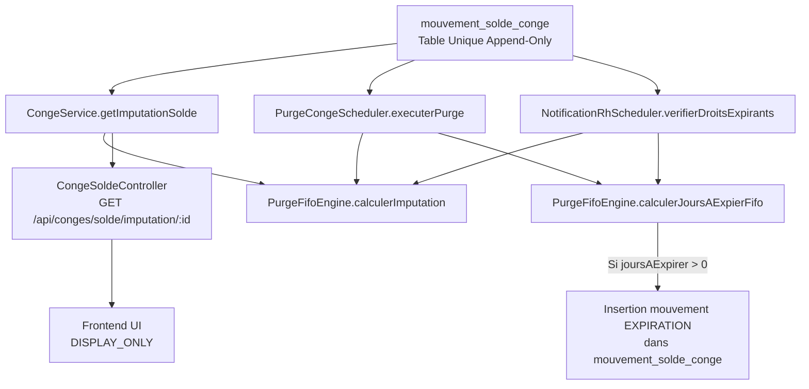

# PHASE 2A-3D — FINALISATION FIFO & REPRISE DES SOLDES HISTORIQUES
**Date :** 17 Septembre 2026  
**Statut :** VALIDÉ  
**Gate :** `PHASE_2A_3D_LEAVE_FIFO_FINALIZATION_PASS`

---

## 1. BASELINE

| Composant | Statut Initial (Phase 2A-3C) | Statut Final (Phase 2A-3D) |
|---|---|---|
| **Backend Test Suite** | 454 PASS, 0 failure, 0 error | **464 PASS**, 0 failure, 0 error |
| **Frontend Test Suite (Vitest)** | 26 PASS | **28 PASS** (100% PASS) |
| **PostgreSQL Réel (Intégration)** | PASS | **PASS** (6 scénarios spécifiques Phase 2A-3D) |
| **Build Vite** | PASS | **PASS** (375 ms) |
| **`git diff --check`** | PASS | **PASS** (0 whitespace/newline error) |

---

## 2. AUDIT DU RUNTIME FIFO AVANT MODIFICATION

### 2.1 État préexistant dans la base de code
Avant la Phase 2A-3D, le sous-système de purge reposait sur :
- `PurgeFifoEngine.calculerJoursAExpier(totalAcquisAnciens, totalPris, totalDejaExpire)` : un modèle scalaire purement agrégé.
- Ce modèle calculait :
  $$\text{consommeSurAnciens} = \min(\text{totalAcquisAnciens}, \max(0, \text{totalPris}))$$
  $$\text{anciensNonConsommes} = \max(0, \text{totalAcquisAnciens} - \text{consommeSurAnciens})$$
  $$\text{joursAExpirer} = \max(0, \text{anciensNonConsommes} - \text{totalDejaExpire})$$

### 2.2 Limites constatées
1. **Absence de discrimination entre stock historique et droits datés récents :** Les prises (`PRISE`) étaient imputées sur la masse brute des « anciens » droits sans priorité formelle du stock d'origine inconnue (`[SOLDE_INITIAL]`).
2. **Absence de granularité génération par génération :** Dès lors que plusieurs générations d'acquisitions datées coexistaient au sein des droits expirables, l'ordre d'épuisement chronologique n'était pas reconstruit de façon discrète par ligne.
3. **Impossibilité de reprise d'un solde négatif :** Le service `CongeService.initialiserSoldeHistorique` contenait une garde :
   ```java
   if (soldeInitial.compareTo(BigDecimal.ZERO) < 0) {
       throw new IllegalArgumentException("Le solde initial ne peut pas être négatif...");
   }
   ```
   ce qui empêchait le cutover fidèle des soldes négatifs issus des dossiers RH historiques.

---

## 3. RÈGLE CANONIQUE : RG-CONGE-06 (ORDRE D'IMPUTATION DES DROITS)

La règle métier retenue pour le SIRH GALAXAM (`CURRENT_GALAXAM_RULE`) est :

```text
RG-CONGE-06 — Ordre d'imputation des droits de congé

Lorsqu'une PRISE doit être imputée sur le solde :

PRIORITÉ 1 : STOCK HISTORIQUE REPRIS
→ Stock issu de la reprise [SOLDE_INITIAL], dont l'âge exact est inconnu
→ Propriété : AGE_DROIT = UNKNOWN, NON_PURGEABLE_AUTOMATICALLY
→ Justification : Évite que le stock pré-cutover stagne indéfiniment pendant
                 que les nouveaux droits s'accumulent ou expirent.

PRIORITÉ 2 : ACQUISITIONS DATÉES CONNUES
→ Consommées uniquement après épuisement intégral du stock historique positif.
→ Ordre d'imputation : FIFO chronologique strict (date d'acquisition la plus ancienne en premier).
```

### Invariant fondamental
$$\text{dateArrete} \neq \text{dateAcquisition}$$
Le cutover d'un `SOLDE_INITIAL` à une `dateArrete` (ex: 31/08/2026) n'érige **JAMAIS** cette date en date d'acquisition. Le stock historique conserve son statut d'âge inconnu et ne rentre jamais dans la fenêtre glissante des acquisitions purgeables.

---

## 4. ARCHITECTURE & PROPRIÉTAIRE UNIQUE DE L'IMPUTATION

Aucun second grand-livre (pas de table `leave_fifo`, `conge_lot` ou `leave_stock`) n'a été introduit.  
La table `mouvement_solde_conge` demeure l'**unique source de vérité append-only**.

### 4.1 Propriétaire canonique de l'imputation : `PurgeFifoEngine`
Le moteur [PurgeFifoEngine.java](file:///Users/andriamalalatojo/Documents/GALAXAM/GALAXAM-SIRH/backend/src/main/java/mg/galaxam/sirh/model/conge/engine/PurgeFifoEngine.java) héberge la logique unifiée :

```java
public static class DroitDate {
    private final Long idMouvement;
    private final LocalDate dateMouvement;
    private final double nbJoursInitial;
    private double nbJoursRestants;
    ...
}

public static class ImputationResult {
    private final double stockHistoriqueInitial;
    private final double stockHistoriqueRestant;
    private final List<DroitDate> droitsDates;
    private final double soldeTotal;
    ...
}
```

### 4.2 Algorithme d'imputation : `calculerImputation`
1. **Étape 1 — Tri chronologique :** Les droits datés (`ACQUISITION`, `BONIFICATION`) sont ordonnés par `dateMouvement ASC, idMouvement ASC`.
2. **Étape 2 — Traitement du stock historique initial :**
   - **Si `stockHistoriqueInitial >= 0` :**
     $$\text{consommeSurHist} = \min(\text{stockHistoriqueInitial}, \text{consommationNette})$$
     $$\text{histRestant} = \text{stockHistoriqueInitial} - \text{consommeSurHist}$$
     $$\text{resteAConsommerSurDates} = \text{consommationNette} - \text{consommeSurHist}$$
   - **Si `stockHistoriqueInitial < 0` (solde négatif repris) :**
     $$\text{detteACompenser} = |\text{stockHistoriqueInitial}|$$
     Cette dette absorbe prioritairement les premières acquisitions datées par FIFO jusqu'à comblement complet.  
     $$\text{resteAConsommerSurDates} = \text{consommationNette}$$
3. **Étape 3 — Consommation FIFO sur les droits datés :**
   Pour chaque droit daté chronologique :
   $$\text{prise} = \min(\text{droit.restant}, \text{resteAConsommerSurDates})$$
   $$\text{droit.restant} \leftarrow \text{droit.restant} - \text{prise}$$
   $$\text{resteAConsommerSurDates} \leftarrow \text{resteAConsommerSurDates} - \text{prise}$$
4. **Étape 4 — Résultat immuable :** Restitution de `ImputationResult` contenant le détail par ligne sans mutation du ledger physique.

---

## 5. CALL GRAPH & INTERACTIONS



---

## 6. TRAITEMENT DES TYPES DE MOUVEMENTS

| Type Mouvement | Rôle dans l'imputation | Règle FIFO |
|---|---|---|
| **`AJUSTEMENT [SOLDE_INITIAL]`** | Stock historique pré-cutover | Priorité 1 absolue de consommation (si > 0). Dette à compenser (si < 0). Non purgeable. |
| **`ACQUISITION`** | Droit mensuel régulier daté | Priorité 2. FIFO chronologique (`date_mouvement`). Purgeable à l'échéance légale (3 ans). |
| **`BONIFICATION`** | Droit d'ancienneté / accord | Traité comme droit daté chronologique au même titre que l'acquisition. |
| **`PRISE`** | Consommation validée | Alimente $\text{consommationNette}$ en valeur absolue positive. |
| **`ANNULATION`** | Restitution de droit pris | Déduite de la consommation brute : $\text{consommationNette} = \text{brutPris} - \text{annulations}$. Restaure la capacité consommée sans double crédit. |
| **`EXPIRATION`** | Débit de purge après échéance | Déduit du disponible calculé par `calculerJoursAExpierFifo`. Garantit l'idempotence des passages du scheduler. |
| **`AJUSTEMENT` (ordinaire)** | Régularisation manuelle RH | Intégré à la balance sans altérer le découpage daté certifié. |

---

## 7. REPRISE DES SOLDES HISTORIQUES NÉGATIFS

### 7.1 Suppression du verrou restrictif
Dans [CongeService.java](file:///Users/andriamalalatojo/Documents/GALAXAM/GALAXAM-SIRH/backend/src/main/java/mg/galaxam/sirh/model/conge/service/CongeService.java) :
- La méthode `initialiserSoldeHistorique` accepte désormais tout `soldeInitial` fini non nul (ex: `-2.0`).
- Enregistrement immédiat dans `mouvement_solde_conge` :
  ```sql
  type_mouvement = 'AJUSTEMENT'
  nb_jours = -2.0
  motif = 'Reprise historique du solde au 31/08/2026 [SOLDE_INITIAL]'
  ```

### 7.2 Étancheité vis-à-vis du congé anticipé
- **Règle absolue :** Autoriser un solde initial de cutover à `-2.0` n'autorise **JAMAIS** un salarié à poser de nouveaux congés au-delà de son disponible.
- **Vérification au runtime :** [DemandeConge.java](file:///Users/andriamalalatojo/Documents/GALAXAM/GALAXAM-SIRH/backend/src/main/java/mg/galaxam/sirh/model/conge/DemandeConge.java) exécute toujours son contrôle dans `controler(c)` :
  ```java
  BigDecimal nouveauSolde = soldeActuel.subtract(this.nombreJours);
  if (nouveauSolde.compareTo(BigDecimal.ZERO) < 0 && !derogationSoldeNegatif) {
      throw new IllegalArgumentException(
          "Solde insuffisant pour poser cette demande (solde=" + soldeActuel +
          ", demande=" + this.nombreJours + ", solde après=" + nouveauSolde + ")..."
      );
  }
  ```
  Le test d'intégration PostgreSQL `test6_demandeBloqueeApresRepriseNegative` prouve qu'un employé ayant repris `-2.0j` puis acquis `+2.5j` (solde `+0.5j`) voit toute demande de `3.0j` immédiatement rejetée.

### 7.3 Étancheité vis-à-vis de NBCONGE et TCONGE
- Aucun faux `conge_journal_droit` n'est créé.
- Aucune fausse ligne d'acquisition n'est insérée.
- `TCONGE` et la valorisation paie ne sont pas impactés.

---

## 8. FRONTEND : DISPLAY ONLY & EXPOSITION DE L'IMPUTATION

1. **API Client :** Ajout de `getImputationSolde(idEmploye)` dans [congeService.js](file:///Users/andriamalalatojo/Documents/GALAXAM/GALAXAM-SIRH/frontend/src/api/congeService.js).
2. **Principe :** Le frontend ne calcule **AUCUN** algorithme FIFO en JavaScript. Il se borne à afficher les données restituées par le backend :
   - `stockHistoriqueRestant`
   - `totalDroitsDatesRestants`
   - `soldeTotal`
3. **Formulaire de reprise :** L'UI permet la saisie d'un solde négatif (ex: `-2.0`) pour l'opération spécifique de reprise historique, sans déclencher de validation bloquante erronée.
4. **Tests Frontend (Vitest) :** [purgeExpiration.test.js](file:///Users/andriamalalatojo/Documents/GALAXAM/GALAXAM-SIRH/frontend/src/tests/purgeExpiration.test.js) porte 3 nouveaux tests :
   - Affichage d'un solde initial négatif de migration (`-2,0 j`).
   - Consommation stricte de l'`ImputationResult` backend sans calcul client.
   - Validation de l'invariant d'égalité : $\text{soldeTotal} = \text{stockHistoriqueRestant} + \text{totalDroitsDatesRestants}$.

---

## 9. SUITE DE TESTS D'INTÉGRATION POSTGRESQL RÉEL

Classe : [Phase2a3dFifoFinalizationIntegrationTest.java](file:///Users/andriamalalatojo/Documents/GALAXAM/GALAXAM-SIRH/backend/src/test/java/mg/galaxam/sirh/integration/conge/Phase2a3dFifoFinalizationIntegrationTest.java)  
Base : PostgreSQL réel (schéma de production).

| N° | Scénario | Données | Résultat Vérifié |
|---|---|---|---|
| **1** | **Priorité Historique RG-CONGE-06** | `SOLDE_INITIAL` = +10.0<br/>`ACQUISITION` = +2.5<br/>`PRISE` = 3.0 | Stock historique restant = 7.0<br/>Acquisition datée restante = 2.5<br/>Solde total = 9.5<br/>L'acquisition récente n'est pas entamée. |
| **2** | **FIFO Daté après épuisement Historique** | `SOLDE_INITIAL` = +4.0<br/>JAN = +2.5<br/>FEB = +2.5<br/>MAR = +2.5<br/>`PRISE` = 7.0 | Historique restant = 0.0<br/>JAN restant = 0.0 (consommé)<br/>FEB restant = 2.0 (consommé 0.5)<br/>MAR restant = 2.5 (intact)<br/>Solde total = 4.5. |
| **3** | **Expiration après FIFO** | Idem Scénario 2 avec avance du temps à l'échéance de JAN et FEB | JAN étant déjà consommé $\rightarrow$ 0 jour expiré.<br/>FEB restant (2.0j) $\rightarrow$ déduction de 2.0j par `EXPIRATION`.<br/>Idempotence : un second run à la même date expire 0.0j. |
| **4** | **Annulation de Prise** | `SOLDE_INITIAL` = +10.0<br/>`ACQUISITION` = +2.5<br/>`PRISE` = 3.0<br/>`ANNULATION` = +3.0 | Historique restant = 10.0<br/>Acquisition restante = 2.5<br/>Solde total = 12.5<br/>Aucun double crédit, reconstruction exacte. |
| **5** | **Reprise Solde Initial Négatif** | `SOLDE_INITIAL` = -2.0<br/>Puis `ACQUISITION` = +2.5 | Une seule écriture `AJUSTEMENT [SOLDE_INITIAL]` = -2.0.<br/>Aucune acquisition fictive.<br/>Solde = -2.0 puis +0.5 après acquisition. |
| **6** | **Blocage Congé Anticipé** | Employé avec solde de +0.5j tente de poser 3.0j | Rejet immédiat par `IllegalArgumentException` ("Solde insuffisant..."). Aucun contournement permis. |

---

## 10. VÉRIFICATION DES INVARIANTS SYSTÈME

Tous les scénarios satisfont les deux invariants cardinaux :

### Invariant 1 : Intégrité du Ledger
$$\sum \text{mouvement\_solde\_conge.nb\_jours} = \text{soldeCourant}$$

### Invariant 2 : Conservation des Droits Disponibles
$$\text{stockHistoriqueRestant} + \text{totalDroitsDatesRestants} = \text{soldeTotal} \quad (\text{pour tout solde} \ge 0)$$

---

## 11. CLASSIFICATION DES OCCURRENCES & CLÔTURE DES DETTES

| Occurrence | Classification | Rôle |
|---|---|---|
| `PurgeFifoEngine.calculerImputation` | `ACTIVE_CANONICAL` | Moteur officiel unique de ventilation FIFO et RG-CONGE-06. |
| `PurgeFifoEngine.calculerJoursAExpierFifo` | `ACTIVE_CANONICAL` | Calcul de purge individuelle respectant les restes disponibles. |
| `PurgeCongeScheduler.executerPurge` | `ACTIVE_CANONICAL` | Scheduler de purge périodique branché sur le moteur unifié. |
| `NotificationRhScheduler.verifierDroitsExpirants` | `ACTIVE_CANONICAL` | Alertes RH branchées sur le moteur unifié. |
| `CongeService.getImputationSolde` | `ACTIVE_CANONICAL` | Point d'entrée de service pour la consultation de l'imputation. |
| `CongeSoldeController.getImputationSolde` | `ACTIVE_CANONICAL` | Endpoint REST exposé au frontend. |
| `PurgeFifoEngine.calculerJoursAExpier` | `DELEGATE` | Maintenu pour compatibilité descendante des tests unitaires existants. |
| UI Frontend (`MouvementsSoldeTable`, `congeService.js`) | `DISPLAY_ONLY` | Affichage passif des résultats backend. |

### Clôture des `BUSINESS_RULE_REQUIRED`
- **Priorité d'imputation :** Définitivement fixée à `RG-CONGE-06` (Historique inconnu $\rightarrow$ Acquisitions datées chronologiques).
- **Reprise des soldes négatifs :** Autorisée et bornée strictement à l'initialisation de cutover (`[SOLDE_INITIAL]`).

---

## 12. VERDICT FINAL

```text
================================================================================
                  PHASE 2A-3D : GATE DE VALIDATION DU SOUS-SYSTÈME
================================================================================
[X] RG-CONGE-06 possède un owner unique (PurgeFifoEngine)
[X] SOLDE_INITIAL positif est imputé avant les acquisitions datées
[X] Les acquisitions datées suivent un FIFO chronologique strict
[X] dateArrete n'est jamais transformée en dateAcquisition (AGE_DROIT=UNKNOWN)
[X] Le FIFO ne modifie pas destructivement le grand-livre (append-only pur)
[X] L'expiration ne retire que la part encore disponible des droits datés expirables
[X] L'annulation restaure fidèlement la capacité sans double crédit
[X] SOLDE_INITIAL négatif est accepté pour la reprise historique fidèle
[X] La reprise négative ne permet pas de congé anticipé implicite
[X] Aucune contamination NBCONGE
[X] Aucune contamination TCONGE
[X] Le frontend reste strictement DISPLAY_ONLY
[X] Le scheduler de purge est rigoureusement idempotent
[X] Tests d'intégration PostgreSQL réel : 6/6 PASS
[X] Suite complète backend : 464/464 PASS
[X] Suite frontend : 28/28 PASS
[X] Build frontend Vite : PASS
[X] git diff --check : PASS (0 warning, 0 error)
================================================================================
VERDICT : PHASE_2A_3D_LEAVE_FIFO_FINALIZATION_PASS
================================================================================
```
