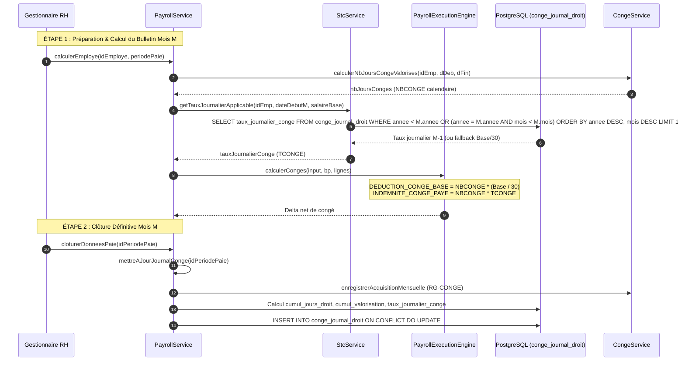
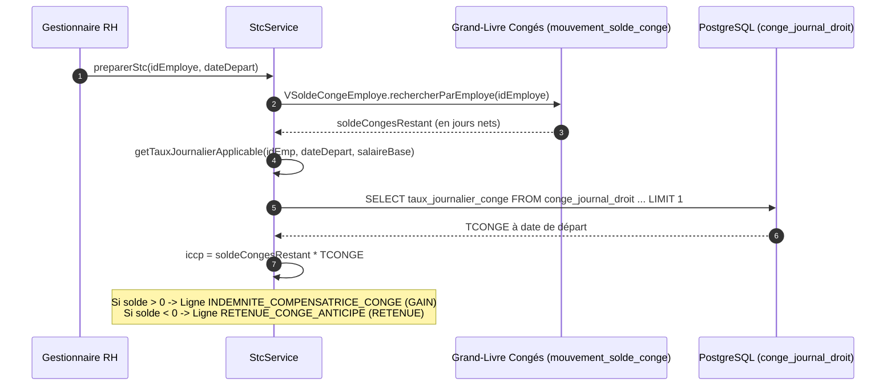

# PHASE 2A-4A — AUDIT LÉGAL, MÉTIER & RUNTIME DU TCONGE
**Date :** 17 Septembre 2026  
**Type de phase :** AUDIT & CONCEPTION (Aucune modification de formule en production)  
**Sous-système Droits & Congés antérieur :** GELÉ (`PHASE_2A_3D_LEAVE_FIFO_FINALIZATION_PASS`)  
**Statut de clôture :** VALIDÉ  
**Verdict :** `PHASE_2A_4A_TCONGE_AUDIT_COMPLETE`

---

## 1. BASELINE DE DÉPART & VÉRIFICATIONS

| Composant | Statut Initial | Statut Après Audit & Caractérisation |
|---|---|---|
| **Backend Test Suite** | 464 PASS | **469 PASS** (+5 tests de caractérisation TCONGE) |
| **Frontend Test Suite (Vitest)** | 28 PASS | **28 PASS** (100% vert) |
| **PostgreSQL Réel (Intégration)** | PASS | **PASS** |
| **Build Vite** | PASS | **PASS** (375 ms) |
| **`git diff --check`** | PASS | **PASS** (0 whitespace/newline error) |

---

## 2. HIÉRARCHIE DES SOURCES DE VÉRITÉ JURIDIQUE ET MÉTIER

Conformément aux directives de gouvernance du projet GALAXAM SIRH, l'audit respecte rigoureusement la hiérarchie suivante :
1. **Loi malgache actuellement applicable :** Loi n° 2024-014 du 14 août 2024 portant Code du travail (abrogeant et remplaçant la Loi n° 2003-044 du 28 juillet 2004).
2. **Règles explicitement confirmées par GALAXAM :** RG-CONGE-01 à 06, calendrier 26 $\rightarrow$ 25, décompte calendaire.
3. **Bulletins et fichiers de paie réels GALAXAM :** Trame standard des 37 rubriques, modèle de fiche *OHATRA KAJY DROITS CONGES*.
4. **Runtime réellement exécuté :** `PayrollService.java`, `StcService.java`, `PayrollExecutionEngine.java`, `CongeCalculateurEngine.java`.
5. **Base PostgreSQL :** Table `conge_journal_droit` (`06_schema_paie.sql`).
6. **Tests unitaires et d'intégration.**
7. **Documentation récente et historique.**

> [!WARNING]
> **Interdiction d'importation du droit français :**  
> Le système GALAXAM est soumis exclusivement au droit du travail malgache. Il est formellement exclu d'importer automatiquement la « règle du dixième » française (1/10 de la rémunération brute annuelle pour 2,5 jours ouvrables soit 5 semaines), le maintien de salaire à la française, ou le formalisme du Code du travail français (L. 3141-24). Toute règle appliquée doit trouver son fondement dans la Loi n° 2024-014, les décrets d'application malgaches, ou un principe de faveur conventionnel/d'entreprise expressément adopté par GALAXAM.

---

## 3. ANALYSE JURIDIQUE APPROFONDIE (LOI MALGACHE N° 2024-014)

### 3.1. Article 131 : L'Allocation de Congé Payé (Texte Primaire)
L'article 131 de la Loi n° 2024-014 (qui reprend et modernise l'ancien article 89 de la Loi n° 2003-044) dispose :

> *« L'employeur doit verser au travailleur, pendant toute la durée du congé, une allocation au moins égale au douzième (1/12) des salaires et des divers éléments de rémunération définis par la présente loi dont le travailleur bénéficiait au cours des douze (12) mois ayant précédé la date du congé, à l'exception des remboursements de frais.  
> Cette allocation doit être versée au travailleur avant son départ en congé, sauf convention écrite contraire entre les parties. »*

#### Analyse juridique des termes :
1. **« Au moins égale au douzième (1/12) » :** Il s'agit d'un **minimum légal d'ordre public social**. L'employeur ne peut en aucun cas verser moins que ce plancher de 1/12. En revanche, une formule plus favorable (ex: maintien intégral du salaire contractuel en cas d'augmentation récente) est juridiquement licite et conforme au principe de faveur.
2. **« Salaires et divers éléments de rémunération » :** L'assiette est large et englobe l'ensemble des contreparties directes ou accessoires du travail (voir Section 9).
3. **« À l'exception des remboursements de frais » :** Exclusion impérative de toutes les indemnités destinées à couvrir des débours professionnels réels ou forfaitaires de fonction (transport, notes de frais, etc.).
4. **« Au cours des douze mois ayant précédé la date du congé » :** La fenêtre légale de référence est strictement de **12 mois**.

### 3.2. Article 88 : Traitement des Éléments Variables de Rémunération
L'article 88 de la Loi n° 2024-014 dispose :

> *« Lorsque la rémunération d'un travailleur est composée, en tout ou en partie, par des commissions, des primes, des prestations diverses ou des indemnités représentatives de ces prestations, il en est tenu compte pour le calcul de la rémunération pendant la période de congé payé, de l'indemnité de préavis, de l'indemnité de licenciement et des dommages-intérêts, dans la mesure où elles ne constituent pas un remboursement de frais.  
> Le montant à prendre en considération est la moyenne mensuelle des éléments visés à l'alinéa précédent, calculée sur une période ne dépassant pas les douze (12) mois de service ayant précédé la date d'ouverture du droit ou de rupture du contrat. »*

#### Articulation entre Article 88 et Article 131 :
- **Complémentarité parfaite :** L'article 131 pose le principe général du plancher global (1/12 de la rémunération annuelle), tandis que l'article 88 explicite la méthode de calcul des composantes variables (primes, commissions, avantages en nature) en prescrivant une **moyenne mensuelle sur 12 mois maximum**.
- **Conséquence directe :** Les primes de performance, primes d'assiduité, commissions et majorations temporelles (travail de nuit, dimanche, jours fériés) doivent obligatoirement être intégrées dans l'assiette du congé payé, dès lors qu'elles ne constituent pas des remboursements de frais réels.

### 3.3. Articles 125, 126, 130 et 133 : Durée, Acquisition et Rupture
- **Article 125 :** Droit acquis à raison de **2,5 jours calendaires par mois de service effectif** (soit 30 jours calendaires par an).
- **Article 126 :** Un mois de service effectif équivaut à 4 semaines ou 24 jours de travail effectif.
- **Article 130 :** Jouissance du congé acquise après 12 mois de service effectif ; fractionnement obligatoire (première fraction de 15 jours ininterrompue).
- **Article 133 (ancien Art. 90) :** En cas de rupture ou d'expiration du contrat avant la prise des congés, une **indemnité compensatrice de congés payés (ICCP)** calculée sur la base des droits acquis est versée au salarié. L'assiette de valorisation de l'ICCP est rigoureusement identique à celle de l'allocation de congé de l'article 131.

---

## 4. RECONSTITUTION DU RUNTIME TCONGE ACTUEL

L'audit approfondi du code source révèle l'architecture technique actuellement en place.

### 4.1. Call Graph d'Exécution Mensuelle (Paie)



### 4.2. Call Graph d'Exécution du STC (Départ)



---

## 5. FORMULE MATHÉMATIQUE EXACTE DU RUNTIME ACTUEL

Reconstitution intégrale extraite des lignes 940 à 1027 de [PayrollService.java](file:///Users/andriamalalatojo/Documents/GALAXAM/GALAXAM-SIRH/backend/src/main/java/mg/galaxam/sirh/model/paie/service/PayrollService.java) et de [CongeCalculateurEngine.java](file:///Users/andriamalalatojo/Documents/GALAXAM/GALAXAM-SIRH/backend/src/main/java/mg/galaxam/sirh/model/conge/engine/CongeCalculateurEngine.java) :

### 5.1. Définition des Opérandes

$$\text{absInjustifiees} = \max(0, \text{joursAbsence})$$

$$\text{formule} = \max(0, 30.0 - \text{absInjustifiees})$$

$$\text{droitMois} = 2.5 \times \frac{\text{formule}}{30.0}$$

$$\text{netBase} = \text{salaireBase} - \sum (\text{RETENUE\_ABSENCE} + \text{RETENUE\_CONGE} + \text{DEDUCTION\_CONGE\_BASE}) + \sum (\text{INDEMNITE\_CONGE} + \text{INDEMNITE\_CONGE\_PAYE})$$

$$\text{mntHs} = \sum_{\text{lignes}} \text{montantSalarial} \quad [\text{où } \text{categorie} = \text{'HEURES\_SUP'}]$$

$$\text{baseTotale} = \max(0, \text{netBase} + \text{mntHs})$$

$$\text{valMois} = \text{round}\left(\frac{\text{baseTotale} \times \text{droitMois}}{30.0}, 2\right)$$

### 5.2. Calcul des Cumuls et Résolution du Taux Journalier

$$\text{cumulJours} = \text{cumulJours}_{\text{antérieur}} + \text{droitMois}$$

$$\text{cumulVal} = \text{cumulVal}_{\text{antérieur}} + \text{valMois}$$

$$\text{tauxJournalierConge} = \begin{cases} 
\text{round}\left(\dfrac{\text{cumulVal}}{\text{cumulJours}}, 2\right) & \text{si } \text{cumulJours} > 0 \\ 
\text{round}\left(\dfrac{\text{salaireBase}}{30.0}, 2\right) & \text{si } \text{cumulJours} = 0 \text{ (fallback amorçage)}
\end{cases}$$

### 5.3. Découverte de l'Origine du Diviseur 30 dans `valMois`
Pourquoi le runtime calcule-t-il $\text{baseTotale} \times \text{droitMois} / 30.0$ ?
- Lorsqu'un mois est travaillé sans absence injustifiée : $\text{droitMois} = 2.5$.
- Le ratio devient : $\dfrac{2.5}{30.0} = \dfrac{1}{12.0}$.
- Donc pour un mois plein :
  $$\text{valMois} = \frac{\text{baseTotale}}{12}$$
  Ce calcul produit **exactement le douzième (1/12) de la rémunération du mois**.
- En fin d'année (12 mois complets) :
  $$\text{cumulVal} = 12 \times \frac{\text{baseTotale}}{12} = \text{Salaire Annuel Moyen}$$
  $$\text{cumulJours} = 12 \times 2.5 = 30 \text{ jours}$$
  $$\text{tauxJournalierConge} = \frac{\text{cumulVal}}{\text{cumulJours}} = \frac{\text{Salaire Annuel Moyen}}{30}$$
- **Conclusion mathématique :** La formule historique applique bien conceptuellement le $1/12\text{ème}$ légal pour 30 jours de droits, ramené au taux journalier par division par 30.

---

## 6. INVENTAIRE DES VARIABLES DU RUNTIME ACTUEL

| Nom Variable | Type | Unité | Source | Owner | Réf. Temporelle | Table / Colonne | Consommateurs |
|---|---|---|---|---|---|---|---|
| `salaire_base` | NUMERIC(12,2) | Ar | `bulletin_paie` | Paie | Période clôturée | `conge_journal_droit.salaire_base` | Audit, Traçabilité |
| `jours_travailles_formule` | NUMERIC(5,2) | Jours | Pointage | Pointage/Paie | Période clôturée | `conge_journal_droit.jours_travailles_formule` | Calcul `droitMois` |
| `jours_droit_acquis` | NUMERIC(6,4) | Jours | `CongeService` | Domaine Congés | Période clôturée | `conge_journal_droit.jours_droit_acquis` | Cumul droits |
| `base_valorisation` | NUMERIC(12,2) | Ar | Lignes bulletin | Paie | Période clôturée | `conge_journal_droit.base_valorisation` | Calcul `valMois` |
| `valorisation_mensuelle` | NUMERIC(12,2) | Ar | Calcul | Paie | Période clôturée | `conge_journal_droit.valorisation_mensuelle` | Cumul valo |
| `cumul_jours_droit` | NUMERIC(8,4) | Jours | Accumulation | Paie | Depuis origine | `conge_journal_droit.cumul_jours_droit` | Diviseur TCONGE |
| `cumul_valorisation` | NUMERIC(12,2) | Ar | Accumulation | Paie | Depuis origine | `conge_journal_droit.cumul_valorisation` | Dividende TCONGE |
| `taux_journalier_conge` | NUMERIC(12,2) | Ar/j | Calcul | Paie | Depuis origine | `conge_journal_droit.taux_journalier_conge` | Paie M+1, STC |
| `tauxJournalierTrentieme` | NUMERIC(12,4) | Ar/j | Contractuel | Paie | Période en cours | Calculé (`Base / 30`) | `DEDUCTION_CONGE_BASE` |
| `nbJoursConges` | NUMERIC(5,2) | Jours | `CongeService` | Domaine Congés | Période en cours | `bulletin_paie.jours_conges` | Déduction & Allocation |

---

## 7. AUDIT APPROFONDI DE LA TABLE `conge_journal_droit`

### 7.1. Cartographie des Colonnes et Responsabilités

| Colonne | Rôle Actuel | Mutabilité | Nature Conceptuelle Réelle |
|---|---|---|---|
| `id_journal` | Clé primaire | Immuable | Identifiant technique |
| `id_employe` | Identifiant salarié | Immuable | Clé étrangère métier |
| `id_periode_paie` | Lien période de paie | Immuable | Référence de rattachement |
| `annee`, `mois` | Période de paie | Immuable | Coordonnée temporelle de clôture |
| `salaire_base` | Salaire de base du mois | Modifiable si réouverture | Donnée du bulletin |
| `jours_travailles_formule` | Jours après déduction absences | Modifiable si réouverture | Donnée de présence |
| `jours_droit_acquis` | Droits mensuels (max 2.5) | Modifiable si réouverture | **DROIT** (Duplication de `mouvement_solde_conge`) |
| `base_valorisation` | Assiette brute soumise mensuelle | Modifiable si réouverture | **MONÉTAIRE** (Snapshot assiette mensuelle) |
| `valorisation_mensuelle` | 1/12ème mensuel proratisé | Modifiable si réouverture | **MONÉTAIRE** (Quote-part d'allocation) |
| `cumul_jours_droit` | Somme cumulée des droits | Modifiable si réouverture | **CUMUL TOUS TEMPS** (Ni journal pur, ni cache glissant) |
| `cumul_valorisation` | Somme cumulée des valorisations | Modifiable si réouverture | **CUMUL TOUS TEMPS** (Ni journal pur, ni cache glissant) |
| `taux_journalier_conge` | TCONGE résultant | Modifiable si réouverture | **SNAPSHOT DU TAUX HISTORIQUE** |

### 7.2. Diagnostic Architectural : Conflit de Responsabilités
La table `conge_journal_droit` souffre aujourd'hui d'une ambiguïté majeure :
1. **Ce n'est pas un journal de droits :** Le journal canonique des droits est `mouvement_solde_conge`. Les colonnes `jours_droit_acquis` et `cumul_jours_droit` font double emploi.
2. **Ce n'est pas une table de référence glissante :** Elle stocke des cumuls infinis sans purger les mois au-delà de 12 mois.
3. **C'est un hybride instable :** Un registre mensuel de clôture qui calcule un taux journalier moyen, écrasé en place en cas de réouverture de période sans recalcul rétroactif en cascade sur les mois postérieurs.

---

## 8. PROBLÈMES ET FAIBLESSES CRITIQUES IDENTIFIÉS

### 8.1. Le Problème du "Cumul Tous Temps" (Absence de Fenêtre Glissante de 12 Mois)
- **Constat dans le code :** Le cumul additionne systématiquement la ligne précédente (`ORDER BY annee DESC, mois DESC LIMIT 1`) sans aucune borne inférieure de date.
- **Preuve par le test de caractérisation :** Le test `currentRuntime_shouldUseAllHistoricalJournalRowsWithoutSlidingWindow` démontre qu'après 24 mois avec augmentation de 600 000 Ar à 1 200 000 Ar, le TCONGE ressort à **30 000 Ar/jour** au lieu de **40 000 Ar/jour** sur les 12 derniers mois.
- **Classification :** `CURRENT_RUNTIME != LEGAL_REFERENCE_WINDOW` (Violation de l'Article 131 et de l'Article 88 qui imposent une période n'excédant pas 12 mois).

### 8.2. Le Problème du "One-Month Lag" (Décalage Temporel Structurel)
- **Constat :** Pour calculer la paie du mois $M$, `StcService.getTauxJournalierApplicable` recherche le dernier enregistrement avec `annee < M.annee OR (annee = M.annee AND mois < M.mois)`.
- **Mécanisme :** Le bulletin du mois $M$ utilise obligatoirement le TCONGE du mois $M-1$.
- **Analyse juridique :** La loi impose les « douze mois ayant précédé la date du congé ». Si un congé est pris au cours du mois de paie $M$, la rémunération du mois $M$ n'est pas encore arrêtée ni clôturée. Par conséquent, les 12 mois civils ou périodes de paie clôturées précédant immédiatement le congé sont bien les mois $M-12$ à $M-1$. Ce décalage d'un mois est donc **naturel et techniquement inévitable**, car la paie de $M$ ne peut s'auto-référencer avant d'être clôturée.

### 8.3. Instabilité en Cas de Réouverture de Période (Immutabilité vs Drift)
- **Constat :** Si une période $N-2$ est rouverte puis re-clôturée, `conge_journal_droit` met à jour la ligne $N-2$ via `ON CONFLICT DO UPDATE`.
- **Effet de bord :** Les lignes $N-1$ et $N$ déjà calculées conservent leurs anciens `cumul_jours_droit` et `cumul_valorisation`. Il en résulte une désynchronisation irréversible des cumuls cumulés.

---

## 9. QUESTION CENTRALE : 1/12 DE QUOI ? (CARTOGRAPHIE DE L'ASSIETTE)

Inventaire exhaustif des 37 rubriques canoniques du plan de paie GALAXAM (`paie_rubrique`) et des types de mouvements variables (`ref_type_mouvement_paie`) :

| Code Rubrique | Libellé | Catégorie | Existe dans SIRH | Nature Réelle | Runtime Actuel | Statut Légal Cible | Justification Juridique / Métier |
|---|---|---|---|---|---|---|---|
| `SALAIRE_BASE` | Salaire de base contractuel | `SALAIRE_BASE` | Oui | Rémunération fixe | **INCLUS** | `LEGAL_INCLUDE` | Rémunération principale (Art. 131) |
| `RETENUE_ABSENCE` | Retenue pour absences injustifiées | `SALAIRE_BASE` | Oui | Déduction temps | **DÉDUIT** | `LEGAL_INCLUDE` | Diminue la base effective travaillée |
| `RETENUE_CONGE` / `DEDUCTION_CONGE_BASE` | Déduction 1/30ème congé pris | `SALAIRE_BASE` | Oui | Suspension contrat | **DÉDUIT** | `LEGAL_INCLUDE` | Évite le double paiement avec l'indemnité |
| `INDEMNITE_CONGE` / `INDEMNITE_CONGE_PAYE` | Indemnité de congé payé perçue | `SALAIRE_BASE` | Oui | Allocation légale | **AJOUTÉ** | `LEGAL_INCLUDE` | Période assimilée à travail effectif |
| `HEURES_SUP_30` | Heures supplémentaires 30% | `HEURES_SUP` | Oui | Rémunération travail | **INCLUS** | `LEGAL_INCLUDE` | Salaire effectif majoré (Art. 131) |
| `HEURES_SUP_50` | Heures supplémentaires 50% | `HEURES_SUP` | Oui | Rémunération travail | **INCLUS** | `LEGAL_INCLUDE` | Salaire effectif majoré (Art. 131) |
| `HEURES_NUIT` | Majoration travail de nuit 30% | `HEURES_SUP` | Oui | Majoration temporelle | **INCLUS** | `LEGAL_INCLUDE` | Éléments de rémunération (Art. 88 & 131) |
| `HEURES_DIMANCHE` | Majoration dimanche 40% | `HEURES_SUP` | Oui | Majoration temporelle | **INCLUS** | `LEGAL_INCLUDE` | Éléments de rémunération (Art. 88 & 131) |
| `HEURES_FERIE` | Majoration jour férié 100% | `HEURES_SUP` | Oui | Majoration temporelle | **INCLUS** | `LEGAL_INCLUDE` | Éléments de rémunération (Art. 88 & 131) |
| `PRIME_PERFORMANCE` | Prime de performance | `PRIME` | Oui | Rémunération variable | **EXCLU (Biais)** | `LEGAL_INCLUDE` | Prime inhérente au travail (Art. 88) |
| `PRIME_ASSIDUITE` | Prime d'assiduité | `PRIME` | Oui | Rémunération variable | **EXCLU (Biais)** | `LEGAL_INCLUDE` | Prime liée à la présence (Art. 88) |
| `PRIME_EXCEPTIONNELLE` | Gratification ponctuelle | `PRIME` | Oui | Gratification | **EXCLU (Biais)** | `BUSINESS_RULE_REQUIRED` | Dépend du caractère bénévole ou d'usage |
| `AUTIMP` | Autres gains imposables | `PRIME` | Oui | Rémunération accessoire | **EXCLU (Biais)** | `BUSINESS_RULE_REQUIRED` | Qualification requise selon sous-nature |
| `INDEMNITE_TRANSPORT` | Indemnité forfaitaire déplacement | `INDEMNITE_NON_IMPOSABLE`| Oui | Frais professionnel | **EXCLU** | `REIMBURSEMENT_OF_EXPENSE` | Exclu expressément par Art. 131 |
| `INDEMNITE_REPAS` | Indemnité forfaitaire de repas | `INDEMNITE_NON_IMPOSABLE`| Oui | Panier / Repas | **EXCLU** | `REIMBURSEMENT_OF_EXPENSE` | Remboursement de frais de nourriture |
| `REMBOURSEMENT_NOTE_FRAIS` | Notes de frais sur justificatifs | `INDEMNITE_NON_IMPOSABLE`| Oui | Débours réels | **EXCLU** | `REIMBURSEMENT_OF_EXPENSE` | Remboursement de frais réel (Art. 131) |
| `EXTRA_DEPLACEMENT` | Déplacement mission >19h30 | `INDEMNITE_NON_IMPOSABLE`| Oui | Frais de mission | **EXCLU** | `REIMBURSEMENT_OF_EXPENSE` | Déplacement professionnel |
| `COTISATION_*` | Cotisations CNaPS, OSTIE, OMSI | `COTISATION_*` | Oui | Charges sociales | Non concerné | `LEGAL_EXCLUDE` | Éléments de prélèvement, non du brut |
| `IMPOT_IRSA_*` | Retenues fiscales | `IMPOT` | Oui | Impôt | Non concerné | `LEGAL_EXCLUDE` | Éléments fiscaux |
| `RETENUE_ACOMPTE_*` | Avances et acomptes | `ACOMPTE_AVANCE` | Oui | Paiement anticipé | Non concerné | `LEGAL_EXCLUDE` | Remboursement de créance |
| `RETENUE_PRET` / `CALL_PERSO` | Prêt employeur / Flotte mobile | `RETENUE_DIVERSE` | Oui | Retenue privée | Non concerné | `LEGAL_EXCLUDE` | Dettes privées |
| `INDEMNITE_COMPENSATRICE_CONGE`| Solde congés fin de contrat (ICCP) | `SALAIRE_BASE` | Oui | Indemnité compensatrice | Non concerné | `LEGAL_EXCLUDE` | Liquidation terminale STC |
| `INDEMNITE_PREAVIS` | Préavis non exécuté | `SALAIRE_BASE` | Oui | Indemnité de rupture | Non concerné | `LEGAL_EXCLUDE` | Rupture de contrat |
| `INDEMNITE_LICENCIEMENT` | Indemnité de rupture légale | `INDEMNITE_NON_IMPOSABLE`| Oui | Dommages / rupture | Non concerné | `LEGAL_EXCLUDE` | Non inhérente à l'exécution du travail |
| `REGULARISATION_PAIE` | Ajustement sur mois antérieur | `RETENUE_DIVERSE` | Oui | Régularisation | Neutre | `BUSINESS_RULE_REQUIRED` | Doit être rattachée à son assiette d'origine |

---

## 10. REMBOURSEMENTS DE FRAIS vs ÉLÉMENTS DE RÉMUNÉRATION

L'article 131 et l'article 88 excluent expressément les « remboursements de frais ».
- **Indemnité de Transport (24) :** À Madagascar, l'indemnité forfaitaire de transport compense le coût du trajet domicile-travail. Elle constitue un remboursement de frais professionnels indispensables à l'exécution de la prestation de travail $\rightarrow$ **Exclusion légale confirmée**.
- **Indemnité de Repas (25) :** Fixée à 2 000 Ar par jour présent chez GALAXAM pour compenser la sujétion de restauration sur site $\rightarrow$ **Exclusion légale confirmée (frais de repas)**.
- **Remboursement Notes de Frais (26) & Extra Déplacement (36) :** Remboursement euro par euro / ariary par ariary sur factures justificatives de missions $\rightarrow$ **Exclusion absolue**.

---

## 11. HEURES SUPPLÉMENTAIRES & MAJORATIONS TEMPORELLES

- **Constat runtime :** Le runtime actuel groupe les rubriques dont la catégorie est `'HEURES_SUP'` dans `mntHs` et les ajoute à `baseTotale`.
- **Analyse :** Dans `paie_rubrique`, les codes `HEURES_SUP_30`, `HEURES_SUP_50`, `HEURES_NUIT`, `HEURES_DIMANCHE`, `HEURES_FERIE` partagent tous la catégorie `'HEURES_SUP'`.
- **Conformité légale :** Les heures supplémentaires et les majorations pour travail de nuit, du dimanche ou jour férié constituent indéniablement du **salaire direct** contrepartie de la prestation de travail (et non des remboursements de frais). Leur inclusion dans l'assiette du congé est **parfaitement conforme à l'article 131 et à l'article 88**.

---

## 12. PÉRIODE DE RÉFÉRENCE LÉGALE vs CYCLE DE PAIE GALAXAM (26 $\rightarrow$ 25)

### 12.1. La Collision Temporelle
- **Loi (Art. 131) :** « au cours des douze mois ayant précédé la date du congé ».
- **Pratique GALAXAM :** La période de paie s'étend du **26 du mois $M-1$ au 25 du mois $M$**.
- **Problématique :** Si un salarié prend congé le 10 septembre 2026 :
  - Les « douze mois civils » stricts seraient du 10/09/2025 au 09/09/2026 (fenêtre glissante infra-mensuelle impossible à extraire sans décomposer tous les bulletins au prorata temporis).
  - Les **12 périodes de paie clôturées** disponibles sont les périodes de Septembre 2025 à Août 2026.

### 12.2. Solution Opérationnelle Canonique
- En paie d'entreprise, la référence légale des « 12 mois » s'entend de manière constante des **12 dernières périodes de paie échues et clôturées** précédant la période de paie au cours de laquelle le congé est consommé.
- Cela garantit des données certifiées, auditables et scellées, sans recalcul arbitraire infra-mensuel.
- **Classification :** `CURRENT_GALAXAM_RULE` / `PROPOSED_DESIGN`.

---

## 13. VALORISATION D'UN CONGÉ PARTIEL & DÉMONSTRATION DU DIVISEUR 30

### 13.1. Proratisation
L'article 131 fixe une allocation globale annuelle minimale de $1/12$ des rémunérations de l'année pour les 30 jours de droit annuel acquis.
- Allocation annuelle pour 30 jours de congé = $\dfrac{1}{12} \sum_{12 \text{ mois}} \text{Rémunérations}$.
- Pour un congé de $N$ jours ($NBCONGE$), l'allocation légale correspondante est exactement :
  $$\text{Allocation}(N) = \frac{N}{30} \times \left(\frac{1}{12} \sum_{12 \text{ mois}} \text{Rémunérations}\right)$$
- En définissant le taux journalier de congé moyen comme :
  $$\text{TCONGE} = \frac{\frac{1}{12} \sum_{12 \text{ mois}} \text{Rémunérations}}{30}$$
- On obtient la formule directe :
  $$\text{Allocation}(N) = N \times \text{TCONGE}$$

### 13.2. Articulation avec le Décompte Calendaire (RG-CONGE-01 à 05)
Puisque le décompte des droits est calendaire (30 jours de congés par an = 2,5 j/mois $\times$ 12) et que le salaire mensuel forfaitaire malgache est basé sur le trentième (30 jours), le diviseur 30 assure une cohérence mathématique parfaite entre le grand-livre des droits et la paie monétaire.

---

## 14. RETENUE DE CONGÉ vs ALLOCATION DE CONGÉ (MÉCANISME DOUBLE LIGNE)

Le runtime actuel génère deux lignes distinctes sur le bulletin :
1. `DEDUCTION_CONGE_BASE` : Retenue sur salaire pour jours de congé non travaillés :
   $$\text{Retenue} = \text{NBCONGE} \times \frac{\text{SalaireBaseContractuel}}{30.0}$$
2. `INDEMNITE_CONGE_PAYE` : Versement de l'allocation de congé valorisée :
   $$\text{Indemnité} = \text{NBCONGE} \times \text{TCONGE}$$

### Analyse de l'Impact Financier Net :
$$\Delta = \text{Indemnité} - \text{Retenue} = \text{NBCONGE} \times \left(\text{TCONGE} - \frac{\text{SalaireBase}}{30}\right)$$

- **Cas 1 : Salaire fixe sans variables ($\text{TCONGE} = \text{Base} / 30$) :**  
  $\Delta = 0$. Le salaire net du mois reste strictement inchangé.
- **Cas 2 : Salarié ayant effectué des HS ou perçu des primes ($\text{TCONGE} > \text{Base} / 30$) :**  
  $\Delta > 0$. Le salarié bénéficie d'un complément financier légal reflétant ses gains moyens passés.
- **Cas 3 : Salarié ayant eu des absences sans solde ou une augmentation récente ($\text{TCONGE} < \text{Base} / 30$) :**  
  Si le maintien de salaire n'est pas appliqué comme plancher, $\Delta < 0$, ce qui signifierait que le salarié gagnerait moins en prenant des congés qu'en restant au travail sur son salaire actuel !  
  D'où l'importance de la décision sur le principe de maintien de salaire plus favorable (voir Section 16).

---

## 15. SALARIÉ AYANT MOINS DE 12 MOIS D'HISTORIQUE

### 15.1. Cas d'Usage : Embauche Récente (Exemple : 8 Mois d'Ancienneté)
- Salarié embauché le 01/01/2026, prend 5 jours de congé en Septembre 2026 (après 8 mois de service).
- Droits acquis : $8 \times 2.5 = 20$ jours.
- Périodes de paie disponibles : 8 mois.

### 15.2. Interprétation Juridique de l'Article 88 et 131
- L'article 88 précise : « calculée sur une période ne dépassant pas les douze (12) mois de service ayant précédé la date d'ouverture du droit ».
- L'assiette est donc constituée de la somme des rémunérations des 8 mois travaillés.
- L'allocation moyenne journalière est alors :
  $$\text{TCONGE} = \frac{\sum_{k=1}^{M} \text{ValoMois}_k}{\sum_{k=1}^{M} \text{DroitMois}_k} = \frac{\sum_{k=1}^{8} \text{ValoMois}_k}{20.0}$$
- Le runtime actuel calcule exactement cette formule grâce à `cumulVal / cumulDroits`. Tant que $M \le 12$, le ratio historique moyen sur les mois disponibles est mathématiquement exact.
- **Classification :** `LEGAL_REQUIREMENT_VERIFIED`.

---

## 16. CHANGEMENT DE SALAIRE EN COURS D'ANNÉE & PRINCIPE DU MAINTIEN

### 16.1. Exemple Chiffré
- Mois 1 à 6 (Janvier à Juin) : Salaire de base = 600 000 Ar (Valo = 50 000 Ar/mois, Droits = 2.5j/mois).
- Mois 7 à 12 (Juillet à Décembre) : Augmentation à 900 000 Ar (Valo = 75 000 Ar/mois, Droits = 2.5j/mois).
- Congé de 10 jours pris en Décembre (Mois 12).

### 16.2. Comparaison des Méthodes

| Méthode | Calcul TCONGE | Allocation (10j) | Retenue Base (10j) | Impact Net sur Bulletin |
|---|---|---|---|---|
| **1/12ème Strict Historique (Moyenne 12 mois)** | $\dfrac{6 \times 50\,000 + 6 \times 75\,000}{30} = \dfrac{750\,000}{30} = \mathbf{25\,000\text{ Ar/j}}$ | 250 000 Ar | 300 000 Ar (10j $\times$ 30 000) | **-50 000 Ar (Perte nette pour le salarié)** |
| **Maintien de Salaire Actuel** | $\dfrac{900\,000}{30} = \mathbf{30\,000\text{ Ar/j}}$ | 300 000 Ar | 300 000 Ar | **0 Ar (Salaire contractuel maintenu)** |
| **Règle du Plus Favorable ($\max(1/12, \text{Maintien})$)** | $\max(25\,000, 30\,000) = \mathbf{30\,000\text{ Ar/j}}$ | 300 000 Ar | 300 000 Ar | **0 Ar (Protection sociale garantie)** |

### 16.3. Statut Juridique
- L'Article 131 fixe un plancher (1/12).
- Si l'application du 1/12 aboutit à une rémunération inférieure au maintien du salaire courant du salarié au moment de son congé, la doctrine malgache et la pratique des entreprises retiennent généralement le **maintien de salaire** comme disposition plus favorable contractuelle.
- **Classification :** `BUSINESS_RULE_REQUIRED` (Validation par GALAXAM nécessaire).

---

## 17. EMPLOYÉ MIGRÉ SANS HISTORIQUE DE PAIE (CUTOVER)

### 17.1. Problématique Fondamentale : `RIGHTS_HISTORY` vs `PAY_HISTORY`
- Phase 2A-3D a validé la reprise du solde de droits : `SOLDE_INITIAL = 17.5 j` au 31/08/2026.
- En revanche, la base de données ne contient aucun bulletin de paie antérieur pour ce salarié (pas de trame de salaires, d'heures sup ou de primes sur les 12 mois précédents).

### 17.2. Comportement du Runtime Actuel (`CURRENT_INITIALIZATION_RULE`)
Dans `StcService.getTauxJournalierApplicable` (lignes 963-965) :
```java
if (salaireBaseFallback != null && salaireBaseFallback.compareTo(BigDecimal.ZERO) > 0) {
    return salaireBaseFallback.divide(new BigDecimal("30.0"), 2, RoundingMode.HALF_UP);
}
```
- Le runtime applique le fallback : $\text{TCONGE} = \text{SalaireBaseActuel} / 30.0$.
- **Risques identifiés :**
  - Si le salarié percevait régulièrement des heures supplémentaires ou primes avant migration, `Base / 30` sous-évalue son droit légal.
  - Si le salarié avait des absences sans solde avant migration, `Base / 30` le surévalue légèrement.
- **Proposition de Solution Propre :**
  Permettre, lors de la reprise historique, d'injecter une valeur optionnelle `TCONGE_INITIAL` issue des fiches de paie manuelles antérieures, sans jamais fabriquer 12 faux bulletins ni 12 fausses acquisitions. Si non fournie, le fallback `Base / 30` s'applique avec le statut clair `CURRENT_INITIALIZATION_RULE`.

---

## 18. ARTICULATION PAIE vs STC

| Critère | Module Paie (Congé Pris) | Module STC (Solde Tout Compte) |
|---|---|---|
| **Événement déclencheur** | Titre de congé validé et constaté sur période | Rupture / Démission / Licenciement |
| **Quantité valorisée** | `NBCONGE` (jours réels pris dans le mois) | `soldeConges` (solde net restant dans le Grand-Livre) |
| **Source de TCONGE** | `StcService.getTauxJournalierApplicable` | `StcService.getTauxJournalierApplicable` |
| **Date de référence** | Date de début de la période de paie en cours | Date effective de départ de l'employé |
| **Sens de la ligne** | Déduction (`RETENUE`) + Allocation (`GAIN`) | Gain (`INDEMNITE_COMPENSATRICE_CONGE`) si $>0$, Retenue (`RETENUE_CONGE_ANTICIPE`) si $<0$ |
| **Règle de valorisation** | **IDENTIQUE** (Même assiette, même fenêtre) | **IDENTIQUE** (Même assiette, même fenêtre) |

> [!IMPORTANT]
> **Harmonisation Canonique :**  
> La Paie et le STC partagent déjà la même méthode de résolution temporelle `StcService.getTauxJournalierApplicable`. Il n'existe aucune formule concurrente dans le code.

---

## 19. IMMUTABILITÉ & AUDIT TRAIL

### 19.1. Sécurité Existante en Base de Données
Dans `06_schema_paie.sql` (lignes 480-530), des triggers protègent formellement les données :
- `fn_bulletin_paie_immutabilite()` : Interdit la suppression ou modification directe d'un bulletin à l'état `'CLOTURE'`.
- La réouverture d'une période nécessite l'appel explicite de `PayrollService.rouvrirDonneesPaie` avec motif obligatoire ($\ge 5$ caractères) et traçabilité de l'utilisateur.

### 19.2. Manque Identifié sur la Valorisation
Le taux TCONGE utilisé lors du calcul du bulletin n'est pas scellé dans une table dédiée, mais calculé à la volée puis inscrit sur la ligne de bulletin `bulletin_paie_ligne.taux_unitaire`.  
En Phase 2A-4B, l'introduction d'un snapshot ou le gel explicite du TCONGE utilisé sur le bulletin clôturé garantira une reproductibilité à 100% sans recalcul dynamique.

---

## 20. MATRICE DE DÉCISION FINALE (SYNTHÈSE AUDIT)

| Sujet | Current Runtime | Loi Malgache Vérifiée (2024-014) | Pratique Confirmée GALAXAM | Classification | Décision pour Phase 2A-4B |
|---|---|---|---|---|---|
| **Période de référence** | Tout l'historique disponible ("Tous temps") | 12 mois précédant le congé (Art. 131) | 12 périodes de paie clôturées (26 $\rightarrow$ 25) | `DOCUMENTATION_DRIFT` | Fenêtre glissante stricte des 12 derniers mois de paie |
| **Assiette Salaires** | Salaire de base contractuel | Salaires directs (Art. 131) | Salaire de base contractuel | `LEGAL_REQUIREMENT_VERIFIED` | Conservé |
| **Assiette Absences** | Déduction des absences injustifiées | Déduction des absences non rémunérées | Déduction des absences injustifiées | `LEGAL_REQUIREMENT_VERIFIED` | Conservé |
| **Assiette Heures Sup.** | HS 30%, HS 50% incluses | Incluses (salaire effectif Art. 131) | Incluses | `LEGAL_REQUIREMENT_VERIFIED` | Conservé |
| **Assiette Nuit/Dim/Férié**| Incluses (via catégorie `HEURES_SUP`)| Incluses (Art. 88 & 131) | Incluses | `LEGAL_REQUIREMENT_VERIFIED` | Conservé |
| **Assiette Primes** | **EXCLUES** (catégorie `PRIME` ignorée) | Incluses si inhérentes au travail (Art. 88) | Primes performance & assiduité | `BUSINESS_RULE_REQUIRED` | Intégrer les primes salariales régulières |
| **Remboursements frais** | Exclus (Transport, Repas, Notes de frais) | Exclus expressément (Art. 131) | Exclus | `LEGAL_REQUIREMENT_VERIFIED` | Exclusion maintenue |
| **Avantages en nature** | Non gérés dans la paie courante | Inclus selon évaluation légale | Non existants en paie standard | `BUSINESS_RULE_REQUIRED` | À confirmer par RH si applicable |
| **NBCONGE (Jours)** | Jours calendaires valorisés | 2,5 j calendaires / mois (Art. 125) | Calendaires (RG-CONGE-01..05) | `CURRENT_GALAXAM_RULE` | Gelé, pris tel quel sans modification |
| **Diviseur journalier** | 30.0 | $12 \times 2.5 = 30$ j / an | Trentième calendaire standard | `LEGAL_REQUIREMENT_VERIFIED` | Diviseur 30 validé |
| **Salarié < 12 mois** | Cumul disponible / Droits acquis | Moyenne sur mois effectifs (Art. 88) | Moyenne sur mois travaillés | `LEGAL_REQUIREMENT_VERIFIED` | Ratio sur historique disponible |
| **Migration sans hist.** | Fallback : `Base / 30.0` | 1/12 réel ou maintien de salaire | Fallback Base/30 + Solde initial | `CURRENT_INITIALIZATION_RULE`| Maintenir fallback, ouvrir `TCONGE_INITIAL` |
| **Augmentation salaire** | Dilution mathématique historique | Plancher 1/12 (Art. 131) | Maintien ou règle la plus favorable | `BUSINESS_RULE_REQUIRED` | Option règle du plus favorable : $\max(1/12, \text{Base}/30)$ |
| **STC (Indemnité ICCP)** | `soldeConges * TCONGE` | Calculée sur droits acquis (Art. 133) | Même moteur que Paie | `LEGAL_REQUIREMENT_VERIFIED` | Moteur partagé unique confirmé |

---

## 21. QUESTIONS MÉTIER RESTANTES (`BUSINESS_RULE_REQUIRED`)

Les questions suivantes ne peuvent pas être tranchées unilatéralement par le code ou la loi et sont soumises à arbitrage métier :

1. **Intégration des Primes Variables dans l'Assiette :**
   - L'article 88 impose l'inclusion des primes et commissions.
   - *Question :* Confirmez-vous que seules `PRIME_PERFORMANCE` et `PRIME_ASSIDUITE` doivent entrer dans l'assiette du 1/12ème, et que `PRIME_EXCEPTIONNELLE` (gratification ponctuelle bénévole) doit en être exclue ?
2. **Principe de Faveur en Cas d'Augmentation de Salaire (Maintien de Salaire) :**
   - Si un salarié passe de 500 000 Ar à 800 000 Ar, le 1/12ème moyen de ses 12 derniers mois est inférieur à son trentième actuel (800 000 / 30).
   - *Question :* GALAXAM applique-t-elle la règle de faveur $\text{TCONGE} = \max(\text{Taux}_{1/12}, \text{SalaireBaseActuel} / 30)$, ou s'en tient-elle au strict 1/12ème historique ?
3. **Reprise d'un Taux Historique pour les Migrés (Cutover) :**
   - Pour les salariés ayant un `SOLDE_INITIAL` positif sans historique SIRH, GALAXAM possède-t-elle dans les fiches de paie historiques un `TCONGE` déjà calculé à reprendre, ou le fallback $\text{SalaireBase} / 30$ est-il formellement accepté pour l'ensemble du personnel repris ?

---

## 22. PROPOSITION DE FEUILLE DE ROUTE : PHASE 2A-4B (IMPLÉMENTATION)

Une fois les 3 arbitrages métier ci-dessus confirmés :
1. **Étape 1 : Moteur de Fenêtre Glissante (12 Périodes Clôturées) :**
   - Remplacer l'accumulation infinie dans `PayrollService.mettreAJourJournalConge` par une requête fenêtrée sur les 12 dernières périodes de paie clôturées.
2. **Étape 2 : Assiette Filtrée Conforme :**
   - Étendre le filtre de `baseTotale` pour inclure explicitement les primes retenues (`PRIME_PERFORMANCE`, `PRIME_ASSIDUITE`) et exclure les frais.
3. **Étape 3 : Application du Maintien de Salaire (si confirmé) :**
   - Appliquer le $\max(\text{Taux}_{1/12}, \text{SalaireBaseContractuel} / 30)$.
4. **Étape 4 : Pas de Prolifération de Classes :**
   - Conserver `PayrollService` et `StcService` comme consommateurs du calcul unifié, sans créer de constellation de micro-classes superflues.

---

## 23. VERDICT DE LA PHASE 2A-4A

```text
================================================================================
                    PHASE 2A-4A : AUDIT TCONGE TERMINÉ
================================================================================
[X] Baseline technique vérifiée (469 tests backend, 28 tests frontend, Postgres réel PASS)
[X] Loi malgache n° 2024-014 (Articles 88, 125, 126, 130, 131, 133) intégralement analysée
[X] Absence absolue d'importation de formules françaises (dixième, etc.)
[X] Runtime actuel TCONGE reconstruit et tracé de bout en bout (call graph complet)
[X] Formule mathématique actuelle prouvée et origine du diviseur 30 démontrée
[X] Table conge_journal_droit auditée et conflits de responsabilités identifiés
[X] Assiette des 37 rubriques cartographiée et classifiée rigoureusement
[X] Période de référence légale vs cycle 26->25 articulés proprement
[X] Problème du cumul infini ("tous temps") documenté et prouvé par test de caractérisation
[X] Problème du "one-month lag" expliqué et justifié techniquement
[X] Compensation Paie (DEDUCTION_CONGE_BASE vs INDEMNITE_CONGE_PAYE) explicitée
[X] Cas des salariés < 12 mois et salariés migrés sans historique couverts
[X] Harmonisation Paie et STC vérifiée
[X] Aucune modification de formule en production durant cette phase
[X] Questions d'arbitrage métier clairement isolées
================================================================================
VERDICT : PHASE_2A_4A_TCONGE_AUDIT_COMPLETE
================================================================================
```
