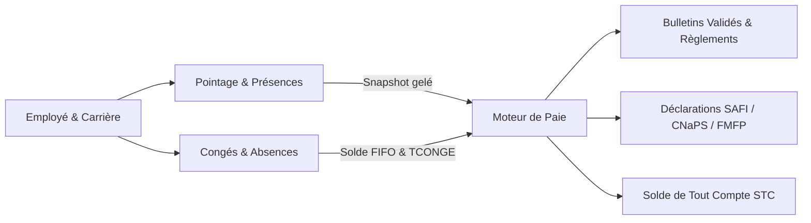

# GALAXAM-SIRH

<p align="center">
  
</p>

<h3 align="center">Système Intégré de Gestion des Ressources Humaines, du Pointage et de la Paie</h3>

<p align="center">
  Plateforme d'entreprise unifiée, déterministe et auditable conçue pour le groupe <strong>GALAXAM LOGISTICS</strong> (Madagascar).
</p>

<p align="center">
  
  
  
  
  
  
  
  
</p>

---

## Sommaire

1. [Présentation & Contexte](#1-présentation--contexte)
2. [Conformité Légale & Réglementaire (Madagascar)](#2-conformité-légale--réglementaire-madagascar)
3. [Périmètre Fonctionnel](#3-périmètre-fonctionnel)
4. [Architecture Technique](#4-architecture-technique)
5. [Arborescence du Monorepo](#5-arborescence-du-monorepo)
6. [Documentation & Références Maîtresses](#6-documentation--références-maîtresses)
7. [Démarrage Rapide avec Docker](#7-démarrage-rapide-avec-docker)
8. [Développement & Déploiement](#8-développement--déploiement)
9. [Tests & Assurance Qualité](#9-tests--assurance-qualité)
10. [Règles d'Immutabilité & Exploitation](#10-règles-dimmutabilité--exploitation)

---

## 1. Présentation & Contexte

**GALAXAM-SIRH** remplace l'ancienne gestion dispersée sur tableurs par un système d'information RH d'entreprise centralisé, déterministe et hautement auditable.

Développée pour couvrir les opérations multi-filiales du groupe **GALAXAM LOGISTICS** (gouvernance multi-sociétés et multi-sites : filiale socle *GALAXAM LOGISTICS*, extensible dynamiquement via l'administration pour les entités du groupe telles que *Vina sy Asa* ou *LMD*), la solution orchestre de bout en bout :
- La gestion administrative du personnel, des contrats et des carrières ;
- Le pointage opérationnel sur cycle décalé (26 au 25) avec plancher d'arrivée par site et ventilation des heures majorées ;
- La gestion des congés et absences via un grand-livre comptable immuable à décompte **FIFO** ;
- Un moteur de paie malgache à calcul déterministe en 6 paliers avec gestion des acomptes, scellement des bulletins et règlements multi-modes traçables ;
- Le Solde de Tout Compte (**STC**) avec journal des règlements échelonnés et décompte scellé ;
- L'édition automatisée des déclaratifs légaux, sociaux et fiscaux (**IRSA / SAFI / e-Hetra**, **CNaPS**, **FMFP**, organismes sanitaires **AMIT / OSTIE / FUNHECE**) et des ordres de virement bancaire interbancaires.

> [!NOTE]
> Le système est conçu pour une **durabilité pluriannuelle autonome** (exercices 2025, 2026, 2027 et suivants) sans modification de code applicatif ni duplication manuelle de constantes lors des changements d'année fiscale.

---

## 2. Références légales et paramètres métier (Madagascar)

Le logiciel implémente des règles métier paramétrées à partir des références ci-dessous. Cette documentation décrit l’intention et les paramètres présents dans le dépôt ; elle ne certifie ni la conformité juridique des calculs ni l’acceptation des déclarations par les organismes concernés. Les paramètres, leurs dates d’effet, les résultats et les formats d’export doivent être validés par les responsables RH/DAF et, lorsque nécessaire, par un conseil compétent et les portails destinataires avant un usage officiel.

| Domaine | Référence Légale / Réglementaire | Application dans GALAXAM-SIRH |
|---|---|---|
| **Code du Travail** | [Loi n° 2024-014 du 14 août 2024](https://cnlegis.gov.mg/uploads/L2024-014-VF.pdf) & Loi n° 2003-044 | Statuts contractuels, transitions de carrière, préavis, certificats de travail (Art. 50). |
| **Temps de Travail & HS** | Loi n° 2024-014 (Art. 109 & 110) & Décret n° 72-226 | Durée légale de 40h/semaine (173,33 h/mois). Majoration des heures supplémentaires (+30% pour les 8 premières heures au-delà de 40h, +50% au-delà de 48h). Qualification orthogonale des heures de nuit (22h–05h), dimanches et jours fériés. |
| **Plancher d'arrivée** | Règlement Intérieur & Art. 11/108 (Loi 2024-014) | Écrêtage matinal $\max(H_{\text{badge}}, H_{\text{plancher}})$ opposable selon le plancher d'accès homologué par site. |
| **Congés Payés** | Loi n° 2024-014 (Art. 125-135) & Décret n° 64-161 | Acquisition légale de **2,5 jours calendaires** par mois effectif. Tranche minimale de fractionnement de 15 jours consécutifs (Art. 130). |
| **Prescription des Congés** | Loi n° 2024-014 (Art. 129) | Purge triennale (36 mois) soumise à un **workflow d'examen humain DAF strict** (aucun cron destructeur automatique). |
| **Pool Familial & Paternité** | Loi n° 2024-014 (Art. 133 & 134) | Pool annuel de 10 jours ouvrables pour événements familiaux (Art. 133) et droit distinct de 3 jours pour congé de paternité (Art. 134). |
| **Valorisation des Congés** | Modèle canonique `OHATRA KAJY DROITS CONGES` | Calcul unitaire du taux journalier `TCONGE` et imputation chronologique FIFO par lot d'acquisition. |
| **Cotisations Sociales** | Décrets CNaPS, FMFP (Loi n° 2017-025), Santé (OSTIE, AMIT, FUNHECE) | CNaPS plafonné à 8× SME (1% salarié / 13% employeur), FMFP 1% employeur, Organisme de santé (1% salarié / 5% à 6% employeur selon site). |
| **Fiscalité sur Salaires** | Code Général des Impôts (CGI) | Barème progressif IRSA par tranches avec minimum de perception légal et déduction pour charges de famille (règle des 21 ans). |
| **Solde de Tout Compte** | Code du Travail malgache (Art. 50-51) | Délai légal de dénonciation et de forclusion de **deux (02) mois** (spécificité malgache, non 6 mois comme en droit français). |

---

## 3. Périmètre Fonctionnel



### Structure, Organisation & Multi-Filiales
- **Multi-sociétés :** Modélisation et gouvernance multi-sociétés (filiale socle GALAXAM LOGISTICS et entités secondaires administrables).
- **Référentiel unifié :** 30 déclarations de tables référentielles (`ref_*`) dans les six schémas canoniques, dont 15 dans le schéma Organisation 02, et 37 paramètres globaux versionnés à date d'effet sans rétroactivité. Ce décompte décrit les DDL canoniques, pas l'état d'une base déjà initialisée.
- **Sites & Établissements :** Paramétrage granulaire par site (plancher d'accès, organisme sanitaire affilié, calendrier des jours fériés).

### Dossier Collaborateur, Contrats & Carrières
- **Dossier individuel 360° :** État civil, CIN, coordonnées bancaires (RIB/IBAN), conjoints et personnes à charge éligibles fiscalement.
- **Matricule séquentiel garanti :** Génération concurrente sécurisée sans trou de séquence.
- **Cycle de vie contractuel :** CDI, CDD, consultants salariés, gestion des renouvellements et alertes proactives de fin de période d'essai (J-30, J-15, J-7, J).
- **Génération documentaire :** Édition automatique des contrats d'embauche personnalisés et attestations de travail (DOCX/PDF) avec signature horodatée du signataire habilité.

### Pointage & Gestion des Temps (GTA)
- **Cycle décalé d'entreprise :** Prise en compte de la période de pointage décalée du 26 du mois $M-1$ au 25 du mois $M$.
- **Moteur de qualification orthogonale :** Détection des retards, pauses, absences injustifiées, heures majorées (HS 30%, HS 50%), heures de nuit (22h–05h), dimanches et jours fériés chômés/payés.
- **Sanctuarisation mensuelle :** Création d'un snapshot de pointage figé (`GELE` puis `CONSOMME`), ventilé par tranches auditables servant de base inviolable au calcul de la paie.

### Congés & Absences (Grand-Livre FIFO)
- **Principe comptable :** Traçabilité intégrale via `mouvement_solde_conge` (`ACQUISITION`, `PRISE`, `BONIFICATION`, `ANNULATION`, `REGULARISATION`).
- **Valorisation FIFO :** Décompte chronologique des droits par lot d'acquisition garantissant la conformité de l'indemnité compensatrice.
- **Absence de solde négatif :** Contrôle strict bloquant toute validation de congé excédant les droits acquis.
- **Supervision DAF :** Tableaux de bord de suivi sur 12 mois et module d'examen de la prescription triennale.

### Moteur de Paie, STC & Règlements
- **Moteur déterministe en 6 paliers :** Salaire de base proratisé au trentième ou horaire, heures majorées (+30%, +50%, nuit, dimanche, férié), primes imposables/non-imposables, cotisations sociales (CNaPS, FMFP, Santé), assiette IRSA et net à payer.
- **Typologie unifiée des bulletins :** Catégorisation stricte via `type_bulletin` (`MENSUEL`, `STC`, `COMPLEMENTAIRE`, `RAPPEL`, `GRATIFICATION`) avec numérotation normalisée (`BP-AAAA-MM-...` ou `STC-AAAA-...`) et scellement immuable de l'identité employeur (`bulletin_paie_employeur_snapshot`).
- **Variables de paie & Acomptes :** Gestion centralisée dans `paie_avance_acompte` des acomptes sur salaire, avances exceptionnelles, primes/variables DAF (gains ou retenues avec quantité/taux) et régularisations de congés payés.
- **Immutabilité absolue :** Tout bulletin au statut `VALIDE` ou `CLOTURE` est sanctuarisé contre tout recalcul automatisé silencieux.
- **Règlement des bulletins :** Registre dédié (`paie_bulletin_reglement`) supportant les modes Virement, Chèque, Espèces et Mobile Money, avec téléversement obligatoire de justificatif (PDF ou image, 5 Mo max).
- **Solde de Tout Compte (STC) :** Dossier de sortie (`paie_dossier_sortie` avec statuts `EN_PREPARATION`, `PRET_A_VALIDER`, `VALIDE`, `REGLE`, `CLOTURE`), décompte scellé, valorisation de l'indemnité compensatrice de congés en FIFO (`TCONGE`) et journal des règlements échelonnés (`paie_stc_reglement`).
- **Prestataires indépendants :** Module B2B autonome hors paie (`prestataire_independant`, `prestataire_contrat`, `prestataire_facture`), avec retenue ISI générale désactivée en 2026.

### Déclarations Officielles & Fichiers Bancaires
- **Fiscalité :** Préparation d'un export mensuel destiné à SAFI / e-Hetra (DGI) ; format et acceptation à valider auprès de la DAF et du portail destinataire.
- **Charges sociales :** Déclaration Nominative Trimestrielle des Salaires (DNTS CNaPS) et récapitulatif FMFP.
- **Santé :** États nominatifs périodiques selon l'organisme sanitaire de chaque site.
- **Virements groupés :** Génération des ordres de virement bancaire interbancaires avec traçabilité des lots (`PREPARE`, `TRANSMIS`).

---

## 4. Architecture Technique

```
┌────────────────────────────────────────────────────────────────────────────────────────┐
│                                     GALAXAM SIRH                                       │
├────────────────────────────────────────────────────────────────────────────────────────┤
│                                                                                        │
│   CLIENTS                                                                              │
│   ├── Application Web   : React 19 / Vite / Tailwind CSS / Lucide Icons                │
│   └── Application Desk  : Tauri 2 (Rust) / Bundle macOS ARM64                          │
│                                                                                        │
│   API BACKEND (Spring Boot 4.1.0 / Java 17)                                            │
│   ├── Architecture modulaire par domaine métier (DDD)                                 │
│   ├── Accès aux données direct via JDBC natif (HikariCP) — Zéro ORM lourd              │
│   ├── Verrous pessimistes (SELECT ... FOR UPDATE) sur soldes et périodes               │
│   ├── Sécurité : JWT HS512, Refresh Tokens HttpOnly, Session Inactivity Timeout (900s) │
│   └── Schedulers nocturnes coordonnés par bail distribué (SchedulerExecutionRegistry) │
│                                                                                        │
│   BASE DE DONNÉES (PostgreSQL 15)                                                      │
│   ├── 01_schema_core_securite.sql       → RBAC, sessions, audit trail JSONB            │
│   ├── 02_schema_referentiels_rh.sql     → 15 tables ref_*, parametre_global            │
│   ├── 03_schema_employes_contrats.sql   → Collaborateurs, contrats, carrières          │
│   ├── 04_schema_conges.sql              → Grand-livre FIFO, demandes, périodes         │
│   ├── 05_schema_pointage.sql            → Périodes, transitions, pointage, snapshots   │
│   └── 06_schema_paie.sql                → Bulletins, variables, STC, règlements        │
│                                                                                        │
└────────────────────────────────────────────────────────────────────────────────────────┘
```

### Choix d'Architecture Notables

1. **JDBC Direct plutôt qu'un ORM (Hibernate/JPA) :**
   Les accès JDBC rendent les requêtes SQL explicites et permettent de maîtriser leur formulation, y compris les verrous transactionnels (`FOR UPDATE`). Ce choix ne garantit pas à lui seul l'absence de motifs N+1 ni un niveau de performance : ceux-ci dépendent des requêtes et doivent être évalués par inspection et mesures.
2. **Backend-Driven UI :**
   L'interface frontend ne porte aucun barème fiscal ni formule de calcul légale. Les montants simulés, plafonds et droits autorisés sont systématiquement résolus par l'API Spring Boot.
3. **Schedulers Nocturnes Coordonnés :**
   Les tâches d'arrière-plan utilisent un registre en base (`SchedulerExecutionRegistry`) avec un bail initial de 30 minutes, renouvelé toutes les 10 minutes, et un jeton propre à chaque tentative. Le renouvellement cesse après une durée maximale de 23 heures ; une erreur de renouvellement ne prolonge pas le bail. La reprise est alors possible après expiration. Le worker déjà lancé n'est pas interrompu automatiquement quand il perd le bail : un chevauchement reste possible et les effets des tâches doivent tenir compte de cette limite.
   - `00:10:00` (quotidien) — `MouvementRhScheduler` : application automatique des mouvements RH (mutations, promotions, titularisations, sorties) atteignant leur date d'effet.
   - `01:00:00` (mensuel, 1er du mois) — `AcquisitionCongeScheduler` : vérifie les bonifications d'ancienneté pour les anniversaires du mois échu. L'acquisition mensuelle standard est enregistrée transactionnellement à la clôture de paie.
   - `02:30:00` (quotidien) — `NotificationRhScheduler` : détection proactive des échéances d'essai (J-30, J-15, J-7, J) et alertes de fin de contrat CDD.
   - `03:30:00` (quotidien) — `SessionSecurityScheduler` : purge en base des refresh tokens expirés et sécurisation des sessions inactives.
   - `04:00:00` (mensuel, 1er du mois) — `AuditLogPurgeScheduler` : purge des traces d'audit antérieures à 36 mois.
   - `Toutes les 15 min` — `RattrapageAutomatiqueService` : vérifie les balayages quotidiens après leur heure prévue, les mois de bonification manqués depuis la première période enregistrée (six par cycle), et la purge d'audit du mois courant après 04:00 le 1er. Les échecs restent retentables et les exécutions terminées sont dédupliquées dans `scheduler_execution`.

---

## 5. Arborescence du Monorepo

```text
GALAXAM-SIRH/
├── backend/                                 # API REST Spring Boot (Java 17)
│   ├── conception/bdd/                      # Schémas SQL canoniques DDL/DML (01 à 06)
│   ├── docs/boky/                           # Documentation maîtresse par module ("Boky")
│   ├── src/main/java/mg/galaxam/sirh/
│   │   ├── admin/                           # Administration des profils, rôles & habilitations
│   │   ├── contrat/                         # Dossier collaborateur, contrats & carrières
│   │   ├── conge/                           # Moteur grand-livre congés & absences FIFO
│   │   ├── cron/                            # Schedulers nocturnes & baux d'exécution
│   │   ├── dashboard/                       # Métriques RH & supervision
│   │   ├── organisation/                    # Multi-filiales, sites & référentiels
│   │   ├── paie/                            # Moteur de paie 6 paliers, STC & règlements
│   │   ├── paieconfig/                      # Barèmes légaux, tranches IRSA & cotisations
│   │   ├── pointage/                        # Gestion des temps, snapshots & heures majorées
│   │   └── securite/                        # IAM, JWT, RBAC & journal d'audit JSONB
│   └── pom.xml                              # Configuration Maven Spring Boot 4.1.0
├── frontend/                                # Application Web SPA (React 19 / Vite)
│   ├── src/
│   │   ├── api/                             # Client API Axios, intercepteurs & résilience JWT
│   │   ├── components/                      # Design system & composants d'interface réutilisables
│   │   └── features/                        # Modules fonctionnels par domaine métier
│   ├── docs/                                # Conventions UI/UX, CSS & runtime frontend
│   └── package.json                         # Dépendances React 19 & Tailwind CSS v4
├── desktop/                                 # Client applicatif Desktop (Tauri 2 / Rust)
│   ├── src-tauri/                           # Cœur Tauri 2, gestionnaire de cycle de vie
│   ├── scripts/                             # Scripts de staging PostgreSQL & JLink macOS
│   └── README.md                            # Guide de build et packaging desktop
├── docker/                                  # Scripts d'initialisation et configurations proxies
├── docker-compose.web.yml                   # Production web
├── docker-compose.dev.yml                   # Développement web
├── docker-compose.desktop.yml               # Relais local pour client desktop
├── scripts/compose                          # Lancement macOS/Linux
├── scripts/windows-local/compose.ps1        # Lancement Windows
└── README.md                                # Documentation générale du projet
```

---

## 6. Documentation & Références Maîtresses

L'ensemble de la documentation fonctionnelle, réglementaire et technique approfondie est centralisé dans le répertoire [`backend/docs/boky/`](backend/docs/boky/) :

| Document | Objet & Périmètre |
|---|---|
| [**INDEX.md**](backend/docs/boky/INDEX.md) | Index général, glossaire des acronymes légaux malgaches et plan du mémoire technique. |
| [**module-employe-carriere.md**](backend/docs/boky/module-employe-carriere.md) | Dossier salarié (Art. 18-20), matricule séquentiel, carrières, contrats et exports DOCX. |
| [**module-structure-organisation.md**](backend/docs/boky/module-structure-organisation.md) | Multi-filiales, 15 tables `ref_*` définies dans le schéma 02 (30 déclarations sur les six schémas canoniques), 37 clés `parametre_global` et plancher d'arrivée par site. |
| [**module-pointage-presence.md**](backend/docs/boky/module-pointage-presence.md) | Cycle décalé 26-25, ventilation hebdo Art. 109-110, qualification nuit/dimanche et snapshots. |
| [**module-conges-absences.md**](backend/docs/boky/module-conges-absences.md) | Grand-livre FIFO, taux journalier `TCONGE`, pool familial 10j et examen DAF de prescription. |
| [**module-paie.md**](backend/docs/boky/module-paie.md) | Moteur 6 paliers, cotisations, IRSA, STC, journal des règlements et prestataires indépendants. |
| [**module-securite-audit.md**](backend/docs/boky/module-securite-audit.md) | Sécurité JWT HS512, expiration par inactivité, RBAC granulaire et audit trail JSONB. |
| [**desktop/README.md**](desktop/README.md) | Guide du client Tauri 2 : build macOS ARM64 et état de progression Windows x64. |
| [**frontend/docs/CONVENTIONS.md**](frontend/docs/CONVENTIONS.md) | Conventions architecturales, gestion d'état et standards d'accessibilité frontend. |

---

## 7. Démarrage Rapide avec Docker

### Prérequis et variables

Docker Desktop avec conteneurs Linux et les ports locaux choisis disponibles. Les deux modes utilisent les mêmes noms de variables sur macOS et Windows, avec des **valeurs propres à chaque machine et à chaque mode** :

| Mode | Variables utilisateur requises |
|---|---|
| Variables communes | `SIRH_ADMIN_NAME`, `SIRH_ADMIN_EMAIL`, `SIRH_ADMIN_PASSWORD` ; même identité initiale, créée séparément dans chaque base vide |
| PROD | `SIRH_PROD_DB_PASSWORD`, `SIRH_PROD_JWT_SECRET` (64 octets minimum), `SIRH_PROD_WEB_PORT`, `SIRH_PROD_CORS_ORIGIN`, `SIRH_PROD_BOOTSTRAP_ADMIN_ENABLED` |
| DEV | `SIRH_DEV_DB_PASSWORD`, `SIRH_DEV_JWT_SECRET` (64 octets minimum), `SIRH_DEV_WEB_PORT`, `SIRH_DEV_BOOTSTRAP_ADMIN_ENABLED` |

Sur Windows, ces variables sont enregistrées pour le compte utilisateur ; les scripts PowerShell les rechargent directement. Sur macOS, configurez les mêmes noms dans `~/.zprofile` (profil utilisateur du terminal), protégez ce fichier avec `chmod 600 ~/.zprofile`, puis ouvrez un nouveau terminal. Chaque valeur doit être définie avec `export NOM='valeur'`. Les variables de production et de développement doivent rester distinctes. Pour un volume PostgreSQL déjà créé sur le Mac, reprenez **son mot de passe existant** avant de retirer l'ancienne configuration ; un nouveau mot de passe ne changerait pas celui de la base. Le Mac et le PC Windows n'échangent pas automatiquement ces valeurs ni leurs bases.

Si le Mac utilisait l'ancienne configuration `.env.production`, le script actuel ne lit plus ce fichier : recopiez localement les valeurs correspondantes dans `~/.zprofile`, sans les partager ni les ajouter à Git. Correspondances : `GALAXAM_DB_PASSWORD` → `SIRH_PROD_DB_PASSWORD`, `GALAXAM_JWT_SECRET` → `SIRH_PROD_JWT_SECRET`, `GALAXAM_WEB_PORT` → `SIRH_PROD_WEB_PORT`, `GALAXAM_CORS_ORIGIN` → `SIRH_PROD_CORS_ORIGIN`, `GALAXAM_PROD_BOOTSTRAP_ADMIN_ENABLED` → `SIRH_PROD_BOOTSTRAP_ADMIN_ENABLED`, `GALAXAM_DEFAULT_ADMIN_NAME` → `SIRH_ADMIN_NAME`, `GALAXAM_DEFAULT_ADMIN_EMAIL` → `SIRH_ADMIN_EMAIL` et `GALAXAM_DEFAULT_ADMIN_PASSWORD` → `SIRH_ADMIN_PASSWORD`. Le nom et l'adresse sont communs à DEV/PROD ; le mot de passe sert au bootstrap d'une base vide et ne modifie pas un compte déjà créé. Les noms des volumes de production restent `galaxam_prod_pg_data` et `galaxam_prod_business_files` par défaut. Gardez donc le mot de passe DB existant pour retrouver le volume de données existant.

### Lancer PROD ou DEV

```sh
# macOS / Linux
./scripts/compose prod
./scripts/compose dev
./scripts/compose prod ps
./scripts/compose dev stop
```

```powershell
# Windows
powershell.exe -NoProfile -ExecutionPolicy Bypass -File .\scripts\windows-local\compose.ps1 -Mode prod
powershell.exe -NoProfile -ExecutionPolicy Bypass -File .\scripts\windows-local\compose.ps1 -Mode dev
powershell.exe -NoProfile -ExecutionPolicy Bypass -File .\scripts\windows-local\compose.ps1 -Mode prod -Action ps
```

Le PC configuré utilise PROD sur `http://localhost:8088` et DEV sur `http://localhost:18088`. Les bases et documents ont des volumes distincts. Le port web et CORS sont fournis par les variables de chaque mode. PostgreSQL PROD n'est pas publié sur l'hôte. Les sauvegardes et mises à jour Windows figurent dans le [guide de maintenance](scripts/windows-local/README.md).

> [!CAUTION]
> N'exécutez **jamais** `docker compose down -v` sur une instance contenant des données de production ou de test métier. Cette commande détruit irréversiblement les volumes persistants déclarés.

---

## 8. Développement & Déploiement

### Déploiement Docker en Mode Production

Pour une installation **web locale sur un PC Windows 10/11** (sans client desktop), suivre le [guide d'installation et de sauvegarde Windows](scripts/windows-local/README.md). Pour essayer le même profil de production sur le Mac avec une base séparée, voir la [recette web de production sur macOS](scripts/mac-prod-test/README.md).
Le profil production compile le frontend avec Node.js 22 puis sert le bundle statique par Nginx ; l'API est un JAR Spring Boot autonome sans DevTools. Le Compose de production transmet `SIRH_PROD_JWT_SECRET` à Spring sous le nom `JWT_SECRET`. Le Compose de développement utilise `SIRH_DEV_JWT_SECRET`.

Le frontal de production est publié uniquement sur `127.0.0.1:8088` et doit être placé derrière un proxy TLS. Ce proxy doit écraser et transmettre `X-Forwarded-Proto: https` et `X-Forwarded-For` avec les valeurs fiables; le Nginx du conteneur relaie le protocole à l'API pour que le cookie de renouvellement soit marqué `Secure`. Ne publiez pas directement le port HTTP du conteneur sur Internet. Le limiteur de connexion est en mémoire et convient à l'instance unique définie par ce Compose; une mise à l'échelle horizontale nécessite une limite partagée au proxy ou un magasin partagé.

Le bootstrap administrateur est idempotent : activé, il crée l'administrateur configuré uniquement si aucun administrateur actif n'existe. Les identifiants sont fournis par les variables utilisateur du mode concerné.

Les six schémas canoniques de `backend/conception/bdd/` initialisent une base neuve. La production utilise `docker-compose.web.yml` et applique les migrations versionnées de `docker/migrations/`. Le développement utilise `docker-compose.dev.yml` et ses propres volumes.

```bash
# Production : validation puis lancement
./scripts/compose prod config
./scripts/compose prod
```

### Exécution Hors Docker (Développement Natif)

#### Backend (Java 17 / Maven)
```bash
# Compilation du projet
mvn -f backend/pom.xml clean compile

# Démarrage du serveur Spring Boot
mvn -f backend/pom.xml spring-boot:run
```

#### Frontend (Node.js / npm)

Les dépendances verrouillées exigent Node.js `^20.19.0 || >=22.12.0` (Vite). Les deux Dockerfiles frontend utilisent l'image `node:22-alpine`.
```bash
cd frontend

# Installation des dépendances
npm install

# Démarrage du serveur de développement Vite
npm run dev

# Audit de conformité du code
npm run lint

# Génération du bundle de production
npm run build
```

#### Client Desktop (Tauri 2 / Rust)
```bash
cd desktop
npm ci
npm run build
```

---

## 9. Tests & Assurance Qualité

Le projet intègre une suite de tests automatisés ciblés sur des règles de calcul, des parcours de non-régression et des scénarios de concurrence. Ces tests apportent des preuves techniques pour les cas couverts ; ils ne certifient pas la conformité juridique ni l'exhaustivité fonctionnelle.

### Tests Backend (JUnit 5 / Spring Boot Test)
```bash
# Exécution de l'ensemble de la suite de tests backend
mvn -f backend/pom.xml test

# Tests ciblés sur le moteur de paie et les calculs d'acomptes/STC
mvn -f backend/pom.xml test -Dtest=PayrollCalculationTargetedTest

# Tests ciblés sur les transitions de périodes de paie
mvn -f backend/pom.xml test -Dtest=PayrollPeriodTransitionTargetedTest

# Tests d'intégrité sur les contrats et matricules concurrents
mvn -f backend/pom.xml test -Dtest=ContratTravailControllerPostgresTest
```

### Tests Frontend (Node.js Native Test Runner & Lint)
```bash
cd frontend

# Contrôle qualité et conformité ESLint
npm run lint

# Exécution des tests d'intégration API et validation des formulaires
npm run test:api
```

---

## 10. Règles d'Immutabilité & Exploitation

1. **Immutabilité des Clôtures :**
   La clôture définitive d'une période de paie scelle irrévocablement les bulletins associés. Aucune modification ultérieure d'état civil, d'affectation ou de barème ne peut rétroagir sur une période close.
2. **Évolution des Barèmes Fiscaux et Sociaux :**
   Toute modification réglementaire (revalorisation du SME, ajustement des tranches IRSA ou des taux CNaPS/FMFP/Santé) s'effectue par insertion d'un nouvel enregistrement daté (`date_debut_effet`), garantissant un écart de calcul strictement nul lors de la consultation des archives.
3. **Traçabilité des Règlements :**
   Tout règlement de bulletin ou de Solde de Tout Compte requiert l'attachement d'une pièce justificative horodatée, conservée de manière intègre dans le registre d'audit.

---

<p align="center">
  <sub>Développé avec rigueur pour <strong>GALAXAM LOGISTICS</strong> — Madagascar. Tous droits réservés.</sub>
</p>
