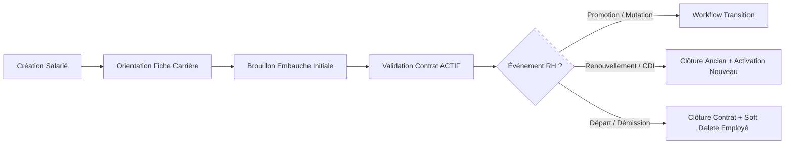
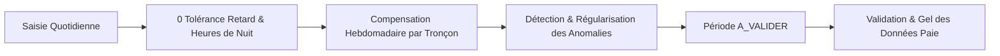

# Guide Complet d'Architecture, Workflows et Règles Métier — GALAXAM SIRH

Ce document constitue la référence officielle du SIRH GALAXAM. Il formalise l'architecture logicielle, les règles de gestion (RG), le fonctionnement des tâches planifiées (Cron/Schedulers), la politique de sécurité et les standards UI/UX.

---

## 🏛️ 1. Architecture Générale & Paradigme Technique

### Backend (Spring Boot 4.1 / Java 17)
- **Accès Données** : Paradigme POO pur JDBC (`bean.ClassMere`) sans ORM JPA/Hibernate pour un contrôle transactionnel total et zéro surcoût N+1.
- **Transactions Manuelles** : Tout service transactionnel applique le pattern :
  ```java
  try (Connection c = dataSource.getConnection()) {
      c.setAutoCommit(false);
      try {
          // Opérations métier
          c.commit();
      } catch (Exception ex) {
          c.rollback();
          throw ex;
      }
  }
  ```
- **Couche Service Découplée & Modulaire** :
  - `EmployeService` : Gestion du profil, statut, composition familiale, pagination standardisée.
  - `WorkflowRhService` : Transitions de carrière, auto-clôture des contrats/affectations antérieurs.
  - `CongeService` : Simulation, scission maladie Art. 13 (> 30j), validation/refus.
  - `PointageSaisieService` : Saisie quotidienne, calcul des heures normales, heures de nuit dynamiques (> 22h00), 0 tolérance aux retards, reconstitution des pauses et indemnités.
  - `PointageAnomalieService` : Détection et qualification des anomalies (pointages incomplets, absences non justifiées, retards), régularisation unitaire et en lot.
  - `PointageSyntheseService` : Compensation hebdomadaire stricte (HS compensant les retards), majorations légales 30%/50%, déduction TMM (-1 000 Ar/j) et consolidation paie.
  - `DashboardService` : Agrégation centralisée des KPIs, alertes critiques (J-0, J-7, J-30), brouillons en attente et effectif en congé.
  - `ParametreGlobal` : Modèle et gestionnaire centralisé de lecture dynamique (`loadActiveMap`, `getDouble`, `getLocalTime`, etc.) sans valeur codée en dur.
- **Gestion Globale des Erreurs** : `GlobalExceptionHandler` (`@RestControllerAdvice`) capturant les exceptions et renvoyant une réponse normalisée `ApiErrorResponse` avec journalisation **SLF4J**.

### Frontend (React 19 / Vite 8 / Tailwind CSS)
- **Polices Système Natives** : 0 requête externe Google Fonts / CDN.
- **Composants Reutilisables Galaxam** :
  - `PageHeader.jsx` : En-tête standardisé avec icône, fil d'Ariane et actions.
  - `PointageSubNav.jsx` : Barre de sous-navigation transversale en 1 clic.
  - `StatusBadge.jsx` : Badge centralisé pour tous les statuts du SIRH.
  - `ConfirmDialog.jsx` : Fenêtres de confirmation modales ergonomiques (0 `window.confirm`).
  - `Afficher masqués` (`showInactive`) : Bascule avec icône œil standardisée sur toutes les tables de référentiels et paramètres.

---

## 🔄 2. Suite Logique des Workflows SIRH

### A. Cycle de Vie Employé & Carrière


### B. Cycle de Pointage & Préparation Paie


#### Règles Clés du Pointage :
1. **0 Tolérance aux Retards** : Tout dépassement dès `08h01` ou `13h01/14h01` génère un retard décompté à la minute près.
2. **Compensation Hebdomadaire (HS vs Retards)** :
   * Chaque semaine civile (tronçon) calcule son propre solde : les HS de la semaine compensent prioritairement les retards de la même semaine.
   * Semaine excédentaire $\rightarrow$ HS payées (jusqu'à 8h à +30%, au-delà à +50%).
   * Semaine déficitaire $\rightarrow$ Retard net déduit sur la paie (100%).
3. **Travail de Nuit Dynamique (`SEUIL_NUIT_DEBUT: 22:00` / `SEUIL_NUIT_FIN: 05:00`)** : Toute heure effectuée dans la tranche nocturne est calculée automatiquement et majorée.
4. **Spécificité Tamatave TMM (`REDUCTION_DEPLACT_REPAS_MIDI: 1000 Ar`)** : Si un salarié de TMM déjeune sur place ou travaille en journée continue (2 trajets au lieu de 4), une déduction de 1 000 Ar/j est appliquée, ramenant son indemnité quotidienne au tarif TNR.

### C. Gestion des Congés & Absences Légales
- **Décompte Standard** : En jours ouvrés ou calendaires selon le paramétrage.
- **Demi-Journée** : Décompte strict de `0.5` jour (Matin ou Après-Midi).
- **Arrêt Maladie > 30 Jours (Art. 13 Code du Travail Malagasy)** : Scission automatique entre les 30 premiers jours à plein salaire et le reliquat pris en charge sans solde / CNaPS.
- **Maternité** : 14 semaines (98 jours).
- **Événements Familiaux** : 3 jours forfaitaires pour Mariage, Décès ou Naissance.

---

## ⏰ 3. Tâches Planifiées (Cron & Schedulers)

| Scheduler | Fréquence (Cron) | Rôle & Action Métier |
| :--- | :--- | :--- |
| `MouvementRhScheduler` | `0 0 0 * * ?` (Minuit) + Démarrage | Applique les mouvements RH validés dont la date d'effet est échue. |
| `NotificationRhScheduler` | `0 5 0 * * ?` (00h05) | Génère les alertes de fin de contrat (J-0, J-7, J-30), fin d'essai et relances congés. |
| `AcquisitionCongeScheduler` | `0 0 1 * * ?` (01h00) | Crédite `+2.5` jours de congé mensuel et attribue les bonifications d'ancienneté (+1j / 5 ans). |
| `SessionSecurityScheduler` | `0 30 3 * * ?` (03h30) | Purge les notifications lues de plus de 90 jours et révoque les refresh tokens expirés. |
| `AuditLogPurgeScheduler` | `0 0 4 1 * ?` (1er du mois à 04h00) | Archive et purge les logs d'audit datant de plus de 365 jours. |
| `PurgeCongeScheduler` | `0 0 2 1 1 ?` (1er janvier) | Clôture et archive les reliquats de congés annuels non reportés. |

---

## 🔒 4. Sécurité, Sessions & Tokens

- **Hachage Mot de Passe** : BCrypt avec salage dynamique.
- **Access Token JWT** : Signature HMAC SHA-512, expiration courte (15 min), transport des rôles et permissions granulaires (`ROLE_ADMIN`, `CONGE_WRITE`, etc.).
- **Refresh Token Persistant** : Stocké de façon sécurisée en base (`table utilisateur`), vérifié à chaque rafraîchissement (rotation) et révoqué immédiatement à la déconnexion.
