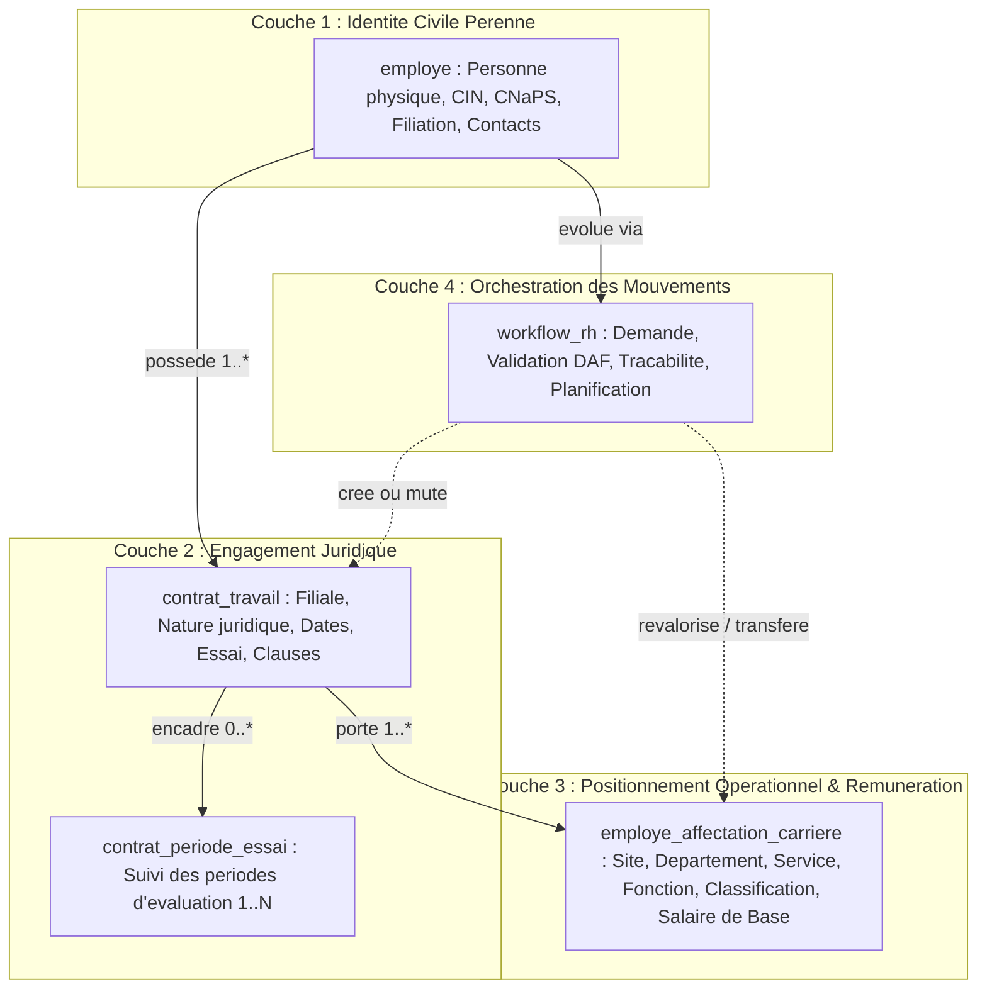
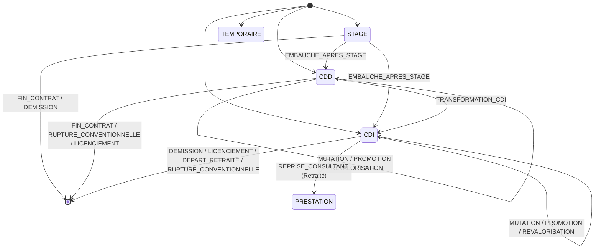
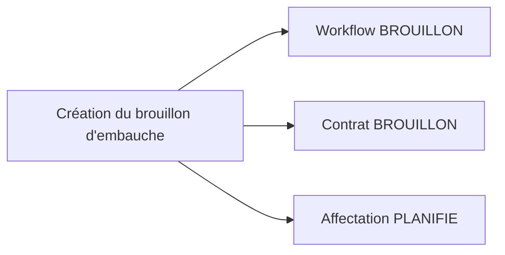

# GALAXAM SIRH — MODULE EMPLOYÉ, CONTRAT & CARRIÈRE
## Gestion du Personnel, Cycle de Vie Contractuel, Transitions de Carrière, Workflows RH & GED
### Document de Référence Canonique — Version Maîtresse 5.0
### **Relu le 23 octobre 2026 — Sources : Code SQL canonique (`03_schema_employes_contrats.sql`), Java 17 Spring Boot 4.1.0 et React 19**

---

> **État des preuves au 23 octobre 2026 :** des tests backend ciblés, dont `ContratTravailControllerPostgresTest` et `EmployeSatelliteLifecycleTest`, sont présents dans le dépôt. Le frontend utilise actuellement `node --test` via `frontend/package.json` ; les anciennes références à Vitest/Testing Library et les totaux de tests frontend ne sont pas confirmés par la configuration actuelle. Aucune évaluation WCAG AA complète n'est documentée ici. DOC-2 n'a pas exécuté de tests.
> - **Cadre Juridique** : [Loi n° 2024-014 du 14 août 2024 portant Code du Travail](https://cnlegis.gov.mg/uploads/L2024-014-VF.pdf) (adoptée le 01/07/2024, validée par la HCC le 08/08/2024 Décision n° 11-HCC/D3, promulguée le 14/08/2024) & Loi n° 2003-044, Décret n° 64-195 (CIN), Décret n° 69-145 (CNaPS).

---

> **NOTE MÉTHODOLOGIQUE : CORRECTIONS FACTUELLES APPLIQUÉES PAR RAPPORT À L'ANCIENNE DOCUMENTATION**
>
> | Élément | Ancienne documentation (ERRONÉE) | Réalité du code source & base de données |
> |---|---|---|
> | **Types de contrats seedés** | 5 types (`CDI`, `CDD`, `STAGE`, `PRESTATION`, `TEMPORAIRE`) | **4 types réels** : `CDI` (id=1), `CDD` (id=2), `TEMPORAIRE` (id=4), `STAGE` (id=5). Le code `PRESTATION` est absent du seed ; la prestation externe est portée par le régime d'intervenant `CONSULTANT`. |
> | **Statuts RH seedés** | 7-8 statuts informels avec coquilles (`ROM нача`, `TERMINE`) | **9 statuts ordonnés** : `BROUILLON` (10), `PLANIFIE` (20), `A_SIGNER` (25), `ACTIF` (30), `SUSPENDU` (35), `HISTORISE` (40, terminal), `CLOTURE` (50, terminal), `ROMPU` (60, terminal), `ANNULE` (70, terminal). |
> | **Régimes d'intervenant** | 4 types, ISI 5% actif | **5 types** : `PERMANENT` (1), `CONSULTANT` (2), `TEMPORAIRE` (3), `STAGIAIRE` (4), `CONSULTANT_SALARIE` (5). Contrainte stricte `CHECK (soumis_isi_5 = FALSE)` bloquant tout assujettissement ISI. |
> | **Statuts de période d'essai** | Décrits informellement (`CONFIRMEE`, `RENOUVELLEE`) | Contrainte SQL stricte `CHECK (statut IN ('EN_COURS', 'CONFIRMEE', 'RENOUVELEE', 'ROMPUE'))` *(noter l'orthographe exacte dans le CHECK DDL)*. |
> | **Plafonds & seuils CDD/Essai** | Constantes en dur dans le texte | **Paramètres dynamiques** résolus via `parametre_global` : `MAX_RENOUVELLEMENTS_ESSAI` (défaut 1), `NB_MAX_RENOUVELLEMENTS_CDD` (défaut 2), `DUREE_MAX_CONTRAT_CDD_MOIS` (défaut 24), `DUREE_MAX_CDD_MOIS` (défaut 72 mois). |
> | **Rôles & Permissions RBAC** | 5 rôles métier actifs en seed | **2 rôles seedés uniquement** (`ROLE_ADMIN` et `ROLE_AGENT_POINTAGE`). Les autorisations métier reposent sur des privilèges granulaires (`EMPLOYE_READ`, `EMPLOYE_WRITE`, `EMPLOYE_VALIDATE`, `PAIE_READ`). |
> | **Contrôleurs REST** | Un contrôleur unique supposé | **6 contrôleurs spécialisés** : `EmployeController`, `ContratTravailController`, `WorkflowRhController`, `ContratGlobalController`, `DocumentRhController`, `RefCarriereController`. |
> | **Vues SQL officielles** | Non documentées ou incomplètes | **5 vues matérialisant la logique de domaine** : `v_employe_cpl`, `v_workflow_rh_cpl`, `v_document_rh_cpl`, `v_employe_actif_courant`, `v_historique_carriere_global`. |
> | **Types de documents GED** | Mention générique | **8 types seedés** dans `ref_type_document` (Fiche renseignement, CIN Recto, CIN Verso, Permis, CV, Contrat de travail, Diplôme, RIB). |

---

## 0. Règle Méthodologique Absolue — Sources de Vérité

Le présent document constitue la documentation canonique définitive du **Module Employé, Contrat & Carrière** du Système d'Information des Ressources Humaines (SIRH) de **GALAXAM Logistics**.

Toutes les spécifications, modèles relationnels, diagrammes d'état et règles de gestion consignés ici sont strictement extraits et vérifiés à partir des sources techniques et juridiques du projet :
1. **Schéma physique PostgreSQL** : [`02_schema_referentiels_rh.sql`](../../conception/bdd/02_schema_referentiels_rh.sql) et [`03_schema_employes_contrats.sql`](../../conception/bdd/03_schema_employes_contrats.sql) ;
2. **Moteurs de domaine Java 17** : [`EmployeValidationEngine.java`](../../src/main/java/mg/galaxam/sirh/contrat/domain/EmployeValidationEngine.java), [`ContratValidationEngine.java`](../../src/main/java/mg/galaxam/sirh/contrat/domain/ContratValidationEngine.java), [`CarriereTransitionValidator.java`](../../src/main/java/mg/galaxam/sirh/contrat/domain/CarriereTransitionValidator.java), [`AncienneteEngine.java`](../../src/main/java/mg/galaxam/sirh/contrat/domain/AncienneteEngine.java), [`EmploymentContextResolver.java`](../../src/main/java/mg/galaxam/sirh/contrat/application/EmploymentContextResolver.java) ;
3. **Contrôleurs et Services Applicatifs** : [`EmployeController.java`](../../src/main/java/mg/galaxam/sirh/contrat/api/EmployeController.java), [`ContratTravailController.java`](../../src/main/java/mg/galaxam/sirh/contrat/api/ContratTravailController.java), [`WorkflowRhController.java`](../../src/main/java/mg/galaxam/sirh/contrat/api/WorkflowRhController.java), [`ContratGlobalController.java`](../../src/main/java/mg/galaxam/sirh/contrat/api/ContratGlobalController.java), [`DocumentRhController.java`](../../src/main/java/mg/galaxam/sirh/contrat/api/DocumentRhController.java), [`WorkflowRhService.java`](../../src/main/java/mg/galaxam/sirh/contrat/application/WorkflowRhService.java), [`DocumentRhService.java`](../../src/main/java/mg/galaxam/sirh/contrat/application/DocumentRhService.java) ;
4. **Interface Frontend React 19 / Vite** : [`frontend/src/features/employees`](../../../frontend/src/features/employees) ;
5. **Cadre Légal Malagasy en vigueur** :
   - *[Loi n° 2024-014 du 14 août 2024 portant Code du Travail](https://cnlegis.gov.mg/uploads/L2024-014-VF.pdf)* (adoptée le 01/07/2024, validée par la HCC le 08/08/2024 Décision n° 11-HCC/D3, promulguée le 14/08/2024) & *[Loi n° 2003-044 du 28 juillet 2004](https://www.assemblee-nationale.mg/media/archives_textes/pl/2003-044/Loi-n-2003-044-finale-Portant-Code-du-Travail-1.pdf)* ;
   - *[Décret n° 64-195 modifié](https://cabinetkim.mg/blog/code-du-travail-madagascar-nouvelle-loi-2024-014/)* (Réglementation de la Carte d'Identité Nationale malgache) ;
   - *Décret n° 69-145 du 8 avril 1969* fixant le Code de Prévoyance Sociale (CNaPS) ;
   - *Loi n° 2014-038 du 9 janvier 2015* sur la protection des données à caractère personnel ;
   - *Loi de Finances 2026* et Code Général des Impôts (CGI Madagascar).

---

## 1. Sommaire Exécutif & Vision Métier

Le module **Employé, Contrat & Carrière** constitue le cœur référentiel du SIRH de GALAXAM. Dans une entreprise multi-sites soumise aux contraintes logistiques (flux maritimes et terrestres, agences d'Antananarivo et de Toamasina), il gère les dossiers, contrats et affectations selon les règles implémentées et les références réglementaires citées. Leur conformité juridique doit être confirmée par les responsables compétents ; cette documentation ne vaut pas certification.

### 1.1 Dissociation Tripartite Fondamentale
Le système impose une rupture conceptuelle nette par rapport aux anciens outils de gestion de personnel (fichiers Excel monolithiques) en dissociant formellement trois couches d'informations :



1. **L'Identité Civile (`employe`)** : Données biométriques, état civil, CIN, adresse et coordonnées d'urgence. Cette entité est pérenne et subsiste même en cas d'interruption contractuelle ou de réembauche ultérieure.
2. **L'Engagement Juridique (`contrat_travail`)** : Matérialise le lien de subordination de droit du travail liant le travailleur à l'entité juridique employeur (`ref_filiale`). Il fixe la typologie d'engagement (`CDI`, `CDD`, `TEMPORAIRE`, `STAGE`), la chronologie contractuelle et les périodes d'essai associées.
3. **Le Positionnement Organisationnel & Rémunération (`employe_affectation_carriere`)** : Détermine l'implantation géographique (`ref_site`), l'appartenance analytique (`ref_departement`, `ref_service`), le métier exercé (`ref_fonction`), le coefficient hiérarchique conventionnel (`ref_categorie_professionnelle`) et la rémunération brute de base (`salaire_base`).

---

## 2. Cadre Juridique et Transposition Légale Malagasy

Le module applique plusieurs règles du Code du travail malgache; les limites fonctionnelles identifiées ci-dessous restent à traiter avant toute revendication de conformité complète :

| Source Légale | Disposition Métier | Transposition Logicielle dans GALAXAM SIRH |
|:---|:---|:---|
| **Loi n° 2024-014, Art. 147** | **Âge minimum légal** : 15 ans; l'emploi d'un mineur requiert l'autorisation expresse d'un parent ou tuteur et des contrôles adaptés. | Le module applique un seuil opérationnel de 16 ans car il exige une CIN; il ne gère pas encore le dossier d'autorisation, l'examen médical ni les restrictions applicables aux mineurs. Ce seuil interne n'est pas présenté comme l'âge minimum légal. |
| **Loi n° 2024-014, Art. 23 à 27** | **CDD** : écrit et terme précis; cas d'usage limités, durée d'un à 24 mois, deux renouvellements au maximum et plafond cumulé de six ans; une réembauche au même poste après une interruption de trois mois ou moins compte comme renouvellement. | Le CDD exige un motif structuré (`OUVRAGE_DETERMINE`, `SURCROIT_EXTRAORDINAIRE` ou `TRAVAUX_URGENTS_SECURITE`). Une réembauche détectée au même poste dans les trois mois est classée en `RENOUVELLEMENT_CDD` et soumise aux limites de renouvellement et de durée cumulée. Le poste est rapproché par site, département, service et fonction, faute d'identifiant de poste dédié. |
| **Loi n° 2024-014, Art. 52 à 54**<br>*(Loi n° 2003-044, Art. 35 & 36)* | **Période d'essai** : Durée maximale encadrée par la convention, notification écrite obligatoire sous peine de nullité, renouvellement unique encadré, rupture sans indemnité de préavis. | `contrat_periode_essai` + `CarriereTransitionValidator` limitent la durée initiale à 6 mois et bornent le renouvellement via `MAX_RENOUVELLEMENTS_ESSAI`. |
| **Loi n° 2024-014, Art. 40 al. 4**<br>*(Loi n° 2003-044, Art. 24 al. 3)* | **Certificat de travail** : Délivrance obligatoire dès cessation de tout contrat de travail, libre de toute mention préjudiciable au travailleur. | `DocumentRhService.genererCertificatDocx()` génère automatiquement le document Word officiel avec les dates exactes et les fonctions exercées. |
| **Décret n° 64-195 modifié** | **Carte d'Identité Nationale (CIN)** : Identifiant régalien à 12 chiffres délivré à partir de l'âge de 16 ans (Décret n° 78-292). | `EmployeValidationEngine.validerCinFormatEtDate()` applique la regex `^[0-9]{12}$` et vérifie que la délivrance est postérieure au 16e anniversaire. |
| **Décret n° 69-145 (CPS)** | **Affiliation CNaPS** : Obligation d'immatriculation pour l'ouverture des droits de sécurité sociale et de retraite. | `employe.num_affiliation_cnaps` assujetti à un index unique SQL (`UNIQUE`). |
| **Loi n° 2014-038** | **Protection des données personnelles** : confidentialité et sécurité des données RH. | Les routes de lecture et de téléchargement documentaire exigent `EMPLOYE_READ` et `PAIE_READ` (ou rôle administrateur); le contenu est validé par signature de fichier et les suppressions de métadonnées sont validées avant suppression physique. |

---

## 3. Schéma Physique et Modèle de Données Relationnel (PostgreSQL)

### 3.1 Énumérations & Tables Satellites de l'Employé

```sql
CREATE TYPE sexe_enum AS ENUM ('M', 'F');

CREATE TYPE situation_familiale_enum AS ENUM (
    'Celibataire', 'Marie', 'Divorce', 'Veuf',
    'CELIBATAIRE', 'MARIE', 'DIVORCE', 'VEUF'
);

CREATE TYPE motif_desactivation_enum AS ENUM (
    'Demission', 'Licenciement', 'Fin_contrat', 'Retraite', 'Deces', 'Autre'
);

CREATE TYPE lien_parente_enum AS ENUM (
    'Pere', 'Mere', 'Conjoint', 'Frere', 'Soeur', 'Enfant', 'Autre'
);
```

#### Table Fondamentale : `employe`
```sql
CREATE TABLE employe (
    id_employe                     SERIAL PRIMARY KEY,
    matricule                      VARCHAR(20) NOT NULL UNIQUE,
    nom                            VARCHAR(100) NOT NULL,
    prenom                         VARCHAR(100) NOT NULL,
    sexe                           sexe_enum NOT NULL,
    date_naissance                 DATE NOT NULL,
    lieu_naissance                 VARCHAR(100) NOT NULL,
    nationalite                    VARCHAR(50) DEFAULT 'Malgache',
    pere_nom_prenom                VARCHAR(150),
    mere_nom_prenom                VARCHAR(150),
    situation_familiale            situation_familiale_enum,
    cin_numero                     VARCHAR(30) NOT NULL UNIQUE,
    cin_date_delivrance            DATE NOT NULL,
    cin_lieu_delivrance            VARCHAR(100) NOT NULL,
    cin_duplicata_date             DATE,
    cin_duplicata_lieu             VARCHAR(100),
    permis_conduire_numero         VARCHAR(50),
    permis_conduire_date_delivrance DATE,
    permis_conduire_lieu_delivrance VARCHAR(100),
    adresse                        TEXT NOT NULL,
    ville                          VARCHAR(100),
    telephone                      VARCHAR(30) NOT NULL,
    email                          VARCHAR(150),
    num_affiliation_cnaps          VARCHAR(30) UNIQUE,
    photo_url                      VARCHAR(255),
    date_declaration               DATE,
    est_actif                      BOOLEAN DEFAULT TRUE,
    date_desactivation             TIMESTAMP,
    motif_desactivation            motif_desactivation_enum,
    created_at                     TIMESTAMP DEFAULT CURRENT_TIMESTAMP,
    updated_at                     TIMESTAMP DEFAULT CURRENT_TIMESTAMP
);
```

#### Satellites : `employe_conjoint`, `employe_enfant`, `employe_contact_urgence`, `employe_compte_banque`
- `employe_enfant` gère les attributs de dépendance fiscale et sociale : `a_charge` (BOOLEAN), `est_etudiant`, `date_fin_scolarite`, `est_handicape`. Ces champs alimentent directement le calcul des réductions de charge familiale en paie (IRSA Malagasy).
- `employe_compte_banque` est contraint par un index unique partiel :
  ```sql
  CREATE UNIQUE INDEX uq_compte_principal_employe 
  ON employe_compte_banque(id_employe) 
  WHERE est_principal = TRUE;
  ```
  Cela garantit qu'un salarié ne possède qu'un seul compte bancaire principal actif pour le virement de sa paie.

---

### 3.2 Gestion Juridique du Contrat : `contrat_travail`

```sql
CREATE TABLE contrat_travail (
    id_contrat                 SERIAL PRIMARY KEY,
    id_employe                 INTEGER NOT NULL REFERENCES employe(id_employe) ON DELETE CASCADE,
    id_filiale                 INTEGER NOT NULL REFERENCES ref_filiale(id_filiale),
    id_type_contrat            INTEGER NOT NULL REFERENCES ref_type_contrat(id_type_contrat),
    id_type_intervenant        INTEGER NOT NULL REFERENCES ref_type_intervenant(id_type_intervenant),
    id_statut_rh               INTEGER NOT NULL REFERENCES ref_statut_rh(id_statut_rh),
    id_type_evenement_initial  INTEGER REFERENCES ref_type_evenement_rh(id_type_evenement_rh),
    id_contrat_precedent       INTEGER REFERENCES contrat_travail(id_contrat),
    numero_contrat             VARCHAR(50) UNIQUE,
    date_signature             DATE,
    date_debut                 DATE NOT NULL,
    date_fin                   DATE,
    duree_essai_mois           INTEGER,
    date_fin_essai             DATE,
    comptabilise_effectif      BOOLEAN DEFAULT TRUE,
    id_motif_sortie            INTEGER REFERENCES ref_motif_sortie(id_motif_sortie),
    description                TEXT,
    commentaire                TEXT,
    created_at                 TIMESTAMP DEFAULT CURRENT_TIMESTAMP,
    updated_at                 TIMESTAMP DEFAULT CURRENT_TIMESTAMP,
    CONSTRAINT chk_contrat_dates CHECK (date_fin IS NULL OR date_fin >= date_debut),
    CONSTRAINT uq_contrat_id_employe UNIQUE (id_contrat, id_employe)
);
```

La clé unique composée `uq_contrat_id_employe` permet de garantir qu'une
affectation référence un contrat appartenant au même salarié.

#### Référentiels sous-jacents vérifiés :
- **`ref_type_contrat`** :
  | id_type_contrat | code | libelle | exige_date_fin |
  |---|---|---|---|
  | 1 | `CDI` | Contrat à Durée Indéterminée | FALSE |
  | 2 | `CDD` | Contrat à Durée Déterminée | TRUE |
  | 4 | `TEMPORAIRE` | Contrat d'Engagement Temporaire | TRUE |
  | 5 | `STAGE` | Convention / Contrat de Stage | TRUE |

- **`ref_statut_rh` (9 statuts ordonnés)** :
  | id_statut_rh | code | libelle | ordre | est_terminal |
  |---|---|---|---|---|
  | 1 | `BROUILLON` | Brouillon | 10 | FALSE |
  | 2 | `PLANIFIE` | Planifié (effet futur) | 20 | FALSE |
  | 3 | `A_SIGNER` | En attente de signature | 25 | FALSE |
  | 4 | `ACTIF` | Actif | 30 | FALSE |
  | 5 | `SUSPENDU` | Suspendu | 35 | FALSE |
  | 6 | `HISTORISE` | Historisé | 40 | **TRUE** |
  | 7 | `CLOTURE` | Clôturé | 50 | **TRUE** |
  | 8 | `ROMPU` | Rompu | 60 | **TRUE** |
  | 9 | `ANNULE` | Annulé | 70 | **TRUE** |

---

### 3.3 Suivi des Périodes d'Essai : `contrat_periode_essai`

```sql
CREATE TABLE contrat_periode_essai (
    id_periode_essai     SERIAL PRIMARY KEY,
    id_contrat           INTEGER NOT NULL REFERENCES contrat_travail(id_contrat) ON DELETE CASCADE,
    numero_periode       INTEGER NOT NULL DEFAULT 1,
    date_debut           DATE NOT NULL,
    date_fin_prevue      DATE NOT NULL,
    date_fin_reelle      DATE,
    statut               VARCHAR(30) NOT NULL DEFAULT 'EN_COURS',
    motif_renouvellement TEXT,
    motif_rupture        TEXT,
    commentaire          TEXT,
    created_at           TIMESTAMP DEFAULT CURRENT_TIMESTAMP,
    updated_at           TIMESTAMP DEFAULT CURRENT_TIMESTAMP,
    CONSTRAINT chk_statut_periode_essai CHECK (statut IN ('EN_COURS', 'CONFIRMEE', 'RENOUVELEE', 'ROMPUE')),
    CONSTRAINT chk_numero_periode CHECK (numero_periode >= 1),
    CONSTRAINT uk_contrat_periode UNIQUE (id_contrat, numero_periode)
);
```

---

### 3.4 Positionnement Organisationnel : `employe_affectation_carriere`

```sql
CREATE TABLE employe_affectation_carriere (
    id_affectation               SERIAL PRIMARY KEY,
    id_employe                   INTEGER NOT NULL REFERENCES employe(id_employe) ON DELETE CASCADE,
    id_contrat                   INTEGER NOT NULL,
    id_statut_rh                 INTEGER NOT NULL REFERENCES ref_statut_rh(id_statut_rh),
    id_motif_mouvement           INTEGER NOT NULL REFERENCES ref_motif_mouvement(id_motif_mouvement),
    id_site                      INTEGER NOT NULL REFERENCES ref_site(id_site),
    id_departement               INTEGER NOT NULL REFERENCES ref_departement(id_departement),
    id_service                   INTEGER NOT NULL,
    id_fonction                  INTEGER NOT NULL REFERENCES ref_fonction(id_fonction),
    id_responsable_hierarchique  INTEGER REFERENCES employe(id_employe),
    id_categorie_professionnelle INTEGER NOT NULL REFERENCES ref_categorie_professionnelle(id_categorie_professionnelle),
    id_mode_calcul_paie          INTEGER NOT NULL REFERENCES ref_mode_calcul_paie(id_mode_calcul_paie),
    salaire_base                 NUMERIC(20,2) NOT NULL,
    date_debut                   DATE NOT NULL,
    date_fin                     DATE,
    description                  TEXT,
    commentaire                  TEXT,
    created_at                   TIMESTAMP DEFAULT CURRENT_TIMESTAMP,
    updated_at                   TIMESTAMP DEFAULT CURRENT_TIMESTAMP,
    CONSTRAINT chk_salaire_base_positif CHECK (salaire_base > 0),
    CONSTRAINT chk_affectation_dates CHECK (date_fin IS NULL OR date_fin >= date_debut),
    CONSTRAINT fk_affectation_contrat_employe
        FOREIGN KEY (id_contrat, id_employe)
        REFERENCES contrat_travail (id_contrat, id_employe),
    CONSTRAINT fk_affectation_service_departement
        FOREIGN KEY (id_service, id_departement)
        REFERENCES ref_service (id_service, id_departement)
);
```

Les clés composées empêchent qu'une affectation référence le contrat d'un
autre salarié ou un service d'un autre département. Elles sont définies dans
les schémas canoniques 02/03 ; SP74 est l'ancien identifiant historique de
cette évolution et les migrations SP ont été volontairement supprimées. Les
schémas canoniques servent à initialiser une base neuve et ne décrivent pas la
mise à niveau d'une base existante. Les contrôles applicatifs restent utiles
pour retourner une erreur métier lisible ; PostgreSQL garantit l'invariant
dans une base disposant de ces contraintes.

---

### 3.5 Orchestration des Mouvements RH : `workflow_rh`

```sql
CREATE TABLE workflow_rh (
    id_workflow           SERIAL PRIMARY KEY,
    id_employe            INTEGER NOT NULL REFERENCES employe(id_employe) ON DELETE CASCADE,
    id_type_evenement_rh  INTEGER NOT NULL REFERENCES ref_type_evenement_rh(id_type_evenement_rh),
    id_statut_rh          INTEGER NOT NULL REFERENCES ref_statut_rh(id_statut_rh),
    id_contrat_source     INTEGER REFERENCES contrat_travail(id_contrat),
    id_contrat_cible      INTEGER REFERENCES contrat_travail(id_contrat),
    id_affectation_source INTEGER REFERENCES employe_affectation_carriere(id_affectation),
    id_affectation_cible  INTEGER REFERENCES employe_affectation_carriere(id_affectation),
    date_demande          DATE NOT NULL DEFAULT CURRENT_DATE,
    date_effet            DATE NOT NULL,
    motif                 TEXT,
    commentaire           TEXT,
    id_demandeur          INTEGER REFERENCES utilisateur(id_utilisateur),
    id_valideur           INTEGER REFERENCES utilisateur(id_utilisateur),
    created_at            TIMESTAMP DEFAULT CURRENT_TIMESTAMP,
    updated_at            TIMESTAMP DEFAULT CURRENT_TIMESTAMP
);
```

---

### 3.6 Gestion Électronique des Documents RH (GED) : `document_rh`

```sql
CREATE TABLE ref_type_document (
    id_type_document    SERIAL PRIMARY KEY,
    libelle             VARCHAR(100) NOT NULL UNIQUE,
    categorie           VARCHAR(50) NOT NULL,
    description         TEXT,
    obligatoire         BOOLEAN DEFAULT FALSE,
    extension_autorisee VARCHAR(100) DEFAULT 'pdf,jpg,jpeg,png',
    taille_max_mo       INTEGER DEFAULT 10,
    actif               BOOLEAN DEFAULT TRUE,
    created_at          TIMESTAMP DEFAULT CURRENT_TIMESTAMP,
    updated_at          TIMESTAMP DEFAULT CURRENT_TIMESTAMP
);

CREATE TABLE document_rh (
    id_document       SERIAL PRIMARY KEY,
    id_employe        INTEGER NOT NULL REFERENCES employe(id_employe) ON DELETE CASCADE,
    id_type_document  INTEGER NOT NULL REFERENCES ref_type_document(id_type_document),
    id_contrat        INTEGER REFERENCES contrat_travail(id_contrat) ON DELETE SET NULL,
    id_workflow       INTEGER REFERENCES workflow_rh(id_workflow) ON DELETE SET NULL,
    nom_original      VARCHAR(255) NOT NULL,
    nom_stockage      VARCHAR(255) NOT NULL,
    chemin_fichier    VARCHAR(500) NOT NULL,
    extension         VARCHAR(10),
    taille_octet      BIGINT,
    date_document     DATE,
    commentaire       TEXT,
    uploaded_by       INTEGER REFERENCES utilisateur(id_utilisateur),
    created_at        TIMESTAMP DEFAULT CURRENT_TIMESTAMP,
    updated_at        TIMESTAMP DEFAULT CURRENT_TIMESTAMP
);
```

**Seed canonique des 8 types de documents réels :**
1. `Fiche renseignement` (Administratif, OBLIGATOIRE)
2. `CIN Recto` (Identité, OBLIGATOIRE)
3. `CIN Verso` (Identité, OBLIGATOIRE)
4. `Permis de conduire` (Identité, Facultatif)
5. `CV` (Recrutement, OBLIGATOIRE)
6. `Contrat de travail` (Contrat, Facultatif à l'onboarding)
7. `Diplôme` (Formation, Facultatif)
8. `RIB` (Paie, Facultatif à l'onboarding)

---

## 4. Vues Métier Canoniques & Requêtes Décisionnelles

Le schéma encapsule la complexité relationnelle dans 5 vues SQL hautement optimisées :

### 4.1 Vue Salarié Complet (`v_employe_cpl`)
Joint l'employé avec son conjoint, son compte bancaire principal actif et agrège le décompte des enfants à charge et contacts d'urgence en sous-requêtes indexées.
```sql
SELECT e.id_employe, e.matricule, CONCAT(e.nom, ' ', e.prenom) AS nom_complet,
       EXTRACT(YEAR FROM AGE(CURRENT_DATE, e.date_naissance))::INTEGER AS age,
       cb.num_compte_rib AS num_compte_rib_principal,
       COALESCE(enf.nb_enfants_a_charge, 0) AS nb_enfants_a_charge
FROM employe e ...
```

### 4.2 Vue Salarié Actif Courant (`v_employe_actif_courant`)
Consommée par le **Module Pointage** et le **Module Paie**. Elle résout pour chaque travailleur en poste son affectation active (`rsw.code = 'ACTIF'`), son régime d'intervenant (`ref_type_intervenant`), son site, son service et son salaire de base.

### 4.3 Vue Historique Carrière Global (`v_historique_carriere_global`)
Unifie par une clause `UNION ALL` les trois flux chronologiques du salarié :
1. `CONTRAT` : Évolution contractuelle (dates, avenants, motifs de rupture).
2. `AFFECTATION` : Évolution professionnelle (postes, services, salaires de base).
3. `PERIODE_ESSAI` : Jalons d'essai (numéro de période, statut, date prévue vs réelle).

---

## 5. Moteurs de Domaine & Logique Métier

### 5.1 Validation de la Fiche Collaborateur (`EmployeValidationEngine.java`)
Ce moteur est invoqué systématiquement lors de l'onboarding ou de la mise à jour de la fiche personnelle :
1. **Seuil opérationnel** : Calcul strict `Period.between(dateNaissance, LocalDate.now()).getYears() >= 16`. Il s'agit du seuil du parcours actuel avec CIN, pas de l'âge légal minimum d'emploi (15 ans, avec conditions).
2. **Cohérence CIN** :
   - Format : Expression régulière `^[0-9]{12}$` (12 chiffres stricts).
   - Antériorité : La date de délivrance de la CIN doit être postérieure ou égale au 16e anniversaire (`dateCin >= dateNaiss.plusYears(16)`).
3. **Coordonnées** : Validation regex du numéro de téléphone (`^[+]?[0-9\s.-]{8,20}$`) et syntaxe RFC-5322 de l'email.
4. **Comptes Bancaires** : Règle de complétude mutuelle — si une banque est sélectionnée, le numéro RIB est obligatoire.

### 5.2 Moteur de Validation des Transitions (`CarriereTransitionValidator.java`)
Orchestre la matrice d'admissibilité des 17 événements de carrière en fonction du contrat d'origine :



#### Règles Dynamiques de Plafonnement :
- **Renouvellement de CDD** :
  - Nombre maximal de renouvellements : `NB_MAX_RENOUVELLEMENTS_CDD` (défaut = 2). Au 3ème renouvellement, le moteur rejette la demande avec l'obligation de requalifier en CDI.
  - Durée unitaire maximale : `DUREE_MAX_CONTRAT_CDD_MOIS` (défaut = 24 mois).
  - Durée totale cumulée maximale : `DUREE_MAX_CDD_MOIS` (défaut = 72 mois / 6 ans). Le calcul s'effectue en remontant la chaîne d'ancêtres `id_contrat_precedent`.
- **Période d'essai** :
  - Encadrement du renouvellement : borné par `MAX_RENOUVELLEMENTS_ESSAI` (défaut = 1).
  - Échéance de décision : La décision de renouvellement ou confirmation doit impérativement intervenir avant la date de fin prévue de la période en cours.

### 5.3 Moteur d'Ancienneté (`AncienneteEngine.java`)
Reconstitue le graphe orienté acyclique des contrats par le lien `id_contrat_precedent` :
- **Ancienneté Contrat** : Écoulée sur le contrat courant.
- **Ancienneté Entreprise Continue** : Cumul de l'ensemble des contrats liés sans discontinuité.
- Formatage textuel normalisé : `"X an(s) Y mois"` (utilisé dans les attestations et pour le calcul de la prime d'ancienneté en paie).

---

## 6. Workflows RH, Cycle de Vie et Concurrence Transactionnelle

### 6.1 Mécanique Transactionnelle et Verrouillage Pessimiste
Pour garantir l'intégrité face aux requêtes concurrentes, toute validation ou modification de workflow passe par le composant unifié `TransactionRunner` avec verrouillage explicite :
```sql
SELECT * FROM workflow_rh WHERE id_workflow = ? FOR UPDATE;
```

### 6.2 Cycle d'États d'un Workflow RH


1. **`BROUILLON`** : Créé par un gestionnaire RH (`EMPLOYE_WRITE`). `WorkflowRhService.creerBrouillonEmbauche` crée le workflow et le contrat cible au statut `BROUILLON`, mais l'affectation cible au statut `PLANIFIE`.
2. **Décision DAF (`validerWorkflow`)** :
   - **Effet Immédiat ($\text{dateEffet} \le \text{Aujourd'hui}$)** :
     - Clôture de l'ancien contrat à $\text{dateEffet} - 1\text{ jour}$ (`id_statut_rh = CLOTURE`).
     - Clôture de l'ancienne affectation (`date_fin = dateEffet - 1`).
     - Activation du contrat cible (`id_statut_rh = ACTIF`).
     - Activation de l'affectation cible (`id_statut_rh = ACTIF`).
     - Workflow marqué `ACTIF` ou clôturé.
   - **Effet Futur ($\text{dateEffet} > \text{Aujourd'hui}$)** :
     - Le contrat cible et l'affectation cible passent au statut `PLANIFIE`.
     - Le workflow passe au statut `PLANIFIE`.
     - L'activation effective est déléguée au scheduler nocturne [`MouvementRhScheduler.java`](../../src/main/java/mg/galaxam/sirh/cron/MouvementRhScheduler.java) qui s'exécute chaque nuit à 00:10 (heure de Madagascar).

---

## 7. Moteur Documentaire Officiel (Apache POI)

Le service [`DocumentRhService.java`](../../src/main/java/mg/galaxam/sirh/contrat/application/DocumentRhService.java) génère à la volée des documents Microsoft Word (`.docx`) professionnels à partir de modèles stockés dans `backend/src/main/resources/templates/documents/` :

```mermaid
flowchart LR
    BDD[(Donnees BDD : Salarie + Contrat + Affectation)] --> Svc[DocumentRhService]
    Modele[Modele Word .docx : Balises ${...}] --> Svc
    Svc --> POI[Moteur Apache POI XWPF]
    POI --> Docx[Flux Binaire .docx telechargeable]
```

### Livrables Documentaires :
1. **Contrats de Travail Officiels** :
   - `GET /documents/contrat/{idContrat}/docx`
   - Injection dynamique : Raison sociale filiale, NIF/STAT, Nom du signataire employeur, Identité du salarié, CIN, Poste, Catégorie, Période d'essai, Salaire de base en lettres et chiffres.
   - **Règle d'affectation originelle** : Le contrat résout obligatoirement la première affectation historique (`rechercherPremiereParContrat`), empêchant qu'un avenant postérieur ne modifie le document d'embauche initial.
2. **Attestation de Travail** :
   - `GET /documents/attestation/{idEmploye}/docx?inclureSalaire=true&typeAnciennete=entreprise`
   - Génère une attestation certifiant l'emploi en cours, avec option d'affichage du salaire (restreinte au privilège `PAIE_READ`).
3. **Certificat de Travail (Art. 42 du Code du Travail)** :
   - `GET /documents/certificat/{idContrat}/docx`
   - Délivré obligatoirement à la rupture, attestant des dates de début et de fin et de l'intitulé exact des postes successifs.

---

## 8. Supervision Décisionnelle & Interface Utilisateur

### 8.1 Les 3 Écrans Majeurs Frontend (`frontend/src/features/employees`)
1. **Annuaire du Personnel (`/employes` — `EmployeListPage.jsx`)** :
   - Tableau interactif avec pagination serveur `PageDTO`.
   - Filtres multi-critères : Statut d'activité, Site, Département, Service. La filiale affichée dans les données du salarié n'est pas un filtre de cet annuaire.
   - Recherche textuelle partielle : la requête SQL utilise `LOWER(...) LIKE` sur le matricule, le nom, le prénom, le numéro CIN et le téléphone, sans opérateur PostgreSQL de recherche plein texte.
2. **Fiche Salarié Détaillée (`/employes/:id` — `EmployeFicheDetailPage.jsx`)** :
   - Barre latérale de synthèse : Photo avec protection IDOR via endpoint dédié (`GET /employes/{id}/photo`), matricule, badge d'ancienneté, alertes documents obligatoires manquants.
   - **7 Onglets Spécialisés** :
     - `FichePersonnelleTab.jsx` : Données d'état civil, CIN, coordonnées, permis.
     - `FamilleContactsTab.jsx` : Conjoint, enfants à charge, contacts d'urgence.
     - `CarriereTabContent.jsx` : Section contrat actif (`ContratActifSection`), historique de carrière unifié (`CarriereTimeline`), boutons d'actions rapides (Générer Contrat Word, Avenant, Fin d'essai).
     - `DocumentsRhTab.jsx` : Espace GED avec drag-and-drop, indicateur visuel de complétude des documents obligatoires.
     - `Congés & Absences` : Passerelle de solde et historique des congés.
     - `Pointages & Présence` : Vue des anomalies de badgeage et fiches mensuelles.
     - `Paie & Rémunération` : Historique des bulletins et éléments de rémunération.
3. **Cockpit de Supervision des Carrières (`/carrieres` — `CarrieresSupervisionPage.jsx`)** :
   - Registre exhaustif des contrats et workflows.
   - Panneau « À traiter en priorité » : fins de CDD imminentes (< 60 jours), fins de période d'essai imminentes (< 45 jours).
   - Export CSV du registre des contrats (`GET /contrats/export`) : matricule et identité du salarié, numéro, type, statut et dates du contrat, site, département et fonction. Le code et les tests identifiés ne démontrent pas une conformité réglementaire de cet export.

---

## 9. Catalogue Exhaustif des Règles de Gestion (RG)

| Code Règle | Libellé Métier | Fondement Juridique / Technique | Contrôle & Comportement Système |
|:---|:---|:---|:---|
| **RG-EMP-01** | **Unicité stricte du matricule** | Norme d'organisation GALAXAM | Contrainte `UNIQUE` sur `employe.matricule`. Support des formats `0042` et `EMP-AAAA-XXXX`. |
| **RG-EMP-02** | **Seuil opérationnel de création d'une fiche** | **Règle interne; Loi 2024-014, Art. 147** | Blocage si `âge < 16 ans`, car la fiche exige une CIN. La loi autorise l'emploi à partir de 15 ans avec autorisation parentale; le module ne couvre pas ce parcours de mineur. |
| **RG-EMP-03** | **Format et antériorité de la CIN** | **Décret n° 64-195** | Exactement 12 chiffres (`^[0-9]{12}$`). Délivrance obligatoirement postérieure au 16ème anniversaire. |
| **RG-EMP-04** | **Unicité d'immatriculation CNaPS** | **Décret n° 69-145 (CPS)** | Contrainte SQL `UNIQUE` sur `num_affiliation_cnaps`. Empêche la création de doublons salariés. |
| **RG-EMP-05** | **Compte bancaire principal unique** | Procédure de virement DAF | Index unique partiel `uq_compte_principal_employe`. Complétude obligatoire Banque + RIB. |
| **RG-EMP-06** | **Désactivation motivée du dossier** | Contrôles de `EmployeValidationEngine` et `Employe.desactiver` | Passage de `est_actif = FALSE` avec motif obligatoire appartenant à `motif_desactivation_enum` ; dossier conservé. Une désactivation directe est refusée si un contrat `ACTIF` ou une affectation `ACTIVE` existe : utiliser le workflow RH de sortie. |
| **RG-CTR-01** | **Terme obligatoire des contrats temporaires** | **Loi 2024-014, Art. 23-25** (Loi 2003-044, Art. 8-10) | Date de fin obligatoire pour `CDD`, `TEMPORAIRE` et `STAGE`. Bloqué par `ContratValidationEngine`. |
| **RG-CTR-02** | **Cohérence chronologique des termes** | Logique temporelle relationnelle | Contrainte `chk_contrat_dates_coherentes` imposant `date_fin >= date_debut`. |
| **RG-CTR-03** | **Plafonnement des renouvellements de CDD** | **Loi 2024-014, Art. 25** (ex-Art. 28) | Limité à `NB_MAX_RENOUVELLEMENTS_CDD` (2 max) et durée totale $\le 72$ mois. Au-delà, requalification CDI obligatoire. |
| **RG-CTR-04** | **Motif CDD et réembauche rapprochée** | **Loi 2024-014, Art. 24-25** | Motif légal structuré obligatoire pour un nouveau CDD, interdit pour les autres contrats. Réembauche au même poste dans un délai de trois mois détectée à partir du site, département, service et fonction puis comptée comme renouvellement. Limite : l'organisation ne possède pas d'identifiant de poste autonome; le rapprochement utilise ces quatre dimensions. |
| **RG-CTR-05** | **Non-chevauchement des périodes actives** | Intégrité temporelle RH | Triggers SQL sérialisent les écritures par employé et refusent les intervalles ACTIF qui se chevauchent; les mouvements PLANIFIE peuvent chevaucher temporairement leur source jusqu'à application. |
| **RG-ESS-01** | **Encadrement légal de la période d'essai** | **Loi 2024-014, Art. 52-54** (Loi 2003-044, Art. 35 & 36) | Durée initiale comprise entre 0 et 6 mois. Calcul : $\text{dateFin} = \text{dateDebut} + M\text{ mois} - 1\text{ jour}$. |
| **RG-ESS-02** | **Limitation du renouvellement d'essai** | **Loi 2024-014, Art. 52-54** (Loi 2003-044, Art. 36) | Renouvellement unique (`MAX_RENOUVELLEMENTS_ESSAI = 1`). Doit être notifié par écrit avant l'expiration de la 1ère période. |
| **RG-WFL-01** | **Admissibilité matricielle des transitions** | Matrice de domaine RH | Rejet par `CarriereTransitionValidator` de toute transition incohérente (ex: avenant direct sur convention de stage). |
| **RG-WFL-02** | **Verrouillage pessimiste de workflow** | Concurrence transactionnelle | `SELECT ... FOR UPDATE` sur la ligne du workflow. Seul le statut `BROUILLON` est éligible à la validation DAF. |
| **RG-WFL-03** | **Bascule temporelle des mouvements** | Découplage temporel | Date d'effet future $\rightarrow$ statut `PLANIFIE`. Activation automatique par le cron quotidien `MouvementRhScheduler` à 00:10, heure de Madagascar. |
| **RG-DOC-01** | **Affectation originelle sur contrat Word** | Intégrité documentaire | Le document `.docx` résout la première affectation historique, interdisant la pollution du contrat originel par des avenants ultérieurs. |
| **RG-DOC-02** | **Obligation légale du certificat de travail** | **Loi 2024-014, Art. 50** (Loi 2003-044, Art. 24 al. 3) | Production du certificat officiel `.docx` à la clôture du contrat, mentionnant exclusivement dates d'entrée/sortie, fonctions et catégories. |
| **RG-SEC-01** | **Sécurisation IDOR de la photo d'identité** | Norme OWASP API Security Top 10 | Route `GET /employes/{id}/photo` protégée par Spring Security avec vérification des droits de consultation. |

---

## 10. Cartographie Exhaustive du Code Réel & Bilan des Tests

### 10.1 Composants Backend Java (`backend/src/main/java/mg/galaxam/sirh/contrat/`)

* **Contrôleurs REST (`api/`)** :
  * [`EmployeController.java`](../../src/main/java/mg/galaxam/sirh/contrat/api/EmployeController.java) : CRUD collaborateur, photo protégée anti-IDOR, satellites familiaux, bancaires et contacts d'urgence.
  * [`ContratTravailController.java`](../../src/main/java/mg/galaxam/sirh/contrat/api/ContratTravailController.java) : Cycle de vie contractuel, génération de matricule, période d'essai et avenants.
  * [`WorkflowRhController.java`](../../src/main/java/mg/galaxam/sirh/contrat/api/WorkflowRhController.java) : Orchestration des 17 types de transitions de carrière, validation DAF atomique et planification future.
  * [`ContratGlobalController.java`](../../src/main/java/mg/galaxam/sirh/contrat/api/ContratGlobalController.java) : Registre général des contrats, supervision multi-sites et alertes de préavis.
  * [`DocumentRhController.java`](../../src/main/java/mg/galaxam/sirh/contrat/api/DocumentRhController.java) : GED dématérialisée, téléversement sécurisé et téléchargement des documents générés.
  * [`RefCarriereController.java`](../../src/main/java/mg/galaxam/sirh/contrat/api/RefCarriereController.java) : Référentiels d'événements, motifs de mouvement et catégories professionnelles.
* **Services Applicatifs (`application/`)** :
  * [`WorkflowRhService.java`](../../src/main/java/mg/galaxam/sirh/contrat/application/WorkflowRhService.java) : Logique de transition avec verrouillage pessimiste `FOR UPDATE`.
  * [`DocumentRhService.java`](../../src/main/java/mg/galaxam/sirh/contrat/application/DocumentRhService.java) : Moteur documentaire Apache POI (`.docx`), modèle de contrat d'embauche, attestation de travail et certificat de travail Art. 42.
  * [`EmploymentContextResolver.java`](../../src/main/java/mg/galaxam/sirh/contrat/application/EmploymentContextResolver.java) : Résolveur universel du contexte d'emploi à date (utilisé par Paie, Pointage et Congés).
  * [`EmployeService.java`](../../src/main/java/mg/galaxam/sirh/contrat/application/EmployeService.java) : Gestion du dossier collaborateur et désactivation motivée.
* **Moteurs de Domaine (`domain/`)** :
  * [`EmployeValidationEngine.java`](../../src/main/java/mg/galaxam/sirh/contrat/domain/EmployeValidationEngine.java) : Seuil opérationnel de 16 ans pour le parcours CIN, format CIN 12 chiffres, téléphone et email.
  * [`ContratValidationEngine.java`](../../src/main/java/mg/galaxam/sirh/contrat/domain/ContratValidationEngine.java) : Terme obligatoire CDD/Stage, cohérence chronologique.
  * [`CarriereTransitionValidator.java`](../../src/main/java/mg/galaxam/sirh/contrat/domain/CarriereTransitionValidator.java) : Matrice d'admissibilité des transitions de carrière et plafonds de renouvellement.
  * [`AncienneteEngine.java`](../../src/main/java/mg/galaxam/sirh/contrat/domain/AncienneteEngine.java) : Reconstitution de la chaîne d'ancienneté continue.

### 10.2 Composants Frontend React (`frontend/src/features/employees/`)

* **Pages Principales (`pages/`)** :
  * [`EmployeListPage.jsx`](../../../frontend/src/features/employees/pages/EmployeListPage.jsx) : Annuaire interactif multi-filiales et multi-sites.
  * [`EmployeFicheDetailPage.jsx`](../../../frontend/src/features/employees/pages/EmployeFicheDetailPage.jsx) : Fiche salarié avec 7 onglets métier intégrés.
  * [`CarrieresSupervisionPage.jsx`](../../../frontend/src/features/employees/pages/CarrieresSupervisionPage.jsx) : Cockpit RH de supervision des alertes (fins d'essai, CDD, départs).
* **Composants Clés (`components/`)** :
  * [`CarriereTimeline.jsx`](../../../frontend/src/features/employees/components/carriere/CarriereTimeline.jsx) : Timeline interactive et sélecteur de mode (parcours narratif vs tableaux détaillés, commandes tactiles prévues pour mobile ; aucune certification WCAG AA n'est établie ici).
  * [`HistoriqueContratsTable.jsx`](../../../frontend/src/features/employees/components/carriere/timeline/HistoriqueContratsTable.jsx) : Tableau de l'historique contractuel avec génération d'attestation et consultation des contrats.
  * [`DocumentsRhTab.jsx`](../../../frontend/src/features/employees/components/tabs/DocumentsRhTab.jsx) : GED avec contrôle de complétude des pièces obligatoires.

### 10.3 Bilan de Recette Automatisée

Les classes de test backend citées plus haut constituent des preuves ciblées de comportements et non un décompte exhaustif de recette. Les noms et totaux de tests historiques qui ne correspondent pas à des fichiers présents ou à une exécution datée identifiable sont retirés. La suite frontend actuelle est lancée par `npm run test:api` (`node --test test/*.test.js`) ; ce runner ne constitue ni une preuve de rendu navigateur ni une certification d'accessibilité.

---

*Documentation technique du module Employé, Contrat & Carrière. Les descriptions d'implémentation et les tests cités ne constituent pas une certification de conformité légale.*
