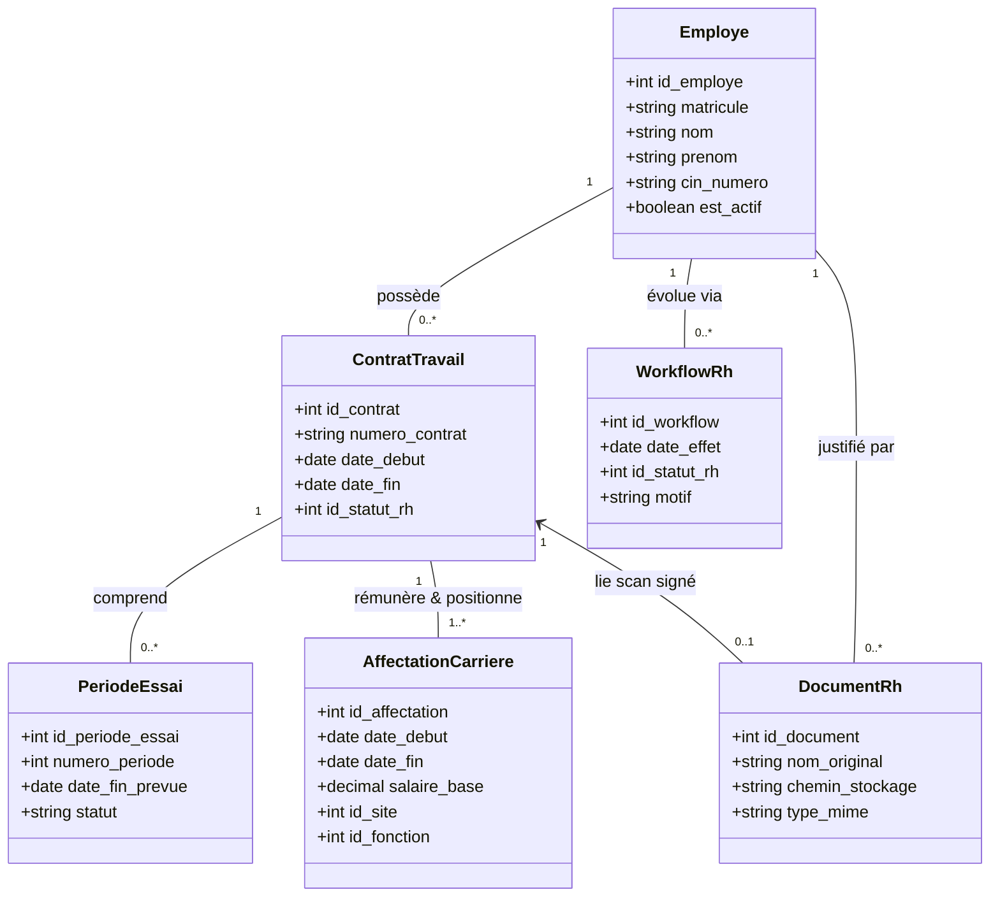
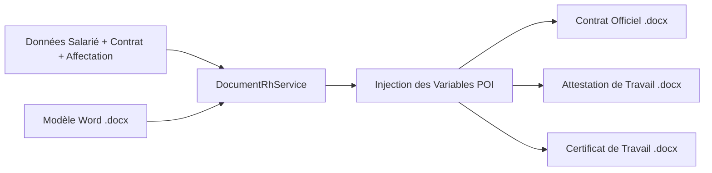

# Module Employé, Contrat & Carrière — Spécification Métier et Technique
## GALAXAM SIRH — Document de Référence pour Mémoire de Fin d'Études

> **Périmètre fonctionnel** : Dossier individuel du salarié, données civiles et familiales, coordonnées bancaires, contrats de travail, périodes d'essai, affectations temporelles, mouvements de carrière (workflows), génération documentaire officielle (.docx, .csv) et supervision décisionnelle.  
> **Cadre juridique de référence** : Code du Travail Malagasy (Loi n° 2003-044 du 28 juillet 2004), Décret n° 64-195 (CIN à Madagascar), Décret n° 69-145 (Code de Prévoyance Sociale CNaPS).  
> **Références logicielles** : Scripts SQL canoniques (`02_schema_referentiels_rh.sql`, `03_schema_employes_contrats.sql`), services applicatifs (`EmployeService`, `WorkflowRhService`, `DocumentRhService`, `EmploymentContextResolver`, `EmployerIdentityContextResolver`, `CarriereExportService`), moteurs de domaine (`EmployeValidationEngine`, `ContratValidationEngine`, `CarriereTransitionValidator`, `AncienneteEngine`, `MatriculeGeneratorEngine`), contrôleurs API et interface React (`frontend/src/features/employees`).  
> **Date de révision** : Octobre 2026 (Version alignée à 100% sur l'implémentation opérationnelle).

---

## Sommaire Exécutif

Le **Module Employé, Contrat & Carrière** constitue le socle fondamental et le référentiel maître de GALAXAM SIRH. Il orchestre l'ensemble du cycle de vie du capital humain de l'entreprise, depuis l'onboarding initial jusqu'au départ du collaborateur.

L'architecture métier repose sur une dissociation conceptuelle stricte entre trois dimensions :
1. **L'Identité civile de la personne** (`employe`) : pérenne et indépendante des aléas contractuels.
2. **L'Engagement juridique** (`contrat_travail`) : rattaché à une filiale légale, un type d'engagement et une chronologie bornée.
3. **Le Positionnement organisationnel et salarial** (`employe_affectation_carriere`) : poste, site, service, fonction, classification professionnelle et rémunération de base à une date d'effet précise.

Tous les mouvements de carrière (promotions, revalorisations, mutations, renouvellements, titularisations ou ruptures) sont formalisés sous forme de **workflows à validation habilitée**, garantissant l'intégrité transactionnelle, la traçabilité temporelle et la conformité légale malgache.

---

## Table des Matières

1. [Fondements Juridiques et Cadre Légal Malagasy](#1-fondements-juridiques-et-cadre-légal-malagasy)
2. [Concepts Fondamentaux et Frontière Métier](#2-concepts-fondamentaux-et-frontière-métier)
3. [Acteurs, Permissions RBAC et Parcours Utilisateur](#3-acteurs-permissions-rbac-et-parcours-utilisateur)
4. [Architecture Technique et Modèle de Données Relationnel](#4-architecture-technique-et-modèle-de-données-relationnel)
5. [Moteur de Validation du Dossier Salarié](#5-moteur-de-validation-du-dossier-salarié)
6. [Cycle de Vie Contractuel et Périodes d'Essai](#6-cycle-de-vie-contractuel-et-périodes-dessai)
7. [Moteur de Transition de Carrière et Workflows RH](#7-moteur-de-transition-de-carrière-et-workflows-rh)
8. [Résolution Contextuelle et Découplage Temporel](#8-résolution-contextuelle-et-découplage-temporel)
9. [Moteur d'Ancienneté et Génération Documentaire Officielle](#9-moteur-dancienneté-et-génération-documentaire-officielle)
10. [Supervision Globale et Tableau de Bord Décisionnel](#10-supervision-globale-et-tableau-de-bord-décisionnel)
11. [Catalogue Exhaustif des Règles de Gestion (RG)](#11-catalogue-exhaustif-des-règles-de-gestion-rg)

---

## 1. Fondements Juridiques et Cadre Légal Malagasy

Le module transpose dans son code source les dispositions d'ordre public du droit du travail et de la sécurité sociale à Madagascar :

| Source Légale | Article / Texte | Application Concrète dans GALAXAM SIRH | Implémentation Logicielle |
| :--- | :--- | :--- | :--- |
| **Code du Travail** | **Loi n° 2003-044, Art. 100** | **Âge minimum d'accès à l'emploi** : 16 ans révolus. Interdiction absolue d'enregistrer un collaborateur de moins de 16 ans à sa date d'embauche. | `EmployeValidationEngine.validerAgeLegal()` |
| **Code du Travail** | **Loi n° 2003-044, Art. 18 à 22** | **Forme et types de contrats** : Définition des contrats à durée indéterminée (CDI) et à durée déterminée (CDD). Obligation d'écrit et de date de terme pour les CDD. | `ContratValidationEngine.validerContrat()` |
| **Code du Travail** | **Loi n° 2003-044, Art. 24 & 25** | **Période d'essai** : Durée maximale légale, formalisation écrite obligatoire, possibilité de renouvellement numéroté, rupture sans indemnité. | `CarriereTransitionValidator`, `contrat_periode_essai` |
| **Code du Travail** | **Loi n° 2003-044, Art. 42** | **Certificat de travail** : Délivrance obligatoire à l'expiration de tout contrat de travail, sous peine de dommages-intérêts, mentionnant exclusivement la date d'entrée, de sortie et les fonctions occupées. | `DocumentRhService.genererCertificatDocx()` |
| **État Civil Malagasy** | **Décret n° 64-195 modifié** | **Carte d'Identité Nationale (CIN)** : Identifiant unique à 12 chiffres. Vérification de cohérence chronologique (délivrance après 16 ans). | `EmployeValidationEngine.validerCinFormatEtDate()` |
| **Sécurité Sociale** | **Décret n° 69-145 (CPS)** | **Affiliation CNaPS** : Numéro d'affiliation travailleur unique pour l'ouverture des droits de prévoyance et retraite. | `employe.num_affiliation_cnaps` (Contrainte UNIQUE SQL) |

---

## 2. Concepts Fondamentaux et Frontière Métier



### 2.1 Dissociation Entité vs Engagement
* **L'Employé (`employe`)** : Ne contient aucune donnée salariale ni contractuelle volatile. Il conserve l'identité civile, la filiation (`pere_nom_prenom`, `mere_nom_prenom`), la CIN, les coordonnées, la situation de famille et les personnes à charge.
* **Le Contrat (`contrat_travail`)** : Matérialise le lien juridique avec la filiale employeur (`ref_filiale`). Il porte la nature du contrat (`CDI`, `CDD`, `STAGE`, `PRESTATION`, `TEMPORAIRE`), son statut (`BROUILLON`, `PLANIFIE`, `A_SIGNER`, `ACTIF`, `TERMINE`, `ROM нача`), et le lien de chaînage contractuel (`id_contrat_precedent`).
* **L'Affectation (`employe_affectation_carriere`)** : Porte la rémunération brute de base (`salaire_base`), le mode de calcul (`MENSUEL`, `HORAIRE`), le site géographique d'affectation (`ref_site`), le service (`ref_service`), la fonction (`ref_fonction`) et la classification professionnelle (`ref_categorie_professionnelle`).

---

## 3. Acteurs, Permissions RBAC et Parcours Utilisateur

Le contrôle d'accès repose sur le module transversal de sécurité Spring Security avec RBAC dynamique :

| Habilitation | Rôles Associés | Périmètre d'Action |
| :--- | :--- | :--- |
| `EMPLOYE_READ` | Agent RH, DAF, Manager, Admin | Consultation de l'annuaire, des fiches individuelles, des synthèses de carrière et des documents. |
| `EMPLOYE_WRITE` | Gestionnaire RH, Admin | Création/modification des dossiers salariés, upload de pièces jointes, création de brouillons de mouvements. |
| `EMPLOYE_VALIDATE` | DAF, DRH, Direction Générale, Admin | Décision finale d'approbation ou de rejet des workflows de carrière, activation effective des contrats et affectations. |
| `ROLE_ADMIN` | Administrateur Système | Accès universel, supervision des anomalies, purge et configuration des référentiels structurels. |

### 3.1 Les Trois Parcours Écrans Majeurs (Frontend React)

L'expérience utilisateur est segmentée en 3 interfaces complémentaires dans `frontend/src/features/employees` :

1. **L'Annuaire du Personnel (`/employes` — `EmployeListPage.jsx`)** :
   - Recherche textuelle full-text (nom, prénom, matricule, CIN).
   - Filtres à facettes dynamiques : statut d'activité (`Actifs`, `Inactifs`, `Tous`), filiale, site, département, service.
   - Bouton de création guidée ouvrant `EmployeeFormModal.jsx`.

2. **La Fiche Salarié à 7 Onglets (`/employes/:id` — `EmployeFicheDetailPage.jsx`)** :
   - Synchronisation bidirectionnelle de l'onglet actif dans l'URL (`?tab=carriere`, `?tab=documents`, etc.).
   - *Fiche personnelle* : État civil, CIN, coordonnées, photo sécurisée IDOR.
   - *Famille & Contacts* : Conjoint, enfants à charge, personnes à contacter en cas d'urgence.
   - *Carrière & Affectation* : Section contrat actif dépliée par défaut (`ContratActifSection.jsx`), timeline interactive, boutons d'action rapide (Attestation Word, avenant, fin d'essai).
   - *Documents RH* : Espace de gestion documentaire (`DocumentsRhTab.jsx`), téléchargement et dépôt sécurisé.
   - *Congés & Absences*, *Pointages & Présence*, *Paie & Rémunération* : Passerelles de consultation transversale.

3. **Le Cockpit de Supervision des Carrières (`/carrieres` — `CarrieresSupervisionPage.jsx`)** :
   - Tableau de bord décisionnel RH pour la direction.
   - Deux onglets de pilotage : `Contrats` (registre global) et `Mouvements` (workflows en cours).
   - Panneau « À traiter en priorité » (`SupervisionAlertsPanel.jsx`).
   - Export CSV officiel en un clic du registre du personnel.

---

## 4. Architecture Technique et Modèle de Données Relationnel

### 4.1 Référentiels Métier (`02_schema_referentiels_rh.sql`)

Le module s'appuie sur des tables de référence immuables :
* `ref_filiale` : Entités juridiques de l'entreprise (raison sociale, NIF, STAT, siège, contact).
* `ref_type_contrat` : Typologies d'engagement (`CDI`, `CDD`, `STAGE`, `PRESTATION`, `TEMPORAIRE`).
* `ref_statut_rh` : États normalisés du workflow (`BROUILLON`, `PLANIFIE`, `A_SIGNER`, `ACTIF`, `TERMINE`, `SUSPENDU`, `ANNULE`, `CLOTURE`).
* `ref_type_evenement_rh` : Les **17 événements officiels** gérés en base :
  1. `EMBAUCHE_INITIALE` (Onboarding initial)
  2. `RENOUVELLEMENT_CDD` (Prorogation de terme)
  3. `TRANSFORMATION_CDI` (Titularisation pérenne)
  4. `EMBAUCHE_APRES_STAGE` (Conversion de stage)
  5. `MUTATION` (Changement de site ou département)
  6. `PROMOTION` (Changement de grade ou classification)
  7. `REVALORISATION` (Augmentation salariale)
  8. `RENOUVELLEMENT_ESSAI` (Prolongation d'essai)
  9. `CONFIRMATION_ESSAI` (Validation définitive de l'essai)
  10. `RUPTURE_ESSAI` (Fin de période d'essai)
  11. `DEMISSION` (Départ volontaire du salarié)
  12. `LICENCIEMENT` (Rupture à l'initiative de l'employeur)
  13. `RUPTURE_CONVENTIONNELLE` (Séparation à l'amiable)
  14. `DEPART_RETRAITE` (Atteinte de l'âge légal de retraite)
  15. `REPRISE_CONSULTANT` (Passage sous statut externe)
  16. `REPRISE_ANCIENNETE` (Réintégration avec maintien de droits)
  17. `FIN_CONTRAT` (Arrivée à échéance du terme)

### 4.2 Schéma des Données Fondamentales (`03_schema_employes_contrats.sql`)

```sql
-- Extrait des contraintes clés du schéma relationnel
CREATE TABLE employe (
    id_employe SERIAL PRIMARY KEY,
    matricule VARCHAR(20) NOT NULL UNIQUE,
    nom VARCHAR(100) NOT NULL,
    prenom VARCHAR(100) NOT NULL,
    sexe sexe_enum NOT NULL,
    date_naissance DATE NOT NULL,
    cin_numero VARCHAR(30) NOT NULL UNIQUE,
    cin_date_delivrance DATE NOT NULL,
    num_affiliation_cnaps VARCHAR(30) UNIQUE,
    est_actif BOOLEAN DEFAULT TRUE,
    created_at TIMESTAMP DEFAULT CURRENT_TIMESTAMP
);

CREATE TABLE contrat_travail (
    id_contrat SERIAL PRIMARY KEY,
    id_employe INT NOT NULL REFERENCES employe(id_employe),
    id_filiale INT NOT NULL REFERENCES ref_filiale(id_filiale),
    id_type_contrat INT NOT NULL REFERENCES ref_type_contrat(id_type_contrat),
    id_statut_rh INT NOT NULL REFERENCES ref_statut_rh(id_statut_rh),
    id_contrat_precedent INT REFERENCES contrat_travail(id_contrat),
    numero_contrat VARCHAR(50) UNIQUE,
    date_debut DATE NOT NULL,
    date_fin DATE,
    date_fin_essai DATE,
    CONSTRAINT chk_contrat_dates CHECK (date_fin IS NULL OR date_fin >= date_debut)
);

CREATE TABLE employe_affectation_carriere (
    id_affectation SERIAL PRIMARY KEY,
    id_employe INT NOT NULL REFERENCES employe(id_employe),
    id_contrat INT NOT NULL REFERENCES contrat_travail(id_contrat),
    id_site INT NOT NULL REFERENCES ref_site(id_site),
    id_fonction INT NOT NULL REFERENCES ref_fonction(id_fonction),
    salaire_base NUMERIC(12,2) NOT NULL CHECK (salaire_base > 0),
    date_debut DATE NOT NULL,
    date_fin DATE,
    CONSTRAINT chk_affectation_dates CHECK (date_fin IS NULL OR date_fin >= date_debut)
);
```

---

## 5. Moteur de Validation du Dossier Salarié

La validation est centralisée dans la classe [EmployeValidationEngine.java](file:///Users/andriamalalatojo/Documents/GALAXAM/GALAXAM-SIRH/backend/src/main/java/mg/galaxam/sirh/contrat/domain/EmployeValidationEngine.java). Elle garantit que toute insertion ou mise à jour respecte les standards légaux et d'intégrité avant d'atteindre la couche persistance :

```
[Requête EmployeRequest]
         │
         ▼
 1. Identité Civile (Nom, Prénom, Sexe enum 'M'/'F')
         │
         ▼
 2. Âge Légal Malagasy (Loi 2003-044, Art. 100) : calcul de Period.between(dateNaiss, now).getYears() >= 16
         │
         ▼
 3. Carte d'Identité Nationale (CIN) :
    - Format Regex : exactement 12 chiffres (^[0-9]{12}$)
    - Non-futurité de la date de délivrance
    - Cohérence croisée : (dateCin - dateNaiss) >= 16 ans révolus
         │
         ▼
 4. Coordonnées & Contact :
    - Adresse physique obligatoire
    - Téléphone obligatoire validé par Regex (^[+]?[0-9\\s.-]{8,20}$)
    - Email facultatif mais syntaxiquement validé par RFC-5322 Regex
         │
         ▼
 5. Comptes Bancaires :
    - Cohérence biunivoque banque/RIB (si la banque est choisie, le RIB est obligatoire et réciproquement)
         │
         ▼
 6. Filiation & Enfants :
    - Nom obligatoire
    - Date de naissance non future
    - Cohérence scolarité : dateFinScolarite >= dateNaissance
         │
         ▼
[Validation Réussie ➔ Persistance Transactionnelle]
```

---

## 6. Cycle de Vie Contractuel et Périodes d'Essai

### 6.1 Validation des Contrats (`ContratValidationEngine.java`)
* **Date de début** : Obligatoire sur tout contrat.
* **Terme obligatoire** : Exigé pour les contrats temporaires (`CDD`, `STAGE`, `PRESTATION`, `TEMPORAIRE`). Une absence de date de fin sur un CDD déclenche l'exception `DATE_FIN_MANDATORY_FOR_CDD`.
* **Cohérence temporelle** : La date de fin doit être strictement supérieure ou égale à la date de début (`chk_contrat_dates`).

### 6.2 Gestion des Périodes d'Essai (Loi n° 2003-044, Art. 24)
La période d'essai fait l'objet d'une table dédiée `contrat_periode_essai` et d'une synchronisation sur le contrat maître :
1. **Durée encadrée** : 0 à 6 mois selon la catégorie professionnelle et les dispositions conventionnelles.
2. **Calcul de la date de fin théorique** : Ajout de la durée en mois moins 1 jour :
   $$\text{dateFinEssai} = \text{dateDebut} + M \text{ mois} - 1 \text{ jour}$$
3. **Cycle d'états d'une période d'essai** :
   - `EN_COURS` : Période active d'évaluation.
   - `CONFIRMEE` : Salarié titularisé dans ses fonctions.
   - `RENOUVELLEE` : Prolongation formalisée (création d'une nouvelle ligne d'essai numérotée $N+1$).
   - `ROMPUE` : Rupture unilatérale ou conjointe sans préavis selon l'Art. 25 du Code du Travail.

---

## 7. Moteur de Transition de Carrière et Workflows RH

Le service [WorkflowRhService.java](file:///Users/andriamalalatojo/Documents/GALAXAM/GALAXAM-SIRH/backend/src/main/java/mg/galaxam/sirh/contrat/application/WorkflowRhService.java) couplé au validateur de matrice [CarriereTransitionValidator.java](file:///Users/andriamalalatojo/Documents/GALAXAM/GALAXAM-SIRH/backend/src/main/java/mg/galaxam/sirh/contrat/domain/CarriereTransitionValidator.java) orchestre les évolutions contractuelles.

### 7.1 Matrice d'Admissibilité des Transitions

Le moteur vérifie la compatibilité stricte entre le type de contrat d'origine et l'événement sollicité :

| Type Contrat Source | Événements RH Admissibles dans le Système |
| :--- | :--- |
| **`STAGE`** | `EMBAUCHE_APRES_STAGE`, `FIN_CONTRAT`, `RUPTURE_ESSAI`, `DEMISSION` |
| **`CDD`** | `TRANSFORMATION_CDI`, `RENOUVELLEMENT_CDD`, `REPRISE_ANCIENNETE`, `MUTATION`, `PROMOTION`, `REVALORISATION`, `REORGANISATION`, `CONFIRMATION_ESSAI`, `RENOUVELLEMENT_ESSAI`, `RUPTURE_ESSAI`, `FIN_CONTRAT`, `DEMISSION`, `LICENCIEMENT`, `RUPTURE_CONVENTIONNELLE`, `DEPART_RETRAITE` |
| **`CDI`** | `REPRISE_ANCIENNETE`, `MUTATION`, `PROMOTION`, `REVALORISATION`, `REORGANISATION`, `REPRISE_CONSULTANT`, `CONFIRMATION_ESSAI`, `RENOUVELLEMENT_ESSAI`, `RUPTURE_ESSAI`, `DEMISSION`, `LICENCIEMENT`, `RUPTURE_CONVENTIONNELLE`, `DEPART_RETRAITE`, `FIN_CONTRAT` |
| **`PRESTATION`** | `TRANSFORMATION_CDI`, `FIN_CONTRAT`, `RUPTURE_CONVENTIONNELLE` |
| **`TEMPORAIRE`** | `TRANSFORMATION_CDI`, `FIN_CONTRAT`, `RUPTURE_CONVENTIONNELLE` |

### 7.2 Mécanique de Validation Transactionnelle et Verrou Pessimiste

Lorsqu'un responsable RH valide un workflow via `PUT /workflows/{id}/valider` :
1. **Verrouillage Pessimiste** : La ligne du workflow est verrouillée par `SELECT ... FOR UPDATE` pour empêcher toute décision concurrente.
2. **Contrôle d'état** : Seul un workflow au statut `BROUILLON` peut être validé.
3. **Application Immédiate vs Planifiée** :
   - Si $\text{dateEffet} \le \text{Aujourd'hui}$ : Le système clôture le contrat source à $\text{dateEffet} - 1\text{ jour}$, active le nouveau contrat, ferme l'affectation précédente et active la nouvelle affectation.
   - Si $\text{dateEffet} > \text{Aujourd'hui}$ : Le workflow et le contrat cible passent au statut `PLANIFIE`. Le job nocturne [MouvementRhScheduler.java](file:///Users/andriamalalatojo/Documents/GALAXAM/GALAXAM-SIRH/backend/src/main/java/mg/galaxam/sirh/cron/MouvementRhScheduler.java) appliquera les changements le jour J à 00:00:00.

---

## 8. Résolution Contextuelle et Découplage Temporel

Pour éliminer le problème classique des requêtes N+1 et garantir que la Paie et le Pointage consomment l'exacte réalité contractuelle d'une date donnée, le module fournit deux résolveurs canoniques :

### 8.1 `EmploymentContextResolver.java`
Ce service résout en **une seule requête SQL optimisée** l'ensemble des conditions de travail d'un collaborateur sur une plage $[T_{\text{debut}}, T_{\text{fin}}]$ :
* Détermination du site applicable jour par jour (`resolveSitesByDay`).
* Détermination des dispenses de badgeage et de l'éligibilité aux heures supplémentaires (`resolvePointageDays`).
* Détection stricte et blocage des chevauchements d'affectations.
* Extraction du salaire de base en vigueur à chaque date pour le moteur de paie (`resolveSalary`).

### 8.2 `EmployerIdentityContextResolver.java`
Ce composant résout l'entité juridique employeur (Raison sociale, NIF, STAT, adresse, contact) rattachée au contrat valide sur la période :
* Protection contre les configurations manquantes (`MISSING_CONFIGURATION: FILIALE`).
* Protection contre les ambiguïtés juridiques (`AMBIGUOUS_CONFIGURATION: FILIALE`) si deux filiales distinctes se chevauchent sur la même période.

---

## 9. Moteur d'Ancienneté et Génération Documentaire Officielle

### 9.1 Moteur d'Ancienneté (`AncienneteEngine.java`)

Le calcul d'ancienneté reconstitue en mémoire le graphe orienté des contrats successifs grâce au champ `id_contrat_precedent` :
* **Ancienneté globale continue** : Cumul de tous les contrats de la chaîne sans interruption de relation de travail.
* **Ancienneté du contrat courant** : Temps écoulé depuis le début du contrat actif.
* **Formatage officiel** : Restitution standardisée (ex : `"2 ans 4 mois"`).
* **Consommateurs directs** :
  - *Module Paie* : Calcul de la prime d'ancienneté conventionnelle.
  - *Module STC* : Calcul des indemnités de préavis et de licenciement (Art. 27 à 35).
  - *Documents officiels* : Mentions obligatoires sur les attestations et certificats.

### 9.2 Moteur Documentaire Officiel (`DocumentRhService.java` & Apache POI)

Le système assure la production automatisée de l'ensemble des livrables contractuels au format Microsoft Word (`.docx`), basés sur des canevas validés stockés dans `backend/src/main/resources/templates/documents/` :



1. **Contrats de Travail par Typologie** :
   - `Contrat_CDI_modele.docx` : Contrat à durée indéterminée standard.
   - `Contrat_CDD_modele.docx` : Contrat à terme fixe avec motif de recours.
   - `Contrat_STAGE_modele.docx` : Convention de stage tripartite.
   - `Contrat_PRESTATION_modele.docx` : Contrat de prestation de services.
   - `Contrat_TEMPORAIRE_modele.docx` : Contrat de travail temporaire.
2. **Règle d'affectation originelle** : Le contrat Word résout obligatoirement la **première affectation historique** du contrat (`rechercherPremiereParContrat`), empêchant qu'une augmentation ou mutation ultérieure ne vienne modifier rétrospectivement le document contractuel initial.
3. **Attestation de Travail** : Émise sur demande pour justifier de l'emploi en cours (option avec ou sans mention du salaire).
4. **Certificat de Travail (Art. 42 du Code du Travail)** : Émis obligatoirement en fin de contrat, libre de toute mention diffamatoire ou préjudiciable, certifiant la date d'entrée, la date de sortie et les fonctions successivement occupées.

---

## 10. Supervision Globale et Tableau de Bord Décisionnel

Le contrôleur [ContratGlobalController.java](file:///Users/andriamalalatojo/Documents/GALAXAM/GALAXAM-SIRH/backend/src/main/java/mg/galaxam/sirh/contrat/api/ContratGlobalController.java) expose les métriques stratégiques consommées par l'espace supervision du frontend :

### 10.1 Indicateurs de Pilotage (`/contrats/stats-globales`)
* **Total contrats actifs** : Salariés présents dans les effectifs.
* **Répartition par type** : Effectifs CDI vs CDD vs Stagiaires vs Prestataires.
* **Contrats en attente de signature** : Contrats `BROUILLON` ou `A_SIGNER` nécessitant une action RH.
* **Échéances < 60 jours** : Alertes sur les termes de CDD et périodes d'essai arrivant à échéance.
* **Doublons potentiels** : Détection des anomalies de gestion où un salarié possède plusieurs contrats de même type débutant le même jour.

### 10.2 Panneau « À Traiter en Priorité » (`/contrats/alertes-prioritaires`)
* **Fins de période d'essai imminentes (< 45 jours)** : Permet d'anticiper la confirmation de titularisation ou le renouvellement.
* **Fins de CDD imminentes (< 60 jours)** : Alerte pour préparer le renouvellement ou la transformation en CDI.
* **Export CSV complet du Registre du Personnel** (`/contrats/export`) : Flux continu UTF-8 avec BOM Excel conforme aux exigences de l'Inspection du Travail.

---

## 11. Catalogue Exhaustif des Règles de Gestion (RG)

| Code Règle | Énoncé de la Règle de Gestion | Source Juridique ou Technique | Contrôle & Comportement Système |
| :--- | :--- | :--- | :--- |
| **RG-EMP-01** | **Unicité du matricule** | Norme interne GALAXAM | Contrainte `UNIQUE` SQL sur `employe.matricule`. Moteur `MatriculeGeneratorEngine` supportant les formats `0042` et `EMP-AAAA-XXXX`. |
| **RG-EMP-02** | **Âge minimum d'admission à l'emploi** | **Code du Travail Malagasy, Art. 100** | Blocage absolu (`AGE_MINIMUM_LEGAL = 16`). Levée d'exception si l'employé a moins de 16 ans révolus. |
| **RG-EMP-03** | **Format et antériorité de la CIN** | **Décret n° 64-195** | Exactement 12 chiffres obligatoires. La date de délivrance doit être postérieure à $\text{dateNaissance} + 16\text{ ans}$. |
| **RG-EMP-04** | **Unicité d'affiliation CNaPS** | **Décret n° 69-145 (CPS)** | Contrainte `UNIQUE` sur `num_affiliation_cnaps`. |
| **RG-EMP-05** | **Cohérence du compte bancaire** | Règle comptable DAF | Si une banque est choisie, le numéro de compte RIB est obligatoire et réciproquement. |
| **RG-EMP-06** | **Désactivation motivée du collaborateur** | Audit & Sécurité RH | La désactivation requiert un motif issu de `motif_desactivation_enum`. Le dossier et l'historique restent intégralement conservés en base. |
| **RG-CAR-01** | **Terme obligatoire des contrats temporaires** | **Code du Travail, Art. 19 & 20** | Date de fin obligatoire pour `CDD`, `STAGE`, `PRESTATION` et `TEMPORAIRE`. Rejet si date de fin absente ou antérieure au début. |
| **RG-CAR-02** | **Encadrement de la période d'essai** | **Code du Travail, Art. 24** | Durée comprise entre 0 et 6 mois. Calcul déterministe de la date de fin d'essai. Cycle d'états contrôlé (`contrat_periode_essai`). |
| **RG-CAR-03** | **Contrôle d'admissibilité des mouvements** | Politique RH GALAXAM | Validation de la transition par `CarriereTransitionValidator` selon la matrice des 17 événements autorisés. |
| **RG-CAR-04** | **Verrouillage des workflows de carrière** | Concurrence & Audit | Verrouillage transactionnel `SELECT ... FOR UPDATE` de la ligne workflow. Seul l'état `BROUILLON` est éligible à la validation. |
| **RG-CAR-05** | **Continuité des affectations salariales** | Règle de calcul Paie | Tout changement de salaire ou de poste ferme l'affectation précédente à $J-1$ et active la nouvelle à $J$. Salaire strictement positif (`salaire_base > 0`). |
| **RG-CAR-06** | **Détection des doublons contractuels** | Qualité des données RH | Détection automatique par requête SQL (`DOUBLON_POTENTIEL`) signalant les contrats de même type et même date de début. |
| **RG-DOC-01** | **Affectation initiale sur contrat Word** | Moteur POI `DocumentRhService` | Le contrat `.docx` généré résout obligatoirement la première affectation historique, évitant toute contamination par des avenants ultérieurs. |
| **RG-DOC-02** | **Délivrance du certificat de travail** | **Code du Travail, Art. 42** | Production du certificat officiel `.docx` à la clôture du contrat, mentionnant exclusivement les dates d'entrée/sortie et fonctions occupées. |
| **RG-SEC-01** | **Protection IDOR sur la photo de profil** | Norme OWASP API Security | L'accès à la photo de l'employé (`/{id}/photo`) passe par un endpoint authentifié vérifiant les habilitations de l'utilisateur connecté. |
