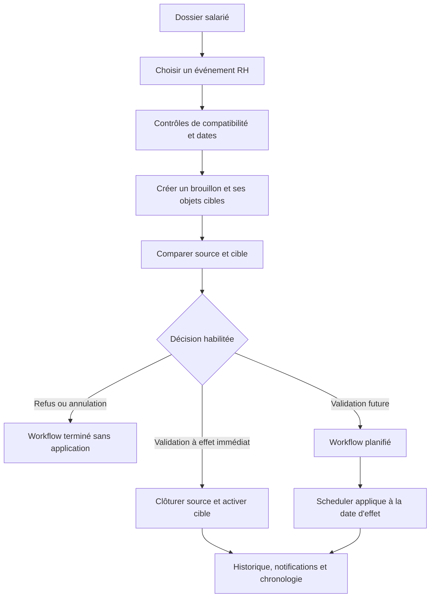

# Module Employé, Contrat & Carrière — Spécification métier et technique
## GALAXAM SIRH — Documentation de référence pour le mémoire

> **Périmètre** : dossier du salarié, données familiales et bancaires, contrats, périodes d'essai, affectations, mouvements de carrière, pièces RH et alertes.  
> **Références de code** : `03_schema_employes_contrats.sql`, `EmployeService`, `WorkflowRhService`, contrôleurs du paquet `mg.galaxam.sirh.contrat` et `frontend/src/features/employees`.  
> **État de description** : code observé dans le dépôt en septembre 2026. Les limites connues sont indiquées dans le chapitre 10.

---

## Sommaire exécutif

Le module Employé et Carrière maintient le dossier d'identité, les informations utiles à la gestion RH, les contrats successifs et les affectations datées. Il sépare l'existence de la personne, la relation contractuelle et son poste dans l'organisation. Les mouvements sont préparés comme des workflows ; leur validation applique les changements de contrat et d'affectation selon leur date d'effet.

L'interface expose une liste filtrable, une fiche à onglets et un espace de supervision des carrières. Le backend valide les données, contrôle les transitions permises, trace les actions et alimente les vues de consultation. Cette documentation décrit les comportements réellement présents dans le dépôt et relève les écarts entre les contrôles applicatifs et les garanties offertes par le schéma SQL.

## Table des matières

1. [Frontière fonctionnelle et concepts](#1-frontière-fonctionnelle-et-concepts)
2. [Acteurs et parcours utilisateur](#2-acteurs-et-parcours-utilisateur)
3. [Modèle de données](#3-modèle-de-données)
4. [Règles de validation du dossier salarié](#4-règles-de-validation-du-dossier-salarié)
5. [Contrats et période d'essai](#5-contrats-et-période-dessai)
6. [Workflow et mouvements de carrière](#6-workflow-et-mouvements-de-carrière)
7. [Affectations historisées et intégrations](#7-affectations-historisées-et-intégrations)
8. [Documents RH et productions officielles](#8-documents-rh-et-productions-officielles)
9. [Architecture, API et interface](#9-architecture-api-et-interface)
10. [Contrôles, limites et recommandations](#10-contrôles-limites-et-recommandations)
11. [Catalogue des règles de gestion](#11-catalogue-des-règles-de-gestion)

---

## 1. Frontière fonctionnelle et concepts

| Concept | Description | Données principales |
| :--- | :--- | :--- |
| Employé | Identité civile et dossier durable de la personne | `employe` |
| Contrat | Engagement juridique rattaché à une filiale, un type, un statut et des dates | `contrat_travail` |
| Période d'essai | Périodes numérotées, datées et suivies séparément du contrat | `contrat_periode_essai` |
| Affectation de carrière | Poste, site, service, catégorie, mode de paie et salaire à une période donnée | `employe_affectation_carriere` |
| Workflow RH | Demande de mouvement, sa source, sa cible, son motif, ses dates et ses acteurs | `workflow_rh` |
| Document RH | Fichier associé à la personne et, éventuellement, à un contrat ou workflow | `document_rh` |

Une modification d'identité corrige le dossier personnel. Une promotion, une mutation ou une revalorisation relève d'un événement de carrière et doit créer une trace temporelle. Le contrat et l'affectation sont des objets distincts : un salarié peut changer d'affectation sans que la personne change, et certains événements créent un nouveau contrat lié au précédent.

Le module fournit des liens vers Congés, Pointage et Paie dans la fiche. Ces onglets affichent les données des modules concernés ; ils ne déplacent pas leurs règles de calcul dans le dossier Employé. La rémunération de référence est portée par l'affectation et consommée par la paie selon la date de période.

## 2. Acteurs et parcours utilisateur

### 2.1 Liste du personnel

`EmployeList` permet de consulter les dossiers avec recherche, filtres d'activité et rattachements organisationnels, tri et pagination. Le contrôleur `GET /employes` accepte notamment `q`, `actif`, `site`, `departement`, `service`, `sort`, `direction`, `page` et `size`. Des routes séparées servent aux statistiques et aux options de sélection.

Le matricule peut être saisi ou proposé par le backend. La vérification de disponibilité par API améliore le formulaire, mais la contrainte `UNIQUE` de la table reste l'arbitre final en cas de création concurrente. Le générateur conserve une nomenclature séquentielle historique ; le moteur sait aussi reconnaître le format `EMP-AAAA-NNNN`.

### 2.2 Fiche individuelle

La fiche est accessible par employé et mémorise l'onglet sélectionné dans l'URL. Les sections observées dans `EmployeFicheDetailPage.jsx` sont :

| Onglet | Contenu |
| :--- | :--- |
| Fiche personnelle | État civil, CIN, coordonnées et photo |
| Famille & Contacts | Conjoint, enfants et contacts d'urgence |
| Documents RH | Pièces déposées, informations de classement et téléchargement |
| Carrière & Affectation | Contrat courant, périodes d'essai, historique et workflows |
| Congés & Absences | Vue liée au module Congés |
| Pointages & Présence | Vue liée au module Pointage |
| Paie & Rémunération | Historique et vues du module Paie |

La visibilité de certains onglets dépend des droits. Le profil synthétique est chargé via `EmployeFicheDetailDTO`, qui réunit l'employé, le conjoint, les enfants, les contacts et les comptes bancaires. Les contrats, workflows et documents sont chargés par les services dédiés.

### 2.3 Parcours carrière

Le formulaire de mouvement guide l'utilisateur dans le choix de l'événement, du contrat cible et de la nouvelle affectation. Un aperçu comparatif rend visibles les champs source et cible avant validation ; une chronologie et les tableaux d'historique permettent de relire les changements. Les brouillons peuvent être modifiés ou annulés. La validation déclenche l'application immédiate ou planifiée selon la date d'effet et l'événement.

## 3. Modèle de données

Le schéma canonique `backend/conception/bdd/03_schema_employes_contrats.sql` crée les tables RH et leurs vues. Les référentiels (filiale, type de contrat, intervenant, statut, événement, motif, site, service, fonction, catégorie et mode de paie) sont définis dans `02_schema_referentiels_rh.sql`.

| Table | Rôle et relations |
| :--- | :--- |
| `employe` | Matricule, identité, CIN, coordonnées, rattachement CNaPS, photo et activation |
| `employe_conjoint` | Informations facultatives du conjoint |
| `employe_enfant` | Enfants, charge, scolarité et certificat déclaré |
| `employe_contact_urgence` | Contacts mobilisables en cas d'urgence |
| `employe_compte_banque` | Comptes associés ; index unique partiel pour un compte principal par employé |
| `contrat_travail` | Contrats successifs, filiale, dates, statut, motif et lien vers contrat précédent |
| `contrat_periode_essai` | Périodes d'essai numérotées, dates prévues/réelles et état |
| `employe_affectation_carriere` | Affectations et paramètres professionnels historisés par dates |
| `workflow_rh` | Événement, source/cible, dates, motif et demandeur/valideur |
| `ref_type_document`, `document_rh` | Politique de type documentaire et métadonnées de fichiers |
| `notification_rh` | Alertes par utilisateur/rôle, priorité et état de lecture |

Les vues `v_employe_cpl`, `v_historique_carriere_global` et `v_employe_actif_courant` regroupent les informations utiles à l'affichage. Elles évitent que chaque écran réécrive ses propres jointures, mais les données restent détenues par les tables sources.

Le schéma garantit notamment l'unicité du matricule, de la CIN, de certains identifiants, du numéro de contrat renseigné, du numéro de période d'essai au sein d'un contrat et de l'unicité d'un compte bancaire principal. Le salaire d'affectation doit être positif. Les dates de carrière, en revanche, ne sont pas toutes protégées par une contrainte SQL d'absence de chevauchement ; les contrôles applicatifs et l'audit doivent donc être complétés par une vérification des intervalles existants.

## 4. Règles de validation du dossier salarié

`EmployeValidationEngine` est appelé par `EmployeService` avant création ou modification. Il vérifie les éléments suivants :

| Donnée | Contrôle backend observé |
| :--- | :--- |
| Nom, prénom, sexe | Valeurs obligatoires ; le sexe utilise les valeurs du référentiel enum |
| Date de naissance | Obligatoire, ne peut être future ; contrôle d'âge minimum fixé à 16 ans dans le moteur |
| CIN | Obligatoire, 12 chiffres attendus ; date de délivrance cohérente et non future lorsqu'elle est fournie |
| Adresse et téléphone | Obligatoires ; téléphone contrôlé par un format numérique tolérant séparateurs |
| Email | Facultatif ; format contrôlé si renseigné |
| Compte bancaire | Contrôles de cohérence lorsque le compte principal est fourni |
| Enfants | Nom requis ; dates de naissance futures et fin de scolarité antérieure rejetées |

La création du dossier, du conjoint, des enfants, contacts et compte bancaire principal fourni dans la requête s'effectue dans une transaction. Le dossier est ensuite enrichi par les parcours contrat/carrière et téléversement de documents. Le système ne doit pas confondre la validation de format d'une pièce d'identité avec l'authentification de son authenticité par un service externe : aucun contrôle externe de ce type n'est documenté dans le code analysé.

La désactivation d'un employé porte un motif (démission, licenciement, fin de contrat, retraite, décès ou autre selon l'enum) et conserve l'enregistrement. La réactivation est également disponible et auditée. La désactivation est une action dédiée ; elle ne remplace pas un workflow de rupture qui ferme le contrat et l'affectation avec une date d'effet.

## 5. Contrats et période d'essai

`ContratValidationEngine` impose une date de début, une date de fin pour certains types à terme (CDD, stage, prestation, consultant, intérim) et refuse une fin antérieure au début. La durée d'essai acceptée par le validateur générique est comprise entre 0 et 6 mois. La date de fin théorique d'une période est calculée en ajoutant la durée en mois puis en retirant un jour. Les paramètres de renouvellement CDD et période d'essai sont contrôlés plus finement par `CarriereTransitionValidator`, parfois à partir de `parametre_global`.

Chaque renouvellement de période d'essai crée une nouvelle ligne numérotée dans `contrat_periode_essai`. L'état est limité par contrainte SQL à `EN_COURS`, `CONFIRMEE`, `RENOUVELEE` ou `ROMPUE`. Les opérations de confirmation, renouvellement et rupture contrôlent l'existence d'une période en cours et les workflows déjà engagés afin d'éviter une seconde décision concurrente.

La supervision des contrats permet de filtrer la population, consulter les contrats actifs et l'historique, afficher les alertes prioritaires et exporter les résultats disponibles. Les événements d'échéance alimentent les notifications RH et les tâches planifiées. Les règles de durée et renouvellement sont des validations applicatives dépendantes des référentiels configurés : elles doivent être revues avec la DAF/RH avant toute modification de paramètre.

## 6. Workflow et mouvements de carrière

Un workflow conserve l'employé, le type d'événement, les états, les contrats et affectations source/cible, les dates de demande et d'effet, le motif, les commentaires et les identifiants de demandeur/valideur. `WorkflowRhService` centralise le brouillon, la validation, les annulations, la planification et l'application automatique des mouvements échus.

### 6.1 Familles d'événements implémentées

Les référentiels couvrent notamment l'embauche initiale, l'embauche après stage, le renouvellement CDD, la transformation en CDI, la reprise d'ancienneté, la reprise consultant, la mutation, la promotion, la revalorisation, la réorganisation, la confirmation/renouvellement/rupture d'essai, la fin de contrat, la démission, le licenciement, la rupture conventionnelle et le départ à la retraite. La matrice d'éligibilité du backend restreint les événements selon le contrat source et le type de cible ; par exemple, les mouvements internes ne sont pas proposés à un contrat de stage.

### 6.2 Création et validation transactionnelles

Lors d'une embauche initiale, le service refuse un contrat actif ou un autre brouillon pour le salarié. Il crée un contrat brouillon et une affectation planifiée, puis lie les objets au workflow. La validation prend un verrou pessimiste `FOR UPDATE` sur la ligne workflow et n'autorise la validation que d'un brouillon. La transition applique les contrôles métier, la mise à jour source/cible et l'audit au sein de la connexion transactionnelle fournie par le contrôleur.

Une transition planifiée est appliquée par `WorkflowRhService.autoAppliquerMouvementsEchus` lorsque la date d'effet est atteinte. Pour un changement de contrat, la date de fin source est normalement positionnée à la veille de la date d'effet, et le nouveau contrat est activé. L'affectation source est close et l'affectation cible activée. Le système réactive aussi un dossier employé inactif lors de certains mouvements de reprise.

La méthode de validation directe de période d'essai existe également. Son usage doit être réservé aux habilitations prévues par l'API ; les événements planifiés passent par la même chaîne de workflow afin que l'historique reste lisible.

## 7. Affectations historisées et intégrations

Une affectation relie salarié et contrat avec statut et motif de mouvement, site, département, service, fonction, responsable hiérarchique, catégorie professionnelle, mode de calcul de paie, salaire de base et dates. La chronologie carrière affiche l'affectation active, les contrats successifs et les mouvements. Les changements salariaux et organisationnels devraient être enregistrés comme nouvelles versions avec date d'effet, pas comme une réécriture non datée de l'affectation antérieure.

| Module consommateur | Informations échangées |
| :--- | :--- |
| Pointage | Employé actif, site, horaires et règles rattachées à son affectation |
| Congés | Identité employé et ancienneté/données nécessaires au calcul du droit |
| Paie | Population éligible, contrat, mode de paie, catégorie, site et salaire de l'affectation applicable |
| Notifications | Échéances de contrat/essai et destinataire employé ou rôle RH |
| Documents officiels | Identité, société, site, ancienneté et historique des fonctions |

La cohérence temporelle entre contrat, affectation, paie et présence dépend de l'application de la date d'effet dans chaque module. Les mouvements planifiés ne doivent pas être consommés avant leur date d'application. Toute correction rétroactive demande de vérifier les bulletins et pointages déjà produits sur la période concernée.

## 8. Documents RH et productions officielles

`ref_type_document` définit la catégorie, le caractère obligatoire, les extensions autorisées et la taille maximale. `document_rh` conserve le nom d'origine, le nom de stockage, le chemin, l'extension, la taille, la date du document, le commentaire, le salarié et les liens facultatifs vers un contrat ou workflow.

Le contrôleur de téléversement vérifie que le fichier n'est pas vide, que le type documentaire existe et est actif, que la taille respecte le maximum configuré et que l'extension figure dans la liste autorisée. Le fichier est stocké sur disque sous un nom UUID, puis sa métadonnée est enregistrée en base. Le téléchargement passe par un endpoint authentifié ; la suppression des métadonnées et du fichier est exposée par une route dédiée.

Les contrôleurs de documents officiels produisent attestations de travail et certificats de travail, en formats de téléchargement disponibles dont DOCX. `DocumentRhService` calcule la durée de travail et enrichit le document avec l'employeur, le site et les postes successifs. Ces productions sont des documents générés par le système ; leur conformité au modèle juridique et leur signature restent une validation RH.

## 9. Architecture, API et interface

### 9.1 Backend

| Couche | Classes représentatives | Rôle |
| :--- | :--- | :--- |
| API | `EmployeController`, `ContratTravailController`, `ContratGlobalController`, `WorkflowRhController` | Requêtes de dossier, contrat, mouvement et supervision |
| API Documents | `DocumentRhController`, `DocumentOfficielRhController`, `EmployePhotoController` | Dépôt, lecture, téléchargement et génération officielle |
| Application | `EmployeService`, `WorkflowRhService`, `DocumentRhService` | Transactions et orchestration des cas métier |
| Domaine | `EmployeValidationEngine`, `ContratValidationEngine`, `CarriereTransitionValidator`, `AncienneteEngine` | Validations, matrice de transitions et calculs métier |
| Persistance | classes `Employe*`, `ContratTravail`, `EmployeAffectationCarriere`, `WorkflowRh` | Accès JDBC et projection des données |

Les APIs contrôlent les permissions par autorités, notamment `EMPLOYE_READ`, `EMPLOYE_WRITE` et `EMPLOYE_VALIDATE`, avec `ROLE_ADMIN` en accès transversal selon la route. La validation d'un mouvement est distincte de sa création. Les actions importantes produisent des entrées d'audit.

### 9.2 Routes principales observées

| Méthode | Route | Fonction |
| :--- | :--- | :--- |
| GET | `/employes` | Liste paginée et filtrée |
| GET | `/employes/{id}` | Fiche salarié |
| POST / PUT | `/employes`, `/employes/{id}` | Création et modification |
| PUT | `/employes/{id}/desactiver`, `/activer` | Désactivation et réactivation |
| GET / POST | `/employes/{idEmploye}/workflows` (sous-routes) | Brouillons et transitions carrière |
| PUT | `/workflows/{idWorkflow}/valider` | Validation d'un workflow |
| GET / POST | `/employes/{idEmploye}/documents` | Consultation et dépôt de document |
| GET | `/documents/attestation/{idEmploye}` | Génération d'attestation |
| GET | `/documents/certificat/{idContrat}` | Génération de certificat |

Les routes de transition de carrière sont regroupées sous `WorkflowRhController`; les routes de contrat sont déclarées sous `/employes/{idEmploye}` et `/contrats`. Les alias et les formats de réponse exacts doivent être consultés dans les contrôleurs lors de la rédaction d'une spécification OpenAPI détaillée.

### 9.3 Frontend

Le domaine frontend `features/employees` regroupe la liste, les filtres, les formulaires en étapes, la fiche à onglets, la chronologie, les aperçus de transition, la supervision, les modales de workflow et les services d'API. La logique d'éligibilité des transitions est coordonnée avec la matrice de carrière ; la décision et la validation finale restent côté backend. La navigation de l'onglet est sérialisée dans l'URL pour permettre le partage d'un lien de fiche.

## 10. Contrôles, limites et recommandations

Les points suivants sont des limites techniques observées ; ils ne signifient pas nécessairement qu'un incident s'est produit :

1. **Chevauchement des affectations** : le schéma a des dates et clés étrangères, mais ne déclare pas de contrainte d'exclusion interdisant deux affectations actives à la même date. Prévoir un contrôle transactionnel et un audit de la base existante.
2. **Désactivation et rupture de contrat** : deux opérations séparées existent. Vérifier que les parcours UI et les habilitations orientent les sorties vers le workflow de rupture afin de synchroniser les dates d'affectation, contrat et statut employé.
3. **Fichier et transaction** : le téléversement copie le fichier sur disque avant le commit SQL. Un échec ultérieur de la transaction peut laisser un fichier orphelin ; prévoir compensation ou tâche de nettoyage et tester le stockage sur le volume de production.
4. **Extension de fichier** : l'extension est contrôlée par liste blanche ; ce contrôle ne prouve pas à lui seul le contenu réel du fichier. En production, valider aussi le type MIME/signature et l'accès au stockage selon la politique sécurité.
5. **Données personnelles** : CIN, coordonnées, informations familiales et RIB sont sensibles. Les profils de consultation, journaux, sauvegardes, téléchargements et exports doivent respecter la politique d'accès et de conservation de l'entreprise.
6. **Matrice légale et politique RH** : l'âge minimum, les limites d'essai et CDD sont implémentés dans le moteur et/ou paramètres. Leur conformité juridique doit être revue par les responsables RH et juridiques ; la présence d'une validation technique ne vaut pas visa légal.
7. **Corrections rétroactives** : modifier une affectation ou un contrat avec effet passé peut changer l'interprétation d'une paie ou d'un pointage antérieur. Une procédure de régularisation et de traçabilité est nécessaire.

Avant la mise en production, il faut exécuter une recette sur les rôles réels, les transitions immédiates et planifiées, l'expiration/confirmation/renouvellement d'essai, les sorties, les documents volumineux et invalides, les scénarios de concurrence et les exports officiels. Contrôler également les intervalles de contrats/affectations en base et la sauvegarde du répertoire de fichiers RH.

## 11. Catalogue des règles de gestion

| Code | Règle | Contrôle / effet |
| :--- | :--- | :--- |
| RG-EMP-01 | Le matricule est unique et requis ; le backend peut le proposer. | Contrainte `UNIQUE` en base, contrôle d'existence pour l'expérience formulaire. |
| RG-EMP-02 | Nom, prénom, sexe, naissance, CIN, adresse et téléphone sont requis par le moteur. | Validation avant persistance ; CIN attendue sur 12 chiffres. |
| RG-EMP-03 | Une modification du dossier ne doit pas créer un nouveau salarié. | L'identifiant du dossier reste stable ; matricule et CIN uniques distinguent les doublons. |
| RG-EMP-04 | Désactiver conserve le dossier et son historique. | Motif stocké ; activation/désactivation auditée. |
| RG-CAR-01 | Une embauche initiale ne peut créer un second contrat actif ou brouillon concurrent. | Refus backend et création des cibles dans une transaction. |
| RG-CAR-02 | Un workflow ne peut être validé qu'à partir de l'état `BROUILLON`. | Verrou `FOR UPDATE`, validation du statut et trace du valideur. |
| RG-CAR-03 | L'événement doit être compatible avec le type du contrat source/cible. | Matrice backend `CarriereTransitionValidator`. |
| RG-CAR-04 | Les contrats à terme exigent une date de fin et des dates cohérentes. | Contrôle applicatif `ContratValidationEngine` et validation dynamique de CDD. |
| RG-CAR-05 | Les périodes d'essai sont numérotées et leur cycle doit être cohérent. | Unicité contrat/numéro en base et contrôle de période active côté service. |
| RG-CAR-06 | Un changement daté ferme la source et active la cible à sa date d'effet. | Application immédiate ou scheduler pour un workflow planifié. |
| RG-CAR-07 | Les données RH et documents sont consultés selon les autorités dédiées. | `EMPLOYE_READ`, `EMPLOYE_WRITE`, `EMPLOYE_VALIDATE`, `ROLE_ADMIN`. |

Ces règles décrivent l'implémentation observée. Toute évolution doit synchroniser les validateurs backend, les formulaires frontend, les référentiels et les migrations de données.
