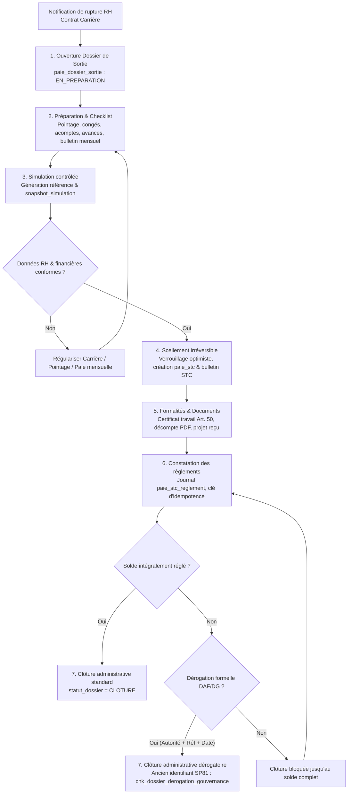

# Module Paie & Rémunération — document maître

> **Projet** : GALAXAM SIRH — GALAXAM Logistics Madagascar  
> **Version documentaire** : 5.7
> **État du code examiné** : vérification documentaire DOC-2, 23 octobre 2026
> **Périmètre technique documenté** : interfaces React, API Java, services applicatifs spécialisés, moteurs, persistance et schéma SQL canonique. Les anciennes migrations SP01–SP84 ont été volontairement supprimées. Le fichier `06_schema_paie.sql` décrit la structure de référence pour une base neuve ; il ne constitue pas une procédure de mise à niveau d'une base existante. Aucun mécanisme automatique d'initialisation ou de migration n'est documenté ici.
> **Usage** : référence métier et technique du module. Les taux et interprétations juridiques doivent être confirmés par la DAF à la date de paie. La génération d’un export ne vaut pas dépôt ni acceptation par une autorité ou une banque.

Ce fichier est le document maître de Paie dans `backend/docs/boky`. Il regroupe les parcours utilisateurs, les règles métier implémentées, l’architecture, les données, les sorties, les limites connues et les points de contrôle. Les README du code restent des aides de navigation technique ; ils ne remplacent pas cette référence.

## Sommaire

1. [Finalité et périmètre](#1-finalité-et-périmètre)
2. [Acteurs et permissions](#2-acteurs-et-permissions)
3. [Écrans et parcours utilisateur](#3-écrans-et-parcours-utilisateur)
4. [Cycle de campagne](#4-cycle-de-campagne)
5. [Architecture d’exécution d’un bulletin](#5-architecture-dexécution-dun-bulletin)
6. [Données et modèle de persistance](#6-données-et-modèle-de-persistance)
7. [Règles de calcul du bulletin](#7-règles-de-calcul-du-bulletin)
8. [Configuration et rubriques](#8-configuration-et-rubriques)
9. [Variables, acomptes et avances d'entreprise](#9-variables-acomptes-et-avances-dentreprise)
10. [Solde de tout compte (STC) & Dossiers de sortie](#10-solde-de-tout-compte-stc--dossiers-de-sortie)
11. [Prestataires indépendants](#11-prestataires-indépendants)
12. [Bulletins, documents, exports et paiements](#12-bulletins-documents-exports-et-paiements)
13. [Transactions, corrections et audit](#13-transactions-corrections-et-audit)
14. [API principales](#14-api-principales)
15. [Limites et décisions métier ouvertes](#15-limites-et-décisions-métier-ouvertes)
16. [Procédures de vérification](#16-procédures-de-vérification)
17. [Cartographie du code](#17-cartographie-du-code)

## 1. Finalité et périmètre

Le CDC initial demande la paie des salariés et des consultants/personnels temporaires selon leurs régimes, les bulletins PDF, les états de cotisations, les barèmes datés, les primes et retenues. Le module transforme les périodes de pointage validées, les situations d’emploi et de salaire, les congés, les paramètres fiscaux et sociaux ainsi que les variables approuvées en bulletins détaillés. Les acomptes/avances, les sorties de paie et le parcours des prestataires sont des fonctions présentes dans le code actuel.

**Extension hors périmètre initial du CDC :** le STC et les dossiers de sortie détaillés dans la section 10 ont été ajoutés ultérieurement. Ils sont documentés pour décrire le produit actuel, mais ne doivent pas être attribués aux exigences initiales du mémoire.

Le domaine est réparti entre :

- `mg.galaxam.sirh.paie` : campagnes, bulletins, moteur, variables, trésorerie, STC, dossiers de sortie, exports et prestataires ;
- `mg.galaxam.sirh.paieconfig` : réglementation datée, barèmes, taux, rubriques, indemnités, calendrier, paramètres et types de mouvement ;
- Pointage, Congés, Contrat/Carrière : domaines propriétaires des données sources consommées par la paie.

Une relation de travail salariée (y compris un consultant sous contrat de travail) donne lieu à un bulletin salarié. Un indépendant avec contrat de prestation est géré par facture et paiement hors bulletin et hors STC. La nature réelle de la relation doit être qualifiée en amont ; le seul intitulé « consultant » ne détermine pas le régime.

Pour le parcours 2026, la retenue ISI générale sur honoraires n’est plus calculée par la paie et l’ancien endpoint EDI ISI répond HTTP 410. Des colonnes et historiques associés restent dans la base pour compatibilité. Ne pas réactiver une retenue fiscale uniquement en changeant un libellé ou une rubrique.

**Écart avec le CDC initial — arbitrage reporté :** celui-ci demande un régime ISI de 5 % pour les consultants de plus de 60 ans et le personnel temporaire. Le comportement décrit ci-dessus (ISI générale désactivée en 2026, `soumis_isi_5 = FALSE` dans le modèle actuel) ne satisfait pas cette exigence telle qu'elle est écrite. L'arbitrage métier et réglementaire est reporté ; aucune règle de calcul n'est modifiée par cette clarification documentaire.

## 2. Acteurs et permissions

Le menu et les routes du frontend sont placés sous la permission `PAIE_READ` ou le rôle `ROLE_ADMIN`. Les contrôles backend restent obligatoires et certains actes requièrent une permission supplémentaire.

| Permission | Usage observé |
|---|---|
| `PAIE_READ` | Consulter campagnes, bulletins, synthèses, configurations, documents, dossiers de sortie et décomptes STC en lecture |
| `PAIE_WRITE` | Saisir variables, demandes, versements, lancer les calculs, préparer/simuler/sceller les dossiers de sortie, enregistrer/annuler les règlements STC et clôturer les dossiers |
| `PAIE_VALIDATE` | Valider la paie de période et valider/régler certains parcours, notamment les factures prestataires |
| `ROLE_ADMIN` | Accès administrateur explicitement admis par les contrôleurs protégés |

Le backend renvoie des capacités d’action et des motifs de blocage avec le contexte de période ou de dossier de sortie. La visibilité d’un bouton n’est pas une autorisation : le serveur revérifie droits, état, version et préconditions.

## 3. Écrans et parcours utilisateur

Routes déclarées dans `frontend/src/routes/Router.jsx` :

| Écran | Route | But |
|---|---|---|
| Centre de paie | `/paie` | Cockpit opérationnel, campagnes, indicateurs et accès aux parcours |
| Campagne active | `/paie/campagne`, `/paie/periodes` | Redirection vers la campagne active |
| Préparation | `/paie/periodes/:periodId/preparation` | Vérifier les prérequis emploi, pointage et configuration |
| Population | `/paie/periodes/:periodId/population` | Revoir les salariés inclus, exclus ou bloqués |
| Variables | `/paie/periodes/:periodId/variables` | Consulter le bulletin provisoire et gérer les variables avant calcul |
| Calcul | `/paie/periodes/:periodId/calcul` | Simuler, calculer et consulter les bulletins |
| Contrôle | `/paie/periodes/:periodId/controle` | Examiner les montants et alertes par salarié |
| Validation | `/paie/periodes/:periodId/validation` | Revoir les contrôles et valider la campagne de paie |
| Sorties | `/paie/periodes/:periodId/sorties` | Ouvrir les documents disponibles et clôturer la période |
| Règlements des bulletins | `/paie/periodes/:periodId/reglements` | Suivi des règlements mensuels, versements individuels avec justificatif binaire obligatoire, lots de virement bancaire et exports CSV |
| Acomptes/avances | `/paie/acomptes-avances` | Décider les demandes, confirmer les versements et suivre les imputations |
| Déclarations | `/paie/declarations` | Catalogue de documents mensuels, trimestriels et annuels |
| Configuration | `/paie/configuration` | Carte des phases, rubriques et types de mouvement |
| Prestataires | `/paie/prestataires` | Dossiers, contrats, factures et paiements d’indépendants |
| Dossiers de sortie & STC | `/paie/dossiers-sortie` | Liste, filtres et consultation de tous les dossiers de sortie et décomptes STC |
| Fiche dossier de sortie | `/paie/dossiers-sortie/:id`, `/nouveau` | Préparation, checklist, simulation, scellement, journal des versements, documents et clôture |
| Historique | `/paie/historique` | Redirection vers le registre des périodes du Centre de paie |

L'accès aux dossiers de sortie est directement disponible dans le menu Paie (`PAIE_DOSSIERS_SORTIE`). Les références SP82, SP83 et SP84 présentes dans les descriptions sont des identifiants d'évolutions historiques ; les anciennes migrations SP ont été volontairement supprimées. Les actions « Établir le STC » de la fiche Paie employé et de la chronologie Carrière ouvrent directement la page du dossier de sortie concerné. Seul l'aperçu prévisionnel rapide (`StcPreparationModal`, simulation immédiate sans persistance) conserve une ouverture par modale directe depuis la fiche collaborateur. Conformément à l'assainissement d'octobre 2026, les anciens prêts d'entreprise ont été purgés du modèle et de l'interface ; les retenues sur salaire sont concentrées sur les acomptes et avances d'entreprise (`paie_avance_acompte`).

Les anciennes routes `/paie/periods/...` sont redirigées vers le format courant. Les alias `calculation` et `outputs` redirigent respectivement vers `calcul` et `sorties`.

### Conventions d’interface

- Les montants saisis dans les formulaires Prestataires utilisent le composant
  partagé `MoneyInput` : séparateurs de milliers visibles, précision décimale
  contrôlée, valeur numérique normalisée transmise à l’API.
- Une erreur de champ apparaît sous le champ concerné ; une erreur de
  soumission API/métier reste dans la modale du formulaire ; les erreurs
  d’actions indépendantes d’un formulaire (validation d’une facture,
  téléchargement d’une pièce) sont annoncées par toast. Les confirmations
  d’action réussie sont également des toasts.
- Dans Acomptes & avances, la date du versement ne peut être future ni antérieure
  à la date d’approbation. Cette règle est signalée sur le champ date ; les
  erreurs métier restantes sont affichées dans la modale de confirmation.

## 4. Cycle de campagne

Le pointage et la paie partagent la période mais ont des statuts distincts. Le mot `VALIDEE` seul correspond à la validation/au gel du pointage, et pas à la validation finale de la paie.

| Étape | Résultat attendu | Blocages typiques |
|---|---|---|
| 1. Préparation | Données emploi et salaire couvrent la période ; référentiels requis résolus | Contrat/affectation absents, snapshot ou configuration manquants |
| 2. Population | Liste des salariés éligibles connue et cohérente | Population vide/incomplète ou salarié non couvert |
| 3. Variables | Variables saisies, décidées et rattachées à la période | Mouvements en attente, type inactif ou rubrique non applicable |
| 4. Calcul | Simulation puis bulletins au statut calculé | Pointage non validé, règle datée absente, calcul obsolète |
| 5. Contrôle | Revue des bulletins, anomalies, totaux et écarts | Bulletins incomplets ou signaux non traités |
| 6. Validation paie | Bulletins et totaux validés selon les capacités de la campagne | Calcul périmé, contrôles incomplets ou transition interdite |
| 7. Sorties/clôture | Exports autorisés et période clôturée | Paie pas encore validée ou clôture refusée par workflow |

Vue simplifiée des états constatés :

```text
BROUILLON → EN_COURS → A_VALIDER / TRANSMIS_DAF → VALIDEE (pointage figé)
                                              → bulletins CALCULE
                                              → bulletins validés / PAIE_VALIDEE
                                              → CLOTUREE
```

Le rejet de validation du pointage ramène à une étape de correction en cours. La réouverture d’une période clôturée est une action contrôlée avec motif. Le détail des transitions et des motifs appartient à `PayrollPeriodWorkflowService` et aux résolveurs de statut ; ne pas inférer une transition uniquement à partir d’un libellé UI.

## 5. Architecture d’exécution d’un bulletin

```text
API / PaieController
  → PayrollService (orchestration et transaction)
  → PayrollCalculationContextAssembler (lectures et garde-fous)
  → PayrollCalculationInput (contexte résolu)
  → PayrollExecutionEngine (calcul métier sans SQL)
  → BulletinPaieComplet (DTO conteneur canonique)
      ├── BulletinPaie (en-tête persistant dans bulletin_paie)
      ├── List<BulletinPaieLigne> (lignes ventilées dans bulletin_paie_ligne)
      ├── CompositionBrutDTO (détail des gains bruts et contrôles d'arrondi)
      ├── ExplicationPaieDTO (décomposition transparente pointage/congés/HS sans recalcul UI)
      ├── ExplicationFiscaliteDTO (tranches IRSA, réductions et minimum de perception)
      └── List<MouvementImputation> (traçabilité des retenues paie_avance_acompte)
  → persistance transactionnelle dans bulletin_paie, bulletin_paie_ligne et paie_mouvement_imputation
```

`PayrollService.preparerInput` est une façade d’assemblage. L’assembleur charge période, contexte emploi/salaire, paramètres légaux, pointage figé, congés et mouvements d'acomptes/avances en cours. Il vérifie les données nécessaires et interdit les configurations absentes ou ambiguës. Le moteur reçoit les valeurs résolues : il ne va pas lire la base.

### Le conteneur central `BulletinPaieComplet`

Le résultat du moteur et des consultations de bulletins (`PayrollService.obtenirBulletinComplet`) est encapsulé dans `BulletinPaieComplet.java`, qui structure l'intégralité des données calculées et garantit une approche **backend-driven** stricte (le frontend React n'exécute aucune formule de recalcul) :

1. **En-tête de bulletin (`BulletinPaie`)** : porte les 17 agrégats scalaires enregistrés en base (`salaireBase`, `totalGainsBruts`, `totalCotisationsSalariales`, `totalCotisationsPatronales`, `baseImposableIrsa`, `montantIrsa`, `totalGainsNet`, `totalRetenuesNet`, `totalRetenuesAvancesAcomptes`, `netAvantArrondi`, `netAPayer`, `coutGlobalEmployeur`, `statut`, `version`).
2. **Lignes ventilées (`List<BulletinPaieLigne>`)** : détail de chaque écriture comptable de paie :
   - Catégorie (`SALAIRE_BASE`, `HEURE_SUPPLEMENTAIRE`, `PRIME`, `INDEMNITE`, `COTISATION_SALARIALE`, `COTISATION_PATRONALE`, `IMPOT_REVENU`, `ACOMPTE_AVANCE`, `NET_A_PAYER`) ;
   - Code rubrique normalisé (ex. `SALBASE`, `HS30`, `HS50`, `NUIT`, `DIMANCHE`, `FERIE`, `CNAPS_SAL`, `SANTE_SAL`, `IRSA`, `ACOMPTE`, `AVANCE`) ;
   - Sens (`GAIN`, `RETENUE`) et étape de calcul (`BRUT`, `COTISATION`, `IRSA`, `NET`) ;
   - Base de calcul, taux salarial, montant salarial, taux patronal, montant patronal ;
   - Indicateurs d'assujettissement (`imposable`, `soumisCnaps`, `soumisSante`, `soumisFmfp`) ;
   - Organisme social figé (`idOrganismeSocial`, `codeOrganismeSocial`, `nomOrganismeSocial`).
3. **Contrôle et composition du brut (`CompositionBrutDTO`)** :
   - `lignes` : sous-ensemble des lignes entrant dans l'assiette brute (`GAIN` à l'étape `BRUT` ou retenues sur salaire de base) ;
   - `totalLignes` : somme algébrique exacte des lignes brutes ;
   - `gainsExoneresIrsa` : montants bruts exonérés d'IRSA (notamment les majorations d'heures supplémentaires selon le CGI LF 2026) ;
   - `ecartAvecTotalEnregistre` : contrôle d'intégrité entre la somme des lignes et `bulletin.totalGainsBruts` ;
   - `ecartArrondiNet` : traçabilité de l'arrondi monétaire (écart entre `netAPayer` et `netAvantArrondi`).
4. **Explication transparente du calcul (`ExplicationPaieDTO`)** :
   - *Absences et retards* : `minutesAbsenceRetenues`, `heuresAbsenceRetenues`, `minutesRetard`, `diviseurMensuelHeures` (173.3333h), `tauxHoraire`, `montantRetenueAbsence`.
   - *Congés payés* : `nbJoursConge`, `salaireBaseContractuel`, `tauxJournalierTrentieme`, `deductionCongeTrentieme`, `tauxJournalierConge`, `indemniteConge`, `impactNetConge`.
   - *Heures majorées* : `heuresHs30`, `montantHs30`, `heuresHs50`, `montantHs50`, `heuresNuit`, `montantNuit`, `heuresDimanche`, `montantDimanche`, `heuresFerie`, `montantFerie`.
5. **Détail de la fiscalité IRSA (`ExplicationFiscaliteDTO`)** :
   - `revenuNetAvantImpot`, `remunerationHsExonereeIrsa`, `revenuNetImposable`, `assietteIrsa`, `irsaCalcule`, `irsaAvantReduction`, `reductionChargeFamille` (2 000 MGA par enfant/personne à charge), `minimumPerceptionApplicable` (3 000 MGA), `irsaDu`.
   - `detailsTranches` (`List<TrancheDetail>`) : barème progressif par tranche (tranche, taux, assiette tranche, impôt tranche).
6. **Imputations d'avances et acomptes** :
   - `idsAvancesImputees` (`List<Integer>`) : liste des identifiants des mouvements retenus ;
   - `imputationsMouvements` (`List<MouvementImputation>`) : détail unitaire `(idMouvement, montantImpute)`.

La simulation utilise le même contexte métier mais ne doit ni créer un bulletin persistant ni consommer un mouvement. Le calcul effectif enregistre bulletin, lignes et imputations de façon transactionnelle. Lors du recalcul d’un brouillon, les imputations antérieures sont restituées puis recalculées pour éviter le double prélèvement.

### Dates métier

- Contrat, affectation et salaire : dates de couverture et d’effet applicables au salarié.
- Barèmes et paramètres mensuels : date de fin de la campagne, selon le résolveur concerné.
- Heures majorées : date de la tranche de pointage.
- Congés consommés : valeur historique du lot au moment d’acquisition/valorisation.
- STC : date de départ, qui constitue un contexte distinct de la fin de campagne mensuelle.
- Acomptes et avances versés : imputés sur le net de la campagne sous réserve de versement effectif confirmé et de capacité disponible.

Les dates de couverture ne sont pas toutes équivalentes. Une règle de fin de mois ne doit pas remplacer silencieusement une règle journalière.

## 6. Données et modèle de persistance

Le schéma canonique de référence est `backend/conception/bdd/06_schema_paie.sql`, pour l'initialisation d'une base neuve. Les anciennes migrations SP01–SP84 ont été volontairement supprimées. Les références SP conservées dans ce document repèrent des évolutions historiques uniquement ; elles ne constituent ni une procédure de mise à niveau d'une base existante ni un mécanisme automatique d'installation.

| Table / famille | Rôle |
|---|---|
| `periode_paie` et références de statut | Période, bornes calendaires et état du workflow |
| `bulletin_paie` | En-tête et totaux du bulletin, statuts, montants scellés et versions |
| `bulletin_paie_employeur_snapshot` | Identité employeur figée à la validation du bulletin (`id_filiale`, raison sociale, NIF, STAT, adresse, téléphone, email), garantissant la reproduction immuable des réimpressions |
| `bulletin_paie_ligne` | Détail des gains, cotisations, impôts et retenues (historise l’organisme social figé : `id_organisme_social`, code et nom) |
| `ref_organisme_social` | Référentiel des organismes déclaratifs sociaux (CNaPS, FMFP, OSTIE, OMSI, AMIT...) avec code stable et statut actif |
| `ref_type_cotisation` | Types de cotisations (CNaPS, Santé, FMFP...), assiettes, taux par défaut et lien vers l’organisme déclaratif par défaut |
| `site_cotisation` | Paramétrage des cotisations par site avec taux spécifiques et surcharge éventuelle de l’organisme social (ex. AMIT pour Tuléar TLR) |
| `paie_rubrique` | Rubriques de calcul et versions datées |
| `ref_type_mouvement_paie` | Types, sens, catégorie, owner, provenance et règles de saisie |
| `paie_avance_acompte` | Variables de paie, demandes d’acompte/avance, montant initial, imputé, restant et versement |
| `paie_mouvement_imputation` | Lien entre un mouvement et les montants retenus sur les bulletins |
| `paie_mouvement_justificatif` | Pièces associées à certains mouvements, en particulier notes de frais |
| `paie_bulletin_reglement` | Versements mensuels confirmés et justificatifs binaires obligatoires, avec historique des annulations (SP84) |
| `paie_bulletin_virement_lot`, `paie_bulletin_virement_ligne` | Lots de virement et décisions par ligne, indépendants du statut de calcul des bulletins (SP84) |
| `paie_avance_acompte` (ex-prêts) | Gestion unifiée des avances, acomptes, primes et retenues DAF (tables `paie_pret` purgées en oct. 2026) |
| `paie_dossier_sortie` | Orchestration administrative du départ : préparation, checklist offboarding, simulation figée (`snapshot_simulation`), scellement, certificat de travail et traçabilité de clôture (SP72, SP73, SP78, SP81) |
| `paie_stc` | Décompte financier scellé : rubriques légales, assiettes, net à payer calculé et bulletin de type STC |
| `paie_stc_reglement` | Journal comptable des versements réels du STC : échelonnement, acquittement à solde nul (`montant_regle >= 0`), unicité de référence active, clé d'idempotence (`cle_idempotence`), traçabilité des annulations (SP72, SP75, SP79) |
| Tables prestataires | Identité indépendante, contrat de prestation et factures |
| Référentiels PaieConfig | Configuration légale, barèmes IRSA, taux sociaux, indemnités, calendrier, modes et paramètres |

Les tables d’origine Pointage, Contrat et Congés restent possédées par leurs domaines. La paie consomme les snapshots/résultats prévus à l’interface du domaine et ne doit pas modifier directement les données sources pour obtenir un montant.

### Intégrité et contraintes SQL clés sur les départs (évolutions historiques SP72 à SP81)

- **`chk_dossier_sortie_statut`** : `statut_dossier IN ('EN_PREPARATION', 'PRET_A_VALIDER', 'VALIDE', 'REGLE', 'CLOTURE', 'ANNULE')`.
- **`uk_dossier_sortie_employe_depart`** : unicité stricte `(id_employe, date_depart)`.
- **`chk_dossier_derogation_gouvernance`** (ancien identifiant SP81) : impose au niveau base que si `derogation_reglement IS TRUE`, les trois champs `autorite_decision_derogation`, `reference_decision_derogation` et `date_decision_derogation` soient obligatoirement non nuls et non vides.
- **`uk_stc_reglement_stc_ref_active`** (ancien identifiant SP75) : index unique partiel sur `(id_stc, reference_reglement) WHERE est_annule = FALSE` pour interdire les doubles règlements actifs sur une même référence.
- **`uk_stc_reglement_idempotence`** (ancien identifiant SP79) : index unique partiel sur `(id_stc, cle_idempotence) WHERE cle_idempotence IS NOT NULL`.
- **`ON DELETE RESTRICT`** (ancien identifiant SP73) : sécurisation formelle de `paie_stc_reglement(id_stc)` empêchant toute suppression accidentelle d'un STC ayant des règlements comptables enregistrés.

## 7. Règles de calcul du bulletin

L’ordre fonctionnel général du moteur est strictement ordonnancé selon le cycle de paie :

1. **Salaire de base et prorata temporis** (contrat, entrées/sorties en cours de mois).
2. **Retenues d'absence et retards** (valorisation horaire et décompte au trentième).
3. **Majorations légales d'heures supplémentaires, de nuit, dimanches et fériés** (Loi 2024-014).
4. **Indemnités de congés payés** (déstockage des lots FIFO et indemnité compensatrice).
5. **Primes et indemnités brutes** (assujetties ou exonérées).
6. **Calcul des assiettes sociales et cotisations salariales/patronales** (CNaPS, FMFP, Santé).
7. **Net imposable et barème progressif IRSA** (CGI LF 2026, déductions pour charges de famille et minimum de perception).
8. **Gains nets non imposables** (indemnités de transport, paniers, remboursements de frais).
9. **Retenues de trésorerie sur le net** (acomptes de quinzaine et avances sur salaire `paie_avance_acompte`).
10. **Arrondi monétaire et net à payer définitif**.

### Catalogue des Règles de Gestion Métier (RG de A à Z)

#### RG-PAIE-01 : Taux horaire de référence
Le taux horaire conventionnel ($TH$) sert de pivot à l'ensemble des valorisations horaires (retenues pour absence, retards, majorations d'heures supplémentaires, heures de nuit). Il est calculé avec une précision de 4 décimales sur la base de la durée légale hebdomadaire de 40 heures (Art. 109 Loi 2024-014), soit un diviseur mensuel invariable de $173{,}3333$ heures :
$$TH = \frac{\text{Salaire de Base Contractuel}}{173{,}3333\dots} = \frac{\text{Salaire de Base Contractuel} \times 12}{52 \times 40}$$

#### RG-PAIE-02 : Retenues pour absence et retards
Toute absence non rémunérée ou retard non justifié constaté dans le snapshot de pointage donne lieu à une retenue sur salaire calculée comme suit :
- **Absence horaire / Retard** : $\text{Retenue} = \frac{\text{Minutes Retenues}}{60} \times TH$.
- **Absence journalière complète (décompte au trentième)** : conformément aux usages et à l'Art. 125/131 de la Loi 2024-014, le salaire journalier moyen est égal à :
$$T30 = \frac{\text{Salaire de Base Contractuel}}{30}$$
$$\text{Retenue Journalière} = \text{Jours d'absence} \times T30$$

#### RG-PAIE-03 : Heures supplémentaires et majorations (Loi 2024-014, Art. 109 à 124)
La durée légale du travail est fixée à 40 heures par semaine (Art. 109). Les heures excédentaires hebdomadaires validées dans le snapshot de pointage sont ventilées selon le barème légal :
- **Tranche 1 (41e à 48e heure hebdomadaire)** : majoration de $+30\%$ sur le taux horaire ($1{,}30 \times TH$, Décret 72-226). Code rubrique `HS30`.
- **Tranche 2 (au-delà de la 48e heure hebdomadaire)** : majoration de $+50\%$ sur le taux horaire ($1{,}50 \times TH$, Décret 72-226). Code rubrique `HS50`.
- **Heures de nuit (22h00 à 05h00)** : majoration légale de nuit de $+30\%$ (Art. 117-124, ex-Art. 83). Code rubrique `NUIT`.
- **Dimanches travaillés** : majoration conventionnelle de $+40\%$ (ou $+50\%$, Art. 114 & 116). Code rubrique `DIMANCHE`.
- **Jours fériés chômés et payés travaillés** : majoration légale de $+100\%$ ($2{,}00 \times TH$, Art. 115 & 116). Code rubrique `FERIE`.

#### RG-PAIE-04 : Exonération fiscale des heures supplémentaires (CGI LF 2026)
Conformément aux dispositions de la Loi de Finances 2026, la rémunération brute des heures supplémentaires et de leurs majorations est exonérée de l'Impôt sur les Revenus Salariaux et Assimilés (IRSA) dans la limite du plafond mensuel configuré (`paie_config_legale.plafond_mensuel_hs_exonerees`). Cette fraction exonérée est déduite du net imposable pour constituer l'assiette IRSA effective.

#### RG-PAIE-05 : Assiettes et cotisations sociales obligatoires
`SocialContributionContextResolver` résout les paramètres sociaux datés (CNaPS, FMFP et organisme de santé) ainsi que l'organisme déclaratif applicable (`RefOrganismeSocial`) pour la période et le site donnés (priorisant toute surcharge définie sur `site_cotisation.id_organisme_social`).
- **CNaPS (Caisse Nationale de Prévoyance Sociale)** :
  - Assiette : salaire brut plafonné à $8 \times \text{SME}$ (Salaire Minimum d'Embauche).
  - Part salariale : $1\%$ retenu sur le brut.
  - Part patronale : $13\%$ à la charge de l'employeur.
- **FMFP (Fonds Malgache de Formation Professionnelle)** :
  - Assiette : salaire brut plafonné à $8 \times \text{SME}$.
  - Part patronale : $1\%$ à la charge de l'employeur (aucune part salariale).
- **Organismes de Santé (OSTIE, AMIT, etc.)** :
  - Assiette : salaire brut plafonné à $8 \times \text{SME}$.
  - Part salariale : $1\%$ retenu sur le brut.
  - Part patronale : taux paramétrable par site ($1\%$ à $5\%$).

Lors de l'émission des lignes dans `PayrollExecutionEngine`, les métadonnées de l'organisme résolu (`id_organisme_social`, `code_organisme_social`, `nom_organisme_social`) sont scellées directement dans `bulletin_paie_ligne`.

#### RG-PAIE-06 : Barème progressif de l'IRSA (CGI LF 2026)
L'impôt est calculé par `PayrollTaxCalculations` sur l'assiette imposable nette de cotisations sociales salariales et hors heures supplémentaires exonérées :
- Tranche de $0$ à $350\,000\text{ MGA}$ : $0\%$
- Tranche de $350\,001$ à $400\,000\text{ MGA}$ : $5\%$
- Tranche de $400\,001$ à $500\,000\text{ MGA}$ : $10\%$
- Tranche de $500\,001$ à $600\,000\text{ MGA}$ : $15\%$
- Tranche supérieure à $600\,000\text{ MGA}$ : $20\%$
- **Déduction pour charges de famille** : déduction fiscale de $2\,000\text{ MGA}$ par enfant ou personne à charge par mois.
- **Minimum de perception légal** : l'IRSA dû ne peut être inférieur à $3\,000\text{ MGA}$, même si le calcul par tranches ou la déduction aboutit à une valeur inférieure (sauf exonération totale de base).
- Le calcul 2026 rejette tout calcul ISI sur bulletin salarié (réservé aux factures prestataires spécifiques).

#### RG-PAIE-07 : Priorité et quotité d'imputation des acomptes et avances
Les retenues de trésorerie sur le salaire net s'exécutent selon un ordre de priorité strict :
1. **Acompte de quinzaine** : priorité absolue sur le net disponible (créance sur salaire déjà acquis).
2. **Avance spéciale / exceptionnelle** : prélevée sur le net restant après acompte, dans la limite de la quotité saisissable légale configurée. Le montant prélevé est débité de `paie_avance_acompte.solde_restant` et tracé dans `paie_mouvement_imputation`.

#### RG-PAIE-08 : Sécurisation des règlements et preuve binaire (ancien identifiant SP84)
Tout paiement de bulletin mensuel confirmé exige une pièce justificative binaire authentique ($\le 5\text{ Mo}$, formats PDF/PNG/JPEG) contrôlée par signature MIME et stockée dans la même transaction. Le reste à payer est calculé dynamiquement sous verrou pessimiste du bulletin (`FOR UPDATE`) :
$$\text{Reste à Payer} = \text{Net à Payer} - \sum(\text{Règlements non annulés})$$

#### RG-PAIE-09 : Solde de Tout Compte (STC) et rupture contractuelle
Le décompte STC scelle irréversiblement les droits de rupture :
- **Indemnité Compensatrice de Congés Payés (ICCP)** : valorisation des jours restants par déstockage virtuel des lots FIFO (`conge_lot_droit`), conservant les salaires historiques d'acquisition.
- **Indemnité de préavis (Art. 52-54)** : due en cas de dispense de préavis par l'employeur.
- **Certificat de travail (Art. 50)** : délivrance obligatoire horodatée mentionnant dates d'entrée/sortie et poste occupé.
- **Journal des règlements STC** : contrainte d'idempotence (`cle_idempotence`) et interdiction de double paiement actif sur même référence (`uk_stc_reglement_stc_ref_active`).

## 8. Configuration et rubriques

La carte `/paie/configuration` expose les phases du moteur, les rubriques, les types de mouvement, leurs niveaux de configuration, liens et assiettes. Les paramètres opérationnels sont aussi gérés par des écrans d’administration de paie :

- réglementation/configuration légale et dates de validité ;
- barème IRSA ;
- organismes déclaratifs sociaux (`ref_organisme_social` : code, nom, statut actif) ;
- cotisations sociales et rattachements par site avec affectation d'organisme (ex. AMIT pour Tuléar TLR) ;
- indemnités et configurations par site ;
- taux de majoration ;
- calendrier férié, sites concernés et périodes chômées ;
- paramètres globaux ;
- types de mouvement et modes de paiement/règlement.

Les controllers de configuration sont sous `backend/src/main/java/mg/galaxam/sirh/paieconfig/api/`. Les pages correspondantes se trouvent principalement sous `frontend/src/features/administration/components/payroll/` (notamment `CotisationsIrsaTab.jsx` qui comprend les sous-onglets « Organismes déclaratifs », « Cotisations sociales », « Rattachement par site » et « Barème IRSA »).

### Rubriques manuelles

Une rubrique manuelle peut intervenir au `BRUT`, `GAIN_NET` ou `RETENUE_NET`. Les méthodes de montant implémentées comprennent :

- `MONTANT` : montant saisi ;
- `QUANTITE_TAUX` : quantité multipliée par un taux/prix ;
- `POURCENTAGE_SALAIRE_BASE` : pourcentage du salaire de base de campagne.

Le serveur recalcule les méthodes dérivées. Chaque version doit couvrir toute la période ; un chevauchement ou une période coupée entre versions bloque le calcul au lieu d’inventer un prorata. Une règle déjà consommée par des mouvements ou bulletins est gouvernée par ses contraintes de modification ; créer une nouvelle version datée quand le contrat de configuration l’exige.

Les calculateurs dédiés (fiscalité, cotisations, heures, congés, acomptes, avances) ne deviennent pas des rubriques génériques configurables. Le registre des capacités décrit le moteur mais ne remplace pas le code de calcul.

## 9. Variables, acomptes et avances d'entreprise

### Variables de paie

Les variables (prime, retenue et autres types manuels autorisés) sont liées à un salarié et à une période. La création démarre en `EN_ATTENTE`. Une commande explicite approuve ou rejette le mouvement ; le rejet exige un motif. Les mouvements approuvés sont pris en compte selon leur type, leur sens, leur rubrique et leur période. Une note de frais exige un justificatif avant approbation. Les mouvements déjà imputés ont des règles de correction plus strictes que les brouillons.

### Acompte de salaire

L’acompte de quinzaine correspond à une partie du salaire déjà acquis et versée avant la paie principale. Le parcours de l’application est : saisir la demande, approbation, confirmer le versement réel, puis déduire lors du calcul du bulletin. La retenue d’acompte est prioritaire et limitée par le net disponible. Le formulaire présente un indicateur de 50 % du salaire de base et des raccourcis ; ce repère affiché n’est pas, à lui seul, une preuve d’une validation métier serveur au même pourcentage.

### Avance exceptionnelle

L’avance exceptionnelle est un mouvement de catégorie `AVANCE` avec suivi du solde. Son parcours est similaire à l’acompte, mais le montant restant est recouvré au fil des bulletins. La demande contient salarié, période, type, montant, motif et mode de règlement. L’approbation seule ne permet pas une retenue : un utilisateur autorisé consigne ensuite date réelle, mode actif et référence du versement. Cette confirmation enregistre un paiement exécuté ; elle ne lance pas un virement bancaire.

Au calcul, les acomptes sont imputés avant les avances spéciales. Le plafond de retenue d’avance est résolu depuis la configuration légale datée et appliqué au net après acompte. Le montant retenu est inscrit dans `paie_mouvement_imputation`, ajouté à `montant_impute` et soustrait de `solde_restant`. Le reliquat est proposé sur les périodes paie éligibles suivantes jusqu’au solde nul. L’écran suit les états « à approuver », « à verser », « versement historique à vérifier », « versé à imputer », « remboursement en cours », « soldé », « rejeté » et « annulé ».

Un dossier déjà versé ne peut pas être annulé par la commande ordinaire. Les dossiers historiques dont les retenues n’ont pas de preuve fiable de versement sont marqués à vérifier. Aucun champ d’échéancier personnalisé d’avance n’est disponible dans le formulaire actuel.

### Prêts d’entreprise (Assainissement Octobre 2026)

Afin d'éviter le maintien de structures non utilisées en exploitation réelle, la gestion des prêts a été formellement purgée du système (suppression définitive des tables `paie_pret` et `paie_pret_echeance`, renommage de la colonne `bulletin_paie.total_retenues_acompte_pret` en `total_retenues_avances_acomptes`). Le suivi financier des créances salariales se concentre désormais exclusivement sur les acomptes et avances d'entreprise (`paie_avance_acompte`), avec justification binaire obligatoire et suivi rigoureux des soldes.

## 10. Solde de tout compte (STC) & Dossiers de sortie

Le départ d'un collaborateur fait l'objet d'un parcours rigoureux articulant l'orchestration administrative RH, le décompte financier scellé, le journal comptable des versements, l'émission des pièces légales et la clôture administrative du dossier.

### 10.1 Architecture à trois niveaux

Le domaine sépare strictement les responsabilités pour préserver la traçabilité et l'immutabilité des actes :

```text
┌────────────────────────────────────────────────────────────────────────┐
│ 1. DOSSIER DE SORTIE ADMINISTRATIF (paie_dossier_sortie)               │
│    Orchestration RH, checklist offboarding, matériel, créances,       │
│    simulation tracée (snapshot_simulation), certificat & clôture       │
└───────────────────────────────────┬────────────────────────────────────┘
                                    │ scelle (POST /{id}/sceller)
                                    ▼
┌────────────────────────────────────────────────────────────────────────┐
│ 2. DÉCOMPTE FINANCIER SCELLÉ (paie_stc & bulletin_paie STC)            │
│    Calcul fiscal/social figé, ICCP (FIFO congés), prorata trentième,   │
│    snapshot employeur immuable (bulletin_paie_employeur_snapshot)      │
└───────────────────────────────────┬────────────────────────────────────┘
                                    │ alimente (POST /{id}/reglement)
                                    ▼
┌────────────────────────────────────────────────────────────────────────┐
│ 3. JOURNAL COMPTABLE DES RÈGLEMENTS (paie_stc_reglement)               │
│    Versements échelonnés, montants >= 0, clé d'idempotence technique,  │
│    unicité de référence active, annulations motivées, quittances PDF   │
└────────────────────────────────────────────────────────────────────────┘
```

1. **Orchestration administrative (`paie_dossier_sortie`)** : pilote le départ du collaborateur dès l'intention ou la notification, sans altérer prématurément le contrat de travail (qui relève du module Carrière) ni perturber les paies mensuelles en cours. Elle conserve la checklist d'offboarding (restitution badge, matériel informatique, clés, désactivation accès), consigne l'arbitrage formel sur les avances subsistantes et matériels, fige le snapshot de simulation avant scellement, enregistre la remise du certificat de travail et porte la décision finale de clôture administrative.
2. **Décompte financier scellé (`paie_stc`)** : émis une seule fois lors du scellement. Il génère transactionnellement le bulletin de paie de type STC (`bulletin_paie`) et ses lignes détaillées, liquide le solde positif de congés (ICCP) par mouvement d'ajustement dans le grand-livre congés, neutralise le prorata mensuel si un bulletin normal existe, capture l'instantané employeur légal (`bulletin_paie_employeur_snapshot`) et fige les montants bruts, cotisations et net à payer.
3. **Journal des règlements (`paie_stc_reglement`)** : enregistre de manière échelonnée ou intégrale les paiements financiers effectivement exécutés par la trésorerie. Il est protégé contre toute suppression en cascade (`ON DELETE RESTRICT`), autorise les acquittements à solde nul (`montant_regle >= 0`), garantit l'unicité de la référence de paiement active (`uk_stc_reglement_stc_ref_active`), supporte l'idempotence technique (`cle_idempotence`) et trace toute annulation exceptionnelle.

### 10.2 Workflow opérationnel guidé



#### Les étapes du parcours opérationnel :

1. **Ouverture du dossier** (`POST /api/paie/dossier-sortie`) : sélection du salarié, saisie de la date effective de départ et du motif. Cette création n'interrompt pas le contrat de travail et ne modifie pas le statut de l'employé.
2. **Préparation & Checklist** : l'écran de travail (`DossierSortieModal` / `DossierSortieWorkspaceShell`) présente l'état réel des modules connexes : gel du pointage, bulletin mensuel de la période, solde de congés, acomptes et avances en cours. L'arbitrage sur une créance subsistante doit être consigné avant clôture.
3. **Simulation contrôlée vs Aperçu immédiat** :
   - *Aperçu UI immédiat* (`POST /api/paie/stc/calculer`) : lancé depuis l'onglet Paie de la fiche collaborateur (`simulationOnly=true`), il calcule les montants à la volée sans créer de dossier, sans réservation et sans persistance.
   - *Simulation contrôlée du dossier* (`POST /api/paie/dossier-sortie/{id}/simuler`) : exécutée au sein du dossier préparatoire, elle vérifie la cohérence du contrat, gèle un `snapshot_simulation` et délivre une `reference_simulation` unique et traçable.
4. **Scellement irréversible du STC** (`POST /api/paie/dossier-sortie/{id}/sceller`) : exige la `reference_simulation` et le numéro de `version` pour prévenir tout conflit concurrent. L'opération est transactionnelle : elle persiste `paie_stc`, crée le bulletin STC et ses lignes, impute les acomptes confirmés, liquide l'ICCP en congés et fige l'identité employeur.
5. **Délivrance du certificat de travail** (`POST /{id}/certificat`, téléchargements PDF/DOCX) : le contenu est conçu au regard de l'Art. 50 de la Loi 2024-014. L'application de l'article et la conformité du document produit doivent être confirmées par les responsables compétents. Le parcours exige un contrat non actif (`ROMPU`, `CLOTURE` ou `TERMINE`) avec date de fin enregistrée.
6. **Enregistrement des versements** (`POST /{id}/reglement`) : saisie des règlements réels (date, référence, mode, montant, commentaire, clé d'idempotence). Les montants nets, totaux réglés et restes à payer sont recalculés dynamiquement par le serveur.
7. **Clôture administrative finale** (`POST /{id}/cloturer`) : clôture irréversible du dossier de sortie, soumise à des règles de gouvernance strictes (voir § 10.5).

### 10.3 Éléments du décompte et contrôles métier

| Élément | Source & Données | Comportement implémenté |
|---|---|---|
| **Salaire du dernier mois** | Salaire contractuel, période de paie et pointage final | Prorata calculé au trentième sur les jours sous contrat. Si un bulletin mensuel est déjà validé, le prorata STC est automatiquement neutralisé et le bulletin est rapproché séparément pour éviter tout double paiement. Sans pointage, la validation exige une justification RH des jours rémunérés. |
| **Pointage final** | `pointage_jour` et snapshot final `GELE`/`CONSOMME` | Le pointage final de la période de départ doit être gelé. Les heures majorées (nuit 22h-05h, dimanche, fériés) et indemnités de site variables doivent être rattachées à la période conformément à la règle d'intégrité présente dans le schéma canonique (ancien identifiant SP80). |
| **Bulletin mensuel déjà validé** | `bulletin_paie` MENSUEL de la période de sortie | Si le salaire mensuel a déjà été traité en paie classique, RH saisit le montant net déjà versé avec date et référence de preuve. Seul le reliquat éventuel est intégré au décompte net du STC. Le serveur rejette tout montant payé supérieur au net du bulletin mensuel. |
| **Cotisations et IRSA différentiels** | Assiettes, tranches et plafonds du mois de départ | Les gains de rupture imposables/cotisables sont calculés en différentiel sur les plafonds et tranches déjà consommés par le bulletin mensuel. |
| **Indemnité Compensatrice de Congés Payés (ICCP)** | Grand-livre congés et valorisation FIFO des lots | Le solde positif de congés acquis est valorisé au taux réel des lots FIFO d'acquisition. À la validation définitive, le solde liquidé est éteint dans le grand-livre congés par un mouvement `AJUSTEMENT` et la période de référence ouverte est clôturée. Si le solde est négatif, il est signalé à l'écran (`CONGE_ANTICIPE_A_EXAMINER`) sans retenue automatique unilatérale. |
| **Préavis et licenciement** | Motif de rupture, ancienneté, contrat et justificatifs formels | Le module Carrière fournit une aide indicative au dimensionnement du préavis. Le moteur STC n'applique aucun barème automatique non certifié : l'utilisateur habilité saisit le montant retenu et fournit la référence de décision écrite. Les justificatifs absents ou incompatibles avec le motif bloquent la validation. |
| **Acomptes et avances** | `paie_avance_acompte` versés et confirmés | Seuls les acomptes approuvés dont le versement a été formellement constaté en trésorerie sont imputés. Les demandes non encore versées ou les avances en cours ne sont pas précomptées unilatéralement. |
| **Créances de rupture** | Régularisations et avances | Les acomptes et avances encore dus sont arrêtés à la date de départ. La gestion des anciens prêts ayant été purgée, aucune retenue de prêt n'est opérée. |
| **Snapshot Employeur Scellé** | `ref_filiale` et `bulletin_paie_employeur_snapshot` | L'identité légale de l'employeur (filiale, raison sociale, NIF, STAT, adresse) est figée lors du scellement, garantissant que les réimpressions futures du décompte ne seront pas dénaturées par un changement organisationnel ultérieur. |

### 10.4 Sécurité financière, journalisation et idempotence des règlements (anciens identifiants SP75 & SP79)

Le journal des règlements (`paie_stc_reglement`) respecte les standards bancaires et comptables stricts :

- **Montants nuls autorisés (`montant_regle >= 0`)** : un STC dont le net à payer est nul (par exemple suite à compensation intégrale ou départ sans solde positif) peut faire l'objet d'un enregistrement d'acquittement formel à `0 Ar` avec référence de régularisation.
- **Unicité de la référence de paiement active (`uk_stc_reglement_stc_ref_active`)** : une référence de transaction ou de virement ne peut être active qu'une seule fois pour un même STC. En cas d'annulation formelle d'un versement, la référence est libérée et peut être réutilisée.
- **Idempotence technique (`X-Idempotency-Key` / `cle_idempotence`)** : le contrôleur et le service acceptent une clé d'idempotence (via l'en-tête HTTP `X-Idempotency-Key` ou le champ JSON `idempotencyKey`). L'index unique partiel `uk_stc_reglement_idempotence` prévient tout double débit suite à un double clic ou un retry réseau : la répétition d'une même clé avec les mêmes paramètres renvoie immédiatement la situation enregistrée sans créer de nouvelle écriture ; une modification du payload sous la même clé est rejetée avec une erreur de conflit.
- **Annulation motivée et traçable** : une écriture de versement ne peut jamais être supprimée physiquement. L'annulation (`POST /{id}/reglement/{idReglement}/annuler`) horodate l'acte, enregistre l'identifiant de l'utilisateur (`annule_par`), passe `est_annule = TRUE` et exige un `motif_annulation` textuel obligatoire.
- **Protection contre la suppression en cascade** : la contrainte `FOREIGN KEY (id_stc) REFERENCES paie_stc(id_stc) ON DELETE RESTRICT` (ancien identifiant SP73) interdit la suppression accidentelle d'un décompte STC dès lors qu'une écriture comptable de règlement existe. Les anciennes migrations SP ont été volontairement supprimées ; le schéma canonique est destiné à une base neuve et ne décrit pas la mise à niveau d'une base existante.

### 10.5 Clôture administrative du dossier & Gouvernance de la dérogation (anciens identifiants SP78 & SP81)

La clôture administrative du dossier de sortie (`POST /api/paie/dossier-sortie/{id}/cloturer`) est l'acte juridique et administratif final scellant le départ du collaborateur. Elle est soumise à un triple verrouillage :

#### 1. Préconditions bloquantes
- Le STC doit être préalablement **scellé et validé** (`id_stc IS NOT NULL` et statut `VALIDE` ou `REGLE`). Un dossier en préparation ne peut être clôturé.
- Le contrat de travail associé ne doit **pas être à l'état ACTIF** ; il doit avoir fait l'objet d'une cessation effective formalisée par le workflow Carrière (`ROMPU`, `CLOTURE` ou `TERMINE`) avec une date de fin effective renseignée.
- La checklist administrative ne doit comporter aucun élément bloquant non conforme.

#### 2. Règle d'or financière et dérogation formelle gouvernée (ancien identifiant SP81)
- Si le STC est **intégralement réglé** (`resteAPayer == 0`), la clôture standard est prononcée.
- Si un **solde restant dû subsiste**, la clôture est **strictement interdite**, sauf si une dérogation formelle motivée est expressément accordée.
- Selon l'évolution identifiée historiquement par **SP81** et la contrainte de base de données `chk_dossier_derogation_gouvernance`, toute dérogation de clôture exige les cinq attributs indissociables listés ci-dessous. Les anciennes migrations SP ont été volontairement supprimées ; cette référence n'est pas une procédure de mise à niveau :
  1. `derogationReglementIncomplet = TRUE` ;
  2. `justificationDerogation` : justification textuelle circonstanciée obligatoire ;
  3. `autoriteDecisionDerogation` : autorité décisionnaire formelle ayant approuvé l'acte (ex. `DIRECTION_GENERALE`, `DAF`, `TRIBUNAL_DU_TRAVAIL`) ;
  4. `referenceDecisionDerogation` : numéro d'acte formel, protocole d'accord signé ou jugement autorisant la dérogation ;
  5. `dateDecisionDerogation` : date de signature ou de prise d'effet de la décision.

> [!CAUTION]
> **Contrainte SQL Infranchissable :**  
> La contrainte PostgreSQL `chk_dossier_derogation_gouvernance` rejette toute écriture en base où `derogation_reglement` est vrai sans autorité, référence écrite et date valides. Aucune dérogation verbale ou informelle ne peut être validée par le système.

#### 3. Gestion du cycle de vie du salarié
Lors de la clôture administrative du dossier de sortie, le système examine la situation globale du salarié avant de désactiver sa fiche :
- Si le collaborateur possède un **autre contrat actif**, sa fiche employé reste active (`est_actif = TRUE`).
- Si le collaborateur possède un **contrat futur confirmé** au statut `PLANIFIE` avec prise d'effet ultérieure, sa fiche reste active. (Les brouillons et contrats `A_SIGNER` ne constituent pas une continuité confirmée).
- Si une **transition Carrière future** est enregistrée au statut `PLANIFIE` dans `workflow_rh`, la fiche reste active.
- Dans tous les autres cas (aucun contrat ou transition planifiée), le salarié est désactivé (`est_actif = FALSE`).

Une fois le dossier clôturé, les opérations ordinaires de versement ou d'annulation sont verrouillées, sauf traitement spécifique sur dossier dérogé avec solde restant.

### 10.6 Sorties documentaires et conformité juridique (Art. 50 Loi 2024-014)

Les documents de sortie sont générés à la volée par `StcDocumentService` avec l'en-tête `Cache-Control: no-store` et requièrent la permission `PAIE_READ` ou `ROLE_ADMIN` :

| Document | Format & Route GET | Règles d’édition et mentions légales |
|---|---|---|
| **Décompte STC scellé** | `/{id}/documents/decompte/pdf` | Reprend les postes et montants scellés de `paie_stc`. Porte la mention expresse : *« Ce décompte détaille les éléments financiers arrêtés mais ne constitue pas une preuve de paiement bancaire »*. |
| **Reçu STC (Projet)** | `/{id}/documents/recu-stc/pdf` | Titré visiblement **PROJET**. Il reflète l'état des versements enregistrés à l'instant de l'impression. Mention légale de forclusion : en droit positif malgache (Loi n° 2024-014, art. 95-96 / Loi n° 2003-044, art. 64-66), le délai légal de dénonciation ou contestation du reçu pour solde de tout compte est strictement de **deux (02) mois** (et non 6 mois comme en droit français). |
| **Quittance de versement** | `/{id}/documents/quittance/{idReglement}/pdf` | Justificatif individuel d'une écriture du journal des règlements. Affiche le montant versé, le mode, la référence, l'auteur, le cumul réglé et le reste à payer à la date de l'écriture. |
| **Certificat de travail** | `/{id}/documents/certificat/pdf` et `.docx` | Le modèle vise à reprendre les éléments prévus à l'**Article 50 de la Loi n° 2024-014** : dates d'entrée/sortie, emplois occupés, périodes et catégories professionnelles. Le document généré et son usage doivent être revus par les responsables compétents avant d'être présentés comme juridiquement conformes. |
| **Bordereau de remise** | `/{id}/documents/bordereau-remise/pdf` | Récapitule l'état des formalités administratives et de la checklist d'offboarding consignées en base. Le téléchargement ne modifie aucune donnée. |

### 10.7 API REST détaillées

Tous les endpoints sont préfixés par `/api/paie/dossier-sortie` (URL canonique) et acceptent les alias `/api/v1/paie/dossier-sortie` et `/v1/paie/dossier-sortie`.

#### 1. Contrôleur des dossiers de sortie (`DossierSortieController`)

| Méthode | Route | Droit | Rôle et effets |
|---|---|---|---|
| `GET` | `/liste` | `PAIE_READ` | Liste l'ensemble des dossiers de sortie avec salarié, contrat, motif, statut, montants et dates. |
| `GET` | `/employes?q=...` | `PAIE_READ` | Recherche minimale (matricule, nom, prénom) limitée à 20 résultats pour l'ouverture d'un dossier sans exposer la fiche complète. |
| `GET` | `/{id}` | `PAIE_READ` | Détail complet d'un dossier avec checklist dynamique, simulation, créances et statuts. |
| `GET` | `/employe/{idEmploye}` | `PAIE_READ` | Récupère ou initialise la vue du dossier d'un employé avec date et motif prévisionnels. |
| `POST` | `/` | `PAIE_WRITE` | Crée ou met à jour un dossier préparatoire (`DossierSortieSaveRequest`). |
| `POST` | `/{id}/certificat` | `PAIE_WRITE` | Constate la délivrance effective du certificat de travail (date et mode de remise). |
| `PUT` | `/{id}/offboarding` | `PAIE_WRITE` | Met à jour les formalités matérielles et administratives de départ. |
| `POST` | `/{id}/simuler` | `PAIE_WRITE` | Lance la simulation contrôlée, capture `snapshot_simulation` et délivre `reference_simulation`. |
| `POST` | `/{id}/sceller` | `PAIE_WRITE` | Scellement définitif du STC (`ScellementStcRequest` avec référence et version optimiste). |
| `POST` | `/{id}/reglement` | `PAIE_WRITE` | Enregistre un versement réel (`StcReglementRequest`, supporte `X-Idempotency-Key`). |
| `GET` | `/{id}/reglements` | `PAIE_READ` | Restitue la situation financière complète (net, total réglé, reste à payer, journal). |
| `POST` | `/{id}/reglement/{idReglement}/annuler` | `PAIE_WRITE` | Annulation motivée et traçable d'une écriture de versement. |
| `POST` | `/{id}/cloturer` | `PAIE_WRITE` | Clôture administrative du dossier (`ClotureDossierRequest`, vérification solde ou dérogation associée à l'ancien identifiant SP81). |
| `GET` | `/{id}/documents/decompte/pdf` | `PAIE_READ` | Téléchargement du décompte financier scellé en PDF. |
| `GET` | `/{id}/documents/recu-stc/pdf` | `PAIE_READ` | Téléchargement du reçu en projet titré PROJET en PDF. |
| `GET` | `/{id}/documents/quittance/{idReglement}/pdf` | `PAIE_READ` | Téléchargement de la quittance d'une écriture comptable en PDF. |
| `GET` | `/{id}/documents/certificat/pdf` | `PAIE_READ` | Téléchargement du certificat de travail légal en PDF. |
| `GET` | `/{id}/documents/certificat/docx` | `PAIE_READ` | Téléchargement du certificat de travail légal en DOCX éditable. |
| `GET` | `/{id}/documents/bordereau-remise/pdf` | `PAIE_READ` | Téléchargement du bordereau récapitulatif des formalités en PDF. |

#### 2. Contrôleur STC legacy / calcul direct (`StcController`)

| Méthode | Route | Droit | Rôle et effets |
|---|---|---|---|
| `GET` | `/preparer/{idEmploye}` | `PAIE_READ` | Prépare les données de synthèse pour calcul direct STC. |
| `POST` | `/calculer` | `PAIE_READ` | Simulation immédiate en mémoire sans persistance (utilisée pour l'aperçu fiche employé). |
| `POST` | `/valider` | `PAIE_WRITE` | Validation directe historique du STC (conservée pour compatibilité technique). |
| `GET` | `/liste` | `PAIE_READ` | Liste brute des décomptes `paie_stc`. |
| `GET` | `/{idStc}/recu` | `PAIE_READ` | Données structurées du reçu STC scellé. |
| `POST` | `/{idStc}/regler` / `reglement` | `PAIE_WRITE` | Enregistre un règlement directement par l'identifiant STC. |
| `GET` | `/{idStc}/reglements` | `PAIE_READ` | Situation financière des règlements par l'identifiant STC. |
| `POST` | `/{idStc}/reglement/{idReglement}/annuler` | `PAIE_WRITE` | Annulation de règlement par l'identifiant STC. |

### 10.8 Points de contrôle et audit contradictoire DAF

- **Contrat non encore rompu dans Carrière** : l'ouverture du dossier de sortie ne vaut pas résiliation du contrat de travail. La rupture doit être enregistrée par le circuit Carrière avant le scellement définitif et la clôture.
- **Salarié en mission ou pointage non clos** : tout pointage de la période de départ doit être gelé. Les heures variables non constatées en paie mensuelle doivent être régularisées avant scellement.
- **Rapprochement bancaire des règlements** : le SIRH enregistre les dates, montants et références des règlements déclarés par la trésorerie. Il n'exécute pas de virement bancaire automatique. La DAF rapproche les écritures avec les extraits de compte réels.
- **Solde de congés négatif** : présenté à titre informatif ; aucune retenue unilatérale automatique n'est opérée sans accord formalisé.
- **Acomptes et avances en cours** : vérification de l'extinction ou du solde des acomptes déclarés dans `paie_avance_acompte` avant clôture définitive.

---

## 11. Prestataires indépendants

Le parcours indépendant figure dans `/paie/prestataires` et comprend :

1. Créer un dossier prestataire avec identifiants fiscaux requis.
2. Créer une mission/contrat de prestation avec dates et référence.
3. Joindre le PDF du contrat signé.
4. Créer une ou plusieurs factures rattachées au contrat et joindre le PDF de chaque facture.
5. Faire valider la facture par un utilisateur habilité.
6. Enregistrer la date et la référence du paiement réel.

La création du contrat dans l’application enregistre les informations de mission ; elle ne rédige ni ne signe le document contractuel. La validation exige les pièces prévues. L’action « payer » consigne un paiement déjà fait et ne lance pas de transfert. Un brouillon peut être annulé selon les règles du contrôleur ; une facture validée ou payée reste conservée.

Ce flux ne crée ni bulletin salarié ni STC. La relation d’emploi doit être qualifiée avant de choisir ce parcours. Les contraintes sont décrites dans `PrestataireController` et le schéma canonique ; les éventuels scripts d'évolution prestataires ne sont pas fournis dans ce dépôt.

### Pièces jointes et noms de fichiers

Le serveur vérifie qu’une pièce est un PDF de 10 Mo maximum et la conserve
sous un nom interne descriptif avec identifiant de dossier, date de dépôt et
suffixe court anti-collision ; les anciennes pièces sous nom UUID restent
compatibles. Le nom local transmis lors du téléversement n’est pas retenu. À
l’extraction, le nom est normalisé selon la pièce et sa référence :

- stockage contrat : `CONTRAT_PRESTATION_{reference}_{dateDebut}_{suffixeCourt}.pdf` ;
- stockage facture : `FACTURE_PRESTATAIRE_{reference}_{dateFacture}_{suffixeCourt}.pdf` ;
- contrat : `contrat-prestation-{reference}-{date-debut}.pdf` ;
- facture : `facture-prestataire-{reference}-{date-facture}.pdf`.

La référence est convertie en minuscules, les caractères non alphanumériques
sont remplacés par des tirets et la date suit le format ISO `AAAA-MM-JJ`.
Cette convention facilite le classement des fichiers téléchargés sans exposer
le chemin de stockage interne.

Les justificatifs de notes de frais sont nommés
`JUSTIFICATIF_FRAIS_{dateDepot}_{suffixeCourt}.{extension}` ;
l’extension reflète le type vérifié (PDF, PNG ou JPEG). Les photos et documents
RH suivent leurs conventions descriptives propres ; l’import Excel de pointage
est prévisualisé et n’est pas conservé comme pièce jointe.

## 12. Bulletins, documents, exports et paiements

### Bulletin individuel & Snapshot Employeur Immuable

Le bulletin affiche les données d’emploi/période et les lignes de gains et retenues. Les documents individuels sont accessibles depuis la campagne et par les routes bulletin. Le backend génère notamment les formats PDF et Excel pris en charge par `BulletinDocumentService`.

À la validation définitive de la paie (`PayrollService.validerPaiePeriode`) ainsi qu'au scellement du STC (`StcService.validerBulletinStc`), le service `PayrollEmployerSnapshotService` capture et fige l'identité légale de l'employeur dans la table `bulletin_paie_employeur_snapshot`. Tout téléchargement ultérieur ou réimpression historique d'un bulletin (PDF/Excel) ou d'un export social lit en priorité absolue ce snapshot. Ainsi, une réorganisation juridique, une modification d'adresse ou un avenant rétroactif sur `ref_filiale` ne peut en aucun cas altérer l'identité de l'employeur telle qu'émise le jour de la paie.

### Catalogue d’exports de l’interface

`/paie/declarations` classe les documents par mois, trimestre et année, s'appuyant sur le contrat serveur centralisé `PayrollDocumentCatalogService` et l'éligibilité stricte `PayrollExportEligibility` (période en `PAIE_VALIDEE` ou `CLOTUREE`, bulletins en `VALIDE` ou `CLOTURE`) :

| Fréquence | Document affiché | Condition/fonction actuelle |
|---|---|---|
| Mensuelle | Bulletins individuels PDF/Excel | Consultation/téléchargement depuis la campagne |
| Mensuelle | Grand livre de paie Excel | Paie validée (inclut colonnes Santé adaptées : OSTIE, AMIT...) via `GrandLivrePaieExportService` |
| Mensuelle | État IRSA Excel | Paie validée, classeur issu d'un modèle embarqué à contrôler par la DAF via `IrsaExcelExportService` ; ce téléchargement ne prouve aucune déclaration |
| Mensuelle | État social Excel | Regroupement dynamique par organisme déclaré (`ref_organisme_social`) avec récapitulatif global, colonnes détaillées par organisme et bannière d’avertissement si cotisations non rattachées |
| Trimestrielle | Consolidation sociale | Synthèse trimestrielle interne dynamique par organisme pour les 3 mois du trimestre avec détection automatique des organismes et avertissements d’incohérence |
| Annuelle | Récapitulatif annuel de paie Excel | Utilise les campagnes validées via `AnnualPayrollExportService` ; peut être partiel |

Le catalogue de l'interface présente les états Excel utiles au contrôle interne. Les anciens endpoints SAFI, DNTS et modèles par organisme restent dans le backend, mais ne sont plus proposés sur cet écran ; leur conformité et leur acceptation par un portail ne sont pas établies. L'ordre de virement CSV n'est pas un état de paie interne. Les exports trimestriels attendent trois mois validés dans le trimestre. L’export annuel indique les mois disponibles et ne complète pas les mois absents par des données estimées.

> [!IMPORTANT]
> **Distinction stricte entre sorties internes et modèles officiels :**  
> Les états internes de contrôle (état social mensuel `EtatSocialMensuelExportService` et consolidation trimestrielle `QuarterlySocialDataService`) sont **dynamiques** : ils regroupent automatiquement les cotisations selon les organismes déclaratifs réels portés par les bulletins (CNaPS, FMFP, OSTIE, OMSI, AMIT, etc.).  
> Les anciens modèles déclaratifs externes (`cnaps`, `fmfp`, `ostie`, `omsi`, `safi`) ne figurent plus dans ce catalogue interne. Leur présence technique ne démontre ni conformité réglementaire ni acceptation par un organisme.

### Sorties backend

`PaieController` possède des routes de grand livre, IRSA, SAFI (XLS et CSV), état social, récapitulatif annuel, DNTS et données/fichier de virement. SAFI, DNTS et autres exports sont produits par des classes dédiées dans `application/export/` orchestrées par `PaieExportService`. Distinguer :

- **document généré** par l’application ;
- **document vérifié** par la DAF ;
- **fichier transmis** à une banque ou un organisme ;
- **transmission acceptée** par son destinataire.

Seule l’application atteste la première étape. Aucun endpoint de virement bancaire ne doit être décrit comme exécutant le paiement ; l’export contient les données à transmettre au canal bancaire prévu.

### Règlements des bulletins mensuels (ancien identifiant SP84)

La validation et la clôture d'un bulletin fixent le calcul, mais ne prouvent pas
son règlement. Le journal `paie_bulletin_reglement` conserve les versements
effectivement confirmés, y compris partiels, en modes `VIREMENT`, `CHEQUE`,
`ESPECES` et `MOBILE_MONEY`. Chaque écriture exige un montant positif inférieur
ou égal au solde, une date, une référence **et un justificatif PDF, PNG ou JPEG
de 5 Mo maximum**. La pièce est vérifiée par sa signature binaire et stockée
avec l'écriture dans la même transaction. Elle est consultable depuis l'historique,
y compris après une annulation motivée. La référence seule, un ordre de virement
ou une déclaration orale ne suffisent pas à justifier le versement.

Le parcours est accessible depuis **Sorties et clôture → Règlements des bulletins**
et depuis **Fiche salarié → Paie → Bulletins → Règlements**. Le panneau partagé
`BulletinReglementSlideOver` présente net dû, total versé, reste et historique,
et utilise les composants `SlideOver`, `MoneyInput`, `Input`, `Select`, `Badge`
ainsi que les tokens de `index.css`.

L'action **Enregistrer un paiement** consigne un versement individuel déjà
effectué. L'utilisateur choisit son mode réel, même s'il diffère du mode prévu
sur le bulletin ; un paiement par chèque, espèces ou mobile money n'exige ni
banque ni RIB. La preuve, la date et la référence restent obligatoires. Les
cases de sélection de la liste servent exclusivement à préparer un lot bancaire.
Elles sont désactivées pour les bulletins non éligibles au lot, mais cela ne
bloque pas l'enregistrement individuel d'un paiement déjà effectué.

Pour un lot bancaire, l'utilisateur sélectionne les bulletins mensuels validés
ou clôturés de la période, avec mode prévu `VIREMENT`, un solde positif, une
banque et un RIB. Un bulletin dans un virement en attente ou repris dans un STC
actif ne peut pas rejoindre ce lot. L'utilisateur prépare le lot puis vérifie
le CSV. Le lot passe de `PREPARE` à
`TRANSMIS` après l'envoi. Chaque ligne n'est marquée `CONFIRME` qu'après retour
bancaire, avec date d'exécution, référence et **avis d'exécution ou relevé joint**.
Une ligne rejetée conserve son motif et libère le bulletin pour un nouveau
paiement. Le CSV est générique : son format doit être contrôlé contre celui de
la banque. Un lot préparé peut être annulé sans effacer sa trace.

Le serveur calcule `reste = net_a_payer - somme(règlements non annulés)` sous
verrou du bulletin ; un virement en attente bloque un autre versement sur ce
bulletin. L'API est `BulletinReglementController` sous `/paie/reglements` ; le
schéma canonique 06 décrit les tables. SP84 est l'identifiant d'une évolution historique ; les anciennes migrations SP ont été volontairement supprimées. Le code actuel
conserve les anciennes lignes sans preuve comme historiques à régulariser ; elles
sont signalées dans l’interface et ne disposent d’aucun justificatif à télécharger.
L’API refuse toute nouvelle écriture sans pièce. Une ancienne ligne ne doit être
régularisée qu’avec une preuve réelle rapprochée du paiement.
Le rapprochement automatique avec les retours bancaires et la lecture directe du
journal mensuel par le STC restent à réaliser ; le STC conserve à ce jour sa
déclaration de paiement du bulletin mensuel.

## 13. Transactions, corrections et audit

Les commandes sensibles (approbation, rejet, versement, calcul, validation, scellement STC, règlements et clôture administrative) s’exécutent dans des transactions ACID strictes. Le backend verrouille les enregistrements concernés lorsque cela est requis, valide l’état et vérifie la version attendue pour prévenir une action fondée sur des données périmées.

Principes observés :

- La simulation ne consomme pas les mouvements et ne persiste aucune entité.
- La simulation contrôlée du dossier de sortie fige un `snapshot_simulation` et une `reference_simulation` vérifiable sans altérer les comptes.
- Le scellement STC s'appuie sur un **verrouillage optimiste** (`version`) et exige la référence exacte de simulation.
- La clôture de dossier verrouille l'entité de manière pessimiste (`SELECT ... FOR UPDATE` via `trouverParIdPourMiseAJour`) pour empêcher toute double clôture ou collision concurrente.
- Le journal des règlements STC applique un index unique d'idempotence (`uk_stc_reglement_idempotence`) et interdit la suppression en cascade (`ON DELETE RESTRICT`).
- Les imputations d’un brouillon recalculé sont restaurées puis recalculées.
- Le mouvement d’acompte/avance conserve montant initial, montant imputé, solde et preuve de versement.
- Les imputations bulletin sont historisées dans `paie_mouvement_imputation`.
- Un acompte ou une avance versé ne peut pas être annulé via la commande de correction ordinaire.
- Les bulletins validés/clôturés ne sont pas corrigés en écrasant leur historique ; les parcours de régularisation et réouverture suivent des règles séparées.
- Les changements sont inscrits dans l’audit applicatif lorsqu’une opération métier le prévoit.

Une erreur de transaction annule l’ensemble de ses écritures associées. Une génération d’export ou de document est une lecture/production de flux et ne doit pas muter un bulletin ni réaliser un paiement.

## 14. API principales

Les routes de paie acceptent généralement les préfixes `/api/v1/paie`, `/v1/paie` et `/paie` pour compatibilité. Routes structurantes :

| Contrôleur | Route(s) | Domaine |
|---|---|---|
| `PaieController` | `POST /calculer-employe`, `POST /calculer-periode`, `POST /valider-periode` | Calcul et validation paie |
| `PaieController` | `GET /bulletin/{id}`, `GET /bulletin/{id}/document/{format}`, `GET /bulletin/{id}/correction-status` | Bulletin et document |
| `PaieController` | `GET /periode/{id}/cockpit`, `GET /periode/{id}/bulletins` | Résumé et bulletins de campagne |
| `PaieController` | `GET /employe/{id}/bulletins`, `/synthese` | Historique et synthèse des bulletins du salarié |
| `PaieController` | `/periode/{id}/export/*`, `/annee/{annee}/export/recap-paie`, `/trimestre/{annee}/{trimestre}/export/{type}` | Exports de paie |
| `BulletinReglementController` | `GET /paie/reglements/periode/{id}`, `GET /bulletin/{id}`, `GET /bulletin/{id}/situation`, `GET /bulletin/{id}/justificatif/{idReglement}` | Consultation de la situation financière, du reste à payer, de l'historique et téléchargement des justificatifs binaires |
| `BulletinReglementController` | `POST /paie/reglements/bulletin` (Multipart), `POST /bulletin/{idReglement}/annuler` | Enregistrement de versement individuel avec pièce jointe obligatoire (<= 5 Mo) et annulation motivée |
| `BulletinReglementController` | `POST /paie/reglements/periode/{id}/lots`, `GET /periode/{id}/lots`, `GET /lots/{id}/lignes`, `GET /lots/{id}/csv` | Préparation de lots bancaires, listing, détail des lignes et export CSV sécurisé (avec BOM UTF-8 et assainissement des formules) |
| `BulletinReglementController` | `POST /paie/reglements/lots/{id}/transmettre`, `POST /lots/{id}/annuler`, `POST /lots/lignes/{id}/confirmer` (Multipart), `POST /lots/lignes/{id}/rejeter` | Cycle de vie des lots : transmission, annulation, confirmation avec avis bancaire joint et rejet libérant le bulletin |
| `PaieAjustementController` | CRUD commandes sur `/ajustements`, types, imputations, justificatifs | Variables, acomptes et avances |
| `PaieAjustementController` | `POST /{id}/versement`, `POST /{id}/commands` | Confirmation de versement et workflow de décision |
| `PaieRubriqueController` | `/paie/rubriques` et `/{id}/versions` | Catalogue et versions de rubriques |
| `DossierSortieController` | `/paie/dossier-sortie/*` (`/liste`, `/employes`, `/{id}`, `/simuler`, `/sceller`, `/reglement`, `/cloturer`, `/documents/*`) | Orchestration complète du départ, formalités, scellement STC, quittances et clôture |
| `StcController` | `/stc/*` (`/preparer/{id}`, `/calculer`, `/valider`, `/liste`, `/{id}/recu`, `/{id}/reglement`) | Calcul direct, simulation rapide et compatibilité technique STC |
| `PrestataireController` | `/prestataires`, `/contrats`, `/factures` et pièces | Dossiers indépendants et facturation |
| `OrganismeSocialController` | `GET`, `POST`, `PUT`, `PATCH /paie/referentiel/organismes-sociaux` | Référentiel des organismes déclaratifs sociaux |
| `CotisationController` | `/paie/referentiel/cotisations`, `/sites` | Configuration cotisations et rattachements site avec organismes |
| `paieconfig` controllers | `/paie/config-legale`, `/referentiel/*` | Paramétrage fiscal, social, indemnités et calendriers |

La liste ci-dessus donne les points d’entrée principaux. Pour le détail exact des verbes HTTP, corps de requête, contrôles et objets JSON, le code annoté des contrôleurs et DTO est la source de vérité.

## 15. Limites et décisions métier ouvertes

1. **Prêts d’entreprise (Assainissement)** : les tables et structures de code liées aux prêts ont été formellement purgées en octobre 2026. Les retenues sur salaire se concentrent exclusivement sur les acomptes et avances d'entreprise (`paie_avance_acompte`).
2. **Échéancier des avances** : le formulaire d’avance ne capture pas une modalité par échéance négociée ; le prélèvement est calculé automatiquement à chaque paie selon configuration et capacité disponible.
3. **Règlements financiers** : le journal mensuel exige une preuve jointe pour chaque versement confirmé ; le STC, les acomptes et les prestataires conservent leurs parcours de preuve distincts. Aucun de ces parcours ne transfère les fonds depuis l'application. Un fichier de virement préparé ou transmis ne prouve pas l'exécution.
4. **Portée juridique du reçu STC** : le document émis est un projet informatif reflétant la situation des versements à la date d'édition. Il ne comporte aucune mention de décharge unilatérale automatique, aucun délai de forclusion forcé et ne se substitue pas à la vérification juridique de l'accord de rupture.
5. **Exports officiels** : les modèles nécessitent revue DAF et vérification du format et des portails actuels. Ne pas utiliser « certifié », « conforme » ou « officiellement accepté » sans preuve de recette externe datée.
6. **Réglementation** : les règles sont datées/configurables. Une valeur en base n’est pas, à elle seule, une validation juridique. La DAF doit faire confirmer taux, plafonds, assiettes et retenues pour chaque période concernée.
7. **ISI 2026** : le calcul général et l’ancien export EDI sont hors du parcours courant. Les enregistrements historiques ne signifient pas qu’une retenue ISI doit être réactivée.
8. **Identité historique employeur scellée** : l'identité légale complète de l'employeur (filiale, raison sociale, NIF, STAT, adresse de siège, téléphone, email) est désormais automatiquement capturée dans `bulletin_paie_employeur_snapshot` dès la validation du bulletin ou du décompte STC. Les réimpressions historiques sont scellées et protégées contre toute modification ultérieure des référentiels d'entreprise. Pour les très anciens bulletins antérieurs à l'évolution historiquement référencée `SP71`, un fallback dynamique sur l'historique contrat reste actif.
9. **État de recette** : les tests vérifient différents moteurs et parcours, mais aucun compte de tests ne prouve une couverture exhaustive ni une certification légale absolue du produit.

## 16. Procédures de vérification

### Avant un calcul de campagne

- Confirmer que la période et le pointage sont dans l’état autorisant le calcul et que le snapshot est figé.
- Examiner la population attendue et les exclusions/blocages.
- Approuver ou rejeter les mouvements en attente ; joindre les justificatifs exigés.
- Vérifier les versions de rubriques et configurations qui couvrent l’intégralité de la période.
- Contrôler la simulation, les anomalies et l’échantillon des bulletins avant calcul/validation.

### Pour un acompte ou une avance

- Vérifier le bénéficiaire, la nature (acompte vs avance), période, montant et motif.
- Enregistrer la décision d’approbation/rejet.
- Confirmer le versement uniquement après exécution réelle et avec date, mode et référence vérifiables.
- Vérifier les lignes de retenue et le solde sur chaque bulletin suivant.
- Rapprocher les dossiers historiques « versement à vérifier » avec les preuves de paiement avant toute imputation.

### Pour un dossier de sortie et STC

1. Vérifier que la cessation effective du contrat de travail a été initiée et validée par le module Carrière (`ROMPU`, `CLOTURE` ou `TERMINE` avec date de fin).
2. Contrôler que le pointage final de la période de départ est gelé et que toutes les indemnités variables sont rattachées selon la règle d'appartenance journée/période du schéma canonique (ancien identifiant SP80).
3. Rapprocher le bulletin mensuel s'il a déjà été calculé/validé pour imputer le salaire déjà perçu et éviter tout double paiement au décompte.
4. Lancer la simulation contrôlée du dossier (`POST /{id}/simuler`) pour vérifier le prorata trentième, la valorisation FIFO des congés et les cotisations différentielles.
5. Résoudre les points bloquants de la checklist d'offboarding (restitution matériels et arbitrage des créances/avances) puis procéder au scellement optimiste (`POST /{id}/sceller`).
6. Télécharger le certificat de travail Art. 50 (PDF/DOCX) et le décompte scellé, puis enregistrer chaque versement réel dans le journal (`POST /{id}/reglement`) avec sa clé d'idempotence.
7. Ne prononcer la clôture administrative (`POST /{id}/cloturer`) que si le solde restant est nul, ou si une dérogation formelle dument motivée comporte l'autorité décisionnaire, la référence écrite et la date d'effet (contrainte associée à l'ancien identifiant SP81).

### Avant export, clôture ou paiement

- Vérifier que la paie est validée et que les bulletins de la période sont complets.
- Rapprocher les totaux bulletin, cockpit, grand livre, état fiscal/social et fichiers de paiement.
- Pour les modèles externes, vérifier format, identifiants et période dans le modèle courant du destinataire.
- Enregistrer le règlement avec la référence réelle ; ne pas confondre fichier d’ordre de paiement et paiement effectué.
- Clôturer seulement après contrôle de période et documents nécessaires.

## 17. Cartographie du code

| Responsabilité | Emplacement |
|---|---|
| Routes frontales paie | `frontend/src/routes/Router.jsx` (inclut `/paie/dossiers-sortie` et `/paie/dossiers-sortie/:id`) |
| Pages de campagne et sorties | `frontend/src/features/payroll/pages/` |
| Gestion des dossiers de sortie & STC | `frontend/src/features/payroll/pages/DossiersSortiePage.jsx`, `DossierSortieDetailPage.jsx` |
| Modales & Composants de sortie | `frontend/src/features/payroll/components/modals/stc/` (`DossierSortieModal.jsx`, `DossierSortieSuiviPanel.jsx`, `DossierSortieWorkspaceShell.jsx`, `StcPreparationModal.jsx`, `StcRecuModal.jsx`) |
| Services client STC & Sorties | `frontend/src/features/payroll/api/dossierSortieService.js`, `stcService.js` |
| Écran acompte/avance | `frontend/src/features/payroll/pages/AcomptesAvancesPage.jsx` |
| Formulaire salarié | `frontend/src/features/employees/components/modals/DemandeAcompteAvanceModal.jsx` |
| Carte unifiée du moteur & rubriques | `frontend/src/features/payroll/components/PayrollEngineMap.jsx` |
| Centre de paie / campagne | `frontend/src/features/payroll/pages/GestionPaiePage.jsx`, `PreparationStepPage.jsx`, `PopulationStepPage.jsx`, `VariablesStepPage.jsx`, `CalculStepPage.jsx`, `ControleStepPage.jsx`, `ValidationStepPage.jsx`, `SortiesStepPage.jsx` |
| Catalogue documents & Déclarations | `frontend/src/features/payroll/pages/DeclarationsSortiesPage.jsx`, `BulletinPaieDrawer.jsx` |
| API campagne/bulletins | `backend/src/main/java/mg/galaxam/sirh/paie/api/PaieController.java` |
| API mouvements de paie | `backend/src/main/java/mg/galaxam/sirh/paie/api/PaieAjustementController.java` |
| API rubriques | `backend/src/main/java/mg/galaxam/sirh/paie/api/PaieRubriqueController.java` |
| API dossiers de sortie | `backend/src/main/java/mg/galaxam/sirh/paie/api/DossierSortieController.java` |
| API STC legacy / calcul direct | `backend/src/main/java/mg/galaxam/sirh/paie/api/StcController.java` |
| API prestataires | `backend/src/main/java/mg/galaxam/sirh/paie/api/PrestataireController.java` |
| Services d'orchestration et calcul | `backend/src/main/java/mg/galaxam/sirh/paie/application/PayrollService.java`, `PayrollCalculationContextAssembler.java`, `DossierSortieService.java`, `StcService.java` |
| Services de sorties documentaires STC | `backend/src/main/java/mg/galaxam/sirh/paie/application/export/StcDocumentService.java` |
| Services métier de paie spécialisés | `PayrollAdjustmentCreationService.java`, `PayrollAdjustmentPaymentService.java`, `PayrollAdjustmentSummaryService.java`, `PayrollPeriodCalendarService.java`, `PayrollPointageCoverage.java`, `ManualRubriqueManagementService.java`, `ManualVariableAmountService.java`, `PrestataireFactureService.java` |
| Invariants domaine et politiques pures | `backend/src/main/java/mg/galaxam/sirh/paie/domain/` (`ManualRubriqueCatalog.java`, `ManualRubriquePolicy.java`, `PrestataireFacturePolicy.java`, `PayrollStatuses.java`, `PayrollBusinessTime.java`) |
| Workflow période et mouvements | `backend/src/main/java/mg/galaxam/sirh/paie/application/workflow/` (`PayrollPeriodWorkflowService.java`, `PayrollAdjustmentWorkflowService.java`, `PayrollWorkflowStatusResolver.java`, `PayrollWorkflowCommands.java`) |
| Services d'export et snapshots | `backend/src/main/java/mg/galaxam/sirh/paie/application/export/` (`PayrollEmployerSnapshotService.java`, `PayrollExportEligibility.java`, `PayrollDocumentCatalogService.java`, `SafiXlsExportService.java`, `SafiExportService.java`, `DntsExportService.java`, `AnnualPayrollExportService.java`, `EtatSocialMensuelExportService.java`, `GrandLivrePaieExportService.java`, `IrsaExcelExportService.java`, `QuarterlySocialDataService.java`, `BulletinDocumentService.java`) |
| Moteurs de calcul déterministes | `backend/src/main/java/mg/galaxam/sirh/paie/domain/engine/` (`PayrollExecutionEngine.java`, `PayrollTaxCalculations.java`, `SocialContributionCalculator.java`, `ManualPayrollRules.java`, `OvertimePayCalculator.java`) |
| Entités et accès SQL immuables | `backend/src/main/java/mg/galaxam/sirh/paie/persistence/` (`BulletinPaie.java`, `BulletinPaieLigne.java`, `PaieDossierSortie.java`, `PaieStc.java`, `PaieAvanceAcompte.java`, `PaieBulletinReglement.java`, `PaieStcReglement.java`) |
| Configuration légale/API | `backend/src/main/java/mg/galaxam/sirh/paieconfig/` |
| Schéma canonique | `backend/conception/bdd/06_schema_paie.sql` |
| Tests d'intégration et unitaires | `backend/src/test/java/mg/galaxam/sirh/paie/` (`PayrollCalculationTargetedTest.java`, `PayrollLegalContextResolverTest.java`, `PayrollBankAccountCompatibilityTest.java`, `PayrollLeaveJournalValuationTest.java`) & `frontend/` (`npm run test:api`, 14 tests d'intégration API) |

---

**Maintenance du document :** mettre à jour cette référence lorsqu’un workflow, une règle métier, une route, un rôle, un schéma ou un export change. Vérifier les écrans et le backend ensemble, préciser ce qui est réellement automatisé et conserver les limites qui évitent de confondre capacité technique et processus opérationnel complet.
