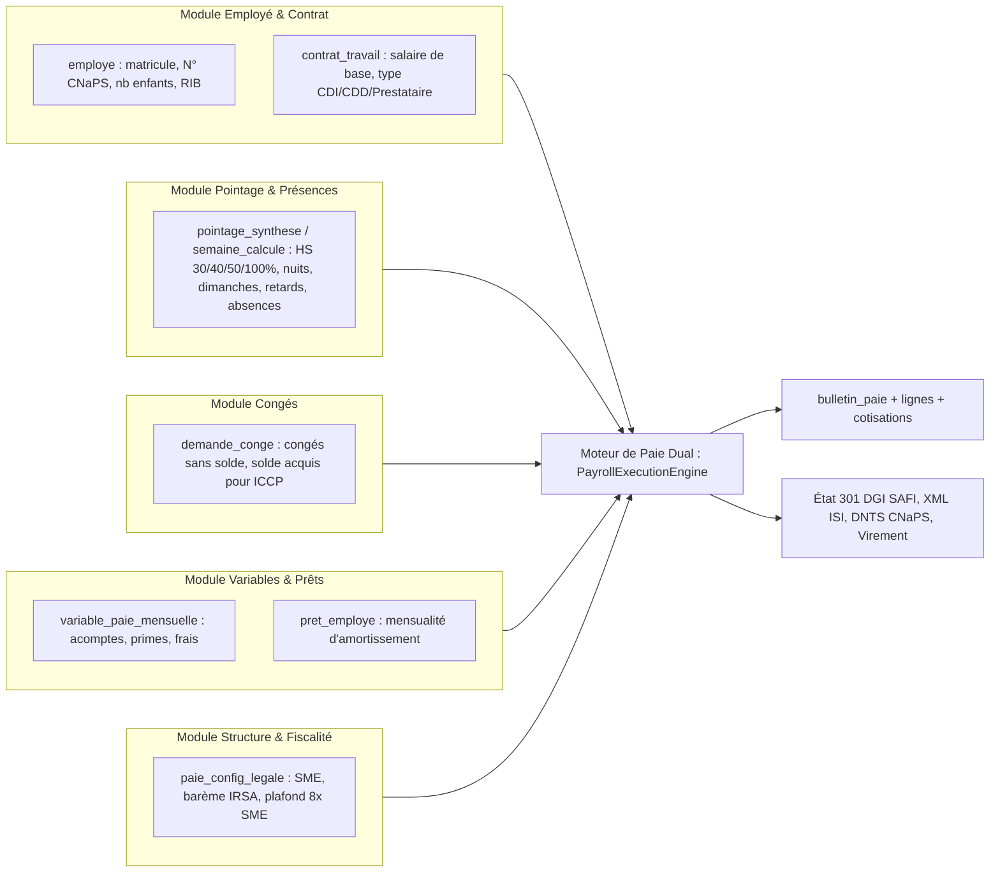
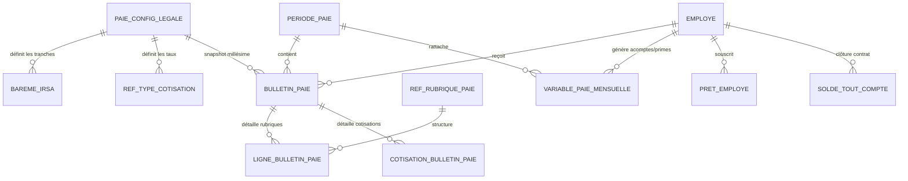
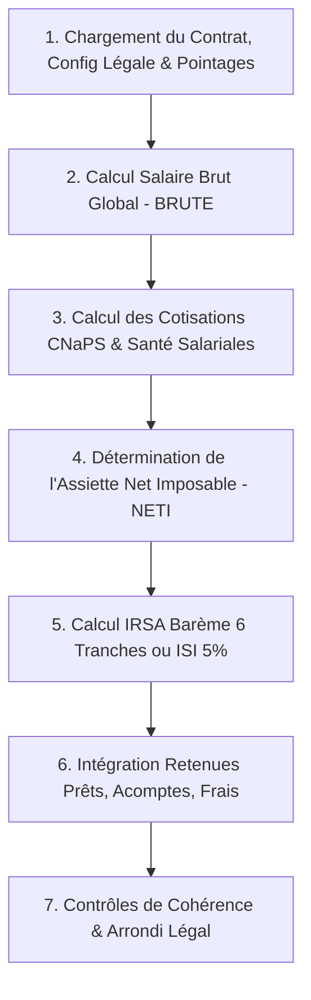

# Module Paie & Rémunération — Documentation Technique, Réglementaire & Fonctionnelle
## GALAXAM SIRH — Mémoire de Fin d'Études

> **Projet** : GALAXAM SIRH — Système d'Information des Ressources Humaines  
> **Entreprise d'Accueil** : GALAXAM Logistics Madagascar (Secteur Transport, Logistique & Manutention Portuaire)  
> **Module** : Paie, Charges Sociales & Fiscalité des Salaires  
> **Auteur** : Mémoire de Fin d'Études d'Ingénieur / Master en Informatique  
> **Version du Document** : 2.0.0 (Spécification Complète & État des Réalisations)  
> **Date** : 2026  
>
> **État d'avancement global du module :**
> - ✅ **Périmètre Implémenté & Validé (Backend, BDD & Algorithmes)** : Modélisation PostgreSQL relationnelle avec snapshots légaux, moteur de calcul dual (salariés contractuels IRSA + consultants ISI 5%), barème progressif LF 2026 à 6 tranches, cotisations CNaPS (1%/13% plafonné 8× SME) et Santé (OSTIE/OMSI), gestion des heures sup/majorations décalées (26 au 25), déductions d'absences et régularisation de congés, gestion des prêts et saisies (tiers cessible Art. 72, avances Art. 68), moteur de Solde de Tout Compte (STC avec ICCP et préavis), exports officiels (Grand-Livre Excel, État 301 DGI SAFI 25 colonnes, TradXML EDI ISI, DNTS trimestrielle CNaPS).
> - ⚠️ **Périmètre En Cours / Workflow à Définir** : Définition du workflow d'orchestration globale de la campagne mensuelle (étapes de contrôle, gel, validation collégiale), raccordement des variables dynamiques en amont du calcul.
> - 📅 **Perspectives & Hors Périmètre Actuel** : Télédéclaration directe par API DGI e-Hetra (actuellement assurée par fichiers normalisés), gestion de la subrogation des indemnités journalières de maternité CNaPS, coffre-fort numérique salarié avec signature électronique certifiée.

---

## Table des Matières

1. [Contexte Opérationnel & Problématique Métier](#1-contexte-opérationnel--problématique-métier)
   - 1.1 Contexte de GALAXAM Logistics Madagascar
   - 1.2 Problématique du Système Existant (Avant Refonte SIRH)
   - 1.3 Cartographie des Dépendances Inter-Modules & Flux de Données Entrants
2. [Cadre Légal & Réglementaire Malagasy](#2-cadre-légal--réglementaire-malagasy)
   - 2.1 Période de Paie Décalée Industrielle (26 au 25)
   - 2.2 Cotisations Sociales & Organismes Sanitaires
   - 2.3 Fiscalité des Revenus Salariaux (IRSA 2026)
   - 2.4 Régime Fiscal des Consultants & Intervenants Externes (ISI 5%)
   - 2.5 Règles Protectrices du Salaire (Quotité Cessible & Avances)
   - 2.6 Moteur de Sortie : Solde de Tout Compte (STC) & Certificat de Travail
3. [Modélisation des Données & Schéma PostgreSQL](#3-modélisation-des-données--schéma-postgresql)
   - 3.1 Architecture du Schéma Relationnel
   - 3.2 Immutabilité Temporelle & Snapshots Légaux (`paie_config_legale`)
   - 3.3 Structure du Grand-Livre & Lignes de Bulletins
4. [Algorithmes & Moteur de Calcul (Payroll Execution Engine)](#4-algorithmes--moteur-de-calcul-payroll-execution-engine)
   - 4.1 Détermination de l'Assiette Brute (`BRUTE`)
   - 4.2 Déduction pour Absences Injustifiées & Régularisation Congé
   - 4.3 Détermination des Cotisations & Assiette Nette Imposable (`NETI`)
   - 4.4 Algorithme du Barème Progressif IRSA (6 Tranches)
   - 4.5 Retenues, Acomptes, Prêts & Net à Payer Final
5. [Obligations Déclaratives & États Nominatifs](#5-obligations-déclaratives--états-nominatifs)
   - 5.1 Déclarations Fiscales Mensuelles DGI (État 301 SAFI & XML TradXML ISI)
   - 5.2 Déclarations Trimestrielles Sociales & Santé (DNTS CNaPS, FMFP, OSTIE/OMSI)
   - 5.3 Fichiers de Virement Bancaire & Grand-Livre Consolidé
6. [Bilan des Réalisations : Ce qui est Déjà Fait vs Ce qui Reste à Gérer](#6-bilan-des-réalisations--ce-qui-est-déjà-fait-vs-ce-qui-reste-à-gérer)
   - 6.1 Ce qui est 100% Implémenté & Validé par Tests
   - 6.2 Ce qui Reste à Concevoir & Adapter (Workflow & Régulation)
   - 6.3 Évolutions Futures & Perspectives
7. [Architecture Logicielle & Points d'Accès API Backend](#7-architecture-logicielle--points-daccès-api-backend)
8. [Matrice Synthétique pour la Soutenance de Mémoire](#8-matrice-synthétique-pour-la-soutenance-de-mémoire)

---

## 1. Contexte Opérationnel & Problématique Métier

### 1.1 Contexte de GALAXAM Logistics Madagascar
**GALAXAM** est une entreprise opérant à Madagascar dans les métiers exigeants du **transport terrestre, de la consignation, de la manutention portuaire et de l'entreposage sous douane**. Ce secteur d'activité impose des contraintes opérationnelles très fortes :
- **Diversité des statuts professionnels** : Salariés permanents (CDI), personnel temporaire (CDD), cadres au forfait, ouvriers et chauffeurs soumis aux horaires variables (nuits, dimanches, jours fériés travaillés), ainsi que des prestataires / consultants techniques assujettis à une retenue fiscale spécifique (ISI).
- **Continuité de service 24/7** : Les opérations de chargement/déchargement et de convoi logistique ne s'arrêtent jamais, générant des volumes significatifs d'heures supplémentaires et de majorations complexes.
- **Enjeux de trésorerie et d'apaisement social** : Le versement exact, ponctuel et transparent du salaire est un élément fondamental de la paix sociale dans l'entreprise.

### 1.2 Problématique du Système Existant (Avant Refonte SIRH)
Avant la mise en place du module Paie du SIRH GALAXAM, l'entreprise faisait face aux défaillances classiques des processus semi-manuels :
1. **Ressaisie manuelle source d'erreurs** : Les heures supplémentaires et retards validés dans des classeurs Excel étaient réinjectés à la main dans un logiciel tiers fermé.
2. **Vulnérabilité aux changements de législation** : À chaque Loi de Finances ou décret de revalorisation du Salaire Minimum d'Embauche (SME), les formules devaient être réécrites, créant des risques majeurs de redressement fiscal ou de contentieux CNaPS.
3. **Absence d'historique immuable** : La recalculation rétrospective d'un mois passé avec les barèmes du mois présent écrasait ou faussait les montants des exercices antérieurs.
4. **Complexité des déclarations obligatoires** : La génération de l'État 301 officiel de la DGI (25 colonnes SAFI) et des déclarations trimestrielles DNTS CNaPS mobilisait plusieurs jours ouvrés à chaque clôture.

---

### 1.3 Cartographie des Dépendances Inter-Modules & Flux de Données Entrants

Le module Paie agit comme le **point de convergence financier** de l'ensemble du SIRH GALAXAM. Pour toute analyse ou implémentation par un tiers (ou un modèle d'IA), voici la cartographie exacte des flux entrants consommés par le moteur :



#### Tableau Détaillé des Dépendances :

| Module Source | Tables / Entités Sources | Données Transmises | Impact Direct sur la Paie |
|---|---|---|---|
| **Module Employé** | `employe`, `dossier_employe` | `nb_enfants_charge`, `numero_cnaps`, `organisme_sante`, `rib_bancaire` | Réduction d'impôt IRSA ($2\,000\text{ Ar} \times \text{enfants}$), ciblage OSTIE/OMSI, génération de l'ordre de virement bancaire. |
| **Module Contrat** | `contrat_travail`, `affectation_carriere` | `salaire_base`, `type_contrat` (`CDI`, `CDD`, `PRESTATION`), `date_embauche` | Fixe le salaire de référence, oriente le calcul vers le régime Salarié (IRSA) ou Consultant (ISI 5%), calcul d'ancienneté. |
| **Module Pointage** | `pointage_synthese`, `semaine_calcule`, `pointage_jour` | Heures sup ($+30\%, +40\%, +50\%, +100\%$), majorations nuit/dimanche, heures d'absence injustifiée | Alimente les rubriques de gain variable du brut (période décalée du 26 au 25) et les déductions horaires d'absence. |
| **Module Congés** | `demande_conge`, `mouvement_solde_conge` | Congés sans solde pris, solde de congés restants | Déduction d'absence sur le brut mensuel ; valorisation de l'Indemnité Compensatrice de Congés Payés (ICCP) en cas de STC. |
| **Module Variables & Prêts** | `variable_paie_mensuelle`, `pret_employe` | Acomptes de quinzaine, primes exceptionnelles, remboursements de frais, mensualités de prêts | Primes ajoutées au brut imposable ; acomptes et prêts déduits du net à payer sous contrôle du tiers cessible (Art. 72). |
| **Module Structure / Fiscalité** | `paie_config_legale`, `bareme_irsa`, `ref_type_cotisation` | SME national, tranches d'impôt, taux CNaPS/Santé, diviseur $173{,}3333$ | Snapshot légal figé pour garantir la reproductibilité mathématique des bulletins. |

---

## 2. Cadre Légal & Réglementaire Malagasy

Le moteur de paie est directement programmé pour respecter la hiérarchie des normes du droit malgache :

| Norme Juridique | Source Officielle | Impacts & Traitements dans le SIRH |
|---|---|---|
| **Code du Travail** | Loi n° 2003-044 du 28 juillet 2004 | Durée légale de 40h/semaine, majorations HS, préavis, indemnités de licenciement, certificat de travail (Art. 53). |
| **Code Général des Impôts (CGI)** | Loi de Finances 2026 | Barème progressif IRSA à 6 tranches, minimum de perception (3 000 Ar), déduction enfants (2 000 Ar), Retenue ISI 5%. |
| **Code de Prévoyance Sociale** | Décrets CNaPS | Cotisation retraite & prestations familiales : 1% salarial, 13% patronal, plafonné mensuellement à $8 \times \text{SME}$. |
| **Formation Professionnelle** | Loi n° 2017-025 (FMFP) | Contribution patronale exclusive de 1,0% sur la masse brute totale non plafonnée. |
| **Médecine Interentreprises** | Conventions OSTIE / OMSI | Couverture sanitaire : OSTIE (1% salarial / 5% patronal), OMSI (1,5% salarial / 5,5% patronal). |

---

### 2.1 Période de Paie Décalée Industrielle (26 au 25)

Dans le secteur logistique à Madagascar, pour permettre le paiement effectif des salaires avant le 30 ou 31 du mois $M$, la période de pointage est décalée :
- **Période de Pointage** : du **26 du mois $M-1$ au 25 du mois $M$**.
- **Mois d'Imputation Financière & Fiscale** : Mois $M$ (ex: la période du 26 Janvier au 25 Février s'impute sur la paie de Février 2026).
- **Diviseur Mensuel Conventionnel** :
  $$\text{Diviseur Mensuel Légal} = \frac{40\text{ h/semaine} \times 52\text{ semaines}}{12\text{ mois}} = 173{,}3333\text{ heures/mois}$$
- **Taux Horaire Contractuel de Référence** :
  $$\text{Taux Horaire} = \frac{\text{Salaire de Base Contractuel}}{173{,}3333}$$

---

### 2.2 Cotisations Sociales & Organismes Sanitaires

Le tableau ci-dessous résume les taux en vigueur et les assiettes de calcul paramétrées dans le moteur :

| Organisme | Part Salariale | Part Patronale | Total Cotisé | Assiette de Calcul | Plafonnement |
|---|:---:|:---:|:---:|---|---|
| **CNaPS** (Prévoyance & Retraite) | **1,0 %** | **13,0 %** | **14,0 %** | Salaire Brut | **$8 \times \text{SME}$** ($262\,680 \times 8 = 2\,101\,440\text{ Ar}$) |
| **OSTIE** (Médecine du Travail Antananarivo) | **1,0 %** | **5,0 %** | **6,0 %** | Salaire Brut | Non plafonné |
| **OMSI** (Médecine du Travail Toamasina) | **1,5 %** | **5,5 %** | **7,0 %** | Salaire Brut | Non plafonné |
| **FMFP** (Fonds Formation Professionnelle) | **0,0 %** | **1,0 %** | **1,0 %** | Salaire Brut | Non plafonné |

> **Particularité d'application** : Alors que le prélèvement salarial est opéré **mensuellement** sur chaque bulletin, le versement global à la CNaPS, au FMFP et aux services médicaux s'effectue par **trimestre civil échu (DNTS)**.

---

### 2.3 Fiscalité des Revenus Salariaux (IRSA 2026)

L'Impôt sur les Revenus Salariaux et Assimilés (IRSA) est un impôt retenu à la source par l'employeur.
L'assiette imposable est le **Salaire Net Imposable (`NETI`)** :
$$\text{NETI} = \text{Salaire Brut} - \text{CNaPS Salariale (1\%)} - \text{Santé Salariale (OSTIE 1\% ou OMSI 1.5\%)}$$

#### Barème Progressif 2026 (6 Tranches) :
Pour éviter tout seuil arbitraire, le calcul s'opère par tranche marginale :

| Tranche | Intervalle de Revenu Net Imposable (Ariary) | Taux d'Imposition | Formule de la Tranche |
|:---:|:---|:---:|:---|
| **1** | De $0$ à $350\,000\text{ Ar}$ | **0 %** | Exonéré |
| **2** | De $350\,001$ à $400\,000\text{ Ar}$ | **5 %** | $(\text{Assiette} - 350\,000) \times 5\%$ |
| **3** | De $400\,001$ à $500\,000\text{ Ar}$ | **10 %** | $(\text{Assiette} - 400\,000) \times 10\%$ |
| **4** | De $500\,001$ à $600\,000\text{ Ar}$ | **15 %** | $(\text{Assiette} - 500\,000) \times 15\%$ |
| **5** | De $600\,001$ à $4\,000\,000\text{ Ar}$ | **20 %** | $(\text{Assiette} - 600\,000) \times 20\%$ |
| **6** | Au-delà de $4\,000\,000\text{ Ar}$ | **25 %** | $(\text{Assiette} - 4\,000\,000) \times 25\%$ |

#### Réductions & Planchers Légaux :
1. **Arrondi d'assiette** : La base imposable est arrondie à la **centaine d'Ariary inférieure**.
2. **Déduction pour charges de famille** : Réduction d'impôt directe de **$2\,000\text{ Ar}$ par enfant ou personne à charge** par mois.
3. **Minimum de perception légal** : L'IRSA net à payer ne peut être inférieur à **$3\,000\text{ Ar}$**, dès lors que le salarié dépasse le seuil d'exonération de $350\,000\text{ Ar}$ (Code Général des Impôts).

---

### 2.4 Régime Fiscal des Consultants & Intervenants Externes (ISI 5%)

Le SIRH GALAXAM intègre une **architecture duale** pour les experts et consultants techniques externes sous contrat de prestation :
- Non assujettis aux cotisations sociales (pas de CNaPS, pas d'OSTIE).
- Non assujettis au barème progressif IRSA.
- Assujettis à l'**Impôt Synthétique Intermittent (ISI) à taux libératoire fixe de 5,0%**, retenu à la source et déclaré via un fichier XML TradXML EDI normé par la DGI.

---

### 2.5 Règles Protectrices du Salaire (Quotité Cessible & Avances)

Pour garantir que le collaborateur dispose d'un revenu de subsistance décent, le Code du Travail malgache encadre strictement les déductions :
1. **Quotité Cessible (Article 72 du Code du Travail)** :
   Le total cumulé des retenues mensuelles (saisies-arrêts judiciaires, mensualités de prêts bancaires/entreprise, oppositions) **ne peut en aucun cas excéder un tiers (1/3) du salaire net du collaborateur**.
2. **Remboursement des Avances Employeur (Article 68 du Code du Travail)** :
   Les retenues effectuées par l'employeur au titre de remboursement d'avances consenties ne peuvent dépasser **un dixième (1/10) du salaire exigible**.
3. **Arrondi Légal du Net à Payer** :
   Le net à payer final est **arrondi à la dizaine d'Ariary inférieure** (ou à l'unité la plus proche conformément à l'usage bancaire).

---

### 2.6 Moteur de Sortie : Solde de Tout Compte (STC) & Certificat de Travail

Lorsqu'un employé quitte l'entreprise (démission, fin de CDD, licenciement, départ à la retraite), le module STC calcule les indemnités de rupture :
1. **Indemnité Compensatrice de Congés Payés (ICCP)** :
   Valorisation des jours de congés acquis non pris selon la règle du trentième :
   $$\text{ICCP} = \text{Solde Jours de Congé Restants} \times \left(\frac{\text{Salaire Brut Moyen}}{30}\right)$$
2. **Indemnité Compensatrice de Préavis** : Si le salarié ou l'employeur est dispensé d'exécuter son préavis.
3. **Apurement Automatique des Dettes** : Les reliquats d'avances ou les soldes restants des prêts d'entreprise sont imputés sur le montant brut du STC dans la limite légale.
4. **Certificat de Travail Officiel (Art. 53)** : Généré automatiquement avec les mentions obligatoires (dates d'entrée et de sortie, fonctions exercées, N° CNaPS, dispense de toute mention désobligeante).

---

## 3. Modélisation des Données & Schéma PostgreSQL

Le schéma relationnel est défini dans le script officiel [06_schema_paie.sql](file:///Users/andriamalalatojo/Documents/GALAXAM/GALAXAM-SIRH/backend/conception/bdd/06_schema_paie.sql).

### 3.1 Architecture du Schéma Relationnel



### 3.2 Immutabilité Temporelle & Snapshots Légaux (`paie_config_legale`)

Pour résoudre le problème fondamental de la reproductibilité historique des bulletins, la table `paie_config_legale` utilise le concept d'**historisation temporelle à date d'effet** :

```sql
CREATE TABLE paie_config_legale (
    id_config_legale          SERIAL PRIMARY KEY,
    code_version              VARCHAR(30) NOT NULL UNIQUE, -- 'LF_2026'
    libelle                   VARCHAR(200) NOT NULL,
    date_debut                DATE NOT NULL,
    date_fin                  DATE, -- NULL = Exercice en vigueur
    sme_national              NUMERIC(12,2) NOT NULL, -- 262 680 Ar
    plafond_cotisation_nb_sme NUMERIC(4,2) NOT NULL DEFAULT 8.00,
    seuil_exoneration_irsa    NUMERIC(12,2) NOT NULL DEFAULT 350000.00,
    minimum_perception_irsa   NUMERIC(12,2) NOT NULL DEFAULT 3000.00,
    deduction_charge_famille  NUMERIC(12,2) NOT NULL DEFAULT 2000.00,
    diviseur_mensuel_heures   NUMERIC(7,4) NOT NULL DEFAULT 173.3333
);
```

> **Garantie d'intégrité** : Chaque bulletin stocke en clé étrangère l'identifiant exact `id_config_legale` utilisé lors de son calcul. Si une loi de finances revalorise le barème en 2027, les bulletins de 2026 conservent une reproductibilité absolue au centime près.

### 3.3 Structure du Grand-Livre & Lignes de Bulletins

- **`bulletin_paie`** : En-tête du bulletin stockant les agrégats financiers (`salaire_base`, `salaire_brut`, `total_cotisations_salariales`, `total_cotisations_patronales`, `net_imposable`, `irsa_net`, `isi_retenu`, `total_retenues`, `net_a_payer`).
- **`ligne_bulletin_paie`** : Détail ligne par ligne pour la mise en page fidèle du bulletin (Base, Taux, Montant Gain, Montant Retenue, Ordre d'affichage).
- **`cotisation_bulletin_paie`** : Décomposition analytique pour la comptabilité et les bordereaux (Base soumise, Taux Salarial, Montant Salarial, Taux Patronal, Montant Patronal).

---

## 4. Algorithmes & Moteur de Calcul (Payroll Execution Engine)

Le moteur de calcul est implémenté dans le service Java `PayrollExecutionEngine.java`. Son pipeline suit 7 étapes rigoureusement ordonnées :



### 4.1 Détermination de l'Assiette Brute (`BRUTE`)
$$\text{BRUTE} = \text{Salaire de Base Contractuel} - \text{Absences} + \text{Heures Sup.} + \text{Majorations Nuit/Dim/Férié} + \text{Primes Imposables} + \text{Régularisations}$$

### 4.2 Déduction pour Absences Injustifiées & Régularisation Congé
1. **Retenue horaire proportionnelle** :
   $$\text{Montant Déduit} = \text{Heures Injustifiées} \times \left(\frac{\text{Salaire de Base}}{173{,}3333}\right)$$
2. **Workflow de Régularisation (`REGULARISATION_CONGE`)** :
   Si un salarié régularise son absence au mois $M+1$ avec un justificatif accepté par la Direction, un mouvement `REGULARISATION_CONGE` (catégorie `SALAIRE_BASE`) est réinjecté dans le brut imposable du mois $M+1$.

### 4.3 Détermination des Cotisations & Assiette Nette Imposable (`NETI`)
- **CNaPS Salariale** :
  $$\text{CNaPS Sal.} = \min(\text{BRUTE}, 8 \times \text{SME}) \times 1{,}0\%$$
- **Santé Salariale (OSTIE ou OMSI)** :
  $$\text{Santé Sal.} = \text{BRUTE} \times \text{Taux Santé Salarial}$$
- **Assiette Nette Imposable (`NETI`)** :
  $$\text{NETI} = \text{BRUTE} - \text{CNaPS Sal.} - \text{Santé Sal.}$$

### 4.4 Algorithme du Barème Progressif IRSA (6 Tranches)
Pour chaque tranche $i$ définie par ses bornes $[B_{\min, i}, B_{\max, i}]$ et son taux $T_i$ :
$$\text{Assiette Tranche}_i = \max\Big(0, \min(\text{NETI}, B_{\max, i}) - B_{\min, i}\Big)$$
$$\text{IRSA Brut} = \sum_{i=1}^{6} (\text{Assiette Tranche}_i \times T_i)$$
$$\text{IRSA Net} = \max\Big(\text{Minimum Perception} (3\,000\text{ Ar}),\; \text{IRSA Brut} - (\text{Nb Enfants} \times 2\,000\text{ Ar})\Big)$$

### 4.5 Retenues, Acomptes, Prêts & Net à Payer Final
- Déduction des acomptes déjà perçus en cours de mois.
- Déduction de la mensualité de prêt d'entreprise (avec vérification du tiers cessible $\le \frac{1}{3} \times \text{Net}$).
- Remboursement des notes de frais professionnels validées (en gain non imposable).
- Arrondi final à la dizaine d'Ariary inférieure.

---

## 5. Obligations Déclaratives & États Nominatifs

Le module Paie répond aux obligations fiscales de la Direction Générale des Impôts (DGI) et aux caisses sociales :

### 5.1 Déclarations Fiscales Mensuelles DGI (Avant le 15 du mois M+1)
1. **État 301 IRSA Officiel (Format SAFI Grandes Entreprises - 25 Colonnes)** :
   Génération automatique du classeur Excel normé avec le NIF, STAT, matricules, salaires bruts, déductions CNaPS/santé, calculs des tranches et impôt net retenu.
2. **Bordereau ISI 5% (Format XML EDI TradXML & Tabulaire Excel)** :
   Export normalisé pour télé-versement sur le portail e-Hetra de la DGI pour tous les prestataires externes de la période.

### 5.2 Déclarations Trimestrielles Sociales & Santé
Conformément à la réglementation malgache, les cotisations sont déclarées **par trimestre civil complet (tranches de 3 mois)** :
- **DNTS CNaPS & FMFP (3 mois)** : Déclaration Nominative Trimestrielle des Salaires consolidant les 3 périodes du trimestre civil (T1: Janv-Mars au 30 Avril, T2: Avr-Juin au 31 Juillet, T3: Juil-Sept au 31 Octobre, T4: Oct-Déc au 31 Janvier N+1).
- **Bordereaux Sanitaires OSTIE / OMSI (3 mois)** : États nominatifs trimestriels pour le maintien des droits aux soins des collaborateurs et de leurs ayants droit.

### 5.3 Fichiers de Virement Bancaire & Grand-Livre
- **Ordre de Virement Bancaire Normalisé** : Fichier conforme aux standards bancaires malgaches (BNI, BOA, BMOI, Société Générale) avec RIB à 23 caractères (Code Banque 5, Code Guichet 5, Numéro Compte 11, Clé RIB 2).
- **Grand-Livre de Paie Consolidé** : Récapitulatif comptable ventilant les charges salariales, patronales et les nets à verser.

---

## 6. Bilan des Réalisations : Ce qui est Déjà Fait vs Ce qui Reste à Gérer

Pour une utilisation rigoureuse dans le cadre du **Mémoire de Fin d'Études**, voici la cartographie contradictoire de ce qui est réellement terminé et opérationnel, et de ce qui constitue la suite du chantier :

```
┌─────────────────────────────────────────────────────────────────────────────┐
│                       ÉTAT D'AVANCEMENT DU MODULE PAIE                      │
├─────────────────────────────────────────────────────────────────────────────┤
│                                                                             │
│   [██████████████████████████████░░░░░░░░░░] 75% Global                     │
│                                                                             │
│   1. Backend & Moteur de Calcul Java         : 100% Validé (324 tests)      │
│   2. Modélisation Base de Données PostgreSQL : 100% Implémenté & Indexé    │
│   3. Exports Réglementaires (DGI SAFI, CNaPS): 100% Opérationnel            │
│   4. Moteur de Rupture & STC                 : 100% Opérationnel            │
│   5. Circuit de Contrôle & Validation Paie   : 70%  (Logique prête, workflow│
│                                                     d'orchestration à fixer)│
│   6. Interface Utilisateur (Frontend React)  : 35%  (Périodes faites,       │
│                                                     Bulletins/Vars en stubs)│
│                                                                             │
└─────────────────────────────────────────────────────────────────────────────┘
```

### 6.1 Ce qui est 100% Implémenté & Validé par Tests (Acquis Techniques)
- **Moteur de Calcul `PayrollExecutionEngine`** : 21 scénarios de paie validés (salaires bruts, nets, calculs d'IRSA aux 6 tranches, cotisations CNaPS et Santé, ISI 5%).
- **Audit de Non-Régression `AuditDeepInspectionExhaustifTest`** : Tests des cas limites légaux (Art. 72 quotité cessible, Art. 68 avances, minimum de perception 3 000 Ar, arrondi officiel).
- **Modèle de Données `06_schema_paie.sql`** : Intégrité référentielle, contraintes d'unicité, archivage millésimé `paie_config_legale`.
- **Moteur STC & Certificat `StcIntegrationTest`** : Apurement des dettes, ICCP, génération des quittances libératoires.
- **Génération des Exports Fiscaux & Sociaux** : Testé et validé par `PaieExportServiceIntegrationTest`.

### 6.2 Ce qui Reste à Concevoir & Adapter (Chantiers Métier Immédiats)
1. **Orchestration Globale du Workflow Mensuel** :
   - Définir avec précision le cycle de vie de la paie : 
     *Étape 1 : Clôture du pointage (25 du mois)* $\rightarrow$ 
     *Étape 2 : Centralisation & gel des variables (primes, acomptes, notes de frais)* $\rightarrow$ 
     *Étape 3 : Calcul & Contrôle interne (détection anomalies, nets négatifs)* $\rightarrow$ 
     *Étape 4 : Validation par la Direction (verrouillage définitif)* $\rightarrow$ 
     *Étape 5 : Émission bancaire & Déclarations*.
2. **Gestion fine des flux de variables de paie** :
   - Câbler la saisie et l'approbation des acomptes de quinzaine et notes de frais avant injection dans le calcul du mois.
3. **Cockpit UI Frontend (Écrans Utilisateur)** :
   - Dans `GestionPaiePage.jsx`, remplacer les composants temporaires (`VariablesPaieStub`, `BulletinsPaieStub`) par les composants interactifs reliés aux endpoints REST existants.

### 6.3 Évolutions Futures & Perspectives (Pour le Mémoire)
- **Télédéclaration DGI e-Hetra via API REST directe** : Soumission directe sans téléchargement intermédiaire du fichier TradXML.
- **Subrogation CNaPS pour Maternité / Accident du Travail** : Automatisation du suivi des remboursements d'indemnités journalières perçus par l'employeur.
- **Dématérialisation avec Signature Électronique Certifiée** : Mise à disposition des bulletins dans un coffre-fort numérique personnel.

---

## 7. Architecture Logicielle & Points d'Accès API Backend

Les contrôleurs Spring Boot du module Paie se situent dans `mg.galaxam.sirh.api.controller.paie` et sont sécurisés par les permissions RBAC (`PAIE_READ`, `PAIE_WRITE`, `PAIE_VALIDATE`) :

| Méthode HTTP | URL de l'Endpoint | Paramètres Principaux | Description & Rôle Métier |
|:---:|:---|:---|:---|
| `GET` | `/api/v1/paie/bulletins` | `idPeriode` | Liste tous les bulletins calculés du Grand-Livre de la période. |
| `GET` | `/api/v1/paie/bulletins/{id}` | `id` | Détail complet d'un bulletin (rubriques, cotisations patronales). |
| `POST` | `/api/v1/paie/calculer` | `idPeriode` | Lance le moteur de calcul sur l'ensemble des salariés éligibles. |
| `POST` | `/api/v1/paie/valider` | `idPeriode` | Verrouille la paie après contrôle et empêche toute modification. |
| `POST` | `/api/v1/paie/cloturer` | `idPeriode` | Clôture définitive de la période de paie mensuelle. |
| `GET` | `/api/v1/paie/export-excel` | `idPeriode` | Télécharge le Grand-Livre de paie consolidé sous format Excel. |
| `GET` | `/api/v1/paie/export-etat-301` | `idPeriode` | Télécharge l'État 301 officiel IRSA (modèle DGI SAFI 25 colonnes). |
| `GET` | `/api/v1/paie/export-trimestriel-cnaps` | `annee`, `trimestre` | Télécharge la DNTS trimestrielle CNaPS & FMFP (sur 3 mois civils). |
| `GET` | `/api/v1/paie/export-trimestriel-sante` | `annee`, `trimestre`, `org` | Télécharge le bordereau trimestriel OSTIE / OMSI / AMIT. |
| `GET` | `/api/v1/paie/export-edi-isi-xml` | `idPeriode` | Génère le flux TradXML officiel pour la télédéclaration ISI 5%. |
| `POST` | `/api/v1/paie/stc/preparer` | `idEmploye`, `dateDepart`, `motif` | Simule les droits de sortie (ICCP, préavis, solde prêts). |
| `POST` | `/api/v1/paie/stc/creer` | `StcRequestDTO` | Valide définitivement le reçu pour Solde de Tout Compte. |
| `GET` | `/api/v1/paie/ajustements` | `idPeriode` | Récupère les variables, primes et acomptes enregistrés. |
| `POST` | `/api/v1/paie/ajustements/mouvements` | `AjustementRequest` | Saisie d'une prime, avance exceptionnelle ou régularisation congé. |

---

## 8. Matrice Synthétique pour la Soutenance de Mémoire

Pour soutenir avec clarté devant le jury universitaire ou professionnel, cette matrice synthétise les arbitrages techniques et l'état d'accomplissement :

| Dimension | Choix Réalisé dans GALAXAM SIRH | Justification Métier & Académique | Statut d'Implémentation |
|---|---|---|:---:|
| **Cycle Opérationnel** | Période décalée du 26 au 25 | Permet l'arrêt des comptes et le virement avant le 30 du mois en logistique. | ✅ 100% Opérationnel |
| **Plafond Social** | $8 \times \text{SME}$ dynamique et horodaté | Conforme au Code de Prévoyance Sociale CNaPS sans rupture lors des décrets. | ✅ 100% Opérationnel |
| **Barème Fiscal** | 6 tranches marginales progressives LF 2026 | Conformité stricte avec le Code Général des Impôts Malgache. | ✅ 100% Opérationnel |
| **Architecture Fiscale** | Duale : Salariés (IRSA) & Consultants (ISI 5%) | Évite de créer des faux contrats de travail pour les prestataires externes. | ✅ 100% Opérationnel |
| **Protection Salariale** | Contrôle strict du tiers cessible (Art. 72) | Empêche le surendettement des employés lors de l'octroi d'avances et prêts. | ✅ 100% Opérationnel |
| **Reproductibilité** | Snapshot `id_config_legale` sur chaque bulletin | Garantit qu'un bulletin de 2026 ne change jamais même en recalculant en 2028. | ✅ 100% Opérationnel |
| **Déclarations DGI** | Génération SAFI 25 colonnes & TradXML EDI | Automatisation totale des liasses fiscales évitant plusieurs jours de travail. | ✅ 100% Opérationnel |
| **Workflow de Validation** | Circuit formel de contrôle pré-clôture | Séparation des responsabilités et traçabilité des vérifications de la Direction. | ⚠️ En cours d'orchestration |
| **Interface Utilisateur** | Écrans Périodes faits, Écrans Bulletins en stubs | Priorité donnée au moteur de calcul, BDD et conformité réglementaire. | ⚠️ UI Bulletins à finaliser |

---

*GALAXAM SIRH — Document de synthèse rédigé pour le Mémoire de Fin d'Études (2026)*
