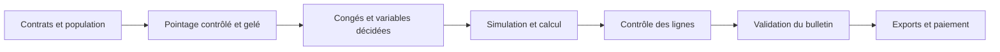

# Module Paie & Rémunération — Spécification métier et architecture
## GALAXAM SIRH — Documentation de référence pour le mémoire

> **Périmètre** : préparation de période, variables, calcul, contrôle, validation du bulletin, exports et solde de tout compte.  
> **État observé** : septembre 2026 ; les résultats de recette sont distingués des règles de conception.  
> **Sources internes** : schéma `06_schema_paie.sql`, services Java du paquet `mg.galaxam.sirh.paie`, écrans `frontend/src/features/payroll`, classeurs de référence TMM/TNR et échanges avec la DAF.

---

## Sommaire exécutif

Le module Paie transforme une période de pointage contrôlée, des droits à congé et des variables décidées en lignes de bulletin justifiables. Il sépare les faits temporels, les décisions de gestion, les paramètres légaux datés et les opérations de trésorerie. Cette séparation permet d'expliquer chaque gain ou retenue sans déduire une règle de paie d'un intitulé de colonne Excel.

La recette du 26 juillet au 25 août 2026 reproduit les composantes connues des exemples TMM et TNR. Elle ne certifie pas encore leurs bulletins complets : `AUTIMP` additionne déplacement et prime exceptionnelle sans détail fiable dans les classeurs. Le [rapport de préproduction](./audit-preproduction-pointage-paie-2026-09-25.md) précise les vérifications réalisées et les conditions restantes.

## Table des matières

1. [Périmètre et frontières intermodules](#1-périmètre-et-frontières-intermodules)
2. [Acteurs et parcours de paie](#2-acteurs-et-parcours-de-paie)
3. [Modèle de données et traçabilité](#3-modèle-de-données-et-traçabilité)
4. [Référentiel légal et sélection à date d'effet](#4-référentiel-légal-et-sélection-à-date-deffet)
5. [Modèle de calcul du bulletin](#5-modèle-de-calcul-du-bulletin)
6. [Variables, avances et prêts](#6-variables-avances-et-prêts)
7. [Architecture logicielle et interfaces](#7-architecture-logicielle-et-interfaces)
8. [Étude de cas TMM et TNR](#8-étude-de-cas-tmm-et-tnr)
9. [Contrôles, limites et recette de production](#9-contrôles-limites-et-recette-de-production)
10. [Catalogue des règles de gestion](#10-catalogue-des-règles-de-gestion)

---

## 1. Périmètre et frontières intermodules

Le pointage établit les minutes réellement travaillées, les déficits après compensation hebdomadaire, les catégories d'heures majorées et les ajustements horaires motivés. Le module Congés établit les demandes validées, les jours calendaires imputés au solde et leur valeur historique. La Paie consomme ces données, calcule leur valeur monétaire et produit le bulletin. Elle ne doit pas modifier rétroactivement un badge ou un droit à congé pour obtenir un montant attendu.

| Source | Donnée consommée | Effet sur le bulletin |
| :--- | :--- | :--- |
| Contrat et carrière | Salaire de base, mode de calcul, affectation | Base de rémunération et population de la période |
| Pointage gelé | Solde horaire, heures majorées, indemnités journalières | Retenue horaire, HS et indemnités accordées |
| Congés | Jours calendaires et taux historique applicable | Retenue au trentième et indemnité distincte |
| Variables DAF | Prime exceptionnelle, régularisation, acompte | Ligne typée, sens et décision traçables |
| Référentiel légal | Version applicable à la date de paie | IRSA, cotisations, diviseurs et majorations |

`Divers` dans le tableau de pointage est une correction horaire libre avec motif : elle intervient avant le calcul du solde final. Selon la DAF, `AUTIMP` dans l'ancien récapitulatif salarial est **la somme de l'indemnité de déplacement et de la prime exceptionnelle**. Le SIRH conserve ces deux gains sur des lignes distinctes. Aucune déduction automatique de `divers` à partir du nombre de déplacements n'est retenue.

## 2. Acteurs et parcours de paie

Le parcours d'interface est organisé en étapes : population, préparation, variables, calcul, contrôle, validation et sorties. Le backend renvoie le contexte de période, les problèmes bloquants et les actions permises. L'utilisateur voit les éléments à corriger avant de pouvoir avancer ; la décision de calcul reste contrôlée côté serveur.

La simulation sert à expliquer un résultat sans consommer définitivement les mouvements. Le calcul réel prend les décisions approuvées ; une variable encore en attente bloque la campagne. Le recalcul d'un bulletin non validé restaure transactionnellement les imputations antérieures de primes, avances et prêts avant de les réappliquer. Un bulletin validé ou clôturé ne peut pas être recalculé directement. Le gel du pointage et la validation du bulletin sont donc deux frontières différentes : l'une stabilise les faits de temps, l'autre stabilise leur traduction financière.

La page de validation ne présente plus la checklist de prévalidation comme des erreurs lorsque la campagne est déjà validée. Les exports appartiennent à l'étape « sorties ». La présence d'un bouton ou d'un fichier généré ne constitue pas une validation comptable ou réglementaire du contenu exporté.

## 3. Modèle de données et traçabilité

Le schéma canonique `06_schema_paie.sql` sépare les référentiels, les bulletins et les mouvements financiers. `02_schema_referentiels_rh.sql` porte la configuration légale datée. Les tables principales sont les suivantes :

| Table | Rôle | Contrôle notable |
| :--- | :--- | :--- |
| `paie_config_legale` | Versions fiscales et sociales | `code_version` unique, dates d'effet |
| `bareme_irsa` | Tranches rattachées à une version | Unicité version + numéro + début |
| `ref_taux_majoration` | Taux HS, nuit, dimanche, férié | Sélection stricte par type et date à l'exécution |
| `ref_type_cotisation`, `site_cotisation` | Cotisations et rattachement site | Codes et rattachements uniques |
| `paie_rubrique` | Catalogue des lignes | Code unique, catégorie et sens contrôlés |
| `bulletin_paie` | En-tête, montants et références de calcul | Unicité employé + période + type ; référence unique |
| `bulletin_paie_ligne` | Détail chiffré et qualifié | Sens, assiettes et montants conservés |
| `paie_avance_acompte` | Variable et imputation de trésorerie | Statut, solde et montant cohérents |
| `paie_pret`, `paie_pret_echeance` | Capital et échéances | Référence et numéro d'échéance uniques |
| `paie_stc` | Solde de tout compte | Numéro de reçu et statut contrôlés |

Les lignes du bulletin sont la justification lisible du total. Le snapshot de pointage et la configuration utilisée servent à interpréter un bulletin historique. Le journal des mouvements et l'audit des modifications de référentiel évitent de confondre une correction future avec le calcul effectué au moment de la validation.

## 4. Référentiel légal et sélection à date d'effet

Le contexte légal est sélectionné par `PayrollLegalContextResolver` à la date de fin de la période de paie. Une même année peut avoir plusieurs versions successives. En 2026, le jeu de données comprend par exemple une version janvier–février et une version à partir de mars. La seule appartenance à « 2026 » ne suffit donc pas à choisir un barème. `PaieConfigLegale.findActiveAt` refuse plusieurs versions applicables à la date recherchée.

Le barème IRSA est rattaché à la configuration sélectionnée. `IrsaBracketResolver` filtre aussi les tranches par date, les ordonne par numéro et refuse les numéros manquants ou dupliqués. La migration `26-09-25-sp31-bareme-irsa-dedoublonnage.sql` retire seulement les anciens doublons identifiés, puis crée l'index unique `(id_config_legale, numero_tranche, date_debut)` ; le même index figure dans le schéma neuf. Un autre doublon ne doit pas être éliminé silencieusement.

Les majorations sont résolues à la date du temps concerné : `RefTauxMajoration.resolveApplicableFromList` exige exactement un taux pour un type donné. Les paramètres globaux utilisent une clé unique `(code_parametre, date_debut)` ; cette clé n'empêche pas à elle seule des périodes de validité qui se recouvrent. Il en va de même pour l'index IRSA si deux lignes commencent à des dates différentes mais restent simultanément valides. L'unicité d'une date de début et l'absence de chevauchement sont deux propriétés distinctes.

Pour fiabiliser un référentiel daté, la règle de gestion attendue est :

1. définir la portée de la clé métier (configuration, code, type, site ou employé) ;
2. vérifier `date_debut <= date_fin` lorsqu'une fin est renseignée ;
3. rechercher toute intersection avec une version existante de même portée avant insertion ou modification ;
4. effectuer la vérification et l'écriture dans une transaction protégée contre les écritures concurrentes ;
5. conserver un historique auditable et refuser les valeurs contradictoires ;
6. contrôler l'unicité effective à la date du calcul, afin qu'une anomalie ancienne ne produise pas un bulletin arbitraire.

Les résolveurs stricts constituent aujourd'hui une protection à l'exécution. Les contraintes de non-chevauchement pour **tous** les référentiels datés restent à généraliser après audit des données existantes. Cette réserve fait partie du verdict préproduction. La loi de finances, les taux et l'assujettissement des rubriques doivent être vérifiés à partir des textes et décisions applicables à chaque période avant validation métier ; ce document décrit le fonctionnement du système et ne certifie pas à lui seul la conformité juridique.

## 5. Modèle de calcul du bulletin

`PayrollExecutionEngine` organise le calcul en paliers : gains bruts, cotisations salariales et patronales, net imposable, fiscalité IRSA ou ISI selon le profil, gains hors assiette lorsqu'ils sont configurés comme tels, retenues de trésorerie, puis net à payer. Chaque palier alimente des lignes de bulletin distinctes. Les propriétés fiscales d'une ligne dépendent de la rubrique et de son sens ; une retenue n'est pas marquée imposable par défaut.

### 5.1 Salaire de base, congés et absence

Pour un salarié mensuel de salaire de base `S`, la retenue liée aux jours calendaires de congé `Jc` est `S / 30 × Jc`. L'indemnité de congé est `TCONGE historique × Jc`. Le taux historique reflète les droits constitués antérieurement ; il peut être inférieur ou supérieur au salaire actuel divisé par 30. Le fait que l'absence du calendrier et le congé correspondent aux mêmes dates ne signifie donc pas que leurs montants s'annulent.

Une absence résiduelle hors congé de `M` minutes est valorisée par `S / diviseur mensuel d'heures × M / 60`. Le diviseur est issu de la version légale applicable ; les exemples utilisent 173,33 h. Le modèle ne transforme pas d'abord 20 minutes en 0,33 heure pour calculer la retenue. Les jours de congé et les minutes d'absence restent deux unités et deux lignes séparées.

### 5.2 Heures supplémentaires et indemnités

La qualification des heures est produite par le pointage à partir des journées, de la compensation hebdomadaire et du solde de période. La paie valorise les catégories reçues avec les taux datés : HS de première et seconde tranche, nuit, dimanche et férié lorsque les données correspondantes existent. `OvertimePayCalculator` agrège les montants des catégories avant l'arrondi monétaire final, ce qui évite des centimes créés par un arrondi de chaque petite fraction.

Le repas et le déplacement sont deux concepts distincts. Selon la réponse DAF, ils entrent dans le brut imposable lorsqu'ils sont payés en fin de mois selon les jours travaillés ; ils ne doivent pas entrer dans la valorisation historique des congés. Une valeur d'indemnité à 0 Ar n'autorise pas à inventer un montant par défaut. La prime exceptionnelle est une variable décidée séparément, même lorsque l'ancien Excel l'additionne au déplacement dans `AUTIMP`.

Pour un site où le repas est fourni sans versement, l'agent peut recevoir un repas valorisé à **0 Ar**. Si le repas est effectivement accordé et qu'un déplacement est aussi accordé ce jour-là, le montant du déplacement est réduit du paramètre `REDUCTION_DEPLACT_REPAS_MIDI` (**1 000 Ar dans l'exemple TMM**), sans descendre sous zéro. Le badge « horaire continu » décrit les entrées et sorties ; il ne décide pas de cette réduction. À titre d'illustration de saisie, le 10 août 2026 peut être choisi pour TMM si cette journée est éligible : la ligne repas reste à 0 Ar, la ligne déplacement porte seule −1 000 Ar par rapport à son tarif du jour, et la prime exceptionnelle reste inchangée. Cette date illustrative n'est pas une donnée certifiée du classeur.

### 5.3 Cotisations, impôt et trésorerie

Les cotisations sociales sont calculées sur leurs assiettes respectives et selon la configuration applicable. Le barème progressif IRSA est lu dans `bareme_irsa`; le parcours ISI est propre aux profils concernés. Les paramètres de plafonnement et d'arrondi sont pris dans la configuration et dans `MoneyRoundingPolicy`. Le calcul conserve la précision des durées et agrège les montants avant l'arrondi prévu pour les montants du bulletin. Les avances et échéances de prêt diminuent ensuite le disponible selon leur état et les règles configurées ; elles ne modifient pas rétrospectivement les heures du pointage.

## 6. Variables, avances et prêts

Une variable manuelle possède un type, un montant signé par son sens métier, un motif, une période, un auteur et un statut. Le contrôle DAF décide si elle est approuvée ou rejetée. Le calcul réel refuse une variable encore en attente. Cette règle évite qu'une prime, un acompte ou une correction soient implicitement pris en compte par simple présence dans la base.

Les avances et acomptes possèdent un montant initial, une imputation et un solde restant. Les prêts possèdent un capital et des échéances. La simulation et le recalcul des bulletins non validés reposent sur la restauration transactionnelle des imputations déjà faites, ce qui évite une double consommation. Le détail des mouvements apparaît dans le bulletin et dans les écrans de contrôle. Le solde de tout compte dispose d'un parcours séparé de préparation, calcul, validation et reçu ; il doit être recetté sur des sorties réelles avant mise en production.

## 7. Architecture logicielle et interfaces

| Couche | Composants représentatifs | Responsabilité |
| :--- | :--- | :--- |
| API | `PaieController`, `PaieAjustementController`, `StcController` | Commandes de campagne, variables, bulletins, STC et exports |
| Application | `PayrollService`, `PayrollPeriodWorkflowService`, `PayrollLegalContextResolver` | Transactions, garde-fous, population et contexte légal |
| Domaine | `PayrollExecutionEngine`, `OvertimePayCalculator`, `IrsaCalculator` | Calcul déterministe et lignes expliquées |
| Persistance | `BulletinPaie`, `BulletinPaieLigne`, `PaieAvanceAcompte`, `PaiePret` | Historique monétaire et imputations |
| Frontend | `PayrollCampaignShell`, pages d'étapes, `BulletinPaieDrawer` | Workflow guidé, anomalies et lecture du bulletin |

L'API expose notamment le calcul d'un employé ou d'une période, la validation, la lecture d'un bulletin et les exports SAFI, DNTS et virement. Les URLs sont déclarées dans `PaieController` sous plusieurs préfixes compatibles ; l'interface passe par son client API authentifié. Les exports CSV/ODS ont été générés avec succès en recette isolée. Leur acceptation par les destinataires n'a pas été vérifiée.

## 8. Étude de cas TMM et TNR

Les deux classeurs de pointage et de droits à congé ont servi de données de référence pour la période du 26/07 au 25/08/2026. Les intitulés des feuilles n'ont pas été utilisés comme preuve de calcul ; les horaires et les formules ont été rapprochés avec les informations fournies par la DAF.

| Mesure rapprochée | TMM | TNR |
| :--- | ---: | ---: |
| HS 30 % avant ajustement DAF | 537 min | 249 min |
| Déficit hebdomadaire | 0 min | 109 min |
| Ajustement DAF « divers » | −150 min | −160 min |
| Résultat de période | 387 min de HS | 20 min d'absence |
| Congés calendaires | 9 j | 3 j |
| Retenue congé au trentième | 111 000,00 Ar | 35 000,00 Ar |
| Indemnité congé historique | 86 967,81 Ar | 24 670,50 Ar |
| Retenue d'absence horaire | 0 Ar | 673,09 Ar |
| HS valorisées | 17 899,09 Ar | 0 Ar |
| Brut SIRH hors gains non ventilés | 363 866,90 Ar | 338 997,41 Ar |

Pour TMM, le brut Excel `399 139,63 − AUTIMP 35 272,73` donne **363 866,90 Ar** : la composante comparable est identique. Pour TNR, `411 367,78 − AUTIMP 28 363,64 − repas 44 000` donne **339 004,14 Ar**, soit **6,73 Ar** de plus que la composante SIRH. Cette différence provient de la conversion Excel de 20 minutes en 0,33 heure avant valorisation ; le SIRH utilise 20/60 heure. Elle doit être acceptée explicitement en recette.

Ces chiffres sont des **sous-totaux rapprochés** et non des bulletins TMM/TNR complets identiques. La ventilation `AUTIMP = déplacement après réduction éventuelle + prime exceptionnelle` est nécessaire pour contrôler le brut final, les assiettes, l'IRSA, les cotisations et le net. Le bulletin produit dans le parcours API prouve que la chaîne technique fonctionne, pas que les deux bulletins historiques sont reconstitués entièrement. Les calculs détaillés figurent dans le [rapport de rapprochement](./rapprochement-pointage-paie-juillet-aout-2026.md).

## 9. Contrôles, limites et recette de production

L'audit technique a exécuté un parcours authentifié de création d'employé et contrat, pointage, congés, variables, calcul et validation du bulletin sur une base PostgreSQL isolée. Les exports SAFI CSV/ODS, DNTS et virement ont répondu avec un contenu non vide. Après les correctifs, la suite backend comptait **99 tests réussis**, les tests frontend **4 réussis**, et la compilation frontend ainsi que le lint passaient. Ces observations ne remplacent pas une recette métier de paie représentative.

Les points à faire signer avant déploiement sont :

1. ventiler `AUTIMP`, saisir les montants de repas et déplacement réellement accordés et comparer les bulletins TMM/TNR complets ligne par ligne ;
2. accepter ou corriger la différence de 6,73 Ar liée à la précision des minutes ;
3. couvrir les autres profils et combinaisons utilisés en production, y compris ISI, sujétions, prêts multiples, régularisations et STC ;
4. auditer les versions légales, les barèmes et les paramètres datés pour rechercher tout chevauchement à la date d'effet ;
5. exécuter les migrations nécessaires sur une copie de la base cible et contrôler les bulletins déjà émis, avec sauvegarde et retour arrière ;
6. faire valider les exports bancaires et déclaratifs par la DAF et la comptabilité sur une paie représentative.

Le verdict détaillé et la liste des correctifs sont conservés dans le [rapport d'audit préproduction](./audit-preproduction-pointage-paie-2026-09-25.md). Le module est fonctionnel sur les scénarios vérifiés, mais le visa de mise en production de la paie reste conditionné à ces contrôles.

## 10. Catalogue des règles de gestion

| Code | Règle | Conséquence vérifiable |
| :--- | :--- | :--- |
| RG-PAI-01 | Le calcul réel consomme une période de pointage gelée. | Une modification de pointage nécessite un nouveau cycle de contrôle avant recalcul. |
| RG-PAI-02 | Les variables de paie sont décidées avant le calcul réel. | Une variable `EN_ATTENTE` bloque la campagne ; une variable rejetée n'est pas imputée. |
| RG-PAI-03 | Le congé est décompté en jours calendaires. | La retenue `S/30 × J` et le gain `TCONGE × J` sont deux lignes indépendantes. |
| RG-PAI-04 | L'absence hors congé est un temps résiduel. | Les minutes finales sont valorisées au taux horaire, sans arrondi préalable en centièmes d'heure. |
| RG-PAI-05 | Les HS ne sont payées qu'après compensation et ajustement du pointage. | La paie ne reconstitue pas seule les semaines à partir des badges bruts. |
| RG-PAI-06 | La version légale est celle applicable à la date de fin de période. | Plusieurs versions dans une année sont admises ; plusieurs versions à la même date bloquent. |
| RG-PAI-07 | Le barème IRSA doit être non ambigu à la date calculée. | Une tranche absente ou dupliquée provoque une erreur de configuration. |
| RG-PAI-08 | Un taux de majoration doit être unique par type à la date du temps qualifié. | Aucun taux n'est choisi par ordre d'insertion en cas de chevauchement. |
| RG-PAI-09 | Les rubriques de repas, déplacement et prime exceptionnelle restent distinctes. | L'agrégat historique `AUTIMP` ne devient pas une règle de calcul. |
| RG-PAI-10 | La simulation ne consomme pas définitivement les mouvements financiers. | Un nouveau calcul d'un brouillon conserve le même net et les mêmes soldes si les entrées sont inchangées. |
| RG-PAI-11 | Un bulletin validé ou clôturé n'est pas recalculé directement. | Toute correction ultérieure doit suivre un parcours de régularisation traçable. |
| RG-PAI-12 | Les exports sont dérivés des bulletins contrôlés. | Le succès HTTP atteste la génération ; l'acceptation métier et bancaire reste une recette distincte. |

Ces règles sont décrites pour le système observé en septembre 2026. Elles
doivent rester synchronisées avec les migrations, les tests de recette et les
décisions de la DAF lorsque les pratiques de paie évoluent.
