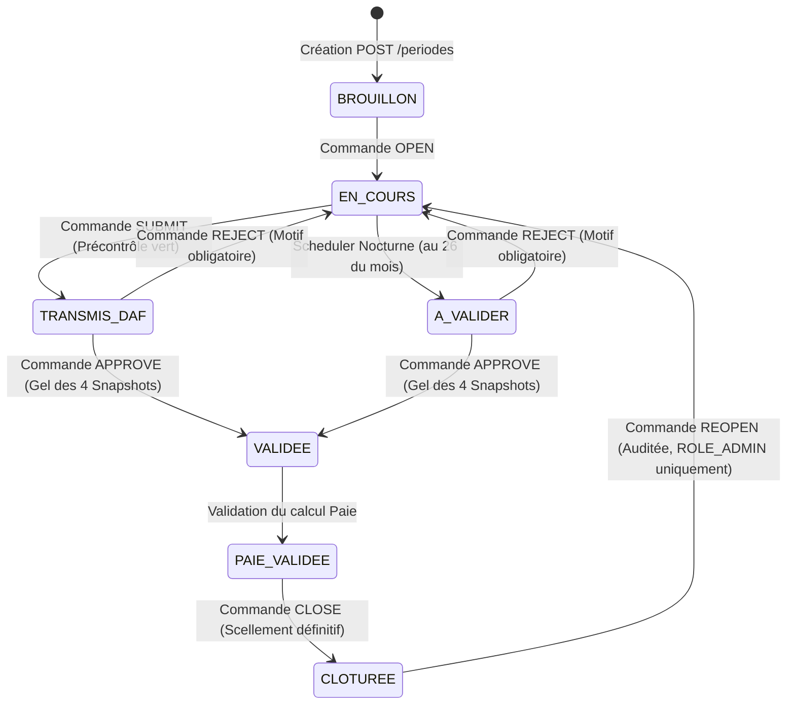

# Module Pointage, Temps de Travail & Présence — document maître

> **Projet** : GALAXAM SIRH — GALAXAM Logistics Madagascar
> **Version documentaire** : 5.1 (Document Maître)
> **État du code examiné** : vérification documentaire DOC-2, 23 octobre 2026
> **Périmètre** : interfaces React, API Java Spring Boot 4.1.0, moteurs d'acquisition et de calcul orthogonal, persistance des snapshots, schéma SQL canonique (`05_schema_pointage.sql`).
> **Cadre Juridique** : [Loi n° 2024-014 du 14 août 2024 portant Code du Travail](https://cnlegis.gov.mg/uploads/L2024-014-VF.pdf) (adoptée le 01/07/2024, validée par la HCC le 08/08/2024 Décision n° 11-HCC/D3, promulguée le 14/08/2024 ; Art. 108 à 123), [Décret n° 72-226 du 6 juillet 1972](https://fr.scribd.com/document/887714691/Droit-Malgache-Du-Travail) (durée légale hebdomadaire 40h = 173,33h/mois et majorations HS +30% et +50%), [Arrêté n° 198-IGT du 20 janvier 1954](https://cabinetkim.mg/blog/code-du-travail-madagascar-nouvelle-loi-2024-014/) (modalités de contrôle du temps de travail).

---

## Sommaire

[Finalité et périmètre légal](#1-finalité-et-périmètre-légal)

[Acteurs, rôles et matrice des permissions](#2-acteurs-rôles-et-matrice-des-permissions)

[Écrans et parcours utilisateur](#3-écrans-et-parcours-utilisateur)

[Cycle de vie de la période de pointage et transitions auditées](#4-cycle-de-vie-de-la-période-de-pointage-et-transitions-auditées)

[Architecture d’acquisition du temps (Saisie &amp; Import Excel)](#5-architecture-dacquisition-du-temps-saisie--import-excel)

[Moteur temporel orthogonal &amp; Plancher d’arrivée](#6-moteur-temporel-orthogonal--plancher-darrivée)

[Calcul hebdomadaire, compensation et ventilation du solde](#7-calcul-hebdomadaire-compensation-et-ventilation-du-solde)

[Indemnités de présence journalières et fixes mensuels](#8-indemnités-de-présence-journalières-et-fixes-mensuels)

[Suivi des anomalies et régularisation motivée](#9-suivi-des-anomalies-et-régularisation-motivée)

[Arbitrage DAF de période et ajustements](#10-arbitrage-daf-de-période-et-ajustements)

[Scellement de période et architecture des 4 snapshots](#11-scellement-de-période-et-architecture-des-4-snapshots)

[Données et modèle de persistance](#12-données-et-modèle-de-persistance)

[Documents, fiches et exports](#13-documents-fiches-et-exports)

[Catalogue exhaustif des Règles de Gestion (RG)](#14-catalogue-exhaustif-des-règles-de-gestion-rg)

[Étude de cas chiffrée &amp; Rapprochement de recette](#15-étude-de-cas-chiffrée--rapprochement-de-recette)

[Cartographie exhaustive du code réel](#16-cartographie-exhaustive-du-code-réel)

---

## 1. Finalité et périmètre légal

Le module **Pointage, Temps de Travail & Présence** constitue l'assise opérationnelle de la traçabilité du temps dans GALAXAM SIRH. Il capture quotidiennement les présences physiques sur site, qualifie les retards et les absences, détecte les anomalies de pointage, calcule les heures supplémentaires (HS) hebdomadaires, majore les heures de nuit (22h00 - 05h00), de dimanche et de jours fériés, attribue les indemnités de sujétion (repas, déplacement), puis fige les cumuls dans des **snapshots versionnés** consommés par le moteur de paie. Le terme « figé » décrit l'état technique et ne vaut pas certification juridique ou financière.

### Ancrage juridique malgache de référence :

- **Loi n° 2024-014 du 14 août 2024 (Code du Travail)** :
  - *Art. 108* : Définition du temps de travail effectif (temps pendant lequel le salarié est à la disposition de l'employeur sans pouvoir vaquer librement à des occupations personnelles).
  - *Art. 109 & 110* : Durée légale du travail fixée à **40 heures par semaine** dans les établissements non agricoles (soit 173,33 heures par mois).
  - *Art. 111 & 112* : Régime des heures supplémentaires et interdiction du dépassement non concerté du contingent légal.
  - *Art. 114* : Repos hebdomadaire obligatoire de 24 heures consécutives (en principe le dimanche).
  - *Art. 115 & 116* : Jours fériés et ponts chômés et payés, et majoration du travail du dimanche et des jours fériés.
  - *Art. 117 à 124 (Section 3)* : Travail de nuit défini comme tout travail effectué entre **22 heures et 5 heures** (ex-Art. 83 de la loi de 2003).
- **Décret n° 72-226 du 6 juillet 1972** (maintenu transitoirement par l'Art. 391 de la Loi 2024-014) :
  - Majoration légale de **30%** pour les 8 premières heures supplémentaires hebdomadaires (de la 41e à la 48e heure).
  - Majoration légale de **50%** pour les heures au-delà de la 48e heure hebdomadaire.
- **Arrêté n° 198-IGT du 20 janvier 1954** :
  - Tenue obligatoire d'un relevé nominatif de contrôle de l'horaire de travail, vérifiable par l'Inspection du Travail.

---

## 2. Acteurs, rôles et matrice des permissions

| Rôle / Profil                                      | Périmètre d'action fonctionnel                                                                                                                      | Permissions requises                                   |
| :-------------------------------------------------- | :---------------------------------------------------------------------------------------------------------------------------------------------------- | :----------------------------------------------------- |
| **Pointeur / Superviseur de Site**            | Saisie journalière par date ou par salarié, import des relevés de badgeuses, prévisualisation des lots.                                           | `POINTAGE_READ`, `POINTAGE_WRITE`                  |
| **Gestionnaire RH**                           | Traitement des anomalies, régularisation des oublis de badge, qualification des motifs d'absence avec création transactionnelle de congés.         | `POINTAGE_READ`, `POINTAGE_WRITE`, `CONGE_WRITE` |
| **Directeur Administratif & Financier (DAF)** | Arbitrage des soldes horaires de fin de période (`pointage_ajustement_periode`), validation de période scellée (`VALIDEE`), transmission Paie. | `POINTAGE_VALIDATE`, `PAIE_WRITE`                  |
| **Administrateur Système**                   | Paramétrage des seuils de tolérance, planchers d'arrivée, dérogations d'indemnité, réouverture exceptionnelle d'une campagne (`REOPEN`).      | `ROLE_ADMIN`                                         |

---

## 3. Écrans et parcours utilisateur

Les écrans sont accessibles sous la route `/pointages` orchestrée par [`GestionPointagesPage.jsx`](../../../frontend/src/features/attendance/pages/GestionPointagesPage.jsx) organisée en trois étapes d'onglets de travail :

```
┌────────────────────────────────────────────────────────────────────────┐
│                        GESTION DES POINTAGES                           │
├────────────────────────────────────────────────────────────────────────┤
│  [ Onglet Saisie ]     [ Onglet À Traiter ]    [ Onglet Contrôle DAF ] │
│  • Saisie Quotidienne  • Suivi Anomalies       • Arbitrage Période     │
│  • Saisie Période      • Régularisations       • Précontrôle & Gel     │
│  • Import Excel        • Fiche Salarié         • Fiches PDF / Excel    │
└────────────────────────────────────────────────────────────────────────┘
```

1. **Saisie Quotidienne (`SaisieQuotidiennePage.jsx`)** : Grille matricielle collective par date. Permet de pointer l'ensemble du personnel actif d'un site à une date donnée.
2. **Saisie par Période Salarié (`SaisiePeriodeEmployePage.jsx`)** : Calendrier individuel complet du 26 au 25. Permet la saisie au fil de l'eau, l'import Excel individuel, la consultation des totaux provisoires et le passage en revue des semaines.
3. **Suivi des Anomalies & Régularisation (`SuiviAnomaliesPage.jsx`)** : Console de détection des journées incomplètes, retards anormaux, pointages non saisis ou statuts litigieux avec déclenchement du modal motivé [`AnomalieRegularisationModal.jsx`](../../../frontend/src/features/attendance/components/modals/AnomalieRegularisationModal.jsx).
4. **Arbitrage DAF & Contrôle (`ArbitrageDafPage.jsx`)** : Synthèse consolidée de fin de mois, vérification du précontrôle bloquant (`PointageTemporalConfigurationGuard`), saisie des ajustements signés et validation finale déclenchant le gel des 4 snapshots.
5. **Fiche Pointage Salarié (`PointageTab.jsx` dans le dossier employé)** : Consultation en lecture/correction ciblée des journées, totaux hebdomadaires, ventilation nuit/dimanche/férié et téléchargement des fiches PDF/Excel.

---

## 4. Cycle de vie de la période de pointage et transitions auditées

Le SIRH GALAXAM utilise un cycle décalé d'entreprise couvrant du **26 du mois $M-1$ au 25 du mois $M$** (ex. : Période `2026-08` du 26/07/2026 au 25/08/2026).

La base de données protège strictement l'unicité et l'étanchéité des périodes via une contrainte d'exclusion GiST PostgreSQL interdisant tout chevauchement :

```sql
CONSTRAINT ex_periode_paie_dates EXCLUDE USING gist (daterange(date_debut, date_fin, '[]') WITH &&)
```

L'ancien identifiant **SP80** désigne historiquement l'ajout d'un invariant : chaque `pointage_jour.date_pointage` doit appartenir aux bornes **inclusives** de sa `periode_paie`. Les triggers correspondants figurent dans le schéma canonique, référence d'initialisation d'une base neuve. Les migrations SP ont été volontairement supprimées ; ce schéma ne fournit pas de procédure de mise à niveau d'une base existante, et aucun mécanisme automatique de migration n'est documenté. Un trigger vérifie les insertions et les changements de date ou de période en verrouillant la période par `FOR SHARE`. Un autre refuse toute modification effective de ses bornes après création. La validation Java du parcours de saisie reste en place ; la protection SQL couvre aussi les écritures directes, notamment la matérialisation des congés et les imports.

### Machine à états de la période (`PayrollPeriodWorkflowService.java`) :



| Commande                    | Statut Initial                   | Statut Cible     | Rôle Autorisé                       | Effet Opérationnel & Technique                                                                                             |
| :-------------------------- | :------------------------------- | :--------------- | :---------------------------------- | :------------------------------------------------------------------------------------------------------------------------- |
| **`OPEN`**                  | `BROUILLON`                      | `EN_COURS`       | `POINTAGE_WRITE`, `ROLE_ADMIN`      | Déverrouille la saisie des fiches et des badges pour les pointeurs.                                                        |
| **`SUBMIT`**                | `EN_COURS`                       | `TRANSMIS_DAF`   | `POINTAGE_WRITE`, `ROLE_ADMIN`      | Exécute le précontrôle de cohérence et soumet la période pour arbitrage DAF.                                               |
| **`APPROVE`**               | `A_VALIDER` / `TRANSMIS_DAF`     | `VALIDEE`        | `POINTAGE_VALIDATE`, `ROLE_ADMIN`   | **Gel transactionnel complet** : génère `pointage_cumul_periode` et alimente les 4 tables de snapshots immuables.         |
| **`REJECT`**                | `A_VALIDER` / `TRANSMIS_DAF`     | `EN_COURS`       | `POINTAGE_VALIDATE`, `ROLE_ADMIN`   | Rejette la période vers la saisie avec motif obligatoire consigné dans `periode_paie_transition`.                          |
| **`VALIDATE_PAYROLL`**      | `VALIDEE`                        | `PAIE_VALIDEE`   | `PAIE_VALIDATE`, `ROLE_ADMIN`       | Validation et approbation de la paie collective de la période, consignée atomiquement dans `periode_paie_transition`.     |
| **`RECALCULATE_PAYROLL`**   | `PAIE_VALIDEE`                   | `VALIDEE`        | `PAIE_WRITE`, `ROLE_ADMIN`          | Recalcul de paie replaçant les bulletins en attente d'approbation, consigné atomiquement dans `periode_paie_transition`.  |
| **`CLOSE`**                 | `PAIE_VALIDEE`                   | `CLOTUREE`       | `PAIE_VALIDATE`, `ROLE_ADMIN`       | Clôture seulement après la fin de période, sans recalcul obsolète et avec la population de bulletins validée complète. `VALIDEE` seul est refusé (`PAYROLL_NOT_VALIDATED`). |
| **`REOPEN`**                | `CLOTUREE`                       | `EN_COURS`       | `ROLE_ADMIN`                        | Dégel d'urgence exceptionnel : archive le cumul précédent (`REMPLACE`) et recrée une session active.                       |

> **Journalisation des transitions (`periode_paie_transition`)** :
> - **Rôle** : Journal métier *append-only* consignant chronologiquement chaque changement d'état (`commande`, `statut_source`, `statut_cible`, `version_source`, `version_cible`, `id_utilisateur`, `motif`, `created_at`).
> - **Atomicité transactionnelle** : Chaque écriture dans `periode_paie_transition` est garantie au sein de la même transaction JDBC que la modification de `periode_paie.statut`. Si l'enregistrement dans le journal échoue, la transaction entière est annulée (`rollback`).
> - **État d'exposition** : Cet historique est strictement tracé en base de données PostgreSQL mais n'est pas encore exposé par un endpoint REST public ni affiché dans les interfaces React actuelles.
> - **Note de conformité** : L'ancien endpoint générique de mutation directe de statut (`PUT /periodes/{id}/statut`) est désactivé et renvoie une réponse HTTP `410 GONE`. Seules les commandes auditées sont autorisées.

La garde de clôture est implémentée dans `backend/src/main/java/mg/galaxam/sirh/paie/application/workflow/PayrollPeriodWorkflowService.java` (`closeStateCapability` et `closeCapability`). `PayrollPeriodTransitionTargetedTest` vérifie notamment la journalisation des transitions, mais ne démontre pas à lui seul toutes les préconditions d'exécution de `CLOSE` ; aucune recette de clôture de pointage distincte n'est revendiquée dans ce document.

**Portée du gel et de la réouverture :** les lignes d'un snapshot généré au gel sont historiques et conservées comme telles. La période, elle, n'est pas irréversible : `REOPEN` permet à `ROLE_ADMIN`, avec motif, de repasser de `CLOTUREE` à `EN_COURS`, de dégeler la période et d'archiver le cumul précédent comme remplacé. La réouverture est refusée lorsqu'un bulletin mensuel a déjà un règlement non annulé, une ligne de virement en attente ou un STC au statut `VALIDE`/`REGLE`. Un nouveau gel crée une nouvelle version de snapshot ; il ne réécrit pas l'ancienne version.

---

## 5. Architecture d’acquisition du temps (Saisie & Import Excel)

L'acquisition du temps physique repose sur un contrat unifié garantissant que le client Web ne calcule jamais de solde en local, mais soumet des **intentions de saisie** validées par le serveur :

```
[ Frontend: pointageRow.js ] ──(Payload)──> [ POST /pointages/saisie/preview/batch ]
                                                    │
                                                    ▼
[ Base de données (05_schema) ] <──(Save)── [ PointageService.writeDay() ]
```

1. **Contrat de lot commun (`pointageBatchPayload.js`)** : Toutes les modifications (heures d'entrée, de sortie, statuts, indemnités accordées) sont normalisées sous une structure batch commune.
2. **Prévisualisation serveur réactive (`usePointageBatchPreview.js`)** : Lors de la modification d'un horaire, une requête de prévisualisation calcule immédiatement les heures effectives, les retards et les indemnités sans persister, ignorant automatiquement les réponses asynchrones obsolètes.
3. **Écriture transactionnelle atomique (`PointageService.writeDay`)** :
   - Vérification de l'affectation active et du contrat du salarié via `EmploymentContextResolver`.
   - Contrôle d'état de la période (`statutCode == 'EN_COURS'`).
   - Vérification de l'appartenance de la date à la période ; le trigger défini dans le schéma canonique impose également cette règle aux autres chemins d'écriture (SP80 est l'ancien identifiant historique de cette évolution).
   - Gestion de la concurrence optimiste via le champ `version` incrémenté à chaque mise à jour.
4. **Import Excel des Badgeuses (`PointageImportService.java`)** :
   - Génération du gabarit officiel nominatif (`GET /pointages/employes/{idEmploye}/import/modele`).
   - Analyse et aperçu non engageant (`POST /pointages/employes/{idEmploye}/import/apercu`) : met en évidence les anomalies, conflits de versions et lignes prêtes. **L'aperçu n'enregistre rien en base**.
   - Détection des signalements de congés : si le fichier signale un congé ou une absence maladie, le système exige la confirmation explicite de l'utilisateur, ce qui déclenche transactionnellement `CongeService.java`.

---

## 6. Moteur temporel orthogonal & Plancher d’arrivée

Le calcul des heures d'une journée n'est pas un calcul arithmétique simple : il mobilise deux moteurs spécialisés garantissant la rigueur légale.

### A. Plancher d'arrivée paramétrable par site (`ref_site`)

Pour empêcher qu'un employé badgé excessivement en avance ne génère indûment des heures de travail sans accord managérial, le système applique un plancher d'arrivée paramétré sur `ref_site` :

$$
\text{Heure Entrée Effective} = \max(\text{Heure Badge Effective}, \text{Plancher Arrivée Site})
$$

- *Exemple réel* : Sur le site de Tamatave (plancher fixé à 07h00), un salarié qui badge à 06h45 verra son `heure_entree_matin_effective` bornée à **07h00**. Si le salarié badge à 07h12, l'heure retenue est 07h12 avec imputation de 12 minutes de retard.
- *Sécurisation juridique & Règlement Intérieur* : Conformément à l'Article 108 de la Loi n° 2024-014 (définition légale du temps de travail effectif), l'écrêtage matinal est juridiquement opposable devant la juridiction prud'homale sous réserve de la présence d'une clause expresse dans le **Règlement Intérieur de l'établissement** (visé et homologué par l'Inspection du Travail selon les Articles 11 et suivants du Code) interdisant l'accès aux postes de travail avant l'horaire officiel et stipulant que les présences anticipées non commandées ne font l'objet d'aucune rémunération.

### B. Qualification temporelle orthogonale (`TemporalAttendanceEngine.java`)

Chaque segment de temps travaillé est découpé et projeté orthogonalement sur **3 dimensions indépendantes** via [`QualifiedTimeBucket.java`](../../src/main/java/mg/galaxam/sirh/pointage/domain/calculation/QualifiedTimeBucket.java) :

1. **Dimension Heures Supplémentaires** : `NONE`, `TIER_30` (majoré à 30%), `TIER_50` (majoré à 50%).
2. **Dimension Jour Spécial** : `STANDARD`, `DIMANCHE`, `FERIE_CHOME`, `FERIE_TRAVAILLE`.
3. **Dimension Période Nocturne** : `NONE`, `NUIT_OCCASIONNELLE`, `NUIT_PROGRAMMEE` (plage stricte de **22h00 à 05h00** selon les Art. 117 et suivants de la Loi 2024-014, ex-Art. 83).

> **Règle des vacations nocturnes à cheval sur minuit** : Les heures travaillées après minuit sont automatiquement ventilées sur le jour calendaire civil d'exécution. Si une vacation du 25 du mois (fin de période) dépasse minuit, le précontrôle de gel bloque la transmission jusqu'à ce que les minutes du 26 soient formellement pointées sur la période suivante.

---

## 7. Calcul hebdomadaire, compensation et ventilation du solde

Le calcul du temps de travail dans GALAXAM SIRH respecte strictement le cadre hebdomadaire de l'Article 109 de la Loi n° 2024-014.

```
Période mensuelle décalée (ex : 26 Juillet au 25 Août)
├── Tronçon 1 (Partiel : 26/07 au Dimanche)  ──> Seuil 40h proratisé aux jours ouvrables
├── Semaine 2 (Pleine  : Lundi au Dimanche) ──> Seuil 40h standard
├── Semaine 3 (Pleine  : Lundi au Dimanche) ──> Seuil 40h standard
├── Semaine 4 (Pleine  : Lundi au Dimanche) ──> Seuil 40h standard
└── Tronçon 5 (Partiel : Lundi au 25/08)    ──> Seuil 40h proratisé aux jours ouvrables
```

### A. Compensation hebdomadaire intra-tronçon

Au sein d'une même semaine (du lundi au dimanche), les heures excédentaires accomplies un jour compensent automatiquement les déficits ou retards d'un autre jour de la même semaine :

- Si un employé travaille 10h le lundi et 6h le mardi, le total est de 16h : il n'y a ni déficit d'absence ni heure supplémentaire isolée.

### B. Paliers légaux d'heures supplémentaires

- Les **8 premières heures** au-delà de l'objectif hebdomadaire (40h) sont qualifiées en **HS 30%** (de 41h à 48h).
- Les heures au-delà de la 48e heure hebdomadaire sont qualifiées en **HS 50%**.
- Pour un tronçon partiel en début ou fin de mois, le palier de 40h et le palier de 8h sont **proratisés au prorata temporis** du nombre de jours ouvrables du tronçon.

### C. Rapprochement et formule du solde de période

Le solde horaire final de la période est calculé selon la formule algébrique :

$$
\text{Solde}_{\text{Période}} = \sum \text{HS}_{30} + \sum \text{HS}_{50} - \sum \text{Déficits Hebdo} + \text{Ajustements DAF}
$$

**Règles strictes d'absorption et d'imputation :**

1. Les déficits hebdomadaires et les ajustements DAF négatifs **consomment en priorité absolue les HS à 30%**.
2. Une fois la tranche à 30% épuisée, ils consomment les **HS à 50%**.
3. Si le déficit total dépasse l'ensemble des heures supplémentaires acquises, l'excédent résiduel devient une **retenue pour absence finale** transmise à la paie (`heures_absence_retenues` valorisées au taux horaire contractuel $S_{base} / 173{,}33$).
4. Un ajustement DAF positif non spécifiquement typé alimente par défaut la tranche des **HS à 30%**.

---

## 8. Indemnités de présence journalières et fixes mensuels

Les indemnités de sujétion liées à l'activité physique sur site sont régies par [`PointageAllowancePolicy.java`](../../src/main/java/mg/galaxam/sirh/pointage/domain/calculation/PointageAllowancePolicy.java) et la table `pointage_indemnite_jour`.

| Indemnité                             | Code                             | Périodicité                 | Conditions d'attribution dans le moteur                                                                                                | Règle de calcul & Dérogation                                                                                                                 |
| :------------------------------------- | :------------------------------- | :---------------------------- | :------------------------------------------------------------------------------------------------------------------------------------- | :--------------------------------------------------------------------------------------------------------------------------------------------- |
| **Indemnité de Déplacement**   | `DPLCT`                        | `MENSUEL` ou `JOURNALIER` | Présence physique sur site actif. Exclue si le salarié utilise un véhicule de fonction (`utilise_vehicule_fonction_jour = TRUE`). | Proratisée au nombre de jours calendaires ou forfait journalier site. Exclusions individuelles portées par `employe_indemnite_derogation`. |
| **Indemnité de Repas (Panier)** | `REPAS`                        | `JOURNALIER`                | Accordée pour toute journée avec présence effective couvrant les plages méridiennes standard.                                      | Forfait journalier défini dans `site_indemnite_config` (ex. : 2 000 Ar à Tananarive, 0 Ar à Tamatave avec cantine d'entreprise).          |
| **Second Repas de Nuit**         | `REPAS_2` / `REPAS_2_MAJORE` | `JOURNALIER`                | Déclenché lors de vacations longues nocturnes dépassant 10h de travail continu incluant la tranche 22h-05h.                         | Montant paramétré reporté dans `pointage_jour.montant_second_repas`.                                                                      |

---

## 9. Suivi des anomalies et régularisation motivée

Le tableau de bord [`SuiviAnomaliesPage.jsx`](../../../frontend/src/features/attendance/pages/SuiviAnomaliesPage.jsx) isole en temps réel toutes les défaillances de pointage :

- Statut `ANOMALIE_SAISIE` (badgeage d'entrée sans badgeage de sortie, ou vice-versa).
- Statut `ABSENCE_NON_JUSTIFIEE` (journée ouvrable non badgée sans demande de congé préalable).
- Retards non autorisés supérieurs au seuil de tolérance du site (paramétré par défaut à 15 minutes).

### Procédure de régularisation auditée (`PointageAnomalieService.java`) :

Toute modification opérée via l'API `PUT /pointages/anomalies/{idPointage}/regulariser` exige :

1. Un **motif formel obligatoire** consigné pour l'audit interne.
2. La saisie des heures corrigées ou la qualification de l'absence.
3. **Couplage transactionnel avec les Congés** : Si l'absence est justifiée par un congé payé, une convenance personnelle ou une permission d'événement familial, le service appelle atomiquement `CongeService.creerDemandeRegularisation()`. Le solde FIFO du collaborateur est débité, le lot de congé est créé, et le pointage passe automatiquement en statut `CONGE`.

---

## 10. Arbitrage DAF de période et ajustements

En fin de cycle, la Direction Administrative et Financière peut être amenée à régulariser des écarts globaux constatés lors du rapprochement contradictoire.

Ces opérations sont scellées dans la table `pointage_ajustement_periode` :

- Portent sur un volume en **minutes signées** (positives ou négatives, non nulles).
- Exigent un **motif explicite obligatoire** d'au moins 5 caractères.
- Sont soumises aux statuts `VALIDE` ou `ANNULE` (avec traçabilité de l'utilisateur ordonnateur).
- Sont strictement étanches aux corrections de badge journalier : elles interviennent directement au niveau du solde global de période sans altérer les badgeages bruts.

---

## 11. Scellement de période et architecture des 4 snapshots

Lorsque la DAF valide le pointage via la commande `APPROVE` (`POST /periodes/{id}/actions/APPROVE`), le service [`PointageSyntheseService.java`](../../src/main/java/mg/galaxam/sirh/pointage/application/PointageSyntheseService.java) passe la période au statut `VALIDEE` et crée un snapshot versionné. Ce gel verrouille les données pour le traitement Paie ; une réouverture ultérieure reste possible sous les conditions administratives décrites plus haut.

Cette transaction réalise le **gel de 4 tables de snapshots immuables** :

```
                        TRANSITION DAF : APPROVE
                                   │
                                   ▼
                   ┌───────────────────────────────┐
                   │     pointage_cumul_periode    │  (Statut: 'GELE')
                   └───────────────┬───────────────┘
                                   │
        ┌──────────────────────────┼──────────────────────────┬──────────────────────────┐
        ▼                          ▼                          ▼                          ▼
┌──────────────────┐      ┌──────────────────┐      ┌──────────────────┐      ┌──────────────────┐
│ pointage_        │      │ pointage_        │      │ pointage_        │      │ pointage_        │
│ snapshot_jour    │      │ snapshot_        │      │ snapshot_        │      │ snapshot_        │
│                  │      │ indemnite        │      │ bucket           │      │ ajustement       │
│ • Heures totales │      │ • Repas accordés │      │ • Tranches 30%   │      │ • Minutes DAF    │
│ • Minutes retard │      │ • Déplacements   │      │ • Tranches 50%   │      │ • Motifs validés │
│ • Entrée calcul  │      │ • Prorata fixe   │      │ • Nuit, Dimanche │      │ • Rapprochement  │
└──────────────────┘      └──────────────────┘      └──────────────────┘      └──────────────────┘
```

1. **`pointage_snapshot_jour`** : Fige pour chaque journée travaillée les minutes réelles, les retards, les heures de nuit et surtout l'**`heure_entree_effective`** (prenant en compte le plancher d'arrivée).
2. **`pointage_snapshot_indemnite`** : Fige la valorisation exacte en Ariary des indemnités de déplacement, de repas et des fixes mensuels proratisés, avec leur rattachement à la rubrique de paie (`code_rubrique_paie`) et leur assujettissement fiscal/social (`imposable_irsa`, `soumis_cotisation`).
3. **`pointage_snapshot_bucket`** : Fige le découpage granulaire de chaque intervalle d'activité avec son éligibilité aux tranches de majoration (`overtime_tier`, `day_special_type`, `night_work_type`).
4. **`pointage_snapshot_ajustement`** : Fige les arbitrages de minutes signées validés par la DAF lors de la clôture.

> **Consommation en Paie et STC** : `PayrollCalculationContextAssembler` lit les snapshots scellés pour assembler le contexte du bulletin mensuel. `StcService` comporte aussi des lectures directes de `pointage_jour`, notamment de `heures_nuit` et `montant_total_indemnites`, pour ses contrôles et son calcul de sortie. Les snapshots et les bulletins historiques ne sont pas modifiés par la règle d'intégrité des périodes (ancien identifiant SP80) ; retirer ces colonnes demanderait d'abord de sécuriser ces consommateurs et les résultats historiques.

---

## 12. Données et modèle de persistance

Le schéma canonique `05_schema_pointage.sql` organise la persistance autour des entités suivantes :

| Table                            | Rôle & Cardinalité                                   | Clés primaires & Contraintes d'intégrité                                                                                                               |
| :------------------------------- | :----------------------------------------------------- | :-------------------------------------------------------------------------------------------------------------------------------------------------------- |
| `periode_paie`                 | Campagnes mensuelles (26 au 25).                       | PK `id_periode_paie`, contrainte GiST `ex_periode_paie_dates` d'exclusion temporelle, UK `code`, Check `chk_periode_paie_statut` (`BROUILLON`, `EN_COURS`, `A_VALIDER`, `TRANSMIS_DAF`, `VALIDEE`, `PAIE_VALIDEE`, `CLOTUREE`) ; trigger du schéma canonique pour l'immuabilité des bornes (ancien identifiant SP80). |
| `periode_paie_transition`      | Journal immuable d'audit des transitions d'état.      | PK `id_transition`, FK `id_periode_paie`, FK `id_utilisateur`.                                                                                      |
| `pointage_jour`                | Pointages journaliers individuels.                     | PK `id_pointage`, UK `(id_employe, date_pointage)`, FK `id_site`, FK `id_statut_jour` ; trigger du schéma canonique pour l'appartenance à la période (ancien identifiant SP80). |
| `pointage_indemnite_jour`      | Source unique de vérité des indemnités de journée. | PK `id_pointage_indemnite`, UK `(id_pointage, id_indemnite, fraction)`.                                                                               |
| `pointage_ajustement_periode`  | Arbitrages DAF de solde en fin de période.            | PK `id_ajustement`, Check `minutes_signees <> 0`, Check `length(motif) >= 5`.                                                                       |
| `pointage_cumul_periode`       | Synthèse gelée pour la paie.                         | PK `id_cumul`, UK `(id_employe, id_periode_paie, version_snapshot)`.                                                                                  |
| `pointage_snapshot_jour`       | Snapshot immuable des journées.                       | PK `(id_cumul, id_pointage)`.                                                                                                                           |
| `pointage_snapshot_indemnite`  | Snapshot immuable des indemnités valorisées.         | PK `(id_cumul, id_indemnite)`.                                                                                                                          |
| `pointage_snapshot_bucket`     | Snapshot immuable des tronçons qualifiés.            | PK `id_snapshot_bucket`, FK `id_cumul`.                                                                                                               |
| `pointage_snapshot_ajustement` | Snapshot immuable des arbitrages DAF.                  | PK `(id_cumul, id_ajustement)`.                                                                                                                         |

---

## 13. Documents, fiches et exports

Le module contient un moteur de génération de documents :

1. **Fiche Individuelle de Pointage PDF (`PointagePdfExportService.java`)** :
   - Générée dynamiquement via OpenPDF avec respect de la charte graphique GALAXAM (en-tête logistique, données d'emploi, récapitulatif hebdomadaire).
   - Affiche pour chaque jour : badges réels, heure d'entrée valorisée (plancher), total d'heures, retards, ventilation nuit/dimanche/férié, indemnités et visa d'émargement.
2. **Relevé de Période Excel (`PointageExcelExportService.java`)** :
   - Généré sous format tableur natif `.xlsx` via Apache POI.
   - Formules de sommation intégrées, décomposition en onglets hebdomadaires, matrice prête pour l'audit comptable.

---

## 14. Catalogue exhaustif des Règles de Gestion (RG)

| Identifiant RG      | Énoncé Formel de la Règle                                                                                                                                                                                                          | Fondement Légal / Réglementaire                | Composant Responsable                                                                                                                                                                                          |
| :------------------ | :------------------------------------------------------------------------------------------------------------------------------------------------------------------------------------------------------------------------------------ | :----------------------------------------------- | :------------------------------------------------------------------------------------------------------------------------------------------------------------------------------------------------------------- |
| **RG-PTG-01** | **Cycle de paie décalé 26-25** : Le cycle mensuel d'acquisition s'étend obligatoirement du 26 du mois $M-1$ au 25 du mois $M$. Aucun chevauchement de dates n'est toléré en base.                                      | Accord d'entreprise GALAXAM & Pratique RH        | [`PointagePeriodeController.java`](../../src/main/java/mg/galaxam/sirh/pointage/api/PointagePeriodeController.java)                           |
| **RG-PTG-02** | **Application stricte du plancher d'arrivée** : Si le badgeage initial précède le plancher configuré du site, l'heure retenue pour le calcul effectif est bornée à ce plancher : $\max(\text{badge}, \text{plancher})$. | Pouvoir d'organisation de l'employeur (Art. 109) | [`AttendanceEngine.java`](../../src/main/java/mg/galaxam/sirh/pointage/domain/calculation/AttendanceEngine.java)                              |
| **RG-PTG-03** | **Durée légale de 40 heures hebdomadaires** : La compensation et le décompte des heures supplémentaires s'opèrent strictement sur base hebdomadaire (lundi 00h00 à dimanche 23h59).                                       | **Loi 2024-014, Art. 109 & 110**           | [`AttendanceEngine.java`](../../src/main/java/mg/galaxam/sirh/pointage/domain/calculation/AttendanceEngine.java)                              |
| **RG-PTG-04** | **Paliers légaux d'heures supplémentaires** : Les 8 premières heures excédentaires de la semaine sont qualifiées en HS 30% ; les heures au-delà sont qualifiées en HS 50%.                                               | **Décret n° 72-226, Art. 2**             | [`AttendanceEngine.java`](../../src/main/java/mg/galaxam/sirh/pointage/domain/calculation/AttendanceEngine.java)                              |
| **RG-PTG-05** | **Proratisation des tronçons partiels** : Pour les semaines coupées par les bornes de début ou de fin de période, les seuils de 40h et de 8h sont réduits proportionnellement au nombre de jours ouvrables du tronçon.    | Équité salariale & Continuité contractuelle   | [`AttendanceEngine.java`](../../src/main/java/mg/galaxam/sirh/pointage/domain/calculation/AttendanceEngine.java)                              |
| **RG-PTG-06** | **Plage stricte du travail de nuit** : Tout travail effectué entre 22 heures et 5 heures est qualifié de travail de nuit et majoré conformément à la convention ou au décret en vigueur.                                  | **Loi 2024-014, Art. 117-124** (ex-Art. 83) | [`TemporalAttendanceEngine.java`](../../src/main/java/mg/galaxam/sirh/pointage/domain/calculation/TemporalAttendanceEngine.java)              |
| **RG-PTG-07** | **Ventilation orthogonale des majorations** : La qualification d'une heure (nuit, dimanche, jour férié, heure supplémentaire) s'opère sur 3 dimensions indépendantes sans neutralisation réciproque.                      | Règle de cumul conventionnel                    | [`QualifiedTimeBucket.java`](../../src/main/java/mg/galaxam/sirh/pointage/domain/calculation/QualifiedTimeBucket.java)                        |
| **RG-PTG-08** | **Compensation hebdomadaire interne** : Les déficits constatés sur un jour de la semaine sont automatiquement absorbés par les dépassements constatés sur un autre jour de la même semaine.                               | Organisation modulaire du temps de travail       | [`AttendanceEngine.java`](../../src/main/java/mg/galaxam/sirh/pointage/domain/calculation/AttendanceEngine.java)                              |
| **RG-PTG-09** | **Ordre d'imputation des déficits de période** : Les déficits hebdomadaires résiduels et ajustements DAF négatifs consomment prioritairement les HS 30%, puis les HS 50%, avant de constituer une retenue pour absence.    | Protection du salaire & Arithmétique sociale    | [`PointageSyntheseService.java`](../../src/main/java/mg/galaxam/sirh/pointage/application/PointageSyntheseService.java)                       |
| **RG-PTG-10** | **Suppression de l'indemnité déplacement par véhicule de fonction** : L'indemnité `DPLCT` est automatiquement désactivée pour la journée si `utilise_vehicule_fonction_jour = TRUE`.                                 | Non-cumul des avantages en nature                | [`PointageAllowancePolicy.java`](../../src/main/java/mg/galaxam/sirh/pointage/domain/calculation/PointageAllowancePolicy.java)                |
| **RG-PTG-11** | **Régularisation motivée et couplage congé** : La régularisation d'une anomalie par motif de congé déclenche obligatoirement la création et la déduction transactionnelle du lot dans le module Congés.                | Intégrité inter-modules & Auditabilité        | [`PointageAnomalieService.java`](../../src/main/java/mg/galaxam/sirh/pointage/application/PointageAnomalieService.java)                       |
| **RG-PTG-12** | **Ajustement DAF étanche** : L'arbitrage de fin de période (`pointage_ajustement_periode`) modifie le solde global de période sans corrompre ni écraser les pointages journaliers d'origine.                              | Traçabilité des actes de gestion               | [`PointageAjustementPeriodeService.java`](../../src/main/java/mg/galaxam/sirh/pointage/application/PointageAjustementPeriodeService.java)     |
| **RG-PTG-13** | **Précontrôle bloquant de transmission** : La période ne peut être transmise à la DAF ni validée si des journées restent en anomalie non traitée ou si des chevauchements d'affectation surviennent.                    | Contrôle interne et barrière de sécurité     | [`PointageTemporalConfigurationGuard.java`](../../src/main/java/mg/galaxam/sirh/pointage/application/PointageTemporalConfigurationGuard.java) |
| **RG-PTG-14** | **Gel versionné des snapshots** : Lors de la validation du pointage, le cumul passe à `GELE` dans `pointage_cumul_periode` et les 4 tables de snapshots sont alimentées. | Traçabilité technique et consommation par la Paie | [`PointageSyntheseService.java`](../../src/main/java/mg/galaxam/sirh/pointage/application/PointageSyntheseService.java) |
| **RG-PTG-15** | **Contexte du bulletin mensuel fondé sur les données gelées** : `PayrollCalculationContextAssembler` lit le snapshot admissible le plus récent (`GELE`/`CONSOMME`) ; le parcours STC conserve des lectures directes de `pointage_jour`. | Traçabilité des résultats mensuels | [`PayrollCalculationContextAssembler.java`](../../src/main/java/mg/galaxam/sirh/paie/application/PayrollCalculationContextAssembler.java) |
| **RG-PTG-16** | **Appartenance journée/période** : La date de chaque journée doit être comprise entre les bornes inclusives de sa période ; ces bornes ne changent plus après création.                                                  | Intégrité du classement temporel des journées | `05_schema_pointage.sql` (SP80 est l'ancien identifiant de l'évolution ; migrations supprimées)                                                                                                                    |

---

## 15. Étude de cas chiffrée & Rapprochement de recette

Exemple chiffré conservé tel qu'il figure dans la version antérieure. Sa provenance, ses données d'entrée et son rapport de recette indépendant ne sont pas établis dans le dépôt ; il ne doit pas être présenté comme un rapprochement certifié ou comme une validation actuelle du moteur. Les chiffres ci-dessous sont laissés inchangés pour arbitrage documentaire.

| Grandeur de Pointage / Résultat              | Salarié TMM (Tamatave — Site Portuaire)                  | Salarié TNR (Antananarivo — Siège)                      | Règle Métier Appliquée                                   |
| :-------------------------------------------- | :--------------------------------------------------------- | :--------------------------------------------------------- | :---------------------------------------------------------- |
| **Régime d'Horaires & Plancher**       | Équipe Quai (Plancher appliqué à **07h00**)       | Siège Administratif (**08h00 - 17h00**)             | `ref_site.heure_entree_minimale_valorisee`                |
| **Badgeages anticipés observés**      | Badgé 06h40 à 4 reprises $\rightarrow$ borné à 07h00 | Badgé 07h55 à 2 reprises $\rightarrow$ borné à 08h00 | Plancher d'arrivée : neutralisation des avances            |
| **Heures travaillées brutes**          | 176 h 27 min                                               | 152 h 40 min                                               | Décompte cumulé des minutes effectives                    |
| **Retards constatés**                  | 0 min (Ponctualité exemplaire)                            | **20 min** de retard net (après tolérance)         | Déduction du temps effectif                                |
| **Congés payés pris**                 | **9 jours ouvrables** régularisés                  | **3 jours ouvrables** régularisés                  | Déduction sur pointage & Ordre de mission                  |
| **Heures Supplémentaires Tronçons**   | **6 h 27 min** (387 min) à 30%, 0 min à 50%        | 0 min (Dépassements absorbés par les absences)           | Découpage 40h hebdo & Paliers Décret 72-226               |
| **Ajustement DAF de période**          | **0 min**                                            | **0 min**                                            | Aucun arbitrage manuel nécessaire                          |
| **Solde Final HS 30%**                  | **+6 h 27 min** (387 min)                            | **0 min**                                            | Acquis pour la paie                                         |
| **Solde Final HS 50%**                  | **0 min**                                            | **0 min**                                            | Aucune heure au-delà du palier de 48h                      |
| **Retenue pour Absence Résiduelle**    | **0 min**                                            | **20 min** (0,33 h d'absence nette)                  | Déduit sur bulletin : $20/60 \times (S_{base}/173{,}33)$ |
| **Indemnités Déplacement accordées** | Fixe mensuel Tamatave proratisé                           | Fixe mensuel Tananarive proratisé                         | `site_indemnite_config`                                   |
| **Indemnités Repas (Panier)**          | **0,00 Ar** (Cantine de site gratuite)               | **44 000,00 Ar** (22 jours $\times$ 2 000 Ar)      | Prise en charge repas physique de midi                      |
| **État du Scellement**                 | `GELE` (Snapshot V1 créé le 26/08/2026)                | `GELE` (Snapshot V1 créé le 26/08/2026)                | 4 tables de snapshots immuables prêtes pour Paie           |

---

## 16. Cartographie exhaustive du code réel

### A. Composants Backend Java (`backend/src/main/java/mg/galaxam/sirh/pointage/`)

- [`PointageController.java`](../../src/main/java/mg/galaxam/sirh/pointage/api/PointageController.java) : Contrôleur REST principal (25 endpoints : saisie, prévisualisation, lots, anomalies, imports, fiches, exports, tolérances, dérogations).
- [`PointagePeriodeController.java`](../../src/main/java/mg/galaxam/sirh/pointage/api/PointagePeriodeController.java) : Contrôleur des périodes de paie, suggestions de calendrier, simulations et exécution des commandes d'état (`OPEN`, `SUBMIT`, `APPROVE`, `REJECT`, `CLOSE`, `REOPEN`).
- [`PointageService.java`](../../src/main/java/mg/galaxam/sirh/pointage/application/PointageService.java) : Service métier d'écriture atomique des journées (`writeDay`), prévisualisation unifiée et persistance des indemnités.
- [`PointageSyntheseService.java`](../../src/main/java/mg/galaxam/sirh/pointage/application/PointageSyntheseService.java) : Service central d'agrégation mensuelle, contrôle de complétude et scellement des 4 snapshots.
- [`PointageAnomalieService.java`](../../src/main/java/mg/galaxam/sirh/pointage/application/PointageAnomalieService.java) : Moteur de détection et régularisation motivée avec couplage direct vers `CongeService`.
- [`PointageAjustementPeriodeService.java`](../../src/main/java/mg/galaxam/sirh/pointage/application/PointageAjustementPeriodeService.java) : Gestionnaire des arbitrages de minutes signées DAF en fin de période.
- [`PointageEmployeService.java`](../../src/main/java/mg/galaxam/sirh/pointage/application/PointageEmployeService.java) : Reconstitution des fiches individuelles de présence et résolution datée des droits.
- [`PointageImportService.java`](../../src/main/java/mg/galaxam/sirh/pointage/application/PointageImportService.java) : Analyse et validation des fichiers Excel de badgeuses avec génération d'aperçu non engageant.
- [`PointagePdfExportService.java`](../../src/main/java/mg/galaxam/sirh/pointage/application/PointagePdfExportService.java) : Moteur d'export des fiches individuelles en PDF (OpenPDF).
- [`PointageExcelExportService.java`](../../src/main/java/mg/galaxam/sirh/pointage/application/PointageExcelExportService.java) : Moteur d'export des relevés d'heures en format Excel (Apache POI).
- [`AttendanceEngine.java`](../../src/main/java/mg/galaxam/sirh/pointage/domain/calculation/AttendanceEngine.java) : Moteur arithmétique de compensation hebdomadaire et de ventilation des heures supplémentaires.
- [`TemporalAttendanceEngine.java`](../../src/main/java/mg/galaxam/sirh/pointage/domain/calculation/TemporalAttendanceEngine.java) : Moteur de partitionnement temporel orthogonal des intervalles d'activité.
- [`QualifiedTimeBucket.java`](../../src/main/java/mg/galaxam/sirh/pointage/domain/calculation/QualifiedTimeBucket.java) : Structure tridimensionnelle des intervalles qualifiés (Heures sup, Jours spéciaux, Nuit).
- [`CalendrierOuvrableEngine.java`](../../src/main/java/mg/galaxam/sirh/pointage/domain/engine/CalendrierOuvrableEngine.java) : Résolution du calendrier d'entreprise (jours ouvrables, fériés nationaux et de site).
- [`PointageTemporalConfigurationGuard.java`](../../src/main/java/mg/galaxam/sirh/pointage/application/PointageTemporalConfigurationGuard.java) : Barrière de sécurité vérifiant l'absence d'ambiguïté temporelle avant le scellement.

### B. Composants Frontend React (`frontend/src/features/attendance/`)

- [`GestionPointagesPage.jsx`](../../../frontend/src/features/attendance/pages/GestionPointagesPage.jsx) : Page racine du module avec navigation par onglets de travail.
- [`SaisieQuotidiennePage.jsx`](../../../frontend/src/features/attendance/pages/SaisieQuotidiennePage.jsx) : Vue collective par date pour les pointeurs de site.
- [`SaisiePeriodeEmployePage.jsx`](../../../frontend/src/features/attendance/pages/SaisiePeriodeEmployePage.jsx) : Calendrier individuel complet et console d'import par collaborateur.
- [`SuiviAnomaliesPage.jsx`](../../../frontend/src/features/attendance/pages/SuiviAnomaliesPage.jsx) : Console de détection et régularisation des anomalies de pointage.
- [`ArbitrageDafPage.jsx`](../../../frontend/src/features/attendance/pages/ArbitrageDafPage.jsx) : Cockpit DAF de contrôle, ajustement de solde et transition de clôture/gel.
- [`AnomalieRegularisationModal.jsx`](../../../frontend/src/features/attendance/components/modals/AnomalieRegularisationModal.jsx) : Modal de saisie motivée des régularisations et déclenchement de congé.
- [`WeeklyPointageCalculationTable.jsx`](../../../frontend/src/features/attendance/components/WeeklyPointageCalculationTable.jsx) : Tableau de restitution de la compensation hebdomadaire et des paliers de majoration.
- [`attendanceApi.js`](../../../frontend/src/features/attendance/api/attendanceApi.js) : Client d'API centralisant l'ensemble des appels HTTP avec gestion des caches et invalidations.

---

### Note sur les tests d'intégration

Les fixtures de `PointagePhase6IntegrationTest` s'appuient sur une période à
dates fixes. Exécuter les tests sur une base PostgreSQL dédiée aux tests, jamais
sur une base partagée contenant des périodes métier, et vérifier la rejouabilité
sur la même base. Une exécution complète antérieure sur PostgreSQL isolé a
réussi deux fois (518 tests, 0 échec, 0 erreur, 5 ignorés) ; ce résultat précède
les dernières modifications STC et ne certifie pas l'état courant de la branche.

*Documentation technique du module Pointage. Les règles citées et les contrôles décrits ne constituent pas une certification de conformité légale ni un rapprochement de recette indépendant.*
