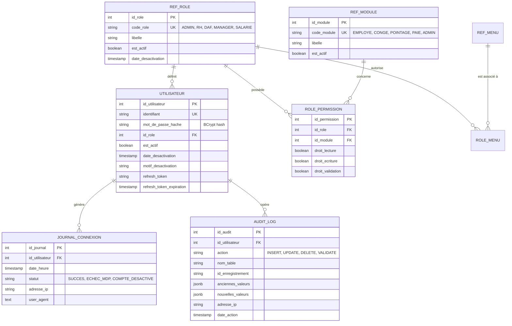
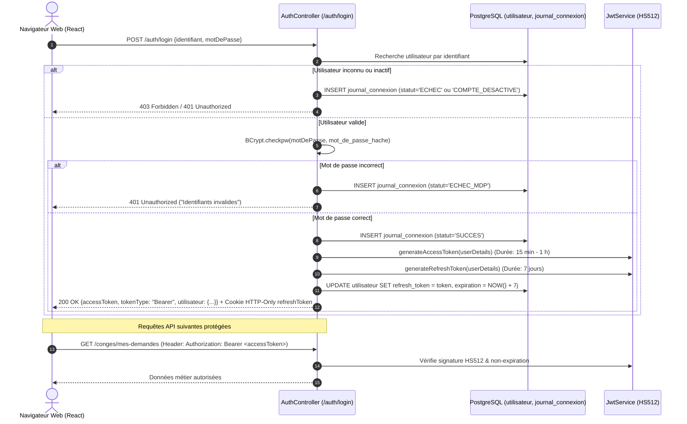

# GALAXAM SIRH — Module Sécurité, IAM, RBAC & Piste d'Audit

> **Projet** : GALAXAM SIRH  
> **Entreprise** : GALAXAM Logistics Madagascar  
> **Document de Référence** : Mémoire de Fin d'Études (Architecture & Sécurité des SI)  
> **Composants Clés** : Spring Security 6, JWT (HS512), RBAC dynamique multi-niveaux, Piste d'audit immuable (`audit_log`), `SessionSecurityScheduler`  
> **Cadre Juridique et Normatif** : Loi n° 2014-038 sur la protection des données à caractère personnel (Madagascar), NIST SP 800-107 (Cryptographie JWT), OWASP Top 10 API Security.

---

## 1. Principes Directeurs et Enjeux de Sécurité

La gestion des ressources humaines manipule par essence des données hautement confidentielles :
- **Données d'identification et vie privée** (CIN, situation matrimoniale, enfants à charge, adresse).
- **Données financières et bancaires** (salaires de base, primes, relevés d'identité bancaire, dettes et saisies sur salaire).
- **Données disciplinaires et médicales** (arrêts maladie, sanctions, motifs de rupture de contrat).

Dans le contexte de **GALAXAM Logistics Madagascar**, société multisites et multifiliales, le système d'information requiert une étanchéité stricte des privilèges, une authentification forte, et une traçabilité médico-légale absolue de toutes les transactions à fort impact financier et statutaire.

### Objectifs Architecturaux
1. **Stateless API & Tokens Renforcés** : L'API Spring Boot ne conserve aucune session HTTP côté serveur ; chaque requête est authentifiée via un jeton JWT signé avec une clé cryptographique forte (HS512, minimum 512 bits / 64 octets, vérifié au démarrage de l'application via `JwtService.validateJwtSecret()`).
2. **Double Niveau d'Autorisation (RBAC Hybride)** :
   - *Niveau Système (Filtres HTTP)* : Filtrage grossier (`SecurityConfig`) isolant les endpoints publics (`/auth/login`, `/auth/refresh`, `/auth/ping`), les endpoints super-administrateur (`/admin/**`, `/securite/**`), et le reste du domaine authentifié.
   - *Niveau Méthode Métier (`@PreAuthorize`)* : Vérification fine des autorisations granulaires sur chaque contrôleur REST (`hasAuthority('ROLE_ADMIN')`, `hasAuthority('PAIE_WRITE')`, `hasAuthority('CONGE_VALIDATE')`, etc.).
3. **Ségrégation des Fonctions (SoD - Segregation of Duties)** : Impossibilité pour un demandeur de valider son propre congé ou pour un gestionnaire de pointage de débloquer unilatéralement un paiement sans validation DAF.
4. **Piste d'Audit Immuable et Exhaustive** : Enregistrement de chaque action sensible dans la table PostgreSQL `audit_log` (avec capture structurée en `JSONB` des états `anciennes_valeurs` et `nouvelles_valeurs`, horodatage, utilisateur responsable et adresse IP).

---

## 2. Cartographie des Composants Techniques Java

Le domaine sécurité est localisé dans les packages `mg.galaxam.sirh.securite` et `mg.galaxam.sirh.config` :

| Composant Java | Rôle et Responsabilité | Mécanisme Clé |
|---|---|---|
| [`SecurityConfig.java`](file:///Users/andriamalalatojo/Documents/GALAXAM/GALAXAM-SIRH/backend/src/main/java/mg/galaxam/sirh/config/SecurityConfig.java) | Configuration Spring Security 6 & FilterChain | Session `STATELESS`, CSRF désactivé (API REST stateless), HSTS (`includeSubDomains`, max-age 1 an), FrameOptions `DENY`, CORS strict sans wildcard. |
| [`JwtService.java`](file:///Users/andriamalalatojo/Documents/GALAXAM/GALAXAM-SIRH/backend/src/main/java/mg/galaxam/sirh/securite/JwtService.java) | Génération et validation des tokens JWT | Signature HMAC-SHA512 (`Keys.hmacShaKeyFor`). Validation NIST SP 800-107 *Fail-Fast* au démarrage si la clé secrète fait moins de 64 octets. |
| [`JwtAuthenticationFilter.java`](file:///Users/andriamalalatojo/Documents/GALAXAM/GALAXAM-SIRH/backend/src/main/java/mg/galaxam/sirh/securite/JwtAuthenticationFilter.java) | Filtre de requête HTTP (intercepteur) | Extraction de l'en-tête `Authorization: Bearer <token>`, extraction du subject, chargement du `UserDetails` et injection dans `SecurityContextHolder`. |
| [`CustomUserDetailsService.java`](file:///Users/andriamalalatojo/Documents/GALAXAM/GALAXAM-SIRH/backend/src/main/java/mg/galaxam/sirh/securite/CustomUserDetailsService.java) | Résolution de l'identité et des permissions | Reconstitution du graphe des autorisations : rôle applicatif (`ROLE_<CODE>`) + permissions matricielles (`<MODULE>_READ`, `<MODULE>_WRITE`, `<MODULE>_VALIDATE`). |
| [`CustomUserDetails.java`](file:///Users/andriamalalatojo/Documents/GALAXAM/GALAXAM-SIRH/backend/src/main/java/mg/galaxam/sirh/securite/CustomUserDetails.java) | Implémentation Spring Security `UserDetails` | Porteur de l'ID utilisateur, du statut actif/désactivé et de la collection d'autorisations (`GrantedAuthority`). |
| [`AuthController.java`](file:///Users/andriamalalatojo/Documents/GALAXAM/GALAXAM-SIRH/backend/src/main/java/mg/galaxam/sirh/securite/api/AuthController.java) | Contrôleur REST d'authentification (`/auth`) | Endpoints `/login`, `/refresh`, `/logout`, `/ping`. Hachage BCrypt, contrôle de verrouillage de compte, émission de Refresh Token sécurisé. |
| [`UtilisateurController.java`](file:///Users/andriamalalatojo/Documents/GALAXAM/GALAXAM-SIRH/backend/src/main/java/mg/galaxam/sirh/securite/api/UtilisateurController.java) | Contrôleur d'administration IAM (`/securite/utilisateurs`) | Gestion des comptes (Création, activation/désactivation avec motif, réinitialisation de mot de passe, affectation de rôle). Réservé à `ROLE_ADMIN`. |
| [`AuditLog.java`](file:///Users/andriamalalatojo/Documents/GALAXAM/GALAXAM-SIRH/backend/src/main/java/mg/galaxam/sirh/securite/AuditLog.java) | Entité et service utilitaire d'audit | Méthode statique `AuditLog.audit(...)` capturant le différentiel JSONB. Les méthodes `modifier()` et `supprimer()` lèvent systématiquement une exception (`UnsupportedOperationException`). |
| [`JournalConnexion.java`](file:///Users/andriamalalatojo/Documents/GALAXAM/GALAXAM-SIRH/backend/src/main/java/mg/galaxam/sirh/securite/JournalConnexion.java) | Traçabilité des tentatives d'accès | Enregistrement de chaque tentative de connexion avec statut (`SUCCES`, `ECHEC_MDP`, `COMPTE_DESACTIVE`), IP et User-Agent. |
| [`AdminAccountSeeder.java`](file:///Users/andriamalalatojo/Documents/GALAXAM/GALAXAM-SIRH/backend/src/main/java/mg/galaxam/sirh/securite/AdminAccountSeeder.java) | Amorce sécurisée de démarrage | Initialisation automatique et idempotente du compte administrateur initial si aucun compte super-admin n'existe en base. |
| [`SessionSecurityScheduler.java`](file:///Users/andriamalalatojo/Documents/GALAXAM/GALAXAM-SIRH/backend/src/main/java/mg/galaxam/sirh/cron/SessionSecurityScheduler.java) | Nettoyage nocturne (03:30:00) | Révocation en base des refresh tokens expirés (`refresh_token_expiration < NOW()`) via verrou distribué `scheduler_execution`. |

---

## 3. Schéma de Base de Données et Sécurité IAM

Les structures relationnelles sont définies dans `01_schema_core_securite.sql` :



---

## 4. Matrice RBAC (Rôles & Permissions)

Le système implémente une matrice de droits à 3 niveaux opérationnels par module métier :
- **R (Read / Lecture)** : Consultation des fiches, listes, soldes et états récapitulatifs.
- **W (Write / Écriture)** : Saisie de données, modification d'enregistrements, import de fichiers.
- **V (Validate / Validation)** : Pouvoir décisionnel (approbation de congés, gel de pointage, validation et clôture de paie).

| Rôle Métier (`code_role`) | Module Employé & Carrière | Module Structure & Org. | Module Congés | Module Pointage | Module Paie | Sécurité & Utilisateurs |
|---|:---:|:---:|:---:|:---:|:---:|:---:|
| **`ADMIN`** (Administrateur Système) | R / W / V | R / W / V | R / W / V | R / W / V | R / W / V | **R / W / V (Exclusif)** |
| **`DAF`** (Directeur Administratif & Fin.) | R | R | R / V (Prescription) | R / V (Ajustements) | **R / W / V (Clôture)** | Non autorisé |
| **`RH`** (Responsable RH / Paie) | R / W / V | R | R / W / V | R / W / V | R / W | Non autorisé |
| **`MANAGER`** (Chef de Service / Site) | R (Équipe) | R (Consultation) | R / V (N+1) | R / W (Saisie site) | Aucun accès | Non autorisé |
| **`SALARIE`** (Collaborateur standard) | R (Profil propre) | Aucun accès | R / W (Ses demandes) | R (Ses pointages) | R (Ses bulletins) | Non autorisé |

---

## 5. Cycle de Vie de l'Authentification JWT & Refresh Token



### Mécanismes de Protection contre les Failles Classiques
1. **Vol de Token (XSS / CSRF)** :
   - L'`accessToken` a une durée de vie courte (typiquement 15 à 60 minutes) et n'est conservé qu'en mémoire d'application frontend (State React / Context), évitant le stockage en `localStorage` vulnérable au XSS persistant.
   - Le `refreshToken` est transmis dans un Cookie avec les attributs `HttpOnly = true`, `SameSite = Lax/None` et `Secure = true` en production, empêchant son exfiltration par script tiers.
2. **Brute Force & Déni de Service** :
   - Hachage de mot de passe via l'algorithme robuste **BCrypt** avec coût adaptatif.
   - Verrouillage automatique des comptes désactivés (`est_actif = FALSE`), consigné dans `journal_connexion`.
3. **Piratage de Session Dépassée** :
   - Le scheduler nocturne [SessionSecurityScheduler.java](file:///Users/andriamalalatojo/Documents/GALAXAM/GALAXAM-SIRH/backend/src/main/java/mg/galaxam/sirh/cron/SessionSecurityScheduler.java) révoque automatiquement chaque nuit à 03:30:00 les jetons de rafraîchissement obsolètes.

---

## 6. Piste d'Audit et Non-Répudiation Légale

Conformément à la **Loi n° 2014-038** sur la protection des données personnelles à Madagascar et aux impératifs d'audit comptable (DGI / Commissaires aux Comptes) :
- Toute opération altérant les données financières ou statutaires (changement de salaire de base, validation d'un prêt, modification d'un statut de pointage gelé, décision d'un congé annuel, suppression d'un document) doit obligatoirement laisser une trace médico-légale.
- La classe utilitaire [AuditLog.java](file:///Users/andriamalalatojo/Documents/GALAXAM/GALAXAM-SIRH/backend/src/main/java/mg/galaxam/sirh/securite/AuditLog.java) assure une capture non-bloquante mais transactionnelle grâce aux `Savepoint` SQL (`audit_sp`).

### Structure d'une Entrée d'Audit (`audit_log`)
```json
{
  "id_audit": 142857,
  "id_utilisateur": 4,
  "action": "VALIDER_PAIE",
  "nom_table": "periode_paie",
  "id_enregistrement": "18",
  "anciennes_valeurs": {
    "statut": "VALIDEE",
    "date_validation_pointage": "2026-09-26T18:00:00"
  },
  "nouvelles_valeurs": {
    "statut": "PAIE_VALIDEE",
    "date_validation_paie": "2026-09-28T14:32:10",
    "total_net_a_payer": 34850000
  },
  "adresse_ip": "192.168.10.42",
  "date_action": "2026-09-28T14:32:10.124Z"
}
```

### Immutabilité Garantie au Niveau Applicatif et Base
- La classe Java [AuditLog.java](file:///Users/andriamalalatojo/Documents/GALAXAM/GALAXAM-SIRH/backend/src/main/java/mg/galaxam/sirh/securite/AuditLog.java) implémente des garde-fous explicites :
  ```java
  @Override
  protected ClassMere modifier(Connection c) throws Exception {
      throw new UnsupportedOperationException("Les logs d'audit ne peuvent pas être modifiés.");
  }

  @Override
  protected void supprimer(Connection c) throws Exception {
      throw new UnsupportedOperationException("Les logs d'audit ne peuvent pas être supprimés.");
  }
  ```
- En base de données, la table `audit_log` ne fait l'objet d'aucune contrainte de cascade descendante susceptible de supprimer l'historique lors de la suppression d'un utilisateur (`id_utilisateur INT REFERENCES utilisateur(id_utilisateur) ON DELETE SET NULL`). L'historique d'audit demeure intact même si le compte opérateur est archivé.

---

## 7. Conformité aux Réglementations et Standards

1. **Loi malgache n° 2014-038** relative à la protection des données à caractère personnel :
   - *Principe de proportionnalité et de finalité* : Les profils ne visualisent que les données strictement indispensables à leur charge de travail (le Manager ne voit pas les fiches d'impôt IRSA détaillées de ses pairs).
   - *Droit à la sécurité et à la confidentialité* : Cryptage des mots de passe en BCrypt, transmission sous TLS (HTTPS), séparation étanche des environnements de test et de production.
2. **NIST SP 800-107 (Recommendation for Cryptographic Key Management)** :
   - Exigence d'un secret cryptographique d'au moins 512 bits pour l'algorithme HS512. Le SIRH intègre un contrôle *fail-fast* empêchant l'application de démarrer sur une clé par défaut ou tronquée.
3. **OWASP API Security Top 10** :
   - Protection contre le *Broken Object Level Authorization (BOLA)* via vérification d'appartenance de la ressource dans les contrôleurs (`EmploymentContextResolver`, filtres par filiale/site).
   - Protection contre l'injection SQL via l'utilisation stricte de requêtes préparées paramétrées (`PreparedStatement`) sans concaténation de chaînes utilisateur.

---

*GALAXAM SIRH — Document Technique Transversal de Sécurité & Piste d'Audit (2026)*
