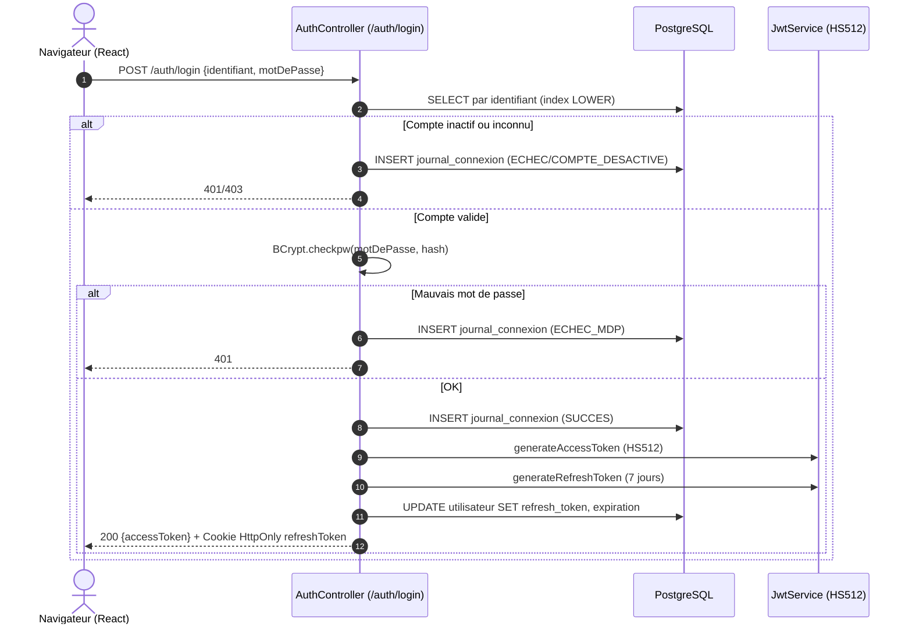

# GALAXAM SIRH — Module Sécurité, IAM, RBAC & Piste d'Audit
## Document Canonique — Mis à jour Octobre 2026

> **Source de vérité** : `backend/conception/bdd/01_schema_core_securite.sql` + `frontend/src/features/administration/api/referentielService.js` + `frontend/src/features/administration/pages/securite/SecuriteAdminPanel.jsx`  
> **Cadre Juridique** : Loi n° 2014-038 (Protection des données personnelles, Madagascar) — NIST SP 800-107 (HS512) — OWASP API Security Top 10.

---

## Corrections par rapport à l'ancienne documentation

| Élément | Ancienne doc (ERRONÉE) | Réalité du code |
|---|---|---|
| Rôles seeedés | 5 rôles (ADMIN, DAF, RH, MANAGER, SALARIE) | **2 rôles** : `ROLE_ADMIN` et `ROLE_AGENT_POINTAGE` |
| Table `utilisateur` | Pas de champ `email` mentionné | `email VARCHAR(254)` présent + index `LOWER(email)` |
| Modules seeedés | Module `ADMIN` | Module `ORGANISATION` (code=5, id=5) |
| `soumis_isi_5` intervenant | ISI 5% actif pour CONSULTANT | `CHECK (soumis_isi_5 = FALSE)` — contrainte SQL bloquant toute valeur TRUE |
| CONSULTANT (type intervenant) | soumis_sante=OUI, +60 ans | `soumis_sante=FALSE`, `soumis_cnaps=FALSE`, `soumis_irsa=FALSE` |
| Matrice permissions DAF/RH/MANAGER | Décrite en détail | **Aucune ligne** — seuls ROLE_ADMIN (tout TRUE) et ROLE_AGENT_POINTAGE seedés |
| `scheduler_execution` | Non documentée | Table avec verrou distribué `(job_code, execution_key)` PK |
| Menus seeedés | Liste partielle | 21 menus total (6 niv.1 + 15 niv.2) détaillés ci-dessous |

---

## 1. Principes Directeurs de Sécurité

La gestion RH manipule des données hautement sensibles : identités civiles (CIN), données bancaires (RIB), salaires, motifs de rupture contractuelle. Dans le contexte multi-sites de GALAXAM, le système applique trois principes fondamentaux :

1. **Stateless API** : Aucune session HTTP côté serveur. Chaque requête est authentifiée par un token JWT signé HMAC-SHA512.
2. **Double niveau d'autorisation** : Filtrage HTTP grossier (`SecurityConfig`) + vérification fine `@PreAuthorize` sur chaque contrôleur REST.
3. **Piste d'audit conservée par le cycle applicatif** : `audit_log` est liée par `ON DELETE SET NULL`. La suppression physique d'un utilisateur est refusée par `Utilisateur.delete`; le fonctionnement normal est la désactivation. Une suppression SQL directe contournerait cette règle et supprimerait les lignes de `journal_connexion` (`ON DELETE CASCADE`), tout en détachant l'audit de l'utilisateur.

### 1.1 Session et expiration pour inactivité

Chaque connexion crée une famille de refresh tokens identifiée par `session_id`
dans `utilisateur_session`. Cette table est distincte du compte afin que les
connexions concurrentes d'un même utilisateur aient chacune leur propre état
d'inactivité. La durée est configurable par
`app.security.session.idle-timeout-seconds` (valeur par défaut : 900 secondes).
Le backend initialise/complète la table de façon idempotente au démarrage et
importe les anciens refresh tokens encore valides; le paquet desktop conserve
ses six scripts SQL canoniques (`01` à `06`).

Le frontend ne signale que des interactions explicites (clic, saisie,
interaction tactile, formulaire), avec limitation de fréquence. Mouvement
continu de souris, appels API, renouvellement JWT, timers et tâches automatiques
ne prolongent pas le délai. L'échéance est recalculée après retour de focus ou
reprise de page. Les onglets d'un même navigateur partagent la date d'échéance
et coordonnent les renouvellements.

Le backend conserve `last_activity_at`; l'endpoint authentifié `/auth/activity`
ne l'avance que si la famille est encore active et que le compte est actif.
Chaque requête protégée vérifie la session liée au claim `sid`, et le refresh
effectue une rotation sans renouveler l'activité. À l'échéance, la session est
révoquée et ses refresh tokens sont invalidés; un access token signé encore
valide ne suffit donc pas à rétablir l'accès. La déconnexion manuelle révoque
la famille courante, et la désactivation du compte révoque les familles de cet
utilisateur.

Les classes concernées sont `securite/IdleSessionService.java`,
`securite/JwtAuthenticationFilter.java`, `securite/JwtService.java` et
`securite/api/AuthController.java`; côté React,
`context/idleSession.js`, `context/AuthContext.jsx` et `api/apiClient.js`.
Les tests temporels du service nécessitent PostgreSQL de test isolé via
`IDLE_TEST_JDBC_URL`; ils ne prouvent pas à eux seuls une recette complète en
navigateur ou en application Tauri.

---

## 2. Schéma Physique de la Base de Données (Code réel)

### 2.1 Table `ref_role`
```sql
CREATE TABLE ref_role (
    id_role            SERIAL PRIMARY KEY,
    code_role          VARCHAR(50) UNIQUE NOT NULL,
    libelle            VARCHAR(100) NOT NULL,
    est_actif          BOOLEAN DEFAULT TRUE,
    date_desactivation TIMESTAMP,
    created_at         TIMESTAMP DEFAULT CURRENT_TIMESTAMP
);
```

**Seed réel (2 rôles uniquement) :**

| id_role | code_role | libelle |
|---|---|---|
| 1 | `ROLE_ADMIN` | Administrateur |
| 2 | `ROLE_AGENT_POINTAGE` | Agent de Pointage |

> Les rôles DAF, RH, MANAGER, SALARIE sont absents du seed. Ils doivent être créés par l'administrateur via `/admin/securite?tab=roles`. Le schéma associe un seul `id_role` à un utilisateur ; les droits de lecture, écriture et validation restent portés par `role_permission`.

### 2.2 Table `ref_module` — 5 modules seeedés

| id_module | code_module | Libellé |
|---|---|---|
| 1 | `EMPLOYE` | Gestion des dossiers employés et contrats |
| 2 | `CONGE` | Gestion des absences et congés |
| 3 | `POINTAGE` | Suivi des présences et horaires |
| 4 | `PAIE` | Moteur de paie et bulletins |
| 5 | `ORGANISATION` | Structure d'entreprise, filiales, sites et fonctions |

### 2.3 Matrice `role_permission` — Seed réel

| Rôle | EMPLOYE | CONGE | POINTAGE | PAIE | ORGANISATION |
|---|:---:|:---:|:---:|:---:|:---:|
| `ROLE_ADMIN` (id=1) | R/W/V | R/W/V | R/W/V | R/W/V | R/W/V |
| `ROLE_AGENT_POINTAGE` (id=2) | - | - | R+W (pas V) | - | - |

### 2.4 Table `utilisateur`
```sql
CREATE TABLE utilisateur (
    id_utilisateur           SERIAL PRIMARY KEY,
    identifiant              VARCHAR(100) NOT NULL,
    email                    VARCHAR(254) NOT NULL,
    mot_de_passe_hache       VARCHAR(255) NOT NULL,   -- BCrypt
    id_role                  INTEGER NOT NULL REFERENCES ref_role(id_role),
    est_actif                BOOLEAN DEFAULT TRUE,
    date_desactivation       TIMESTAMP,
    motif_desactivation      VARCHAR(100),
    refresh_token            VARCHAR(500),
    refresh_token_expiration TIMESTAMP,
    created_at               TIMESTAMP DEFAULT CURRENT_TIMESTAMP,
    updated_at               TIMESTAMP DEFAULT CURRENT_TIMESTAMP
);

-- Index réels
CREATE UNIQUE INDEX idx_utilisateur_email_lower       ON utilisateur (LOWER(email));
CREATE INDEX        idx_utilisateur_identifiant_lower ON utilisateur (LOWER(identifiant));
CREATE INDEX        idx_utilisateur_refresh_token     ON utilisateur (refresh_token) WHERE refresh_token IS NOT NULL;
```

`id_role` est une colonne unique sur le compte : le modèle actuel associe un seul
rôle à chaque utilisateur. L'email est unique sans distinction de casse ;
`identifiant` dispose d'un index `LOWER` non unique et ne doit donc pas être
présenté comme unique par la base.

La désactivation et la réactivation effacent `refresh_token` et
`refresh_token_expiration`. L'ancien cookie ne peut pas être rafraîchi après
réactivation ; l'utilisateur doit se reconnecter. Le filtre JWT vérifie que le
compte chargé est actif à chaque requête. Toutefois, un access token non expiré
peut redevenir accepté après réactivation, car le mécanisme actuel ne vérifie
pas de version de session ou de date de révocation.

`journal_connexion.id_utilisateur` référence actuellement `utilisateur` avec
`ON DELETE CASCADE`, contrairement à `audit_log`. L'API applicative interdit
la suppression physique pour préserver ces traces ; un `DELETE` SQL direct
reste dangereux et n'est pas une procédure d'administration supportée.

### 2.5 Table `audit_log`
```sql
CREATE TABLE audit_log (
    id_audit          SERIAL PRIMARY KEY,
    id_utilisateur    INT REFERENCES utilisateur(id_utilisateur) ON DELETE SET NULL,
    action            VARCHAR(50) NOT NULL,
    nom_table         VARCHAR(50) NOT NULL,
    id_enregistrement VARCHAR(100) NOT NULL,
    anciennes_valeurs JSONB,
    nouvelles_valeurs JSONB,
    adresse_ip        VARCHAR(45),
    date_action       TIMESTAMP DEFAULT CURRENT_TIMESTAMP
);
```

> `ON DELETE SET NULL` conserve la ligne d'audit mais perd son lien direct à l'utilisateur. La suppression physique est refusée par `Utilisateur.delete` ; la politique normale est la désactivation. Attention : `journal_connexion.id_utilisateur` est déclaré `ON DELETE CASCADE`, donc une suppression SQL directe détruirait les journaux de connexion.

Le login consigne les statuts `SUCCES`, `ECHEC` et `COMPTE_DESACTIVE` lorsque
le compte est connu. Une tentative avec email inconnu n'a pas de `id_utilisateur`
à rattacher et ne peut pas être auditée par le modèle actuel de
`journal_connexion`.

### 2.6 Table `scheduler_execution` (registre de tentatives et bail)
```sql
CREATE TABLE scheduler_execution (
    job_code      VARCHAR(80) NOT NULL,
    execution_key DATE NOT NULL,
    status        VARCHAR(16) NOT NULL CHECK (status IN ('RUNNING','COMPLETED','FAILED')),
    started_at    TIMESTAMP NOT NULL DEFAULT CURRENT_TIMESTAMP,
    completed_at  TIMESTAMP NULL,
    attempt_count INTEGER NOT NULL DEFAULT 1,
    error_message TEXT NULL,
    attempt_token UUID,
    lease_until   TIMESTAMP NULL,
    CHECK ((status = 'RUNNING' AND attempt_token IS NOT NULL AND lease_until IS NOT NULL)
        OR (status <> 'RUNNING' AND lease_until IS NULL)),
    PRIMARY KEY (job_code, execution_key)
);
```

L'acquisition insère atomiquement la clé `(job_code, execution_key)`. Une
tentative `RUNNING` possède un UUID et un bail renouvelé périodiquement ; après
expiration, une autre instance peut reprendre la clé. Seul le jeton courant
peut renouveler le bail ou terminer l'enregistrement. Cela protège le registre,
mais n'arrête pas un worker qui continue déjà son traitement métier : les effets
non répétables doivent aussi être idempotents ou protégés dans leur transaction.
Le bail par défaut est de 30 minutes, avec heartbeat toutes les 10 minutes et
une limite de renouvellement à 23 heures.

---

## 3. Arborescence des Menus Seeedés (21 menus)

**Niveau 1 (6 racines) :**

| id_menu | Libellé | Route |
|---|---|---|
| `DASHBOARD` | Tableau de bord | `/dashboard` |
| `GESTION_PERSONNEL` | Gestion du Personnel | *(parent)* |
| `CONGES_MODULE` | Congés & Absences | `/conges` |
| `POINTAGE` | Pointage & Présences | `/pointages` |
| `PAIE_MODULE` | Paie & Rémunération | *(parent)* |
| `ADMIN_MODULE` | Administration & Paramétrage | *(parent)* |

**Niveau 2 (15 enfants) :**

| id_menu | Libellé | Route | Parent |
|---|---|---|---|
| `PERS_EMPLOYES` | Fiches Employés | `/employes` | `GESTION_PERSONNEL` |
| `PERS_CARRIERES` | Contrats & Carrières | `/carrieres` | `GESTION_PERSONNEL` |
| `CONGES_GENERAL` | Vue Générale | `/conges?tab=planning` | `CONGES_MODULE` |
| `CONGES_DEMANDES` | Demandes & Validation | `/conges?tab=demandes` | `CONGES_MODULE` |
| `CONGES_PERIODES` | Contrôle des droits | `/conges?tab=periodes` | `CONGES_MODULE` |
| `POINTAGE_JOURNALIER` | Saisie Quotidienne | `/pointages?tab=saisie` | `POINTAGE` |
| `POINTAGE_SUIVI` | Suivi & Anomalies | `/pointages?tab=suivi` | `POINTAGE` |
| `POINTAGE_VALIDATION` | Contrôle & Validation | `/pointages?tab=validation` | `POINTAGE` |
| `PAIE_CENTRE` | Centre de paie | `/paie` | `PAIE_MODULE` |
| `PAIE_CAMPAGNE` | Cycles de paie | `/paie?tab=periodes` | `PAIE_MODULE` |
| `PAIE_ACOMPTES` | Acomptes & avances | `/paie/acomptes-avances` | `PAIE_MODULE` |
| `PAIE_PRESTATAIRES` | Prestataires indépendants | `/paie/prestataires` | `PAIE_MODULE` |
| `PAIE_CONFIGURATION` | Configuration de paie | `/paie/configuration` | `PAIE_MODULE` |
| `PAIE_DECLARATIONS` | Déclarations & sorties | `/paie/declarations` | `PAIE_MODULE` |
| `ADMIN_SECURITE` | Sécurité & Accès | `/admin/securite` | `ADMIN_MODULE` |
| `ADMIN_ORGANISATION` | Organisation & Structure | `/admin/organisation` | `ADMIN_MODULE` |
| `ADMIN_REFERENTIELS` | Référentiels RH | `/admin/referentiels-rh` | `ADMIN_MODULE` |
| `ADMIN_PARAMETRES` | Paramétrage des Modules | `/admin/parametres` | `ADMIN_MODULE` |

**Habilitations seed :** `ROLE_ADMIN` → tous les 21 menus. `ROLE_AGENT_POINTAGE` → `POINTAGE`, `POINTAGE_JOURNALIER`, `POINTAGE_SUIVI`, `POINTAGE_VALIDATION`.

---

## 4. Interface Frontend — Panel Sécurité

**Page** : [`SecuriteAdminPanel.jsx`](file:///Users/andriamalalatojo/Documents/GALAXAM/GALAXAM-SIRH/frontend/src/features/administration/pages/securite/SecuriteAdminPanel.jsx)  
**Route** : `/admin/securite` — Navigation par `?tab=` query param.

| Onglet (`tab=`) | Composant (lazy) | Fonctionnalités |
|---|---|---|
| `users` (défaut) | `UserManagementTab.jsx` | CRUD comptes utilisateurs. Formulaire : `identifiant`, `email`, `motDePasse`, `confirmPassword`, `idRole`. Désactivation avec motif obligatoire. |
| `roles` | `RolesAndPermissionsTab.jsx` | Gestion rôles + matrice R/W/V par module + attribution menus par rôle. |
| `menus` | `MenuManagementTab.jsx` | CRUD arborescence de navigation niv.1 et niv.2. |

---

## 5. Catalogue des Endpoints API (Code réel)

| Action | Méthode | Endpoint |
|---|---|---|
| **Utilisateurs** | | |
| Liste | GET | `/securite/utilisateurs` |
| Créer | POST | `/securite/utilisateurs` |
| Modifier | PUT | `/securite/utilisateurs/{id}` |
| Désactiver | PUT | `/securite/utilisateurs/{id}/desactiver` ← body `{motifDesactivation}` |
| Réactiver | PUT | `/securite/utilisateurs/{id}/activer` |
| **Rôles** | | |
| Liste | GET | `/referentiel/roles` |
| Par ID | GET | `/referentiel/roles/{id}` |
| Créer | POST | `/referentiel/roles` |
| Modifier | PUT | `/referentiel/roles/{id}` |
| Désactiver | PUT | `/referentiel/roles/{id}/desactiver` |
| Activer | PUT | `/referentiel/roles/{id}/activer` |
| **Permissions** | | |
| Lire permissions rôle | GET | `/referentiel/roles/{id}/permissions` |
| Mettre à jour permissions | POST | `/referentiel/roles/{id}/permissions` ← body `{permissions}` |
| **Menus** | | |
| Lire menus rôle | GET | `/referentiel/roles/{id}/menus` |
| Mettre à jour menus | POST | `/referentiel/roles/{id}/menus` ← body `{idMenus}` |
| Menus (arbre) | GET | `/referentiel/menus` |
| Menus (plat) | GET | `/referentiel/menus/flat` |
| Créer menu | POST | `/referentiel/menus` |
| Modifier menu | PUT | `/referentiel/menus/{id}` |
| Supprimer menu | DELETE | `/referentiel/menus/{id}` |
| **Modules** | | |
| Liste | GET | `/referentiel/modules` |

**Cache frontend** : `referentielService.js` cache `modules`, `roles`, `menusFlat`, `menusTree`. Toute mutation appelle `invalidateReferentielCache()` + `notifyMenuChanged()` (bus d'événements pour rafraîchir la navigation immédiatement).

---

## 6. Cycle d'Authentification JWT



---

## 7. Conformité et Standards

| Standard | Implémentation concrète dans le code |
|---|---|
| **Loi n° 2014-038** (Madagascar) | `audit_log` conservé par la politique applicative de désactivation, `ON DELETE SET NULL`, accès cloisonné par rôle RBAC |
| **NIST SP 800-107** | HMAC-SHA512, fail-fast si clé < 64 octets au démarrage |
| **OWASP BOLA** | Filtrage par filiale/site dans `EmploymentContextResolver` |
| **OWASP SQL Injection** | Requêtes JDBC paramétrées exclusivement (`PreparedStatement`) |
| **BCrypt** | Hachage adaptatif des mots de passe |
| **SessionSecurityScheduler** | Nettoyage nocturne des refresh tokens expirés ; son exécution est inscrite dans `scheduler_execution` |

---

*GALAXAM SIRH — Module Sécurité IAM — Document mis à jour depuis le code source réel — Octobre 2026*
