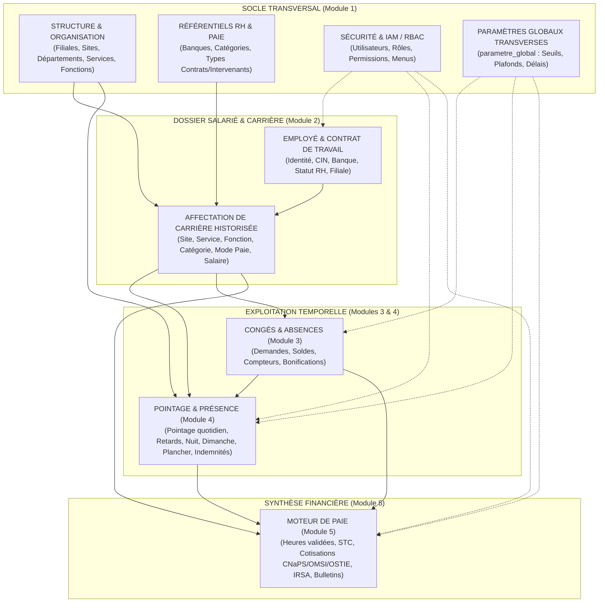
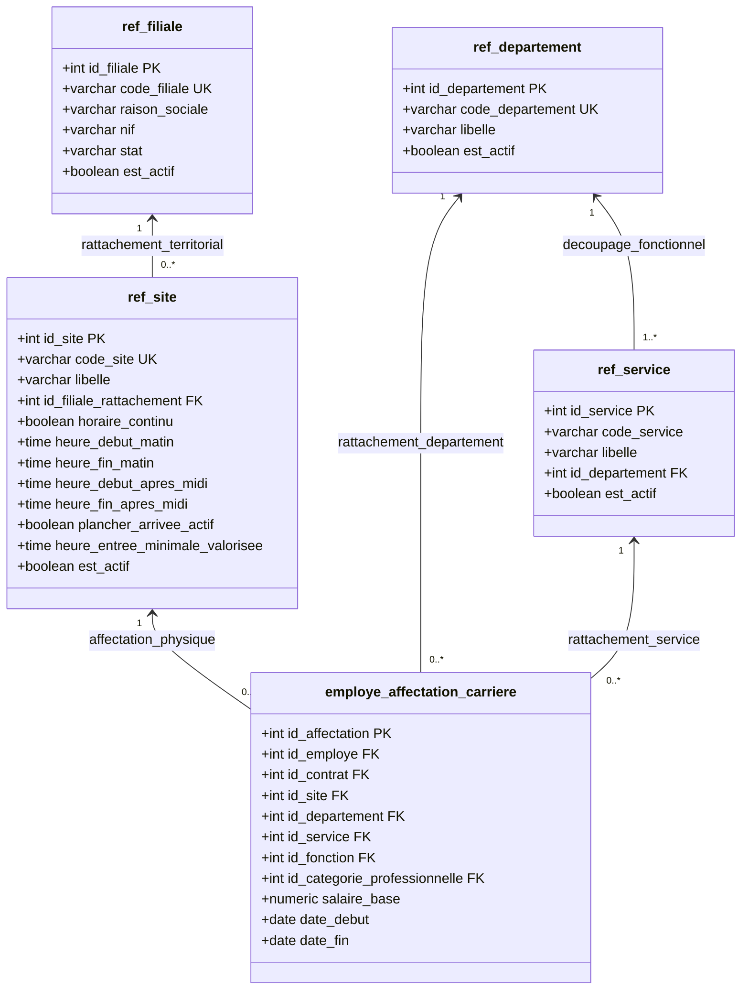
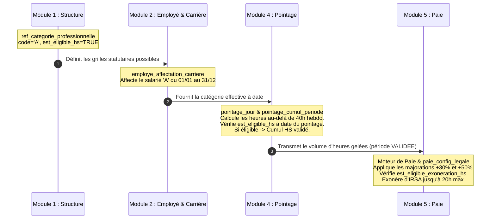
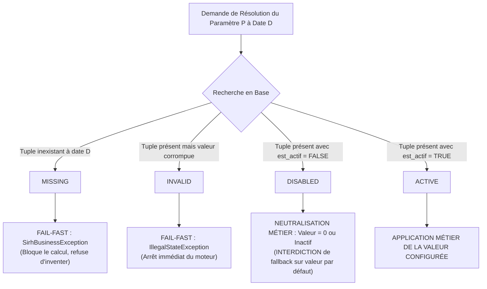
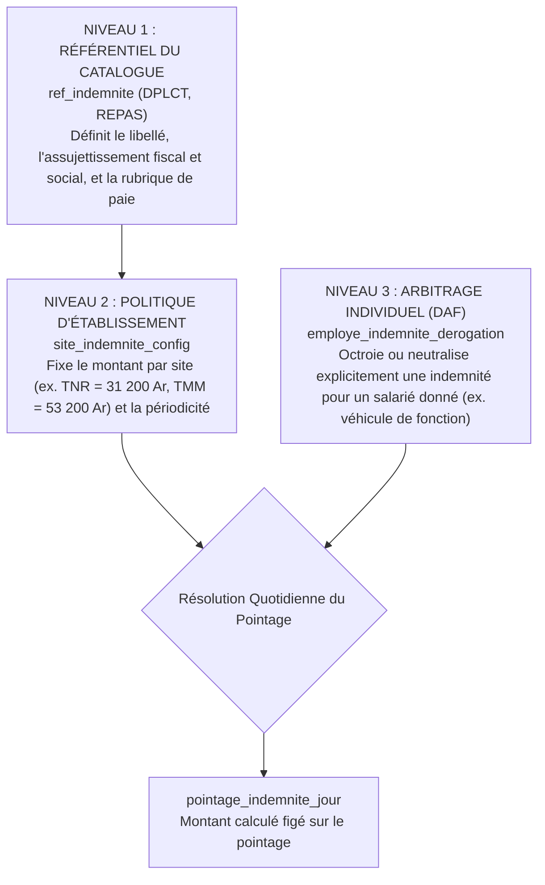
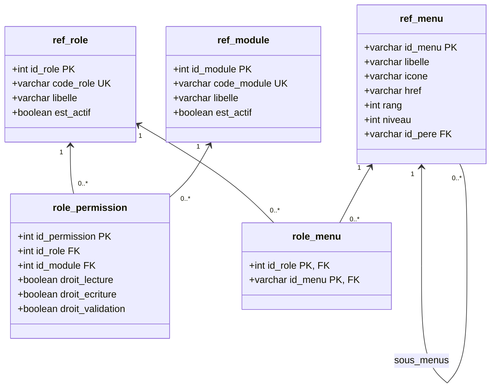

# GALAXAM SIRH — MODULE STRUCTURE, ORGANISATION & ADMINISTRATION
## Référentiels, Paramétrage Système, Gouvernance Organisationnelle et Sécurité IAM
### Document de Référence Canonique — Niveau Mémoire Universitaire / Ouvrage Technique

---

## 0. Règle Méthodologique Absolue — Source de Vérité

Le présent document constitue la documentation canonique définitive du **Module 1 (Structure, Organisation, Référentiels et Administration)** du Système d'Information des Ressources Humaines (SIRH) de la société **GALAXAM**.

Conformément aux exigences de rigueur méthodologique applicables à un travail de recherche appliquée ou de mémoire d'ingénierie logicielle, **les anciens documents Markdown ou spécifications textuelles historiques ne constituent en aucun cas une source de vérité**. Les évolutions successives de l'architecture logicielle, les refactorings d'architecture et les migrations de base de données (notamment les migrations de septembre 2026 : unification du plancher d'arrivée par le script `26-09-24-sp27-ref-site-plancher-arrivee.sql`, durcissement de l'ownership DAF dans `26-09-21-sp14-payroll-ownership-hardening.sql`, et gestion du triétat des paramètres dans `26-09-24-sp25-pointage-arrival-floor.sql`) ont rendu caduques plusieurs hypothèses antérieures.

La seule et unique source de vérité exploitée pour établir ce traité est l'état technique effectif du dépôt :
1. **Le code backend Java 17** (`mg.galaxam.sirh.*` et la couche Active Record JDBC `bean.ClassMere`) ;
2. **Le schéma physique de la base de données PostgreSQL** (`01_schema_core_securite.sql`, `02_schema_referentiels_rh.sql`, `03_schema_employes_contrats.sql`, `04_schema_conges.sql`, `05_schema_pointage.sql`, `06_schema_paie.sql`) ;
3. **Le registre réel des migrations exécutées** (`backend/conception/bdd/migrations/`) ;
4. **La suite de tests automatisés** (`backend/src/test/java/mg/galaxam/sirh/...`) ;
5. **Le code frontend React 18 / Vite** (`frontend/src/features/organization`, `frontend/src/features/administration`, `routes/Router.jsx`) ;
6. **Les jeux de données initiaux (seeds SQL canoniques)** exécutés à blanc ;
7. **La configuration applicative réelle** (`application.properties`, `application-local.properties`, `application-prod.properties`).

Toute assertion formulée ci-dessous est vérifiable par un fichier source, une table physique, une contrainte d'intégrité, une route API ou un test d'intégration. Tout concept non formellement attesté par le code exécuté est explicitement qualifié de *"Non confirmé par le runtime actuel"* ou *"Configuration présente mais usage non identifié"*.

---

## 1. Sommaire Exécutif & Frontières Fondamentales

### 1.1. Rôle du Module Structure & Organisation
Le module **Structure & Organisation** représente le squelette ontologique de l'entreprise. Il modélise les personnes morales composant le groupe (filiales), les implantations physiques et géographiques (sites), le découpage fonctionnel des activités (départements et services), ainsi que le catalogue des métiers et qualifications (fonctions et catégories professionnelles). 

Sa finalité première n'est pas d'exécuter des calculs ni de stocker des états éphémères, mais de **fournir un vocabulaire canonique, stable et univoque** à tous les autres domaines applicatifs.

### 1.2. Rôle du Module Administration & Paramétrage
Le module **Administration & Paramétrage** remplit deux missions distinctes souvent confondues dans les architectures immatures :
1. **La Sécurité IAM et le Contrôle d'Accès (RBAC)** : gestion du cycle de vie des comptes utilisateurs (`utilisateur`), attribution des rôles (`ref_role`), affectation des permissions granulaires par module (`role_permission`) et distribution de l'arborescence de navigation (`role_menu`).
2. **La Gouvernance des Constantes et Règles Transverses** : hébergement du moteur de temporalité des paramètres généraux (`parametre_global`), assurant qu'une règle métier (ex. seuil de nuit, plafonds CDD, seuils d'alerte) puisse évoluer à date d'effet sans écraser le passé.

### 1.3. Distinction Fondamentale : Donnée Organisationnelle vs Règle de Configuration
Une ambiguïté classique consiste à traiter de manière indifférenciée une entité de structure et une variable de paramétrage. Le tableau suivant consacre la frontière conceptuelle retenue par GALAXAM SIRH :

| Dimension | Donnée Organisationnelle | Règle de Configuration |
| :--- | :--- | :--- |
| **Nature** | Entité structurelle pérenne (ex. *Siège Antananarivo*, *Département Logistique*). | Constante d'ajustement ou seuil d'activation d'un algorithme métier (ex. *Heure de début de nuit = 22:00*). |
| **Cycle de vie** | Création rare, modification exceptionnelle, désactivation logique lors de fermetures de sites. | Versionnement daté régulier au fil des lois de finances ou des arbitrages de la direction générale. |
| **Portée relationnelle** | Clé étrangère (`id_site`, `id_service`) référencée directement dans les contrats et pointages. | Clé alphanumérique (`code_parametre`) résolue dynamiquement à une date donnée par un moteur de calcul. |
| **Suppression** | Strictement interdite dès lors qu'un historique y fait référence. | Clôture temporelle (`date_fin = date_debut_nouveau - 1`) pour préserver la rejouabilité des calculs passés. |

### 1.4. Le Piège de l'Administration "Fourre-Tout" et Propriété Métier Réelle
Dans de nombreux progiciels, le fait qu'une valeur soit administrable depuis une interface graphique réservée aux administrateurs conduit à l'illusion que le module "Admin" est propriétaire de la règle. Dans GALAXAM SIRH, **l'écran d'administration n'est qu'un vecteur de saisie technique** ; la propriété intellectuelle et algorithmique de la règle appartient au domaine fonctionnel qui l'exécute :
- **Taux CNaPS, seuils IRSA, diviseur mensuel (173.33)** : Propriété exclusive du module **Paie & Légal** (`paie_config_legale`, `bareme_irsa`, `ref_type_cotisation`). L'administrateur système ne fait que saisir les publications du Code Général des Impôts (CGI).
- **Horaires et plancher d'arrivée d'un site** : Propriété du module **Structure** quant au stockage (`ref_site`), mais consommés et interprétés par le moteur de **Pointage**.
- **Éligibilité aux Heures Supplémentaires** : Portée par la catégorie professionnelle (`ref_categorie_professionnelle`), assignée dans le temps par **Employés/Carrière**, résolue à date par le **Pointage**, et valorisée financièrement par la **Paie**.
- **Acquisition mensuelle des congés (2.5 jours) et règles de bascule** : Propriété exclusive du module **Congés & Absences**.

---

## 2. Modèle Global du SIRH

L'architecture du SIRH GALAXAM s'articule autour d'une hiérarchie de dépendances stricte, orientée des référentiels stables vers les calculs financiers finaux.



---

## 3. Structure Organisationnelle Hiérarchique

### 3.1. Topologie de l'Entreprise
La structure d'entreprise de GALAXAM ne répond pas à une arborescence purement pyramidale stricte, mais à un modèle orthogonal distinguant le **rattachement juridique**, la **ligne hiérarchique fonctionnelle** et l'**implantation géographique** :
1. **Axe Juridique** : La Filiale (`ref_filiale`) est l'employeur légal contractant avec le salarié.
2. **Axe Métier / Analytique** : Le Département (`ref_departement`) regroupe des Services (`ref_service`).
3. **Axe Géographique & Opérationnel** : Le Site (`ref_site`) est l'établissement où s'exécute physiquement la prestation de travail.



---

## 4. Filiales Juridiques

### 4.1. Modélisation Physique (`ref_filiale`)
La table `ref_filiale` matérialise l'entité légale titulaire du registre du commerce et des numéros d'immatriculation fiscale malgaches.

- **Table** : `ref_filiale`
- **Contrainte d'unicité** : `code_filiale VARCHAR(10) UNIQUE NOT NULL`
- **Colonnes réelles** :
  - `id_filiale` (SERIAL, Clé primaire)
  - `code_filiale` (VARCHAR(10), Code mnémonique unique en majuscules)
  - `raison_sociale` (VARCHAR(100), Dénomination commerciale légale)
  - `nif` (VARCHAR(30), Numéro d'Identification Fiscale)
  - `stat` (VARCHAR(30), Numéro Statistique délivré par l'INSTAT)
  - `est_actif` (BOOLEAN, Défaut TRUE)
  - `date_desactivation` (TIMESTAMP WITH TIME ZONE, Date de cessation ou clôture)
  - `created_at` (TIMESTAMP WITH TIME ZONE, Date d'enregistrement)

### 4.2. Données Actuelles du Seed SQL Canonique
Les données initiales présentes dans `02_schema_referentiels_rh.sql` documentent la structure du groupe :
1. **GLX** : *Galaxam Logistics* — NIF `3000019434`, STAT `9876543210`.
2. **VA** : *Vina sy Asa* — NIF `3000019434` (même groupe fiscal), STAT `0123456789`.

### 4.3. Impacts Transverses
- **Employés & Contrats** : Chaque contrat de travail (`contrat_travail.id_filiale`) est obligatoirement lié à une filiale. C'est l'employeur juridique au sens du droit du travail.
- **Moteur de Paie** : La filiale pilote l'entête des déclarations nominatives trimestrielles CNaPS et des bordereaux annuels de l'IRSA. Le NIF et le STAT de la filiale figurent obligatoirement sur les bulletins de paie édités.

---

## 5. Départements & Services

### 5.1. Départements (`ref_departement`)
Le département constitue une division fonctionnelle majeure de l'organisation.
- **Table** : `ref_departement`
- **Colonnes** : `id_departement` (PK), `code_departement` (VARCHAR(10) UNIQUE), `libelle` (VARCHAR(100)), `est_actif` (BOOLEAN DEFAULT TRUE).
- **Données Seed** : `LOG` — *Logistics*.
- **Rôle métier** : Utilisé pour les regroupements analytiques et les synthèses d'effectifs.

### 5.2. Services (`ref_service`)
Le service est la cellule opérationnelle de rattachement du salarié, obligatoirement subordonnée à un département.
- **Table** : `ref_service`
- **Colonnes** :
  - `id_service` (SERIAL, PK)
  - `code_service` (VARCHAR(10) NOT NULL)
  - `libelle` (VARCHAR(100) NOT NULL)
  - `id_departement` (INT NOT NULL, FK `ref_departement(id_departement)` ON DELETE CASCADE)
  - `est_actif` (BOOLEAN DEFAULT TRUE)
- **Contrainte d'unicité composite** : `CONSTRAINT uk_service_departement UNIQUE (code_service, id_departement)`. Un même code de service peut théoriquement exister dans deux départements distincts, mais est unique au sein d'un département donné.
- **Données Seed** :
  - `ADM` — *Administration & RH* (rattaché au département `LOG`).
  - `OPE` — *Opérations & Transit* (rattaché au département `LOG`).

---

## 6. Sites Géographiques & Établissements

### 6.1. Identité et Rôle Central du Site
Dans GALAXAM SIRH, le **Site** (`ref_site`) est l'entité pivot de l'exploitation quotidienne. Il modélise les dépôts logistiques et agences portuaires.

- **Table** : `ref_site`
- **Colonnes réelles** :
  - `id_site` (SERIAL, PK)
  - `code_site` (VARCHAR(10) UNIQUE NOT NULL)
  - `libelle` (VARCHAR(100) NOT NULL)
  - `id_filiale_rattachement` (INT, FK vers `ref_filiale(id_filiale)`)
  - `horaire_continu` (BOOLEAN DEFAULT TRUE)
  - `heure_debut_matin` (TIME)
  - `heure_fin_matin` (TIME)
  - `heure_debut_apres_midi` (TIME)
  - `heure_fin_apres_midi` (TIME)
  - `plancher_arrivee_actif` (BOOLEAN NOT NULL DEFAULT FALSE)
  - `heure_entree_minimale_valorisee` (TIME NULL)
  - `est_actif` (BOOLEAN DEFAULT TRUE)
- **Contrainte de cohérence stricte** :
  ```sql
  CONSTRAINT chk_ref_site_plancher_arrivee 
  CHECK (NOT plancher_arrivee_actif OR heure_entree_minimale_valorisee IS NOT NULL)
  ```

### 6.2. Données Réelles du Seed
1. **TNR** : *Antananarivo - Siège*
   - Rattaché à la filiale GLX (`id_filiale_rattachement = 1`).
   - `horaire_continu = TRUE` (Journée continue avec pause déjeuner sur place).
   - Horaires : `08:00 - 12:00` / `13:00 - 17:00`.
   - Plancher d'arrivée actif : `07:30` (`plancher_arrivee_actif = TRUE`, `heure_entree_minimale_valorisee = '07:30'`).
2. **TMM** : *Toamasina - Agence*
   - Rattaché à la filiale GLX (`id_filiale_rattachement = 1`).
   - `horaire_continu = FALSE` (Coupure méridienne de 2 heures permettant le retour à domicile).
   - Horaires : `08:00 - 12:00` / `14:00 - 18:00`.
   - Plancher d'arrivée actif : `07:30`.

---

## 7. Horaires de Site & Modalités de Présence

### 7.1. Journée Continue vs Horaire Discontinu
La distinction entre `horaire_continu = TRUE` et `horaire_continu = FALSE` pilote des règles métiers critiques dans le module de Pointage :
- **Horaire Continu (TNR)** : Pause méridienne standard de 1 heure (12h00 - 13h00). Le salarié ne quitte généralement pas l'enceinte de l'entreprise ; cela ouvre droit à l'indemnité repas midi si les conditions sont satisfaites.
- **Horaire Discontinu / Coupure (TMM)** : Pause méridienne de 2 heures (12h00 - 14h00). Le salarié rentre déjeuner à domicile. En contrepartie, si la pause constatée est inférieure au paramètre `SEUIL_PAUSE_MIDI_MIN` (60 minutes), l'algorithme détecte une anomalie ou applique la règle *« ne rentre pas midi »*, déclenchant l'indemnité repas et réduisant l'indemnité de transport (`REDUCTION_DEPLACT_REPAS_MIDI = 1000 Ar`).

---

## 8. Le Plancher d'Arrivée (*Earliest Paid Start*)

### 8.1. Définition et Justification Juridique / Économique
Le **Plancher d'Arrivée** est le mécanisme par lequel l'entreprise refuse de rémunérer ou de comptabiliser en heures supplémentaires les arrivées ultra-matinales non sollicitées. Si un salarié badge à 06h45 par convenance personnelle, alors que les bureaux n'ouvrent qu'à 08h00 et que le plancher de valorisation est fixé à 07h30, le temps de travail commence à être valorisé à 07h30.

### 8.2. Historique de Migration (sp27)
Antérieurement au Sprint 27, cette notion résidait dans une table isolée `ref_tolerance_arrivee_pointage` (qui prêtait à confusion avec les tolérances de retard). La migration canonique `26-09-24-sp27-ref-site-plancher-arrivee.sql` a :
1. Rapatrié `plancher_arrivee_actif` et `heure_entree_minimale_valorisee` directement dans la table hôte `ref_site` ;
2. Posé la contrainte `chk_ref_site_plancher_arrivee` interdisant d'activer le plancher sans fournir d'heure minimale ;
3. Supprimé définitivement (`DROP TABLE CASCADE`) l'ancienne table obsolète `ref_tolerance_arrivee_pointage`.

### 8.3. Algorithme de Valorisation (Code Réel Backend)
Dans `PointageService.java` (méthode `effectiveMorningEntry`), la résolution de l'heure d'entrée effective du matin s'exprime ainsi :

$$\text{Soit } H_{\text{badge}} \text{ l'heure physique de pointage et } H_{\text{plancher}} \text{ l'heure minimale configurée sur le site.}$$

$$H_{\text{effective}} = \begin{cases} 
H_{\text{badge}} & \text{si } \text{plancher\_arrivee\_actif} = \text{FALSE ou } H_{\text{plancher}} \text{ est NULL} \\
\max(H_{\text{badge}}, H_{\text{plancher}}) & \text{si } \text{plancher\_arrivee\_actif} = \text{TRUE et } H_{\text{plancher}} \text{ est non NULL}
\end{cases}$$

### 8.4. Preuve par les Tests Unitaires (`PointageConfigurationResolutionTest.java`)
La conformité algorithmique est formellement garantie par cinq cas de tests d'intégration :
- **Cas 1** : Site actif, seuil 07:30, badge 07:00 $\rightarrow$ Entrée retenue : `07:30` (écrêtage de l'arrivée précoce).
- **Cas 2** : Site actif, seuil 07:30, badge 07:20 $\rightarrow$ Entrée retenue : `07:30`.
- **Cas 3** : Site actif, seuil 07:30, badge 07:45 $\rightarrow$ Entrée retenue : `07:45` (arrivée dans la plage normale, non modifiée).
- **Cas 4** : Site actif, seuil 07:30, badge 08:05 $\rightarrow$ Entrée retenue : `08:05` (retard réel constaté).
- **Cas 5** : Règle inactive (`minimum = null`) $\rightarrow$ Badge 07:00 donne `07:00` (aucun écrêtage).

---

## 9. Catégories Socio-Professionnelles

### 9.1. Modélisation (`ref_categorie_professionnelle`)
La catégorie professionnelle détermine le statut conventionnel du salarié et son régime légal de travail.

- **Table** : `ref_categorie_professionnelle`
- **Colonnes réelles** :
  - `id_categorie_professionnelle` (SERIAL, PK)
  - `code` (VARCHAR(10) UNIQUE NOT NULL)
  - `libelle` (VARCHAR(100) NOT NULL)
  - `description` (TEXT)
  - `est_eligible_hs` (BOOLEAN NOT NULL DEFAULT TRUE)
  - `est_cadre` (BOOLEAN NOT NULL DEFAULT FALSE)
  - `est_eligible_exoneration_hs` (BOOLEAN NOT NULL DEFAULT TRUE)
  - `dispense_pointage` (BOOLEAN NOT NULL DEFAULT FALSE)
  - `actif` (BOOLEAN DEFAULT TRUE)
  - `created_at` (TIMESTAMP DEFAULT CURRENT_TIMESTAMP)
  - `updated_at` (TIMESTAMP)

### 9.2. Données Actuelles du Seed
1. **CADRE** : *Cadre*
   - `est_cadre = TRUE`
   - `est_eligible_hs = FALSE` (Au forfait, ne génère pas d'heures supplémentaires de droit commun)
   - `est_eligible_exoneration_hs = FALSE`
   - `dispense_pointage = FALSE` (Le cadre badge pour tracer sa présence journalière, sauf si sa fonction spécifique l'en dispense)
2. **A** : *Agent*
   - `est_cadre = FALSE`
   - `est_eligible_hs = TRUE` (Régime standard 40h/semaine, éligible aux tranches HS 30% et 50%)
   - `est_eligible_exoneration_hs = TRUE` (Éligible à l'exonération fiscale IRSA dans la limite du plafond légal de 20 heures)
   - `dispense_pointage = FALSE`

---

## 10. Cadre / Non Cadre vs Éligibilité HS

Il est impératif de souligner l'**indépendance conceptuelle des colonnes** `est_cadre` et `est_eligible_hs` dans le schéma GALAXAM SIRH. Il ne s'agit pas d'un booléen unique ni d'une négation automatique :

$$\text{est\_cadre} \ne \neg(\text{est\_eligible\_hs})$$

Le système prévoit la possibilité de modéliser des catégories spécifiques :
- Un *Cadre intégré* ou *Cadre d'atelier* peut avoir `est_cadre = TRUE` tout en ayant `est_eligible_hs = TRUE` (soumis à un horaire collectif contrôlable).
- Un *Agent de maîtrise autonome* ou un *Commercial non cadre* peut avoir `est_cadre = FALSE` et `est_eligible_hs = FALSE` (autonomie complète dans l'organisation de son temps).

De même, `dispense_pointage` figure sur la catégorie mais également sur la fonction (`ref_fonction.dispense_pointage`). Si l'un des deux attributs est à `TRUE` lors de la résolution de l'affectation active, le moteur de pointage génère automatiquement le statut `DISPENSE_POINTAGE` sans lever d'anomalie de saisie manquante.

---

## 11. Chaîne d'Éligibilité aux Heures Supplémentaires

Le traitement d'une heure supplémentaire met en jeu quatre étapes orchestrées à travers les cinq modules :



---

## 12. Affectations de Carrière & Rattachement Historisé

Bien que la gestion du cycle de vie du personnel appartienne au Module 2, les **affectations de carrière** (`employe_affectation_carriere`) constituent le pont d'application de la Structure sur le salarié.

Le parcours complet du dossier, des contrats et des workflows RH est décrit dans le [module Employé, Contrat & Carrière](./module-employe-carriere.md). Le présent chapitre détaille le rôle de l'affectation comme rattachement historisé aux référentiels organisationnels.

### 12.1. Structure du Tuple d'Affectation
```sql
CREATE TABLE employe_affectation_carriere (
    id_affectation SERIAL PRIMARY KEY,
    id_employe INTEGER NOT NULL REFERENCES employe(id_employe) ON DELETE CASCADE,
    id_contrat INTEGER NOT NULL REFERENCES contrat_travail(id_contrat) ON DELETE CASCADE,
    id_statut_rh INTEGER NOT NULL REFERENCES ref_statut_rh(id_statut_rh),
    id_motif_mouvement INTEGER NOT NULL REFERENCES ref_motif_mouvement(id_motif_mouvement),
    id_site INTEGER NOT NULL REFERENCES ref_site(id_site),
    id_departement INTEGER NOT NULL REFERENCES ref_departement(id_departement),
    id_service INTEGER NOT NULL REFERENCES ref_service(id_service),
    id_fonction INTEGER NOT NULL REFERENCES ref_fonction(id_fonction),
    id_responsable_hierarchique INTEGER REFERENCES employe(id_employe),
    id_categorie_professionnelle INTEGER NOT NULL REFERENCES ref_categorie_professionnelle(id_categorie_professionnelle),
    id_mode_calcul_paie INTEGER NOT NULL REFERENCES ref_mode_calcul_paie(id_mode_calcul_paie),
    salaire_base NUMERIC(12,2) NOT NULL,
    date_debut DATE NOT NULL,
    date_fin DATE,
    description TEXT,
    commentaire TEXT,
    created_at TIMESTAMP DEFAULT CURRENT_TIMESTAMP,
    updated_at TIMESTAMP DEFAULT CURRENT_TIMESTAMP,
    CONSTRAINT chk_salaire_base_positif CHECK (salaire_base > 0)
);
```

### 12.2. Règle d'Immutabilité et de Clôture
Lors d'une mutation de site, d'une promotion ou d'un changement de département :
1. L'affectation courante active voit son champ `date_fin` mis à jour à la veille de la prise d'effet du mouvement, et son statut passe à `HISTORISE`.
2. Une nouvelle ligne d'affectation est créée avec la nouvelle référence structurelle, avec `date_debut = date_effet` et `date_fin = NULL`.
3. Cette stricte conservation garantit qu'un recalcul ou un audit d'une période de paie antérieure utilisera fidèlement l'ancien site et l'ancienne catégorie du salarié.

---

## 13. Postes & Fonctions

### 13.1. Modélisation (`ref_fonction`)
Le référentiel `ref_fonction` modélise l'intitulé d'emploi ou de métier exercé par le collaborateur.

- **Table** : `ref_fonction`
- **Colonnes** : `id_fonction` (SERIAL, PK), `code_fonction` (VARCHAR(20) UNIQUE NOT NULL), `libelle` (VARCHAR(100) NOT NULL), `dispense_pointage` (BOOLEAN DEFAULT FALSE), `est_actif` (BOOLEAN DEFAULT TRUE).
- **Distinction Fonction vs Catégorie vs Rôle** :
  - **Fonction** : Le métier opérationnel (ex. `CHEF_DECLARANT`, `PASSEUR_PIECES`).
  - **Catégorie** : Le statut conventionnel et légal (ex. `A` pour Agent, `CADRE`).
  - **Rôle Applicatif** : Le compte d'accès logiciel informatique (ex. `ROLE_AGENT_POINTAGE`, `ROLE_ADMIN`).
  *Un Directeur Administratif et Financier a pour fonction `DAF`, pour catégorie `CADRE`, et pour rôle applicatif `ROLE_ADMIN`.*

### 13.2. Liste Exhaustive des Postes Seedés en Base (22 Fonctions)
Les données réelles du fichier `02_schema_referentiels_rh.sql` établissent le catalogue suivant :

| Code Fonction | Libellé Métier | Dispense Pointage |
| :--- | :--- | :--- |
| `DG` | Direction Générale | **TRUE** |
| `DAF` | Direction Administrative & Financière | **TRUE** |
| `CHEF_COMPTABLE` | Chef Comptable | FALSE |
| `AIDE_COMPTABLE` | Aide-Comptable | FALSE |
| `OPE_MGR` | Responsable Opérations Transit | FALSE |
| `CHEF_DECLARANT` | Chef Déclarant Douane | FALSE |
| `AIDE_DECLARANT` | Aide-Déclarant | FALSE |
| `PASSEUR_PIECES` | Passeur de pièces en douane | FALSE |
| `RESP_TOAMASINA` | Responsable bureau Toamasina | FALSE |
| `RESP_ENTREPOT` | Responsable Entrepôt | FALSE |
| `CHEF_ZONE` | Chef de zone | FALSE |
| `AGENT_PLANIF` | Agent de planification | FALSE |
| `MANUTENTIONNAIRE` | Manutentionnaire | FALSE |
| `COMMERCIAL_EXEC` | Commercial Executive | FALSE |
| `ASSIST_DIR` | Assistante de Direction | FALSE |
| `ASSIST_ADMIN` | Assistante Administrative | FALSE |
| `AGENT_B_D` | Agent Bon à Délivrer (B à D) | FALSE |
| `AGENT_TRANSMISSION` | Agent de transmission | FALSE |
| `AGENT_TOUT_FAIRE` | Agent à tout faire | FALSE |
| `AGENT_SURFACE` | Agent de surface | FALSE |
| `GARDIEN` | Gardien de site | FALSE |
| `AGENT_FORMATION` | Agent en formation | FALSE |

---

## 14. Types de Contrat & Types d'Intervenants

### 14.1. Types de Contrat (`ref_type_contrat`)
Définit la nature conventionnelle du lien d'embauche.
- **Colonnes** : `id_type_contrat` (PK), `code` (VARCHAR(20) UNIQUE), `libelle` (VARCHAR(100)), `exige_date_fin` (BOOLEAN DEFAULT FALSE), `est_actif` (BOOLEAN DEFAULT TRUE).
- **Catalogue Seed** :
  - `CDI` (*Contrat à Durée Indéterminée*) : `exige_date_fin = FALSE`.
  - `CDD` (*Contrat à Durée Déterminée*) : `exige_date_fin = TRUE` (soumis aux plafonds de renouvellement du Code du Travail malgache).
  - `PRESTATION` (*Contrat de Prestation de Service*) : `exige_date_fin = TRUE`.
  - `TEMPORAIRE` (*Contrat d'Engagement Temporaire*) : `exige_date_fin = TRUE`.
  - `STAGE` (*Convention / Contrat de Stage*) : `exige_date_fin = TRUE`.

### 14.2. Types d'Intervenants (`ref_type_intervenant`)
Pilote le régime de cotisations sociales et la fiscalité de la rémunération versée :
- **Colonnes** : `id_type_intervenant` (PK), `code` (VARCHAR(20) UNIQUE), `libelle` (VARCHAR(100)), `soumis_irsa` (BOOLEAN), `soumis_isi_5` (BOOLEAN), `soumis_cnaps` (BOOLEAN), `soumis_sante` (BOOLEAN), `est_actif` (BOOLEAN).
- **Matrice Légale et Fiscale (Seed Réel)** :

| Code | Libellé | IRSA (Barème) | ISI 5% Libératoire | CNaPS (1% + 13%) | Santé (OMSI/OSTIE) |
| :--- | :--- | :---: | :---: | :---: | :---: |
| `PERMANENT` | Salarié Permanent | **OUI** | NON | **OUI** | **OUI** |
| `CONSULTANT` | Consultant (+60 ans) | NON | **OUI** | NON | **OUI** |
| `TEMPORAIRE` | Travailleur Temporaire | NON | **OUI** | NON | NON |
| `STAGIAIRE` | Stagiaire conventionné | NON | NON | NON | NON |

---

## 15. Inventaire Exhaustif de Tous les Référentiels Socle (`ref_*`)

Le tableau suivant répertorie **l'ensemble des 26 tables de référence (`ref_*`)** existant dans le schéma relationnel physique de GALAXAM SIRH :

| Table Physique | Domaine Propriétaire | Modules Utilisateurs | Mutable ? | Historisé ? | Rôle dans l'Architecture |
| :--- | :--- | :--- | :---: | :---: | :--- |
| `ref_filiale` | Structure | Employés, Paie | Oui (Admin) | Oui (`date_desactivation`) | Personnes morales du groupe |
| `ref_banque` | Référentiel Socle | Employés, Paie | Oui (Admin) | Non (Flag actif) | Établissements bancaires & codes SWIFT |
| `ref_site` | Structure | Pointage, Employés, Paie | Oui (Admin) | Non (Flag actif) | Établissements physiques & horaires |
| `ref_departement` | Structure | Employés, Organisation | Oui (Admin) | Non (Flag actif) | Pôles fonctionnels majeurs |
| `ref_service` | Structure | Employés, Pointage | Oui (Admin) | Non (Flag actif) | Découpage des départements |
| `ref_fonction` | Structure | Employés, Pointage | Oui (Admin) | Non (Flag actif) | Postes, métiers et dispenses de pointage |
| `ref_type_contrat` | Employés | Employés, Paie | Oui (Admin) | Non (Flag actif) | Typologie des contrats d'embauche |
| `ref_type_intervenant`| Paie / Légal | Employés, Paie | Oui (Admin) | Non (Flag actif) | Régimes fiscaux et sociaux |
| `ref_statut_rh` | Employés | Employés, Contrats | Non (Système) | Non (Ordre d'état) | États du cycle de vie collaborateur |
| `ref_type_evenement_rh`| Employés | Carrière, Workflows | Non (Système) | Non | Événements de carrière (mutation, etc.) |
| `ref_motif_sortie` | Employés | Contrats, Paie STC | Oui (Admin) | Non (Flag actif) | Motifs légaux de fin de contrat |
| `ref_motif_mouvement` | Employés | Carrière | Oui (Admin) | Non (Flag actif) | Motifs d'avenants et promotions |
| `ref_mode_calcul_paie` | Paie | Carrière, Paie | Non (Système) | Non (Flag actif) | Mensuel, Horaire, Journalier |
| `ref_categorie_professionnelle` | Structure / Paie | Pointage, Paie, Employés | Oui (Admin) | Non (Flag actif) | Grille catégorielle, Cadre, Éligibilité HS |
| `ref_type_document` | Employés | Dossier Salarié | Oui (Admin) | Non (Flag actif) | Typologie des justificatifs RH |
| `ref_calendrier_ferie` | Structure / Légal | Pointage, Congés, Paie | Oui (Admin) | Non (Par date) | Jours fériés légaux et chômés |
| `ref_periode_chomee` | Structure / Exploitation | Pointage, Paie | Oui (Admin) | Oui (Par dates début/fin)| Chômage technique ou fermetures |
| `ref_role` | Sécurité / IAM | Sécurité, Tous | Oui (Admin) | Oui (`date_desactivation`) | Rôles du modèle RBAC applicatif |
| `ref_module` | Sécurité / IAM | Sécurité | Non (Système) | Non (Flag actif) | Découpage applicatif du SIRH |
| `ref_menu` | Sécurité / IAM | Frontend Navigation | Oui (Admin) | Non | Arborescence de la navigation UI |
| `ref_pool_conge_annuel`| Congés | Congés, Solde | Non (Système) | Non | Quotas partagés (permissions 10j) |
| `ref_type_conge` | Congés | Congés, Pointage, Paie | Oui (Admin) | Non (Flag actif) | Types d'absences, bascules, règles |
| `ref_motif_evenement_familial` | Congés | Congés | Oui (Admin) | Non (Flag actif) | Motifs d'événements familiaux |
| `ref_statut_demande_conge` | Congés | Congés | Non (Système) | Non | Circuit de validation du congé |
| `ref_statut_pointage_jour` | Pointage | Pointage, Paie | Non (Système) | Non | Qualification journalière du pointage |
| `ref_statut_periode_paie` | Pointage / Paie | Pointage, Paie | Non (Système) | Non | États du cycle mensuel de paie |
| `ref_indemnite` | Pointage / Paie | Pointage, Paie | Oui (Admin) | Non (Flag actif) | Catalogue indemnités (Repas, Transport) |
| `ref_type_cotisation` | Paie / Légal | Paie | Oui (Admin) | Oui (Dates début/fin) | Cotisations CNaPS, Santé, FMFP |
| `ref_taux_majoration` | Paie / Légal | Paie | Oui (Admin) | Oui (Dates début/fin) | Taux d'heures sup et majorations |
| `ref_type_mouvement_paie`| Paie | Paie Variables | Oui (Admin) | Non (Flag actif) | Catalogue des variables DAF |

---

## 16. Moteur des Paramètres Globaux (`parametre_global`)

### 16.1. Schéma Physique
La table `parametre_global` implémente un registre clé-valeur versionné dans le temps :
```sql
CREATE TABLE parametre_global (
    id_parametre SERIAL PRIMARY KEY,
    code_parametre VARCHAR(50) NOT NULL,
    categorie VARCHAR(30) NOT NULL DEFAULT 'GENERAL',
    valeur VARCHAR(100) NOT NULL,
    description TEXT,
    date_debut DATE NOT NULL,
    date_fin DATE,
    est_actif BOOLEAN NOT NULL DEFAULT TRUE,
    est_desactivable BOOLEAN NOT NULL DEFAULT FALSE,
    CONSTRAINT uq_parametre_global_code_date UNIQUE (code_parametre, date_debut)
);

CREATE INDEX idx_parametre_actif ON parametre_global(code_parametre) WHERE date_fin IS NULL;
CREATE INDEX idx_parametre_categorie ON parametre_global(categorie);
```

### 16.2. Inventaire Exhaustif des Clés Paramétrées (34 Paramètres Canoniques)

| ID | Clé Paramètre | Catégorie | Valeur Seed | Type Déduit | Description & Portée Métier |
| :---: | :--- | :--- | :---: | :---: | :--- |
| **3** | `SEUIL_NUIT_DEBUT` | `POINTAGE` | `22:00` | LocalTime | Début du travail de nuit (Art. 83 Code Travail malgache) |
| **4** | `SEUIL_NUIT_FIN` | `POINTAGE` | `05:00` | LocalTime | Fin de la période légale de nuit |
| **5** | `MONTANT_REPAS_MIDI` | `POINTAGE` | `2000` | Montant Ar | Forfait journalier repas du midi (si présent) |
| **6** | `SEUIL_2ND_REPAS_1` | `POINTAGE` | `19:30` | LocalTime | Sortie ouvrant un deuxième repas distinct, tranche 1 |
| **7** | `MONTANT_2ND_REPAS_1` | `POINTAGE` | `2000` | Montant Ar | Montant du deuxième repas, tranche 1 |
| **8** | `SEUIL_2ND_REPAS_2` | `POINTAGE` | `21:00` | LocalTime | Sortie ouvrant le deuxième repas majoré |
| **9** | `MONTANT_2ND_REPAS_2` | `POINTAGE` | `4000` | Montant Ar | Montant du deuxième repas majoré |
| **10**| `SEUIL_PAUSE_MIDI_MIN` | `POINTAGE` | `60` | Minutes | Seuil de détection « ne rentre pas midi » (TMM) |
| **11**| `REDUCTION_DEPLACT_REPAS_MIDI` | `POINTAGE` | `1000` | Montant Ar | Déduction transport si repas midi alloué sur site |
| **12**| `SEUIL_HEURES_JOUR` | `RH_GENERAL` | `8` | Heures | Durée légale de référence d'une journée de travail |
| **14**| `DUREE_MAX_CDD_MOIS` | `CONTRAT` | `72` | Mois | Durée maximale cumulée de CDD successifs (6 ans) |
| **15**| `NB_MAX_RENOUVELLEMENTS_CDD` | `CONTRAT` | `2` | Entier | Nombre max de renouvellements par avenant (max 2) |
| **37**| `DUREE_MAX_CONTRAT_CDD_MOIS`| `CONTRAT` | `24` | Mois | Durée max d'un contrat CDD unitaire (Art. 19 Code Travail) |
| **16**| `MAX_RENOUVELLEMENTS_ESSAI`| `RH_GENERAL` | `1` | Entier | Renouvellements autorisés pour la période d'essai (1 max) |
| **18**| `PLAFOND_CUMUL_SOLDE_CONGE_JOURS` | `CONGE` | `90` | Jours | Plafond optionnel ; désactivé, acquisitions et bonifications sans plafond |
| **19**| `DUREE_PRESCRIPTION_SOLDE_CONGE_MOIS` | `CONGE` | `36` | Mois | Délai avant signalement des droits disponibles pour examen DAF, sans débit automatique |
| **20**| `PLAFOND_SOLDE_CONGE_NEGATIF` | `CONGE` | `-10` | Jours | Anticipation max autorisée par dérogation RH |
| **21**| `SEUIL_ALERTE_SOLDE_CONGE_FAIBLE` | `CONGE` | `3` | Jours | Déclenchement de l'indicateur visuel de solde faible |
| **22**| `DELAI_PREAVIS_COURT_JOURS` | `CONGE` | `2` | Jours | Préavis minimum pour demande de courte durée |
| **23**| `DELAI_PREAVIS_LONG_JOURS` | `CONGE` | `15` | Jours | Préavis minimum pour demande de longue durée |
| **24**| `SEUIL_JOURS_PREAVIS_LONG` | `CONGE` | `3` | Jours | Seuil de jours posés basculant vers le préavis long |
| **26**| `DUREE_MAX_MATERNITE_STANDARD_JOURS` | `CONGE` | `98` | Jours | Congé maternité légal standard (14 semaines calendaires) |
| **27**| `DUREE_MAX_MATERNITE_PATHOLOGIQUE_JOURS` | `CONGE` | `119` | Jours | Maternité avec extension médicale (98 + 21 jours) |
| **28**| `SEUIL_ANCIENNETE_BONIFICATION_ANS` | `CONGE` | `3` | Années | Ancienneté ouvrant droit à bonification congé (Art. 86) |
| **29**| `PALIER_ANNEES_BONIFICATION`| `CONGE` | `5` | Années | Nombre d'années par tranche de bonification |
| **30**| `JOURS_BONIFICATION_PAR_PALIER` | `CONGE` | `1` | Jours | Jours de congé supplémentaires par palier d'ancienneté |
| **31**| `SEUIL_RETARD_ASSIDUITE_MIN`| `PAIE` | `45` | Minutes | Retard mensuel max pour conserver la prime d'assiduité |
| **32**| `SEUIL_RETARD_PENALITE_PP_MIN` | `PAIE` | `70` | Minutes | Retard mensuel déclenchant la pénalité sur prime performance |
| **33**| `SEUIL_CONGES_PENALITE_PP_JOURS` | `PAIE` | `1.0` | Jours | Jours congés cumulés conditionnant la pénalité PP |
| **34**| `TAUX_PENALITE_PP` | `PAIE` | `0.25` | Taux (25%) | Réduction appliquée sur la prime de performance |
| **35**| `SEUIL_HEURES_SEMAINE_COMPENSATION` | `POINTAGE` | `40.0` | Heures | Ancien paramètre non consommé ; objectif calculé depuis la durée journalière et les jours requis |
| **38**| `DUREE_REFERENCE_TCONGE_MOIS` | `CONGE` | `12` | Mois | Borne technique de référence de calcul de droit congé |
| **39**| `EXONERATION_HS_IRSA_ACTIVE`| `PAIE` | `TRUE` | Booléen | Activation globale de l'exonération fiscale des HS |
| **40**| `PLAFOND_MENSUEL_HS_EXONEREES` | `PAIE` | `20.00` | Heures | Plafond mensuel légal d'heures sup exonérées d'IRSA |

---

## 17. Critique Fondamentale de `parametre_global`

> **Contrôle des versions (audit du 25/09/2026)** : l'unicité
> `(code_parametre, date_debut)` bloque seulement un doublon à même date de
> début. Elle ne bloque pas deux intervalles qui se chevauchent. La création
> et la modification doivent vérifier l'intersection temporelle sous
> transaction ; une base existante doit être auditée avant une contrainte SQL
> de non-chevauchement. Une année civile peut avoir plusieurs versions
> successives sans ambiguïté. Voir aussi
> [les règles Paie](./module-paie.md#4-référentiel-légal-et-sélection-à-date-deffet).

Bien que séduisante par sa flexibilité apparente, la table générique clé-valeur `parametre_global` présente des limites architecturales sévères qu'il convient de documenter :

### Ce qu'il est légitime d'y stocker :
- Des scalaires isolés, indépendants de toute relation complexe (ex. `SEUIL_RETARD_ASSIDUITE_MIN = 45`).
- Des flags d'activation fonctionnelle globale (ex. `EXONERATION_HS_IRSA_ACTIVE = TRUE`).

### Ce qu'il NE FAUT PAS y stocker (et les refactors déjà opérés) :
1. **Les structures multidimensionnelles et composites** : Un barème fiscal progressif (6 tranches d'IRSA avec planchers, plafonds et pourcentages) ne doit jamais être éclaté en 18 clés `IRSA_TRANCHE1_MIN`, `IRSA_TRANCHE1_TAUX`, etc. Le système a judicieusement rejeté cette approche pour créer la table relationnelle dédiée `bareme_irsa`.
2. **Les configurations propres à un site** : Les tolérances et horaires ne doivent pas être dupliqués par des clés `TNR_HORAIRE_DEBUT`, `TMM_HORAIRE_DEBUT`. Ces attributs appartiennent aux colonnes de `ref_site`.
3. **Les taux légaux de cotisations sociales** : Portés par `ref_type_cotisation` et `paie_config_legale` car soumis à une gouvernance d'effet millésimée et à des plafonds stricts (8x SME).

---

## 18. Sémantique Triétat : ACTIVE / DISABLED / MISSING / INVALID

Une innovation majeure du code backend réside dans la classe interne `ParametreGlobal.ResolutionStatus` et son record `ParametreResolution` :

```java
public enum ResolutionStatus { ACTIVE, DISABLED, MISSING }
public record ParametreResolution(ResolutionStatus status, String valeur) {
    public boolean isActive() { return status == ResolutionStatus.ACTIVE; }
    public boolean isDisabled() { return status == ResolutionStatus.DISABLED; }
    public boolean isMissing() { return status == ResolutionStatus.MISSING; }
}
```

Cette modélisation résout un piège classique du génie logiciel : **la confusion entre une coupure volontaire et une absence de configuration** :



- **ACTIVE** : Le paramètre existe et est en vigueur $\rightarrow$ La valeur configurée s'applique.
- **DISABLED** : L'administrateur a explicitement désactivé la règle (`est_actif = FALSE`) $\rightarrow$ Le moteur applique l'effet métier documenté par le backend, sans reprendre la valeur configurée ni un fallback codé en dur. Certaines règles sont liées : la désactivation d'un paramètre de bonification coupe la bonification entière ; celle d'un paramètre d'exonération HS coupe l'exonération.
- **MISSING** : La clé est introuvable pour la date requise $\rightarrow$ Lève une exception bloquante `BLOCKING_CONFIGURATION_ERROR` ou `PAYROLL_ALLOWANCE_CONFIGURATION_MISSING`. Le système refuse de calculer à l'aveugle.
- **INVALID** : La chaîne présente ne peut être convertie dans le type attendu (ex. "ABC" pour un montant numérique) $\rightarrow$ Lève une exception immédiate `TCONGE_REFERENCE_DURATION_INVALID`.

---

## 19. Catégorisation des Paramètres : Obligatoires vs Optionnels

Le backend distingue formellement la possibilité de désactivation via la colonne physique `est_desactivable BOOLEAN NOT NULL DEFAULT FALSE` :

### 1. Paramètres non désactivables (`est_desactivable = FALSE`)
Les constantes actives requises par les moteurs incluent :
- `SEUIL_HEURES_JOUR`, `SEUIL_NUIT_DEBUT`, `SEUIL_NUIT_FIN`, `DUREE_MAX_CDD_MOIS`.
- Le deuxième repas est une règle automatique du pointage, indépendante de l'attribution du premier repas. Son type et son montant sont tracés sur la journée ; pour la paie, le montant rejoint l'unique indemnité `REPAS`. Chaque tranche peut être désactivée sans valeur de repli. La tranche majorée remplace, sans cumuler, la première.
- `SEUIL_HEURES_SEMAINE_COMPENSATION` est conservé pour l'historique et n'est plus désactivable : le seuil hebdomadaire opérationnel est la durée journalière configurée multipliée par les jours requis du tronçon de période (40 h pour cinq jours à 8 h, 32 h pour quatre, 16 h pour deux).
- Si un utilisateur tente d'appeler l'API `/referentiel/parametres-globaux/{id}/toggle-actif` sur ces lignes, le contrôleur rejette la requête avec le code d'erreur 400 :
  > *"Ce paramètre ne peut pas être désactivé."*

### 2. Règles Opérationnelles Optionnelles (`est_desactivable = TRUE`)
Règles relevant de la politique interne de gestion de la société :
- `REDUCTION_DEPLACT_REPAS_MIDI`, `PLAFOND_CUMUL_SOLDE_CONGE_JOURS`, `PLAFOND_SOLDE_CONGE_NEGATIF`, `SEUIL_ALERTE_SOLDE_CONGE_FAIBLE`, les trois paramètres de bonification d'ancienneté, les quatre paramètres de primes de paie, `EXONERATION_HS_IRSA_ACTIVE` et `PLAFOND_MENSUEL_HS_EXONEREES`.
- La désactivation de `PLAFOND_SOLDE_CONGE_NEGATIF` interdit la prise anticipée ; celle du plafond d'exonération HS supprime l'exonération. L'API fournit `effetDesactivation` pour afficher cette conséquence dans l'interface.
- Ces paramètres peuvent être coupés (`est_actif = false`) sans compromettre l'intégrité de l'application.

---

## 20. Versionnement Temporel & Clôture à Date d'Effet

### 20.1. Convention Temporelle Semi-Ouverte
La validité d'une version de paramètre s'exprime sous la forme d'un intervalle semi-ouvert ou fermé :

$$\text{Période de validité} = [ \text{date\_debut} \, ; \, \text{date\_fin} ]$$

- Une version active a `date_fin IS NULL`.
- L'intervalle est **inclusif aux deux bornes** : un paramètre avec `date_debut = '2026-01-01'` et `date_fin = '2026-02-28'` est applicable jusqu'au 28 février inclus.

### 20.2. Clôture Automatique à la Veille (`cloturerPrecedent`)
Lors de la création d'une nouvelle version via l'API `POST /referentiel/parametres-globaux`, le système exécute de manière transactionnelle la méthode statique `ParametreGlobal.cloturerPrecedent` :

```sql
UPDATE parametre_global SET date_fin = :dateDebutNouveau - INTERVAL '1 day'
WHERE UPPER(code_parametre) = UPPER(:codeParametre)
  AND (date_fin IS NULL OR date_fin >= :dateDebutNouveau)
  AND date_debut < :dateDebutNouveau;
```

Ce mécanisme garantit :
1. L'absence de discontinuité (trou temporel) ;
2. L'absence de chevauchement (aucun jour n'a deux valeurs concurrentes actives) ;
3. Le respect de la contrainte d'unicité composite `uq_parametre_global_code_date UNIQUE (code_parametre, date_debut)`.

---

## 21. Matrice des Portées de Configuration

Le tableau suivant formalise la portée de chaque type de configuration au sein du SIRH :

| Configuration | Portée Globale | Portée Site | Portée Employé | Portée Catégorie | Portée Légale Nationale |
| :--- | :---: | :---: | :---: | :---: | :---: |
| **Horaires de travail (Matin/AM)** | - | **X** (`ref_site`) | - | - | - |
| **Plancher d'arrivée (*Earliest Start*)** | - | **X** (`ref_site`) | - | - | - |
| **Indemnité de transport (forfait)** | - | **X** (`site_indemnite_config`) | Exception (`employe_indemnite_derogation`) | - | - |
| **Indemnité de repas (taux midi/soir)**| `parametre_global` | Montant site direct (`site_indemnite_config`)| Exception individuelle | - | - |
| **Éligibilité aux Heures Supplémentaires**| - | - | - | **X** (`ref_cat_pro`) | Code du travail |
| **Seuil d'heures de nuit (22h - 05h)** | **X** (`parametre_global`)| - | - | - | Code du travail (Art. 83) |
| **Plafonds & Renouvellements CDD** | **X** (`parametre_global`)| - | - | - | Code du travail (Art. 19) |
| **Barème d'imposition IRSA** | - | - | - | - | **X** (`bareme_irsa` / CGI) |
| **Organisme de Santé (OSTIE vs OMSI)** | - | **X** (`site_cotisation`) | - | - | Décrets Santé travail |

---

## 22. Configuration des Indemnités de Site & Dérogations Individuelles

Le modèle de gestion des indemnités de présence (repas, déplacement) repose sur une architecture à trois niveaux garantissant une flexibilité totale :



### 22.1. Catalogue d'Indemnités (`ref_indemnite`)
- **DPLCT** : *Indemnité de Déplacement* $\rightarrow$ Liée à la rubrique de paie `INDEMNITE_TRANSPORT`. Imposable IRSA (`TRUE`), soumise à cotisation sociale (`TRUE`), fractionnable (`TRUE` : proratisée selon le nombre de jours travaillés sur le mois).
- **REPAS** : *Indemnité de Repas* $\rightarrow$ Liée à la rubrique de paie `INDEMNITE_REPAS`. Imposable IRSA (`TRUE`), soumise à cotisation (`TRUE`), non fractionnable (`FALSE` : octroyée à l'unité journalière).

### 22.2. Configuration par Site (`site_indemnite_config`)
Définit la dotation budgétaire de chaque site géographique :
- **Site TNR (Siège)** : Déplacement = `31 200.00 Ar / Mois` ; Repas = `2 000.00 Ar / Jour`.
- **Site TMM (Agence)** : Déplacement = `53 200.00 Ar / Mois` (compensation de l'éloignement portuaire) ; Repas = `0.00 Ar` (cantine sur site sans versement numéraire).

### 22.3. Dérogations Individuelles (`employe_indemnite_derogation`)
Permet à la DAF de surcharger la règle de site pour un collaborateur précis :
- `beneficie = FALSE` : Neutralisation. Exemple typique : un salarié doté d'un véhicule de fonction de société ne doit pas percevoir l'indemnité forfaitaire de déplacement.
- `beneficie = TRUE` : Attribution dérogatoire exceptionnelle.
- La dérogation est datée (`date_debut`, `date_fin`) et tracée par son créateur (`created_by REFERENCES utilisateur(id_utilisateur)`).

---

## 23. Frontière avec la Configuration Légale & Fiscale

Bien qu'administrable depuis le panneau d'administration (`ParametresModulesPanel.jsx`), la **Configuration Légale** n'appartient pas au domaine Structure. Elle appartient au domaine **Paie & Légal** et réside dans la table `paie_config_legale`.

### 23.1. Structure du Millésime Légal (`paie_config_legale`)
Chaque ligne correspond à un exercice fiscal d'application de la Loi de Finances :
- `code_version` : Code unique de la version (ex. `LF_2026`).
- `date_debut`, `date_fin` : Période d'application légale.
- `sme_national`, `sme_agricole` : Salaire Minimum d'Embauche (Base de calcul du plafond CNaPS : 8 x SME).
- `plafond_cotisation_nb_sme` : Multiplicateur du SME (fixé à 8.00).
- `seuil_exoneration_irsa` : Seuil de la tranche 0% (350 000 Ar).
- `minimum_perception_irsa` : Minimum de perception fiscale (3 000 Ar sous LF 2026, anciennement 2 000 Ar sous LF 2024/2025).
- `deduction_charge_famille` : Déduction pour enfant à charge (2 000 Ar / enfant).
- `duree_hebdo_legale` (40h), `diviseur_mensuel_heures` (173.33).
- `exoneration_hs_irsa_active` (`TRUE`), `plafond_mensuel_hs_exonerees` (20.00 heures).

### 23.2. Versions Réelles Actuelles du Système
1. `LF_2024_2025` : Applicable du 01/01/2022 au 31/12/2025 (SME 262 680 Ar, Min IRSA 2 000 Ar, Barème 5 tranches).
2. `LF_2026_JAN_FEB` : Période transitoire du 01/01/2026 au 28/02/2026 (Barème IRSA 6 tranches LF 2026, Min IRSA 3 000 Ar, mais SME CNaPS maintenu à 262 680 Ar selon décret d'application).
3. `LF_2026` : En vigueur depuis le 01/03/2026 (SME 300 000 Ar, Plafond CNaPS 2 400 000 Ar, Barème 6 tranches culminant à 25%, Min IRSA 3 000 Ar).

---

## 24. Frontières avec Congés, Pointage et Employés

### 24.1. Frontière avec Congés & Absences
- **Structure fournit** : L'identité du salarié et son calendrier des jours fériés de site (`ref_calendrier_ferie`, `site_calendrier_ferie`).
- **Paramétrage transverse fournit** : Les plafonds et préavis (`parametre_global`).
- **Congés possède** : Les tables `ref_type_conge`, `ref_pool_conge_annuel` (pool des 10 jours de permissions exceptionnelles), `ref_motif_evenement_familial`, le moteur de décompte en jours ouvrables, le solde acquis et le circuit d'examen DAF des droits arrivés au délai configuré.

### 24.2. Frontière avec Pointage & Présences
- **Structure fournit** : Le site d'affectation (`id_site`), les horaires d'ouverture, l'état d'activation du plancher d'arrivée et l'heure minimale valorisée (`ref_site`).
- **Pointage possède** : La capture des entrées/sorties brutes, le calcul des retards et départs anticipés, le calcul des heures de nuit et du dimanche, la détection des anomalies, la gestion des transitions de période de paie (`periode_paie`), et l'application stricte des dérogations d'indemnités.

### 24.3. Frontière avec Employés & Contrats
- **Structure fournit** : Le catalogue des choix autorisés (filiales, sites, départements, services, fonctions, catégories, types de contrats, types d'intervenants).
- **Employés possède** : Le dossier personnel (CIN, coordonnées, conjoints, enfants éligibles aux déductions fiscales), le contrat de travail signé et l'historisation des affectations (`employe_affectation_carriere`).

---

## 25. Sécurité IAM, Authentification & Gestion des Identités

### 25.1. Comptes Utilisateurs (`utilisateur`)
Le modèle de sécurité IAM repose sur des identifiants stricts et un traçage exhaustif :
- **Table** : `utilisateur`
- **Colonnes** :
  - `id_utilisateur` (SERIAL, PK)
  - `identifiant` (VARCHAR(50) UNIQUE NOT NULL — généralement l'adresse email professionnelle)
  - `mot_de_passe_hache` (VARCHAR(255) NOT NULL — hachage BCrypt sécurisé)
  - `id_role` (INTEGER NOT NULL REFERENCES `ref_role(id_role)`)
  - `est_actif` (BOOLEAN DEFAULT TRUE)
  - `date_desactivation` (TIMESTAMP, datation de fermeture d'accès)
  - `motif_desactivation` (VARCHAR(100), raison obligatoire lors de la révocation)
  - `refresh_token` (VARCHAR(500), signature de session longue durée)
  - `refresh_token_expiration` (TIMESTAMP)
  - `created_at`, `updated_at` (TIMESTAMP)

### 25.2. Sécurité des Mots de Passe & Politiques de Validation
Dans `Utilisateur.java`, la méthode `controler(Connection c)` applique des contrôles drastiques :
- Identifiant obligatoire, nettoyé des espaces superflus (`trim()`).
- Unicité absolue de l'identifiant (rejet de doublons avec message clair).
- Rôle obligatoire et vérifié actif (`RefRole.estActif == true`).
- Complexité minimale du mot de passe en clair :
  - Longueur minimale de **8 caractères** ;
  - Au moins une lettre majuscule (`[A-Z]`) ;
  - Au moins un chiffre (`[0-9]`) ;
  - Encodage systématique via `BCryptPasswordEncoder` avant écriture en base.

---

## 26. Système RBAC, Matrice de Permissions & Habilitations

### 26.1. Référentiel des Rôles (`ref_role`)
Le système distingue les profils par des codes de rôles normalisés :
- `ROLE_ADMIN` (ID 1) : Administrateur Système / DAF. Accès intégral à l'ensemble du progiciel.
- `ROLE_AGENT_POINTAGE` (ID 2) : Agent d'exploitation du pointage. Accès restreint à la saisie quotidienne et au contrôle des présences, sans habilitation sur la paie ni l'administration du personnel.

### 26.2. Matrice Rôle x Module x Droits (`role_permission`)
La finesse des autorisations d'action est formalisée par la table `role_permission` croisée avec `ref_module` :
- Modules déclarés (`ref_module`) : `EMPLOYE`, `CONGE`, `POINTAGE`, `PAIE`, `ORGANISATION`.
- Droits booléens attribués : `droit_lecture`, `droit_ecriture`, `droit_validation`.



### 26.3. Traduction Dynamique Spring Security (`CustomUserDetailsService.java`)
Lors de l'authentification, le backend transforme dynamiquement les enregistrements de `role_permission` en `GrantedAuthority` Spring Security selon la convention :
- `<CODE_MODULE>_READ` (si `droit_lecture = true`)
- `<CODE_MODULE>_WRITE` (si `droit_ecriture = true`)
- `<CODE_MODULE>_VALIDATE` (si `droit_validation = true`)

De plus, une hiérarchie formelle de sécurité est configurée dans `SecurityConfig.java` (`RoleHierarchy`) :
```java
roleHierarchy.role("ROLE_ADMIN").implies(
    "EMPLOYE_READ", "EMPLOYE_WRITE", "EMPLOYE_VALIDATE",
    "CONGE_READ", "CONGE_WRITE", "CONGE_VALIDATE",
    "POINTAGE_READ", "POINTAGE_WRITE", "POINTAGE_VALIDATE",
    "PAIE_READ", "PAIE_WRITE", "PAIE_VALIDATE",
    "ORGANISATION_READ", "ORGANISATION_WRITE"
);
```

### 26.4. Matrice Réelle des Permissions Système (Seed BDD)

| Module SIRH | Permission Générée | ROLE_ADMIN (Administrateur) | ROLE_AGENT_POINTAGE (Exploitation) |
| :--- | :--- | :---: | :---: |
| **EMPLOYE** | `EMPLOYE_READ` | **ACCORDÉ** | REFUSÉ |
| | `EMPLOYE_WRITE` | **ACCORDÉ** | REFUSÉ |
| | `EMPLOYE_VALIDATE` | **ACCORDÉ** | REFUSÉ |
| **CONGE** | `CONGE_READ` | **ACCORDÉ** | REFUSÉ |
| | `CONGE_WRITE` | **ACCORDÉ** | REFUSÉ |
| | `CONGE_VALIDATE` | **ACCORDÉ** | REFUSÉ |
| **POINTAGE**| `POINTAGE_READ` | **ACCORDÉ** | **ACCORDÉ** |
| | `POINTAGE_WRITE` | **ACCORDÉ** | **ACCORDÉ** |
| | `POINTAGE_VALIDATE` | **ACCORDÉ** | REFUSÉ (Lecture/Préparation seule) |
| **PAIE** | `PAIE_READ` | **ACCORDÉ** | REFUSÉ |
| | `PAIE_WRITE` | **ACCORDÉ** | REFUSÉ |
| | `PAIE_VALIDATE` | **ACCORDÉ** | REFUSÉ |
| **ORGANISATION**| `ORGANISATION_READ` | **ACCORDÉ** | REFUSÉ |
| | `ORGANISATION_WRITE`| **ACCORDÉ** | REFUSÉ |

---

## 27. Bootstrap Idempotent du Compte Administrateur Système

Pour garantir qu'un déploiement à blanc (environnement neuf ou conteneur Docker initialisé) soit immédiatement administrable sans exposer de faille de sécurité, le composant `AdminAccountSeeder.java` implémente un démarrage sécurisé :

### 27.1. Mécanisme de Détection et d'Idempotence
1. Au démarrage (`CommandLineRunner`, `@Order(1)`), si la propriété `app.security.bootstrap-admin.enabled` est `true` :
2. Une requête SQL vérifie la présence d'au moins un compte actif rattaché au rôle `ROLE_ADMIN` :
   ```sql
   SELECT COUNT(u.id_utilisateur) FROM utilisateur u 
   JOIN ref_role r ON u.id_role = r.id_role 
   WHERE r.code_role = 'ROLE_ADMIN' AND u.est_actif = true;
   ```
3. **Si un administrateur actif existe déjà** : Le seeder émet un log d'information et annule sa transaction (`c.rollback()`). **Il ne modifie aucun compte existant et n'écrase jamais le mot de passe en production**.
4. **Si aucun administrateur actif n'est présent** :
   - Il crée le rôle `ROLE_ADMIN` s'il est absent ;
   - Lorsqu'il est explicitement activé, il initialise le compte configuré par les variables d'environnement `GALAXAM_DEFAULT_ADMIN_USERNAME` et `GALAXAM_DEFAULT_ADMIN_PASSWORD`. Aucun identifiant ni mot de passe n'est fourni par défaut.

---

## 28. Sécurité des Jetons JWT & Audit des Connexions

### 28.1. Architecture à Deux Jetons (Access & Refresh Tokens)
Le système applique le standard de sécurité stateless :
- **Access Token** : 
  - Durée de vie courte : **15 minutes** (`app.security.jwt.access-token-expiration-ms = 900000`).
  - Transmis dans l'entête HTTP `Authorization: Bearer <token>`.
  - Contient les claims du sujet (`identifiant`) et la liste des autorités (`roles`).
- **Refresh Token** :
  - Durée de vie longue : **7 jours** (`app.security.jwt.refresh-token-expiration-ms = 604800000`).
  - Stocké en base de données (`utilisateur.refresh_token` et `refresh_token_expiration`).
  - Délivré au client sous forme d'un **Cookie HTTP-Only, Secure, SameSite=Lax (ou None en HTTPS)** borné au path `/api/auth`.
  - Permet le renouvellement transparent du jeton d'accès sans ressaisie des identifiants via `POST /api/auth/refresh`.

### 28.2. Traçabilité des Sessions (`journal_connexion`)
Chaque appel à `POST /api/auth/login` insère un enregistrement dans `journal_connexion` :
- `date_heure` (TIMESTAMP)
- `adresse_ip` (VARCHAR(45), extrait des entêtes `X-Forwarded-For` ou socket distante)
- `user_agent` (TEXT, signature du navigateur client)
- `statut` : `SUCCES`, `COMPTE_DESACTIVE`, `ECHEC_IDENTIFIANTS_INVALIDES`.

### 28.3. Piste d'Audit Générale (`audit_log`)
Toute opération de création, modification ou désactivation sur une table sensible (`ref_site`, `ref_role`, `parametre_global`, `utilisateur`, `site_indemnite_config`) déclenche l'appel statique `AuditLog.audit(Connection c, String action, String nomTable, String idEnregistrement, Object ancien, Object nouveau)` :
- Les états avant/après sont sérialisés au format **JSONB** natif PostgreSQL.
- L'identifiant de l'opérateur connecté et l'IP sont automatiquement extraits du contexte d'exécution de la requête.

---

## 29. Architecture Frontend : Écrans, Onglets & Composants

L'architecture du frontend React est structurée en modules de fonctionnalités autonomes (`features/`), respectant une séparation stricte entre l'organisation structurelle et l'administration système.

```
frontend/src/
├── features/
│   ├── organization/                       # Feature Organisation & Structure
│   │   ├── api/
│   │   │   └── organisationService.js      # Appels REST /referentiel/filiales, sites, etc.
│   │   ├── components/
│   │   │   └── structure/
│   │   │       ├── FilialesSitesTab.jsx    # Gestion des filiales & sites avec horaires
│   │   │       ├── DepartementsServicesTab.jsx # Gestion hiérarchique Départements/Services
│   │   │       ├── FonctionsTab.jsx        # Gestion des fonctions & dispenses
│   │   │       └── ReferentielsRhTab.jsx   # Banques, types contrats, intervenants
│   │   └── pages/
│   │       └── OrganisationAdminPanel.jsx  # Cockpit /admin/organisation
│   │
│   └── administration/                     # Feature Administration, Paramètres & IAM
│       ├── api/
│       │   ├── referentielService.js       # Rôles, modules, menus arborescents
│       │   ├── paieConfigService.js        # Exercices légaux, cotisations, barèmes
│       │   └── pointageParametreService.js # Tolérances de site & dérogations indemnités
│       ├── components/
│       │   ├── security/
│       │   │   ├── UserManagementTab.jsx   # Comptes utilisateurs, réinitialisation MDP
│       │   │   ├── RolesAndPermissionsTab.jsx # Matrice RBAC Rôle x Droits
│       │   │   └── MenuManagementTab.jsx   # Assignation des menus de navigation
│       │   ├── reference-data/
│       │   │   ├── CareerReferenceDataManagementTab.jsx # Catégories pro & modes calcul
│       │   │   └── DocumentTypeManagementTab.jsx        # Pièces justificatives RH
│       │   ├── attendance/
│       │   │   ├── ToleranceArriveeSiteTab.jsx # Configuration plancher d'arrivée site
│       │   │   └── DerogationIndemnitesTab.jsx # Dérogations individuelles d'indemnité
│       │   └── payroll/
│       │       ├── ParametresGlobauxTab.jsx    # Moteur générique parametre_global
│       │       ├── ReglementationFiscaleTab.jsx# Millésimes paie_config_legale & IRSA
│       │       ├── CotisationsIrsaTab.jsx      # Taux CNaPS/OMSI/OSTIE par site
│       │       ├── IndemnitesSitesTab.jsx      # Montants repas/déplacement par site
│       │       └── CalendrierFerieTab.jsx      # Jours fériés nationaux et par site
│       └── pages/
│           ├── securite/
│           │   └── SecuriteAdminPanel.jsx      # Cockpit /admin/securite
│           ├── referentiels/
│           │   └── ReferentielsRhAdminPanel.jsx# Cockpit /admin/referentiels-rh
│           └── modules/
│               └── ParametresModulesPanel.jsx  # Cockpit /admin/parametres
```

### Matrice des Écrans d'Administration

| Route Frontend | Page React Hôte | Onglets Disponibles | API Backend Consommées | Rôle Exigé |
| :--- | :--- | :--- | :--- | :---: |
| `/admin/securite` | `SecuriteAdminPanel` | • Utilisateurs<br>• Rôles & Permissions<br>• Menus | `/securite/utilisateurs`<br>`/referentiel/roles`<br>`/referentiel/menus` | `ROLE_ADMIN` |
| `/admin/organisation` | `OrganisationAdminPanel` | • Filiales & Sites<br>• Départements & Services<br>• Postes & Fonctions | `/referentiel/filiales`<br>`/referentiel/sites`<br>`/referentiel/departements`<br>`/referentiel/services`<br>`/referentiel/fonctions` | `ROLE_ADMIN` |
| `/admin/referentiels-rh`| `ReferentielsRhAdminPanel`| • Catégories Professionnelles<br>• Types de Documents<br>• Autres Référentiels RH | `/ref-carriere/categories-pro`<br>`/ref-types-documents`<br>`/referentiel/banques`<br>`/referentiel/types-contrats`<br>`/referentiel/types-intervenants` | `ROLE_ADMIN` |
| `/admin/parametres` | `ParametresModulesPanel` | • Général (Constantes & CDD)<br>• Paie (Cadre fiscal, Cotisations, Indemnités, Fériés)<br>• Congés (Règles & Constantes)<br>• Pointage (Constantes & Tolérances site) | `/referentiel/parametres-globaux`<br>`/paie/config-legale`<br>`/referentiel/cotisations`<br>`/referentiel/indemnites`<br>`/referentiel/calendrier-ferie`<br>`/pointages/parametres/tolerances` | `ROLE_ADMIN` |

---

## 30. Couche API REST Canonique

Le tableau ci-dessous dresse l'inventaire exhaustif des routes HTTP relatives à la Structure, l'Organisation, la Sécurité et le Paramétrage :

| Méthode | Route API Backend | Permission Requise | DTO Requête | Réponse / Type Retour | Contrôleur Backend |
| :--- | :--- | :--- | :--- | :--- | :--- |
| **POST** | `/api/auth/login` | Publique | `LoginRequest` (identifiant, motDePasse) | `{accessToken, expiresIn, user, menus}` | `AuthController` |
| **POST** | `/api/auth/refresh`| Publique (Cookie) | N/A (Cookie `refreshToken`) | `{accessToken, expiresIn, user}` | `AuthController` |
| **POST** | `/api/auth/logout` | Publique | N/A | Status 200 (Cookie invalidé) | `AuthController` |
| **GET** | `/api/auth/me` | Authentifié | N/A | DTO Utilisateur connecté | `AuthController` |
| **GET** | `/api/securite/utilisateurs` | `ROLE_ADMIN` | N/A | `List<UtilisateurResponse>` | `UtilisateurController` |
| **POST** | `/api/securite/utilisateurs` | `ROLE_ADMIN` | `UtilisateurRequest` | `UtilisateurResponse` (201) | `UtilisateurController` |
| **PUT** | `/api/securite/utilisateurs/{id}` | `ROLE_ADMIN` | `UtilisateurRequest` | `UtilisateurResponse` (200) | `UtilisateurController` |
| **PUT** | `/api/securite/utilisateurs/{id}/desactiver` | `ROLE_ADMIN` | `{motifDesactivation}` | `UtilisateurResponse` | `UtilisateurController` |
| **PUT** | `/api/securite/utilisateurs/{id}/activer` | `ROLE_ADMIN` | N/A | `UtilisateurResponse` | `UtilisateurController` |
| **PUT** | `/api/securite/utilisateurs/{id}/mot-de-passe`| `ROLE_ADMIN` | `{nouveauMotDePasse}` | Message confirmation | `UtilisateurController` |
| **GET** | `/api/referentiel/roles` | Authentifié | N/A | `List<RefRole>` | `RoleController` |
| **POST** | `/api/referentiel/roles` | `ROLE_ADMIN` | `RoleRequest` (code, libelle) | `RefRole` (201) | `RoleController` |
| **PUT** | `/api/referentiel/roles/{id}` | `ROLE_ADMIN` | `RoleRequest` | `RefRole` | `RoleController` |
| **PUT** | `/api/referentiel/roles/{id}/desactiver` | `ROLE_ADMIN` | N/A | `RefRole` | `RoleController` |
| **PUT** | `/api/referentiel/roles/{id}/activer` | `ROLE_ADMIN` | N/A | `RefRole` | `RoleController` |
| **GET** | `/api/referentiel/roles/{id}/permissions` | Authentifié | N/A | `List<RolePermission>` | `RoleController` |
| **POST** | `/api/referentiel/roles/{id}/permissions` | `ROLE_ADMIN` | `RolePermissionsRequest` | `List<RolePermission>` | `RoleController` |
| **GET** | `/api/referentiel/roles/{id}/menus` | Authentifié | N/A | `List<RoleMenu>` | `RoleController` |
| **POST** | `/api/referentiel/roles/{id}/menus` | `ROLE_ADMIN` | `RoleMenusRequest` (idMenus[]) | `List<RoleMenu>` | `RoleController` |
| **GET** | `/api/referentiel/modules` | Authentifié | N/A | `List<RefModule>` | `ModuleController` |
| **GET** | `/api/referentiel/menus` | Authentifié | N/A | Arbre hiérarchique `List<RefMenu>` | `MenuController` |
| **GET** | `/api/referentiel/menus/flat` | Authentifié | N/A | Liste plate `List<RefMenu>` | `MenuController` |
| **GET** | `/api/referentiel/filiales` | Authentifié | Query param `actifUniquement` | `List<RefFiliale>` | `FilialeController` |
| **POST** | `/api/referentiel/filiales` | `ORGANISATION_WRITE` / Admin | `FilialeRequest` | `RefFiliale` (201) | `FilialeController` |
| **PUT** | `/api/referentiel/filiales/{id}` | `ORGANISATION_WRITE` / Admin | `FilialeRequest` | `RefFiliale` | `FilialeController` |
| **PUT** | `/api/referentiel/filiales/{id}/desactiver`| `ORGANISATION_WRITE` / Admin | N/A | `RefFiliale` | `FilialeController` |
| **PUT** | `/api/referentiel/filiales/{id}/activer` | `ORGANISATION_WRITE` / Admin | N/A | `RefFiliale` | `FilialeController` |
| **GET** | `/api/referentiel/sites` | Authentifié | Query param `actifUniquement` | `List<RefSite>` | `SiteController` |
| **POST** | `/api/referentiel/sites` | `ORGANISATION_WRITE` / Admin | `SiteRequest` | `RefSite` (201) | `SiteController` |
| **PUT** | `/api/referentiel/sites/{id}` | `ORGANISATION_WRITE` / Admin | `SiteRequest` | `RefSite` | `SiteController` |
| **PUT** | `/api/referentiel/sites/{id}/desactiver` | `ORGANISATION_WRITE` / Admin | N/A | `RefSite` | `SiteController` |
| **PUT** | `/api/referentiel/sites/{id}/activer` | `ORGANISATION_WRITE` / Admin | N/A | `RefSite` | `SiteController` |
| **GET** | `/api/pointages/parametres/tolerances` | Authentifié | N/A | `List<{idSite, siteNom, heurePlafond, estActif}>` | `PointageController` |
| **POST** | `/api/pointages/parametres/tolerances` | `ROLE_ADMIN` | `ToleranceRequest` (idSite, estActif, heurePlafond) | `{idSite, estActif, heurePlafond}` | `PointageController` |
| **GET** | `/api/referentiel/departements` | Authentifié | Query param `actifUniquement` | `List<RefDepartement>` | `DepartementController` |
| **POST** | `/api/referentiel/departements` | `ORGANISATION_WRITE` / Admin | `DepartementRequest` | `RefDepartement` (201) | `DepartementController` |
| **PUT** | `/api/referentiel/departements/{id}` | `ORGANISATION_WRITE` / Admin | `DepartementRequest` | `RefDepartement` | `DepartementController` |
| **PUT** | `/api/referentiel/departements/{id}/desactiver`| `ORGANISATION_WRITE` / Admin | N/A | `RefDepartement` | `DepartementController` |
| **PUT** | `/api/referentiel/departements/{id}/activer` | `ORGANISATION_WRITE` / Admin | N/A | `RefDepartement` | `DepartementController` |
| **GET** | `/api/referentiel/services` | Authentifié | Query param `idDepartement` | `List<RefService>` | `ServiceController` |
| **POST** | `/api/referentiel/services` | `ORGANISATION_WRITE` / Admin | `ServiceRequest` | `RefService` (201) | `ServiceController` |
| **PUT** | `/api/referentiel/services/{id}` | `ORGANISATION_WRITE` / Admin | `ServiceRequest` | `RefService` | `ServiceController` |
| **PUT** | `/api/referentiel/services/{id}/desactiver`| `ORGANISATION_WRITE` / Admin | N/A | `RefService` | `ServiceController` |
| **PUT** | `/api/referentiel/services/{id}/activer` | `ORGANISATION_WRITE` / Admin | N/A | `RefService` | `ServiceController` |
| **GET** | `/api/referentiel/fonctions` | Authentifié | Query param `actifUniquement` | `List<RefFonction>` | `FonctionController` |
| **POST** | `/api/referentiel/fonctions` | `ORGANISATION_WRITE` / Admin | `FonctionRequest` | `RefFonction` (201) | `FonctionController` |
| **PUT** | `/api/referentiel/fonctions/{id}` | `ORGANISATION_WRITE` / Admin | `FonctionRequest` | `RefFonction` | `FonctionController` |
| **PUT** | `/api/referentiel/fonctions/{id}/desactiver`| `ORGANISATION_WRITE` / Admin | N/A | `RefFonction` | `FonctionController` |
| **PUT** | `/api/referentiel/fonctions/{id}/activer` | `ORGANISATION_WRITE` / Admin | N/A | `RefFonction` | `FonctionController` |
| **GET** | `/api/ref-carriere/categories-pro` | Authentifié | Query param `actifUniquement` | `List<RefCategorieProfessionnelle>`| `RefCarriereController` |
| **POST** | `/api/ref-carriere/categories-pro` | `ROLE_ADMIN` | `RefCategorieProfessionnelle` | `RefCategorieProfessionnelle` (201)| `RefCarriereController` |
| **PUT** | `/api/ref-carriere/categories-pro/{id}` | `ROLE_ADMIN` | `RefCategorieProfessionnelle` | `RefCategorieProfessionnelle` | `RefCarriereController` |
| **GET** | `/api/referentiel/parametres-globaux` | `PAIE_READ` / Admin | N/A | `List<ParametreGlobal>` | `ParametreGlobalController` |
| **POST** | `/api/referentiel/parametres-globaux` | `PAIE_WRITE` / Admin | `ParametreGlobalRequest` | `ParametreGlobal` (201) | `ParametreGlobalController` |
| **PUT** | `/api/referentiel/parametres-globaux/{id}` | `PAIE_WRITE` / Admin | `ParametreGlobalRequest` | `ParametreGlobal` | `ParametreGlobalController` |
| **PATCH/PUT**| `/api/referentiel/parametres-globaux/{id}/toggle-actif`| `PAIE_WRITE` / `ROLE_ADMIN` | `{estActif}` (optionnel) | `ParametreGlobal` | `ParametreGlobalController` |
| **GET** | `/api/referentiel/indemnites` | `PAIE_READ` / Admin | N/A | `List<RefIndemnite>` | `IndemniteController` |
| **POST** | `/api/referentiel/indemnites` | `PAIE_WRITE` / Admin | `IndemniteRequest` | `RefIndemnite` (201) | `IndemniteController` |
| **GET** | `/api/referentiel/indemnites/site-config` | `PAIE_READ` / Admin | N/A | `List<SiteIndemniteConfig>` | `IndemniteController` |
| **POST** | `/api/referentiel/indemnites/site-config` | `PAIE_WRITE` / Admin | `SiteIndemniteRequest` | `SiteIndemniteConfig` (201) | `IndemniteController` |
| **GET** | `/api/pointages/parametres/derogations` | Authentifié | N/A | `List<EmployeIndemniteDerogation>` | `PointageController` |
| **POST** | `/api/pointages/parametres/derogations` | `ROLE_ADMIN` | `DerogationRequest` | `EmployeIndemniteDerogation` (201) | `PointageController` |
| **PUT** | `/api/pointages/parametres/derogations/{id}` | `ROLE_ADMIN` | `DerogationRequest` | `EmployeIndemniteDerogation` | `PointageController` |
| **DELETE**| `/api/pointages/parametres/derogations/{id}` | `ROLE_ADMIN` | N/A | Message confirmation | `PointageController` |

---

## 31. Architecture de Persistance : Le Pattern Active Record JDBC Pur

### 31.1. Philosophie Architecturale (Zéro JPA / Zéro Hibernate)
GALAXAM SIRH fait le choix délibéré d'**exclure tout framework ORM lourd** (JPA, Hibernate) au profit d'un pattern **Active Record en pur JDBC** encapsulé par la superclasse abstraite `bean.ClassMere` :
- **Transparence SQL intégrale** : Aucune génération magique de requêtes, aucun proxy dynamique, aucun problème de lazy-loading imprévisible (*N+1 queries*). Chaque entité fille (`RefSite`, `RefRole`, `ParametreGlobal`) rédige explicitement ses requêtes `PreparedStatement` (INSERT, UPDATE, DELETE, SELECT).
- **Pilotage Transactionnel Strict** : Toutes les méthodes de persistance prennent obligatoirement un objet `java.sql.Connection` en argument. Le contrôle de la transaction (`c.setAutoCommit(false)`, `c.commit()`, `c.rollback()`) reste **exclusivement dévolu à la couche contrôleur ou au `TransactionRunner`**, garantissant l'atomicité multi-tables.
- **Cycle de vie standardisé** :
  1. Instanciation en mémoire de l'objet ;
  2. Appel de la méthode `controler(Connection c)` : validation des règles métier, unicité des codes, vérification des contraintes ;
  3. Appel de `save(c)` ou `update(c)` ;
  4. Journalisation systématique dans la transaction via `AuditLog.audit(c, ...)`.

---

## 32. Diagramme Relationnel Entité-Association (ERD)

Le diagramme suivant présente l'intégralité des tables du socle Structure, Organisation, Sécurité et Paramétrage et leurs liens avec le noyau contractuel :

```mermaid
erDiagram
    REF_FILIALE ||--o{ REF_SITE : "rattache"
    REF_FILIALE ||--o{ CONTRAT_TRAVAIL : "emploie"
    REF_DEPARTEMENT ||--|{ REF_SERVICE : "compose"
    REF_SITE ||--o{ EMPLOYE_AFFECTATION_CARRIERE : "accueille"
    REF_DEPARTEMENT ||--o{ EMPLOYE_AFFECTATION_CARRIERE : "impute"
    REF_SERVICE ||--o{ EMPLOYE_AFFECTATION_CARRIERE : "affecte"
    REF_FONCTION ||--o{ EMPLOYE_AFFECTATION_CARRIERE : "qualifie"
    REF_CATEGORIE_PROFESSIONNELLE ||--o{ EMPLOYE_AFFECTATION_CARRIERE : "classe"
    REF_MODE_CALCUL_PAIE ||--o{ EMPLOYE_AFFECTATION_CARRIERE : "remunere"
    
    EMPLOYE ||--|{ CONTRAT_TRAVAIL : "detient"
    CONTRAT_TRAVAIL ||--|{ EMPLOYE_AFFECTATION_CARRIERE : "structure"
    REF_TYPE_CONTRAT ||--o{ CONTRAT_TRAVAIL : "regit"
    REF_TYPE_INTERVENANT ||--o{ CONTRAT_TRAVAIL : "fiscalise"
    REF_STATUT_RH ||--o{ CONTRAT_TRAVAIL : "statut"
    REF_STATUT_RH ||--o{ EMPLOYE_AFFECTATION_CARRIERE : "statut"

    REF_ROLE ||--|{ UTILISATEUR : "habilite"
    REF_ROLE ||--o{ ROLE_PERMISSION : "attribue"
    REF_MODULE ||--o{ ROLE_PERMISSION : "delimite"
    REF_ROLE ||--o{ ROLE_MENU : "affiche"
    REF_MENU ||--o{ ROLE_MENU : "inclut"
    REF_MENU ||--o{ REF_MENU : "sous_menu"

    UTILISATEUR ||--o{ JOURNAL_CONNEXION : "trace"
    UTILISATEUR ||--o{ AUDIT_LOG : "opere"

    REF_SITE ||--o{ SITE_INDEMNITE_CONFIG : "configure"
    REF_INDEMNITE ||--o{ SITE_INDEMNITE_CONFIG : "definit"
    EMPLOYE ||--o{ EMPLOYE_INDEMNITE_DEROGATION : "deroge"
    REF_INDEMNITE ||--o{ EMPLOYE_INDEMNITE_DEROGATION : "concerne"

    REF_SITE ||--o{ SITE_CALENDRIER_FERIE : "localise"
    REF_CALENDRIER_FERIE ||--o{ SITE_CALENDRIER_FERIE : "fete"
    REF_SITE ||--o{ REF_PERIODE_CHOMEE : "ferme"

    REF_FILIALE {
        int id_filiale PK
        varchar code_filiale UK
        varchar raison_sociale
        boolean est_actif
    }
    REF_SITE {
        int id_site PK
        varchar code_site UK
        varchar libelle
        int id_filiale_rattachement FK
        boolean plancher_arrivee_actif
        time heure_entree_minimale_valorisee
        boolean est_actif
    }
    REF_DEPARTEMENT {
        int id_departement PK
        varchar code_departement UK
        varchar libelle
        boolean est_actif
    }
    REF_SERVICE {
        int id_service PK
        varchar code_service
        int id_departement FK
        varchar libelle
        boolean est_actif
    }
    REF_FONCTION {
        int id_fonction PK
        varchar code_fonction UK
        varchar libelle
        boolean dispense_pointage
        boolean est_actif
    }
    REF_CATEGORIE_PROFESSIONNELLE {
        int id_categorie_professionnelle PK
        varchar code UK
        varchar libelle
        boolean est_eligible_hs
        boolean est_cadre
        boolean est_eligible_exoneration_hs
        boolean dispense_pointage
        boolean actif
    }
    PARAMETRE_GLOBAL {
        int id_parametre PK
        varchar code_parametre
        varchar valeur
        date date_debut
        date date_fin
        boolean est_actif
        boolean est_desactivable
    }
    UTILISATEUR {
        int id_utilisateur PK
        varchar identifiant UK
        varchar mot_de_passe_hache
        int id_role FK
        boolean est_actif
    }
    REF_ROLE {
        int id_role PK
        varchar code_role UK
        varchar libelle
        boolean est_actif
    }
    ROLE_PERMISSION {
        int id_permission PK
        int id_role FK
        int id_module FK
        boolean droit_lecture
        boolean droit_ecriture
        boolean droit_validation
    }
```



---

## 33. Cycle de Vie : Désactivation Logique vs Suppression Physique

Une règle d'ingénierie fondamentale gouverne GALAXAM SIRH : **l'interdiction absolue de la suppression physique (`DELETE`) sur toute entité organisationnelle ou référentielle déjà consommée par l'historique**.

### Pourquoi la suppression physique est prohibée :
1. **Intégrité référentielle BDD** : Les tables transactionnelles (`employe_affectation_carriere`, `pointage_jour`, `bulletin_paie`) détiennent des contraintes de clés étrangères `REFERENCES ref_site(id_site)` ou `REFERENCES ref_service(id_service)`. Un ordre SQL `DELETE` déclencherait une violation de contrainte d'intégrité (`DATA_REFERENCED`, code HTTP 409).
2. **Rejouabilité et Auditabilité Comptable / Fiscale** : En cas de contrôle fiscal de la Direction Générale des Impôts (DGI) ou de la CNaPS sur un bulletin de paie émis en 2024, le système doit pouvoir réafficher la fiche de paie avec son site d'origine et sa catégorie, même si ce site a été fermé en 2025.

### Comportement du flag `est_actif` :
- **Création d'un dossier / Nouvelle affectation** : Les listes déroulantes de l'interface graphique (ex. création d'un employé, saisie d'un avenant) interrogent le backend avec le filtre `actifUniquement = true`. Les structures fermées n'apparaissent plus dans les sélecteurs.
- **Dossiers et Pointages Antérieurs** : Les jointures SQL internes s'effectuent sans filtre sur `est_actif`. L'affichage des fiches historiques et le recalcul des soldes restent 100% fonctionnels et exacts.

---

## 34. Catalogue des Règles de Gestion Métier Canoniques

Le fonctionnement du socle Structure, Organisation et Paramétrage est régi par les règles de gestion canoniques suivantes :

- **RG-STR-01 (Unicité des Codes Métier)** : Tout code d'identification d'une structure (`ref_filiale.code_filiale`, `ref_site.code_site`, `ref_departement.code_departement`, `ref_fonction.code_fonction`, `ref_categorie_professionnelle.code`) doit être strictement unique au niveau du groupe, saisi en majuscules sans espaces superflus.
- **RG-STR-02 (Unicité Relative du Service)** : Un code de service doit être strictement unique au sein de son département de rattachement (`uk_service_departement`).
- **RG-STR-03 (Cohérence du Plancher d'Arrivée)** : Un site ne peut activer son plancher d'arrivée valorisé (`plancher_arrivee_actif = TRUE`) que si une heure d'entrée minimale valide est renseignée (`heure_entree_minimale_valorisee IS NOT NULL`). Contrainte vérifiée côté base par `chk_ref_site_plancher_arrivee` et côté applicatif avant tout enregistrement.
- **RG-STR-04 (Immutabilité des Structures Utilisées)** : La suppression physique (`DELETE`) d'un site, département, service, filiale ou fonction est interdite dès lors qu'il existe au moins une affectation de carrière ou un pointage lié. Seule la désactivation logique (`est_actif = FALSE`) est autorisée.
- **RG-STR-05 (Unicité de l'Affectation Active)** : À toute date $D$, un salarié ne peut posséder qu'une et une seule affectation de carrière active (`statut_rh = 'ACTIF'`, $D \in [\text{date\_debut}, \text{date\_fin}]$).
- **RG-STR-06 (Priorité de Dispense de Pointage)** : Si la fonction du salarié (`ref_fonction.dispense_pointage = TRUE`) ou sa catégorie (`ref_categorie_professionnelle.dispense_pointage = TRUE`) prévoit une dispense, le collaborateur est réputé dispensé de pointage sans anomalie.
- **RG-STR-07 (Décorrélation Cadre et Heures Sup)** : Les attributs `est_cadre` et `est_eligible_hs` sont indépendants. L'éligibilité aux heures supplémentaires découle exclusivement de `est_eligible_hs`.
- **RG-STR-08 (Clôture à Date d'Effet des Paramètres)** : L'enregistrement d'une nouvelle version d'un paramètre global à la date $D_{\text{nouveau}}$ entraîne la clôture automatique de la version précédente à la date $D_{\text{nouveau}} - 1\text{ jour}$.
- **RG-STR-09 (Absence de Chevauchement Temporel)** : Deux versions d'un même paramètre global ne peuvent pas être simultanément actives pour une même date d'évaluation ($[\text{date\_debut}_A, \text{date\_fin}_A] \cap [\text{date\_debut}_B, \text{date\_fin}_B] = \emptyset$).
- **RG-STR-10 (Non-Fallback d'une Règle Désactivée)** : Lorsqu'un paramètre désactivable est positionné à `est_actif = FALSE`, les moteurs de calcul ont l'interdiction de basculer sur une valeur par défaut codée en dur. La règle est considérée comme volontairement coupée (`DISABLED`).
- **RG-STR-11 (Fail-Fast sur Paramètre Manquant)** : Si un paramètre obligatoire est introuvable à la date d'évaluation (`MISSING`), le système doit interrompre le traitement par une exception explicite et refuser tout calcul approximatif.
- **RG-STR-12 (Protection des Constantes Système)** : Tout paramètre portant `est_desactivable = FALSE` ne peut pas être désactivé par l'API administrative (`toggle-actif`).
- **RG-STR-13 (Complexité Mot de Passe)** : Tout mot de passe utilisateur doit comporter au moins 8 caractères, incluant au moins une majuscule et un chiffre, et être haché en BCrypt.
- **RG-STR-14 (Motif Obligatoire de Désactivation Utilisateur)** : La désactivation d'un compte utilisateur (`utilisateur`) exige obligatoirement la fourniture d'un motif textuel non vide.
- **RG-STR-15 (Idempotence du Compte Racine)** : Le mécanisme de bootstrap de l'administrateur système ne doit modifier aucun compte dès lors qu'un compte administrateur actif existe déjà dans la base.
- **RG-STR-16 (Habilitation des Menus par Rôle)** : L'arborescence de navigation délivrée au client web est strictement restreinte aux menus rattachés au rôle de l'utilisateur dans `role_menu`.
- **RG-STR-17 (Traçabilité Audit Universelle)** : Toute opération d'écriture modifiant les paramètres ou la structure doit générer un enregistrement synchrone dans `audit_log` au sein de la même transaction SQL.
- **RG-STR-18 (Priorité de Dérogation Individuelle d'Indemnité)** : Une dérogation individuelle active (`employe_indemnite_derogation`) l'emporte de plein droit sur la configuration de l'indemnité du site (`site_indemnite_config`).
- **RG-STR-19 (Férié de Site Prioritaire)** : Un jour férié rattaché spécifiquement à un site (`site_calendrier_ferie`) s'applique prioritairement aux collaborateurs affectés à ce site, même s'il ne figure pas dans le calendrier national.
- **RG-STR-20 (Exonération Fiscale des HS)** : L'exonération d'IRSA sur les heures supplémentaires n'est applicable que si `parametre_global.EXONERATION_HS_IRSA_ACTIVE = TRUE`, que `paie_config_legale.exoneration_hs_irsa_active = TRUE`, que la catégorie du salarié a `est_eligible_exoneration_hs = TRUE`, et dans la limite stricte du plafond de 20 heures mensuelles.

---

## 35. Matrice des Codes d'Erreur & Réponses API

Le système unifie la gestion de ses exceptions via `SirhErrorCode.java` et `SirhBusinessException.java` :

| Code d'Erreur Métier | Statut HTTP | Signification et Contexte d'Émission |
| :--- | :---: | :--- |
| `VALIDATION_ERROR` | 400 Bad Request | Données d'entrée invalides (code manquant, plancher actif sans heure, mot de passe trop court). |
| `PARAMETER_FORMAT_INVALID` | 400 Bad Request | Format de date, d'heure ou d'identifiant malformé. |
| `AUTHENTICATION_REQUIRED` | 401 Unauthorized | Session absente, token expiré ou identifiants incorrects lors du login. |
| `ACCESS_DENIED` | 403 Forbidden | Droits insuffisants (ex. Agent de pointage tentant d'accéder à l'écran de paramétrage paie). |
| `RESOURCE_NOT_FOUND` | 404 Not Found | Filiale, site, utilisateur, paramètre ou rôle inexistant pour l'identifiant fourni. |
| `DATA_DUPLICATE` | 409 Conflict | Violation d'unicité (code filiale déjà existant, code rôle déjà attribué, login existant). |
| `DATA_REFERENCED` | 409 Conflict | Tentative de suppression d'une structure référencée par d'autres dossiers actifs. |
| `DATA_INTEGRITY_VIOLATION` | 409 Conflict | Non-respect d'une contrainte CHECK de base de données. |
| `BLOCKING_CONFIGURATION_ERROR` | 409 Conflict | Paramètre obligatoire manquant ou non résoluble à la date d'évaluation. |
| `PAYROLL_ALLOWANCE_CONFIGURATION_MISSING` | 409 Conflict | Absence de configuration d'indemnité de site pour un contexte de pointage/paie. |
| `POINTAGE_SITE_NON_AFFECTE` | 409 Conflict | Salarié pointé sur un site auquel son affectation de carrière ne le rattache pas. |
| `PERSISTENCE_ERROR` | 500 Server Error | Échec d'exécution SQL bas niveau lors d'une transaction Active Record. |

---

## 36. Scénarios Concrets & Flux Inter-Modules Détaillés

### Scénario 1 : Création d'une Nouvelle Structure et Affectation d'un Salarié
1. **Création du Site** : L'administrateur crée le site portuaire de Fort-Dauphin (`code_site = 'FTD'`, `libelle = 'Fort-Dauphin Agence'`, `horaire_continu = true`, horaires `08:00 - 17:00`, `plancher_arrivee_actif = true`, `heure_entree_minimale_valorisee = '07:30'`).
2. **Configuration des Indemnités** : Dans `site_indemnite_config`, affectation de l'indemnité déplacement `DPLCT` à hauteur de 45 000 Ar / mois, et repas `REPAS` à 2 000 Ar / jour.
3. **Embauche Salarié** : Le module Employés crée le collaborateur avec un contrat CDI rattaché à la filiale `GLX`.
4. **Affectation Carrière** : Création d'un tuple dans `employe_affectation_carriere` liant l'employé au site `FTD`, département `LOG`, service `OPE`, fonction `CHEF_DECLARANT`, catégorie `A`, salaire de base 1 200 000 Ar, prenant effet au 1ᵉʳ octobre 2026.
5. **Exploitation Pointage** : Dès le 1ᵉʳ octobre, le salarié apparaît dans la grille de pointage du site `FTD`. S'il badge à 07h10, le plancher d'arrivée valorise son entrée à 07h30. En fin de mois, le cumul d'heures et l'indemnité transport de 45 000 Ar sont calculés automatiquement.

### Scénario 2 : Revalorisation d'un Paramètre Global avec Préservation Historique
1. Au 31 décembre 2026, la direction générale décide de porter le montant de l'indemnité repas du midi de 2 000 Ar à 2 500 Ar, avec prise d'effet au 1ᵉʳ janvier 2027.
2. L'administrateur saisit la nouvelle valeur via `ParametresGlobauxTab`.
3. Le contrôleur invoque `ParametreGlobal.cloturerPrecedent("MONTANT_REPAS_MIDI", '2027-01-01', c)`.
4. La version historique (ID 5) voit sa `date_fin` mise à jour au `'2026-12-31'`.
5. Une nouvelle ligne est insérée avec `valeur = '2500'`, `date_debut = '2027-01-01'`, `date_fin = NULL`.
6. **Résultat** : Tout recalcul rétroactif d'une période de paie de novembre 2026 continuera d'appliquer fidèlement 2 000 Ar, tandis que les pointages de janvier 2027 valoriseront le repas à 2 500 Ar.

---

## 37. Dettes Techniques & Recommandations d'Architecture

Bien que le système soit fonctionnel et robuste en production, l'audit du code actuel met en lumière quatre dettes techniques majeures :

1. **TECHNICAL_DEBT (Modélisation JDBC Active Record manuelle)** :
   - *Constat* : L'absence de framework de mapping impose une écriture manuelle répétitive des requêtes SQL et des `mapResultSet`. Le risque d'oubli d'une colonne lors d'un ajout de champ est réel (comme ce fut le cas lors de la phase transitoire du plancher d'arrivée).
   - *Recommandation* : Introduire à moyen terme un mapper léger à typage fort (type jOOQ ou Spring Data JDBC pur sans Hibernate) pour éliminer le boilerplate SQL tout en conservant le contrôle total des requêtes.
2. **HISTORICAL_CONFIGURATION_RISK (Absence de table temporelle pour `ref_site`)** :
   - *Constat* : Les horaires et le plancher d'arrivée sont portés directement par les colonnes de `ref_site`. Si un site modifie ses horaires d'ouverture de 08h00 à 08h30 en milieu d'année, l'ancienne valeur est écrasée.
   - *Recommandation* : Extraire les horaires et tolérances dans une table dédiée `site_horaire_config` dotée d'intervalles temporels (`date_debut`, `date_fin`), sur le modèle de `site_indemnite_config`.
3. **OWNERSHIP_AMBIGUITY (`ParametresModulesPanel.jsx`)** :
   - *Constat* : L'écran des paramètres modules dans le frontend regroupe sous une même bannière des entités qui relèvent de la Paie (`paie_config_legale`), des Congés et du Pointage. Cette centralisation visuelle entretient la confusion chez les utilisateurs non avertis.
   - *Recommandation* : Documenter clairement dans la formation utilisateur que cet écran est une console de paramétrage technique transversale, et non un sous-module fonctionnel de la Paie.
4. **CONFIGURATION_AMBIGUITY (`parametre_global.valeur VARCHAR(100)`)** :
   - *Constat* : L'absence de typage physique côté PostgreSQL oblige le code Java à multiplier les parsers défensifs (`requirePositiveInt`, `getLocalTime`, `getBigDecimal`). Une mauvaise saisie d'un administrateur (ex. saisie de "20h" au lieu de "20:00") ne déclenche une erreur qu'à l'exécution du calcul.
   - *Recommandation* : Ajouter une colonne `type_donnee VARCHAR(20)` (`INTEGER`, `TIME`, `AMOUNT`, `BOOLEAN`) et poser une contrainte de validation par expression régulière sur la colonne `valeur`.

---

## 38. Glossaire Technique & Fonctionnel Exhaustif

- **Actif (Flag `est_actif`)** : Propriété booléenne indiquant si un enregistrement référentiel est éligible à de nouvelles associations opérationnelles.
- **Active Record** : Patron de conception où chaque classe métier encapsule à la fois ses attributs de données et les requêtes SQL de persistance en base.
- **Affectation de Carrière** : Enregistrement daté rattachant un salarié à un site, un département, un service, une fonction, une catégorie et un salaire de base.
- **BCrypt** : Fonction de hachage cryptographique unidirectionnelle avec sel intégré utilisée pour protéger les mots de passe.
- **Borne Semi-Ouverte** : Convention de représentation d'intervalles où la fin de période est inclusive et la suivante commence le jour d'après sans discontinuité.
- **Cadre** : Statut professionnel caractérisé par une autonomie d'organisation, généralement non soumis au décompte standard des heures supplémentaires de droit commun.
- **Catégorie Professionnelle** : Grille conventionnelle déterminant les prérogatives légales du salarié (éligibilité aux HS, statut cadre, exonération fiscale).
- **Clôture à Date d'Effet** : Action automatique fermant la période de validité d'une règle la veille de la prise d'effet de la nouvelle règle.
- **CNaPS** : Caisse Nationale de Prévoyance Sociale de Madagascar.
- **Dérogation d'Indemnité** : Surcharge individuelle décidée par la DAF neutralisant ou accordant une indemnité de présence à un collaborateur précis.
- **Disabled** : Statut d'un paramètre volontairement coupé par l'administrateur, interdisant tout fallback sur une valeur par défaut.
- **Dispense de Pointage** : Exemption d'enregistrement quotidien des badges accordée aux cadres dirigeants (DG, DAF) n'entraînant aucune retenue pour absence.
- **Heure d'Entrée Effective** : Heure retenue pour le calcul du temps de travail après application du plancher d'arrivée : $\max(H_{\text{badge}}, H_{\text{plancher}})$.
- **Idempotence** : Propriété d'une opération produisant exactement le même résultat qu'elle soit exécutée une ou plusieurs fois (ex. `AdminAccountSeeder`).
- **IRSA** : Impôt sur les Revenus Salariaux et Assimilés (barème fiscal progressif malgache).
- **Missing** : Statut d'un paramètre introuvable en base pour la date évaluée, déclenchant l'arrêt immédiat des calculs (*fail-fast*).
- **Plancher d'Arrivée (*Earliest Paid Start*)** : Heure minimale matinale à partir de laquelle la présence physique d'un salarié commence à être rémunérée.
- **RBAC (*Role-Based Access Control*)** : Contrôle d'accès basé sur les rôles, croisant rôles système, modules applicatifs et droits d'action.
- **Référentiel** : Ensemble de données stables et normalisées fournissant la nomenclature commune à toutes les transactions du système.
- **SameSite** : Attribut de sécurité d'un cookie HTTP limitant son émission aux contextes de première partie pour prévenir les attaques CSRF.
- **Seed SQL** : Script de données initiales injecté lors de l'initialisation de la base de données.
- **SME** : Salaire Minimum d'Embauche fixé par décret gouvernemental à Madagascar.
- **Statut RH** : État formel du contrat de travail ou de l'affectation dans son cycle de vie (`BROUILLON`, `ACTIF`, `SUSPENDU`, `HISTORISE`, `CLOTURE`).

---

## 39. Annexes Techniques

### Annexe A : Inventaire Exhaustif des Tables du Module

1. `ref_filiale` (Structure Juridique)
2. `ref_site` (Sites & Horaires)
3. `ref_departement` (Départements)
4. `ref_service` (Services)
5. `ref_fonction` (Postes & Fonctions)
6. `ref_banque` (Banques)
7. `ref_type_contrat` (Types de Contrat)
8. `ref_type_intervenant` (Types d'Intervenants)
9. `ref_statut_rh` (Statuts de Cycle de Vie)
10. `ref_type_evenement_rh` (Événements Carrière)
11. `ref_motif_sortie` (Motifs de Sortie)
12. `ref_motif_mouvement` (Motifs de Mouvement)
13. `ref_mode_calcul_paie` (Modes de Calcul Paie)
14. `ref_categorie_professionnelle` (Catégories Pro)
15. `ref_type_document` (Types de Documents)
16. `ref_calendrier_ferie` (Fériés Nationaux)
17. `site_calendrier_ferie` (Fériés de Site)
18. `ref_periode_chomee` (Périodes Chômées)
19. `ref_role` (Rôles RBAC)
20. `ref_module` (Modules Système)
21. `role_permission` (Permissions Habilitations)
22. `utilisateur` (Comptes IAM)
23. `journal_connexion` (Audit Login)
24. `audit_log` (Piste d'Audit Métier)
25. `scheduler_execution` (Tâches Batch)
26. `ref_menu` (Arborescence Navigation)
27. `role_menu` (Menus par Rôle)
28. `parametre_global` (Constantes Versionnées)
29. `ref_indemnite` (Catalogue Indemnités)
30. `site_indemnite_config` (Indemnités par Site)
31. `employe_indemnite_derogation` (Dérogations Salarié)

### Annexe B : Inventaire Exhaustif des Endpoints REST
*(Se référer à la section 30 pour la matrice détaillée des 52 routes du module).*

### Annexe C : Matrice de Consommation Inter-Modules

| Donnée / Référentiel Structure | Employés & Contrats | Congés & Absences | Pointage & Présences | Moteur de Paie |
| :--- | :---: | :---: | :---: | :---: |
| **Filiale (`ref_filiale`)** | Rattachement contrat | - | - | Déclarations CNaPS, NIF bulletin |
| **Site (`ref_site`)** | Affectation physique | - | Horaires, Plancher, Présence | Organismes de santé locaux |
| **Département (`ref_departement`)** | Organigramme analytique| - | Filtres de supervision | Ventilation comptable |
| **Service (`ref_service`)** | Cellule de travail | - | Suivi d'équipe | Analytique |
| **Fonction (`ref_fonction`)** | Intitulé contrat | - | Dispense de pointage | Mention obligatoire bulletin |
| **Catégorie (`ref_cat_pro`)** | Qualification | - | Éligibilité HS, Dispense | Exonération fiscale IRSA (20h) |
| **Fériés (`ref_calendrier_ferie`)** | - | Exclusion jours ouvrables | Détection jour férié travaillé | Majoration 100% |
| **Indemnités (`site_indemnite_config`)**| - | - | Montants journaliers | Rubriques brutes de paie |
| **Paramètres (`parametre_global`)**| Durée max CDD (24/72m)| Plafond solde (90j), préavis| Heures de nuit (22h/05h), repas| Seuil assiduité (45m), bonus |
