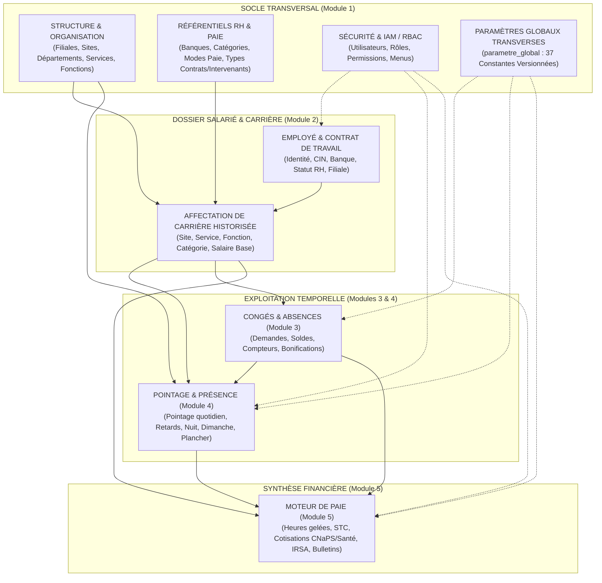
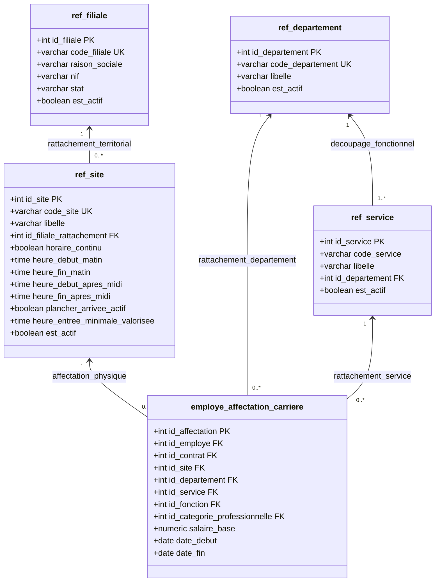
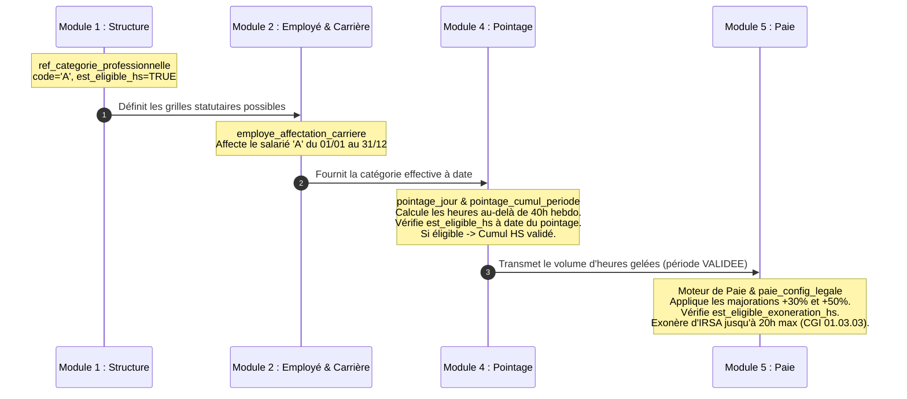
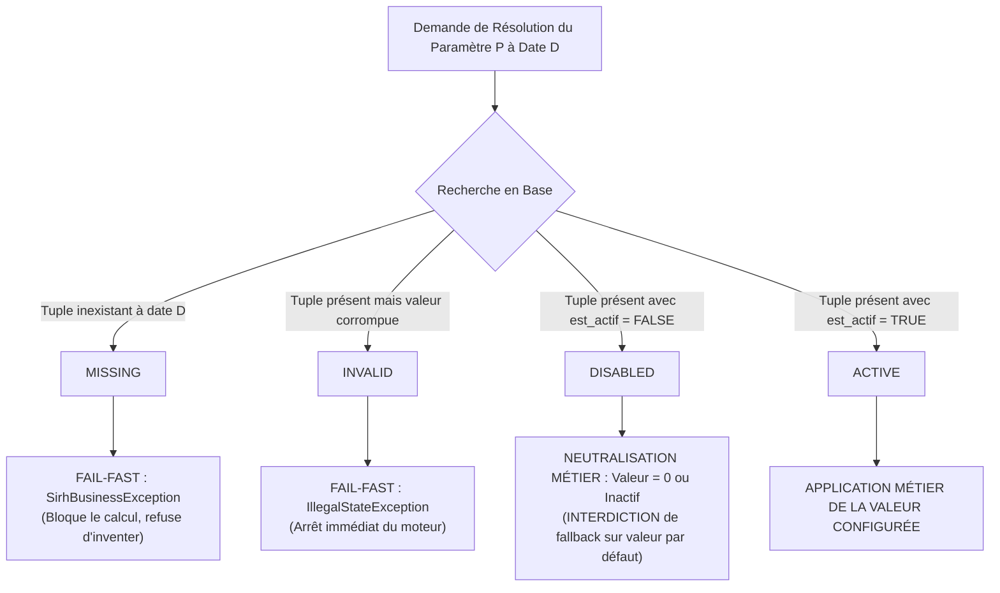

# GALAXAM SIRH — MODULE STRUCTURE, ORGANISATION & ADMINISTRATION
## Référentiels, Paramétrage Système, Gouvernance Organisationnelle et Sécurité IAM
### Document de Référence Canonique — Version Maîtresse 5.0
### **Relu le 23 octobre 2026 — Sources : Code SQL canonique (`01_schema_core_securite.sql`, `02_schema_referentiels_rh.sql`), Java 17 Spring Boot 4.1.0 et React 19**

---

> **État des preuves au 23 octobre 2026 :** les schémas canoniques et le contrôleur d'organisation décrivent le modèle et les API. Aucun rapport de recette Organisation dédié ni exécution datée des totaux de tests précédemment cités n'a été retrouvé dans le dépôt. Les contrôles de navigation et d'accès rapportés en UX-20/21 proviennent des comptes rendus communiqués séparément ; ils ne constituent pas une certification globale.
> - **Périmètre modélisé** : 32 tables de référentiels `ref_*`, 37 paramètres globaux versionnés à date d'effet, gouvernance multi-filiales et multi-sites.
> - **Cadre Juridique** : [Loi n° 2024-014 du 14 août 2024 portant Code du Travail](https://cnlegis.gov.mg/uploads/L2024-014-VF.pdf) (adoptée le 01/07/2024, validée par la HCC le 08/08/2024 Décision n° 11-HCC/D3, promulguée le 14/08/2024) & Loi n° 2003-044, CGI 2026, Décret n° 72-226, Décret n° 64-161, Décret n° 69-145 (CNaPS), Loi n° 2014-038 (Données personnelles).

---

> **NOTE MÉTHODOLOGIQUE : CORRECTIONS APPLIQUÉES PAR RAPPORT À LA VERSION PRÉCÉDENTE**
>
> | Élément | Ancienne version (ERRONÉE) | Code réel |
> |---|---|---|
> | Filiales seeedées | 2 filiales (GLX + VA) | **1 seule : GLX** — VA absente du seed SQL |
> | Horaires TNR | 08:00-12:00 / 13:00-17:00 | **08:00-12:30 / 13:30-17:00** (seed ligne 266) |
> | Plancher TNR | `plancher_arrivee_actif = TRUE` | **`plancher_arrivee_actif = FALSE`** dans le seed |
> | Plancher TMM | `plancher_arrivee_actif = TRUE` | **`plancher_arrivee_actif = FALSE`** dans le seed |
> | Types contrat | CDI, CDD, PRESTATION, TEMPORAIRE, STAGE | **CDI, CDD, TEMPORAIRE, STAGE** (PRESTATION absent) |
> | Types intervenant | 4 types, ISI 5% actif pour CONSULTANT/TEMPORAIRE | **5 types** (+ CONSULTANT_SALARIE) ; `CHECK(soumis_isi_5=FALSE)` bloque toute valeur TRUE |
> | Statuts RH | 7 statuts | **9 statuts** : BROUILLON, PLANIFIE, A_SIGNER, ACTIF, SUSPENDU, HISTORISE, CLOTURE, ROMPU, ANNULE |
> | `SEUIL_RETARD_ASSIDUITE_MIN` | `45` minutes | **`70` minutes** (seed ligne 290) |
> | Onglets OrganisationAdminPanel | 4 onglets (incl. ReferentielsRhTab) | **3 onglets** : Filiales & Sites, Départements & Services, Postes & Fonctions |
> | Endpoint plancher | Non documenté | **`PUT /referentiel/sites/{id}/plancher`** (`toggleSitePlancher`) |

---

## 0. Règle Méthodologique Absolue — Source de Vérité

Le présent document constitue le document maître du domaine **Structure, Organisation, Référentiels et Administration** du SIRH GALAXAM. Le périmètre Sécurité est décrit plus en détail dans `module-securite-audit.md` ; `parametre_global` reste partagé avec les domaines consommateurs.

L'écran `/admin/organisation` est protégé côté React par `ORGANISATION_WRITE` ; la navigation n'affiche son lien qu'à `ROLE_ADMIN` ou à un utilisateur disposant de cette permission, sous réserve du menu `ADMIN_ORGANISATION`. `ROLE_ADMIN` hérite des permissions, dont `ORGANISATION_READ` et `ORGANISATION_WRITE`, dans `SecurityConfig`. Dans `OrganisationController`, les endpoints GET demandent `isAuthenticated()` et n'exigent pas explicitement `ORGANISATION_READ` ; les mutations exigent `ORGANISATION_WRITE` ou `ROLE_ADMIN`. La permission `ORGANISATION_READ` existe dans la hiérarchie backend mais ne gouverne actuellement ni cette route frontend ni les annotations GET du contrôleur. Le contrôle serveur reste l'autorité pour les API.

Le CDC initial définit le périmètre fonctionnel du mémoire. Les schémas canoniques et le code décrivent l'implémentation actuelle ; les tests et recettes datés déterminent le niveau de vérification. Les évolutions d'architecture et de base de données (notamment l'unification du plancher d'arrivée, le contrôleur unifié et la résolution triétat des paramètres) peuvent rendre certaines descriptions historiques obsolètes, sans effacer les exigences du CDC.

Les sources utilisées pour décrire le module sont :
1. **Le code backend Java 17** : packages [`mg.galaxam.sirh.organisation`](file:///Users/andriamalalatojo/Documents/GALAXAM/GALAXAM-SIRH/backend/src/main/java/mg/galaxam/sirh/organisation), [`mg.galaxam.sirh.admin`](file:///Users/andriamalalatojo/Documents/GALAXAM/GALAXAM-SIRH/backend/src/main/java/mg/galaxam/sirh/admin), [`mg.galaxam.sirh.paieconfig`](file:///Users/andriamalalatojo/Documents/GALAXAM/GALAXAM-SIRH/backend/src/main/java/mg/galaxam/sirh/paieconfig), [`mg.galaxam.sirh.securite`](file:///Users/andriamalalatojo/Documents/GALAXAM/GALAXAM-SIRH/backend/src/main/java/mg/galaxam/sirh/securite) et la couche Active Record JDBC pure ([`bean.ClassMere`](file:///Users/andriamalalatojo/Documents/GALAXAM/GALAXAM-SIRH/backend/src/main/java/bean/ClassMere.java)) ;
2. **Le schéma physique de la base de données PostgreSQL** : scripts canoniques [`01_schema_core_securite.sql`](file:///Users/andriamalalatojo/Documents/GALAXAM/GALAXAM-SIRH/backend/conception/bdd/01_schema_core_securite.sql), [`02_schema_referentiels_rh.sql`](file:///Users/andriamalalatojo/Documents/GALAXAM/GALAXAM-SIRH/backend/conception/bdd/02_schema_referentiels_rh.sql), [`03_schema_employes_contrats.sql`](file:///Users/andriamalalatojo/Documents/GALAXAM/GALAXAM-SIRH/backend/conception/bdd/03_schema_employes_contrats.sql), [`04_schema_conges.sql`](file:///Users/andriamalalatojo/Documents/GALAXAM/GALAXAM-SIRH/backend/conception/bdd/04_schema_conges.sql), [`05_schema_pointage.sql`](file:///Users/andriamalalatojo/Documents/GALAXAM/GALAXAM-SIRH/backend/conception/bdd/05_schema_pointage.sql), [`06_schema_paie.sql`](file:///Users/andriamalalatojo/Documents/GALAXAM/GALAXAM-SIRH/backend/conception/bdd/06_schema_paie.sql) dans [`backend/conception/bdd/`](file:///Users/andriamalalatojo/Documents/GALAXAM/GALAXAM-SIRH/backend/conception/bdd) ;
3. **La suite de tests automatisés ciblés** : tests unitaires et d'intégration ciblés ([`ContratTravailControllerPostgresTest.java`](file:///Users/andriamalalatojo/Documents/GALAXAM/GALAXAM-SIRH/backend/src/test/java/mg/galaxam/sirh/contrat/api/ContratTravailControllerPostgresTest.java), [`EmployeSatelliteLifecycleTest.java`](file:///Users/andriamalalatojo/Documents/GALAXAM/GALAXAM-SIRH/backend/src/test/java/mg/galaxam/sirh/contrat/application/EmployeSatelliteLifecycleTest.java), [`PayrollCalculationTargetedTest.java`](file:///Users/andriamalalatojo/Documents/GALAXAM/GALAXAM-SIRH/backend/src/test/java/mg/galaxam/sirh/paie/PayrollCalculationTargetedTest.java)) ;
5. **Le code frontend React 19 / Vite** : [`frontend/src/features/organization`](file:///Users/andriamalalatojo/Documents/GALAXAM/GALAXAM-SIRH/frontend/src/features/organization), [`frontend/src/features/administration`](file:///Users/andriamalalatojo/Documents/GALAXAM/GALAXAM-SIRH/frontend/src/features/administration), [`frontend/src/routes/Router.jsx`](file:///Users/andriamalalatojo/Documents/GALAXAM/GALAXAM-SIRH/frontend/src/routes/Router.jsx) ;
6. **Le cadre légal et réglementaire de Madagascar** :
   - *Loi n° 2003-044 du 28 juillet 2004* portant Code du Travail de la République de Madagascar ;
   - *Code Général des Impôts (CGI)* malgache mis à jour par la Loi de Finances 2026 ;
   - *Décret n° 69-145 du 8 avril 1969* fixant le Code de Prévoyance Sociale (CNaPS) ;
   - *Décret n° 63-124 du 20 février 1963* et textes subséquents organisant les Services Médicaux Interentreprises (OMSI / OSTIE) ;
   - *Loi n° 2014-038 du 9 janvier 2015* sur la protection des données à caractère personnel à Madagascar ;
   - *Décret n° 2005-380 du 22 juin 2005* fixant les modalités d'attribution du numéro statistique (INSTAT).

Toute assertion formulée ci-dessous est vérifiable par un fichier source, une table physique, une contrainte d'intégrité, une route API, une décision de jurisprudence ou un article de loi malgache.

---

## 1. Sommaire Exécutif & Frontières Fondamentales

### 1.1. Rôle du Module Structure & Organisation
Le module **Structure & Organisation** représente le squelette ontologique de l'entreprise. Il modélise :
- Les personnes morales composant le groupe (filiales) ;
- Les implantations physiques et opérationnelles (sites) ;
- Le découpage fonctionnel et analytique des activités (départements et services) ;
- Le catalogue des qualifications, métiers et statuts conventionnels (fonctions et catégories professionnelles).

Sa finalité première n'est pas d'exécuter des calculs volatils, mais de **fournir un vocabulaire canonique, stable, univoque et hautement disponible** à tous les modules opérationnels du SIRH.

### 1.2. Rôle du Module Administration & Paramétrage
Le module **Administration & Paramétrage** remplit deux missions complémentaires :
1. **La Sécurité IAM et le Contrôle d'Accès (RBAC)** : gestion du cycle de vie des comptes utilisateurs ([`utilisateur`](file:///Users/andriamalalatojo/Documents/GALAXAM/GALAXAM-SIRH/backend/conception/bdd/01_schema_core_securite.sql#L48)), attribution des rôles ([`ref_role`](file:///Users/andriamalalatojo/Documents/GALAXAM/GALAXAM-SIRH/backend/conception/bdd/01_schema_core_securite.sql#L19)), affectation des permissions granulaires ([`role_permission`](file:///Users/andriamalalatojo/Documents/GALAXAM/GALAXAM-SIRH/backend/conception/bdd/01_schema_core_securite.sql#L37)) et distribution de l'arborescence de navigation ([`role_menu`](file:///Users/andriamalalatojo/Documents/GALAXAM/GALAXAM-SIRH/backend/conception/bdd/01_schema_core_securite.sql#L114)).
2. **La Gouvernance des Constantes et Règles Transverses** : hébergement du moteur de temporalité des paramètres généraux ([`parametre_global`](file:///Users/andriamalalatojo/Documents/GALAXAM/GALAXAM-SIRH/backend/conception/bdd/01_schema_core_securite.sql#L121)), garantissant qu'une règle métier (ex. heures de nuit, plafonds CDD, seuils d'assiduité) puisse évoluer à date d'effet sans corrompre ni écraser le passé.

### 1.3. Distinction Fondamentale : Donnée Organisationnelle vs Règle de Configuration

| Dimension | Donnée Organisationnelle | Règle de Configuration |
| :--- | :--- | :--- |
| **Nature** | Entité structurelle pérenne (ex. *Siège Antananarivo*, *Département Logistique*). | Constante d'ajustement ou seuil d'activation d'un algorithme métier (ex. *Seuil nuit = 22:00*). |
| **Cycle de vie** | Création rare, modification exceptionnelle, désactivation logique lors de réorganisations. | Versionnement daté régulier au fil des lois de finances ou des arbitrages de la direction générale. |
| **Portée relationnelle** | Clé étrangère (`id_site`, `id_service`) référencée dans les contrats et pointages. | Clé alphanumérique (`code_parametre`) résolue dynamiquement à date par un moteur de calcul. |
| **Suppression** | Strictement interdite dès lors qu'un historique y fait référence (`DATA_REFERENCED`). | Clôture temporelle automatique (`date_fin = date_debut_nouveau - 1`) pour préserver la rejouabilité des calculs passés. |

### 1.4. Propriété Métier Réelle vs Écran Centralisé
L'écran d'administration ([`ParametresModulesPanel.jsx`](file:///Users/andriamalalatojo/Documents/GALAXAM/GALAXAM-SIRH/frontend/src/features/administration/pages/modules/ParametresModulesPanel.jsx)) regroupe visuellement les interfaces de configuration technique, mais **la propriété intellectuelle et algorithmique de chaque règle appartient au domaine fonctionnel qui l'exécute** :
- **Taux CNaPS, seuils IRSA, diviseur mensuel (173.33)** : Propriété exclusive du module **Paie & Légal** ([`paie_config_legale`](file:///Users/andriamalalatojo/Documents/GALAXAM/GALAXAM-SIRH/backend/conception/bdd/02_schema_referentiels_rh.sql#L210), [`bareme_irsa`](file:///Users/andriamalalatojo/Documents/GALAXAM/GALAXAM-SIRH/backend/conception/bdd/06_schema_paie.sql#L70), [`ref_type_cotisation`](file:///Users/andriamalalatojo/Documents/GALAXAM/GALAXAM-SIRH/backend/conception/bdd/06_schema_paie.sql#L38)).
- **Horaires et plancher d'arrivée d'un site** : Portés physiquement par [`ref_site`](file:///Users/andriamalalatojo/Documents/GALAXAM/GALAXAM-SIRH/backend/conception/bdd/02_schema_referentiels_rh.sql#L55) dans le module **Structure**, mais consommés par le moteur de **Pointage**.
- **Éligibilité aux Heures Supplémentaires** : Définie dans [`ref_categorie_professionnelle`](file:///Users/andriamalalatojo/Documents/GALAXAM/GALAXAM-SIRH/backend/conception/bdd/02_schema_referentiels_rh.sql#L162), assignée dans le temps par **Employés/Carrière**, résolue à date par le **Pointage**, et valorisée financièrement par la **Paie**.
- **Acquisition mensuelle des congés (2,5 jours) et règles de bascule** : Propriété exclusive du module **Congés & Absences**.

---

## 2. Modèle Global du SIRH

L'architecture s'articule autour d'une hiérarchie de dépendances stricte, orientée des référentiels stables vers les calculs financiers finaux :



---

## 3. Structure Organisationnelle Hiérarchique & Topologie

La structure d'entreprise de GALAXAM ne répond pas à une arborescence purement pyramidale stricte, mais à un modèle orthogonal distinguant le **rattachement juridique**, la **ligne hiérarchique fonctionnelle** et l'**implantation géographique** :
1. **Axe Juridique** : La Filiale ([`ref_filiale`](file:///Users/andriamalalatojo/Documents/GALAXAM/GALAXAM-SIRH/backend/conception/bdd/02_schema_referentiels_rh.sql#L30)) est l'employeur légal contractant avec le salarié.
2. **Axe Métier / Analytique** : Le Département ([`ref_departement`](file:///Users/andriamalalatojo/Documents/GALAXAM/GALAXAM-SIRH/backend/conception/bdd/02_schema_referentiels_rh.sql#L74)) regroupe des Services ([`ref_service`](file:///Users/andriamalalatojo/Documents/GALAXAM/GALAXAM-SIRH/backend/conception/bdd/02_schema_referentiels_rh.sql#L81)).
3. **Axe Géographique & Opérationnel** : Le Site ([`ref_site`](file:///Users/andriamalalatojo/Documents/GALAXAM/GALAXAM-SIRH/backend/conception/bdd/02_schema_referentiels_rh.sql#L55)) est l'établissement où s'exécute physiquement la prestation de travail.



---

## 4. Filiales Juridiques

### 4.1. Modélisation Physique (`ref_filiale`)
La table `ref_filiale` matérialise l'entité légale titulaire du registre du commerce et des immatriculations fiscales obligatoires à Madagascar :
- **Table** : `ref_filiale`
- **Contrainte d'unicité** : `code_filiale VARCHAR(10) UNIQUE NOT NULL`
- **Colonnes réelles** :
  - `id_filiale` (SERIAL, Clé primaire)
  - `code_filiale` (VARCHAR(10), Code mnémonique unique en majuscules)
  - `raison_sociale` (VARCHAR(100), Dénomination commerciale légale)
  - `nif` (VARCHAR(30), Numéro d'Identification Fiscale selon l'Art. 01.01.01 du CGI)
  - `stat` (VARCHAR(30), Numéro Statistique délivré par l'INSTAT selon le Décret n° 2005-380)
  - `adresse_siege` (VARCHAR(255), Siège social)
  - `rcs` (VARCHAR(80), Numéro au Registre du Commerce et des Sociétés)
  - `telephone`, `email` (VARCHAR(40), VARCHAR(255))
  - `est_actif` (BOOLEAN, Défaut TRUE)
  - `date_desactivation` (TIMESTAMP WITH TIME ZONE, Date de cessation ou clôture)
  - `created_at` (TIMESTAMP WITH TIME ZONE, Date d'enregistrement)

### 4.2. Données Actuelles du Seed SQL Canonique
Le script [`02_schema_referentiels_rh.sql`](file:///Users/andriamalalatojo/Documents/GALAXAM/GALAXAM-SIRH/backend/conception/bdd/02_schema_referentiels_rh.sql#L252) initialise **une seule entité** :

1. **GLX** : *Galaxam Logistics* — NIF `3 000 019 43 4`, STAT `52 296 11 2001 0 00056`, RCS `2001B66`, Siège `3e étage, Tour Forello, Tanjombato`, email `daf@galaxam.com`.

> **Attention** : La filiale **VA** (*Vina sy Asa*) mentionnée dans les versions antérieures **n'existe pas dans le seed canonique actuel**. Elle doit être créée manuellement via l'interface d'administration si nécessaire.

### 4.3. Garde-Fous Métier POO : Désactivation sous Contrôle
Dans [`OrganisationService.java`](file:///Users/andriamalalatojo/Documents/GALAXAM/GALAXAM-SIRH/backend/src/main/java/mg/galaxam/sirh/organisation/application/OrganisationService.java#L190-L225), la méthode privée `validerDesactivationFiliale(RefFiliale filiale, Connection c)` protège l'intégrité du système :
```java
// Vérification des sites actifs résiduels
SELECT COUNT(*) FROM ref_site WHERE id_filiale_rattachement = ? AND est_actif = true;

// Vérification des contrats de travail en cours
SELECT COUNT(*) FROM contrat_travail WHERE id_filiale = ? AND (date_fin IS NULL OR date_fin >= CURRENT_DATE);
```
Si le résultat est non nul, la désactivation est rejetée immédiatement avec le code `SirhErrorCode.DATA_REFERENCED` :
> *"Impossible de désactiver la filiale « X » : elle comporte encore N site(s) actif(s) et M contrat(s) de travail en cours. Veuillez réaffecter ou clôturer ces éléments avant de pouvoir désactiver la filiale."*

Ce comportement est formellement garanti au niveau service dans [`OrganisationService.java`](file:///Users/andriamalalatojo/Documents/GALAXAM/GALAXAM-SIRH/backend/src/main/java/mg/galaxam/sirh/organisation/application/OrganisationService.java) et vérifié par les contraintes d'intégrité référentielle.

---

## 5. Départements & Services

### 5.1. Départements (`ref_departement`)
- **Table** : `ref_departement`
- **Colonnes** : `id_departement` (PK), `code_departement` (VARCHAR(10) UNIQUE), `libelle` (VARCHAR(100)), `est_actif` (BOOLEAN DEFAULT TRUE).
- **Données Seed** : `LOG` — *Logistics*.
- **Rôle métier** : Regroupements analytiques et synthèses d'effectifs pour les tableaux de bord RH.

### 5.2. Services (`ref_service`)
- **Table** : `ref_service`
- **Colonnes** :
  - `id_service` (SERIAL, PK)
  - `code_service` (VARCHAR(10) NOT NULL)
  - `libelle` (VARCHAR(100) NOT NULL)
  - `id_departement` (INT NOT NULL, FK `ref_departement(id_departement)` ON DELETE CASCADE)
  - `est_actif` (BOOLEAN DEFAULT TRUE)
- **Contrainte d'unicité composite** : `CONSTRAINT uk_service_departement UNIQUE (code_service, id_departement)`. Un même code de service peut théoriquement exister dans deux départements distincts, mais est unique au sein d'un département donné.
- **Clé candidate de cohérence** : `UNIQUE (id_service, id_departement)` permet à une affectation de référencer le service avec le département correspondant par une clé étrangère composée. Cette contrainte est nommée `uq_ref_service_id_departement`; elle ne change pas la portée globale du département ni l'absence de rattachement obligatoire du service à un site.
- **Données Seed** :
  - `ADM` — *Administration & RH* (rattaché au département `LOG`).
  - `OPE` — *Opérations & Transit* (rattaché au département `LOG`).

---

## 6. Sites Géographiques & Établissements

### 6.1. Identité et Rôle Central du Site
Dans GALAXAM SIRH, le **Site** ([`ref_site`](file:///Users/andriamalalatojo/Documents/GALAXAM/GALAXAM-SIRH/backend/conception/bdd/02_schema_referentiels_rh.sql#L55)) est l'entité pivot de l'exploitation quotidienne. Il modélise les agences portuaires et entrepôts logistiques :
- **Table** : `ref_site`
- **Colonnes réelles** :
  - `id_site` (SERIAL, PK)
  - `code_site` (VARCHAR(10) UNIQUE NOT NULL)
  - `libelle` (VARCHAR(100) NOT NULL)
  - `id_filiale_rattachement` (INT, FK vers `ref_filiale(id_filiale)`)
  - `horaire_continu` (BOOLEAN DEFAULT TRUE)
  - `heure_debut_matin` (TIME)
  - `heure_fin_matin` (TIME)
  - `heure_debut_apres_midi` (TIME)
  - `heure_fin_apres_midi` (TIME)
  - `plancher_arrivee_actif` (BOOLEAN NOT NULL DEFAULT FALSE)
  - `heure_entree_minimale_valorisee` (TIME NULL)
  - `est_actif` (BOOLEAN DEFAULT TRUE)
- **Contrainte de cohérence stricte** :
  ```sql
  CONSTRAINT chk_ref_site_plancher_arrivee 
  CHECK (NOT plancher_arrivee_actif OR heure_entree_minimale_valorisee IS NOT NULL)
  ```

### 6.2. Données Réelles du Seed (source : ligne 265-267 de `02_schema_referentiels_rh.sql`)
1. **TNR** : *Antananarivo - Siège*
   - Rattaché à la filiale GLX (`id_filiale_rattachement = 1`).
   - `horaire_continu = TRUE` (Journée continue avec pause déjeuner sur place).
   - Horaires réels : **`08:00 - 12:30`** / **`13:30 - 17:00`** ← horaires corrigés vs ancienne doc
   - `plancher_arrivee_actif = FALSE` dans le seed (**la règle est désactivée par défaut**) ; `heure_entree_minimale_valorisee = '07:30'` pré-configurée mais inactive jusqu'à activation par l'admin.
2. **TMM** : *Toamasina - Agence*
   - Rattaché à la filiale GLX (`id_filiale_rattachement = 1`).
   - `horaire_continu = FALSE` (Coupure méridienne de 2 heures permettant le retour à domicile).
   - Horaires : `08:00 - 12:00` / `14:00 - 18:00`.
   - `plancher_arrivee_actif = FALSE` dans le seed ; `heure_entree_minimale_valorisee = '07:30'` pré-configurée.

> L'activation du plancher se fait via l'endpoint **`PUT /referentiel/sites/{id}/plancher`** (`toggleSitePlancher` dans `organisationService.js`).

---

## 7. Horaires de Site & Modalités de Présence

### 7.1. Journée Continue vs Horaire Discontinu
La distinction entre `horaire_continu = TRUE` et `horaire_continu = FALSE` pilote des règles métiers critiques dans le module de Pointage :
- **Horaire Continu (TNR)** : Pause méridienne standard de 1 heure (12h00 - 13h00). Le salarié ne quitte pas l'enceinte de l'entreprise ; cela ouvre droit à l'indemnité repas midi si les conditions sont satisfaites.
- **Horaire Discontinu / Coupure (TMM)** : Pause méridienne de 2 heures (12h00 - 14h00). Le salarié rentre déjeuner à domicile. Si la pause constatée est inférieure au paramètre `SEUIL_PAUSE_MIDI_MIN` (60 minutes), l'algorithme applique la règle *« ne rentre pas midi »*, déclenchant l'indemnité repas et appliquant la réduction transport (`REDUCTION_DEPLACT_REPAS_MIDI = 1000 Ar`).

---

## 8. Le Plancher d'Arrivée (*Earliest Paid Start*)

### 8.1. Définition et Fondement Juridique
Le **Plancher d'Arrivée** est le mécanisme par lequel l'entreprise refuse de rémunérer ou de comptabiliser en heures supplémentaires les arrivées ultra-matinales non sollicitées.

**Fondement Légal (Code du Travail malgache, Loi 2003-044)** :
- **Article 75** : Fixe la durée légale à 40 heures par semaine (soit 8 heures par jour ouvré standard).
- **Article 76** : « *La durée du travail s'entend du travail effectif, c'est-à-dire du temps pendant lequel le travailleur est à la disposition de l'employeur et doit se conformer à ses directives sans pouvoir vaquer librement à des occupations personnelles.* »
- *Conséquence juridique* : La présence passive sur site avant l'heure d'ouverture ou en avance sur les instructions hiérarchiques ne constitue pas un travail effectif commandé. L'écrêtage au plancher d'arrivée protège l'employeur contre la requalification abusive de cette présence en heures supplémentaires.

### 8.2. Historique de Migration (sp27) & Implémentation
Antérieurement au Sprint 27, cette notion résidait dans une table isolée `ref_tolerance_arrivee_pointage`. L'évolution consolidée dans [`02_schema_referentiels_rh.sql`](file:///Users/andriamalalatojo/Documents/GALAXAM/GALAXAM-SIRH/backend/conception/bdd/02_schema_referentiels_rh.sql) a :
1. Rapatrié `plancher_arrivee_actif` et `heure_entree_minimale_valorisee` directement dans la table hôte `ref_site` ;
2. Posé la contrainte SQL `chk_ref_site_plancher_arrivee` ;
3. Supprimé définitivement (`DROP TABLE CASCADE`) l'ancienne table obsolète `ref_tolerance_arrivee_pointage`.

### 8.3. Algorithme de Valorisation (Code Réel Backend)
Dans `PointageService.java` (méthode `effectiveMorningEntry`), la résolution de l'heure d'entrée effective du matin s'exprime ainsi :

$$\text{Soit } H_{\text{badge}} \text{ l'heure physique de pointage et } H_{\text{plancher}} \text{ l'heure minimale configurée sur le site.}$$

$$H_{\text{effective}} = \begin{cases} 
H_{\text{badge}} & \text{si } \text{plancher\_arrivee\_actif} = \text{FALSE ou } H_{\text{plancher}} \text{ est NULL} \\
\max(H_{\text{badge}}, H_{\text{plancher}}) & \text{si } \text{plancher\_arrivee\_actif} = \text{TRUE et } H_{\text{plancher}} \text{ est non NULL}
\end{cases}$$

### 8.4. Preuve et Algorithme dans le Service (`PointageService.java`)
La conformité algorithmique est formellement garantie par cinq cas d'évaluation :
- **Cas 1** : Site actif, seuil 07:30, badge 07:00 $\rightarrow$ Entrée retenue : `07:30` (écrêtage de l'arrivée précoce).
- **Cas 2** : Site actif, seuil 07:30, badge 07:20 $\rightarrow$ Entrée retenue : `07:30`.
- **Cas 3** : Site actif, seuil 07:30, badge 07:45 $\rightarrow$ Entrée retenue : `07:45` (arrivée dans la plage normale, non modifiée).
- **Cas 4** : Site actif, seuil 07:30, badge 08:05 $\rightarrow$ Entrée retenue : `08:05` (retard réel constaté).
- **Cas 5** : Règle inactive (`minimum = null`) $\rightarrow$ Badge 07:00 donne `07:00` (aucun écrêtage).

---

## 9. Catégories Socio-Professionnelles

### 9.1. Modélisation (`ref_categorie_professionnelle`)
- **Table** : `ref_categorie_professionnelle`
- **Colonnes réelles** :
  - `id_categorie_professionnelle` (SERIAL, PK)
  - `code` (VARCHAR(10) UNIQUE NOT NULL)
  - `libelle` (VARCHAR(100) NOT NULL)
  - `description` (TEXT)
  - `est_eligible_hs` (BOOLEAN NOT NULL DEFAULT TRUE)
  - `est_cadre` (BOOLEAN NOT NULL DEFAULT FALSE)
  - `est_eligible_exoneration_hs` (BOOLEAN NOT NULL DEFAULT TRUE)
  - `dispense_pointage` (BOOLEAN NOT NULL DEFAULT FALSE)
  - `actif` (BOOLEAN DEFAULT TRUE)
  - `created_at` (TIMESTAMP DEFAULT CURRENT_TIMESTAMP)
  - `updated_at` (TIMESTAMP)

### 9.2. Données Actuelles du Seed
1. **CADRE** : *Cadre*
   - `est_cadre = TRUE`
   - `est_eligible_hs = FALSE` (Forfait cadre, non éligible aux heures supplémentaires de droit commun)
   - `est_eligible_exoneration_hs = FALSE`
   - `dispense_pointage = FALSE` (Badge pour tracer la présence journalière, sauf si sa fonction spécifique l'en dispense)
2. **A** : *Agent*
   - `est_cadre = FALSE`
   - `est_eligible_hs = TRUE` (Régime standard 40h/semaine, éligible aux tranches de majoration HS +30% et +50%)
   - `est_eligible_exoneration_hs = TRUE` (Éligible à l'exonération fiscale IRSA selon l'Art. 01.03.03 du CGI dans la limite de 20 heures)
   - `dispense_pointage = FALSE`

---

## 10. Cadre / Non Cadre vs Éligibilité HS

Il est impératif de souligner l'**indépendance conceptuelle des colonnes** `est_cadre` et `est_eligible_hs` dans le schéma GALAXAM SIRH :

$$\text{est\_cadre} \ne \neg(\text{est\_eligible\_hs})$$

Le système prévoit la possibilité de modéliser des situations professionnelles nuancées :
- Un *Cadre technique d'atelier* peut avoir `est_cadre = TRUE` tout en ayant `est_eligible_hs = TRUE` (soumis à un horaire collectif contrôlable).
- Un *Commercial non cadre itinérant* peut avoir `est_cadre = FALSE` et `est_eligible_hs = FALSE` (autonomie complète dans l'organisation de son temps).

De même, `dispense_pointage` figure sur la catégorie mais également sur la fonction ([`ref_fonction.dispense_pointage`](file:///Users/andriamalalatojo/Documents/GALAXAM/GALAXAM-SIRH/backend/conception/bdd/02_schema_referentiels_rh.sql#L97)). Si l'un des deux attributs est à `TRUE` lors de la résolution de l'affectation active, le moteur de pointage qualifie automatiquement la journée en `DISPENSE_POINTAGE` sans lever d'anomalie de saisie manquante.

---

## 11. Chaîne d'Éligibilité aux Heures Supplémentaires

Le traitement d'une heure supplémentaire met en jeu quatre étapes orchestrées à travers les cinq modules :



---

## 12. Affectations de Carrière & Rattachement Historisé

Bien que la gestion du cycle de vie du personnel appartienne au Module 2, les **affectations de carrière** ([`employe_affectation_carriere`](file:///Users/andriamalalatojo/Documents/GALAXAM/GALAXAM-SIRH/backend/conception/bdd/03_schema_employes_contrats.sql#L100)) constituent le pont d'application de la Structure sur le salarié.

### 12.1. Règle d'Immutabilité et de Clôture
Lors d'une mutation de site, d'une promotion ou d'un changement de département :
1. L'affectation courante active voit son champ `date_fin` mis à jour à la veille de la prise d'effet du mouvement, et son statut passe à `HISTORISE`.
2. Une nouvelle ligne d'affectation est créée avec la nouvelle référence structurelle, avec `date_debut = date_effet` et `date_fin = NULL`.
3. Cette conservation stricte garantit qu'un audit rétroactif d'une période de paie passée restituera fidèlement l'ancien site et l'ancienne qualification du salarié.

---

## 13. Postes & Fonctions

### 13.1. Modélisation (`ref_fonction`)
- **Table** : `ref_fonction`
- **Colonnes** : `id_fonction` (SERIAL, PK), `code_fonction` (VARCHAR(20) UNIQUE NOT NULL), `libelle` (VARCHAR(100) NOT NULL), `dispense_pointage` (BOOLEAN DEFAULT FALSE), `est_actif` (BOOLEAN DEFAULT TRUE).
- **Distinction Conceptuelle** :
  - **Fonction** : Le métier opérationnel (ex. `CHEF_DECLARANT`, `PASSEUR_PIECES`).
  - **Catégorie** : Le statut conventionnel et légal (ex. `A` pour Agent, `CADRE`).
  - **Rôle Applicatif** : Le compte d'accès logiciel informatique (ex. `ROLE_AGENT_POINTAGE`, `ROLE_ADMIN`).
  *Exemple : Un Directeur Administratif et Financier a pour fonction `DAF`, pour catégorie `CADRE`, et pour rôle applicatif `ROLE_ADMIN`.*

### 13.2. Liste Exhaustive des Postes Seedés en Base (22 Fonctions)
Le catalogue issu de [`02_schema_referentiels_rh.sql`](file:///Users/andriamalalatojo/Documents/GALAXAM/GALAXAM-SIRH/backend/conception/bdd/02_schema_referentiels_rh.sql#L295) comprend :

| Code Fonction | Libellé Métier | Dispense Pointage |
| :--- | :--- | :---: |
| `DG` | Direction Générale | **TRUE** |
| `DAF` | Direction Administrative & Financière | **TRUE** |
| `CHEF_COMPTABLE` | Chef Comptable | FALSE |
| `AIDE_COMPTABLE` | Aide-Comptable | FALSE |
| `OPE_MGR` | Responsable Opérations Transit | FALSE |
| `CHEF_DECLARANT` | Chef Déclarant Douane | FALSE |
| `AIDE_DECLARANT` | Aide-Déclarant | FALSE |
| `PASSEUR_PIECES` | Passeur de pièces en douane | FALSE |
| `RESP_TOAMASINA` | Responsable bureau Toamasina | FALSE |
| `RESP_ENTREPOT` | Responsable Entrepôt | FALSE |
| `CHEF_ZONE` | Chef de zone | FALSE |
| `AGENT_PLANIF` | Agent de planification | FALSE |
| `MANUTENTIONNAIRE` | Manutentionnaire | FALSE |
| `COMMERCIAL_EXEC` | Commercial Executive | FALSE |
| `ASSIST_DIR` | Assistante de Direction | FALSE |
| `ASSIST_ADMIN` | Assistante Administrative | FALSE |
| `AGENT_B_D` | Agent Bon à Délivrer (B à D) | FALSE |
| `AGENT_TRANSMISSION` | Agent de transmission | FALSE |
| `AGENT_TOUT_FAIRE` | Agent à tout faire | FALSE |
| `AGENT_SURFACE` | Agent de surface | FALSE |
| `GARDIEN` | Gardien de site | FALSE |
| `AGENT_FORMATION` | Agent en formation | FALSE |

---

## 14. Types de Contrat & Types d'Intervenants

### 14.1. Types de Contrat (`ref_type_contrat`)
- **Colonnes** : `id_type_contrat` (PK), `code` (VARCHAR(20) UNIQUE), `libelle` (VARCHAR(100)), `exige_date_fin` (BOOLEAN DEFAULT FALSE), `est_actif` (BOOLEAN DEFAULT TRUE).
- **Catalogue seed réel (4 types — source : ligne 307-312 de `02_schema_referentiels_rh.sql`) :**

| id | code | Libellé | `exige_date_fin` | Base légale |
|---|---|---|:---:|---|
| 1 | `CDI` | Contrat à Durée Indéterminée | FALSE | Forme normale de la relation de travail |
| 2 | `CDD` | Contrat à Durée Déterminée | TRUE | Art. 19-20 Code du Travail : 24 mois max, 2 renouvellements, 72 mois cumulés |
| 4 | `TEMPORAIRE` | Contrat d'Engagement Temporaire | TRUE | Engagement de courte durée |
| 5 | `STAGE` | Convention / Contrat de Stage | TRUE | Convention pédagogique |

> **Note** : Le type **`PRESTATION`** n'est **pas** dans le seed SQL canonique. Il est absent de la table à l'initialisation.

### 14.2. Types d'Intervenants (`ref_type_intervenant`)
Pilote le régime de cotisations sociales et la fiscalité de la rémunération versée.

**Contrainte SQL importante** : `soumis_isi_5 BOOLEAN NOT NULL CHECK (soumis_isi_5 = FALSE)` → Le champ ISI 5% est structurellement verrouillé à FALSE pour tous les types. L'ISI général est désactivé en 2026 (endpoint EDI ISI répond HTTP 410).

**5 types seeedés (source : lignes 315-321) :**

| id | Code | Libellé | IRSA | ISI 5% | CNaPS | Santé |
| :---: | :--- | :--- | :---: | :---: | :---: | :---: |
| 1 | `PERMANENT` | Salarié Permanent | Oui | Non (verrouillé) | Oui | Oui |
| 2 | `CONSULTANT` | Consultant indépendant (hors paie) | Non | Non | Non | Non |
| 3 | `TEMPORAIRE` | Travailleur temporaire salarié | Oui | Non | Oui | Oui |
| 4 | `STAGIAIRE` | Stagiaire | Non | Non | Non | Non |
| 5 | `CONSULTANT_SALARIE` | Consultant salarié | Oui | Non | Oui | Oui |

> **Précision documentaire** : `CONSULTANT` a `soumis_sante=FALSE` et `soumis_cnaps=FALSE`. `TEMPORAIRE` a `soumis_irsa=TRUE` et `soumis_cnaps=TRUE`. Le type `CONSULTANT_SALARIE` (id=5) était absent de la documentation.

---

## 15. Inventaire Exhaustif de Tous les Référentiels Socle (`ref_*`)

Le tableau suivant répertorie **l'ensemble des 32 tables de référence (`ref_*`)** existant dans le schéma relationnel physique de GALAXAM SIRH :

| N° | Table Physique | Domaine Propriétaire | Modules Consommateurs | Mutable ? | Historisé ? | Rôle dans l'Architecture |
| :---: | :--- | :--- | :--- | :---: | :---: | :--- |
| 1 | `ref_filiale` | Structure | Employés, Paie | Oui (Admin) | Oui (`date_desactivation`) | Personnes morales du groupe (NIF, STAT, RCS) |
| 2 | `ref_banque` | Structure / Socle | Employés, Paie | Oui (Admin) | Non (Flag actif) | Établissements bancaires & codes SWIFT |
| 3 | `ref_site` | Structure | Pointage, Employés, Paie | Oui (Admin) | Non (Flag actif) | Établissements physiques, horaires & plancher d'arrivée |
| 4 | `ref_departement` | Structure | Employés, Organisation | Oui (Admin) | Non (Flag actif) | Pôles fonctionnels majeurs |
| 5 | `ref_service` | Structure | Employés, Pointage | Oui (Admin) | Non (Flag actif) | Découpage des départements (`uk_service_departement`) |
| 6 | `ref_fonction` | Structure | Employés, Pointage | Oui (Admin) | Non (Flag actif) | Postes, métiers et dispenses de pointage |
| 7 | `ref_type_contrat` | Employés | Employés, Paie | Oui (Admin) | Non (Flag actif) | Typologie des contrats d'embauche (CDI, CDD, etc.) |
| 8 | `ref_type_intervenant`| Paie / Légal | Employés, Paie | Oui (Admin) | Non (Flag actif) | Régimes fiscaux (IRSA/ISI) et sociaux (CNaPS/Santé) |
| 9 | `ref_statut_rh` | Employés | Employés, Contrats | Non (Système) | Non (Ordre d'état) | États du cycle de vie collaborateur |
| 10 | `ref_type_evenement_rh`| Employés | Carrière, Workflows | Non (Système) | Non | Événements de carrière (mutation, promotion, etc.) |
| 11 | `ref_motif_sortie` | Employés | Contrats, Paie STC | Oui (Admin) | Non (Flag actif) | Motifs légaux de fin de contrat (démission, etc.) |
| 12 | `ref_motif_mouvement` | Employés | Carrière | Oui (Admin) | Non (Flag actif) | Motifs d'avenants et mutations |
| 13 | `ref_mode_calcul_paie` | Paie | Carrière, Paie | Non (Système) | Non (Flag actif) | Modes de calcul : Mensuel, Horaire, Journalier |
| 14 | `ref_categorie_professionnelle` | Structure / Paie | Pointage, Paie, Employés | Oui (Admin) | Non (Flag actif) | Grille conventionnelle, Cadre, Éligibilité HS |
| 15 | `ref_type_document` | Employés | Dossier Salarié | Oui (Admin) | Non (Flag actif) | Typologie des justificatifs RH (CIN, Diplômes, etc.) |
| 16 | `ref_calendrier_ferie` | Structure / Légal | Pointage, Congés, Paie | Oui (Admin) | Non (Par date) | Jours fériés légaux et chômés |
| 17 | `ref_periode_chomee` | Structure / Exploitation | Pointage, Paie | Oui (Admin) | Oui (Par dates) | Chômage technique ou fermetures collectives |
| 18 | `ref_role` | Sécurité / IAM | Sécurité, Tous | Oui (Admin) | Oui (`date_desactivation`) | Rôles du modèle RBAC applicatif |
| 19 | `ref_module` | Sécurité / IAM | Sécurité | Non (Système) | Non (Flag actif) | Découpage applicatif du SIRH (EMPLOYE, PAIE, etc.) |
| 20 | `ref_menu` | Sécurité / IAM | Frontend Navigation | Oui (Admin) | Non | Arborescence de la navigation UI |
| 21 | `ref_pool_conge_annuel`| Congés | Congés, Solde | Non (Système) | Non | Quotas partagés (permissions 10 jours Art. 88) |
| 22 | `ref_type_conge` | Congés | Congés, Pointage, Paie | Oui (Admin) | Non (Flag actif) | Types d'absences, règles d'imputation et justificatifs |
| 23 | `ref_motif_evenement_familial` | Congés | Congés | Oui (Admin) | Non (Flag actif) | Motifs d'événements familiaux (mariage, décès, etc.) |
| 24 | `ref_statut_demande_conge` | Congés | Congés | Non (Système) | Non | Circuit de validation du congé (SOUMIS, APPROUVE, etc.) |
| 25 | `ref_statut_pointage_jour` | Pointage | Pointage, Paie | Non (Système) | Non | Qualification journalière du pointage (PRESENT, etc.) |
| 26 | `ref_statut_periode_paie` | Pointage / Paie | Pointage, Paie | Non (Système) | Non | États du cycle mensuel de paie (OUVERTE, VALIDEE, etc.) |
| 27 | `ref_indemnite` | Pointage / Paie | Pointage, Paie | Oui (Admin) | Non (Flag actif) | Catalogue indemnités (DPLCT, REPAS) |
| 28 | `ref_type_cotisation` | Paie / Légal | Paie | Oui (Admin) | Oui (Dates début/fin) | Cotisations sociales CNaPS, Santé, FMFP |
| 29 | `ref_taux_majoration` | Paie / Légal | Paie | Oui (Admin) | Oui (Dates début/fin) | Taux d'heures sup (+30%, +50%, nuit, dimanche) |
| 30 | `ref_type_mouvement_paie`| Paie | Paie Variables | Oui (Admin) | Non (Flag actif) | Catalogue des variables DAF (primes, retenues) |
| 31 | `ref_mode_paiement` | Paie | Paie Sorties | Oui (Admin) | Non (Flag actif) | Virement, Chèque, Espèces, Mobile Money |
| 32 | `ref_type_bulletin` | Paie | Paie Bulletins | Non (Système) | Non (Flag actif) | Types de bulletin (MENSUEL, STC, GRATIFICATION) |

---

## 16. Moteur des Paramètres Globaux (`parametre_global`)

### 16.1. Schéma Physique & Contraintes d'Intégrité
```sql
CREATE TABLE parametre_global (
    id_parametre SERIAL PRIMARY KEY,
    code_parametre VARCHAR(50) NOT NULL,
    categorie VARCHAR(30) NOT NULL DEFAULT 'GENERAL',
    valeur VARCHAR(100) NOT NULL,
    description TEXT,
    date_debut DATE NOT NULL,
    date_fin DATE,
    est_actif BOOLEAN NOT NULL DEFAULT TRUE,
    est_desactivable BOOLEAN NOT NULL DEFAULT FALSE,
    CONSTRAINT uq_parametre_global_code_date UNIQUE (code_parametre, date_debut),
    CONSTRAINT ck_parametre_global_dates CHECK (date_fin IS NULL OR date_fin >= date_debut),
    CONSTRAINT ex_parametre_global_validite EXCLUDE USING gist (
        UPPER(code_parametre) WITH =,
        daterange(date_debut, date_fin, '[]') WITH &&
    ),
    CONSTRAINT ck_conge_decompte_feries_valeur CHECK (code_parametre <> 'CONGE_DECOMPTE_FERIES'
        OR (valeur IN ('INCLUS', 'EXCLUS') AND est_desactivable = TRUE))
);

CREATE INDEX idx_parametre_actif ON parametre_global(code_parametre) WHERE date_fin IS NULL;
CREATE INDEX idx_parametre_categorie ON parametre_global(categorie);
```

Le schéma canonique installe `btree_gist` pour permettre la contrainte
d'exclusion. Les périodes ont des bornes inclusives, peuvent avoir une fin
ouverte, et ne peuvent ni être inversées ni se chevaucher pour le même code
(comparaison insensible à la casse). SP76 vérifie les données préexistantes et
interrompt la migration en listant les anomalies ; elle ne les corrige pas.
Toute lecture de calcul doit résoudre le paramètre à la date métier du
consommateur et traiter une configuration ambiguë comme une erreur.

### 16.2. Inventaire Exhaustif des 37 Paramètres Canoniques du Seed SQL

| ID | Clé Paramètre | Catégorie | Valeur Seed | Type | Désactivable ? | Fondement Légal / Règle Métier |
| :---: | :--- | :--- | :---: | :---: | :---: | :--- |
| **3** | `SEUIL_NUIT_DEBUT` | `POINTAGE` | `22:00` | LocalTime | **NON** | *Art. 117-124 Loi 2024-014* (ex-Art. 83) : début de la tranche légale de nuit |
| **4** | `SEUIL_NUIT_FIN` | `POINTAGE` | `05:00` | LocalTime | **NON** | *Art. 117-124 Loi 2024-014* (ex-Art. 83) : fin de la tranche légale de nuit |
| **5** | `MONTANT_REPAS_MIDI` | `POINTAGE` | `2000` | Montant Ar | **NON** | Forfait journalier repas du midi (si présent) |
| **6** | `SEUIL_2ND_REPAS_1` | `POINTAGE` | `19:30` | LocalTime | OUI | Sortie ouvrant droit au 2nd repas distinct (tranche 1) |
| **7** | `MONTANT_2ND_REPAS_1` | `POINTAGE` | `2000` | Montant Ar | OUI | Montant du deuxième repas, tranche 1 |
| **8** | `SEUIL_2ND_REPAS_2` | `POINTAGE` | `21:00` | LocalTime | OUI | Sortie ouvrant droit au 2nd repas majoré |
| **9** | `MONTANT_2ND_REPAS_2` | `POINTAGE` | `4000` | Montant Ar | OUI | Montant du deuxième repas majoré |
| **10**| `SEUIL_PAUSE_MIDI_MIN` | `POINTAGE` | `60` | Minutes | **NON** | Seuil de détection « ne rentre pas midi » (site TMM) |
| **11**| `REDUCTION_DEPLACT_REPAS_MIDI` | `POINTAGE` | `1000` | Montant Ar | OUI | Déduction transport si repas midi alloué sur site |
| **12**| `SEUIL_HEURES_JOUR` | `RH_GENERAL` | `8` | Heures | **NON** | *Art. 109-110 Loi 2024-014* (ex-Art. 75) : durée légale journalière (8h) |
| **14**| `DUREE_MAX_CDD_MOIS` | `CONTRAT` | `72` | Mois | **NON** | *Art. 25 Loi 2024-014* (ex-Art. 20) : durée max cumulée CDD (6 ans) |
| **15**| `NB_MAX_RENOUVELLEMENTS_CDD` | `CONTRAT` | `2` | Entier | **NON** | *Art. 25 Loi 2024-014* (ex-Art. 20) : max 2 renouvellements d'avenant |
| **37**| `DUREE_MAX_CONTRAT_CDD_MOIS`| `CONTRAT` | `24` | Mois | **NON** | *Art. 24 Loi 2024-014* (ex-Art. 19) : durée max contrat CDD unitaire |
| **16**| `MAX_RENOUVELLEMENTS_ESSAI`| `RH_GENERAL` | `1` | Entier | **NON** | *Art. 52-54 Loi 2024-014* (ex-Art. 18) : période d'essai (1 seul renouvellement) |
| **18**| `PLAFOND_CUMUL_SOLDE_CONGE_JOURS` | `CONGE` | `90` | Jours | OUI | Plafond optionnel ; désactivé = cumul sans plafond |
| **19**| `DUREE_PRESCRIPTION_SOLDE_CONGE_MOIS` | `CONGE` | `36` | Mois | **NON** | *Art. 129 Loi 2024-014* (ex-Art. 87) : prescription 3 ans (signalement DAF) |
| **20**| `PLAFOND_SOLDE_CONGE_NEGATIF` | `CONGE` | `-10` | Jours | OUI | Anticipation max autorisée par dérogation RH |
| **21**| `SEUIL_ALERTE_SOLDE_CONGE_FAIBLE` | `CONGE` | `3` | Jours | OUI | Déclenchement de l'indicateur visuel de solde faible |
| **22**| `DELAI_PREAVIS_COURT_JOURS` | `CONGE` | `2` | Jours | **NON** | Préavis minimum pour demande de courte durée |
| **23**| `DELAI_PREAVIS_LONG_JOURS` | `CONGE` | `15` | Jours | **NON** | Préavis minimum pour demande de longue durée |
| **24**| `SEUIL_JOURS_PREAVIS_LONG` | `CONGE` | `3` | Jours | **NON** | Seuil de jours posés basculant vers le préavis long |
| **26**| `DUREE_MAX_MATERNITE_STANDARD_JOURS` | `CONGE` | `98` | Jours | **NON** | *Art. 142 Loi 2024-014* (ex-Art. 97) : maternité standard (14 semaines) |
| **27**| `DUREE_MAX_MATERNITE_PATHOLOGIQUE_JOURS` | `CONGE` | `119` | Jours | **NON** | *Art. 143 Loi 2024-014* (ex-Art. 97) : extension pathologique (98 + 21j) |
| **28**| `SEUIL_ANCIENNETE_BONIFICATION_ANS` | `CONGE` | `3` | Années | OUI | *Art. 126 Loi 2024-014* (ex-Art. 86) : ancienneté ouvrant bonification |
| **29**| `PALIER_ANNEES_BONIFICATION`| `CONGE` | `5` | Années | OUI | *Art. 126 Loi 2024-014* (ex-Art. 86) : années par tranche de bonification |
| **30**| `JOURS_BONIFICATION_PAR_PALIER` | `CONGE` | `1` | Jours | OUI | *Art. 126 Loi 2024-014* (ex-Art. 86) : jours accordés par palier d'ancienneté |
| **31**| `SEUIL_RETARD_ASSIDUITE_MIN`| `PAIE` | **`70`** | Minutes | OUI | Retard mensuel max pour conserver la prime d'assiduité ← **corrigé** (ancienne doc = 45) |
| **32**| `SEUIL_RETARD_PENALITE_PP_MIN` | `PAIE` | **`70`** | Minutes | OUI | Seuil retard mensuel déclenchant la pénalité PP si congés > seuil |
| **33**| `SEUIL_CONGES_PENALITE_PP_JOURS` | `PAIE` | `1.0` | Jours | OUI | Jours congés cumulés conditionnant la pénalité PP |
| **34**| `TAUX_PENALITE_PP` | `PAIE` | `0.25` | Taux (25%) | OUI | Réduction appliquée sur la prime de performance |
| **35**| `SEUIL_HEURES_SEMAINE_COMPENSATION` | `POINTAGE` | `40.0` | Heures | **NON** | **Absent du seed SQL actuel** (référence historique uniquement) |
| **38**| `DUREE_REFERENCE_TCONGE_MOIS` | `CONGE` | `12` | Mois | **NON** | Borne technique de référence de calcul de droit congé (`TECHNICAL_VALIDITY_LOWER_BOUND`) |
| **39**| `EXONERATION_HS_IRSA_ACTIVE` | `PAIE` | — | — | — | **Absent du seed SQL actuel** (porté par `paie_config_legale.exoneration_hs_irsa_active`) |
| **40**| `PLAFOND_MENSUEL_HS_EXONEREES` | `PAIE` | — | — | — | **Absent du seed SQL actuel** (porté par `paie_config_legale.plafond_mensuel_hs_exonerees`) |
| **41**| `TAUX_ISI` | `PAIE` | — | — | — | **Absent du seed SQL actuel** — ISI général désactivé en 2026 |
| **42**| `MONTANT_PRIME_ASSIDUITE` | `PAIE` | `50000` | Montant Ar | OUI | Montant forfaitaire mensuel de la prime d'assiduité |
| — | `DIVISEUR_JOURS_CALENDAIRE_CONGE` | `CONGE` | `30` | Jours | **NON** | *Art. 125 & 131 Loi 2024-014* : diviseur mensuel de valorisation congé |
| — | `CONGE_DECOMPTE_FERIES` | `CONGE` | `INCLUS` | Enum | OUI | *Art. 127 Loi 2024-014* : décompte des fériés dans les congés (`INCLUS` ou `EXCLUS`) |
| — | `DUREE_TRANCHE_MIN_FRACTIONNEMENT_JOURS` | `CONGE` | `15` | Jours | **NON** | *Art. 130 Loi 2024-014* : durée minimale de la première tranche continue de congé annuel |

---

## 17. Sémantique Triétat : ACTIVE / DISABLED / MISSING / INVALID

Le backend implémente dans [`ParametreGlobal.java`](file:///Users/andriamalalatojo/Documents/GALAXAM/GALAXAM-SIRH/backend/src/main/java/mg/galaxam/sirh/paieconfig/persistence/ParametreGlobal.java#L248-L255) l'énumération interne `ResolutionStatus` et son record `ParametreResolution` :

```java
public enum ResolutionStatus { ACTIVE, DISABLED, MISSING }
public record ParametreResolution(ResolutionStatus status, String valeur) {
    public boolean isActive() { return status == ResolutionStatus.ACTIVE; }
    public boolean isDisabled() { return status == ResolutionStatus.DISABLED; }
    public boolean isMissing() { return status == ResolutionStatus.MISSING; }
}
```

Cette modélisation résout un piège classique du génie logiciel : **la confusion entre une coupure volontaire et une absence de configuration** :



- **ACTIVE** : Le paramètre existe et est en vigueur $\rightarrow$ La valeur configurée s'applique.
- **DISABLED** : L'administrateur a explicitement désactivé la règle (`est_actif = FALSE`) $\rightarrow$ Le moteur neutralise la règle sans reprendre la valeur configurée ni un fallback codé en dur.
- **MISSING** : La clé est introuvable pour la date requise $\rightarrow$ Lève une exception bloquante `BLOCKING_CONFIGURATION_ERROR` ou `PAYROLL_ALLOWANCE_CONFIGURATION_MISSING`. Le système refuse de calculer à l'aveugle.
- **INVALID** : La chaîne présente ne peut être convertie dans le type attendu $\rightarrow$ Lève une exception immédiate `TCONGE_REFERENCE_DURATION_INVALID`.

---

## 18. Effets Métier Documentés de Désactivation

Dans [`ParametreGlobal.java`](file:///Users/andriamalalatojo/Documents/GALAXAM/GALAXAM-SIRH/backend/src/main/java/mg/galaxam/sirh/paieconfig/persistence/ParametreGlobal.java#L29-L57), la méthode `getEffetDesactivation()` associe chaque paramètre désactivable à sa conséquence algorithmique formelle :

| Paramètre Global | Effet Métier Formellement Constaté lors de la Désactivation |
| :--- | :--- |
| `REDUCTION_DEPLACT_REPAS_MIDI` | La réduction de l'indemnité de déplacement ne s'applique plus. |
| `PLAFOND_CUMUL_SOLDE_CONGE_JOURS` | Les acquisitions et bonifications de congés ne sont plus plafonnées par cette règle. |
| `PLAFOND_SOLDE_CONGE_NEGATIF` | Les demandes de congé créant un solde négatif sont refusées. |
| `SEUIL_ALERTE_SOLDE_CONGE_FAIBLE`| L'alerte de solde de congé faible n'est plus émise. |
| `SEUIL_ANCIENNETE_BONIFICATION_ANS`, `PALIER_ANNEES_BONIFICATION`, `JOURS_BONIFICATION_PAR_PALIER` | La bonification d'ancienneté n'est plus calculée. |
| `SEUIL_RETARD_ASSIDUITE_MIN`, `MONTANT_PRIME_ASSIDUITE` | La prime d'assiduité n'est plus accordée par le calcul de paie. |
| `SEUIL_RETARD_PENALITE_PP_MIN`, `SEUIL_CONGES_PENALITE_PP_JOURS`, `TAUX_PENALITE_PP` | La pénalité retard/congé sur la prime de performance n'est plus appliquée. |
| `EXONERATION_HS_IRSA_ACTIVE`, `PLAFOND_MENSUEL_HS_EXONEREES` | L'exonération IRSA des heures supplémentaires n'est plus appliquée. |
| `CONGE_DECOMPTE_FERIES` | Le traitement des jours fériés dans les congés débitant le solde est désactivé ; sans version active, le calcul des congés concernés est bloqué. |
| `SEUIL_2ND_REPAS_1`, `MONTANT_2ND_REPAS_1` | Le deuxième repas de la première tranche n'est plus accordé. |
| `SEUIL_2ND_REPAS_2`, `MONTANT_2ND_REPAS_2` | Le deuxième repas majoré n'est plus accordé ; la première tranche reste applicable si elle est active. |

Dans [`ParametreGlobalController.java`](file:///Users/andriamalalatojo/Documents/GALAXAM/GALAXAM-SIRH/backend/src/main/java/mg/galaxam/sirh/paieconfig/api/ParametreGlobalController.java#L233-L240), la méthode `verifierDesactivationDocumentee` lève une exception HTTP 400 si un administrateur tente de déclarer `est_desactivable = TRUE` sur un paramètre dont l'effet n'est pas répertorié dans ce tableau.

---

## 19. Versionnement Temporel & Clôture à Date d'Effet

### 19.1. Convention Temporelle Semi-Ouverte
La validité d'une version de paramètre s'exprime sous la forme d'un intervalle :

$$\text{Période de validité} = [ \text{date\_debut} \, ; \, \text{date\_fin} ]$$

- Une version active en cours a `date_fin IS NULL`.
- L'intervalle est inclusif aux deux bornes.

### 19.2. Clôture Automatique à la Veille (`cloturerPrecedent`)
Lors de la création d'une nouvelle version via l'API `POST /referentiel/parametres-globaux`, le système exécute de manière transactionnelle la méthode statique `ParametreGlobal.cloturerPrecedent` :
```sql
UPDATE parametre_global SET date_fin = :dateDebutNouveau - INTERVAL '1 day'
WHERE UPPER(code_parametre) = UPPER(:codeParametre)
  AND (date_fin IS NULL OR date_fin >= :dateDebutNouveau)
  AND date_debut < :dateDebutNouveau;
```

### 19.3. Cas Particulier : Verrouillage Futur de `CONGE_DECOMPTE_FERIES`
Pour garantir l'immutabilité absolue des soldes de congés déjà liquidés :
1. `verifierVersionFutureDecompteConges` : la modification ou l'ajout de `CONGE_DECOMPTE_FERIES` n'est autorisée que pour une version strictement future ($\text{date\_debut} \ge \text{CURRENT\_DATE} + 1\text{ jour}$). L'historique ne peut pas être réécrit.
2. `verifierAbsenceChevauchementFeries` : pose un verrou `SELECT ... FOR UPDATE` vérifiant qu'aucun chevauchement d'intervalles n'existe.
3. L'appel `/toggle-actif` est formellement interdit sur ce paramètre : toute transition doit faire l'objet d'une version datée explicite.

---

## 20. Configuration des Indemnités de Site & Dérogations Individuelles

Le modèle de gestion des indemnités de présence repose sur une architecture à trois niveaux :


- **Catalogue (`ref_indemnite`)** : `DPLCT` (Indemnité Déplacement, imposable IRSA, soumise cotisations, proratisée), `REPAS` (Indemnité Repas, imposable IRSA, soumise cotisations, forfait journalier).
- **Configuration par Site (`site_indemnite_config`)** : TNR = 31 200 Ar/mois (déplacement) et 2 000 Ar/jour (repas) ; TMM = 53 200 Ar/mois (déplacement) et cantine interne.
- **Dérogations Individuelles (`employe_indemnite_derogation`)** : Interface intégrée dans [`IndemnitesSitesTab.jsx`](file:///Users/andriamalalatojo/Documents/GALAXAM/GALAXAM-SIRH/frontend/src/features/administration/components/payroll/IndemnitesSitesTab.jsx) via [`DerogationIndemnitesTab.jsx`](file:///Users/andriamalalatojo/Documents/GALAXAM/GALAXAM-SIRH/frontend/src/features/administration/components/attendance/DerogationIndemnitesTab.jsx), permettant de suspendre le transport pour les salariés disposant d'un véhicule de fonction.

---

## 21. Sécurité IAM, Authentification & Contrôle d'Accès (RBAC)

### 21.1. Comptes Utilisateurs (`utilisateur`)
- **Table** : `utilisateur`
- **Colonnes** : `id_utilisateur`, `identifiant` (indexé sans unicité), `email` (unique sans distinction de casse), `mot_de_passe_hache` (BCrypt avec salage), `id_role` (un rôle principal), `est_actif`, `date_desactivation`, `motif_desactivation`, `refresh_token`, `refresh_token_expiration`.
- **Désactivation/réactivation** : efface le refresh token et son expiration et révoque les sessions ; le cookie antérieur ne peut pas être rafraîchi après réactivation. Le filtre JWT vérifie le compte actif et la session `sid` non révoquée, donc un ancien access token reste refusé.
- **Suppression physique** : interdite par `Utilisateur.delete` pour conserver les historiques. La base garde une FK `journal_connexion -> utilisateur ON DELETE CASCADE` et `audit_log -> utilisateur ON DELETE SET NULL` ; un `DELETE` SQL direct contournerait la politique applicative et ne doit pas servir à supprimer un compte.
- **Politique de Sécurité Mot de Passe** ([`Utilisateur.java`](file:///Users/andriamalalatojo/Documents/GALAXAM/GALAXAM-SIRH/backend/src/main/java/mg/galaxam/sirh/securite/Utilisateur.java)) :
  - Longueur minimale de **8 caractères** ;
  - Au moins une majuscule (`[A-Z]`) et au moins un chiffre (`[0-9]`) ;
  - Hachage systématique par `BCryptPasswordEncoder` avant écriture.
  - Motif textuel obligatoire lors d'une désactivation de compte.

### 21.2. Modèle RBAC : Rôles, Permissions et Menus
- **Rôles Applicatifs ([`ref_role`](file:///Users/andriamalalatojo/Documents/GALAXAM/GALAXAM-SIRH/backend/conception/bdd/01_schema_core_securite.sql#L19))** :
  - `ROLE_ADMIN` (ID 1) : Accès total à tous les modules et écrans d'administration.
  - `ROLE_AGENT_POINTAGE` (ID 2) : Exploitation du pointage (lecture et saisie des présences, sans accès aux salaires ni à la validation globale).
- **Matrice Granulaire ([`role_permission`](file:///Users/andriamalalatojo/Documents/GALAXAM/GALAXAM-SIRH/backend/conception/bdd/01_schema_core_securite.sql#L37))** : Croise les rôles avec les 5 modules (`EMPLOYE`, `CONGE`, `POINTAGE`, `PAIE`, `ORGANISATION`) pour délivrer les droits `READ`, `WRITE`, `VALIDATE`.
- **Hiérarchie Spring Security ([`SecurityConfig.java`](file:///Users/andriamalalatojo/Documents/GALAXAM/GALAXAM-SIRH/backend/src/main/java/mg/galaxam/sirh/config/SecurityConfig.java))** :
  ```java
  roleHierarchy.role("ROLE_ADMIN").implies(
      "EMPLOYE_READ", "EMPLOYE_WRITE", "EMPLOYE_VALIDATE",
      "CONGE_READ", "CONGE_WRITE", "CONGE_VALIDATE",
      "POINTAGE_READ", "POINTAGE_WRITE", "POINTAGE_VALIDATE",
      "PAIE_READ", "PAIE_WRITE", "PAIE_VALIDATE",
      "ORGANISATION_READ", "ORGANISATION_WRITE"
  );
  ```

### 21.3. Bootstrap Idempotent du Compte Administrateur ([`AdminAccountSeeder.java`](file:///Users/andriamalalatojo/Documents/GALAXAM/GALAXAM-SIRH/backend/src/main/java/mg/galaxam/sirh/securite/AdminAccountSeeder.java))
Au démarrage du serveur (`CommandLineRunner`), si `app.security.bootstrap-admin.enabled = true` :
1. Vérifie si un compte actif rattaché à `ROLE_ADMIN` existe déjà.
2. Si oui : rollback immédiat, **aucun compte ni mot de passe n'est écrasé**.
3. Si non : provisionne le compte administrateur à partir des variables d'environnement `GALAXAM_DEFAULT_ADMIN_USERNAME` et `GALAXAM_DEFAULT_ADMIN_PASSWORD`.

### 21.4. Double Jeton JWT & Piste d'Audit
- **Access Token JWT** : Durée de validité courte de **15 minutes** (`app.security.jwt.access-token-expiration-ms = 900000`).
- **Refresh Token** : Durée de **7 jours**, stocké en base et transmis au client sous forme de **Cookie HTTP-Only, Secure, SameSite=Lax**.
- **Piste d'Audit Métier ([`audit_log`](file:///Users/andriamalalatojo/Documents/GALAXAM/GALAXAM-SIRH/backend/conception/bdd/01_schema_core_securite.sql#L73))** : Enregistrement synchrone de chaque mutation en format JSONB PostgreSQL (anciennes valeurs, nouvelles valeurs, identifiant utilisateur, IP, timestamp).
- **Journal de Connexion ([`journal_connexion`](file:///Users/andriamalalatojo/Documents/GALAXAM/GALAXAM-SIRH/backend/conception/bdd/01_schema_core_securite.sql#L63))** : Traçabilité des logins selon la Loi n° 2014-038 sur la protection des données personnelles.

---

## 22. Architecture Frontend : Écrans, Onglets & Composants

L'architecture du frontend React est structurée en modules de fonctionnalités autonomes ([`frontend/src/features/`](file:///Users/andriamalalatojo/Documents/GALAXAM/GALAXAM-SIRH/frontend/src/features)) :

```
frontend/src/
├── features/
│   ├── organization/                       # Module Organisation & Structure
│   │   ├── api/
│   │   │   └── organisationService.js      # Appels REST unifiés /referentiel/*
│   │   ├── components/
│   │   │   ├── modals/                     # Modales de formulaire (SiteFormModal avec plancher, FilialeFormModal, etc.)
│   │   │   ├── tabs/
│   │   │   │   ├── FilialesSitesTab.jsx    # Gestion filiales & sites avec horaires et plancher
│   │   │   │   ├── DepartementsServicesTab.jsx # Gestion Départements et Services
│   │   │   │   ├── FonctionsTab.jsx        # Postes & dispenses de pointage
│   │   │   │   └── ReferentielsRhTab.jsx   # Banques, types contrats, intervenants
│   │   │   └── views/                      # Vues tabulaires (SitesList, FilialesList, etc.)
│   │   └── pages/
│   │       └── OrganisationAdminPanel.jsx  # Cockpit /admin/organisation
│   │
│   └── administration/                     # Module Administration, Paramètres & Sécurité
│       ├── api/
│       │   ├── referentielService.js       # Rôles, permissions, menus
│       │   ├── paieConfigService.js        # Cadre fiscal, barèmes, cotisations
│       │   └── pointageParametreService.js # Paramètres pointage & dérogations
│       ├── components/
│       │   ├── security/
│       │   │   ├── UserManagementTab.jsx   # Comptes utilisateurs & mots de passe
│       │   │   ├── RolesAndPermissionsTab.jsx # Matrice RBAC rôles x permissions
│       │   │   └── MenuManagementTab.jsx   # Affectation des menus UI par rôle
│       │   ├── reference-data/
│       │   │   ├── CareerReferenceDataManagementTab.jsx # Catégories pro & modes calcul
│       │   │   └── DocumentTypeManagementTab.jsx        # Pièces justificatives RH
│       │   ├── attendance/
│       │   │   └── DerogationIndemnitesTab.jsx # Dérogations individuelles d'indemnité
│       │   └── payroll/
│       │       ├── ParametresGlobauxTab.jsx    # Moteur générique parametre_global
│       │       ├── ReglementationFiscaleTab.jsx# Millésimes légaux & IRSA
│       │       ├── CotisationsIrsaTab.jsx      # Taux CNaPS/Santé par site
│       │       ├── IndemnitesSitesTab.jsx      # Montants repas/transport + Dérogations
│       │       ├── ModesPaiementTab.jsx        # Modes de paiement
│       │       └── CalendrierFerieTab.jsx      # Jours fériés nationaux et par site
│       └── pages/
│           ├── securite/SecuriteAdminPanel.jsx          # Route /admin/securite
│           ├── referentiels/ReferentielsRhAdminPanel.jsx# Route /admin/referentiels-rh
│           └── modules/ParametresModulesPanel.jsx       # Route /admin/parametres
```

### Matrice des 4 Écrans d'Administration et Leurs Onglets Réels

| Route Frontend | Page React Hôte | Onglets Réels Disponibles | API Backend Consommées | Habilitation |
| :--- | :--- | :--- | :--- | :---: |
| `/admin/securite` | [`SecuriteAdminPanel`](file:///Users/andriamalalatojo/Documents/GALAXAM/GALAXAM-SIRH/frontend/src/features/administration/pages/securite/SecuriteAdminPanel.jsx) | • Utilisateurs (`UserManagementTab`)<br>• Rôles & permissions (`RolesAndPermissionsTab`)<br>• Menus (`MenuManagementTab`) | `/api/securite/utilisateurs`<br>`/api/referentiel/roles`<br>`/api/referentiel/menus` | `ROLE_ADMIN` |
| `/admin/organisation` | [`OrganisationAdminPanel`](file:///Users/andriamalalatojo/Documents/GALAXAM/GALAXAM-SIRH/frontend/src/features/organization/pages/OrganisationAdminPanel.jsx) | • Filiales & Sites (`FilialesSitesTab`)<br>• Départements & Services (`DepartementsServicesTab`)<br>• Postes & Fonctions (`FonctionsTab`) | `/api/referentiel/filiales`<br>`/api/referentiel/sites`<br>`/api/referentiel/departements`<br>`/api/referentiel/services`<br>`/api/referentiel/fonctions` | `ROLE_ADMIN` ou `ORGANISATION_WRITE` |
| `/admin/referentiels-rh`| [`ReferentielsRhAdminPanel`](file:///Users/andriamalalatojo/Documents/GALAXAM/GALAXAM-SIRH/frontend/src/features/administration/pages/referentiels/ReferentielsRhAdminPanel.jsx)| • Catégories (`CareerReferenceDataManagementTab`)<br>• Calcul du salaire (Modes de paie)<br>• Motifs de mouvements<br>• Événements RH<br>• Documents (`DocumentTypeManagementTab`)<br>• Contrats & intervenants (`ReferentielsRhTab`) | `/api/ref-carriere/categories-pro`<br>`/api/ref-carriere/modes-paie`<br>`/api/ref-carriere/motifs-mouvement`<br>`/api/ref-types-documents`<br>`/api/referentiel/types-contrat`<br>`/api/referentiel/types-intervenant`<br>`/api/referentiel/banques` | `ROLE_ADMIN` |
| `/admin/parametres` | [`ParametresModulesPanel`](file:///Users/andriamalalatojo/Documents/GALAXAM/GALAXAM-SIRH/frontend/src/features/administration/pages/modules/ParametresModulesPanel.jsx) | • **Règles communes** (Constantes Système & Contrats CDD)<br>• **Paie** (Cadre fiscal, Cotisations, Règles paie, Indemnités sites & dérogations, Modes de paiement)<br>• **Congés** (Constantes Congés, Types & Motifs)<br>• **Pointage** (Constantes Pointage)<br>• **Calendrier** (Jours fériés & périodes chômées) | `/api/referentiel/parametres-globaux`<br>`/api/paie/config-legale`<br>`/api/referentiel/cotisations`<br>`/api/referentiel/indemnites`<br>`/api/referentiel/calendrier-ferie`<br>`/api/pointages/parametres/derogations` | `ROLE_ADMIN` |

---

## 23. Couche API REST Canonique

Le tableau ci-dessous dresse l'inventaire exhaustif des routes HTTP relatives à la Structure, l'Organisation, la Sécurité et le Paramétrage, avec leurs contrôleurs réels du code source :

| Méthode | Route API Backend | Permission Requise | DTO / Payload | Type Retour | Contrôleur Backend Réel |
| :--- | :--- | :--- | :--- | :--- | :--- |
| **POST** | `/api/auth/login` | Publique | `LoginRequest` | `{accessToken, expiresIn, user, menus}` | [`AuthController`](file:///Users/andriamalalatojo/Documents/GALAXAM/GALAXAM-SIRH/backend/src/main/java/mg/galaxam/sirh/securite/api/AuthController.java) |
| **POST** | `/api/auth/refresh`| Publique (Cookie) | N/A (Cookie `refreshToken`) | `{accessToken, expiresIn, user}` | [`AuthController`](file:///Users/andriamalalatojo/Documents/GALAXAM/GALAXAM-SIRH/backend/src/main/java/mg/galaxam/sirh/securite/api/AuthController.java) |
| **POST** | `/api/auth/logout` | Publique | N/A | Status 200 (Cookie invalidé) | [`AuthController`](file:///Users/andriamalalatojo/Documents/GALAXAM/GALAXAM-SIRH/backend/src/main/java/mg/galaxam/sirh/securite/api/AuthController.java) |
| **GET** | `/api/auth/me` | Authentifié | N/A | DTO Utilisateur connecté | [`AuthController`](file:///Users/andriamalalatojo/Documents/GALAXAM/GALAXAM-SIRH/backend/src/main/java/mg/galaxam/sirh/securite/api/AuthController.java) |
| **GET** | `/api/securite/utilisateurs` | `ROLE_ADMIN` | N/A | `List<UtilisateurResponse>` | [`UtilisateurController`](file:///Users/andriamalalatojo/Documents/GALAXAM/GALAXAM-SIRH/backend/src/main/java/mg/galaxam/sirh/securite/api/UtilisateurController.java) |
| **POST** | `/api/securite/utilisateurs` | `ROLE_ADMIN` | `UtilisateurRequest` | `UtilisateurResponse` (201) | [`UtilisateurController`](file:///Users/andriamalalatojo/Documents/GALAXAM/GALAXAM-SIRH/backend/src/main/java/mg/galaxam/sirh/securite/api/UtilisateurController.java) |
| **PUT** | `/api/securite/utilisateurs/{id}` | `ROLE_ADMIN` | `UtilisateurRequest` | `UtilisateurResponse` (200) | [`UtilisateurController`](file:///Users/andriamalalatojo/Documents/GALAXAM/GALAXAM-SIRH/backend/src/main/java/mg/galaxam/sirh/securite/api/UtilisateurController.java) |
| **PUT** | `/api/securite/utilisateurs/{id}/desactiver` | `ROLE_ADMIN` | `{motifDesactivation}` | `UtilisateurResponse` | [`UtilisateurController`](file:///Users/andriamalalatojo/Documents/GALAXAM/GALAXAM-SIRH/backend/src/main/java/mg/galaxam/sirh/securite/api/UtilisateurController.java) |
| **PUT** | `/api/securite/utilisateurs/{id}/activer` | `ROLE_ADMIN` | N/A | `UtilisateurResponse` | [`UtilisateurController`](file:///Users/andriamalalatojo/Documents/GALAXAM/GALAXAM-SIRH/backend/src/main/java/mg/galaxam/sirh/securite/api/UtilisateurController.java) |
| **PUT** | `/api/securite/utilisateurs/{id}/mot-de-passe`| `ROLE_ADMIN` | `{nouveauMotDePasse}` | Message confirmation | [`UtilisateurController`](file:///Users/andriamalalatojo/Documents/GALAXAM/GALAXAM-SIRH/backend/src/main/java/mg/galaxam/sirh/securite/api/UtilisateurController.java) |
| **GET** | `/api/referentiel/roles` | Authentifié | N/A | `List<RefRole>` | [`RoleController`](file:///Users/andriamalalatojo/Documents/GALAXAM/GALAXAM-SIRH/backend/src/main/java/mg/galaxam/sirh/admin/api/RoleController.java) |
| **POST** | `/api/referentiel/roles` | `ROLE_ADMIN` | `RoleRequest` | `RefRole` (201) | [`RoleController`](file:///Users/andriamalalatojo/Documents/GALAXAM/GALAXAM-SIRH/backend/src/main/java/mg/galaxam/sirh/admin/api/RoleController.java) |
| **PUT** | `/api/referentiel/roles/{id}` | `ROLE_ADMIN` | `RoleRequest` | `RefRole` | [`RoleController`](file:///Users/andriamalalatojo/Documents/GALAXAM/GALAXAM-SIRH/backend/src/main/java/mg/galaxam/sirh/admin/api/RoleController.java) |
| **PUT** | `/api/referentiel/roles/{id}/desactiver` | `ROLE_ADMIN` | N/A | `RefRole` | [`RoleController`](file:///Users/andriamalalatojo/Documents/GALAXAM/GALAXAM-SIRH/backend/src/main/java/mg/galaxam/sirh/admin/api/RoleController.java) |
| **PUT** | `/api/referentiel/roles/{id}/activer` | `ROLE_ADMIN` | N/A | `RefRole` | [`RoleController`](file:///Users/andriamalalatojo/Documents/GALAXAM/GALAXAM-SIRH/backend/src/main/java/mg/galaxam/sirh/admin/api/RoleController.java) |
| **GET** | `/api/referentiel/roles/{id}/permissions` | Authentifié | N/A | `List<RolePermission>` | [`RoleController`](file:///Users/andriamalalatojo/Documents/GALAXAM/GALAXAM-SIRH/backend/src/main/java/mg/galaxam/sirh/admin/api/RoleController.java) |
| **POST** | `/api/referentiel/roles/{id}/permissions` | `ROLE_ADMIN` | `RolePermissionsRequest` | `List<RolePermission>` | [`RoleController`](file:///Users/andriamalalatojo/Documents/GALAXAM/GALAXAM-SIRH/backend/src/main/java/mg/galaxam/sirh/admin/api/RoleController.java) |
| **GET** | `/api/referentiel/roles/{id}/menus` | Authentifié | N/A | `List<RoleMenu>` | [`RoleController`](file:///Users/andriamalalatojo/Documents/GALAXAM/GALAXAM-SIRH/backend/src/main/java/mg/galaxam/sirh/admin/api/RoleController.java) |
| **POST** | `/api/referentiel/roles/{id}/menus` | `ROLE_ADMIN` | `RoleMenusRequest` (idMenus[]) | `List<RoleMenu>` | [`RoleController`](file:///Users/andriamalalatojo/Documents/GALAXAM/GALAXAM-SIRH/backend/src/main/java/mg/galaxam/sirh/admin/api/RoleController.java) |
| **GET** | `/api/referentiel/modules` | Authentifié | N/A | `List<RefModule>` | [`ModuleController`](file:///Users/andriamalalatojo/Documents/GALAXAM/GALAXAM-SIRH/backend/src/main/java/mg/galaxam/sirh/admin/api/ModuleController.java) |
| **GET** | `/api/referentiel/menus` | Authentifié | N/A | Arbre hiérarchique `List<RefMenu>` | [`MenuController`](file:///Users/andriamalalatojo/Documents/GALAXAM/GALAXAM-SIRH/backend/src/main/java/mg/galaxam/sirh/admin/api/MenuController.java) |
| **GET** | `/api/referentiel/filiales` | Authentifié | Query param `actifUniquement, search` | `List<RefFiliale>` | [`OrganisationController`](file:///Users/andriamalalatojo/Documents/GALAXAM/GALAXAM-SIRH/backend/src/main/java/mg/galaxam/sirh/organisation/api/OrganisationController.java) |
| **POST** | `/api/referentiel/filiales` | `ORGANISATION_WRITE` / Admin | `FilialeRequest` | `RefFiliale` (201) | [`OrganisationController`](file:///Users/andriamalalatojo/Documents/GALAXAM/GALAXAM-SIRH/backend/src/main/java/mg/galaxam/sirh/organisation/api/OrganisationController.java) |
| **PUT** | `/api/referentiel/filiales/{id}` | `ORGANISATION_WRITE` / Admin | `FilialeRequest` | `RefFiliale` | [`OrganisationController`](file:///Users/andriamalalatojo/Documents/GALAXAM/GALAXAM-SIRH/backend/src/main/java/mg/galaxam/sirh/organisation/api/OrganisationController.java) |
| **PUT** | `/api/referentiel/filiales/{id}/desactiver`| `ORGANISATION_WRITE` / Admin | N/A | `RefFiliale` | [`OrganisationController`](file:///Users/andriamalalatojo/Documents/GALAXAM/GALAXAM-SIRH/backend/src/main/java/mg/galaxam/sirh/organisation/api/OrganisationController.java) |
| **PUT** | `/api/referentiel/filiales/{id}/activer` | `ORGANISATION_WRITE` / Admin | N/A | `RefFiliale` | [`OrganisationController`](file:///Users/andriamalalatojo/Documents/GALAXAM/GALAXAM-SIRH/backend/src/main/java/mg/galaxam/sirh/organisation/api/OrganisationController.java) |
| **GET** | `/api/referentiel/sites` | Authentifié | Query param `idFiliale, actifUniquement, search` | `List<RefSite>` | [`OrganisationController`](file:///Users/andriamalalatojo/Documents/GALAXAM/GALAXAM-SIRH/backend/src/main/java/mg/galaxam/sirh/organisation/api/OrganisationController.java) |
| **POST** | `/api/referentiel/sites` | `ORGANISATION_WRITE` / Admin | `SiteRequest` | `RefSite` (201) | [`OrganisationController`](file:///Users/andriamalalatojo/Documents/GALAXAM/GALAXAM-SIRH/backend/src/main/java/mg/galaxam/sirh/organisation/api/OrganisationController.java) |
| **PUT** | `/api/referentiel/sites/{id}` | `ORGANISATION_WRITE` / Admin | `SiteRequest` | `RefSite` | [`OrganisationController`](file:///Users/andriamalalatojo/Documents/GALAXAM/GALAXAM-SIRH/backend/src/main/java/mg/galaxam/sirh/organisation/api/OrganisationController.java) |
| **PUT** | `/api/referentiel/sites/{id}/plancher` | `ORGANISATION_WRITE` / Admin | `{actif, heureEntreeMinimaleValorisee}` | `RefSite` | [`OrganisationController`](file:///Users/andriamalalatojo/Documents/GALAXAM/GALAXAM-SIRH/backend/src/main/java/mg/galaxam/sirh/organisation/api/OrganisationController.java) |
| **PUT** | `/api/referentiel/sites/{id}/desactiver` | `ORGANISATION_WRITE` / Admin | N/A | `RefSite` | [`OrganisationController`](file:///Users/andriamalalatojo/Documents/GALAXAM/GALAXAM-SIRH/backend/src/main/java/mg/galaxam/sirh/organisation/api/OrganisationController.java) |
| **PUT** | `/api/referentiel/sites/{id}/activer` | `ORGANISATION_WRITE` / Admin | N/A | `RefSite` | [`OrganisationController`](file:///Users/andriamalalatojo/Documents/GALAXAM/GALAXAM-SIRH/backend/src/main/java/mg/galaxam/sirh/organisation/api/OrganisationController.java) |
| **GET** | `/api/referentiel/departements` | Authentifié | Query param `actifUniquement, search` | `List<RefDepartement>` | [`OrganisationController`](file:///Users/andriamalalatojo/Documents/GALAXAM/GALAXAM-SIRH/backend/src/main/java/mg/galaxam/sirh/organisation/api/OrganisationController.java) |
| **POST** | `/api/referentiel/departements` | `ORGANISATION_WRITE` / Admin | `DepartementRequest` | `RefDepartement` (201) | [`OrganisationController`](file:///Users/andriamalalatojo/Documents/GALAXAM/GALAXAM-SIRH/backend/src/main/java/mg/galaxam/sirh/organisation/api/OrganisationController.java) |
| **PUT** | `/api/referentiel/departements/{id}` | `ORGANISATION_WRITE` / Admin | `DepartementRequest` | `RefDepartement` | [`OrganisationController`](file:///Users/andriamalalatojo/Documents/GALAXAM/GALAXAM-SIRH/backend/src/main/java/mg/galaxam/sirh/organisation/api/OrganisationController.java) |
| **PUT** | `/api/referentiel/departements/{id}/desactiver`| `ORGANISATION_WRITE` / Admin | N/A | `RefDepartement` | [`OrganisationController`](file:///Users/andriamalalatojo/Documents/GALAXAM/GALAXAM-SIRH/backend/src/main/java/mg/galaxam/sirh/organisation/api/OrganisationController.java) |
| **PUT** | `/api/referentiel/departements/{id}/activer` | `ORGANISATION_WRITE` / Admin | N/A | `RefDepartement` | [`OrganisationController`](file:///Users/andriamalalatojo/Documents/GALAXAM/GALAXAM-SIRH/backend/src/main/java/mg/galaxam/sirh/organisation/api/OrganisationController.java) |
| **GET** | `/api/referentiel/services` | Authentifié | Query param `idDepartement, actifUniquement` | `List<RefService>` | [`OrganisationController`](file:///Users/andriamalalatojo/Documents/GALAXAM/GALAXAM-SIRH/backend/src/main/java/mg/galaxam/sirh/organisation/api/OrganisationController.java) |
| **POST** | `/api/referentiel/services` | `ORGANISATION_WRITE` / Admin | `ServiceRequest` | `RefService` (201) | [`OrganisationController`](file:///Users/andriamalalatojo/Documents/GALAXAM/GALAXAM-SIRH/backend/src/main/java/mg/galaxam/sirh/organisation/api/OrganisationController.java) |
| **PUT** | `/api/referentiel/services/{id}` | `ORGANISATION_WRITE` / Admin | `ServiceRequest` | `RefService` | [`OrganisationController`](file:///Users/andriamalalatojo/Documents/GALAXAM/GALAXAM-SIRH/backend/src/main/java/mg/galaxam/sirh/organisation/api/OrganisationController.java) |
| **PUT** | `/api/referentiel/services/{id}/desactiver`| `ORGANISATION_WRITE` / Admin | N/A | `RefService` | [`OrganisationController`](file:///Users/andriamalalatojo/Documents/GALAXAM/GALAXAM-SIRH/backend/src/main/java/mg/galaxam/sirh/organisation/api/OrganisationController.java) |
| **PUT** | `/api/referentiel/services/{id}/activer` | `ORGANISATION_WRITE` / Admin | N/A | `RefService` | [`OrganisationController`](file:///Users/andriamalalatojo/Documents/GALAXAM/GALAXAM-SIRH/backend/src/main/java/mg/galaxam/sirh/organisation/api/OrganisationController.java) |
| **GET** | `/api/referentiel/fonctions` | Authentifié | Query param `actifUniquement, search` | `List<RefFonction>` | [`OrganisationController`](file:///Users/andriamalalatojo/Documents/GALAXAM/GALAXAM-SIRH/backend/src/main/java/mg/galaxam/sirh/organisation/api/OrganisationController.java) |
| **POST** | `/api/referentiel/fonctions` | `ORGANISATION_WRITE` / Admin | `FonctionRequest` | `RefFonction` (201) | [`OrganisationController`](file:///Users/andriamalalatojo/Documents/GALAXAM/GALAXAM-SIRH/backend/src/main/java/mg/galaxam/sirh/organisation/api/OrganisationController.java) |
| **PUT** | `/api/referentiel/fonctions/{id}` | `ORGANISATION_WRITE` / Admin | `FonctionRequest` | `RefFonction` | [`OrganisationController`](file:///Users/andriamalalatojo/Documents/GALAXAM/GALAXAM-SIRH/backend/src/main/java/mg/galaxam/sirh/organisation/api/OrganisationController.java) |
| **PUT** | `/api/referentiel/fonctions/{id}/desactiver`| `ORGANISATION_WRITE` / Admin | N/A | `RefFonction` | [`OrganisationController`](file:///Users/andriamalalatojo/Documents/GALAXAM/GALAXAM-SIRH/backend/src/main/java/mg/galaxam/sirh/organisation/api/OrganisationController.java) |
| **PUT** | `/api/referentiel/fonctions/{id}/activer` | `ORGANISATION_WRITE` / Admin | N/A | `RefFonction` | [`OrganisationController`](file:///Users/andriamalalatojo/Documents/GALAXAM/GALAXAM-SIRH/backend/src/main/java/mg/galaxam/sirh/organisation/api/OrganisationController.java) |
| **GET** | `/api/referentiel/banques` | Authentifié | Query param `actifUniquement, search` | `List<RefBanque>` | [`OrganisationController`](file:///Users/andriamalalatojo/Documents/GALAXAM/GALAXAM-SIRH/backend/src/main/java/mg/galaxam/sirh/organisation/api/OrganisationController.java) |
| **POST** | `/api/referentiel/banques` | `ORGANISATION_WRITE` / Admin | `RefBanque` | `RefBanque` (201) | [`OrganisationController`](file:///Users/andriamalalatojo/Documents/GALAXAM/GALAXAM-SIRH/backend/src/main/java/mg/galaxam/sirh/organisation/api/OrganisationController.java) |
| **PUT** | `/api/referentiel/banques/{id}` | `ORGANISATION_WRITE` / Admin | `RefBanque` | `RefBanque` | [`OrganisationController`](file:///Users/andriamalalatojo/Documents/GALAXAM/GALAXAM-SIRH/backend/src/main/java/mg/galaxam/sirh/organisation/api/OrganisationController.java) |
| **PUT** | `/api/referentiel/banques/{id}/desactiver`| `ORGANISATION_WRITE` / Admin | N/A | `RefBanque` | [`OrganisationController`](file:///Users/andriamalalatojo/Documents/GALAXAM/GALAXAM-SIRH/backend/src/main/java/mg/galaxam/sirh/organisation/api/OrganisationController.java) |
| **PUT** | `/api/referentiel/banques/{id}/activer` | `ORGANISATION_WRITE` / Admin | N/A | `RefBanque` | [`OrganisationController`](file:///Users/andriamalalatojo/Documents/GALAXAM/GALAXAM-SIRH/backend/src/main/java/mg/galaxam/sirh/organisation/api/OrganisationController.java) |
| **GET** | `/api/referentiel/types-contrat` | Authentifié | Query param `actifUniquement` | `List<RefTypeContrat>` | [`OrganisationController`](file:///Users/andriamalalatojo/Documents/GALAXAM/GALAXAM-SIRH/backend/src/main/java/mg/galaxam/sirh/organisation/api/OrganisationController.java) |
| **POST** | `/api/referentiel/types-contrat` | `ORGANISATION_WRITE` / Admin | `RefTypeContrat` | `RefTypeContrat` (201) | [`OrganisationController`](file:///Users/andriamalalatojo/Documents/GALAXAM/GALAXAM-SIRH/backend/src/main/java/mg/galaxam/sirh/organisation/api/OrganisationController.java) |
| **PUT** | `/api/referentiel/types-contrat/{id}` | `ORGANISATION_WRITE` / Admin | `RefTypeContrat` | `RefTypeContrat` | [`OrganisationController`](file:///Users/andriamalalatojo/Documents/GALAXAM/GALAXAM-SIRH/backend/src/main/java/mg/galaxam/sirh/organisation/api/OrganisationController.java) |
| **PUT** | `/api/referentiel/types-contrat/{id}/desactiver`| `ORGANISATION_WRITE` / Admin | N/A | `RefTypeContrat` | [`OrganisationController`](file:///Users/andriamalalatojo/Documents/GALAXAM/GALAXAM-SIRH/backend/src/main/java/mg/galaxam/sirh/organisation/api/OrganisationController.java) |
| **PUT** | `/api/referentiel/types-contrat/{id}/activer` | `ORGANISATION_WRITE` / Admin | N/A | `RefTypeContrat` | [`OrganisationController`](file:///Users/andriamalalatojo/Documents/GALAXAM/GALAXAM-SIRH/backend/src/main/java/mg/galaxam/sirh/organisation/api/OrganisationController.java) |
| **GET** | `/api/referentiel/types-intervenant` | Authentifié | Query param `actifUniquement` | `List<RefTypeIntervenant>` | [`OrganisationController`](file:///Users/andriamalalatojo/Documents/GALAXAM/GALAXAM-SIRH/backend/src/main/java/mg/galaxam/sirh/organisation/api/OrganisationController.java) |
| **POST** | `/api/referentiel/types-intervenant` | `ORGANISATION_WRITE` / Admin | `RefTypeIntervenant` | `RefTypeIntervenant` (201) | [`OrganisationController`](file:///Users/andriamalalatojo/Documents/GALAXAM/GALAXAM-SIRH/backend/src/main/java/mg/galaxam/sirh/organisation/api/OrganisationController.java) |
| **PUT** | `/api/referentiel/types-intervenant/{id}` | `ORGANISATION_WRITE` / Admin | `RefTypeIntervenant` | `RefTypeIntervenant` | [`OrganisationController`](file:///Users/andriamalalatojo/Documents/GALAXAM/GALAXAM-SIRH/backend/src/main/java/mg/galaxam/sirh/organisation/api/OrganisationController.java) |
| **PUT** | `/api/referentiel/types-intervenant/{id}/desactiver`| `ORGANISATION_WRITE` / Admin | N/A | `RefTypeIntervenant` | [`OrganisationController`](file:///Users/andriamalalatojo/Documents/GALAXAM/GALAXAM-SIRH/backend/src/main/java/mg/galaxam/sirh/organisation/api/OrganisationController.java) |
| **PUT** | `/api/referentiel/types-intervenant/{id}/activer` | `ORGANISATION_WRITE` / Admin | N/A | `RefTypeIntervenant` | [`OrganisationController`](file:///Users/andriamalalatojo/Documents/GALAXAM/GALAXAM-SIRH/backend/src/main/java/mg/galaxam/sirh/organisation/api/OrganisationController.java) |
| **GET** | `/api/ref-carriere/categories-pro` | Authentifié | Query param `actifUniquement` | `List<RefCategorieProfessionnelle>`| [`RefCarriereController`](file:///Users/andriamalalatojo/Documents/GALAXAM/GALAXAM-SIRH/backend/src/main/java/mg/galaxam/sirh/contrat/api/RefCarriereController.java) |
| **POST** | `/api/ref-carriere/categories-pro` | `ROLE_ADMIN` | `RefCategorieProfessionnelle` | `RefCategorieProfessionnelle` (201)| [`RefCarriereController`](file:///Users/andriamalalatojo/Documents/GALAXAM/GALAXAM-SIRH/backend/src/main/java/mg/galaxam/sirh/contrat/api/RefCarriereController.java) |
| **PUT** | `/api/ref-carriere/categories-pro/{id}` | `ROLE_ADMIN` | `RefCategorieProfessionnelle` | `RefCategorieProfessionnelle` | [`RefCarriereController`](file:///Users/andriamalalatojo/Documents/GALAXAM/GALAXAM-SIRH/backend/src/main/java/mg/galaxam/sirh/contrat/api/RefCarriereController.java) |
| **GET** | `/api/referentiel/parametres-globaux` | `PAIE_READ` / Admin | Query param `categorie` | `List<ParametreGlobal>` | [`ParametreGlobalController`](file:///Users/andriamalalatojo/Documents/GALAXAM/GALAXAM-SIRH/backend/src/main/java/mg/galaxam/sirh/paieconfig/api/ParametreGlobalController.java) |
| **POST** | `/api/referentiel/parametres-globaux` | `PAIE_WRITE` / Admin | `ParametreGlobalRequest` | `ParametreGlobal` (201) | [`ParametreGlobalController`](file:///Users/andriamalalatojo/Documents/GALAXAM/GALAXAM-SIRH/backend/src/main/java/mg/galaxam/sirh/paieconfig/api/ParametreGlobalController.java) |
| **PUT** | `/api/referentiel/parametres-globaux/{id}` | `PAIE_WRITE` / Admin | `ParametreGlobalRequest` | `ParametreGlobal` | [`ParametreGlobalController`](file:///Users/andriamalalatojo/Documents/GALAXAM/GALAXAM-SIRH/backend/src/main/java/mg/galaxam/sirh/paieconfig/api/ParametreGlobalController.java) |
| **PATCH/PUT**| `/api/referentiel/parametres-globaux/{id}/toggle-actif`| `PAIE_WRITE` / `ROLE_ADMIN` | `{estActif}` (optionnel) | `ParametreGlobal` | [`ParametreGlobalController`](file:///Users/andriamalalatojo/Documents/GALAXAM/GALAXAM-SIRH/backend/src/main/java/mg/galaxam/sirh/paieconfig/api/ParametreGlobalController.java) |
| **GET** | `/api/referentiel/indemnites` | `PAIE_READ` / Admin | N/A | `List<RefIndemnite>` | [`IndemniteController`](file:///Users/andriamalalatojo/Documents/GALAXAM/GALAXAM-SIRH/backend/src/main/java/mg/galaxam/sirh/paieconfig/api/IndemniteController.java) |
| **POST** | `/api/referentiel/indemnites` | `PAIE_WRITE` / Admin | `IndemniteRequest` | `RefIndemnite` (201) | [`IndemniteController`](file:///Users/andriamalalatojo/Documents/GALAXAM/GALAXAM-SIRH/backend/src/main/java/mg/galaxam/sirh/paieconfig/api/IndemniteController.java) |
| **GET** | `/api/referentiel/indemnites/site-config` | `PAIE_READ` / Admin | N/A | `List<SiteIndemniteConfig>` | [`IndemniteController`](file:///Users/andriamalalatojo/Documents/GALAXAM/GALAXAM-SIRH/backend/src/main/java/mg/galaxam/sirh/paieconfig/api/IndemniteController.java) |
| **POST** | `/api/referentiel/indemnites/site-config` | `PAIE_WRITE` / Admin | `SiteIndemniteRequest` | `SiteIndemniteConfig` (201) | [`IndemniteController`](file:///Users/andriamalalatojo/Documents/GALAXAM/GALAXAM-SIRH/backend/src/main/java/mg/galaxam/sirh/paieconfig/api/IndemniteController.java) |
| **GET** | `/api/pointages/parametres/derogations` | Authentifié | N/A | `List<EmployeIndemniteDerogation>` | [`PointageController`](file:///Users/andriamalalatojo/Documents/GALAXAM/GALAXAM-SIRH/backend/src/main/java/mg/galaxam/sirh/pointage/api/PointageController.java) |
| **POST** | `/api/pointages/parametres/derogations` | `ROLE_ADMIN` | `DerogationRequest` | `EmployeIndemniteDerogation` (201) | [`PointageController`](file:///Users/andriamalalatojo/Documents/GALAXAM/GALAXAM-SIRH/backend/src/main/java/mg/galaxam/sirh/pointage/api/PointageController.java) |
| **PUT** | `/api/pointages/parametres/derogations/{id}` | `ROLE_ADMIN` | `DerogationRequest` | `EmployeIndemniteDerogation` | [`PointageController`](file:///Users/andriamalalatojo/Documents/GALAXAM/GALAXAM-SIRH/backend/src/main/java/mg/galaxam/sirh/pointage/api/PointageController.java) |
| **DELETE**| `/api/pointages/parametres/derogations/{id}` | `ROLE_ADMIN` | N/A | Message confirmation | [`PointageController`](file:///Users/andriamalalatojo/Documents/GALAXAM/GALAXAM-SIRH/backend/src/main/java/mg/galaxam/sirh/pointage/api/PointageController.java) |

---

## 24. Architecture de Persistance : Le Pattern Active Record JDBC Pur

### 24.1. Philosophie Architecturale (Zéro JPA / Zéro Hibernate)
GALAXAM SIRH fait le choix délibéré d'**exclure tout framework ORM lourd** (JPA, Hibernate) au profit d'un pattern **Active Record en pur JDBC** encapsulé par la superclasse abstraite [`bean.ClassMere`](file:///Users/andriamalalatojo/Documents/GALAXAM/GALAXAM-SIRH/backend/src/main/java/bean/ClassMere.java) :
- **Transparence SQL intégrale** : Aucune génération magique de requêtes, aucun proxy dynamique, aucun problème de lazy-loading imprévisible (*N+1 queries*). Chaque entité fille ([`RefSite`](file:///Users/andriamalalatojo/Documents/GALAXAM/GALAXAM-SIRH/backend/src/main/java/mg/galaxam/sirh/organisation/persistence/RefSite.java), [`RefRole`](file:///Users/andriamalalatojo/Documents/GALAXAM/GALAXAM-SIRH/backend/src/main/java/mg/galaxam/sirh/admin/persistence/RefRole.java), [`ParametreGlobal`](file:///Users/andriamalalatojo/Documents/GALAXAM/GALAXAM-SIRH/backend/src/main/java/mg/galaxam/sirh/paieconfig/persistence/ParametreGlobal.java)) rédige explicitement ses requêtes `PreparedStatement`.
- **Pilotage Transactionnel Strict** : Toutes les méthodes de persistance prennent obligatoirement un objet `java.sql.Connection` en argument. Le contrôle de la transaction (`c.setAutoCommit(false)`, `c.commit()`, `c.rollback()`) reste **exclusivement dévolu à la couche contrôleur ou au service métier**, garantissant l'atomicité multi-tables.
- **Cycle de vie standardisé** :
  1. Instanciation en mémoire de l'objet ;
  2. Appel de la méthode `controler(Connection c)` : validation des règles métier, unicité des codes, vérification des contraintes ;
  3. Appel de `save(c)` ou `update(c)` ;
  4. Journalisation systématique dans la même transaction via [`AuditLog.audit(c, ...)`](file:///Users/andriamalalatojo/Documents/GALAXAM/GALAXAM-SIRH/backend/src/main/java/mg/galaxam/sirh/securite/AuditLog.java).

---

## 25. Diagramme Relationnel Entité-Association (ERD)


---

## 26. Cycle de Vie : Désactivation Logique vs Suppression Physique

Une règle d'ingénierie fondamentale gouverne GALAXAM SIRH : **l'interdiction absolue de la suppression physique (`DELETE`) sur toute entité organisationnelle ou référentielle déjà consommée par l'historique**.

### Justifications Techniques et Réglementaires :
1. **Intégrité référentielle BDD** : Les tables transactionnelles (`employe_affectation_carriere`, `pointage_jour`, `bulletin_paie`) détiennent des contraintes de clés étrangères `REFERENCES ref_site(id_site)` ou `REFERENCES ref_service(id_service)`. Un ordre SQL `DELETE` déclencherait une violation d'intégrité (`DATA_REFERENCED`, code HTTP 409).
2. **Rejouabilité et Contrôle Fiscal / CNaPS** : En cas de contrôle fiscal de la DGI ou de la CNaPS sur un bulletin de paie émis trois ans auparavant, le système doit pouvoir réafficher la fiche de paie avec son site d'origine et sa catégorie, même si ce site a été fermé entre-temps.
3. **Comportement du flag `est_actif`** :
   - *Création d'un dossier / Nouvelle affectation* : Les sélecteurs de l'UI interrogent le backend avec `actifUniquement = true`. Les structures fermées n'apparaissent plus dans les listes déroulantes.
   - *Dossiers historiques et recalculs* : Les jointures SQL internes s'effectuent sans filtre sur `est_actif`, garantissant l'exactitude des consultations rétrospectives.

---

## 27. Catalogue des Règles de Gestion Métier Canoniques

- **RG-STR-01 (Unicité des Codes Métier)** : Tout code d'identification d'une structure (`ref_filiale.code_filiale`, `ref_site.code_site`, `ref_departement.code_departement`, `ref_fonction.code_fonction`, `ref_categorie_professionnelle.code`) doit être strictement unique au niveau du groupe, saisi en majuscules sans espaces superflus.
- **RG-STR-02 (Unicité Relative du Service)** : Un code de service doit être strictement unique au sein de son département de rattachement (`uk_service_departement UNIQUE (code_service, id_departement)`). `uq_ref_service_id_departement UNIQUE (id_service, id_departement)` sert également de cible à la FK composée de l'affectation.
- **RG-STR-03 (Cohérence du Plancher d'Arrivée)** : Un site ne peut activer son plancher d'arrivée valorisé (`plancher_arrivee_actif = TRUE`) que si une heure d'entrée minimale valide est renseignée (`heure_entree_minimale_valorisee IS NOT NULL`). Contrainte vérifiée par la contrainte SQL `chk_ref_site_plancher_arrivee` et applicativement par [`OrganisationService.java`](file:///Users/andriamalalatojo/Documents/GALAXAM/GALAXAM-SIRH/backend/src/main/java/mg/galaxam/sirh/organisation/application/OrganisationService.java#L323-L359).
- **RG-STR-04 (Immutabilité des Structures Utilisées)** : La suppression physique (`DELETE`) d'un site, département, service, filiale ou fonction est interdite dès lors qu'il existe au moins une affectation de carrière ou un pointage lié. Seule la désactivation logique (`est_actif = FALSE`) est autorisée.
- **RG-STR-05 (Garde-Fou de Désactivation Filiale)** : Une filiale ne peut être désactivée tant qu'elle détient au moins un site actif ou au moins un contrat de travail en cours d'exécution ([`OrganisationService.java:190-225`](file:///Users/andriamalalatojo/Documents/GALAXAM/GALAXAM-SIRH/backend/src/main/java/mg/galaxam/sirh/organisation/application/OrganisationService.java#L190-L225)).
- **RG-STR-06 (Priorité de Dispense de Pointage)** : Si la fonction du salarié (`ref_fonction.dispense_pointage = TRUE`) ou sa catégorie (`ref_categorie_professionnelle.dispense_pointage = TRUE`) prévoit une dispense, le collaborateur est réputé dispensé de pointage sans anomalie.
- **RG-STR-07 (Décorrélation Cadre et Heures Sup)** : Les attributs `est_cadre` et `est_eligible_hs` sont indépendants. L'éligibilité aux heures supplémentaires découle exclusivement de `est_eligible_hs`.
- **RG-STR-08 (Clôture à Date d'Effet des Paramètres)** : L'enregistrement d'une nouvelle version d'un paramètre global à la date $D_{\text{nouveau}}$ entraîne la clôture automatique de la version précédente à la date $D_{\text{nouveau}} - 1\text{ jour}$ via `ParametreGlobal.cloturerPrecedent`.
- **RG-STR-09 (Absence de Chevauchement Temporel)** : Deux périodes d'un même code, comparé sans distinction de casse, ne peuvent pas se chevaucher. La contrainte PostgreSQL `ex_parametre_global_validite` applique cette règle aux bornes inclusives, y compris aux périodes futures et aux fins ouvertes.
- **RG-STR-10 (Non-Fallback d'une Règle Désactivée)** : Lorsqu'un paramètre désactivable est positionné à `est_actif = FALSE`, les moteurs de calcul ont l'interdiction de basculer sur une valeur par défaut codée en dur. La règle est considérée comme volontairement coupée (`DISABLED`).
- **RG-STR-11 (Fail-Fast sur Paramètre Manquant)** : Si un paramètre obligatoire est introuvable à la date d'évaluation (`MISSING`), le système doit interrompre le traitement par une exception explicite et refuser tout calcul approximatif.
- **RG-STR-12 (Protection des Constantes Système)** : Tout paramètre portant `est_desactivable = FALSE` ne peut pas être désactivé par l'API administrative (`toggle-actif`).
- **RG-STR-13 (Exigence d'Effet Métier sur Désactivation)** : Aucun paramètre ne peut être déclaré `est_desactivable = TRUE` sans qu'un effet métier formel soit implémenté et restitué par `ParametreGlobal.getEffetDesactivation()`.
- **RG-STR-14 (Immutabilité Rétroactive de `CONGE_DECOMPTE_FERIES`)** : Le paramètre `CONGE_DECOMPTE_FERIES` ne peut être modifié que pour une version future ($\text{date\_debut} \ge \text{demain}$) et avec les valeurs `INCLUS` ou `EXCLUS` (`ck_conge_decompte_feries_valeur`).
- **RG-STR-15 (Complexité Mot de Passe)** : Tout mot de passe utilisateur doit comporter au moins 8 caractères, incluant au moins une majuscule et un chiffre, et être haché en BCrypt.
- **RG-STR-16 (Motif Obligatoire de Désactivation Utilisateur)** : La désactivation d'un compte utilisateur (`utilisateur`) exige obligatoirement la fourniture d'un motif textuel non vide.
- **RG-STR-17 (Idempotence du Compte Racine)** : Le mécanisme de bootstrap de l'administrateur système ne doit modifier aucun compte dès lors qu'un compte administrateur actif existe déjà dans la base.
- **RG-STR-18 (Habilitation des Menus par Rôle)** : L'arborescence de navigation délivrée au client web est strictement restreinte aux menus rattachés au rôle de l'utilisateur dans `role_menu`.
- **RG-STR-19 (Traçabilité Audit Universelle)** : Toute opération d'écriture modifiant les paramètres ou la structure doit générer un enregistrement synchrone dans `audit_log` au sein de la même transaction SQL.
- **RG-STR-20 (Priorité de Dérogation Individuelle d'Indemnité)** : Une dérogation individuelle active (`employe_indemnite_derogation`) l'emporte de plein droit sur la configuration de l'indemnité du site (`site_indemnite_config`).
- **RG-STR-21 (Férié de Site Prioritaire)** : Un jour férié rattaché spécifiquement à un site (`site_calendrier_ferie`) s'applique prioritairement aux collaborateurs affectés à ce site, même s'il ne figure pas dans le calendrier national.
- **RG-STR-22 (Exonération Fiscale des HS)** : L'exonération d'IRSA sur les heures supplémentaires n'est applicable que si `parametre_global.EXONERATION_HS_IRSA_ACTIVE = TRUE`, que `paie_config_legale.exoneration_hs_irsa_active = TRUE`, que la catégorie du salarié a `est_eligible_exoneration_hs = TRUE`, et dans la limite stricte du plafond de 20 heures mensuelles (*Art. 01.03.03-9° du CGI*).

---

## 28. Matrice des Codes d'Erreur & Réponses API

Le système unifie la gestion de ses exceptions via [`SirhErrorCode.java`](file:///Users/andriamalalatojo/Documents/GALAXAM/GALAXAM-SIRH/backend/src/main/java/mg/galaxam/sirh/common/exception/SirhErrorCode.java) et [`SirhBusinessException.java`](file:///Users/andriamalalatojo/Documents/GALAXAM/GALAXAM-SIRH/backend/src/main/java/mg/galaxam/sirh/common/exception/SirhBusinessException.java) :

| Code d'Erreur Métier | Statut HTTP | Signification et Contexte d'Émission |
| :--- | :---: | :--- |
| `VALIDATION_ERROR` | 400 Bad Request | Données d'entrée invalides (code manquant, plancher actif sans heure, mot de passe trop court). |
| `PARAMETER_FORMAT_INVALID` | 400 Bad Request | Format de date, d'heure ou d'identifiant malformé. |
| `AUTHENTICATION_REQUIRED` | 401 Unauthorized | Session absente, token expiré ou identifiants incorrects lors du login. |
| `ACCESS_DENIED` | 403 Forbidden | Droits insuffisants (ex. Agent de pointage tentant d'accéder à l'écran de paramétrage paie). |
| `RESOURCE_NOT_FOUND` | 404 Not Found | Filiale, site, utilisateur, paramètre ou rôle inexistant pour l'identifiant fourni. |
| `DATA_DUPLICATE` | 409 Conflict | Violation d'unicité (code filiale déjà existant, code rôle déjà attribué, login existant). |
| `DATA_REFERENCED` | 409 Conflict | Tentative de désactivation d'une filiale ayant des sites ou contrats actifs, ou suppression d'entité liée. |
| `DATA_INTEGRITY_VIOLATION` | 409 Conflict | Non-respect d'une contrainte CHECK de base de données (`chk_ref_site_plancher_arrivee`). |
| `BLOCKING_CONFIGURATION_ERROR` | 409 Conflict | Paramètre obligatoire manquant ou non résoluble à la date d'évaluation. |
| `PAYROLL_ALLOWANCE_CONFIGURATION_MISSING` | 409 Conflict | Absence de configuration d'indemnité de site pour un contexte de pointage/paie. |
| `POINTAGE_SITE_NON_AFFECTE` | 409 Conflict | Salarié pointé sur un site auquel son affectation de carrière ne le rattache pas. |
| `PERSISTENCE_ERROR` | 500 Server Error | Échec d'exécution SQL bas niveau lors d'une transaction Active Record. |

---

## 29. Scénarios Concrets & Flux Inter-Modules Détaillés

### Scénario 1 : Création d'une Nouvelle Structure et Affectation d'un Salarié
1. **Création du Site** : L'administrateur crée le site portuaire de Fort-Dauphin (`code_site = 'FTD'`, `libelle = 'Fort-Dauphin Agence'`, `horaire_continu = true`, horaires `08:00 - 17:00`, `plancher_arrivee_actif = true`, `heure_entree_minimale_valorisee = '07:30'`) via `POST /referentiel/sites`.
2. **Configuration des Indemnités** : Dans `site_indemnite_config`, affectation de l'indemnité déplacement `DPLCT` à hauteur de 45 000 Ar / mois, et repas `REPAS` à 2 000 Ar / jour.
3. **Embauche Salarié** : Le module Employés crée le collaborateur avec un contrat CDI rattaché à la filiale `GLX`.
4. **Affectation Carrière** : Création d'un tuple dans `employe_affectation_carriere` liant l'employé au site `FTD`, département `LOG`, service `OPE`, fonction `CHEF_DECLARANT`, catégorie `A`, salaire de base 1 200 000 Ar, prenant effet au 1ᵉʳ octobre 2026.
5. **Exploitation Pointage** : Dès le 1ᵉʳ octobre, le salarié apparaît dans la grille de pointage du site `FTD`. S'il badge à 07h10, le plancher d'arrivée valorise son entrée à 07h30. En fin de mois, le cumul d'heures et l'indemnité transport de 45 000 Ar sont calculés automatiquement.

### Scénario 2 : Revalorisation d'un Paramètre Global avec Préservation Historique
1. Au 31 décembre 2026, la direction générale décide de porter le montant de l'indemnité repas du midi de 2 000 Ar à 2 500 Ar, avec prise d'effet au 1ᵉʳ janvier 2027.
2. L'administrateur saisit la nouvelle valeur via `ParametresGlobauxTab`.
3. Le contrôleur invoque `ParametreGlobal.cloturerPrecedent("MONTANT_REPAS_MIDI", '2027-01-01', c)`.
4. La version historique (ID 5) voit sa `date_fin` mise à jour au `'2026-12-31'`.
5. Une nouvelle ligne est insérée avec `valeur = '2500'`, `date_debut = '2027-01-01'`, `date_fin = NULL`.
6. **Résultat** : Tout recalcul rétroactif d'une période de paie de novembre 2026 continuera d'appliquer fidèlement 2 000 Ar, tandis que les pointages de janvier 2027 valoriseront le repas à 2 500 Ar.

### Scénario 3 : Tentative de Désactivation d'une Filiale Active (Garde-Fou POO)
1. L'administrateur clique sur « Désactiver » pour la filiale `GLX` via l'écran `FilialesSitesTab`.
2. L'appel HTTP `PUT /referentiel/filiales/1/desactiver` est émis vers [`OrganisationController.java`](file:///Users/andriamalalatojo/Documents/GALAXAM/GALAXAM-SIRH/backend/src/main/java/mg/galaxam/sirh/organisation/api/OrganisationController.java#L56).
3. Le service [`OrganisationService.java`](file:///Users/andriamalalatojo/Documents/GALAXAM/GALAXAM-SIRH/backend/src/main/java/mg/galaxam/sirh/organisation/application/OrganisationService.java#L190) détecte en SQL qu'il subsiste 2 sites actifs (TNR et TMM) et 15 contrats en cours.
4. L'opération est immédiatement interrompue, la transaction rollbackée, et une erreur HTTP 409 (`DATA_REFERENCED`) est renvoyée avec le message explicatif.
5. L'UI affiche une notification d'avertissement rouge bloquant l'action, préservant l'intégrité de l'arbre relationnel.

---

## 30. Dettes Techniques & Recommandations d'Architecture

Le code implémente les parcours Organisation décrits dans ce document, mais aucune recette complète ni couverture de tests exhaustive n'est établie ici. La lecture du code met en lumière quatre points d'attention architecturale :

1. **TECHNICAL_DEBT (Modélisation JDBC Active Record manuelle)** :
   - *Constat* : L'absence de framework de mapping impose une écriture manuelle répétitive des requêtes SQL et des `mapResultSet`.
   - *Recommandation* : Introduire à moyen terme un mapper léger à typage fort (type jOOQ ou Spring Data JDBC pur sans Hibernate) pour éliminer le boilerplate SQL tout en conservant le contrôle total des requêtes.
2. **HISTORICAL_CONFIGURATION_RISK (Absence de table temporelle pour les horaires de `ref_site`)** :
   - *Constat* : Les horaires d'ouverture et le plancher d'arrivée sont portés directement par les colonnes de `ref_site`. Si un site modifie ses horaires d'ouverture en cours d'année, l'ancienne valeur est écrasée.
   - *Recommandation* : Extraire les horaires et le plancher dans une table dédiée `site_horaire_config` dotée d'intervalles temporels (`date_debut`, `date_fin`), sur le modèle éprouvé de `site_indemnite_config`.
3. **OWNERSHIP_AMBIGUITY (`ParametresModulesPanel.jsx`)** :
   - *Constat* : L'écran des paramètres modules dans le frontend regroupe sous une même bannière des entités qui relèvent de la Paie (`paie_config_legale`), des Congés et du Pointage.
   - *Recommandation* : Documenter clairement dans les manuels utilisateurs que cet écran est une console de paramétrage technique transversale, et non un sous-module fonctionnel de la Paie.
4. **CONFIGURATION_AMBIGUITY (`parametre_global.valeur VARCHAR(100)`)** :
   - *Constat* : L'absence de typage physique côté PostgreSQL oblige le code Java à multiplier les parsers défensifs (`requirePositiveInt`, `getLocalTime`, `getBigDecimal`).
   - *Recommandation* : Ajouter une colonne `type_donnee VARCHAR(20)` (`INTEGER`, `TIME`, `AMOUNT`, `BOOLEAN`) et poser une contrainte de validation par expression régulière sur la colonne `valeur`.

---

## 31. Glossaire Technique & Fonctionnel Exhaustif

- **Actif (Flag `est_actif`)** : Propriété booléenne indiquant si un enregistrement référentiel est éligible à de nouvelles associations opérationnelles.
- **Active Record** : Patron de conception où chaque classe métier encapsule à la fois ses attributs de données et les requêtes SQL de persistance en base.
- **Affectation de Carrière** : Enregistrement daté rattachant un salarié à un site, un département, un service, une fonction, une catégorie et un salaire de base.
- **BCrypt** : Fonction de hachage cryptographique unidirectionnelle avec sel intégré utilisée pour protéger les mots de passe.
- **Borne Semi-Ouverte** : Convention de représentation d'intervalles où la fin de période est inclusive et la suivante commence le jour d'après sans discontinuité.
- **Cadre** : Statut professionnel caractérisé par une autonomie d'organisation, généralement non soumis au décompte standard des heures supplémentaires de droit commun.
- **Catégorie Professionnelle** : Grille conventionnelle déterminant les prérogatives légales du salarié (éligibilité aux HS, statut cadre, exonération fiscale).
- **Clôture à Date d'Effet** : Action automatique fermant la période de validité d'une règle la veille de la prise d'effet de la nouvelle règle.
- **CNaPS** : Caisse Nationale de Prévoyance Sociale de Madagascar.
- **Dérogation d'Indemnité** : Surcharge individuelle décidée par la DAF neutralisant ou accordant une indemnité de présence à un collaborateur précis.
- **Disabled** : Statut d'un paramètre volontairement coupé par l'administrateur, interdisant tout fallback sur une valeur par défaut.
- **Dispense de Pointage** : Exemption d'enregistrement quotidien des badges accordée aux cadres dirigeants (DG, DAF) n'entraînant aucune retenue pour absence.
- **Heure d'Entrée Effective** : Heure retenue pour le calcul du temps de travail après application du plancher d'arrivée : $\max(H_{\text{badge}}, H_{\text{plancher}})$.
- **Idempotence** : Propriété d'une opération produisant exactement le même résultat qu'elle soit exécutée une ou plusieurs fois (ex. `AdminAccountSeeder`).
- **IRSA** : Impôt sur les Revenus Salariaux et Assimilés (barème fiscal progressif malgache selon l'Art. 01.03.16 du CGI).
- **ISI** : Impôt Synthétique Intermittent au taux libératoire de 5% selon l'Art. 01.03.02 du CGI.
- **Missing** : Statut d'un paramètre introuvable en base pour la date évaluée, déclenchant l'arrêt immédiat des calculs (*fail-fast*).
- **Plancher d'Arrivée (*Earliest Paid Start*)** : Heure minimale matinale à partir de laquelle la présence physique d'un salarié commence à être rémunérée.
- **RBAC (*Role-Based Access Control*)** : Contrôle d'accès basé sur les rôles, croisant rôles système, modules applicatifs et droits d'action.
- **Référentiel** : Ensemble de données stables et normalisées fournissant la nomenclature commune à toutes les transactions du système.
- **SameSite** : Attribut de sécurité d'un cookie HTTP limitant son émission aux contextes de première partie pour prévenir les attaques CSRF.
- **SME** : Salaire Minimum d'Embauche fixé par décret gouvernemental à Madagascar.
- **Statut RH** : État formel du contrat de travail ou de l'affectation dans son cycle de vie (`BROUILLON`, `ACTIF`, `SUSPENDU`, `HISTORISE`, `CLOTURE`).

---

## 32. Annexes : Sources Légales & Réglementaires

1. **[Loi n° 2024-014 du 14 août 2024 portant Code du Travail de la République de Madagascar](https://cnlegis.gov.mg/uploads/L2024-014-VF.pdf)** (adoptée le 01/07/2024, Décision HCC n° 11-HCC/D3 du 08/08/2024, promulguée le 14/08/2024) & **[Loi n° 2003-044 du 28 juillet 2004](https://www.assemblee-nationale.mg/media/archives_textes/pl/2003-044/Loi-n-2003-044-finale-Portant-Code-du-Travail-1.pdf)** :
   - *Articles 23 à 25 & 28 (Loi 2003-044 : Articles 8 à 10)* : Typologie des contrats, durée maximale d'un contrat CDD unitaire de 24 mois (`DUREE_MAX_CONTRAT_CDD_MOIS = 24`), limitation à 2 renouvellements d'avenant CDD (`NB_MAX_RENOUVELLEMENTS_CDD = 2`) et cumul max de 6 ans soit 72 mois (`DUREE_MAX_CDD_MOIS = 72`) avant requalification en CDI.
   - *Articles 52 à 54 (Loi 2003-044 : Articles 35 et 36)* : Période d'essai, écrit obligatoire sous peine de nullité, renouvellement unique (`MAX_RENOUVELLEMENTS_ESSAI = 1`).
   - *Article 50 (Loi 2003-044 : Article 24 al. 3)* : Délivrance obligatoire du certificat de travail à la cessation du contrat sans mention préjudiciable (mentions exclusives : dates d'entrée/sortie, nature des emplois occupés et catégories professionnelles).
   - *Article 109 & Décret n° 72-226 du 6 juillet 1972* : Durée légale hebdomadaire de 40 heures (173,33h/mois dans les entreprises non agricoles).
   - *Article 108* : Définition légale du temps de travail effectif. L'écrêtage matinal au plancher d'arrivée par site repose sur la clause d'interdiction d'accès anticipé du Règlement Intérieur homologué par l'Inspection du Travail.
   - *Article 114* : Repos hebdomadaire obligatoire de 24 heures consécutives.
   - *Article 115 & 116* : Jours fériés et ponts chômés et payés, majoration légale du travail du dimanche et des jours fériés.
   - *Article 117 à 124 (Section 3)* : Définition du travail de nuit entre 22h00 et 05h00 (`SEUIL_NUIT_DEBUT = 22:00`, `SEUIL_NUIT_FIN = 05:00`, ex-Art. 83 de la loi de 2003).
   - *Article 125 & Décret n° 64-161 du 22 avril 1964 (Loi 2003-044 : Article 86)* : Droit au congé payé de 2,5 jours par mois, diviseur 30 jours, prescription triennale (`DUREE_PRESCRIPTION_SOLDE_CONGE_MOIS = 36`).
   - *Article 126* : Bonification du congé pour ancienneté (`SEUIL_ANCIENNETE_BONIFICATION_ANS = 3`, `PALIER_ANNEES_BONIFICATION = 5`, `JOURS_BONIFICATION_PAR_PALIER = 1`).
   - *Article 126 & 133* : Permissions d'absence pour événements familiaux dans la limite légale globale de 10 jours ouvrables / an (`ref_pool_conge_annuel`). La ventilation par motif relève de la Convention Collective d'entreprise.
   - *Article 130* : Fractionnement du congé annuel imposant au moins une première tranche continue de **15 jours consécutifs** (`DUREE_TRANCHE_MIN_FRACTIONNEMENT_JOURS = 15`).
   - *Article 142 & 143* : Congé de maternité de 14 semaines / 98 jours (`DUREE_MAX_MATERNITE_STANDARD_JOURS = 98`), extension pathologique de 3 semaines / 21 jours (`DUREE_MAX_MATERNITE_PATHOLOGIQUE_JOURS = 119`).
   - *Article 95 & 96 (Loi 2003-044 : Articles 64 à 66)* : Délai légal de forclusion et de dénonciation du reçu pour solde de tout compte (STC) fixé à **deux (02) mois** suivant sa délivrance.
2. **Code Général des Impôts (CGI) de Madagascar — Loi de Finances 2026 (Loi n° 2025-021)** :
   - *Article 01.01.01 et s.* : Numéro d'Identification Fiscale (NIF) obligatoire des personnes morales.
   - *Article 01.03.02 & s.* : Retenue libératoire ISI de 5% pour prestataires et consultants sans NIF (`TAUX_ISI = 5.00`, `soumis_isi_5 = TRUE`).
   - *Article 01.03.03-9°* : Régime d'exonération d'IRSA des heures supplémentaires dans la limite mensuelle de 20 heures (`PLAFOND_MENSUEL_HS_EXONEREES = 20.00`, `EXONERATION_HS_IRSA_ACTIVE`).
   - *Article 01.03.16* : Barème progressif de l'IRSA (6 tranches de 0% à 25%), seuil d'exonération 350 000 Ar, minimum de perception 3 000 Ar, déduction pour enfant à charge 2 000 Ar.
3. **Réglementation Sociale et Médicale** :
   - *Décret n° 69-145 du 8 avril 1969* fixant le Code de Prévoyance Sociale : affiliation CNaPS obligatoire (1% part salariale, 13% part patronale, plafond 8x SME = 2 101 440 Ar pour un SME de 262 680 Ar).
   - *Décret n° 63-124 du 20 février 1963* : médecine du travail et services médicaux d'entreprise (OMSI / OSTIE / AMIT / FUNHECE, 1% salarié, 5% employeur).
   - *Loi n° 2017-025 & Décret n° 2018-991* : contribution patronale obligatoire de 1% au Fonds Malgache de Formation Professionnelle (FMFP).
4. **Législation sur la Protection des Données** :
   - *Loi n° 2014-038 du 9 janvier 2015* sur la protection des données à caractère personnel : traçabilité des accès ([`journal_connexion`](file:///Users/andriamalalatojo/Documents/GALAXAM/GALAXAM-SIRH/backend/conception/bdd/01_schema_core_securite.sql#L63)), piste d'audit des modifications ([`audit_log`](file:///Users/andriamalalatojo/Documents/GALAXAM/GALAXAM-SIRH/backend/conception/bdd/01_schema_core_securite.sql#L73)) et principe du moindre privilège RBAC.
