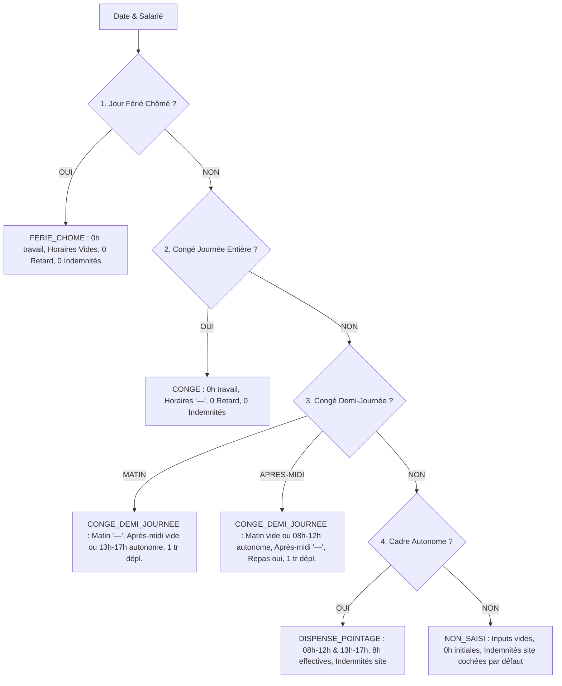
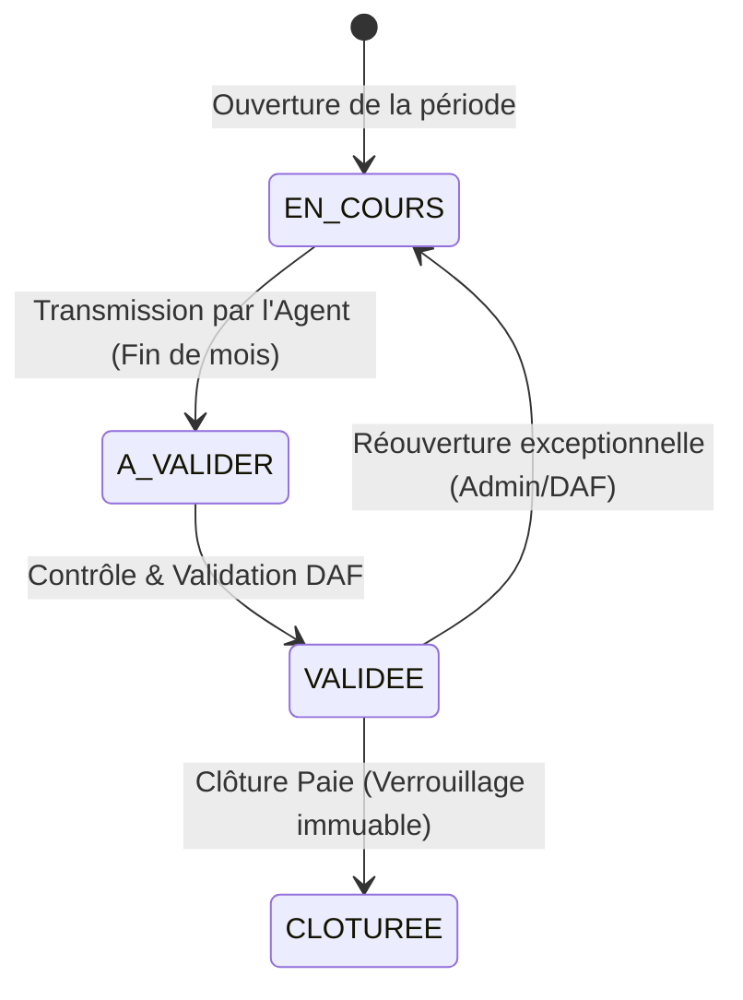

# Rapport de Conception & Logique Métier : Module Pointage & Présence (SIRH GALAXAM)

---

## 1. Objectifs & Périmètre du Module

Le module **Pointage & Présence** a pour objectif de collecter l'activité journalière des salariés, de qualifier leur statut de présence, de calculer les majorations/heures supplémentaires/heures de nuit, et d'attribuer les indemnités associées pour alimenter de façon infaillible le calcul de la paie mensuelle.

---

## 2. Typologie des Salariés & Régimes de Présence

| Profil Salarié | Régime de Pointage | Horaires par Défaut | Heures Supplémentaires (HS) | Suivi des Retards |
| :--- | :--- | :--- | :--- | :--- |
| **Non-Cadre (Standard)** | Pointage 4 bornes journalières | **Inputs VIDES** (à saisir quotidiennement) | **OUI** (+30% sur les 8 premières HS hebdo, +50% au-delà) | **OUI** (Tolérance 0 min par défaut, paramétrable par site) |
| **Cadre Autonome (`dispense_pointage = true`)** | Forfait 8h / jour ouvré | **08:00 - 12:00 & 13:00 - 17:00** (8.0h pré-saisi) | **NON** (Forfait contractuel, pas de calcul HS) | **NON** (Pas de pénalité de retard) |

---

## 3. Matrice de Priorité Logique Journalière

Lors de l'ouverture ou du calcul d'une journée de pointage, l'ordre d'évaluation est **strict et descendant** :

---

## 4. Règles de Gestion Métier Détaillées (RG-PTG)

### RG-PTG-01 : Calcul du Temps de Travail Effectif
- **Heures travaillées** = `(Sortie Matin - Entrée Matin) + (Sortie Soir - Retour Pause)`.
- **Déduction automatique de pause** : Si seule l'entrée matin ($E_M$) et la sortie soir ($S_A$) sont saisies, le système déduit la pause paramétrée du site (1h en horaire continu, 2h en horaire standard).
- **Les congés ne sont JAMAIS additionnés au temps de travail effectif** : Un congé demi-journée donne 0h de travail effectif pour la demi-journée chômée.

### RG-PTG-02 : Tolérance & Calcul des Retards
- **Règle de base** : 0 minute de tolérance (tout retard dès la 1ère minute est comptabilisé).
- **Retard cumulé** = `Retard Entrée Matin + Retard Retour Pause`.
- Les retards constatés sont compensés à hauteur de 1:1 par les excédents d'heures réalisés dans la même semaine civile avant d'appliquer une retenue.

### RG-PTG-03 : Heures de Nuit
- Toute heure travaillée entre **22h00 et 05h00** donne droit à une majoration légale de **+30%**.
- La détection s'effectue strictement sur des horaires réels valides (jamais sur des tirets de congé ou des champs vides).

### RG-PTG-04 : Indemnités de Déplacement (Fractionnement Journalier)
- Déplacement paramétrable par site avec dérogations individuelles possibles.
- **Fractionnement en 2 trajets** :
  - Trajet Aller (Matin) : $0.5$ jour
  - Trajet Retour (Soir) : $0.5$ jour
- Total journalier = $0$ trajet ($0\text{ Ar}$), $1$ trajet ($0.5\text{j}$), ou $2$ trajets ($1\text{j}$ complet).

### RG-PTG-05 : Indemnités de Repas & Repas de Soirée
- **Repas de midi** : Montant unitaire (ex: $2\ 000\text{ Ar}$) accordé si présence effective sur le créneau du déjeuner.
- **2ème Repas (Soirée)** :
  - Sortie entre **19h30 et 21h00** : $+1$ repas standard ($+2\ 000\text{ Ar}$).
  - Sortie après **21h00** : $+1$ repas majoré ($+4\ 000\text{ Ar}$).

### RG-PTG-06 : Indemnités Dynamiques de Site
Chaque site peut configurer des indemnités complémentaires (`site_indemnite_config`) selon 3 modes :
1. **`JOURNALIER`** : Montant unitaire alloué par jour travaillé coché.
2. **`MENSUEL_PRORATISE`** : Montant mensuel de référence proratisé selon le nombre de jours ouvrables travaillés ($\text{Montant / 22j} \times \text{Présences}$).
3. **`FIXE_MENSUEL`** : Montant fixe versé en paie sans déduction de présence.

### RG-PTG-07 : Majorations Hebdomadaires & Jours Fériés
- **Semaine légale** : Base de 40h / semaine (ou seuil proratisé si semaine partielle/férié).
- **HS 30%** : 8 premières heures au-delà du seuil hebdo.
- **HS 50%** : Heures au-delà des 8 premières HS.
- **Férié travaillé / Dimanche** : Majoration à **+100%**.

---

## 5. Cycle de Vie & Workflow du Pointage

1. **`EN_COURS` (Saisie Active)** :
   - L'agent de pointage saisit et enregistre quotidiennement les pointages sur le site.
   - Les modifications sont libres et sauvegardées par lot.
2. **`A_VALIDER` (Contrôle DAF)** :
   - L'agent transmet la période à la fin du mois via le bouton dédié en bas de page.
   - La saisie quotidienne est verrouillée pour l'agent. La DAF vérifie les anomalies et la synthèse hebdo/mensuelle.
3. **`VALIDEE` / `CLOTUREE` (Scellé Paie)** :
   - Les heures, retards nets et indemnités sont figés et injectés dans le bulletin de paie.

---

## 6. Plan de Reset Propre & Recommencement

### Ce qui est conservé intact :
- Tables de configuration et référentiels (`ref_statut_pointage_jour`, `ref_statut_periode_paie`, `ref_indemnite`, `site_indemnite_config`, `ref_calendrier_ferie`, `tolerance_retard_site`).
- Architecture de base de données validée et tables d'affectation/carrière/salariés.

### Ce qui va être réinitialisé et recréé proprement :
- **Backend** : Contrôleurs et services de saisie, anomalies et synthèse nettoyés de toute redondance ou artefact de calcul.
- **Frontend** : Pages `SaisieQuotidiennePage`, `AnomaliesPointagePage`, `SynthesePointagePage` recréées avec une structure limpide, aérée, sans aucun emoji, sans calculs parasites et avec une ergonomie directe.
