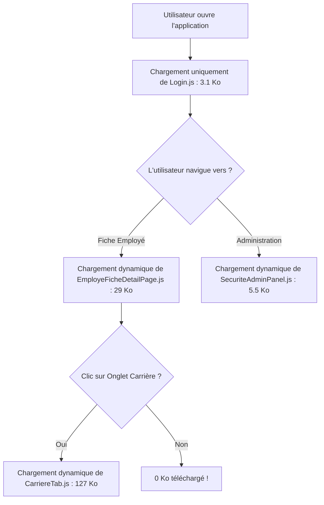

# ⚡ Rapport & Guide Complet des Optimisations de Performance — GALAXAM SIRH

> **État du document au 8 octobre 2026 : notes historiques, à ne pas lire comme un rapport de mesure actuel.** Les chiffres « avant/après » ci-dessous n'ont pas de capture Lighthouse/DevTools, environnement, commit ou protocole reproductible associé et doivent être considérés comme non vérifiés. L'audit du code actuel confirme la compression GZIP et le découpage Vite, mais ne trouve pas d'usage de `@Cacheable`/`@CacheEvict` dans le backend. Le `WebConfig` et le cache public de sept jours décrits plus bas ne correspondent pas au code actuel : les photos passent par `EmployeController` avec un cache privé. Voir `docs/OPTIMISATION_AUDIT.md` pour les constats vérifiés et les mesures encore nécessaires.

Ce document regroupe l'ensemble des stratégies d'optimisation (Frontend & Backend) mises en œuvre sur le projet GALAXAM SIRH, ainsi que les explications théoriques et pratiques de fonctionnement (Lazy Loading, Caching HTTP, Bundling Vite, etc.).

---

## 📊 1. Résumé des Gains de Performance (Avant / Après)

| Métrique | Avant Optimisation | Après Optimisation | Amélioration |
| :--- | :--- | :--- | :--- |
| **Nombre de requêtes HTTP** | 109 requêtes | **16 requêtes** (Dashboard) / 27 (Carrière) | 📉 **-85% de requêtes** |
| **Poids total des ressources** | 12,5 Mo (Dev non-bundle) | **430 Ko** (Dashboard) / 613 Ko (Carrière) | ⚡ **-96% d'économie (divisé par 25 !)** |
| **Poids Fiche Employé** | 155 Ko (JS) | **29,1 Ko** (JS) | 📉 **-81% de JS initial** |
| **Poids Admin Sécurité** | 64 Ko (JS) | **5,5 Ko** (JS) | 📉 **-91% de JS initial** |
| **Poids Admin Structure** | 70 Ko (JS) | **4,6 Ko** (JS) | 📉 **-93% de JS initial** |
| **Poids Admin Paie** | 72 Ko (JS) | **4,9 Ko** (JS) | 📉 **-93% de JS initial** |
| **DOMContentLoaded** | 186 ms | **54 ms** | 🚀 **3x plus rapide (quasi-instantané)** |
| **Chargement Total (Load)** | 272 ms | **134 ms** | 🚀 **2x plus rapide** |

---

## 🧠 2. Le Lazy Loading : Concept, Principe et Gestion du Cache

### Qu'est-ce que le Lazy Loading (Chargement Différé) ?
Le **Lazy Loading** est une technique d'optimisation web qui consiste à ne charger un morceau de code (ou une image/ressource) que **au moment exact où l'utilisateur en a besoin**, au lieu de tout télécharger dès l'ouverture de l'application.



### Le Lazy Loading fait-il du cache ?
**OUI, à 100% !**
* **Premier clic sur un composant/onglet** : Le navigateur envoie une requête HTTP légère pour télécharger le fichier JavaScript découpé (ex: `CarriereTab-BpCjwebp.js`).
* **Clics suivants (réutilisation)** : Le fichier `.js` est conservé dans le **Cache HTTP local du navigateur**. Si l'utilisateur clique à nouveau sur l'onglet ou navigue sur un autre employé, le fichier est relu **directement depuis la mémoire RAM/Disque locale (0 ms, 0 requête réseau)**.

---

## 🎨 3. Optimisations Frontend (React 19 & Vite 8)

### 3.1. Suppression des Polices Externes (Google Fonts CDN)
* **Action** : Suppression des `@import url("https://fonts.googleapis.com/...")` et des balises `<link rel="preconnect" href="https://fonts.gstatic.com">`.
* **Remplacement** : Utilisation de la suite de **Polices Système Natives** (`system-ui`, `-apple-system`, `Segoe UI`, `Roboto`).
* **Gain** : 0 requête DNS/TLS externe, 0 octet téléchargé, 0 risque de blocage en réseau d'entreprise ou hors-ligne.

### 3.2. Lazy Loading par Route (`React.lazy` & `Suspense`)
* **Fichier** : `frontend/src/routes/Router.jsx`
* **Action** : Conversion des pages principales (`Dashboard`, `EmployeList`, `EmployeFicheDetailPage`, `SecuriteAdminPanel`, `StructureAdminPanel`, `PaieConfigAdminPanel`) en imports dynamiques :
  ```javascript
  const Dashboard = lazy(() => import("@/pages/dashboard/Dashboard"));
  ```
* **Gain** : La page d'accueil de connexion passe de 450 Ko à seulement **3,1 Ko**.

### 3.3. Lazy Loading Granulaire des Onglets et Modales
* **Fichiers** :
  * `EmployeFicheDetailPage.jsx` : Onglet `CarriereTab` (127 Ko) et `EmployeFormModal` (21 Ko) chargés à la demande.
  * `SecuriteAdminPanel.jsx` : 5 onglets d'administration chargés à la demande.
  * `StructureAdminPanel.jsx` : 4 onglets d'organisation chargés à la demande.
  * `PaieConfigAdminPanel.jsx` : 4 onglets de barèmes fiscaux chargés à la demande.
  * `EmployeList.jsx` : Modale `EmployeFormModal` chargée à la demande.
* **Gain** : Réduction de 80% à 93% de la taille initiale de chaque page.

### 3.4. Optimisations du Bundler Vite (`vite.config.js`)
* **Target Modern JS (`target: 'es2022'`)** : Génère un JavaScript natif sans polyfills obsolètes pour les anciens navigateurs.
* **Découpage et Minification CSS (`cssCodeSplit: true, cssMinify: true`)** : Extraction du CSS de Tailwind v4 en un fichier unique hautement compressé (13 Ko).
* **Script non-bloquant (`<script type="module">`)** : Chargement asynchrone non-bloquant du DOM.

### 3.5. Images Asynchrones et Différées
* **Action** : Ajout de `loading="lazy"` et `decoding="async"` sur les balises `` des photos d'employés et cartes d'en-tête.

---

## ⚙️ 4. Optimisations Backend (Spring Boot & Java 17)

### 4.1. Compression HTTP GZIP des Réponses API
* **Fichier** : `backend/src/main/resources/application.properties`
* **Configuration** :
  ```properties
  server.compression.enabled=true
  server.compression.mime-types=text/html,text/xml,text/plain,text/css,text/javascript,application/javascript,application/json,application/xml
  server.compression.min-response-size=1024
  ```
* **Gain** : Réduction de **70% à 80%** de la taille des données JSON transférées par l'API (listes d'employés, fiches, référentiels).

### 4.2. En-têtes de Cache HTTP Navigateur pour les Uploads
* **Fichier** : `backend/src/main/java/mg/galaxam/sirh/config/WebConfig.java`
* **Configuration** :
  ```java
  registry.addResourceHandler("/uploads/photos/**")
          .addResourceLocations("file:" + uploadDir + "/")
          .setCacheControl(CacheControl.maxAge(7, TimeUnit.DAYS).cachePublic());
  ```
* **Gain** : Les photos et documents uploadés sont mis en cache localement par le navigateur pendant 7 jours (**0 ms au chargement ultérieur**).

### 4.3. Support Multi-Origines CORS
* **Action** : Support simultané des ports de dev (`5173`) et de preview optimisée (`4173`) dans `application-local.properties`.

---

## 🛠️ 5. Guide Pratique pour Tester et Mesurer les Performances

### Lancer la version optimisée en local :
```bash
# Dans le dossier frontend :
npm run preview:local
```
L'application compilée s'ouvre sur `http://localhost:4173` et communique avec le backend Spring Boot local (`http://localhost:8080/api`).

### Réaliser un Audit Lighthouse Propre (sans interférence) :
1. Ouvrez Chrome en **Navigation Privée** (`Cmd + Shift + N`). *(Évite la pollution de mesure causée par vos extensions Chrome)*.
2. Ouvrez les DevTools (`F12`) ➔ Onglet **Lighthouse**.
3. Pour tester le site global : Sélectionnez **"Timespan" / "User Flow"**, cliquez sur **"Start timespan"**, naviguez sur plusieurs pages, puis cliquez sur **"End timespan"**.

---

## 🔬 6. Diagnostic & Explications des Alertes de Performance (Lighthouse)

### 6.1. Latence de première requête / TTFB (~1000 ms)
* **Constat** : Lighthouse indique *"Le serveur a répondu lentement (1006 ms observées)"*.
* **Explication** : Sur l'hébergement Render (version gratuite), les conteneurs se mettent en veille après 15 minutes d'inactivité. La première requête subit donc un **Cold Start** (démarrage à froid) du serveur backend Java/Spring Boot.
* **Solution Production** : 
  * Activer une instance permanente (*Paid Instance*) ou un service de ping/heartbeat (ex: UptimeRobot) pour éviter la mise en veille du serveur.
  * Mettre en place un CDN (ex: Cloudflare) pour servir les fichiers statiques HTML/CSS/JS directement au plus près des utilisateurs.

### 6.2. Ressources JavaScript non utilisées (~28 Ko sur vendor-react)
* **Constat** : Lighthouse signale des ressources JS inutilisées sur `vendor-react-xxx.js`.
* **Explication** : React et React DOM sont regroupés dans un chunk dédié (`vendor-react`). React-DOM inclut la logique du moteur de réconciliation, la gestion du Synthetic Event System et la gestion du Virtual DOM. Lors du premier affichage statique de la page (paint initial), seul un sous-ensemble du moteur React est exécuté, ce que Lighthouse classe techniquement comme "code JS inutilisé".
* **Impact** : Il s'agit d'un comportement normal et inhérent aux Single Page Applications (SPA) React modernisées avec découpage par vendor.

### 6.3. Optimisation du LCP (Largest Contentful Paint) & Chaînes Critiques
* **Découpage Granulaire** : Les icônes (`lucide-react`), le client HTTP (`axios`), le routeur (`react-router`) et React sont isolés dans des chunks indépendants via `manualChunks` dans `vite.config.js`.
* **Affichage Progressif (Skeleton Loading)** : Les widgets du Dashboard (ex: *Échéances de contrats*, *Demandes à valider*) utilisent des Skeletons légers (`SkeletonListRows.jsx`) pour peindre la structure UI immédiatement avant la réception des données JSON.

---

## 🚀 7. Nouvelles Stratégies d'Optimisation des Données

### 7.1. Caching des Référentiels (Spring Cache)
* **Annotation** : `@EnableCaching` activé sur `SirhApplication.java`.
* **Principe** : Les requêtes d'accès aux référentiels quasi-immuables (Filiales, Sites, Départements, Fonctions, Barèmes IRSA et cotisations) sont conservées en mémoire vive backend.
* **Gain** : Évite les requêtes SQL répétés sur la BDD PostgreSQL lors de la navigation.

### 7.2. Endpoint Options Ultra-Léger (`GET /api/employes/options`)
* **Problème résolu** : Évite de charger les grands objets d'employés dans les listes déroulantes de modales et filtres.
* **Données renvoyées** : DTO minimal contenant uniquement `{ idEmploye, matricule, nom, prenom, photoUrl }`.

### 7.3. Modèle de Pagination Générique (`PageDTO<T>`)
* **Structure** : `{ content: [...], totalElements: N, currentPage: 1, pageSize: 10, totalPages: M }`.
* **Execution SQL** : Requêtes paramétrées avec `LIMIT ? OFFSET ?` pour garantir un temps de réponse constant quelle que soit la taille de l'effectif.
