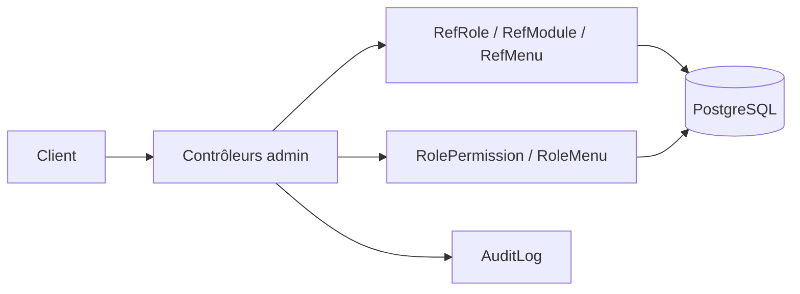

# Admin — guide technique

Ce module gère modules, rôles, menus et leurs affectations. Les transactions et validations sont dans les contrôleurs ; aucun dossier `application/` ou `domain/` n'existe ici.

## Fichiers et méthodes

| Fichier | Méthodes à lire | Usage et importance |
| --- | --- | --- |
| [`RoleController`](api/RoleController.java) | `getAllRoles`, `getRoleById`, `createRole`, `updateRole`, `deactivateRole`, `activateRole` | **Critique** — cycle de vie des rôles, `/referentiel/roles`. |
| [`RoleController`](api/RoleController.java) | `getRolePermissions`, `updateRolePermissions`, `getRoleMenus`, `updateRoleMenus` | **Critique** — lit ou remplace permissions et menus d'un rôle (`/{id}/permissions`, `/{id}/menus`) dans une transaction. |
| [`ModuleController`](api/ModuleController.java) | `getAllModules`, `getModuleById`, `createModule`, `updateModule`, `deactivateModule`, `activateModule` | **Structurant** — catalogue des modules, `/referentiel/modules`. |
| [`MenuController`](api/MenuController.java) | `getAllMenusTree`, `getAllMenusFlat`, `getMenuById`, `createMenu`, `updateMenu`, `deleteMenu`, `buildMenuTree` | **Structurant** — catalogue et arborescence des menus, `/referentiel/menus`. `buildMenuTree` construit la vue imbriquée. |
| [`DesktopBackupAuthorizationController`](api/DesktopBackupAuthorizationController.java) | `authorize` | **Critique** — autorisation de sauvegarde desktop, `/admin/desktop-backup/authorize`. |
| [`DesktopServiceControlController`](api/DesktopServiceControlController.java) | `shutdown` | **Critique** — arrêt du service desktop, `/desktop/internal/shutdown`. |
| [`RefRole`](persistence/RefRole.java), [`RefModule`](persistence/RefModule.java), [`RefMenu`](persistence/RefMenu.java) | `controler`, `inserer`, `modifier`, `supprimer`, `rechercherParId`, `lister`, `rechercherParCode` ou `rechercherParIdMenu` | **Critique** — modèles Active Record et SQL des catalogues ; `RefMenu.rechercherParRole` lit les menus attribués. |
| [`RolePermission`](persistence/RolePermission.java), [`RoleMenu`](persistence/RoleMenu.java) | `inserer`, `modifier`, `supprimer`, `rechercherParId`, `rechercherParRole` ou `listerParRole`, `supprimerParRole` | **Critique** — liaisons rôle-module et rôle-menu ; `supprimerParRole` précède le remplacement complet. |

## DTO et contrat

| Fichier | Usage |
| --- | --- |
| [`RoleRequest`](api/dto/RoleRequest.java) | Code et libellé d'un rôle. |
| [`ModuleRequest`](api/dto/ModuleRequest.java) | Code et libellé d'un module. |
| [`MenuRequest`](api/dto/MenuRequest.java) | Identifiant, libellé, icône, lien, rang et parent d'un menu. |
| [`RolePermissionsRequest`](api/dto/RolePermissionsRequest.java) | Liste des permissions à affecter au rôle. |
| [`PermissionUpdateRequest`](api/dto/PermissionUpdateRequest.java) | Module et droits lecture, écriture, validation. |
| [`RoleMenusRequest`](api/dto/RoleMenusRequest.java) | Liste des identifiants de menus à affecter au rôle. |

Les lectures des catalogues exigent une authentification ; les écritures exigent `ROLE_ADMIN` via `@PreAuthorize`. Le context-path `/api` s'ajoute aux routes. `/admin/desktop-backup/authorize` relève de la règle globale `ADMIN_ENDPOINTS` de `SecurityConfig` et retourne 204 pour une session admin admise. `/desktop/internal/shutdown` est permis par la chaîne HTTP globale, mais seulement sous le profil `desktop` et avec un jeton d'au moins 32 octets vérifié par le contrôleur. Les écritures de catalogue associent JDBC et `AuditLog.audit` dans la transaction. Pour suivre une permission effective : `RoleController.updateRolePermissions` → `RolePermission` → chargement des autorités dans `securite/`.
