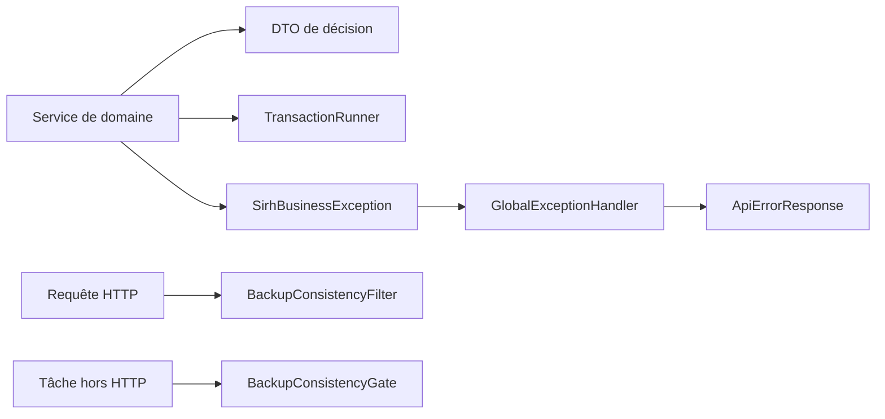

# Code commun du backend



## Inventaire des fichiers

| Fichier | Méthodes ou données à connaître | Importance |
| --- | --- | --- |
| [`BackupConsistencyFilter`](backup/BackupConsistencyFilter.java) | `doFilterInternal` prend un verrou partagé PostgreSQL pendant toute la requête HTTP et limite les requêtes admises. | **Critique** — cohérence des sauvegardes. |
| [`BackupConsistencyGate`](backup/BackupConsistencyGate.java) | `withWriteAccess(Callable)` et `withWriteAccess(CheckedRunnable)` encadrent les écritures hors filtre HTTP avec le même verrou ; `LOCK_NAMESPACE` et `LOCK_ID` identifient ce verrou. | **Critique** — coordination des écritures hors HTTP. |
| [`TransactionRunner`](transaction/TransactionRunner.java) | `required(Work)` ouvre une connexion, exécute le travail, valide ou annule ; `Work.execute` reçoit cette connexion. | **Critique** — atomicité des écritures JDBC qui l'utilisent. |
| [`SirhErrorCode`](exception/SirhErrorCode.java) | `getHttpStatus`, `getDefaultMessage` ; catalogue des codes d'erreur partagés. | **Critique** — contrat HTTP d'erreur. |
| [`SirhBusinessException`](exception/SirhBusinessException.java) | Constructeurs et `getErrorCode`, `getHttpStatus`, `getDetails`, `getIssues` transportent l'échec métier. | **Critique** — déclenche le rollback lorsqu'elle se propage. |
| [`SirhExceptionTranslator`](exception/SirhExceptionTranslator.java) | `propagate` préserve les exceptions runtime et traduit les exceptions contrôlées. | **Structurant** — propagation vers la frontière HTTP. |
| [`ApiErrorResponse`](dto/ApiErrorResponse.java) | Constructeurs et accesseurs des champs `status`, `code`, `message`, `details`, `issues`, etc. | **Structurant** — forme JSON des erreurs. |
| [`BusinessIssue`](dto/BusinessIssue.java) | Record `code`, `message`, `details`. | **Support** — détail d'un champ ou prérequis. |
| [`BusinessDecision`](dto/BusinessDecision.java) | Record de décision : état, résultat, règles examinées, blocages, avertissements, `availableActions`, version. | **Structurant** — transporte une décision prise par un domaine. |
| [`DecisionStatus`](dto/DecisionStatus.java) | Valeurs du résultat d'une décision. | **Support** — vocabulaire partagé. |
| [`RuleResult`](dto/RuleResult.java) | Record de résultat d'une règle ; `pass(code)` crée un succès simple. | **Support** — diagnostic d'une évaluation. |
| [`ActionCapability`](dto/ActionCapability.java) | Record `allowed`/`reasonCodes` ; `permit()` et `denied(reasonCode)`. | **Structurant** — capacité d'action renvoyée au client. |
| [`PageDTO`](dto/PageDTO.java) | Constructeurs et accesseurs de `content`, total et paramètres de page. | **Support** — réponse paginée. |
| [`FlexibleLocalDateDeserializer`](json/FlexibleLocalDateDeserializer.java) | `deserialize` accepte date ISO simple ou date-heure ISO et retourne `LocalDate`. | **Support** — compatibilité des entrées JSON. |

`common/` fournit des mécanismes et formes de données. Il ne décide ni des soldes, ni des droits, ni des transitions propres à un domaine. Les accesseurs et constructeurs des DTO transportent les valeurs ; ils n'appliquent pas de règle métier.

Ce dossier contient des outils partagés entre les domaines RH. Il ne porte pas
les règles propres aux congés, au pointage ou à la paie.

| Dossier | Rôle |
| --- | --- |
| `exception/` | Nommer et transporter les erreurs métier. |
| `transaction/` | Encadrer les écritures JDBC avec `commit` ou `rollback`. |
| `dto/` | Définir la forme de certaines données échangées par l'API. DTO signifie *Data Transfer Object* : objet de transfert de données. |
| `json/` | Adapter la lecture de certaines données JSON. |
| `backup/` | Contrôles communs liés aux sauvegardes. |

## Une erreur métier, de sa détection à la réponse HTTP

1. Le code métier détecte une règle non satisfaite et lève une
   `SirhBusinessException` avec un `SirhErrorCode`. Le code d'erreur fixe le
   statut HTTP et un message par défaut ; un message précis peut le remplacer.
2. Si l'opération s'exécute dans `TransactionRunner.required`, l'exception
   déclenche `rollback()` sur **la connexion JDBC reçue par le travail**. Les
   écritures faites avec une autre connexion ou déjà validées ne sont pas annulées.
3. `config/GlobalExceptionHandler.handleSirhBusiness` intercepte l'exception
   propagée et construit un `ApiErrorResponse`. Ce gestionnaire prépare la
   réponse HTTP : **il ne fait pas lui-même le rollback**.
4. React reçoit un statut HTTP et un objet JSON. `frontend/src/api/apiClient.js`
   peut lire notamment `code`, `message`, `details` et `issues`.

Exemple d'utilisation dans un service qui possède un `TransactionRunner` :

```java
return transactionRunner.required(connection -> {
    // Toutes les écritures de cette opération reçoivent cette connexion.
    if (soldeInsuffisant(connection)) {
        throw new SirhBusinessException(
                SirhErrorCode.CONGE_SOLDE_INSUFFISANT,
                "Le solde disponible ne couvre pas cette demande.");
    }
    return enregistrerDemande(connection);
});
```

Une réponse produite par `GlobalExceptionHandler` a cette forme ; les valeurs
ci-dessous sont illustratives :

```json
{
  "timestamp": "2026-11-11T10:00:00",
  "status": 400,
  "error": "Bad Request",
  "message": "Le solde disponible ne couvre pas cette demande.",
  "path": "/conges/demandes",
  "code": "CONGE_SOLDE_INSUFFISANT",
  "details": {},
  "issues": []
}
```

### Quel objet choisir ?

| Classe | Question à laquelle elle répond |
| --- | --- |
| `SirhErrorCode` | « Quel type d'erreur est-ce, et quel statut HTTP lui correspond ? » |
| `SirhBusinessException` | « Quelle erreur vient d'être détectée ? » Elle peut transporter un message, des détails et des problèmes précis. |
| `ApiErrorResponse` | « Quel JSON d'erreur envoyer au client ? » Il est construit par `GlobalExceptionHandler`, pas normalement par le service métier. |
| `BusinessIssue` | « Quel champ ou prérequis précis pose problème ? » Un ou plusieurs éléments peuvent figurer dans `issues`. |

Le constructeur simple `new SirhBusinessException(code, message)` suffit pour
la plupart des règles. La variante avec `details` (`Map<String, Object>`) et
`issues` (`List<BusinessIssue>`) sert lorsque le client a besoin d'informations
structurées, par exemple le nom d'un champ invalide. Avec `@Valid`, Spring
détecte les champs incorrects avant le corps du contrôleur ; le gestionnaire
global crée alors des `BusinessIssue` portant `INVALID_FIELD`.

`GlobalExceptionHandler` traite aussi `IllegalArgumentException` en HTTP 400,
`IllegalStateException` en HTTP 409, les erreurs de validation `@Valid`, les
refus d'accès et des erreurs SQL. `SirhExceptionTranslator.propagate` conserve
les exceptions déjà de type `RuntimeException` ; il remplace une exception
contrôlée par `INTERNAL_ERROR`. Ce traducteur ne décide pas du rollback.

## Transactions JDBC : quand l'erreur annule-t-elle les écritures ?

`TransactionRunner.required` ouvre une connexion, désactive l'auto-commit,
exécute le travail, puis valide avec `commit()`. Si le travail lève une
`Exception`, il appelle `rollback()` et propage l'erreur. Certains contrôleurs
et services réalisent explicitement ces mêmes étapes avec `Connection`.

**À retenir :** retourner normalement une `ResponseEntity` d'erreur depuis un
travail transactionnel ne signale pas un échec à `TransactionRunner` : celui-ci
peut alors faire `commit()`. Une erreur qui doit annuler les écritures doit être
levée avant `commit()` et ne pas être avalée par un `catch` interne.

## DTO de décision : différents d'une exception

`BusinessDecision`, `DecisionStatus`, `RuleResult` et `ActionCapability` servent
à **décrire le résultat d'une évaluation métier** : action autorisée ou bloquée,
règles examinées, avertissements et actions disponibles. Un service peut les
renvoyer normalement, par exemple pour expliquer pourquoi une étape de workflow
est indisponible. Ce ne sont pas des exceptions et leur retour ne déclenche pas
de rollback. `BusinessIssue` peut aussi apparaître dans une telle décision.

`PageDTO<T>` sert à transporter une page de résultats (`content`, total,
numéro de page). Il ne concerne pas le traitement des erreurs.

## Où montrer le code ?

1. `exception/SirhErrorCode.java` : catalogue des codes et statuts.
2. `exception/SirhBusinessException.java` : exception levée par le métier.
3. `transaction/TransactionRunner.java` : `commit()` et `rollback()`.
4. `config/GlobalExceptionHandler.java` : transformation en réponse HTTP.
5. `dto/ApiErrorResponse.java` et `dto/BusinessIssue.java` : forme du JSON.
6. `dto/BusinessDecision.java` : exemple de DTO de résultat, distinct d'une erreur HTTP.
