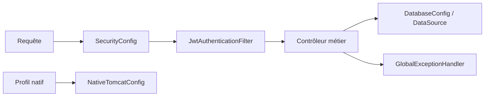

# Config — infrastructure Spring

Ce dossier assemble les services techniques. Il ne possède pas de règle RH.

| Fichier | Méthodes | Usage et importance |
| --- | --- | --- |
| [`DatabaseConfig`](DatabaseConfig.java) | `dataSource`, `normalizeJdbcUrl` | **Critique** — construit le pool Hikari ; lit la configuration Spring puis `SPRING_DATASOURCE_URL` ou `DATABASE_URL`, normalise l'URL PostgreSQL et les identifiants éventuels. |
| [`SecurityConfig`](SecurityConfig.java) | `validateCorsConfiguration`, `securityFilterChain`, `roleHierarchy`, `corsConfigurationSource`, `passwordEncoder`, `authenticationManager` | **Critique** — CORS, routes publiques et admin, JWT, session sans état, rôles, BCrypt et authentification. |
| [`GlobalExceptionHandler`](GlobalExceptionHandler.java) | `handleSirhBusiness`, `handleValidationException`, `handleSqlException`, `handleAccessDenied`, autres `handle*`, `problem` | **Critique** — transforme les exceptions en `ApiErrorResponse` ; `problem` centralise la forme HTTP. Les annotations `@ExceptionHandler` donnent la liste complète des erreurs couvertes. |
| [`NativeTomcatConfig`](NativeTomcatConfig.java) | `nativeTomcatServletWebServerFactory` | **Support** — configure Tomcat NIO2 quand `galaxam.native.nio2=true`. |

`GlobalExceptionHandler` expose aussi `handleIllegalArgument`, `handleIllegalState`, `handleDataIntegrity`, `handleMaxUploadSize`, `handleTypeMismatch`, `handleMessageNotReadable`, `handleMethodNotSupported` et `handleGenericException` : chaque méthode adapte le type d'échec correspondant au contrat d'erreur HTTP. `handleSqlException` délègue au traitement privé `pointagePeriodConstraint` pour une contrainte spécifique de période.

Une nouvelle erreur métier commence dans `SirhErrorCode`. Un changement de route publique ou admin touche `SecurityConfig` et les contrôleurs concernés. Les propriétés de profils sont dans `backend/src/main/resources/application*.properties`.

## Index des méthodes principales

| Méthode | Effet concret | Quand la consulter |
|---|---|---|
| `DatabaseConfig.dataSource` / `normalizeJdbcUrl` | Construisent le pool JDBC / convertissent une URL en format PostgreSQL utilisable. | La connexion au démarrage échoue. |
| `SecurityConfig.securityFilterChain` | Fixe les routes publiques, filtres JWT et règles HTTP globales. | Une route retourne 401 ou 403 avant le contrôleur. |
| `SecurityConfig.corsConfigurationSource` | Déclare les origines et méthodes admises par le navigateur. | Une requête est bloquée par CORS. |
| `SecurityConfig.roleHierarchy` | Déclare l'héritage des rôles utilisé par les contrôles d'accès. | Une autorité effective surprend. |
| `GlobalExceptionHandler.handleSirhBusiness` / `problem` | Convertissent une erreur métier en réponse HTTP JSON commune ; ne gèrent pas la transaction. | Le code ou message d'erreur client est incorrect. |
| `GlobalExceptionHandler.handleSqlException` | Traduit une erreur SQL reconnue, notamment une contrainte de période Pointage. | Une contrainte de base produit un mauvais statut HTTP. |
| `NativeTomcatConfig.nativeTomcatServletWebServerFactory` | Choisit Tomcat NIO2 sous le profil natif configuré. | Diagnostiquer le serveur HTTP en mode natif. |
