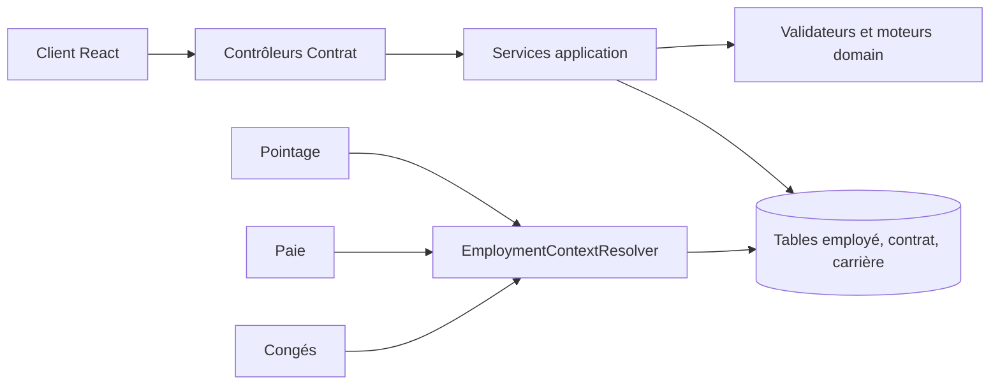

# Contrat et personnel — guide technique

Ce domaine possède le dossier employé, les contrats, les affectations, les workflows de carrière et les documents RH. Les autres domaines consomment son contexte d'emploi daté ; ils conservent leurs propres règles de pointage, congés et paie.

```text
contrat/
├── api/           Routes HTTP et dto/ des requêtes/réponses
├── application/   Cas d'usage, résolutions datées, exports et documents
├── domain/        Validations et calculs de carrière
└── persistence/   Modèles Active Record et SQL JDBC
```



## Parcours à suivre

| Besoin | Point d'entrée → cas d'usage → règle | Effet / importance |
| --- | --- | --- |
| Créer ou modifier un employé | `EmployeController.createEmploye` / `updateEmploye` → `EmployeService.creerEmploye` / `modifierEmploye` → `EmployeValidationEngine` | **Critique** — identité, données satellites et compte bancaire sous permissions distinctes. |
| Embauche et transition | `WorkflowRhController.creerBrouillonEmbauche` / `creerBrouillonTransition` → `WorkflowRhService` → `CarriereTransitionValidator`, `ContratValidationEngine` | **Critique** — brouillon, validation et application datée des changements. |
| Résoudre l'emploi à une date | Appel d'un domaine consommateur → `EmploymentContextResolver.resolveContext`, `resolveCoverage`, `resolvePointageDays`, `resolveSalaryByDay` | **Critique** — contrat, affectation, site et salaire applicables à la date demandée. |
| Produire un document | `DocumentRhController` → `DocumentRhService.preparer*` / `generer*Docx` | **Structurant** — données contrôlées et génération depuis les modèles DOCX. |
| Superviser les contrats | `ContratGlobalController` → requêtes de lecture / `CarriereExportService.exportContratsCsv` | **Support** — listes, alertes, statistiques et export. |

## Fichiers API

| Fichier | Méthodes et contrat |
| --- | --- |
| [`EmployeController`](api/EmployeController.java) | `getEmployes`, `getEmployeFicheDetail`, `getEmployeStats`, `getEmployeOptions`, `checkMatriculeExists`, `getNextMatricule` lisent le dossier ; `createEmploye`, `updateEmploye`, `desactiverEmploye`, `reactiverEmploye` le modifient ; `getComptesBancaires`/`updateCompteBancaire` appliquent les droits Paie ; `getPhoto*`/`uploadPhoto*` gèrent les photos. |
| [`ContratTravailController`](api/ContratTravailController.java) | `getContratsEmploye`, `getContratActif`, `getContrat`, `getEtatEssaiEmploye`, `getAffectationsEmploye`, `getAffectationActive`, `getAffectationParContrat` consultent ; `renseignerDateSignature`, `modifierBrouillonContrat` modifient un contrat existant. La création passe par le workflow. |
| [`WorkflowRhController`](api/WorkflowRhController.java) | `creerBrouillonEmbauche`, `creerBrouillonTransition`, `modifierBrouillonWorkflow`, `validerWorkflow`, `annulerWorkflow`, `annulerWorkflowPlanifie`, `confirmerEssaiDirectement` commandent la carrière ; `getWorkflow*` et `getStatutsWorkflows` consultent ; `forcerRattrapage` déclenche la reprise. |
| [`DocumentRhController`](api/DocumentRhController.java) | `getDocumentsByEmploye`, `uploadDocument`, `downloadDocument`, `deleteDocument` gèrent les pièces ; `getContratData`, `getAttestationData`, `getCertificatData` et `download*Docx` produisent les documents. |
| [`RefCarriereController`](api/RefCarriereController.java) | `getAllReferentielsCarriere` et `get*` lisent les référentiels ; `createCategoriePro`, `updateCategoriePro`, `createTypeDocument`, `updateTypeDocument`, `deleteTypeDocument` les administrent. |
| [`ContratGlobalController`](api/ContratGlobalController.java) | `getFiltresContrats`, `getContratsGlobal`, `getStatsSupervision`, `getAlertesPrioritaires`, `exportContratsCsv` servent la supervision. |

## Fichiers application et domain

| Fichier | Méthodes principales / responsabilité |
| --- | --- |
| [`EmployeService`](application/EmployeService.java) | `creerEmploye`, `modifierEmploye`, `desactiverEmploye`, `reactiverEmploye`, `modifierCompteBancaire` possèdent les écritures ; `getFicheDetail`, `getEmployes`, `getStats`, `getOptions`, `generateNextMatricule` servent les lectures et préparations. |
| [`WorkflowRhService`](application/WorkflowRhService.java) | `creerBrouillonEmbauche`, `creerBrouillonTransition`, `modifierBrouillonWorkflow`, `validerWorkflow`, `annulerWorkflow`, `annulerWorkflowPlanifie`, `confirmerEssaiDirectement`, `autoAppliquerMouvementsEchus` orchestrent les transitions et transactions. |
| [`EmploymentContextResolver`](application/EmploymentContextResolver.java) | `resolveContext`, `resolveCoverage`, `resolvePointageDays`, `resolveSitesByDay`, `resolveSalaryByDay`, `resolveContinuityDays`, `resolveLabels`, `listActiveEmploymentContexts` lisent l'emploi daté ; `resolveCurrent` seul utilise aujourd'hui par défaut. |
| [`EmployerIdentityContextResolver`](application/EmployerIdentityContextResolver.java) | `resolve` fournit l'identité employeur applicable au dossier et à la période. |
| [`DocumentRhService`](application/DocumentRhService.java) | `preparerContrat`, `preparerAttestation`, `preparerCertificat`, `genererContratDocx`, `genererAttestationDocx`, `genererCertificatDocx`, `validerLiaisonsDocument` préparent et génèrent les fichiers. |
| [`CarriereExportService`](application/CarriereExportService.java) | `exportContratsCsv` sérialise la liste de supervision. |
| [`EmployeValidationEngine`](domain/EmployeValidationEngine.java) | `validerEmploye`, `validerAgeLegal`, `validerCinFormatEtDate`, `validerCompteBancaire`, `validerDesactivation` contrôlent les invariants du dossier. |
| [`ContratValidationEngine`](domain/ContratValidationEngine.java) | `validerDatesContrat` contrôle la chronologie contractuelle. |
| [`CarriereTransitionValidator`](domain/CarriereTransitionValidator.java) | `validerTransition`, `validerDureeContratCDD`, `validerMotifCDD`, `trouverCddReembaucheMemePoste` contrôlent l'admissibilité des mouvements. |
| [`AncienneteEngine`](domain/AncienneteEngine.java) | `evaluerAnciennete`, `calculerAnciennete`, `calculerAncienneteEmploye`, `calculerAncienneteBatch`, `formaterAncienneteTexte` reconstituent l'ancienneté. |
| [`MatriculeGeneratorEngine`](domain/MatriculeGeneratorEngine.java) | `genererMatriculeSequentiel`, `genererMatriculeParDefaut` construisent les matricules ; l'unicité concurrente dépend aussi de la transaction et de SQL. |
| [`EmploymentContext`](domain/EmploymentContext.java) | Données d'emploi résolues ; `estActifAPaie`, `estSoumisPointage` donnent les indicateurs consommés par les autres domaines. |

## Contrats HTTP et persistance

Les DTO de `api/dto/` sont : `EmployeRequest` (écriture du dossier), `ContratTravailGlobalDTO` (vue globale), `EmployeFicheDetailDTO` (vue détaillée), `DocumentRhDTO` (pièce), `TransitionCarriereRequest` (commande de transition), `ContratModificationRequest` (brouillon), `DateSignatureRequest` (signature) et `EtatEssaiDTO` (état d'essai fourni au frontend). Les trois derniers sont des classes autonomes extraites du contrôleur ; leur JSON reste identique.

| Fichier de `persistence/` | Usage |
| --- | --- |
| [`Employe`](persistence/Employe.java), [`EmployeCPL`](persistence/EmployeCPL.java) | Compte principal et vue détaillée de l'employé. |
| [`EmployeCompteBanque`](persistence/EmployeCompteBanque.java) | Coordonnées bancaires. |
| [`EmployeConjoint`](persistence/EmployeConjoint.java), [`EmployeEnfant`](persistence/EmployeEnfant.java), [`EmployeContactUrgence`](persistence/EmployeContactUrgence.java) | Données familiales et contacts satellites. |
| [`ContratTravail`](persistence/ContratTravail.java), [`EmployeAffectationCarriere`](persistence/EmployeAffectationCarriere.java) | Contrat et affectation datée ; sources du contexte d'emploi. |
| [`WorkflowRh`](persistence/WorkflowRh.java), [`WorkflowRhCPL`](persistence/WorkflowRhCPL.java) | Mouvement RH et vue enrichie. |
| [`DocumentRh`](persistence/DocumentRh.java), [`DocumentRhCPL`](persistence/DocumentRhCPL.java) | Pièce RH et vue enrichie. |
| [`RefCategorieProfessionnelle`](persistence/RefCategorieProfessionnelle.java), [`RefModeCalculPaie`](persistence/RefModeCalculPaie.java) | Catégorie professionnelle et mode de paie. |
| [`RefMotifMouvement`](persistence/RefMotifMouvement.java), [`RefMotifSortie`](persistence/RefMotifSortie.java) | Motifs des transitions et sorties. |
| [`RefTypeDocument`](persistence/RefTypeDocument.java), [`RefTypeEvenementRh`](persistence/RefTypeEvenementRh.java) | Types de pièces et d'événements RH. |

Ces classes exécutent le SQL Active Record : `controler`, `inserer`, `modifier`, `rechercherParId`, méthodes de liste et de recherche selon le modèle. Leurs accesseurs ne sont pas des règles métier ; les cas d'usage se trouvent dans `application/` et les invariants dans `domain/`.

Les routes `/employes/*`, `/contrats/*`, `/documents/*`, `/ref-carriere/*` et `/ref-types-documents/*` exigent une authentification. Les contrôleurs appliquent `EMPLOYE_READ`, `EMPLOYE_WRITE`, `EMPLOYE_VALIDATE`, `PAIE_READ`, `PAIE_WRITE` ou `ROLE_ADMIN` selon l'opération. La lecture des données bancaires et des contrats générés est plus restrictive que la fiche générale ; vérifier l'annotation de la méthode avant de changer une route. Les clés composées `(id_contrat, id_employe)` et `(id_service, id_departement)` protègent les affectations en base.

## Index des méthodes principales

| Méthode | Effet concret | Quand la consulter |
|---|---|---|
| `EmployeService.creerEmploye` / `modifierEmploye` | Valident puis écrivent le dossier employé et ses données associées. | Modifier l'identité ou les informations satellites. |
| `WorkflowRhService.creerBrouillonTransition` | Prépare un mouvement de carrière sans l'appliquer immédiatement. | Comprendre la différence entre saisie et effet du changement. |
| `WorkflowRhService.validerWorkflow` | Valide une transition et applique ou planifie ses effets selon sa date. | Une affectation ou un contrat ne change pas après approbation. |
| `WorkflowRhService.autoAppliquerMouvementsEchus` | Applique les mouvements planifiés devenus effectifs. | Rechercher pourquoi un changement daté n'est pas encore visible. |
| `EmploymentContextResolver.resolveContext` / `resolvePointageDays` | Retrouvent contrat, affectation et site applicables à une date / à une série de jours. | Pointage, Congés ou Paie voient un mauvais contexte d'emploi. |
| `EmploymentContextResolver.resolveCurrent` | Résout le contexte pour aujourd'hui ; ne convient pas à une situation historique. | Vérifier un affichage courant. |
| `DocumentRhService.preparerContrat` / `genererContratDocx` | Rassemblent les données contrôlées / produisent le fichier DOCX. | Un champ de contrat généré est faux ou absent. |
| `EmployeValidationEngine.validerEmploye` / `CarriereTransitionValidator.validerTransition` | Vérifient les invariants du dossier / l'admissibilité d'un mouvement. | Une commande est refusée pour une raison métier. |

## Vérifier un changement

- Employé et satellites : `EmployeSatelliteLifecycleTest`, `EmployeConjointLifecycleTest`, `EmployeCompteBanqueLifecycleTest`, `EmployeServiceSatelliteNullTest`.
- Matricule et contrat : `EmployeMatriculeConcurrencyPostgresTest`, `ContratTravailControllerPostgresTest`.
- Autorisations bancaires : `EmployeBankAccessTest`.
- Règles pures : `CarriereTransitionValidatorCddTest`, `EmployeValidationEngineSatelliteTest`.

Les tests PostgreSQL demandent leur base isolée et peuvent être ignorés sans elle. Pour un changement de contrat HTTP, exécuter aussi `npm run test:api` et `npm run build` depuis `frontend/`. Les règles métier détaillées figurent dans [le Boky Employé et Carrière](../../../../../../../docs/boky/module-employe-carriere.md).
