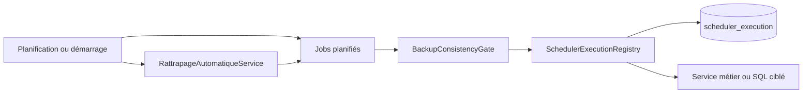

# Cron — traitements planifiés

Ce dossier coordonne les tâches serveur. Il ne possède pas les règles RH, Congés ou Sécurité exécutées par ces tâches. Tous les horaires ci-dessous utilisent `Indian/Antananarivo`.

```text
cron/
├── execution/   Registre d'exécution, baux et rattrapage
└── jobs/        Points d'entrée planifiés par traitement
```



## Fichiers et méthodes

| Fichier | Entrées et usage | Importance |
| --- | --- | --- |
| [`SchedulerExecutionRegistry`](execution/SchedulerExecutionRegistry.java) | `runDaily`, `runMonthly`, `run`, `runIfNotCompleted`, `runDailyCatchUp` réservent une exécution par code/date ; `isCompleted`, `findIncompletePeriods`, `firstRecordedPeriod`, `hasMoreIncompletePeriods` guident le rattrapage. `tryStart`, `renewLease`, `updateResult` gèrent le bail et le résultat en base. | **Critique** — déduplication et coordination entre instances. |
| [`RattrapageAutomatiqueService`](execution/RattrapageAutomatiqueService.java) | `auDemarrage`, `battementCoeurPeriodique` (15 min), `verifierEtExecuterRattrapageAsync`, `verifierEtExecuterRattrapage` lancent les tâches échues ; `getDernierRattrapageJournalier` expose la date locale suivie. | **Critique** — reprise après arrêt ou veille. |
| [`MouvementRhScheduler`](jobs/MouvementRhScheduler.java) | `effectuerBasculementMouvementsPlanifies` à 00:10 ; `rattraperMouvements` relance une date manquée ; méthode interne applique les mouvements RH échus. | **Critique** — état effectif des carrières. |
| [`AcquisitionCongeScheduler`](jobs/AcquisitionCongeScheduler.java) | `bonifierCongesAnciennete` le 1er à 01:00 ; `rattraperBonificationMensuelle` retrouve les mois absents ; `executer` appelle le domaine Congés. | **Critique** — droits de congé liés à l'ancienneté. |
| [`NotificationRhScheduler`](jobs/NotificationRhScheduler.java) | `genererNotificationsRh` à 02:30 ; `rattraperNotifications`; méthodes `genererAlerte*` et `genererAlertes*` produisent contrats, essais, congés, pièces, pointage ; `purguerAnciennesNotifications` nettoie les traces. | **Structurant** — alertes RH persistées. |
| [`SessionSecurityScheduler`](jobs/SessionSecurityScheduler.java) | `nettoyerSecurite` à 03:30 et `rattraperSecurite` nettoient les sessions et refresh tokens expirés. | **Critique** — hygiène des sessions. |
| [`AuditLogPurgeScheduler`](jobs/AuditLogPurgeScheduler.java) | `purgerAnciensLogsAudit` le 1er à 04:00 et `rattraperPurgeMensuelle` appliquent la rétention des journaux d'audit. | **Critique** — rétention des données. |

## Invariants d'exécution

Chaque écriture planifiée passe par `BackupConsistencyGate` pour cohabiter avec les sauvegardes. `SchedulerExecutionRegistry` utilise `scheduler_execution` avec un jeton par tentative, un bail initial de 30 minutes et un renouvellement de 10 minutes, limité à 23 heures. Un worker qui perd le bail n'est pas interrompu automatiquement : les effets d'une tâche doivent tolérer une reprise ou un chevauchement. Le rattrapage n'est pas déclenché par le frontend ; son entrée HTTP éventuelle est un filet de sécurité asynchrone.

Pour modifier une tâche, vérifier sa clé d'exécution, ses effets transactionnels, son comportement en double exécution et son rattrapage. Les règles de calcul restent dans le domaine propriétaire ; les méthodes `@Scheduled` ne font que déclencher et coordonner.

## Index des méthodes principales

| Méthode | Effet concret | Quand la consulter |
|---|---|---|
| `SchedulerExecutionRegistry.runDaily` / `runMonthly` | Réservent une clé de traitement pour un jour ou un mois et exécutent le travail sous bail. | Une tâche ne part pas ou se déclenche deux fois. |
| `tryStart` / `renewLease` / `updateResult` | Acquièrent le bail, maintiennent sa possession et enregistrent l'issue. | Une tentative est reprise ou un ancien worker continue. |
| `findIncompletePeriods` / `runDailyCatchUp` | Repèrent puis rejouent les périodes manquées. | Après un arrêt ou une veille du serveur. |
| `RattrapageAutomatiqueService.auDemarrage` / `battementCoeurPeriodique` | Déclenchent la vérification des tâches échues au lancement puis périodiquement. | Le rattrapage ne se produit pas. |
| `AcquisitionCongeScheduler.bonifierCongesAnciennete` | Planifie la bonification ; le calcul et l'écriture métier appartiennent à Congés. | Diagnostiquer l'horaire ou l'appel vers Congés. |
| `NotificationRhScheduler.genererNotificationsRh` | Déclenche la création des alertes RH dues ; l'écriture commune est dans Dashboard. | Une alerte n'est pas apparue. |
