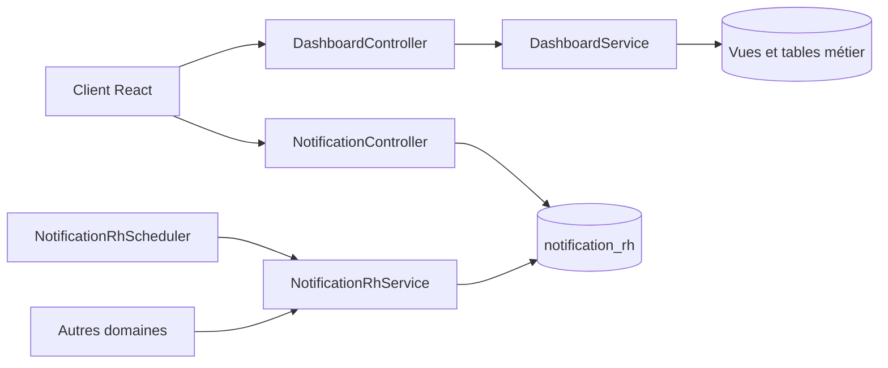

# Dashboard et notifications — guide technique

Ce module sert la synthèse RH et les notifications persistées. Le dashboard agrège des données détenues par Contrat, Congés, Pointage et Paie ; il ne doit pas recalculer leurs résultats officiels.

```text
dashboard/
├── api/           Routes HTTP de synthèse et de notifications
├── application/   Assemblage de la synthèse RH
└── persistence/   Écriture JDBC commune des notifications
```



## Fichiers et méthodes

| Fichier | Méthodes et usage | Importance |
| --- | --- | --- |
| [`DashboardController`](api/DashboardController.java) | `getDashboardSummary` expose `GET /dashboard/summary` et délègue au service. | **Structurant** — contrat de la page d'accueil. |
| [`DashboardService`](application/DashboardService.java) | `getDashboardSummary` assemble la réponse ; `buildKpis`, `buildActionsATraiter`, `buildDemandesCongeAValider`, `buildAbsentsAujourdhui`, `buildCongesQuinzaine`, `buildAlertesCritiques`, `buildAlertes7j`, `buildAlertes30j`, `buildBrouillons`, `buildActiviteRecente` construisent les blocs. `ActiviteStatut.from` choisit le libellé/badge de présentation. | **Structurant** — agrégation en lecture des données métier. |
| [`NotificationController`](api/NotificationController.java) | `getNotifications` liste 50 non lues ; `marquerToutesLues`, `marquerUne`, `purgerToutes` changent l'état visible. `visibilityCondition` et `bindVisibility` imposent le filtre utilisateur/rôle ; `getCurrentUserId` et `getCurrentUserRoleCode` résolvent le destinataire. | **Critique** — confidentialité et modifications des notifications. |
| [`NotificationRhService`](persistence/NotificationRhService.java) | Surcharges `creer` et `creerPourRole` insèrent une notification avec utilisateur ou rôle cible sur la connexion fournie par l'appelant. | **Structurant** — écriture partagée par Cron et les domaines RH. |

## Contrats et limites actuelles

`GET /dashboard/summary` exige `EMPLOYE_READ` ou `ROLE_ADMIN`. Les routes `/notifications` exigent une authentification ; le contrôleur filtre les lignes par destinataire ou rôle. Le préfixe `/api` vient du context-path. Le frontend appelle ces routes dans `frontend/src/features/dashboard/api/dashboardService.js`.

`NotificationController` exécute encore du SQL directement dans `api/` ; `DashboardService` associe assemblage et requêtes de lecture. Cette séparation n'est donc pas complète. La restructuration actuelle ne change pas leurs requêtes ni leurs réponses. `NotificationRhService` est un adaptateur d'écriture, malgré son nom : il utilise un savepoint et journalise un échec d'insertion sans annuler la transaction principale. Une modification de cette politique doit être traitée comme un changement de comportement.

Test ciblé : `NotificationControllerVisibilityTest` vérifie le filtrage des notifications. Pour changer la synthèse, vérifier aussi le contrat JSON consommé par `DashboardPage.jsx` et les tests frontend du dashboard.
