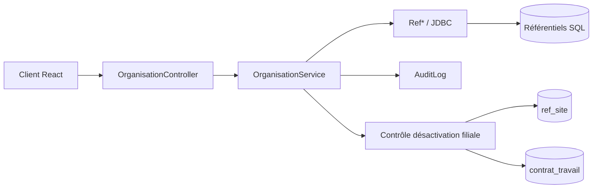

# Organisation — guide technique

## Structure et parcours

Ce module gère les filiales, sites, départements, services, fonctions, banques, types de contrat et types d'intervenant. Il fournit les référentiels actifs aux formulaires employé et carrière.

```text
organisation/
├── api/                 OrganisationController : routes, autorisations, DTO d'entrée
├── application/         OrganisationService : cas d'usage, transactions, audit
└── persistence/         Ref* : modèles Active Record et requêtes JDBC
```



Parcours de lecture : `frontend/src/features/organization/api/organisationService.js` → [`OrganisationController`](api/OrganisationController.java) → [`OrganisationService`](application/OrganisationService.java) → `Ref*` dans `persistence/`. Le contrôleur adapte HTTP ; le service orchestre les cas d'usage ; les modèles exécutent le SQL. Le contrôle de désactivation d'une filiale est une règle métier située dans le service. « Backend driven » signifie que le serveur décide des changements d'état ; ce n'est pas une catégorie de classe Java.

## Routes et méthodes

Préfixe : `/api/referentiel` avec le context-path actuel. Pour chaque ressource : `GET /{ressource}` → `lister*`, `GET /{ressource}/{id}` → `get*`, `POST /{ressource}` → `creer*`, `PUT /{ressource}/{id}` → `modifier*`, `PUT /{ressource}/{id}/activer|desactiver` → `activer*|desactiver*`.

| Ressource | Méthodes de `OrganisationService` | Usage et importance |
| --- | --- | --- |
| `formulaire-employe` | `listerReferentielsFormulaireEmploye` | **Support** — agrège sept listes actives ; lecture seule. |
| `filiales` | `listerFiliales`, `getFiliale`, `creerFiliale`, `modifierFiliale`, `activerFiliale`, `desactiverFiliale` | **Critique** — `validerDesactivationFiliale` bloque la désactivation si des sites actifs ou contrats en cours subsistent. |
| `sites` | `listerSites`, `getSite`, `creerSite`, `modifierSite`, `activerSite`, `desactiverSite`, `configurerPlancherSite` | **Critique** — horaires et plancher consommés par Pointage ; `PUT /sites/{id}/plancher`. |
| `departements` | `listerDepartements`, `getDepartement`, `creerDepartement`, `modifierDepartement`, `activerDepartement`, `desactiverDepartement` | **Structurant** — rattachement des services et affectations. |
| `services` | `listerServices`, `getService`, `creerService`, `modifierService`, `activerService`, `desactiverService` | **Structurant** — rattachement département ; liste filtrable par département. |
| `fonctions` | `listerFonctions`, `getFonction`, `creerFonction`, `modifierFonction`, `activerFonction`, `desactiverFonction` | **Critique** — `dispensePointage` influe sur le temps de travail. |
| `banques` | `listerBanques`, `getBanque`, `creerBanque`, `modifierBanque`, `activerBanque`, `desactiverBanque` | **Structurant** — référentiel bancaire ; modèle `RefBanque` utilisé aussi en HTTP. |
| `types-contrat` | `listerTypesContrat`, `getTypeContrat`, `creerTypeContrat`, `modifierTypeContrat`, `activerTypeContrat`, `desactiverTypeContrat` | **Critique** — `exigeDateFin` paramètre les contrats. |
| `types-intervenant` | `listerTypesIntervenant`, `getTypeIntervenant`, `creerTypeIntervenant`, `modifierTypeIntervenant`, `activerTypeIntervenant`, `desactiverTypeIntervenant` | **Critique** — paramètres IRSA, ISI, CNaPS et santé. |

Les lectures par identifiant signalent `RESOURCE_NOT_FOUND`. Les listes filtrent après lecture JDBC. Les écritures partagent une connexion avec `AuditLog.audit` et valident ou annulent la transaction ensemble. Plusieurs `catch` convertissent actuellement des exceptions en `VALIDATION_ERROR` : vérifier le code observable avant de changer cette gestion.

## Inventaire des fichiers

| Fichier | Méthodes ou données à connaître |
| --- | --- |
| [`OrganisationController`](api/OrganisationController.java) | Les méthodes `getAll*`, `get*ById`, `create*`, `update*`, `activate*`, `deactivate*` relient les routes aux méthodes du tableau précédent ; `toggleSitePlancher` traite l'opération supplémentaire du site. |
| [`OrganisationService`](application/OrganisationService.java) | Les 50 méthodes publiques sont réparties par référentiel dans le tableau précédent ; `validerDesactivationFiliale` est le contrôle privé des sites et contrats dépendants. |
| [`FilialeRequest`](api/dto/FilialeRequest.java) | Identité légale et coordonnées de la filiale : code, raison sociale, NIF, STAT, RCS, adresse, téléphone et email. |
| [`SiteRequest`](api/dto/SiteRequest.java) | Code, libellé, filiale de rattachement, horaires et plancher d'arrivée. |
| [`DepartementRequest`](api/dto/DepartementRequest.java) | Code et libellé du département. |
| [`ServiceRequest`](api/dto/ServiceRequest.java) | Code, libellé et département de rattachement. |
| [`FonctionRequest`](api/dto/FonctionRequest.java) | Code, libellé et indicateur `dispensePointage`. |
| [`RefFiliale`](persistence/RefFiliale.java) | État légal et statut actif ; `rechercherParCode`, `listAll`, `listActifs`, `rechercherParId`, opérations Active Record. |
| [`RefSite`](persistence/RefSite.java) | Rattachement, horaires et plancher ; `rechercherParCode`, `listAll`, `listActifs`, `listByFiliale`, opérations Active Record. |
| [`RefDepartement`](persistence/RefDepartement.java) | Code/libellé/statut ; `rechercherParCode`, `listAll`, `listActifs`, opérations Active Record. |
| [`RefService`](persistence/RefService.java) | Département parent ; `rechercherParCodeEtDepartement`, `listAll`, `listActifs`, `listByDepartement`, opérations Active Record. |
| [`RefFonction`](persistence/RefFonction.java) | Code/libellé, `dispensePointage` ; `rechercherParCode`, `listAll`, `listActifs`, opérations Active Record. |
| [`RefBanque`](persistence/RefBanque.java) | Code, nom, SWIFT ; `rechercherParCode`, `listAll`, `listActifs`, opérations Active Record. |
| [`RefTypeContrat`](persistence/RefTypeContrat.java) | `exigeDateFin` et aides `isCdi`, `isCdd`, `isStage`, `isPrestataire` ; `rechercherParCode`, `listAll`, `listActifs`, opérations Active Record. |
| [`RefTypeIntervenant`](persistence/RefTypeIntervenant.java) | Indicateurs fiscaux et sociaux ; `rechercherParCode`, `listAll`, `listActifs`, opérations Active Record. |

Les modèles `Ref*` héritent de `ClassMere` : `controler`, `inserer`, `modifier`, `supprimer` et `rechercherParId` sont leurs méthodes de validation et de persistance. Les accesseurs `get*`/`set*` exposent les colonnes ; ils ne constituent pas des cas d'usage. Les décisions métier sont dans le service ou chez les domaines consommateurs, pas dans ces accesseurs.

## Contrats et dépendances

- **Sécurité** : lecture authentifiée ; écriture avec `ORGANISATION_WRITE` ou `ROLE_ADMIN`. Le menu `ADMIN_ORGANISATION` ne contrôle que la visibilité du lien.
- **Données** : `validerDesactivationFiliale` lit `ref_site` et `contrat_travail`. Les `Ref*` portent les requêtes JDBC ; aucun ORM.
- **HTTP** : routes, verbes, champs JSON et erreurs forment le contrat client. `RefBanque`, `RefTypeContrat` et `RefTypeIntervenant` servent aussi de corps de requête ; les autres commandes utilisent les DTO de `api/dto/`.
- **Schéma** : les clés composées `(id_contrat, id_employe)` et `(id_service, id_departement)` des affectations figurent dans `backend/conception/bdd/03_schema_employes_contrats.sql`. Une évolution de base existante passe par `docker/migrations/`.

## Index des méthodes principales

| Méthode | Effet concret | Quand la consulter |
|---|---|---|
| `listerReferentielsFormulaireEmploye` | Agrège les listes actives utiles au formulaire employé ; aucune modification. | Un choix manque ou affiche une valeur inactive. |
| `validerDesactivationFiliale` | Refuse la désactivation si la filiale possède encore un site actif ou un contrat en cours. | Une désactivation échoue malgré un identifiant valide. |
| `configurerPlancherSite` | Modifie le plancher d'arrivée du site utilisé par Pointage. | Le calcul des heures d'arrivée semble ignorer un paramètre du site. |
| `creer*` / `modifier*` | Valident puis écrivent le référentiel et son audit dans la même transaction. | Ajouter ou modifier une ligne ; vérifier aussi le `Ref*` correspondant. |
| `activer*` / `desactiver*` | Change la disponibilité d'une valeur pour les nouveaux choix. | Une option apparaît ou disparaît des formulaires. |
| `Ref*.controler` / `Ref*.rechercherParId` | Vérifient les champs du modèle / chargent une ligne SQL ; ce sont des opérations de persistance. | Tracer une validation de colonne ou une recherche, après le service. |

## Vérification

Aucun test dédié à `OrganisationService` n'est présent dans `backend/src/test`. `ContratTravailControllerPostgresTest` et `EmployeSatelliteLifecycleTest` couvrent des comportements voisins, sans prouver tous les parcours ci-dessus. Pour une commande modifiée, vérifier succès, refus métier, code HTTP et rollback de l'audit, puis les tests des domaines consommateurs concernés.
