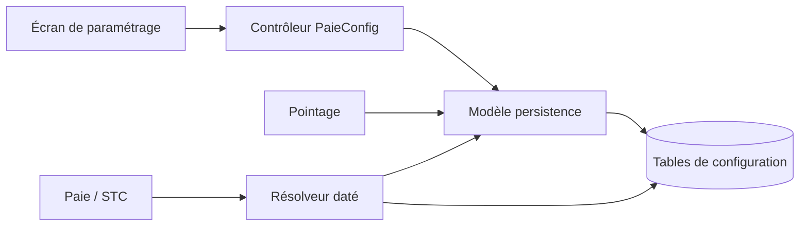

# PaieConfig — guide technique

PaieConfig possède les versions légales, barèmes fiscaux, cotisations, indemnités, jours fériés et paramètres utilisés par la Paie et le Pointage. Il fournit des valeurs **applicables à une date** ; les assiettes et montants de bulletin sont calculés par `paie/`, pas ici.

## Structure et parcours

```text
paieconfig/
├── api/                 9 contrôleurs par référentiel ; commandes et transactions JDBC
│   └── dto/             Corps des requêtes HTTP
├── application/         Résolution datée des cotisations sociales
└── persistence/         Versions légales, barèmes et liaisons site (Active Record/JDBC)
```



Pour modifier une valeur : partir du contrôleur du référentiel, puis du modèle SQL qu'il écrit. Pour comprendre un calcul de Paie : partir du consommateur (`PayrollLegalContextResolver`, `StcService` ou Pointage), puis de la méthode `findActiveAt`, `resolveAtDate`, `companyRates` ou `healthRate` qu'il appelle. Il n'existe actuellement ni `domain/` ni service d'application général : plusieurs validations, audits et transactions sont dans les contrôleurs ; les déplacer exige une refonte distincte de leurs contrats et transactions.

## Trouver une action

| Besoin | Entrée et méthode | Résolution ou stockage |
|---|---|---|
| Définir un millésime légal | `PaieConfigLegaleController.createConfig`, `revaloriser`, `updateConfig`, `annulerProgramme` | `PaieConfigLegale.revaloriser`, `findActiveAt`, `annulerProgramme` |
| Définir les tranches IRSA | `IrsaController.createIrsa`, `revaloriserBareme`, `updateIrsa` | `BaremeIrsa.validerContinuite`, `revaloriser`, `listByConfigLegale` |
| Définir CNAPS, FMFP, santé | `CotisationController.createCotisation`, `updateCotisation`, `createSiteCotisation` | `RefTypeCotisation`, `SiteCotisation`, `SocialContributionContextResolver` |
| Définir l'organisme destinataire | `OrganismeSocialController.createOrganisme`, `updateOrganisme` | `RefOrganismeSocial` |
| Définir une indemnité et sa disponibilité par site | `IndemniteController.createIndemnite`, `createSiteIndemnite`, `updateSiteIndemnite` | `RefIndemnite`, `SiteIndemniteConfig` |
| Définir jours fériés et sites concernés | `CalendrierFerieController.createCalendrierFerie`, `createSiteFerie` | `RefCalendrierFerie`, `SiteCalendrierFerie` ; consommation dans Pointage |
| Définir les majorations HS/nuit/dimanche/férié | `TauxMajorationController.createTauxMajoration`, `updateTauxMajoration` | `RefTauxMajoration.resolveApplicable` |
| Définir un paramètre transverse | `ParametreGlobalController.createParametreGlobal`, `updateParametreGlobal`, `toggleActif`, `toggleGroupeActif` | `ParametreGlobal.resolveAtDate`, `loadEtatMapAtDate` |
| Définir un type de mouvement de Paie | `RefTypeMouvementPaieController.creerTypeMouvement`, `modifierTypeMouvement` | `RefTypeMouvementPaie` ; `getCatalogue`, `getParcoursConfiguration` pour l'écran |

Le préfixe applicatif `/api` s'ajoute aux routes `/paie/config-legale` et `/referentiel/*`. `RefTypeMouvementPaieController` expose aussi un alias `/api/v1/referentiel/types-mouvement-paie` ; vérifier le chemin effectivement consommé avant de changer ce contrat. Les écritures sont protégées dans les contrôleurs ; consulter leurs annotations `@PreAuthorize` pour l'autorité précise.

## Fichiers API

| Fichier | Méthodes à chercher ; rôle |
|---|---|
| `api/PaieConfigLegaleController.java` | `getAllConfigs`, `getActiveConfig`, `getConfigAt` lisent les versions ; `createConfig`, `revaloriser`, `updateConfig`, `annulerProgramme` les modifient. |
| `api/IrsaController.java` | `getAllBaremesIrsa`, `getIrsaById` lisent ; `createIrsa`, `revaloriserBareme`, `updateIrsa` maintiennent les tranches. |
| `api/CotisationController.java` | CRUD des types via `createCotisation`, `updateCotisation`, `deactivateCotisation`, `activateCotisation` ; `createSiteCotisation` et `*SiteCotisation` gèrent le rattachement local. |
| `api/OrganismeSocialController.java` | `createOrganisme`, `updateOrganisme`, `deactivateOrganisme`, `activateOrganisme` gèrent le destinataire des cotisations. |
| `api/IndemniteController.java` | `createIndemnite`, `updateIndemnite`, `deactivateIndemnite`, `activateIndemnite` gèrent le catalogue ; `*SiteIndemnite` gèrent la configuration par site. |
| `api/CalendrierFerieController.java` | `*CalendrierFerie` gèrent les dates ; `createSiteFerie`, `deleteSiteFerie` l'applicabilité par site. |
| `api/TauxMajorationController.java` | `createTauxMajoration`, `updateTauxMajoration` définissent les taux attachés au millésime. |
| `api/ParametreGlobalController.java` | `createParametreGlobal`, `updateParametreGlobal`, `toggleActif`, `toggleGroupeActif`, `annulerProgramme` maintiennent les versions et leur disponibilité. |
| `api/RefTypeMouvementPaieController.java` | `listerTypesMouvement`, `creerTypeMouvement`, `modifierTypeMouvement` gèrent le référentiel ; `getCatalogue`, `getParcoursConfiguration`, `getConfiguration` servent la configuration de l'écran. |

### Contrats d'entrée (`api/dto`)

| Fichiers | Usage |
|---|---|
| `PaieConfigLegaleRequest`, `IrsaRequest`, `IrsaRevalorisationRequest`, `TauxMajorationRequest` | Versions légales, tranche IRSA, revalorisation complète et taux de majoration. |
| `CotisationRequest`, `SiteCotisationRequest`, `OrganismeSocialRequest` | Cotisation, application par site et organisme social. |
| `IndemniteRequest`, `SiteIndemniteRequest` | Indemnité et configuration par site. |
| `CalendrierFerieRequest`, `SiteCalendrierFerieRequest` | Jour férié et rattachement au site. |
| `ParametreGlobalRequest`, `RefTypeMouvementPaieRequest` | Paramètre versionné et type de mouvement. |

Ces DTO transportent l'entrée HTTP ; les vérifications de dates, de chevauchement et de disponibilité se trouvent dans les contrôleurs et modèles associés.

## Application et persistance

| Fichier | Méthodes et responsabilité |
|---|---|
| `application/SocialContributionContextResolver.java` | `companyRates(date, connection)` choisit CNAPS et FMFP ; `healthRate(siteCode, date, connection)` choisit la santé du site. Les taux sont renvoyés sous forme décimale. Une configuration entreprise absente ou ambiguë bloque ; `healthRate` renvoie `null` si aucune santé n'est configurée pour le site. |
| `persistence/PaieConfigLegale.java` | Millésime et valeurs légales (SME, plafonds, IRSA, heures, congés) ; `findActiveAt` choisit la version à la date, `revaloriser` ouvre une nouvelle version, `annulerProgramme` annule une version planifiée. |
| `persistence/BaremeIrsa.java` | Tranches rattachées au millésime ; `validerContinuite`, `revaloriser`, `listByConfigLegale`. |
| `persistence/ParametreGlobal.java` | Paramètres versionnés ; `resolveAtDate` distingue version active, désactivée et absente ; `loadEtatMapAtDate` charge l'état complet ; `cloturerPrecedent`, `annulerProgramme` gèrent les versions. |
| `persistence/RefTypeCotisation.java` | Taux et dates d'effet d'une cotisation ; `listActiveAt`, `desactiverTransactionnel`. |
| `persistence/SiteCotisation.java` | Rattachement d'une cotisation au site et éventuel organisme santé ; `desactiverParTypeCotisation`. |
| `persistence/RefOrganismeSocial.java` | Catalogue des organismes ; `findByCode`, `listActive`. |
| `persistence/RefIndemnite.java` | Catalogue des indemnités ; `desactiverTransactionnel` coordonne la désactivation. |
| `persistence/SiteIndemniteConfig.java` | Règles d'indemnité par site ; `desactiverParIndemnite`. |
| `persistence/RefCalendrierFerie.java` | Dates fériées et état actif ; `desactiver`, `activer`. |
| `persistence/SiteCalendrierFerie.java` | Association d'un jour férié à un site. |
| `persistence/RefTauxMajoration.java` | Taux datés par type ; `resolveApplicable` choisit celui du millésime et de la date. |
| `persistence/RefTypeMouvementPaie.java` | Types de mouvement ; `trouverParCode`, `listerActifs`. |

Les modèles héritent de `ClassMere` pour les opérations Active Record (`controler`, `inserer`, `modifier`, `rechercherParId`). Ces méthodes effectuent validation de modèle et SQL ; elles ne calculent pas un bulletin.

## Index des méthodes principales

| Méthode | Effet concret | Quand la consulter |
|---|---|---|
| `PaieConfigLegaleController.revaloriser` / `PaieConfigLegale.revaloriser` | Crée une nouvelle version légale à une date d'effet ; la version précédente est bornée. | Une modification légale doit s'appliquer à partir d'une date future. |
| `PaieConfigLegale.findActiveAt` | Lit le millésime applicable à la date du calcul. | Un bulletin ou STC utilise le mauvais SME, seuil ou plafond. |
| `IrsaController.revaloriserBareme` / `BaremeIrsa.revaloriser` | Installe les tranches IRSA du nouveau millésime. | Une réforme fiscale change tout le barème. |
| `ParametreGlobal.resolveAtDate` | Retourne la version applicable et distingue actif, désactivé et absent. | Un calcul interprète mal une valeur manquante ou volontairement coupée. |
| `ParametreGlobal.loadEtatMapAtDate` | Charge tous les états à une date métier explicite. | Calcul historique, campagne ou STC ; éviter le chargement à la date du jour. |
| `SocialContributionContextResolver.companyRates` | Résout les taux CNAPS/FMFP valides, signale manque ou ambiguïté. | Bulletin, DNTS ou STC a un taux social inattendu. |
| `SocialContributionContextResolver.healthRate` | Résout la santé configurée pour un site et une date ; peut ne rien trouver. | Une cotisation santé dépend du site d'affectation. |
| `RefTauxMajoration.resolveApplicable` | Sélectionne un taux par type, millésime et date. | Le calcul d'une majoration HS/nuit/dimanche/férié est surprenant. |
| `ParametreGlobalController.toggleGroupeActif` | Change l'état d'un groupe de paramètres, avec contrôle côté serveur. | Activer ou couper ensemble un jeu de paramètres. |
| `RefTypeMouvementPaieController.getConfiguration` | Assemble les informations de configuration exposées à l'interface ; ne calcule pas la Paie. | Comprendre les options proposées pour un mouvement. |

## Règles et vérification

Les bornes temporelles sont inclusives ; la fin peut être ouverte. Une absence de version conserve la politique du consommateur lorsqu'elle est facultative, mais une ambiguïté doit bloquer le calcul. `ParametreGlobal` emploie un résultat à trois états (`ACTIVE`, `DISABLED`, `MISSING`) pour ne pas confondre coupure volontaire et absence. Les calculs mensuels utilisent la date de la campagne ; le STC utilise la date de départ. Pour Pointage, l'applicabilité d'un jour férié ou d'une indemnité peut dépendre du site et du jour.

La migration SP76 mentionnée dans l’historique du module ne figure pas dans ce dépôt. Vérifier le schéma de la base cible avant de supposer que les contraintes de dates et de chevauchement y sont installées. Le code `ParametreGlobal.resolveAtDate` contrôle aussi l’ambiguïté à la lecture. Un changement de règle doit être vérifié côté consommateur Paie/Pointage, car une simple lecture du référentiel ne prouve pas le calcul final.

Tests ciblés : `ParametreGlobalAuthorizationTest`, `PayrollPeriodTransitionTargetedTest`, `CalendrierFeriePostgresTest` selon le parcours. Après modification de code ou de package : `mvn -f backend/pom.xml clean test`, `npm --prefix frontend run test:api`, `npm --prefix frontend run build`. Les tests PostgreSQL nécessitent une base disponible.
