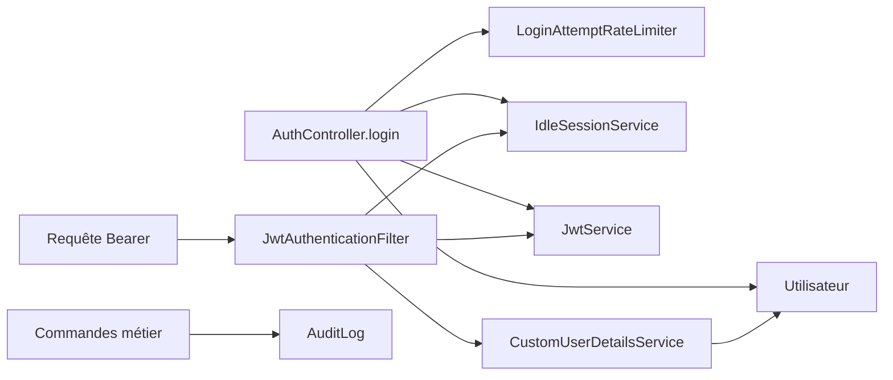

# Sécurité — guide technique

Ce module gère les comptes, l'authentification, les sessions, les JWT et les traces d'audit. Les autorisations globales sont configurées dans [`SecurityConfig`](../config/SecurityConfig.java) ; les permissions fines restent dans les contrôleurs et les cas d'usage des domaines.

```text
securite/
├── api/             Authentification, utilisateurs, bootstrap desktop et DTO HTTP
├── application/     Sessions, limitation des connexions et bootstrap administrateur
├── auth/            JWT, filtre et identité Spring Security
└── persistence/     Comptes, journal des connexions et audit JDBC
```



## Inventaire des fichiers et méthodes

| Fichier | Méthodes principales et usage | Importance |
| --- | --- | --- |
| [`api/AuthController`](api/AuthController.java) | `login` vérifie le compte et crée les jetons/session ; `refresh` renouvelle le cookie ; `logout` révoque ; `recordActivity` prolonge l'activité ; `getMenu` renvoie les menus autorisés ; `register` crée un compte admin ; `ping` contrôle l'accès. `requireTrustedOrigin` protège les commandes à cookie et `createRefreshCookie` construit ce cookie. | **Critique** — frontière des sessions HTTP. |
| [`api/UtilisateurController`](api/UtilisateurController.java) | `getAllUsers`, `getUserById`, `createUser`, `updateUser`, `deactivateUser`, `activateUser` administrent les comptes ; changement de mot de passe et désactivation révoquent les sessions selon leur parcours. | **Critique** — cycle de vie des accès. |
| [`api/DesktopBootstrapController`](api/DesktopBootstrapController.java) | `createInitialAdmin` initialise le premier admin desktop ; `validCapability` contrôle la capacité locale ; `handleBootstrapRejection` transforme un refus. | **Critique** — initialisation locale. |
| [`application/AdminAccountSeeder`](application/AdminAccountSeeder.java) | `run` crée l'admin configuré uniquement si aucun admin actif n'existe. | **Critique** — bootstrap serveur. |
| [`application/IdleSessionService`](application/IdleSessionService.java) | `migrateSessionSchema`, `create`, `isActive`, `touch`, `rotate`, `revoke`, `revokeAllForUser`, `findSessionIdByRefreshToken`, `findTokensByRefreshToken`, `expireIfIdle`, `getIdleExpiresAt` gèrent le cycle des familles de sessions ; `SessionTokens` et `AuthenticationSession` transportent les données. | **Critique** — révocation et inactivité. |
| [`application/LoginAttemptRateLimiter`](application/LoginAttemptRateLimiter.java) | `retryAfterSeconds`, `recordFailure`, `recordSuccess` limitent les essais de connexion ; `evictExpiredAndOldest` borne le compteur en mémoire. | **Critique** — protection du login, locale à l'instance. |
| [`auth/JwtService`](auth/JwtService.java) | `validateJwtSecret`, `generateAccessToken`, `generateRefreshToken`, `extractValidUsername`, `extractSessionId`, `isTokenValid`, `isRefreshTokenValid`, durées d'expiration. | **Critique** — émission et validation des jetons. |
| [`auth/JwtAuthenticationFilter`](auth/JwtAuthenticationFilter.java) | `doFilterInternal` lit le Bearer, vérifie le compte et la session, renseigne le contexte Spring. | **Critique** — authentification de chaque requête protégée. |
| [`auth/CustomUserDetailsService`](auth/CustomUserDetailsService.java) | `loadUserByUsername` charge compte, rôle et autorités par module. | **Critique** — droits effectifs. |
| [`auth/CustomUserDetails`](auth/CustomUserDetails.java) | `getAuthorities`, `getUsername`, `getPassword`, `isEnabled`, `getCurrentUserId` et autres méthodes `UserDetails` exposent l'identité au framework. | **Structurant** — identité courante. |
| [`persistence/Utilisateur`](persistence/Utilisateur.java) | `controler`, `verifierMotDePasse`, `setMotDePasseEnClair`, `rechercherParEmail`, `rechercherParId`, `lister`, méthodes de refresh héritées et opérations Active Record. `supprimer` interdit la suppression physique. | **Critique** — état du compte et SQL. |
| [`persistence/JournalConnexion`](persistence/JournalConnexion.java) | `controler`, `inserer`, méthodes Active Record et accesseurs enregistrent le résultat d'une connexion. | **Structurant** — traçabilité des connexions. |
| [`persistence/AuditLog`](persistence/AuditLog.java) | `audit` enregistre auteur, action, table, ancien/nouvel état et adresse IP ; méthodes Active Record et sérialisation servent cette écriture. | **Critique** — traçabilité des commandes. |

| DTO HTTP | Rôle |
| --- | --- |
| [`LoginRequest`](api/dto/LoginRequest.java) | Email et mot de passe du login. |
| [`RegisterRequest`](api/dto/RegisterRequest.java) | Identité, email, mot de passe et rôle pour l'inscription admin. |
| [`UtilisateurRequest`](api/dto/UtilisateurRequest.java) | Création, modification, désactivation d'un compte. |
| [`UtilisateurResponse`](api/dto/UtilisateurResponse.java) | Vue de compte sans mot de passe ni refresh token. |

Les accesseurs des modèles et DTO transportent des champs ; ils ne sont pas des décisions métier. La règle de validité d'un compte est dans `Utilisateur`, la validité d'une session dans `IdleSessionService`, et le contrôle d'accès à une route dans `SecurityConfig` ou `@PreAuthorize`.

## Contrats et invariants

- **Routes** : `/auth/login`, `/auth/refresh`, `/auth/logout`, `/auth/ping`, `/auth/activity`, `/auth/menu`, `/auth/register`, `/securite/utilisateurs/*` et `/desktop/setup/admin`. `SecurityConfig` définit les accès globaux ; `@PreAuthorize` protège notamment `register` et les opérations utilisateur. Le préfixe `/api` vient du context-path.
- **Jetons** : l'access token est un Bearer ; le refresh token est dans un cookie `HttpOnly`. Les deux sont liés à `utilisateur_session` par `sid`. Le renouvellement du refresh ne prolonge pas à lui seul l'inactivité ; seule une activité acceptée actualise `last_activity_at`.
- **Révocation** : désactivation du compte et changement de mot de passe non vide révoquent les sessions. La réactivation impose une nouvelle connexion. `Utilisateur.supprimer` interdit la suppression physique pour préserver les historiques.
- **Origine** : `refresh` et `logout` vérifient une origine autorisée par `app.cors.allowed-origins` via `Origin` ou `Referer`. La limite de tentatives de login est en mémoire par instance.
- **Bootstrap** : `AdminAccountSeeder` est désactivé par défaut et ne crée un admin que si aucun admin actif n'existe. Le bootstrap desktop utilise un parcours distinct.
- **Audit** : `AuditLog.audit` est appelé explicitement par les commandes. Une erreur d'audit doit remonter et annuler l'opération lorsqu'elle partage la même transaction.

## Tests et références

`LoginAttemptRateLimiterTest` couvre la limitation, `IdleSessionServicePostgresTest` les familles et l'inactivité, `RefreshTokenUniquenessTest` l'unicité du refresh, et `UtilisateurPasswordChangeTest` la révocation conditionnelle. Les tests PostgreSQL demandent une base de test disponible. La référence métier détaillée reste [le module Sécurité et Audit](../../../../../../../docs/boky/module-securite-audit.md).
