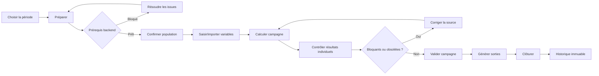

# Audit global contradictoire du SIRH GALAXAM

**Date :** 14 septembre 2026  
**Périmètre :** backend Java/Spring, frontend React, schémas PostgreSQL, tests, configuration, Docker et documentation.  
**Nature :** audit statique et dynamique de l'état courant, incluant les modifications locales non commitées. Aucun fichier applicatif n'a été modifié par cet audit.

## 1. Résumé exécutif

Le SIRH possède de vrais acquis : calculateurs Pointage unitaires, moteur de paie individuel réutilisé par la campagne, snapshots Pointage versionnés, 279 endpoints tous couverts par une annotation `@PreAuthorize`, contraintes relationnelles nombreuses, build frontend valide et 133 tests backend verts.

Il n'est cependant ni prêt pour une production RH sécurisée, ni totalement backend-driven. Trois défauts dominent :

1. **Sécurité de configuration critique.** Le dépôt contient des valeurs de repli exploitables pour le compte DAF, la signature JWT et ImgBB. Les photos RH sont servies comme ressources publiques. La production accepte par défaut toute origine CORS avec credentials.
2. **Workflow non unifié.** `PUT /periodes-paie/{id}/statut` accepte un code d'état fourni par le client et mélange autorisation, transition, horloge, gel/dégel et SQL. React reconstruit parallèlement les transitions et permissions. Il n'existe pratiquement aucun contrat `availableActions`.
3. **Sources de vérité concurrentes.** Malgré le README, le SQL contient encore des décisions/calculs métier actifs (`fn_jours_ouvrables`, `v_config_legale_active`, assujettissements fiscaux par défaut). Les services Pointage et les contrôleurs restent massifs et redondants.

La certification A01–A20 doit être conservée comme baseline des moteurs canoniques, mais elle ne certifie ni la sécurité globale, ni les workflows, ni l'UX, ni l'absence globale de SQL métier. Les documents qui extrapolent cette certification au système entier sont faux.

### Verdict direct

- Le backend est **une source de calcul importante**, mais pas encore l'unique source de décision.
- Le frontend est **partiellement assistant** ; il décide encore états, actions et sélection de contexte.
- Le SQL contient encore **au moins 3 artefacts métier actifs**.
- La Paie backend est structurellement prometteuse ; son workflow/API et son UX ne sont pas prêts.
- La priorité absolue n'est pas une refonte visuelle : c'est la fermeture des P0 sécurité puis l'unification des décisions métier.

## 2. Méthode, périmètre et limites

### État mesuré

| Élément | Valeur observée |
|---|---:|
| Fichiers Java production | 240 |
| Fichiers de tests Java | 38 |
| Fichiers JS/JSX frontend | 271 |
| Contrôleurs REST | 45 |
| Méthodes endpoint | 279 |
| `@PreAuthorize` | 279 |
| Tables PostgreSQL locales | 75 |
| Vues PostgreSQL locales | 10 |
| Fonctions PostgreSQL locales | 3 |
| Index PostgreSQL locaux | 276 |
| Clés étrangères PostgreSQL locales | 136 |

Les recherches excluent `node_modules`, `target`, `dist` et les migrations historiques lorsqu'il est question du code actif. Les scripts `01_schema_*` à `06_schema_*` sont actifs car `docker/init-databases.sql` les charge explicitement.

### Vérifications dynamiques

| Gate | Résultat | Observation |
|---|---|---|
| `mvn test` | **PASS** | 133 tests, 0 échec, 0 erreur, 0 ignoré, 1 min 29 s |
| `./mvnw test` | **FAIL infrastructure** | `.mvn/wrapper/maven-wrapper.properties` absent |
| `npm run lint` | **PASS** | aucune sortie d'erreur |
| `npm run build` | **PASS** | 2 110 modules, build en 380 ms |

Le README annonce 328 tests ; le runner réel n'en exécute que 133. Cette différence n'invalide pas les 133 résultats, mais invalide le chiffre documentaire.

## 3. Scores

### Score global pondéré

| Axe | Poids | Note | Contribution |
|---|---:|---:|---:|
| Architecture backend | 20 % | 6,0/10 | 12,0 |
| Architecture frontend | 15 % | 5,0/10 | 7,5 |
| Workflows / UX | 20 % | 4,0/10 | 8,0 |
| Fiabilité métier | 15 % | 6,0/10 | 9,0 |
| Tests | 10 % | 5,5/10 | 5,5 |
| Sécurité | 10 % | 3,0/10 | 3,0 |
| Données / SQL / temporalité | 5 % | 4,5/10 | 2,25 |
| Performance | 5 % | 5,0/10 | 2,5 |
| **Global** | **100 %** |  | **49,75/100** |

**Score retenu : 50/100.**

### Backend

| Critère | /10 |
|---|---:|
| Architecture | 6 |
| Backend-driven | 5 |
| SQL | 4 |
| Granularité | 4 |
| Responsabilités | 4 |
| Temporalité | 5 |
| Fiabilité | 6 |
| Sécurité | 3 |
| Tests | 6 |
| Performance | 5 |
| Maintenabilité | 5 |

### Frontend

| Critère | /10 | Critère | /10 |
|---|---:|---|---:|
| Architecture React | 5 | Frontend assistant | 4 |
| Absence de logique métier | 4 | Workflow | 4 |
| UI | 6 | UX | 5 |
| Ergonomie | 5 | Navigation | 6 |
| Feedback | 5 | Accessibilité | 5 |
| Responsive | 5 | Performance | 4 |
| Maintenabilité | 4 | Design system | 4 |
| Respect `index.css` | 4 | Cohérence composants | 5 |

### Modules

| Module | /10 | Diagnostic |
|---|---:|---|
| Employés | 5,5 | fiche riche, liste non paginée réellement, modal trop lourde |
| Contrats / Carrière | 5,0 | workflows présents mais décisions UI et service monolithique |
| Congés / Absences | 5,5 | règles couvertes, solde SQL et fallback UI encore concurrents |
| Pointage | 4,5 | moteurs canoniques acquis, services et UX très concentrés |
| Paie backend | 6,0 | bon moteur unitaire, contexte/workflow/API à unifier |
| Paie frontend | 4,0 | cockpit utile mais workflow incomplet et états devinés |
| Administration | 5,0 | couverture large, écrans >1 000 lignes |
| Sécurité | 3,0 | RBAC endpoint solide, secrets/PII/CORS critiques |
| Documents | 3,5 | téléchargement contrôlé, mais ressources statiques publiques possibles |
| Référentiels | 5,0 | nombreux CRUD, temporalité et activation dispersées |

## 4. Top 10 anomalies

| ID | Priorité | Titre | Module |
|---|---|---|---|
| G-001 | P0 | Secrets et compte DAF de repli versionnés | Sécurité |
| G-002 | P0 | Photos RH publiquement accessibles | Sécurité / PII |
| G-003 | P0 | Endpoint générique permettant des transitions de période non modélisées | Pointage / Paie |
| G-004 | P1 | Décisions métier concurrentes en SQL | SQL / Paie / Pointage |
| G-005 | P1 | Erreurs métier sans contrat structuré unique | API globale |
| G-006 | P1 | Frontend reconstruit permissions, workflow et contexte actif | Frontend global |
| G-007 | P1 | Services Pointage et Carrière monolithiques | Backend |
| G-008 | P1 | Temporalité implicite et sélections arbitraires | Backend / SQL |
| G-009 | P2 | Chargement intégral de populations dans React | Performance / UX |
| G-011 | P1 | Le menu « Bulletins de Paie » ouvre une page vide | Navigation / Paie |

Anomalie additionnelle transversale : **G-010**, incohérence du design system (P2).

## 5. Fiches détaillées des anomalies prioritaires

### G-001 — Secrets et compte DAF de repli versionnés

- **Priorité / module :** P0 — Sécurité.
- **Fichiers :** `backend/src/main/resources/application.properties:22,53,59-60`, `application-prod.properties:18`.
- **Comportement actuel :** sans variables d'environnement, l'application démarre avec une clé JWT connue, une clé ImgBB versionnée et `daf@galaxam.com / TnrGalLog2605`.
- **Preuve :** valeurs littérales présentes dans le fichier de configuration ; `AdminAccountSeeder` consomme ces valeurs.
- **Pourquoi c'est mauvais :** une erreur de déploiement devient une compromission silencieuse et reproductible.
- **Scénario :** production démarrée sans `GALAXAM_DEFAULT_ADMIN_PASSWORD` ; un tiers lit Git et se connecte comme DAF.
- **Architecture cible :** démarrage refusé en profil production si un secret manque ; bootstrap admin explicite, ponctuel et audité.
- **Backend :** supprimer tous les defaults sensibles, valider l'entropie JWT, désactiver le seeder en prod par défaut.
- **Frontend / SQL :** aucun calcul ; prévoir seulement un écran d'initialisation à jeton unique si nécessaire.
- **Tests :** test de contexte prod qui échoue sans secrets ; scan secret CI.
- **Risque migration :** rotation JWT déconnectera les sessions ; rotation ImgBB et mot de passe DAF à coordonner immédiatement.

### G-002 — Photos RH publiquement accessibles

- **Priorité / module :** P0 — Sécurité, Employés, Documents.
- **Fichiers :** `SecurityConfig.java:37-43`, `WebConfig.java:33-40`.
- **Comportement actuel :** `/uploads/photos/**` est `permitAll`; le handler sert les fichiers avec cache public 7 jours. Les documents sont aussi servis statiquement par MVC, même si le matcher global exige actuellement une authentification.
- **Preuve :** matcher public et `cachePublic()` explicites.
- **Pourquoi :** une URL devinée, fuitée ou journalisée expose une donnée personnelle hors contrôle ressource.
- **Scénario :** ancien salarié ou tiers accède à une photo via une URL conservée, sans JWT.
- **Cible :** endpoint contrôlé par identifiant opaque, autorisation ressource, `Cache-Control: private`, stockage non servi directement.
- **Backend :** retirer le matcher public et les handlers bruts ; unifier lecture photo/document dans `DocumentAccessService`.
- **Frontend :** charger un blob autorisé ou une URL signée courte.
- **SQL :** journaliser propriétaire, classification et accès.
- **Tests :** 401 anonyme, 403 utilisateur hors périmètre, révocation, absence de cache public.
- **Risque migration :** les URL historiques devront être migrées.

### G-003 — Transition générique de période non modélisée

- **Priorité / module :** P0 — Pointage / Paie / Historique.
- **Fichier / méthode :** `PeriodePaieController.updateStatut`, lignes 208–307.
- **Actuel :** le client envoie n'importe quel `statutCode`; un admin peut passer directement vers presque tout code existant. La méthode ne charge pas l'état courant, n'applique pas de matrice de transitions, met à jour, puis gèle ou dégèle selon le nouvel état.
- **Preuve :** aucun prédicat `état courant -> événement -> état cible`; `BROUILLON` déclenche `degelerPeriode` quel que soit l'historique.
- **Pourquoi :** validation, clôture, réouverture et rejet deviennent des affectations CRUD, non des événements métier.
- **Scénario :** une période `CLOTUREE` repasse `BROUILLON`, dégelant un snapshot déjà consommé par la paie.
- **Cible :** commandes `submit`, `approve`, `reject`, `close`, `reopen`, chacune idempotente et verrouillée ; une seule méthode canonique `execute(PeriodCommand)` décide.
- **Backend :** `PayrollPeriodWorkflowService` retourne un `BusinessDecision` unique avec état, règles évaluées, issues et `availableActions`.
- **Frontend :** ne plus envoyer de statut ; invoquer l'action exposée.
- **SQL :** update conditionnel `WHERE id=? AND version=? AND status=?`; historique append-only.
- **Tests :** matrice complète, double clic, deux utilisateurs, clôturée→brouillon interdite, snapshot consommé.
- **Risque :** migration des appels existants ; conserver temporairement l'endpoint en 410/adapter sans dupliquer la logique.

### G-004 — Décisions métier concurrentes en SQL

- **Priorité / module :** P1 — SQL.
- **Fichiers :** `05_schema_pointage.sql:275-291`, `06_schema_paie.sql:535-542`, `03_schema_employes_contrats.sql:570-602`.
- **Actuel :** PL/pgSQL calcule les jours ouvrables ; une vue calcule le plafond social et choisit la config avec `CURRENT_DATE`; une autre remplace silencieusement des assujettissements absents par `true/false`.
- **Preuve :** `EXTRACT(ISODOW)`, `ROUND(sme * plafond)`, `CURRENT_DATE`, `COALESCE(soumis_cnaps, TRUE)` actifs dans le schéma Docker.
- **Pourquoi :** contredit les moteurs canoniques datés et crée des réponses différentes selon le chemin.
- **Scénario :** audit d'une paie historique via la vue : la config d'aujourd'hui remplace celle de la période.
- **Cible :** SQL charge et agrège techniquement ; Java résout et décide pour une date cible obligatoire.
- **Backend :** supprimer les consommateurs avant de supprimer les artefacts ; conserver `CalendrierOuvrableEngine`, `PaieConfigLegale.findActiveAt`.
- **Frontend :** aucune formule de secours.
- **SQL :** vues brutes sans défaut fiscal ; absence = donnée invalide explicite.
- **Tests :** parité historique, configuration absente/chevauchante, calendrier site.
- **Risque :** rapports existants pouvant dépendre des vues ; instrumenter leurs usages.

### G-005 — Erreurs métier sans contrat structuré unique

- **Priorité / module :** P1 — API globale.
- **Fichiers :** `GlobalExceptionHandler`, `ApiErrorResponse`, contrôleurs Paie, `apiClient.js`.
- **Actuel :** 92 `IllegalStateException`, 281 `IllegalArgumentException`, zéro construction de `SirhBusinessException` détectée. Les contrôleurs attrapent souvent `Exception` et recréent des maps. Le frontend classe les erreurs en recherchant des fragments de texte comme `duplicate key`.
- **Preuve :** `ApiErrorResponse` n'a ni `details`, ni `issues`, ni `action`; le code d'erreur est null pour les exceptions génériques.
- **Pourquoi :** localisation impossible, comportements UI fragiles, plusieurs messages divergents pour une règle.
- **Scénario :** le libellé backend change ; le frontend ne reconnaît plus l'erreur et affiche une action incorrecte.
- **Cible :** un unique `BusinessDecision`/`ApiProblem` : `code`, `message`, `ruleResults`, `blockingIssues`, `warnings`, `availableActions`, `details`, `correlationId`.
- **Backend :** une fabrique et un handler ; interdire les réponses d'erreur manuelles dans les contrôleurs.
- **Frontend :** router sur `code` et afficher le message, jamais parser le texte.
- **SQL :** mapper les contraintes connues par nom, pas par sous-chaîne du message PostgreSQL.
- **Tests :** contrat JSON de chaque règle prioritaire et test de non-régression des codes.
- **Risque :** versionner l'API ou fournir un adaptateur temporaire unique.

### G-006 — React reconstruit la décision métier

- **Priorité / module :** P1 — Frontend global.
- **Fichiers :** `SaisieQuotidiennePage:266-276`, `DashboardHeader:29-35,113-129`, `GestionPaiePage:42-49`, `HistoriqueContratsTable`, `ParcoursChronologique`.
- **Actuel :** React détermine lecture seule, période active, destination, création de certificat/attestation et transitions à partir de statuts et permissions.
- **Preuve :** 151 comparaisons statut/égalité, 134 occurrences d'identifiants `canX`, aucun contrat `availableActions` trouvé.
- **Pourquoi :** l'UI et le backend peuvent autoriser des choses différentes.
- **Scénario :** ajout d'un statut backend ; le dashboard sélectionne `list[0]` et présente la mauvaise période.
- **Cible :** réponses backend contenant contexte courant et actions disponibles.
- **Backend :** `PeriodContextView` et `ResourceCapabilities` partagés.
- **Frontend :** conditions de présentation autorisées ; aucune reconstruction de workflow.
- **SQL :** aucun changement.
- **Tests :** contract tests + E2E par rôle.
- **Risque :** migration écran par écran, mais vers un seul contrat commun.

### G-007 — Services monolithiques

- **Priorité / module :** P1 — Backend.
- **Fichiers :** `PointageSyntheseService` 1 942 lignes, `PointageSaisieService` 1 624, `WorkflowRhService` 1 576, `PayrollService` 1 310, `PointageAnomalieService` 1 081, `ContratTravailController` 1 046, `StcService` 1 026.
- **Actuel :** chargement JDBC, résolution, calcul, validation, mutation, DTO et workflow cohabitent.
- **Preuve :** tailles, connexions SQL et branches observées ; les rapports antérieurs identifient déjà ces méthodes.
- **Pourquoi :** chaque correction encourage un second chemin local.
- **Scénario :** la régularisation d'anomalie recalcule différemment de la saisie quotidienne.
- **Cible :** un cas unitaire canonique, composé pour le lot ; ne pas micro-découper.
- **Backend :** extraire uniquement `ContextResolver`, calculateur canonique, workflow et repository ; un orchestrateur public.
- **Frontend :** un hook par cas d'usage, pas par endpoint CRUD.
- **SQL :** repositories de données brutes.
- **Tests :** tests directs de chaque vraie règle et équivalence unitaire/collectif.
- **Risque :** élevé ; caractérisation avant extraction.

### G-008 — Temporalité implicite et sélection arbitraire

- **Priorité / module :** P1 — tous domaines historiques.
- **Preuves :** 46 occurrences actives de `CURRENT_DATE`, 86 de `LIMIT 1`; `CalendrierOuvrableEngine` sélectionne le dernier `id_affectation`; `PointageAnomalieService` prend la dernière période si aucune ouverte; plusieurs fallbacks utilisent `LocalDate.now()`.
- **Pourquoi :** « premier » n'est pas « applicable à la date cible ».
- **Scénario :** recalcul août en septembre avec affectation mutée : site/calendrier de septembre utilisé.
- **Cible :** toute résolution historique exige `BusinessDate`/période ; absence ou ambiguïté bloque.
- **Backend :** un résolveur daté par agrégat, réutilisé partout.
- **Frontend :** période explicite dans URL et API.
- **SQL :** bornes datées + ordre déterministe seulement après filtrage.
- **Tests :** avant/pendant/après changement, chevauchement, trou de validité.
- **Risque :** résultats historiques peuvent changer ; faire un rapport de comparaison avant migration.

### G-009 — Chargement intégral des populations

- **Priorité / module :** P2 — Performance / UX.
- **Fichiers :** `useContractReferentiels.js:71` (`size:10000`), `EmployeList.jsx:72` (`size:1000`), `useDerogationIndemnites` (`size:1000`).
- **Actuel :** chargement global puis filtrage/tri client.
- **Pourquoi :** payload PII excessif, mémoire et temps de rendu, résultats plafonnés silencieusement.
- **Scénario :** 1 001e salarié invisible dans la liste.
- **Cible :** pagination/recherche serveur, sélecteur distant, état dans URL.
- **Backend :** endpoints options minimaux et paginés.
- **Frontend :** debounce, pages, virtualisation si nécessaire.
- **Tests :** 10 001 salariés, navigation retour, filtres persistants.
- **Risque :** adaptation des composants de sélection.

### G-010 — Design system contredit par le code

- **Priorité / module :** P2 — Frontend UI.
- **Preuve :** 17 couleurs hexadécimales JS/JSX, 761 utilitaires Tailwind nommés par couleur, 510 classes `rounded*` hors `rounded-none` ; convention sauge et `rounded-none` déclarée.
- **Pourquoi :** statuts et actions identiques changent d'apparence, maintenance sombre/contraste difficile.
- **Scénario :** un warning est ambre dans un écran, sky ou emerald dans un autre.
- **Cible :** variantes sémantiques du design system, exceptions documentées seulement.
- **Backend / SQL :** aucun.
- **Frontend :** migrer via composants `StatusBadge`, `Alert`, `Button`, pas par remplacement aveugle.
- **Tests :** Storybook/visual snapshots, axe, contrastes.
- **Risque :** régression visuelle ; traiter par famille de composants.

### G-011 — Route Bulletins de Paie morte

- **Priorité / module :** P1 — Navigation / Paie frontend.
- **Fichiers :** `01_schema_core_securite.sql:198`, `GestionPaiePage.jsx:28,68-90`.
- **Actuel :** le menu persistant pointe vers `/paie?tab=bulletins`; la page ne déclare que `cockpit`, `variables`, `periodes`, `exports` et ne rend aucun fallback pour un onglet inconnu.
- **Preuve dynamique :** ouverture authentifiée le 14 septembre 2026 : la route affiche l'en-tête et les quatre boutons, puis une zone principale vide.
- **Pourquoi :** c'est une page morte accessible depuis la navigation primaire du rôle DAF.
- **Scénario :** le DAF clique « Bulletins de Paie » et croit que les données ne se sont pas chargées.
- **Cible :** route Results/Fiche individuelle du workflow cible, ou redirection explicite vers le cockpit avec filtre ; jamais un alias qui possède sa propre logique.
- **Backend :** exposer les résultats paginés et les capacités ; aucun nouvel endpoint de calcul.
- **Frontend :** une table de routes/onglets validée, fallback 404 interne et test de chaque entrée de menu.
- **SQL :** corriger le seed du menu en même temps que les environnements existants.
- **Tests :** test Router pour chaque `url_path` de `menu`; E2E DAF menu→contenu.
- **Risque :** faible si redirection, moyen lors de la création de la vraie vue résultats.

## 6. Audit SQL

### Inventaire reproductible

Le scan lexical du code Java actif et des six schémas Docker trouve **1 233 occurrences de mots-clés SQL** : 683 `SELECT`, 143 `INSERT`, 264 `UPDATE`, 143 `DELETE`. Ces occurrences ne sont pas des requêtes distinctes garanties : une chaîne Java peut être concaténée et `DELETE` apparaît aussi dans des clauses de contrainte. Elles constituent un inventaire mécanique, pas une fausse classification exhaustive.

Marqueurs actifs : 74 `CASE`, 152 `COALESCE`, 61 `SUM`, 31 `ROUND`, 46 `CURRENT_DATE`, 86 `LIMIT 1`. Leur présence seule n'est pas une anomalie.

### Classification manuelle des 13 artefacts SQL exécutables nommés

| Classe primaire | Nombre | Commentaire |
|---|---:|---|
| CRUD | 0 | vues/fonctions uniquement |
| FILTER / JOIN / SORT | 4 | projections CPL et historique |
| TECHNICAL_AGGREGATION | 2 | soldes/mouvements, à contractualiser |
| REPORTING | 2 | projections de restitution |
| BUSINESS_CALCULATION | 2 | jours ouvrables, plafond cotisation |
| BUSINESS_DECISION | 1 | assujettissements fiscaux par défaut |
| LEGACY_BOUNDARY / INTEGRITY_GUARD | 2 | fonctions d'immutabilité des bulletins |
| **Total** | **13** | 10 vues + 3 fonctions |

La cible `BUSINESS_CALCULATION=0`, `BUSINESS_DECISION=0` n'est donc pas atteinte. Les triggers d'immutabilité sont des garde-fous d'intégrité acceptables si le backend porte aussi la règle et traduit leur erreur par code.

## 7. Audit des conditions React

### Comptage mécanique

- 151 lignes candidates comparant `status/statut/codeStatut/statutCode` ;
- 10 comparaisons/inclusions explicites de rôle ou `allowedRoles` ;
- 134 occurrences d'identifiants `canX` ;
- 60 appels `Math.round/floor/ceil`, 38 `toFixed`, 21 `reduce`.

### Classification manuelle des candidats à risque confirmés

| Catégorie | Confirmés | Exemples |
|---|---:|---|
| UI_PRESENTATION | 18 | couleur, badge, libellé, step visuel |
| UI_TECHNICAL | 7 | loading, filtre local, online |
| BUSINESS_DECISION | 6 | certificat selon dates/statut, période cible calculée côté UI |
| WORKFLOW_DECISION | 9 | read-only, route active, statut modifiable |
| PERMISSION | 5 | combinaison permission + statut pour action |
| **Total classifié manuellement** | **45** | sous-ensemble prouvé, non extrapolé aux 151 |

La cible n'est pas atteinte. Les guards ergonomiques `hasPermission` peuvent rester pour masquer rapidement un contrôle déjà sécurisé, mais ils ne doivent pas composer une règle avec le statut.

## 8. Méthodes et granularité

### Top 20 méthodes/classes à risque

| Rang | Cible | Décision | Motif |
|---:|---|---|---|
| 1 | `PeriodePaieController.updateStatut` | DELETE/REPLACE | commande générique dangereuse |
| 2 | `PointageSaisieService.enregistrerPointagesBatch` | SPLIT | lot + règles + SQL + concurrence |
| 3 | `PointageSyntheseService.calculerSyntheseEmploye` | SPLIT | contexte + jour + semaine + période |
| 4 | `PointageSyntheseService.getSynthesePeriode` | SPLIT | requête collective parallèle |
| 5 | `PointageSyntheseService.gelerPeriode` | REFACTOR | snapshot + workflow + agrégation |
| 6 | `PointageAnomalieService.regulariser*` | REFACTOR | second chemin de calcul/saisie |
| 7 | `WorkflowRhService` transitions | SPLIT | 1 576 lignes, événements multiples |
| 8 | `ContratTravailController` | SPLIT | contrôleur de 1 046 lignes |
| 9 | `PayrollService.preparerInput` | SPLIT | résolutions temporelles nombreuses |
| 10 | `PayrollService.calculerBulletinEmploye` | REFACTOR | calcul réel marque directement VALIDE |
| 11 | `PayrollService.calculerPaiePeriode` | KEEP/REFINE | bonne composition unitaire, erreurs texte |
| 12 | `PayrollExecutionEngine.calculer` | KEEP | moteur canonique certifié |
| 13 | `PayrollExecutionEngine.calculerSalaireBrut` | REFACTOR | composition de rubriques dense |
| 14 | `StcService` calcul/validation | REFACTOR | spécifique légitime, orchestration dense |
| 15 | `CongeService` demandes | SPLIT | règles + SQL + workflow |
| 16 | `DemandeCongeController` | SPLIT | 581 lignes de contrôle/API |
| 17 | `DashboardService` | REFACTOR | plusieurs agrégats datés par aujourd'hui |
| 18 | `NotificationRhScheduler` | REFACTOR | SQL métier/notifications mêlés |
| 19 | `PointageExcelExportService` | REFACTOR | `CURRENT_DATE` dans export historique |
| 20 | `CalendrierOuvrableEngine` | KEEP/FIX | canonique, mais résolution site `LIMIT 1` |

Principe d'implémentation : **une méthode publique canonique par cas d'usage**. Les méthodes extraites représentent seulement une règle testable, un résolveur, une limite de persistance ou une transition. Aucun alias métier parallèle ne doit survivre.

## 9. Workflows réels et cibles

### Pointage actuel

`Saisie → Anomalies → Synthèse → Validation/Arbitrage`, mais le même statut de période est manipulé depuis plusieurs écrans et le gel dépend d'un PATCH/PUT générique.

### Pointage cible

`Ouvrir → Saisir → Corriger anomalies → Contrôler semaines → Soumettre → Arbitrer DAF → Geler`. Chaque action est fournie par le backend avec raison si interdite.

### Paie actuelle

Quatre onglets : Cockpit, Variables, Périodes, Exports. Le choix de période active est reconstruit côté React. Le calcul réel crée/persiste directement un bulletin marqué `VALIDE` dans `calculerBulletinEmploye`, alors qu'un endpoint `valider-periode` existe ensuite : les mots « calculé » et « validé » ne correspondent pas à un état unifié.

### Workflow Paie cible



Une seule commande `PayrollCampaignWorkflow.execute(command)` évalue toutes les règles et renvoie un seul message structuré. Les exports consomment uniquement le snapshot validé.

## 10. Contrat métier unifié cible

```json
{
  "resourceId": 42,
  "state": "CALCULATED",
  "decision": "BLOCKED",
  "message": "Validation impossible : 2 règles bloquantes.",
  "ruleResults": [
    {"code": "ATTENDANCE_FROZEN", "outcome": "PASS"},
    {"code": "TAX_CONFIGURATION_PRESENT", "outcome": "BLOCK", "details": {"period": "2026-09"}}
  ],
  "warnings": [],
  "availableActions": {
    "CALCULATE": {"allowed": true},
    "VALIDATE": {"allowed": false, "reasonCodes": ["TAX_CONFIGURATION_MISSING"]}
  },
  "version": 7
}
```

Ce contrat remplace les maps ponctuelles, booléens isolés, messages concaténés et méthodes redondantes. Il ne signifie pas une classe générique omnisciente : chaque domaine possède ses règles, mais utilise le même vocabulaire de décision.

## 11. Documentation / règles / code

| RG / document | Code réel | Test | Cohérent ? | Action |
|---|---|---|---|---|
| README : anciens moteurs actifs | 0 référence | recherche statique | **Non** | supprimer noms obsolètes |
| README : 328 tests | 133 exécutés | `mvn test` | **Non** | générer chiffre depuis Surefire |
| README : 100 % métier Java | 3 artefacts SQL métier | scan schémas | **Non** | nuancer puis migrer |
| A01–A20 : moteurs canoniques | calculateurs présents | tests unitaires | Oui sur périmètre | préserver |
| Pointage : calendrier canonique | calculateur présent + fonction SQL | tests Java seulement | Partiel | supprimer chemin SQL après preuve d'usage |
| Paie : config datée | `findActiveAt` + vue `CURRENT_DATE` | tests moteur | Partiel | interdire vue métier |
| API erreurs structurées | enum présent mais inutilisé | couverture non prouvée | **Non** | unifier contrat |
| Workflow période | statuts documentés | quelques tests API | **Non** | matrice événementielle exhaustive |
| Congés 2,5 j/mois | moteur + scheduler | tests unitaires/intégration | Partiel | source légale officielle à confirmer |
| CDD 24 mois/2 renouvellements | enum/messages et validator | tests partiels | À confirmer légalement | citer source officielle avant certification |

Documents manifestement obsolètes : `README.md` (moteurs, volume de tests, absence SQL métier), `Deployement.md` (anciens chemins de migrations), tout audit antérieur décrivant `PointageCalculateurEngine` comme actif. Les documents A01–A20 restent pertinents dans leur périmètre strict.

## 12. Sécurité

### Points forts

- 279 endpoints et 279 annotations `@PreAuthorize` ;
- tests négatifs pour Paie, Pointage, Congés, Contrats/Employés ;
- mots de passe BCrypt ; refresh token HttpOnly, rotation et vérification base ;
- headers frame deny et HSTS.

### Faiblesses

- G-001 et G-002 sont bloquants production ;
- `CORS_ORIGIN:*` en production avec credentials ;
- deux configurations CORS concurrentes (`SecurityConfig` et `WebConfig`), avec listes de méthodes différentes (PATCH absent dans MVC) ;
- access token configuré à 9 000 000 ms (2 h 30) mais réponse annonce 900 s ;
- chaîne d'erreur SQL inspectée par texte ;
- autorisation souvent fonctionnelle mais pas toujours propriété/filiale/ressource ; couverture IDOR documentaire insuffisante ;
- `logout` ignore silencieusement l'échec de révocation.

## 13. Performance et concurrence

- Population chargée à 1 000/10 000 côté frontend : P2 prouvé.
- 1 233 occurrences DML et classes de service >1 500 lignes rendent les N+1 difficiles à exclure ; des boucles avec requêtes existent dans les services Pointage/Paie.
- La campagne Paie utilise correctement un moteur unitaire et des savepoints par salarié.
- Les snapshots et certaines contraintes uniques protègent des doublons.
- Le workflow générique de période n'utilise ni version optimiste ni état courant dans le `WHERE`.
- Le frontend lance des `Promise.all` pour les référentiels ; c'est parallèle mais produit des payloads massifs.

Tests manquants prioritaires : double validation, calcul concurrent, réouverture après consommation, export pendant recalcul, 10 001 salariés, perte/répétition réseau et idempotency key.

## 14. Audit UI/UX page par page

| Page | UI | UX | Workflow | A11y | Responsive | Verdict |
|---|---:|---:|---:|---:|---:|---|
| Login | 7 | 7 | 7 | 7 | 7 | garder, durcir erreurs/session |
| Dashboard | 6 | 5 | 4 | 5 | 5 | période active devinée ; rendre alertes actionnables |
| Employés liste | 6 | 4 | 4 | 5 | 4 | pagination serveur obligatoire |
| Fiche employé | 6 | 6 | 5 | 5 | 4 | garder, réduire densité et décisions tabs |
| Carrières supervision | 5 | 5 | 5 | 4 | 4 | unifier actions par événement |
| Congés | 6 | 5 | 5 | 5 | 4 | séparer demande, validation, planification |
| Pointage saisie | 6 | 5 | 4 | 4 | 3 | grille desktop utile, décision read-only backend |
| Pointage anomalies | 5 | 4 | 4 | 4 | 3 | modal 948 lignes à remplacer par drawer/page |
| Pointage synthèse | 5 | 4 | 4 | 4 | 3 | clarifier semaine→période→gel |
| Pointage arbitrage | 5 | 4 | 4 | 4 | 3 | fusionner avec validation dans un cockpit rôle DAF |
| Paie cockpit | 6 | 3 | 3 | 4 | 4 | manque préparation/population/contrôle ; cycle rendu `26/..→25/..` sans erreur |
| Paie variables | 6 | 5 | 5 | 4 | 4 | garder, ajouter batch/import/historique |
| Paie périodes | 5 | 4 | 3 | 4 | 4 | page CRUD à intégrer au workflow campagne |
| Paie exports | 5 | 4 | 4 | 4 | 4 | bloquer selon snapshot/action backend |
| Admin sécurité | 5 | 5 | 5 | 4 | 4 | tables denses, bonnes frontières RBAC |
| Admin organisation | 5 | 5 | 5 | 4 | 4 | composants trop volumineux |
| Admin référentiels | 5 | 4 | 4 | 4 | 4 | activation/temporel à unifier |
| Admin paramètres | 5 | 4 | 4 | 4 | 4 | écrans fiscaux >1 000 lignes |

La vérification dans le navigateur local authentifié confirme que le dashboard est visuellement lisible à 1280 px et que les empty states sont présents. Elle confirme aussi que le cockpit affiche des actions désactivées avec raison (« Pointage non scellé »), ce qui est positif. En revanche, une période incomplète donne `Cycle d'activité : 26/.. → 25/..` au lieu d'un blocage métier explicite, et la route `?tab=bulletins` est vide. Dans Pointage Validation, le sélecteur de période est désactivé et vide tandis que « ACTUALISER LES CALCULS » reste actif et que « Chargement de la synthèse… » ne se termine pas pendant l'observation : l'action primaire n'est pas cohérente avec le contexte incomplet. Les notes restent prudentes : aucun audit complet au clavier/lecteur d'écran ni campagne avec données volumineuses n'a été réalisé.

### Pages à fusionner/scinder/remplacer

- **Fusionner** Pointage Validation + Arbitrage en cockpit DAF à deux niveaux (issues, détail salarié).
- **Remplacer** `AnomalieRegularisationModal` par un drawer avec résumé persistant ou une page si plusieurs jours.
- **Intégrer** Périodes de Paie au workflow campagne ; ne pas la laisser comme CRUD parallèle.
- **Scinder** les écrans fiscaux/paramètres >1 000 lignes par responsabilité métier, pas par micro-composants visuels.
- **Conserver** la fiche employé à onglets, mais rendre l'URL de chaque onglet partageable.

## 15. Wireframes Paie obligatoires

### A. Dashboard / période

```text
┌ PAIE · SEPTEMBRE 2026 ─────────────── ÉTAT : PRÉPARATION ┐
│ Préparer → Population → Variables → Calcul → Contrôle → Validation │
├───────────────────────────────────────────────────────────┤
│ 42 inclus · 3 bloqués · 2 avertissements                 │
│ [Pointage non gelé: 2] [Configuration fiscale: 1]        │
│ Message backend : « Validation impossible : 3 blocages » │
│                                  [Résoudre les blocages]  │
└───────────────────────────────────────────────────────────┘
```

### B. Préparation

```text
┌ PRÉPARATION ──────────────────────────────────────────────┐
│ ✓ Période datée       ✓ Calendrier     ✕ Pointage gelé   │
│ ✓ Fiscalité IRSA/ISI  ! Cotisations    ✓ Rubriques       │
├───────────────────────────────────────────────────────────┤
│ Issues triées par sévérité, salarié, règle et propriétaire│
│ RAKOTO · POINTAGE_NOT_FROZEN · [Ouvrir Pointage]          │
│ RABE   · TAX_CONFIG_MISSING · [Configurer]                │
└───────────────────────────────────────────────────────────┘
```

### C. Population

```text
┌ POPULATION · 42 ──────────────────────────────────────────┐
│ [Tous 42] [Inclus 39] [Bloqués 3] [Entrants] [Sortants]  │
│ Matricule │ Employé │ Contrat daté │ Régime │ Décision   │
│ 001       │ RAKOTO  │ CDI           │ IRSA   │ INCLUS     │
│ 002       │ RABE    │ ?             │ —      │ BLOQUÉ [→] │
└───────────────────────────────────────────────────────────┘
```

### D. Variables

```text
┌ VARIABLES ────────────────────────────────────────────────┐
│ [Ajouter] [Importer] [Appliquer au lot] [Historique]     │
│ Recherche…  Type…  Statut…                               │
│ Employé │ Rubrique │ Quantité │ Montant │ Source │ État  │
│ RAKOTO  │ PRIME    │ —        │ 50 000  │ MANUEL │ VALIDÉ│
└───────────────────────────────────────────────────────────┘
```

### E. Résultats campagne

```text
┌ RÉSULTATS ────────────────────────────────────────────────┐
│ [Tous] [OK] [Warnings] [Bloqués] [Modifiés]              │
│ Employé │ Brut │ Retenues │ Net │ Contrôle │ Action      │
│ RAKOTO  │ ...  │ ...      │ ... │ OK       │ [Détail]    │
│ RABE    │ —    │ —        │ —   │ BLOQUÉ   │ [Résoudre]  │
└───────────────────────────────────────────────────────────┘
```

### F. Fiche individuelle

```text
┌ RAKOTO Jean · Snapshot P-2026-09/v3 ─ Net 812 450 Ar ───┐
│ Résumé │ Gains │ Retenues │ Pointage │ Sources │ Audit   │
├───────────────────────────────────────────────────────────┤
│ Base                 quantité · taux · base · montant     │
│ HS 30 %              120 min · … · … · 48 200 Ar         │
│ Cotisations / IRSA   chaque ligne expliquée par backend   │
│ [Voir règle] [Voir snapshot] [Comparer au mois précédent] │
└───────────────────────────────────────────────────────────┘
```

### G. Validation

```text
┌ VALIDATION ───────────────────────────────────────────────┐
│ 42 salariés · Net total … · Charges … · Impôts …         │
│ 0 bloquant · 2 warnings acceptés avec justification      │
│ Version campagne 7 · calculée par … le …                 │
│ [Retour contrôle]                    [Valider la campagne] │
└───────────────────────────────────────────────────────────┘
```

### H. Sorties / exports

```text
┌ SORTIES · CAMPAGNE VALIDÉE v7 ────────────────────────────┐
│ Bulletins       42/42  [Générer] [Télécharger]           │
│ Virements       PRÊT   [Contrôler] [Exporter]             │
│ SAFI / e-Hetra  PRÊT   [Prévisualiser] [Exporter]         │
│ DNTS / Santé    Période trimestrielle requise             │
│ Chaque sortie affiche source, version, auteur et checksum │
└───────────────────────────────────────────────────────────┘
```

## 16. Architecture cible

### Paie frontend : routes, API, états et rôles cibles

Routes proposées, toutes centrées sur `periodId` et partageables :

```text
/paie/periods/:periodId/overview
/paie/periods/:periodId/readiness
/paie/periods/:periodId/population
/paie/periods/:periodId/variables
/paie/periods/:periodId/results
/paie/periods/:periodId/results/:employeeId
/paie/periods/:periodId/validation
/paie/periods/:periodId/outputs
```

API minimale, sans endpoints redondants :

| Endpoint | Responsabilité unique |
|---|---|
| `GET /payroll-periods/{id}/decision` | état, readiness, règles et toutes les actions disponibles |
| `GET /payroll-periods/{id}/population` | population paginée et raisons d'inclusion/exclusion |
| `GET/POST /payroll-periods/{id}/variables` | variables paginées / commande batch unique |
| `POST /payroll-periods/{id}/commands` | une enveloppe de commande typée, routée vers un seul workflow |
| `GET /payroll-periods/{id}/results` | résultats paginés, filtres backend |
| `GET /payroll-periods/{id}/results/{employeeId}` | résultat individuel explicable |
| `GET /payroll-periods/{id}/outputs` | sorties disponibles, versions et checksums |

`commands` accepte des types fermés (`CALCULATE`, `VALIDATE`, `CLOSE`, `REOPEN`) mais ne permet jamais d'envoyer un état cible. Un unique `PayrollCampaignWorkflow` traite la commande ; il peut déléguer aux calculateurs spécialisés mais aucun endpoint alternatif ne recalcule la règle.

États UI obligatoires : skeleton contextualisé, empty state actionnable, `BLOCKED` avec issues, `WARNING` avec justification, progression asynchrone, succès incluant version, échec partiel salarié par salarié, conflit OCC invitant à recharger. Le même `BusinessDecision` fournit message et actions : il est interdit de maintenir séparément `canValidate`, `blockingReasons` et un troisième texte.

Actions par rôle :

| Rôle | Actions proposées par le backend |
|---|---|
| Agent Pointage | consulter readiness Pointage, corriger, soumettre/geler selon délégation ; jamais voir les montants Paie |
| DAF / Admin Paie | préparer population, variables, calculer, contrôler, valider, générer sorties |
| Admin système | réouvrir exceptionnellement avec motif et audit ; aucune transition arbitraire |

### Design system : inventaire et cible

| Mesure mécanique JS/JSX | Nombre |
|---|---:|
| Couleurs hexadécimales | 17 |
| Classes Tailwind à couleur nommée | 761 |
| Classes `rounded*` hors `rounded-none` | 510 |
| Grands composants communs identifiés | Button, Input, Select, Modal, Table, Badge, Alert, EmptyState, Tabs, Card, Pagination |

Ces nombres sont des occurrences, pas 1 288 violations certaines : les avatars, dots, toggles et spinners sont des exceptions admises. La violation confirmée est la coexistence massive de couleurs nommées (`amber`, `emerald`, `sky`, etc.) avec les tokens sémantiques de `index.css`, y compris pour les mêmes statuts. La migration doit passer par les variantes des composants communs. Créer un second design system ou remplacer mécaniquement toutes les classes serait une nouvelle redondance.

### Transactions, historique, base et exports

- Le code utilise **145 transactions JDBC manuelles** et aucune annotation `@Transactional`. Ce choix est valide pour les savepoints Paie, mais la répétition `getConnection/setAutoCommit/commit/rollback` dans les contrôleurs multiplie les risques d'oubli et place la frontière transactionnelle dans l'API.
- Les calculs purs ne doivent pas garder une connexion ouverte. Résoudre un snapshot d'entrée, calculer hors transaction si possible, puis persister avec contrôle de version.
- Les snapshots Pointage et triggers d'immutabilité Paie sont des acquis. La réouverture générique et les suppressions CRUD doivent être vérifiées contre cet historique.
- Les 136 FK et 276 index de la base locale sont positifs. Cela ne prouve pas leur efficacité sans plans `EXPLAIN ANALYZE` sur un volume représentatif.
- Les exports SAFI, DNTS, ISI et virements partent de services backend dédiés. Ils doivent tous refuser une campagne non validée/obsolète et exposer version + checksum. `PointageExcelExportService` utilise encore `CURRENT_DATE`, donc un export historique peut résoudre la mauvaise affectation.
- Cible transactionnelle : un `TransactionRunner`/service applicatif unique par commande, sans wrapper générique concurrent et sans transaction ouverte pendant génération PDF/ODS ou appel externe.

```text
Données brutes datées
  ↓
ContextResolver unique par domaine
  ↓
Calculateurs canoniques unitaires
  ↓
BusinessDecision / DomainResult explicable
  ↓
WorkflowService (commande + matrice + version)
  ↓
Repository / snapshot append-only
  ↓
API Problem + availableActions
  ↓
Frontend assistant
```

Règles anti-redondance :

1. Une règle a un propriétaire nommé.
2. Un collectif boucle sur le cas unitaire ; il ne possède aucune formule.
3. Un endpoint de compatibilité délègue au même cas d'usage ou disparaît.
4. Une erreur et une capacité proviennent du même `BusinessDecision`.
5. SQL ne fournit jamais de fallback métier.
6. React ne compose jamais permission + statut + date pour décider.

## 17. Plan d'implémentation

| Phase | Objectif | Fichiers/cibles | Risques | Tests / sortie |
|---|---|---|---|---|
| 0 | fermer les P0 | configs, Security/WebConfig, uploads, période | rotation/session | aucun secret, PII 401/403, transitions impossibles |
| 1 | contrat de décision unifié | exceptions, DTO common, handler | compat API | codes stables et schema contract testé |
| 2 | workflow période backend | nouveau service + contrôleur | historique | matrice exhaustive + OCC/idempotence |
| 3 | retirer SQL métier | 3 vues/fonctions + consommateurs | reporting | parité datée et absence bloquante |
| 4 | frontend assistant | Pointage/Paie/dashboard/carrière | migration progressive | zéro décision confirmée dans React |
| 5 | UX Paie | routes/pages des wireframes | portée fonctionnelle | E2E DAF complet |
| 6 | autres modules | Congés, Carrière, Employés | régression | E2E par rôle et historique |
| 7 | performance/a11y | pagination, virtualisation, axe | UX | budgets payload/LCP, clavier/contraste |
| 8 | documentation/CI | README, wrapper Maven, scans | aucun majeur | chiffres générés, build reproductible |

Chaque phase doit livrer un chemin canonique avant de supprimer le précédent. La compatibilité ne doit jamais créer un second moteur : l'adapter délègue au nouveau service.

## 18. Réponses aux questions finales

1. **Backend source de vérité ?** Non, partiellement.
2. **Frontend assistant ?** Partiellement, il décide encore.
3. **Logique métier SQL ?** Oui, au moins deux calculs et une décision actifs.
4. **Décisions métier React ?** Oui.
5. **Permissions frontend ?** Oui comme ergonomie, et certaines sont composées avec le workflow — à supprimer.
6. **Collectifs sur moteurs unitaires ?** Paie oui ; Pointage partiellement et avec chemins de service concurrents.
7. **Bonne granularité ?** Non dans les grands services/contrôleurs.
8. **RG/doc cohérentes ?** Non globalement ; A01–A20 seulement dans son périmètre.
9. **Docs obsolètes ?** README, Deployement et audits citant les anciens moteurs.
10. **Workflows métier Galaxam ?** Partiellement ; validation/clôture insuffisamment modélisées.
11. **Respect `index.css` ?** Non, violations nombreuses.
12. **Pages à revoir ?** Pointage validation/arbitrage à fusionner, anomalie modal à remplacer, Paie à reconstruire en workflow.
13. **Paie prête architecturalement ?** Moteur : plutôt oui ; système complet : non.
14. **Paie prête ergonomiquement ?** Non.
15. **10 erreurs majeures ?** G-001 à G-009 et G-011 ; G-010 est l'anomalie transversale suivante.
16. **Architecture cible ?** Résolution datée → calcul unitaire → décision structurée → workflow backend → UI assistante.

## 19. Top 10 priorités

1. Rotation immédiate des secrets et suppression des valeurs de repli.
2. Protéger les photos/documents RH par ressource.
3. Remplacer `updateStatut` par des commandes métier atomiques.
4. Introduire le message/résultat métier structuré unique.
5. Retirer les décisions/calculs des vues/fonctions SQL.
6. Exposer `availableActions` depuis le backend.
7. Migrer React sans dupliquer les règles.
8. Caractériser puis scinder les services Pointage/Carrière.
9. Passer toutes les populations en pagination/recherche serveur.
10. Réaligner documentation, wrapper Maven et chiffres CI.

## 20. Ce qu'il ne faut pas toucher sans preuve contraire

- `DailyAttendanceCalculator`
- `WeeklyAttendanceCalculator`
- `AttendancePeriodCalculator`
- `OvertimePayCalculator`
- `SocialContributionCalculator`
- `IrsaCalculator`
- `IsiCalculator`
- `IrsaBracketResolver`
- `RefTauxMajoration`
- `CalendrierOuvrableEngine` comme propriétaire Java, après correction de ses résolutions
- `MoneyRoundingPolicy`
- `PayrollAttendanceInput`
- snapshots Pointage versionnés
- résolution fiscale partagée Paie/STC
- composition campagne Paie → moteur individuel

## 21. Ordre d'implémentation recommandé et score final

`P0 sécurité → workflow période → contrat de décision → SQL métier → capacités backend → frontend assistant → UX Paie → autres modules → performance/a11y → documentation`.

```text
Backend : 5,2/10
Frontend : 4,8/10
Workflow : 4,0/10
UI/UX : 5,0/10
Global : 50/100
```
