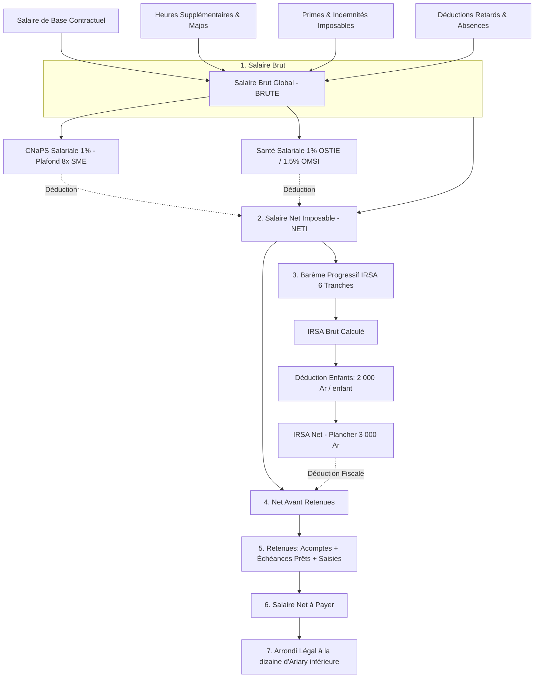
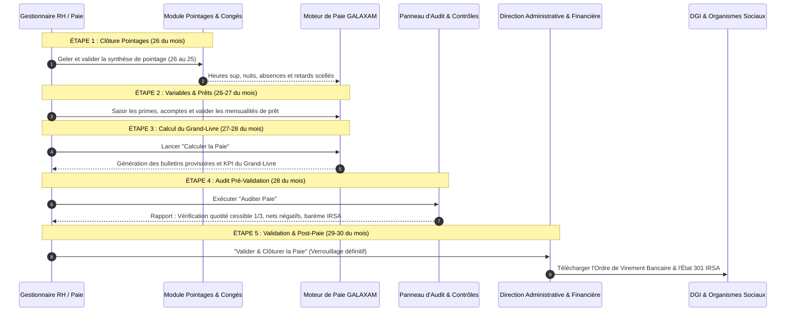
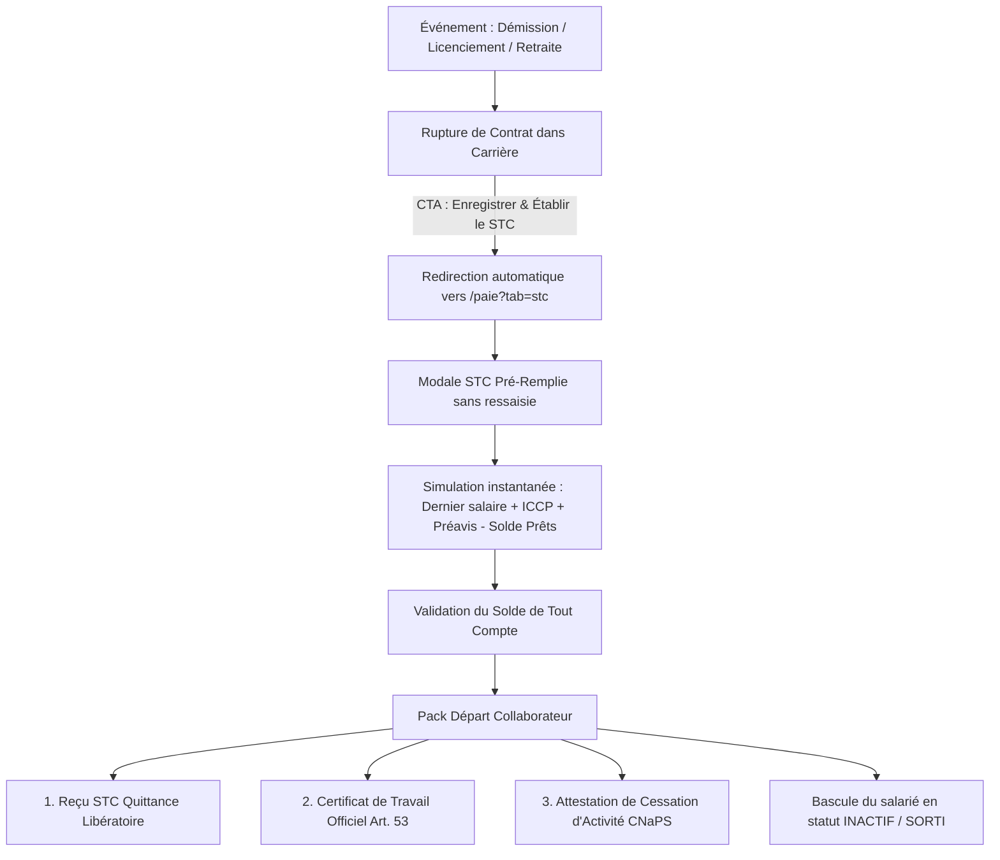
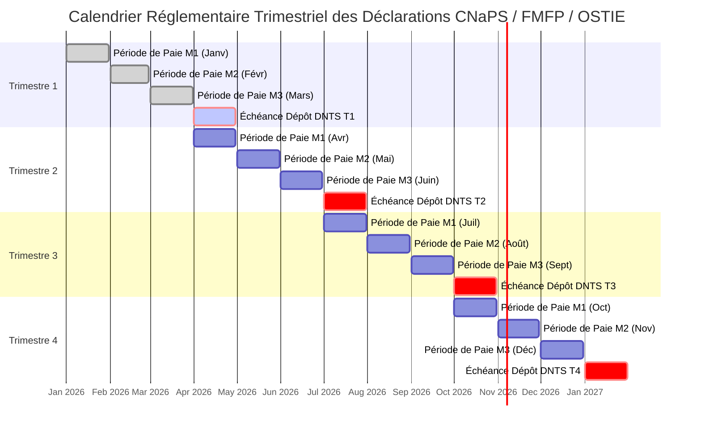

# GUIDE COMPLET DU MODULE PAIE & RÉMUNÉRATION — GALAXAM SIRH

---

## Sommaire

1. [Présentation Générale du Module Paie](#1-présentation-générale-du-module-paie)
2. [Règles Légales & Méthodes de Calcul Détaillées](#2-règles-légales--méthodes-de-calcul-détaillées)
   - 2.1 Période de Paie Décalée (26 au 25)
   - 2.2 Détermination du Salaire Brut (`BRUTE`)
   - 2.3 Cotisations Sociales Salariales & Patronales (CNaPS, FMFP, Santé)
   - 2.4 Fiscalité des Salaires : IRSA & ISI (Loi de Finances Madagascar)
   - 2.5 Retenues, Prêts d'Entreprise & Quotité Cessible (Art. 68)
   - 2.6 Net à Payer & Règle de l'Arrondi Légal
   - 2.7 Moteur du Solde de Tout Compte (STC) & Indemnités Légales
3. [Workflow Recommandé de Gestion de Paie (Pipeline Mensuel & Sorties)](#3-workflow-recommandé-de-gestion-de-paie)
   - 3.1 Pipeline Mensuel en 5 Étapes Séquentielles
   - 3.2 Workflow de Sortie & Offboarding Collaborateur (Rupture ➔ STC ➔ Clôture)
4. [États Nominatifs & Déclarations Fiscales et Sociales (DGI, CNaPS, Santé)](#4-états-nominatifs--déclarations-fiscales-et-sociales)
   - 4.1 Déclarations Mensuelles DGI (Impôts)
     - A. État 301 IRSA (Modèle e-Hetra / SAFI Grandes Entreprises - 25 Colonnes)
     - B. Annexe ISI 5% (XML EDI & Saisie Excel)
     - C. Ordre de Virement Bancaire
   - 4.2 Déclarations Trimestrielles Sociales & Santé (Par 3 mois civils)
     - A. Périodicité & Calendrier Réglementaire Strict (T1, T2, T3, T4)
     - B. DNTS CNaPS (1% + 13%, Plafond 8× SME)
     - C. Déclaration FMFP (1% Patronal)
     - D. Bordereaux Organismes de Santé (OSTIE, OMSI, AMIT, FUNHECE)
5. [Guide des Écrans & Nouvelles Interfaces Logiques](#5-guide-des-écrans--nouvelles-interfaces-logiques)
6. [Référentiel Technique & Points d'API Backend](#6-référentiel-technique--points-dapi-backend)

---

## 1. Présentation Générale du Module Paie

Le module **Paie & Rémunération** de **GALAXAM SIRH** centralise l'ensemble des opérations de rémunération du personnel permanent (salariés) et des intervenants externes (consultants assujettis à l'ISI), en stricte conformité avec :
- Le **Code du Travail Malagasy** (Loi n° 2003-044).
- Le **Code Général des Impôts (CGI)** et les dispositions des Lois de Finances (IRSA, ISI).
- Le **Code de Prévoyance Sociale** (CNaPS - Caisse Nationale de Prévoyance Sociale).
- La réglementation de la **Formation Professionnelle** (FMFP - Loi n° 2017-025).
- Les conventions des **Organismes Sanitaires Interentreprises** (OSTIE, OMSI, AMIT, FUNHECE).

### Caractéristiques Fondamentales :
- **Architecture Duale** : Prise en charge simultanée des salariés sous contrat (IRSA progressif + cotisations sociales) et des consultants/prestataires externes (retenue à la source ISI 5%).
- **Cycle Décalé Industriel** : Calcul des pointages du **26 du mois M-1 au 25 du mois M**, pour un virement bancaire effectif avant le 30/31 du mois M.
- **Continuité Inter-Modules Zéro Ressaisie** : Alimentation automatique depuis les modules **Contrats/Carrière** (salaire de base), **Pointages** (heures sup, retards, nuits, dimanches), **Congés** (droits acquis, absences déduites) et **Prêts** (échéanciers d'amortissement).

---

## 2. Règles Légales & Méthodes de Calcul Détaillées

---

### 2.1 Période de Paie Décalée (26 au 25)

À Madagascar, notamment dans les entreprises de logistique, manutention et transport, le mois de paie opérationnel est décalé par rapport au mois civil :
- **Période de Pointage Réelle** : du **26 du mois M-1 au 25 du mois M**.
- **Mois d'Imputation Financière & Fiscale** : Mois **M**.
- **Diviseur Horaire Légal National** :
  $$\text{Diviseur Mensuel} = \frac{40 \text{ heures/semaine} \times 52 \text{ semaines}}{12 \text{ mois}} = 173{,}3333 \text{ heures/mois}$$
- **Taux Horaire de Base** :
  $$\text{Taux Horaire} = \frac{\text{Salaire de Base}}{173{,}3333}$$

---

### 2.2 Détermination du Salaire Brut (`BRUTE`)

Le salaire brut mensuel regroupe la contrepartie du travail fourni ainsi que les compléments de rémunération imposables :

$$\text{BRUTE} = \text{Salaire de Base} - \text{Déductions Absences} + \text{Heures Supplémentaires} + \text{Majorations} + \text{Primes Imposables}$$

#### A. Déduction pour Absences Injustifiées
Conformément à la convention d'entreprise et à la pratique de paie GALAXAM :
$$\text{Taux Journalier d'Absence} = \frac{\text{Salaire de Base}}{30}$$
$$\text{Déduction Absence} = \text{Nombre de Jours d'Absence} \times \left(\frac{\text{Salaire de Base}}{30}\right)$$

#### B. Heures Supplémentaires & Majorations Légales (Code du Travail)
Les heures travaillées au-delà de la durée légale hebdomadaire (40h) donnent lieu aux majorations suivantes :
- **HS 30%** (8 premières heures sup au-delà de 40h) : $\text{Taux Horaire} \times 1{,}30$
- **HS 50%** (heures sup suivantes) : $\text{Taux Horaire} \times 1{,}50$
- **Heures de Nuit** (22h00 à 05h00) : Majoration de $+30\%$
- **Heures de Dimanche** : Majoration de $+40\%$
- **Jours Fériés Chômés et Payés** : Majoration de $+100\%$

#### C. Primes et Indemnités
- **Primes Imposables** : Prime d'assiduité, prime de rendement, prime d'astreinte, commissions.
- **Indemnités Non Imposables & Non Soumises** (dans les limites des barèmes DGI) : Indemnité de panier / cantine, indemnité forfaitaire de transport / déplacement justifié par les sujétions du poste.

---

### 2.3 Cotisations Sociales Salariales & Patronales

Les cotisations sont calculées sur la base du salaire brut mensuel (`BRUTE`) :

| Organisme | Assiette de Cotisation | Taux Salarial (Retenu au salarié) | Taux Patronal (À la charge employeur) | Plafonnement Légal |
| :--- | :--- | :---: | :---: | :--- |
| **CNaPS** (Prévoyance sociale, pensions, accidents du travail) | Salaire Brut Global | **1,0 %** | **13,0 %** | Plafonné à **$8 \times \text{SME}$** (Soit $8 \times 262\,680 = 2\,101\,440 \text{ Ar}$) |
| **FMFP** (Fonds Malgache de Formation Professionnelle) | Salaire Brut Global | **0,0 %** (Néant) | **1,0 %** | Non plafonné |
| **OSTIE** (Médecine du travail - Antananarivo) | Salaire Brut Global | **1,0 %** | **5,0 %** | Non plafonné |
| **OMSI** (Médecine du travail - Toamasina) | Salaire Brut Global | **1,5 %** | **5,5 %** | Non plafonné |
| **AMIT** / **FUNHECE** (Autres centres médicaux) | Salaire Brut Global | **1,0 %** | **5,0 %** | Selon convention locale |

> [!IMPORTANT]
> **Règle du Plafond CNaPS :**
> Si le salaire brut dépasse $2\,101\,440 \text{ Ar}$, la cotisation salariale CNaPS maximale est strictement de :
> $$\text{CNaPS Salariale Max} = 2\,101\,440 \times 1\% = 21\,014{,}40 \text{ Ar}$$
> Et la cotisation patronale CNaPS maximale est de :
> $$\text{CNaPS Patronale Max} = 2\,101\,440 \times 13\% = 273\,187{,}20 \text{ Ar}$$
> En revanche, **l'OSTIE, l'OMSI et le FMFP ne sont pas plafonnés**.

---

### 2.4 Fiscalité des Salaires : IRSA & ISI (Loi de Finances Madagascar)

#### A. Salaire Net Imposable (`NETI`)
L'assiette soumise à l'Impôt sur les Revenus Salariaux et Assimilés (IRSA) est obtenue après déduction des charges sociales obligatoires :
$$\text{NETI} = \text{BRUTE} - \text{Cotisation CNaPS Salariale} - \text{Cotisation Médicale Salariale (OSTIE/OMSI)}$$

#### B. Barème Progressif Annuel & Mensuel de l'IRSA (6 Tranches)
Conformément au Code Général des Impôts malagasy :

| Tranche | Tranche de Revenu Mensuel Imposable (`NETI`) | Taux IRSA | Formule d'Impôt sur la Tranche |
| :---: | :--- | :---: | :--- |
| **1** | De **0 Ar** à **350 000 Ar** | **0 %** | $0 \text{ Ar}$ |
| **2** | De **350 001 Ar** à **400 000 Ar** (soit 50 000 Ar) | **5 %** | $(\text{NETI} - 350\,000) \times 5\%$ (Max: $2\,500 \text{ Ar}$) |
| **3** | De **400 001 Ar** à **500 000 Ar** (soit 100 000 Ar) | **10 %** | $(\text{NETI} - 400\,000) \times 10\%$ (Max: $10\,000 \text{ Ar}$) |
| **4** | De **500 001 Ar** à **600 000 Ar** (soit 100 000 Ar) | **15 %** | $(\text{NETI} - 500\,000) \times 15\%$ (Max: $15\,000 \text{ Ar}$) |
| **5** | De **600 001 Ar** à **4 000 000 Ar** (soit 3 400 000 Ar) | **20 %** | $(\text{NETI} - 600\,000) \times 20\%$ (Max: $680\,000 \text{ Ar}$) |
| **6** | Au-delà de **4 000 000 Ar** | **25 %** | $(\text{NETI} - 4\,000\,000) \times 25\%$ |

#### C. Réduction d'Impôt pour Charges de Famille (Enfants à charge)
- **Montant légal** : **$2\,000 \text{ Ar}$ par mois et par enfant mineur à charge** (dans la limite des déclarations transmises à l'employeur).
$$\text{IRSA Après Déduction} = \text{IRSA Brut} - (\text{Nombre d'Enfants} \times 2\,000 \text{ Ar})$$

#### D. Règle du Minimum de Perception Fiscale (Plancher Légal)
La Loi de Finances fixe un impôt minimum :
- **Si $\text{IRSA Après Déduction} < 3\,000 \text{ Ar}$ (ou $2\,000 \text{ Ar}$ selon la configuration légale active)** :
  $$\text{IRSA Dû} = 3\,000 \text{ Ar}$$
- Sauf si le salarié est en exonération légale totale (revenu brut inférieur au seuil d'imposition national).

#### E. Régime de l'Impôt Synthétique Intermittent (ISI 5%)
Pour les **consultants, intervenants extérieurs, experts et prestataires occasionnels** qui ne possèdent pas de carte fiscale/statistique et n'ont pas la qualité de salariés permanents :
- **Taux Libératoire Unique** : **$5{,}0\%$ prélevé à la source** sur le montant hors taxe des honoraires.
- **Exonération totale** de CNaPS, de FMFP et d'OSTIE.
- Déclaration obligatoire sur l'annexe ISI e-Hetra de la DGI.

---

### 2.5 Retenues, Prêts d'Entreprise & Quotité Cessible (Art. 68)

Le salaire net disponible avant déductions personnelles est égal à :
$$\text{Net Avant Retenues} = \text{NETI} - \text{IRSA Dû}$$

Les retenues opérées par l'entreprise comprennent :
1. **Acomptes sur salaire** (quinzaine).
2. **Mensualités de remboursement de prêts d'entreprise**.
3. **Communications personnelles** non professionnelles (`CALL PERSO`).
4. **Saisies-arrêts** judiciaires ou cessions volontaires de salaire.

> [!CAUTION]
> **Règle d'Ordre Public de la Quotité Cessible (Art. 68 du Code du Travail) :**
> Le total cumulé des retenues mensuelles (prêts + acomptes + saisies) **ne peut jamais excéder le tiers (33,33%) de la rémunération disponible**.
> Le module Paie GALAXAM intègre un contrôle bloquant dans son **Audit Pré-Validation** qui signale tout dépassement de cette quotité.

---

### 2.6 Net à Payer & Règle de l'Arrondi Légal

Le salaire net final est calculé comme suit :
$$\text{Net à Payer} = \text{Net Avant Retenues} - \text{Total des Retenues}$$

#### Règle de l'Arrondi Spécifique :
À Madagascar, en raison des coupures de billets émises par la Banque Centrale (BFM), le net à payer est obligatoirement arrondi à la **dizaine d'Ariary inférieure** :
$$\text{Arrondi Net à Payer} = \lfloor \text{Net à Payer} / 10 \rfloor \times 10$$
*Exemple :* Un salaire net calculé de $845\,678{,}45 \text{ Ar}$ devient **$845\,670 \text{ Ar}$** net bancaire à virer.

---

### 2.7 Moteur du Solde de Tout Compte (STC) & Indemnités Légales

Lors de la rupture d'un contrat (démission, licenciement, rupture conventionnelle, fin de contrat CDD, départ à la retraite), le STC calcule automatiquement :

1. **Dernier Salaire Proratisé** : Traitement au prorata des jours réels travaillés jusqu'à la date de départ effectif.
2. **Indemnité Compensatrice de Congés Payés (ICCP)** :
   $$\text{ICCP} = \text{Solde de Jours de Congés Restants} \times \left(\frac{\text{Salaire de Base}}{30}\right)$$
3. **Indemnité de Préavis** :
   Due si le préavis n'est pas effectué à la demande de l'employeur (ou en cas de dispense légale accordée). Égale à 1 à 3 mois de salaire brut selon l'ancienneté et la catégorie (Cadre vs Non-Cadre).
4. **Indemnité Légale de Licenciement (Loi 2003-044)** :
   Due pour tout licenciement non consécutif à une faute lourde, calculée selon les barèmes d'ancienneté (ex: 10 à 20 jours de salaire par année de service continu).
5. **Apurement Intégral des Prêts en Cours** :
   Déduction intégrale automatique du capital restant dû sur tous les prêts accordés au salarié.
6. **Émission de la Quittance Libératoire** :
   Reçu officiel pour solde de tout compte numéroté (ex: `STC-2026-001`) avec mention de libération des dettes réciproques.

---

## 3. Workflow Recommandé de Gestion de Paie

### 3.1 Pipeline Mensuel en 5 Étapes Séquentielles

Le cockpit du module Paie intègre désormais le **Stepper Interactif du Cycle de Paie** matérialisant les 5 phases opérationnelles :

#### Fiche Récapitulative des Étapes du Pipeline :

| Étape | Intitulé | Actions à Mener | Points de Contrôle |
| :---: | :--- | :--- | :--- |
| **1** | **Pointages & Congés** | Clôturer et geler la période dans `/pointage/synthese` pour la période du 26 au 25. | Aucun pointage en anomalie ou en statut "BROUILLON". |
| **2** | **Variables & Prêts** | Dans l'onglet `Variables & Primes`, saisir les primes d'astreinte, commissions et acomptes quinzaine. | Respect des barèmes d'exonération des indemnités de déplacement. |
| **3** | **Moteur de Calcul** | Cliquer sur `Calculer la Paie`. Le moteur calcule en masse l'ensemble des salariés actifs. | Vérification des 5 KPI : Masse Brute, Net, Charges Patronales, IRSA, Coût Total. |
| **4** | **Contrôles & Audit** | Cliquer sur `Auditer Paie`. La modale contrôle automatiquement les 3 règles de conformité. | Zéro salaire net négatif ; Zéro dépassement de la quotité cessible d'un tiers (Art. 68). |
| **5** | **Clôture & Déclarations** | Valider la période. Les bulletins sont verrouillés. Télécharger l'Ordre de Virement, l'État 301 IRSA et les bordereaux. | Signature du DAF et envoi du fichier de virement bancaire avant le 30 du mois. |

---

### 3.2 Workflow de Sortie & Offboarding Collaborateur (Rupture ➔ STC ➔ Clôture)

1. **Rupture de Contrat** : Le RH notifie le motif légal, la date de départ et le préavis dans le module Carrière.
2. **Transition Instantanée** : Le bouton **« Enregistrer & Établir le STC »** transmet automatiquement l'employé, la date et le motif vers la Paie.
3. **Calcul & Apurement** : Le moteur de STC intègre l'historique de présence, les congés restants et déduit le solde des prêts en cours.
4. **Édition du Pack Sortie** : Depuis la table STC ou la modale de reçu, le RH imprime en un clic le **Reçu pour STC** et le **Certificat de Travail** conforme à l'article 53.

---

## 4. États Nominatifs & Déclarations Fiscales et Sociales

### 4.1 Déclarations Mensuelles DGI (Impôts)

#### A. État 301 IRSA (Modèle Officiel DGI SAFI / e-Hetra)
L'État 301 est la déclaration mensuelle récapitulative nominative des salaires versés et de l'impôt retenu. Le SIRH GALAXAM génère un fichier Excel strictement identique à la matrice officielle de la Direction des Grandes Entreprises (DGE) :

- **Périodicité** : **Mensuelle**.
- **Date Limite de Dépôt & Paiement** : **Le 15 du mois suivant** (ex: pour la paie de Mars 2026, dépôt avant le **15 Avril 2026**).
- **Règles des 25 Colonnes Officielles (A à Y)** :

| Colonne | Intitulé Réglementaire DGI | Description du Contenu |
| :---: | :--- | :--- |
| **A** | `N°` | Numéro d'ordre de la ligne (1, 2, 3...) |
| **B** | `N° CIN OU CARTE DE RESIDENT` | Numéro national d'identification du travailleur |
| **C** | `DATE DE DELIVRANCE` | Date de délivrance de la CIN |
| **D** | `LIEU DE DELIVRANCE` | Ville ou district de délivrance de la CIN |
| **E** | `N° CNAPS` | Numéro d'immatriculation CNaPS du salarié |
| **F** | `NOM` | Nom de famille de l'employé |
| **G** | `PRENOMS` | Prénoms de l'employé |
| **H** | `FONCTION` | Poste / métier exercé dans l'entreprise |
| **I** | `DATE D'ENTREE` | Date d'embauche initiale |
| **J** | `DATE DE DEPART` | Date de sortie si rupture intervenue au cours du mois |
| **K** | `SALAIRE DE BASE` | Salaire contractuel brut de base du mois |
| **L** | `AVANTAGES EN NATURE IMPOSABLES` | Logement, véhicule, domesticité valorisés selon barème DGI |
| **M** | `AUTRES INDEMNITES IMPOSABLES` | Primes de rendement, assiduité, heures supplémentaires |
| **N** | `TOTAL SALAIRE BRUT IMPOSABLE` | Somme K + L + M |
| **O** | `INDEMNITES NON IMPOSABLES` | Panier, transport justifié, frais réels de mission |
| **P** | `RETENUE CNAPS SALARIALE (1%)` | Cotisation 1% salariale (plafonnée à 8× SME) |
| **Q** | `RETENUE SANTE SALARIALE (1% / 1.5%)` | Cotisation OSTIE / OMSI salariale |
| **R** | `TOTAL RETENUES DEDUCTIBLES` | Somme P + Q |
| **S** | `MONTANT NET IMPOSABLE` | N - R (Assiette d'application du barème progressif) |
| **T** | `IMPOT BRUT CALCULE` | Résultat de l'application des 6 tranches du barème IRSA |
| **U** | `NOMBRE D'ENFANTS A CHARGE` | Nombre d'enfants mineurs déclarés |
| **V** | `REDUCTION CHARGES DE FAMILLE` | U × 2 000 Ar |
| **W** | `IMPOT NET DU (IRSA A PAYER)` | T - V (avec plancher légal minimum de 3 000 Ar) |
| **X** | `MODE DE PAIEMENT` | VIREMENT / ESPECES / CHEQUE |
| **Y** | `OBSERVATIONS` | Mention CDD, CDI, STC, Temps partiel |

---

#### B. Annexe ISI 5% (Pour Prestataires & Consultants Externes)
Pour les prestataires non salariés ayant subi la retenue de 5% :
- **Fichier XML EDI (`TradXML`)** : Fichier normalisé au standard technique DGI contenant les balises `<Transaction>`, `<IdentifiantBeneficiaire>`, `<MontantBrut>`, `<TauxImpot>`, `<MontantRetenu>`.
- **Feuille Excel `SAISIE`** : Modèle reprenant exactement la feuille de saisie du classeur macro officiel `edi-annexe-ISI-DECEMBRE2025.ods`.

---

### 4.2 Déclarations Trimestrielles Sociales & Santé

#### A. Périodicité & Calendrier Réglementaire Strict

> [!IMPORTANT]
> **Règle Fondamentale du Droit Social Malgache :**
> Alors que la paie est calculée et payée **chaque mois**, les cotisations de sécurité sociale (CNaPS), de formation professionnelle (FMFP) et de santé au travail (OSTIE, OMSI, AMIT) sont déclarées et réglées **par trimestre civil complet (tranche de 3 mois)** :

| Trimestre Civil | Mois Civils Inclus | Date Limite Légale de Versement & Dépôt | Pénalités en cas de retard |
| :---: | :--- | :---: | :--- |
| **T1** | Janvier — Février — Mars | **30 Avril** | Majoration de retard de 10% + 1% par mois |
| **T2** | Avril — Mai — Juin | **31 Juillet** | Majoration de retard de 10% + 1% par mois |
| **T3** | Juillet — Août — Septembre | **31 Octobre** | Majoration de retard de 10% + 1% par mois |
| **T4** | Octobre — Novembre — Décembre | **31 Janvier (Année N+1)** | Majoration de retard de 10% + 1% par mois |

---

#### B. DNTS CNaPS (Déclaration Nominative Trimestrielle des Salaires)
Le fichier généré consolide les 3 mois du trimestre sélectionné :
- Pour chaque salarié : Matricule, Nom, N° CNaPS, Date d'entrée/sortie, Salaire brut M1, Salaire brut M2, Salaire brut M3, Total Trimestre.
- Assiette plafonnée à $8 \times \text{SME}$ par mois.
- **Cotisation Salariale Due (1%)** : Déduite chaque mois sur les bulletins des salariés.
- **Cotisation Patronale Due (13%)** : Prise en charge intégrale par GALAXAM.
- **Total à Virer à la CNaPS** : **14,0 %** de l'assiette brute trimestrielle plafonnée.

#### C. Déclaration FMFP (Fonds Malgache de Formation Professionnelle)
- Adossée à la déclaration CNaPS mais calculée à **1,0% à la charge exclusive de l'employeur** (part salariale nulle).
- Assiette : Masse brute totale non plafonnée des 3 mois.
- Permet à GALAXAM de financer les plans de formation professionnelle continue de ses collaborateurs.

#### D. Bordereaux Organismes de Santé (OSTIE, OMSI, AMIT, FUNHECE)
- **OSTIE (Antananarivo)** : **1% salarial + 5% patronal = 6% total**.
- **OMSI (Toamasina)** : **1.5% salarial + 5.5% patronal = 7% total**.
- État nominatif trimestriel mentionnant l'état d'adhésion, les ayants droit (conjoints et enfants couverts pour les soins médicaux et d'urgence).

---

## 5. Guide des Écrans & Nouvelles Interfaces Logiques

### 1. Le Pipeline Stepper Interactif (`PaieWorkflowStepper.jsx`)
Situé en haut du cockpit de paie, il guide le gestionnaire à travers les 5 phases opérationnelles :
- Indicateurs d'état en temps réel : `✓ Terminé`, `En cours`, `À auditer`, `Pointages non gelés`.
- Boutons d'action contextuelle intégrés sur chaque carte (`Voir Synthèse`, `Gérer Variables`, `Recalculer`, `Auditer`, `Déclarations`).

### 2. Le Widget Échéancier Réglementaire (`EcheancierFiscalSocialWidget.jsx`)
Surveille en continu les dates limites légales :
- Calcul dynamique du compte à rebours : **J-X avant l'IRSA mensuelle** (le 15) et **J-X avant la DNTS CNaPS trimestrielle** (30 Avril, 31 Juillet, 31 Octobre, 31 Janvier).
- Badges d'urgence visuels et CTA vers les bordereaux.

### 3. La Modale d'Audit Pré-Validation (`PaieAuditModal.jsx`)
Outil de contrôle pré-clôture indispensable pour la DAF :
- Détecte les salaires nets négatifs ou nuls.
- Contrôle le respect strict de la **quotité cessible d'un tiers (Art. 68)** pour les prêts et acomptes.
- Signale les rémunérations inférieures au Salaire Minimum d'Embauche (SME 262 500 Ar).
- Présente la synthèse chiffrée consolidée avant le verrouillage définitif.

### 4. Le Pack Départ STC & Certificat de Travail (`SoldeToutCompteTable.jsx` & `RecuStcModal.jsx`)
- Accès en un clic au **Reçu Officiel STC** (quittance libératoire financière).
- Accès direct au **Certificat de Travail Officiel (Art. 53)** prêt à l'impression format A4.

---

## 6. Référentiel Technique & Points d'API Backend

Tous les services de paie sont exposés sur le préfixe `/paie` et sécurisés par Spring Security (`PAIE_READ`, `PAIE_WRITE`, `PAIE_VALIDATE`, `ADMIN`) :

| Méthode HTTP | URL de l'Endpoint | Paramètres Requis | Description & Rôle Métier |
| :---: | :--- | :--- | :--- |
| `GET` | `/paie/bulletins` | `idPeriode` | Récupère la liste des bulletins du Grand-Livre de la période |
| `GET` | `/paie/bulletins/{id}` | `id` | Détail complet d'un bulletin (rubriques, cotisations, parts pat.) |
| `POST` | `/paie/calculer` | `idPeriode` | Exécute le moteur de calcul sur l'ensemble des salariés actifs |
| `POST` | `/paie/valider` | `idPeriode` | Valide et verrouille définitivement la paie de la période |
| `POST` | `/paie/cloturer` | `idPeriode` | Clôture finale de l'exercice mensuel |
| `GET` | `/paie/export-excel` | `idPeriode` | Télécharge le Grand-Livre consolidé sous format Excel |
| `GET` | `/paie/export-etat-301` | `idPeriode` | Télécharge l'État 301 IRSA officiel DGI SAFI (25 colonnes) |
| `GET` | `/paie/export-dnts-cnaps` | `idPeriode` | Télécharge le bordereau mensuel indicatif CNaPS |
| `GET` | `/paie/export-trimestriel-cnaps` | `annee`, `trimestre` | **Bordereau Nominatif Trimestriel CNaPS & FMFP (3 mois)** |
| `GET` | `/paie/export-trimestriel-sante` | `annee`, `trimestre`, `organisme` | **Bordereau Nominatif Trimestriel OSTIE / OMSI / AMIT (3 mois)** |
| `GET` | `/paie/export-edi-isi-xml` | `idPeriode` | **Export du fichier XML EDI normalisé (TradXML)** |
| `GET` | `/paie/export-edi-isi-excel` | `idPeriode` | **Export de la feuille tabulaire SAISIE pour classeur macro DGI** |
| `POST` | `/paie/stc/preparer` | `idEmploye`, `dateDepart`, `motif` | Simule les droits de sortie (ICCP, préavis, déduction prêts) |
| `POST` | `/paie/stc/creer` | `StcRequestDTO` | Enregistre et valide le Solde de Tout Compte avec n° de reçu |
| `GET` | `/paie/stc/liste` | Aucun | Liste l'ensemble des reçus pour solde de tout compte émis |
