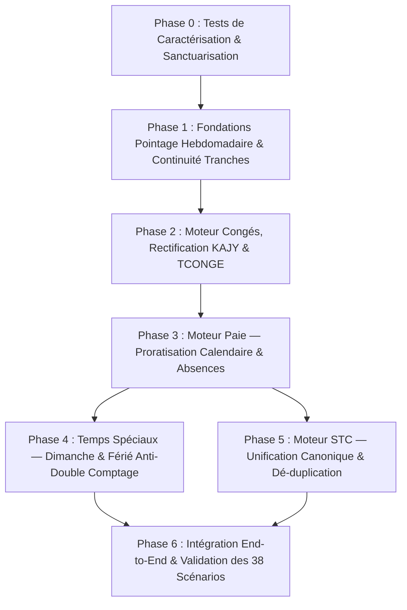

# PLAN D'IMPLÉMENTATION OPÉRATIONNEL CONSOLIDÉ
## Pointage → Congés → Paie → Solde de Tout Compte (STC)

**Date :** 16 septembre 2026  
**Document de Référence :** `AUDIT_CONSOLIDE_FINAL_2026-09-16.md`  
**Statut :** 🛑 DOCUMENT OPÉRATIONNEL EN ATTENTE D'ARBITRAGE ET DE DÉCLENCHEMENT  
**Règle d'or :** Aucun code modifié avant validation formelle de ce plan et des arbitrages BR-01 et BR-02.

---

## VUE D'ENSEMBLE DU SÉQUENCEMENT



---

## PHASE 0 — TESTS DE CARACTÉRISATION & SANCTUARISATION

### 1. Objectif
Figer par des tests automatisés stricts les comportements sains existants afin d'interdire toute régression lors des phases ultérieures.

### 2. Findings Couverts
Sécurisation préalable de l'ensemble du périmètre P0 / P1 / P2.

### 3. Dépendances
Aucune.

### 4. Périmètre Fichiers & Tables
* **Fichiers de tests modifiés/créés :**
  - `AttendanceCalculationPipelineTest.java`
  - `CalculsConformiteIntegraleTest.java`
  - `PayrollExecutionEngineTest.java`
* **Tables concernées :** Aucune modification de schéma.

### 5. Classes Conservées / Modifiées / Supprimées
* *Modifiées (Tests uniquement) :* Aucune classe de production modifiée.
* *Nouveaux tests de caractérisation :*
  - Validation de la compensation nominale (7+9+8+8+8 = 40h) ;
  - Validation de la déduction d'absence en heures réelles ;
  - Validation de la progressivité du barème IRSA à 6 tranches.

### 6. Tests AVANT
Exécution de la suite existante :
```bash
mvn test -Dtest=AttendanceCalculationPipelineTest,CalculsConformiteIntegraleTest,PayrollExecutionEngineTest
```
*Résultat attendu :* 100% vert (36 tests réussis).

### 7. Modifications Techniques
Ajout de tests d'assertion caractérisant les sorties actuelles du moteur de calcul sans modifier le code source Java.

### 8. Tests APRÈS
Exécution des tests de caractérisation.

### 9. Risques & Rollback
* **Risque :** Découverte de comportements instables déjà existants.
* **Rollback :** Suppression des tests de caractérisation non conformes.
* **Critère de sortie :** Socle de tests de référence stable et vert à 100%.

---

## PHASE 1 — FONDATIONS POINTAGE HEBDOMADAIRE & CONTINUITÉ DES TRANCHES

### 1. Objectif
1. Supprimer le constructeur défectueux `WeeklyAttendanceContext` (qui dérive `expectedMinutes / 5`).
2. Sécuriser la transmission explicite de `standardDayMinutes` (480 min).
3. Corriger le dédoublement de la tranche 1 HS (8h à 30%) lors des semaines tronçonnées en frontière de mois.

### 2. Findings Corrigés
* `C3-Obs` / `P2-05` : Élimination du biais `expectedMinutes / 5`.
* `P1-06` : Continuité de la première tranche HS sur les semaines chevauchant deux périodes de paie.

### 3. Dépendances
Phase 0 validée.

### 4. Périmètre Fichiers & Tables
* **Classes de production modifiées :**
  - `WeeklyAttendanceContext.java`
  - `WeeklyAttendanceCalculator.java`
  - `PointageSyntheseService.java`
* **Tables concernées :** `pointage_semaine_calcule` (lecture de l'historique de la semaine).

### 5. Changements Techniques Détaillés
1. **`WeeklyAttendanceContext.java` :**
   - Déprécier le constructeur à 4 arguments et forcer le passage explicite de `standardDayMinutes` :
     ```java
     public WeeklyAttendanceContext(LocalDate weekStart, long expectedMinutes,
                                    long firstOvertimeBandMinutes, boolean overtimeEligible,
                                    long standardDayMinutes) { ... }
     ```
2. **`PointageSyntheseService.java` :**
   - Lors du calcul d'un tronçon de semaine, vérifier si un tronçon antérieur existe pour le même `debut_semaine` :
     ```sql
     SELECT COALESCE(SUM(heures_hs_30), 0) AS hs30_deja_prises
     FROM pointage_semaine_calcule
     WHERE id_employe = ? AND debut_semaine = ? AND id_periode_paie != ?
     ```
   - Ajuster `firstBandMinutes` pour le tronçon courant :
     $$\text{firstBandMinutes} = \max\left(0L, 480L - (\text{hs30\_deja\_prises} \times 60L)\right)$$

### 6. Tests AVANT / APRÈS
* **Test Avant :** `testSemaineTronqueeContinuiteTranches` échoue (accorde 16h à 30%).
* **Test Après :** `testSemaineTronqueeContinuiteTranches` réussit (8h à 30%, 4h à 50%).
* **Critère de sortie :** Tests 1 à 11 du catalogue validés sans régression.

---

## PHASE 2 — MOTEUR CONGÉS, RECTIFICATION KAJY & TCONGE

### 1. Objectif
1. Corriger le bug `jAbs - jCge` dans `PayrollService.java:870` qui effaçait les absences injustifiées.
2. Éliminer les constantes `"2.5"` et `"30.0"` en les liant à `paie_config_legale`.
3. Reproduire rigoureusement le benchmark KAJY.
4. Traiter le cas du premier mois sans historique conformément à l'arbitrage BR-02.

### 2. Findings Corrigés
* `P0-03` : Bug de neutralisation des absences injustifiées.
* `P2-01` : Constantes hardcodées `"2.5"` et `"30.0"`.
* `P1-04` : Fallback silencieux `BASE/30`.

### 3. Dépendances
Phase 1 validée ; Arbitrage BR-02 confirmé par le métier.

### 4. Périmètre Fichiers & Tables
* **Classes de production modifiées :**
  - `PayrollService.java` (`mettreAJourJournalConge`)
  - `CongeCalculateurEngine.java`
* **Tables concernées :** `conge_journal_droit`, `paie_config_legale`.

### 5. Changements Techniques Détaillés
1. **`PayrollService.java` :**
   - Remplacer les lignes 869-875 par :
     ```java
     // jAbs est déjà le nombre d'absences injustifiées non rémunérées
     BigDecimal formule = new BigDecimal("30.0").subtract(jAbs).max(BigDecimal.ZERO);
     BigDecimal droitMois = congeEngine.calculerAcquisitionMensuelleProratisee(
             formule, 
             configLegale.getAcquisitionCongeMensuelJours(), 
             new BigDecimal(configLegale.getDiviseurValorisationCongeJours()));
     ```
   - Remplacer le diviseur fixe 30 dans le calcul de valorisation :
     ```java
     BigDecimal valMois = congeEngine.calculerValorisationDroitMensuel(
             baseTotale, droitMois, configLegale.getDiviseurValorisationCongeJours());
     ```
2. **Gestion du Premier Mois (Arbitrage BR-02) :**
   - Remplacer le fallback silencieux `BASE/30` par l'application stricte de la formule choisie lors de l'arbitrage (ex : exception explicite ou formule légale encadrée).

### 6. Tests AVANT / APRÈS
* **Test Avant :** `testAbsenceInjustifieeNonAnnuleeParConge` produit $D = 30$ au lieu de $D = 28$.
* **Test Après :** $D = 28$, benchmark KAJY conforme ($CumulJours \approx 29{,}96$, $CumulValo \approx 324\,385{,}38$, $TCONGE \approx 10\,828{,}49$).
* **Critère de sortie :** Tests 21 à 26 du catalogue validés.

---

## PHASE 3 — MOTEUR PAIE : PRORATISATION CALENDAIRE & ABSENCES

### 1. Objectif
1. Remplacer la proratisation erronée en heures (`tauxHoraire × heuresReelles`) par la règle confirmée du trentième calendaire ($Base \times JoursCalendaires / 30$).
2. Introduire le paramètre dédié `diviseur_prorata_salaire_jours` dans `paie_config_legale`.
3. Supprimer le fallback `8.00h` dans `PayrollExecutionEngine.java:191`.
4. Corriger le test tautologique `CalculsConformiteIntegraleTest:124`.

### 2. Findings Corrigés
* `P0-01` : Proratisation d'entrée/sortie incorrecte.
* `P1-01` / `P1-02` : Fallbacks `8.0h` en dur.
* `P2-06` : Test 1.1 encodant la mauvaise règle.

### 3. Dépendances
Phase 1 validée.

### 4. Périmètre Fichiers & Tables
* **Migration SQL :**
  ```sql
  ALTER TABLE paie_config_legale 
      ADD COLUMN IF NOT EXISTS diviseur_prorata_salaire_jours INT NOT NULL DEFAULT 30;
  ```
* **Classes de production modifiées :**
  - `PaieConfigLegale.java`
  - `PayrollCalculationInput.java`
  - `PayrollService.java`
  - `PayrollExecutionEngine.java`
* **Classes de tests modifiées :**
  - `CalculsConformiteIntegraleTest.java` (Test 1.1 réécrit).

### 5. Changements Techniques Détaillés
1. **`PayrollCalculationInput.java` :**
   - Ajouter `joursCalendairesProrata` et `diviseurProrataSalaireJours`.
2. **`PayrollService.java:preparerInput()` :**
   - Si `entreeSortieEnCoursDeMois == true`, calculer le nombre de jours calendaires effectifs :
     $$\text{joursEffectifs} = \min\left(30, \text{ChronoUnit.DAYS.between}(\text{dateDebutEch}, \text{dateFinEch}) + 1\right)$$
3. **`PayrollExecutionEngine.java:calculerSalaireBrut()` :**
   - Remplacer le calcul du salaire de base proratisé par :
     ```java
     if (input.isEntreeSortieEnCoursDeMois()) {
         BigDecimal jours = new BigDecimal(input.getJoursCalendairesProrata());
         BigDecimal div = new BigDecimal(input.getDiviseurProrataSalaireJours());
         salaireBaseLigne = MoneyRoundingPolicy.amount(
                 salaireBaseContractuel.multiply(jours).divide(div, 4, RoundingMode.HALF_UP)
         ).min(salaireBaseContractuel);
     }
     ```
4. **Correction de la conversion d'absence :**
   - `PayrollService.java:567` : Remplacer `"8.0"` par `input.getHeuresJournalieresLegales()`.
   - `PayrollExecutionEngine.java:191` : Supprimer le fallback `8.00` et exiger une valeur positive validée par le résolveur légal.

### 6. Tests AVANT / APRÈS
* **Test Avant :** Test 1.1 attend $300\,000{,}00\text{ Ar}$ calculé sur $86{,}665\text{ h}$.
* **Test Après :** Test 1.1 attend $300\,000{,}00\text{ Ar}$ calculé sur 15 jours calendaires ($600\,000 \times 15 / 30$).
* **Critère de sortie :** Tests 15 à 20 du catalogue validés.

---

## PHASE 4 — TEMPS SPÉCIAUX (DIMANCHE & FÉRIÉ TRAVAILLÉ SÉCURISÉS)

### 1. Objectif
1. Câbler la persistance des heures réelles de dimanche et de férié travaillé dans `pointage_cumul_periode`.
2. Résoudre la majoration `DIMANCHE` (0.40) dans `PayrollLegalContextResolver`.
3. Implémenter la valorisation en Paie en respectant la matrice anti-double comptage issue de l'arbitrage BR-01.

### 2. Findings Corrigés
* `P0-02` : Heures dimanche et férié perdues.
* `P1-07` : Omission de la majoration dimanche dans le résolveur légal.

### 3. Dépendances
Arbitrage BR-01 validé ; Phase 3 validée.

### 4. Périmètre Fichiers & Tables
* **Migration SQL :**
  ```sql
  ALTER TABLE pointage_cumul_periode
      ADD COLUMN IF NOT EXISTS heures_dimanche NUMERIC(6,2) NOT NULL DEFAULT 0.00,
      ADD COLUMN IF NOT EXISTS heures_ferie_travaille NUMERIC(6,2) NOT NULL DEFAULT 0.00;
  ```
* **Classes de production modifiées :**
  - `PointageSyntheseService.java`
  - `PayrollAttendanceInput.java`
  - `PayrollLegalContextResolver.java`
  - `OvertimePayCalculator.java`
  - `PayrollExecutionEngine.java`

### 5. Changements Techniques Détaillés
1. **`PointageSyntheseService.java` :**
   - Sauvegarder `heures_dimanche` et `heures_ferie_travaille` dans le snapshot scellé lors de `gelerPeriode()`.
2. **`PayrollLegalContextResolver.java` :**
   - Ajouter la résolution de `DIMANCHE` dans `resolveOvertimeRates()` :
     ```java
     input.setMajorationDimanche(RefTauxMajoration.resolveApplicable(
             configId, "DIMANCHE", targetDate, connection).getTaux());
     ```
3. **`OvertimePayCalculator.java` & `PayrollExecutionEngine.java` :**
   - Appliquer la formule arbitrée :
     - Si Majoration seule (Option A) : $Montant = Heures \times TauxHoraire \times Majoration$.
     - Si Rémunération + Majoration (Option B) : $Montant = Heures \times TauxHoraire \times (1 + Majoration)$.
   - Générer les rubriques `HEURES_DIMANCHE` et `HEURES_FERIE`.

### 6. Tests AVANT / APRÈS
* **Test Avant :** Les bulletins de paie affichent 0 Ar pour dimanche et férié travaillé.
* **Test Après :** Montants calculés avec exactitude sans doublement de l'heure de base.
* **Critère de sortie :** Tests 12, 13, 14 du catalogue validés.

---

## PHASE 5 — SOLDE DE TOUT COMPTE (STC) : ALIGNEMENT CANONIQUE

### 1. Objectif
1. Supprimer toutes les requêtes SQL brutes dupliquées dans `StcService` (CNaPS, FMFP, Santé).
2. Brancher `StcService` sur `PayrollLegalContextResolver`.
3. Supprimer le hardcode `SME × 8` dans `SocialContributionCalculator`.
4. Remplacer `PayrollExecutionEngine.DIVISEUR_HEURES_MENSUELLES` par la configuration légale datée.

### 2. Findings Corrigés
* `P1-03` : Requête santé brute avec `LIMIT 1`.
* `P1-05` : Taux horaire constant non daté.
* `P2-02` : Plafond CNaPS hardcodé dans le moteur social.
* `P2-03` : Fuite d'abstraction de la constante 173.33.

### 3. Dépendances
Phases 2 et 3 validées.

### 4. Périmètre Fichiers & Tables
* **Classes de production modifiées :**
  - `SocialContributionCalculator.java`
  - `PayrollLegalContextResolver.java`
  - `StcService.java`
  - `PayrollExecutionEngine.java` (privatisation des constantes).

### 5. Changements Techniques Détaillés
1. **`SocialContributionCalculator.java` :**
   - Étendre `Rules` pour recevoir `ceilingSmeMultiplier` résolu dynamiquement.
   - Supprimer le littéral `"8"` en dur.
2. **`StcService.java` :**
   - Éliminer les méthodes privées redondantes et utiliser `PayrollLegalContextResolver` pour obtenir les taux de cotisations applicables à la date de rupture.
   - Aligner la formule du salaire au prorata sur la méthode canonique validée en Phase 3.
3. **`PayrollExecutionEngine.java` :**
   - Rendre privées ou déprécier les constantes statiques globales.

### 6. Tests AVANT / APRÈS
* **Test Avant :** Divergence possible entre bulletin STC et bulletin mensuel ordinaire lors d'un recalcul historique.
* **Test Après :** Identité stricte des cotisations, bases et plafonds entre STC et Paie normale.
* **Critère de sortie :** Tests 32 à 38 du catalogue validés.

---

## PHASE 6 — VALIDATION END-TO-END & NON-RÉGRESSION

### 1. Objectif
Vérifier l'exécution de la chaîne complète sur un cycle complet : Pointage quotidien $\rightarrow$ Clôture hebdomadaire $\rightarrow$ Gel de période $\rightarrow$ Calcul des bulletins $\rightarrow$ Clôture Paie $\rightarrow$ Génération STC.

### 2. Findings Couverts
Ensemble du périmètre consolidé.

### 3. Dépendances
Phases 1 à 5 achevées et validées.

### 4. Exécution du Catalogue de Tests
Exécution sans échec des **38 tests canoniques** répertoriés dans la section 9 du rapport d'audit consolidé.

### 5. Critères de Clôture Définitive
1. 100% des tests unitaires, d'intégration et adversariaux sont verts.
2. Zéro constante métier hardcodée dans les classes Java de production.
3. Rapport d'exécution documenté dans le fichier de compte-rendu `walkthrough.md`.
