# LIVRE BLANC D'ARCHITECTURE & MANUEL TECHNIQUE DU REPOSITORY

# GALAXAM-SIRH — SYSTÈME D'INFORMATION DES RESSOURCES HUMAINES & DE LA PRÉ-PAIE

---

## SOMMAIRE GÉNÉRAL

- [PARTIE I — COMPRENDRE LE PROJET](#partie-i--comprendre-le-projet)
  - [1. Résumé Exécutif](#1-résumé-exécutif)
  - [2. Technologies &amp; Stack Technique](#2-technologies--stack-technique)
  - [3. Architecture Globale Réelle](#3-architecture-globale-réelle)
  - [4. Arborescence Expliquée du Codebase](#4-arborescence-expliquée-du-codebase)
  - [5. Principes Architecturaux &amp; Design Patterns Détectés](#5-principes-architecturaux--design-patterns-détectés)
- [PARTIE II — CARTOGRAPHIE DU BACKEND](#partie-ii--cartographie-du-backend)
  - [6. Architecture en Couches &amp; Active Record JDBC](#6-architecture-en-couches--active-record-jdbc)
  - [7. Moteurs Métier &amp; Domain Engines (Cœur Algorithmique)](#7-moteurs-métier--domain-engines-cœur-algorithmique)
  - [8. Inventaire Exhaustif des 39 Contrôleurs REST &amp; 213 Endpoints](#8-inventaire-exhaustif-des-39-contrôleurs-rest--213-endpoints)
  - [9. Couche de Persistance : Entités Active Record &amp; Vues CPL](#9-couche-de-persistance--entités-active-record--vues-cpl)
  - [10. Sécurité, IAM, Filtres &amp; JWT](#10-sécurité-iam-filtres--jwt)
  - [11. Tâches Planifiées (Schedulers &amp; Crons)](#11-tâches-planifiées-schedulers--crons)
- [PARTIE III — CARTOGRAPHIE DU FRONTEND](#partie-iii--cartographie-du-frontend)
  - [12. Architecture SPA React 19 &amp; Design System](#12-architecture-spa-react-19--design-system)
  - [13. Routage, Protection RBAC &amp; Code-Splitting](#13-routage-protection-rbac--code-splitting)
  - [14. Gestion de l&#39;État &amp; Custom Hooks](#14-gestion-de-létat--custom-hooks)
  - [15. Couche API Client &amp; Gestion Centralisée des Erreurs](#15-couche-api-client--gestion-centralisée-des-erreurs)
  - [16. Inventaire des 14 Services API Frontend](#16-inventaire-des-14-services-api-frontend)
- [PARTIE IV — CARTOGRAPHIE BIDIRECTIONNELLE FRONT ↔ BACK](#partie-iv--cartographie-bidirectionnelle-front--back)
  - [17. Traçabilité Complète des Flux de Données](#17-traçabilité-complète-des-flux-de-données)
  - [18. Analyse des Écarts : Endpoints Orphelins &amp; Appels Divergents](#18-analyse-des-écarts--endpoints-orphelins--appels-divergents)
- [PARTIE V — FICHES STANDARD DES 9 MODULES MÉTIER](#partie-v--fiches-standard-des-9-modules-métier)
  - [Module 1 : Authentification, Sécurité &amp; IAM](#module-1--authentification-sécurité--iam)
  - [Module 2 : Organisation &amp; Structure d&#39;Entreprise](#module-2--organisation--structure-dentreprise)
  - [Module 3 : Référentiels RH &amp; Paramètres Généraux](#module-3--référentiels-rh--paramètres-généraux)
  - [Module 4 : Gestion des Employés &amp; Dossier RH](#module-4--gestion-des-employés--dossier-rh)
  - [Module 5 : Gestion des Contrats &amp; Supervision des Carrières](#module-5--gestion-des-contrats--supervision-des-carrières)
  - [Module 6 : Gestion du Pointage, Présences &amp; Horaires](#module-6--gestion-du-pointage-présences--horaires)
  - [Module 7 : Gestion des Congés &amp; Absences (Ledger FIFO)](#module-7--gestion-des-congés--absences-ledger-fifo)
  - [Module 8 : Configuration Paie &amp; Préparation Bulletins](#module-8--configuration-paie--préparation-bulletins)
  - [Module 9 : Tableau de Bord, Widgets &amp; Notifications RH](#module-9--tableau-de-bord-widgets--notifications-rh)
- [PARTIE VI — WORKFLOWS MÉTIER COMPLETS](#partie-vi--workflows-métier-complets)
  - [19. Workflow 1 : Embauche &amp; Cycle de Carrière](#19-workflow-1--embauche--cycle-de-carrière)
  - [20. Workflow 2 : Congé Payé &amp; Scission Maladie (Art. 13)](#20-workflow-2--congé-payé--scission-maladie-art-13)
  - [21. Workflow 3 : Clôture Mensuelle de Pointage &amp; Gel Paie](#21-workflow-3--clôture-mensuelle-de-pointage--gel-paie)
- [PARTIE VII — QUALITÉ DU CODE &amp; DETTE TECHNIQUE](#partie-vii--qualité-du-code--dette-technique)
  - [22. Détection des Duplications &amp; Opportunités de Mutualisation](#22-détection-des-duplications--opportunités-de-mutualisation)
  - [23. Responsabilités Mal Placées &amp; Incohérences](#23-responsabilités-mal-placées--incohérences)
- [PARTIE VIII — ARCHITECTURE CIBLE &amp; STANDARDS DE DÉVELOPPEMENT](#partie-viii--architecture-cible--standards-de-développement)
  - [24. Organisation Standard d&#39;une Nouvelle Fonctionnalité](#24-organisation-standard-dune-nouvelle-fonctionnalité)
  - [25. Matrice Universelle des Responsabilités](#25-matrice-universelle-des-responsabilités)
- [PARTIE IX — GUIDE OPÉRATIONNEL (&#34;OÙ MODIFIER QUOI ?&#34;)](#partie-ix--guide-opérationnel-où-modifier-quoi-)
  - [26. Guide de Modification par Scénario Métier](#26-guide-de-modification-par-scénario-métier)
- [PARTIE X — TABLEAU CENTRAL DE NAVIGATION &amp; INDEX](#partie-x--tableau-central-de-navigation--index)
  - [27. Matrice Globale de Référence du Repository](#27-matrice-globale-de-référence-du-repository)

---

# PARTIE I — COMPRENDRE LE PROJET

## 1. Résumé Exécutif

**GALAXAM-SIRH** est un progiciel de gestion intégrée des Ressources Humaines et de pré-paie conçu spécifiquement pour le contexte légal, fiscal et conventionnel malagasy (Code du Travail Malagasy, règles CNaPS, organismes de santé OSTIE/AMIT/FUNHREUMA, et barème progressif IRSA du Code Général des Impôts).

Le système couvre le cycle de vie complet du collaborateur :

1. **Recrutement & Dossier Collaborateur** : Génération séquentielle de matricule `EMP%04d`, gestion complète de l'état civil, CIN/Passeport/Permis, données familiales (conjoint, enfants pour déduction IRSA), comptes bancaires RIB, GED des pièces justificatives avec conformité obligatoire.
2. **Gestion Contractuelle & Carrière** : Workflow d'embauche, gestion des périodes d'essai (confirmation/renouvellement), avenants CDD avec garde-fous légaux stricts (2 renouvellements / 24 mois max), promotions, mutations multi-filiales/sites, ruptures conventionnelles/licenciements avec clôture automatique.
3. **Gestion des Congés & Absences** : Moteur de Ledger FIFO par pools d'acquisition annuelle de 2.5 jours/mois, calcul précis des jours ouvrables/fériés, bascule automatique Art. 13 des arrêts maladie longue durée > 30 jours, purges et acquisitions automatisées par cron.
4. **Gestion des Pointages & Présences** : Saisie quotidienne de badgeage avec détection de retard, ventilation hebdomadaire au seuil des 40h/semaine avec compensation 1:1 retard/HS, calcul des HS 130%/150%, heures de nuit, dimanches, fériés, primes de repas et indemnités kilométriques avec dérogations par site, détection et régularisation des anomalies, gel/dégel et transmission DAF des périodes de paie.
5. **Configuration Paie & Préparation Bulletins** : Paramétrage des cotisations sociales avec plafonnement à 8×SMIG, barème progressif par tranches IRSA avec minimum de perception et déductions enfants à charge, calendriers fériés locaux, et moteur de calcul préparatoire du net.
6. **Sécurité, IAM & Administration** : Authentification JWT sans état avec Refresh Token HTTP-only, contrôle d'accès RBAC granulaire par rôles, permissions et menus dynamiques, traçabilité intégrale via `audit_log` et `journal_connexion`.

---

## 2. Technologies & Stack Technique

```text
┌─────────────────────────────────────────────────────────────────────────────┐
│                             FRONTEND STACK                                  │
│  React 19.2 + Vite 8.1 + Tailwind CSS v4 + React Router v7 + Axios + Lucide │
└──────────────────────────────────────┬──────────────────────────────────────┘
                                       │ HTTP / REST / JSON (JWT Bearer)
┌──────────────────────────────────────▼──────────────────────────────────────┐
│                             BACKEND STACK                                  │
│  Java 17 + Spring Boot 4.1 MVC + Spring Security 6 + JJWT 0.12 + HikariCP   │
│  Design Pattern : Domain Engines + Service Layer + Active Record JDBC       │
└──────────────────────────────────────┬──────────────────────────────────────┘
                                       │ Raw JDBC (ClassMere) / Connection Pool
┌──────────────────────────────────────▼──────────────────────────────────────┐
│                            DATABASE ENGINE                                  │
│  PostgreSQL 15+ (Migrations séquentielles, Vues relationnelles, Triggers)   │
└─────────────────────────────────────────────────────────────────────────────┘
```

| Domaine                            | Technologie                                                    | Version / Particularités                                                        |
| :--------------------------------- | :------------------------------------------------------------- | :------------------------------------------------------------------------------- |
| **Backend Framework**        | Spring Boot (WebMVC, Security, Validation, Cache)              | `4.1.0` (Java 17 LTS)                                                          |
| **Persistance Backend**      | Pure JDBC / Custom Active Record via`ClassMere` & `UtilDB` | Zéro réflexion / Requêtes SQL explicites / Contrôles transactionnels manuels |
| **Sécurité Backend**       | Spring Security + JJWT                                         | `0.12.5` (Access Token mémoire + Refresh Token Cookie HTTP-Only)              |
| **Frontend Framework**       | React + Vite                                                   | React`19.2.7`, Vite `8.1.1`                                                  |
| **Routage Frontend**         | React Router DOM                                               | `7.18.2` (Lazy loading complet des pages + ProtectedRoute)                     |
| **Design System / CSS**      | Tailwind CSS v4 (`@tailwindcss/vite`) + Design Tokens HSL    | Palette GALAXAM (Bordeaux`wine`, Navy `slate`, Ambre, Émeraude)             |
| **Gestion d'état Frontend** | React Context (`AuthContext`) + Custom Hooks modulaires      | Découplage complet UI / Logique / API                                           |
| **Base de Données**         | PostgreSQL                                                     | Schéma relationnel`mg.galaxam.sirh`                                           |

---

## 3. Architecture Globale Réelle

```text
                            GALAXAM-SIRH
                                 │
             ┌───────────────────┴───────────────────┐
             │                                       │
      FRONTEND (SPA)                          BACKEND (API)
  [React 19 / Vite / Tailwind v4]         [Spring Boot 4.1 / Java 17]
             │                                       │
    ┌────────┴────────┐                     ┌────────┴────────┐
    │ Pages / UI      │                     │ REST Controller │ (39 Controllers / 213 Endpoints)
    │ Hooks Métier    │                     │ Service Layer   │ (Orchestration & Transactions)
    │ API Client HTTP │                     │ Domain Engines  │ (Règles Paie, Congé, Pointage, Validations)
    └────────┬────────┘                     │ Active Record   │ (Entités ClassMere & Vues CPL)
             │                              └────────┬────────┘
             └─────────────── REST / JSON ───────────┘
                                 │
                            PERSISTENCE
                                 │
                      POSTGRESQL DATABASE
            (45+ Tables, 12 Vues CPL, Séquences, Audit)
```

---

## 4. Arborescence Expliquée du Codebase

### Backend (`/backend/src/main/java`)

* [`mg/galaxam/sirh/api/controller/`](file:///Users/andriamalalatojo/Documents/GALAXAM/GALAXAM-SIRH/backend/src/main/java/mg/galaxam/sirh/api/controller) : Contrôleurs REST Spring exposant les 213 endpoints de l'application, organisés par sous-domaines (`admin`, `conge`, `contrat`, `dashboard`, `employe`, `organisation`, `paieconfig`, `pointage`, `securite`).
* [`mg/galaxam/sirh/api/dto/`](file:///Users/andriamalalatojo/Documents/GALAXAM/GALAXAM-SIRH/backend/src/main/java/mg/galaxam/sirh/api/dto) : Objets de transfert de données (DTO) sérialisés en JSON pour les requêtes entrantes (`Request`) et les réponses (`Response` / `PageDTO`).
* [`mg/galaxam/sirh/model/*/service/`](file:///Users/andriamalalatojo/Documents/GALAXAM/GALAXAM-SIRH/backend/src/main/java/mg/galaxam/sirh/model) : Services métier orchestrant les transactions SQL (`Connection c`), les audits et les notifications.
* [`mg/galaxam/sirh/model/*/engine/`](file:///Users/andriamalalatojo/Documents/GALAXAM/GALAXAM-SIRH/backend/src/main/java/mg/galaxam/sirh/model) : Moteurs de calculs purs et isolés (Validation matricule, calculs de jours ouvrables, décompte FIFO de congés, ventilation des heures de pointage, barème IRSA & cotisations CNaPS).
* [`mg/galaxam/sirh/model/`](file:///Users/andriamalalatojo/Documents/GALAXAM/GALAXAM-SIRH/backend/src/main/java/mg/galaxam/sirh/model) : Entités Active Record héritant de [`ClassMere.java`](file:///Users/andriamalalatojo/Documents/GALAXAM/GALAXAM-SIRH/backend/src/main/java/bean/ClassMere.java) pour l'exécution directe des requêtes JDBC.
* [`mg/galaxam/sirh/securite/`](file:///Users/andriamalalatojo/Documents/GALAXAM/GALAXAM-SIRH/backend/src/main/java/mg/galaxam/sirh/securite) : Filtre JWT, UserDetails, Services de génération de token et entités de traçabilité (`AuditLog`, `JournalConnexion`).
* [`mg/galaxam/sirh/cron/`](file:///Users/andriamalalatojo/Documents/GALAXAM/GALAXAM-SIRH/backend/src/main/java/mg/galaxam/sirh/cron) : Tâches planifiées Spring (`@Scheduled`) pour les purges de session, expirations de congés, prise d'effet des mouvements RH et alertes contrats.
* [`mg/galaxam/sirh/config/`](file:///Users/andriamalalatojo/Documents/GALAXAM/GALAXAM-SIRH/backend/src/main/java/mg/galaxam/sirh/config) : Configuration globale de sécurité (`SecurityConfig`), gestionnaire d'exceptions (`GlobalExceptionHandler`), CORS et base de données.

### Frontend (`/frontend/src`)

* [`src/pages/`](file:///Users/andriamalalatojo/Documents/GALAXAM/GALAXAM-SIRH/frontend/src/pages) : Écrans principaux de l'application chargés via le routeur (`auth`, `dashboard`, `employe`, `conges`, `pointage`, `parametres`, `systeme`).
* [`src/components/`](file:///Users/andriamalalatojo/Documents/GALAXAM/GALAXAM-SIRH/frontend/src/components) : Composants React découpés par domaine métier (`employe`, `carriere`, `conges`, `pointage`, `parametres`, `dashboard`, `layout`) et composants atomiques réutilisables du Design System (`ui/data-display`, `ui/feedback`, `ui/forms`, `ui/navigation`, `ui/overlays`).
* [`src/hooks/`](file:///Users/andriamalalatojo/Documents/GALAXAM/GALAXAM-SIRH/frontend/src/hooks) : Hooks React encapsulant toute la logique d'état local, validation et chargement des données.
* [`src/api/`](file:///Users/andriamalalatojo/Documents/GALAXAM/GALAXAM-SIRH/frontend/src/api) : Couche d'infrastructure HTTP utilisant Axios (`apiClient.js` avec intercepteur de renouvellement de token proactif et gestionnaire centralisé des messages d'erreur).
* [`src/context/`](file:///Users/andriamalalatojo/Documents/GALAXAM/GALAXAM-SIRH/frontend/src/context) : `AuthContext.jsx` fournissant l'état d'authentification globale, l'utilisateur connecté, ses rôles et la méthode de vérification de permissions `hasPermission()`.
* [`src/routes/`](file:///Users/andriamalalatojo/Documents/GALAXAM/GALAXAM-SIRH/frontend/src/routes) : Définition des routes déclaratives avec protection RBAC dans `Router.jsx` et `ProtectedRoute.jsx`.

---

## 5. Principes Architecturaux & Design Patterns Détectés

1. **Pattern Active Record Pur JDBC (Sans ORM)** : Chaque entité fille hérite de `ClassMere` et écrit explicitement ses requêtes SQL d'insertion, modification et suppression via des `PreparedStatement`. Ce choix élimine les problèmes de n+1 queries et de lazy initialization d'Hibernate tout en garantissant des performances maximales.
2. **Domain Engines (Moteurs Métier Stateless)** : Les calculs de congés, de pointages, de cotisations et d'IRSA sont découplés de la base de données dans des classes `*Engine` pures, facilitant les tests unitaires isolés.
3. **Double Token JWT (Access Token Mémoire + Refresh Token Cookie HTTP-Only)** : Haute sécurité XSS/CSRF : le token court (2h30) réside uniquement dans la mémoire JavaScript du Frontend, tandis que le token de rafraîchissement (7 jours) est stocké dans un cookie sécurisé inaccessible au JavaScript.
4. **Vues SQL Complémentaires (Pattern *CPL)** : Pour les requêtes de lecture complexes ou enrichies, l'application utilise des vues PostgreSQL dédiées (`v_employe_cpl`, `v_workflow_rh_cpl`, `v_demande_conge_cpl`, `v_pointage_synthese_mensuelle_cpl`) hydratées dans des classes Java correspondantes sans surcharger les entités d'écriture.
5. **Modèle Découplé & Synchronisé des Indemnités de Pointage (Politique Dual-Write / Option A)** : Architecture relationnelle dissociant les présences (`pointage_jour` : heures, retards, statuts) du détail des indemnités (`pointage_indemnite_jour` : table dynamique universelle stockant pour chaque pointage et indemnité repas/déplacement le statut d'octroi et les montants proratisés). Les 8 colonnes scalaires historiques de `pointage_jour` (`deplacement_matin`, `deplacement_am`, `indemnite_repas_recue`, `utilise_vehicule_fonction_jour`, etc.) sont maintenues en mode miroir déprécié (shadow columns) pour le cache de lecture, tandis que `pointage_indemnite_jour` constitue la **source unique de vérité prioritaire** pour les calculs de synthèse, les heures sup et le figeage DAF pour la paie (`pointage_cumul_indemnite`). Synchronisation transactionnelle stricte (`syncIndemniteJour`) lors de la saisie quotidienne par lot et de la régularisation des anomalies RH.
6. **Planification & Anti-Collision Métier Backend-Driven (Congés)** :
   * Anti-collision multi-sites ciblée sur le couple `(id_fonction, id_site)` pour éviter le blocage de collaborateurs de même métier affectés sur des sites distincts.
   * Tolérance des demi-journées complémentaires (`MATIN` vs `APRES_MIDI`) assurant la continuité de service sans faux positif.
   * Contrôle d'ancienneté légale 12 mois (Art. 85 du Code du Travail Malagasy) sur `contrat_travail.date_debut` avec dérogation solde négatif explicite.
   * Moteur de planning collaborateur entièrement paginé et filtré côté SQL (`LIMIT ? OFFSET ?`, `search`, `filterMode`) via CTE `base_emp`.
7. **Standard de Résilience UI & Performance Runtime (`runtime.md`)** :
   * Temporisation systématique `useDebounce(..., 350)` sur l'ensemble des champs de recherche pour préserver la réactivité du thread de rendu et éliminer les requêtes intempestives.
   * Annulation systématique par `AbortController` sur les requêtes réseau en vol, éliminant définitivement les courses critiques (race conditions) entre frappes successives.
   * Charte graphique et typographique stricte : zéro emoji, zéro style italique, interface dense et responsive.
8. **Guard de Rattrapage Quotidien Autonome (`RattrapageAutomatiqueService`)** :
   * Découplage de la dépendance exclusive aux heures fixes nocturnes (`00:10:00`) grâce à un battement de cœur régulier (`fixedDelay = 15 min`). Au réveil d'une machine mise en veille (ordinateur portable Mac / développeur), le planificateur s'exécute automatiquement dans les secondes post-réveil sans nécessiter de redémarrage serveur ni d'action manuelle.
   * Filet de sécurité paresseux (Lazy Catch-up) : interception asynchrone sur requêtes HTTP authentifiées (`JwtAuthenticationFilter`, `POST /auth/refresh`, `POST /auth/login`) exécutant les traitements échus dès le premier signe de vie de la journée.
   * Résilience du pool JDBC HikariCP face aux coupures de sockets consécutives aux mises en veille (`keepalive-time=30000`, `max-lifetime=600000`).
9. **Workflow Transactionnel de Pointage & Ségrégation RBAC des Notifications** :
   * **Calcul global 1-clic** : consolidation atomique de 100% des semaines du mois sans modification du statut `EN_COURS`. L'agent conserve une liberté totale de consultation et de rectification sans aucun verrouillage séquentiel contraignant.
   * **Transmission d'entreprise inviolable** : contrôle d'absence d'anomalies bloquantes sur l'intégralité des sites de l'entreprise, recalcul scellé (`idSite = null`), passage de `periode_paie` en `A_VALIDER` avec verrouillage hermétique des écritures dans `PointageSaisieService` et `PointageAnomalieService`, et notification ciblée vers `ROLE_ADMIN`.
   * **Verrous de concurrence pessimistes (`FOR UPDATE`)** : sérialisation stricte des transitions d'état de `periode_paie` dans `transmettreDaf`, `validerParDaf` et `rejeterParDaf`.
   * **Arbitrage DAF avec motif obligatoire** : persistance de `motif_rejet` dans `periode_paie`, retour en `EN_COURS`, alerte prioritaire vers `ROLE_AGENT_POINTAGE` et bannière explicative persistante sur l'IHM.
   * **Cloisonnement RBAC des notifications** : ajout de la colonne `cible_role` (`ROLE_ADMIN` vs `ROLE_AGENT_POINTAGE`) et filtrage SQL dans `NotificationController`.
   * **Immuabilité des périodes clôturées** : barrière absolue `IllegalStateException` interdisant toute modification ou réouverture sur statut `CLOTUREE`.

---

# PARTIE II — CARTOGRAPHIE DU BACKEND

## 6. Architecture en Couches & Active Record JDBC

```text
┌─────────────────────────────────────────────────────────────┐
│                   REST CONTROLLERS                          │
│   (Validation @Valid, Sécurité @PreAuthorize, Réponses DTO) │
└──────────────────────────────┬──────────────────────────────┘
                               │ Appel
┌──────────────────────────────▼──────────────────────────────┐
│                    BUSINESS SERVICES                        │
│   (Gestion des Transactions c.commit()/rollback(), Audit)   │
└──────────────────────────────┬──────────────────────────────┘
                               │ Utilise
┌──────────────────────────────▼──────────────────────────────┐
│                     DOMAIN ENGINES                          │
│   (Règles de paie, décompte congés, seuils 40h pointage)   │
└──────────────────────────────┬──────────────────────────────┘
                               │ Persiste via
┌──────────────────────────────▼──────────────────────────────┐
│               ACTIVE RECORD ENTITIES (ClassMere)            │
│   (Requêtes SQL explicites, PreparedStatement, Mappage RS)  │
└──────────────────────────────┬──────────────────────────────┘
                               │
                        HikariCP Pool
                               │
                      POSTGRESQL DATABASE
```

---

## 7. Moteurs Métier & Domain Engines (Cœur Algorithmique)

```mermaid
classDiagram
    class MatriculeGeneratorEngine {
        +extraireSequence(matricule) Long
        +genererMatriculeParDefaut(seq) String
        +genererMatriculePrefixe(annee, seq) String
    }
    class EmployeValidationEngine {
        +validerEmploye(req)
        +validerAgeLegal(naiss, ref, ageMin, errs)
        +validerCinFormatEtDate(cin, dateCin, dateNaiss, errs)
        +validerCompteBancaire(cb, errs)
        +validerDesactivation(req)
    }
    class ContratValidationEngine {
        +validerDatesContrat(type, debut, fin, essai)
        +calculerFinPeriodeEssai(debut, mois) LocalDate
        +validerTransitionCarriere(evt, hasActif, motif)
        +estTransitionStatutAutorisee(cur, target) boolean
    }
    class AncienneteEngine {
        +evaluerAnciennete(contrats, idCible, refDate) AncienneteBilan
    }
    class CongeCalculateurEngine {
        +calculerNombreJours(debut, fin, demiJournee) BigDecimal
        +calculerAcquisitionMensuelle(mois) BigDecimal
        +calculerBonificationAnciennete(annees) int
        +doitScinderArretMaladie(totalJours) boolean
        +verifierEligibilitePoolFamilial(conso, demande) boolean
    }
    class PurgeFifoEngine {
        +calculerJoursAExpier(acquisAnciens, pris, dejaExpire) double
    }
    class PointageCalculateurEngine {
        +calculerMinutesRetard(arrivee, debut, tolerance) int
        +calculerHeuresNuit(sortie, debutNuit, finNuit) double
        +calculerTotalRepasJour(...) double
        +calculerDeplacementJour(...) double
        +calculerTroncon(...) BilanTronconHebdo
    }
    class CalendrierOuvrableEngine {
        +getDatesFeriesEtChomees(debut, fin, idSite, c) Set~LocalDate~
        +isWeekend(date) boolean
    }
    class CalculateurPaieEngine {
        +calculerCnaps(brut, smig, tSal, tPat) CotisationResult
        +calculerSante(brut, tSal, tPat) CotisationResult
        +calculerIrsa(base, tranches, nbEnfants) BigDecimal
    }
```



### Table des Moteurs, Méthodes Clés, Appelants et Règles Associées

> **Référence Complète :** Pour le détail des 36 règles et de leur guide de modification, consulter [GUIDE_REGLES_METIER_ET_MODIFICATIONS.md](file:///Users/andriamalalatojo/Documents/GALAXAM/GALAXAM-SIRH/docs/GUIDE_REGLES_METIER_ET_MODIFICATIONS.md).

| Moteur Métier (`engine/`) | Méthode Clé | Classes / Services Appelants | Règle de Gestion | Test Associé |
| :--- | :--- | :--- | :--- | :--- |
| **`EmployeValidationEngine`** | `validerAgeLegal(...)` | `EmployeService.creerEmploye`, `EmployeService.modifierEmploye` | **RG-EMP-01** (Âge min 16 ans) | `EmployeValidationEngineTest` |
| | `validerCinFormatEtDate(...)` | `EmployeService.java` | **RG-EMP-02** (CIN 12 chiffres) | `EmployeValidationEngineTest` |
| | `validerCompteBancaire(...)` | `EmployeService.java` | **RG-EMP-05** (Banque et RIB) | `EmployeValidationEngineTest` |
| | `validerDesactivation(...)` | `EmployeService.desactiverEmploye` | **RG-EMP-06** (Motif départ) | `EmployeValidationEngineTest` |
| **`MatriculeGeneratorEngine`** | `genererMatriculeSequentiel(...)` | `EmployeService.genererNouveauMatricule` | **RG-EMP-04** (Nomenclature `EMP%04d`) | `MatriculeGeneratorEngineTest` |
| **`ContratValidationEngine`** | `validerDatesContrat(...)` | `WorkflowRhService.enregistrerMouvement` | **RG-CTR-01 / 02** (Fin CDD, Essai <= 6m) | `ContratCarriereWorkflowIntegrationTest` |
| | `calculerFinPeriodeEssai(...)` | `WorkflowRhService.java` | **RG-CTR-03** (Échéance essai) | `ContratCarriereWorkflowIntegrationTest` |
| | `validerTransitionCarriere(...)`| `WorkflowRhService.validerWorkflow` | **RG-CTR-04 / 05** (Contrat actif, Motif) | `ContratCarriereWorkflowIntegrationTest` |
| **`AncienneteEngine`** | `evaluerAnciennete(...)` | `WorkflowRhService.getAncienneteDetaillee` | **RG-CTR-07** (Chaîne continue en mémoire) | `AncienneteEngineTest` |
| | `calculerAncienneteEmploye(...)` | `WorkflowRhService`, `StcService` | **RG-CTR-07** (Calcul unifié sans duplication SQL) | `AncienneteEngineTest` |
| **`PointageCalculateurEngine`**| `calculerMinutesRetard(...)` | `PointageSaisieService.sauvegarderSemaine` | **RG-PTG-01** (Détection retard) | `PointageCalculateurEngineTest` |
| | `calculerHeuresNuit(...)` | `PointageSaisieService.calcHeuresNuit` | **RG-PTG-02** (Plage 22h-05h +30%) | `PointageCalculateurEngineTest` |
| | `calculerTotalRepasJour(...)` | `PointageSaisieService.calculerIndemnites` | **RG-PTG-03** (Midi & sorties tardives) | `PointageCalculateurEngineTest` |
| | `calculerDeplacementJour(...)` | `PointageSaisieService.calculerIndemnites` | **RG-PTG-04** (Transport & déduction) | `PointageCalculateurEngineTest` |
| | `calculerTroncon(...)` | `PointageSyntheseService.calculerSynthese` | **RG-PTG-05 / 06 / 07** (40h, comp. 1:1, HS) | `PointageCalculateurEngineTest` |
| **`CalendrierOuvrableEngine`** | `getDatesFeriesEtChomees(...)`| `PointageSaisieService.chargerGrilleHebdo` | **RG-PTG-08 / 09** (Jours ouvrés réels) | `CalendrierOuvrableEngineTest` |
| | `getJourChomeInfo(...)` | `CongeService`, `PointageSaisieService` | **RG-CNG-03 / RG-PTG-08** (Calendrier d'entreprise unifié) | `CalendrierOuvrableEngineTest` |
| **`CongeCalculateurEngine`** | `calculerNombreJours(...)` | `CongeService.creerDemande` | **RG-CNG-02** (Décompte calendaire) | `CongeCalculateurEngineTest` |
| | `calculerAcquisitionMensuelle` | `RattrapageAutomatiqueService` (Cron) | **RG-CNG-01** (2.5 j/mois) | `CongeCalculateurEngineTest` |
| | `doitScinderArretMaladie(...)` | `CongeService.creerDemande` | **RG-CNG-04** (Art. 13 : scission > 30j) | `CongeCalculateurEngineTest` |
| **`PurgeFifoEngine`** | `calculerJoursAExpier(...)` | `PurgeCongeScheduler` (Cron) | **RG-CNG-06** (Purge FIFO triennale) | `PurgeFifoEngineTest` |
| **`CalculateurPaieEngine`** | `calculerCnaps(...)` | `PointageSyntheseService`, `PaieConfig` | **RG-PAIE-01** (Plafond 8xSMIG) | `CalculateurPaieEngineTest` |
| | `calculerSante(...)` | `PointageSyntheseService`, `PaieConfig` | **RG-PAIE-02** (OSTIE/AMIT) | `CalculateurPaieEngineTest` |
| | `calculerIrsaDetaille(...)` | `PayrollExecutionEngine`, `StcService`, `IrsaController` | **RG-PAIE-03 / 04 / 05** (CGI Art. 01.03.18, centaine, progressif, dizaine, parité STC) | `CalculateurPaieEngineTest` |
| **`PayrollExecutionEngine`** | `calculer(...)` | `PayrollService.calculerBulletinsPeriode` | **RG-PAIE-06 / 07 / 08** (Brut, absence horaire, quotité 1/3, avance 1/10, régularisation) | `PayrollExecutionEngineTest` |

---

## 8. Inventaire Exhaustif des 44 Contrôleurs REST & 246 Endpoints

Le tableau suivant répertorie l'intégralité des 39 contrôleurs du système avec leur préfixe d'URI et leur responsabilité :

| Contrôleur Backend                   | Fichier Java                                                                                                                                                                                        | Base URL                                         | Endpoints | Responsabilité                                                                     |
| :------------------------------------ | :-------------------------------------------------------------------------------------------------------------------------------------------------------------------------------------------------- | :----------------------------------------------- | :-------: | :---------------------------------------------------------------------------------- |
| **AuthController**              | [`AuthController.java`](file:///Users/andriamalalatojo/Documents/GALAXAM/GALAXAM-SIRH/backend/src/main/java/mg/galaxam/sirh/api/controller/securite/AuthController.java)                           | `/auth`                                        |     4     | Connexion, Refresh Token HTTP-only, Déconnexion, Enregistrement                    |
| **UtilisateurController**       | [`UtilisateurController.java`](file:///Users/andriamalalatojo/Documents/GALAXAM/GALAXAM-SIRH/backend/src/main/java/mg/galaxam/sirh/api/controller/securite/UtilisateurController.java)             | `/admin/utilisateurs`                          |     6     | Gestion des comptes utilisateurs, statuts, réinitialisation de mot de passe        |
| **RoleController**              | [`RoleController.java`](file:///Users/andriamalalatojo/Documents/GALAXAM/GALAXAM-SIRH/backend/src/main/java/mg/galaxam/sirh/api/controller/admin/RoleController.java)                              | `/referentiel/roles`                           |     7     | Gestion des rôles RBAC, attribution des permissions et menus                       |
| **ModuleController**            | [`ModuleController.java`](file:///Users/andriamalalatojo/Documents/GALAXAM/GALAXAM-SIRH/backend/src/main/java/mg/galaxam/sirh/api/controller/admin/ModuleController.java)                          | `/referentiel/modules`                         |     6     | Activation/désactivation des modules fonctionnels SIRH                             |
| **MenuController**              | [`MenuController.java`](file:///Users/andriamalalatojo/Documents/GALAXAM/GALAXAM-SIRH/backend/src/main/java/mg/galaxam/sirh/api/controller/admin/MenuController.java)                              | `/referentiel/menus`                           |     6     | Arborescence des menus de navigation dynamique                                      |
| **EmployeController**           | [`EmployeController.java`](file:///Users/andriamalalatojo/Documents/GALAXAM/GALAXAM-SIRH/backend/src/main/java/mg/galaxam/sirh/api/controller/employe/EmployeController.java)                      | `/employes`                                    |     8     | CRUD employés, pagination, recherche, fiche détaillée, matricule auto            |
| **EmployePhotoController**      | [`EmployePhotoController.java`](file:///Users/andriamalalatojo/Documents/GALAXAM/GALAXAM-SIRH/backend/src/main/java/mg/galaxam/sirh/api/controller/employe/EmployePhotoController.java)            | `/employes/{id}/photo`                         |     1     | Upload photo avec fallback Cloud ImgBB / Stockage disque local                      |
| **DocumentRhController**        | [`DocumentRhController.java`](file:///Users/andriamalalatojo/Documents/GALAXAM/GALAXAM-SIRH/backend/src/main/java/mg/galaxam/sirh/api/controller/employe/DocumentRhController.java)                | `/employes/{id}/documents` & `/documents-rh` |     4     | GED des pièces jointes, contrôle des documents obligatoires, téléchargement     |
| **RefTypeDocumentController**   | [`RefTypeDocumentController.java`](file:///Users/andriamalalatojo/Documents/GALAXAM/GALAXAM-SIRH/backend/src/main/java/mg/galaxam/sirh/api/controller/employe/RefTypeDocumentController.java)      | `/ref-types-documents`                         |     4     | Référentiel des types de pièces (CIN, Diplôme, Contrat)                         |
| **ContratGlobalController**     | [`ContratGlobalController.java`](file:///Users/andriamalalatojo/Documents/GALAXAM/GALAXAM-SIRH/backend/src/main/java/mg/galaxam/sirh/api/controller/contrat/ContratGlobalController.java)          | `/contrats`                                    |     4     | Vue globale unifiée des contrats, alertes échéances et export CSV                |
| **ContratTravailController**    | [`ContratTravailController.java`](file:///Users/andriamalalatojo/Documents/GALAXAM/GALAXAM-SIRH/backend/src/main/java/mg/galaxam/sirh/api/controller/contrat/ContratTravailController.java)        | `/employes/{id}/contrats`                      |     3     | Contrats actifs et historique contractuel par collaborateur                         |
| **WorkflowRhController**        | [`WorkflowRhController.java`](file:///Users/andriamalalatojo/Documents/GALAXAM/GALAXAM-SIRH/backend/src/main/java/mg/galaxam/sirh/api/controller/contrat/WorkflowRhController.java)                | `/workflows-rh` & `/employes/{id}/carrieres` |     9     | Supervision des carrières, mouvements RH et forçage manuel du rattrapage          |
| **RefCarriereController**       | [`RefCarriereController.java`](file:///Users/andriamalalatojo/Documents/GALAXAM/GALAXAM-SIRH/backend/src/main/java/mg/galaxam/sirh/api/controller/contrat/RefCarriereController.java)              | `/ref-carriere`                                |    17    | Référentiels des catégories pro, modes de paie, statuts RH, types d'événements |
| **DemandeCongeController**      | [`DemandeCongeController.java`](file:///Users/andriamalalatojo/Documents/GALAXAM/GALAXAM-SIRH/backend/src/main/java/mg/galaxam/sirh/api/controller/conge/DemandeCongeController.java)              | `/conges/demandes`                             |    11    | Soumission avec contrôle de solde temps réel, simulation, vérification conflits, validation avec dérogation, refus et annulation avec motif obligatoire et restitution ledger |
| **CongeSoldeController**        | [`CongeSoldeController.java`](file:///Users/andriamalalatojo/Documents/GALAXAM/GALAXAM-SIRH/backend/src/main/java/mg/galaxam/sirh/api/controller/conge/CongeSoldeController.java)                  | `/conges/solde` & `/conges/planning`          |     6     | Soldes, mouvements FIFO, planning Gantt paginé et filtré SQL, purges            |
| **CongeRefController**          | [`CongeRefController.java`](file:///Users/andriamalalatojo/Documents/GALAXAM/GALAXAM-SIRH/backend/src/main/java/mg/galaxam/sirh/api/controller/conge/CongeRefController.java)                      | `/conges/referentiels`                         |    11    | Référentiels types de congé, motifs familiaux, statuts et pools                  |
| **PeriodePaieController**       | [`PeriodePaieController.java`](file:///Users/andriamalalatojo/Documents/GALAXAM/GALAXAM-SIRH/backend/src/main/java/mg/galaxam/sirh/api/controller/pointage/PeriodePaieController.java)             | `/periodes`                                    |     5     | Création de période, simulation ouvrables, transition de statut, gel/dégel       |
| **PointageSaisieController**    | [`PointageSaisieController.java`](file:///Users/andriamalalatojo/Documents/GALAXAM/GALAXAM-SIRH/backend/src/main/java/mg/galaxam/sirh/api/controller/pointage/PointageSaisieController.java)       | `/pointages/saisie`                            |     2     | Grille journalière, badgeages et batch save synchronisé avec pointage_indemnite_jour |
| **PointageAnomalieController**  | [`PointageAnomalieController.java`](file:///Users/andriamalalatojo/Documents/GALAXAM/GALAXAM-SIRH/backend/src/main/java/mg/galaxam/sirh/api/controller/pointage/PointageAnomalieController.java)   | `/pointages/anomalies`                         |     2     | Détection retards/absences et régularisation synchronisée pointage_indemnite_jour |
| **PointageSyntheseController**  | [`PointageSyntheseController.java`](file:///Users/andriamalalatojo/Documents/GALAXAM/GALAXAM-SIRH/backend/src/main/java/mg/galaxam/sirh/api/controller/pointage/PointageSyntheseController.java)   | `/pointages/synthese`                          |     9     | Synthèse mensuelle/hebdo, calcul global 1-clic, transmission DAF, arbitrage DAF (valider/rejeter) |
| **PointageEmployeController**   | [`PointageEmployeController.java`](file:///Users/andriamalalatojo/Documents/GALAXAM/GALAXAM-SIRH/backend/src/main/java/mg/galaxam/sirh/api/controller/pointage/PointageEmployeController.java)     | `/pointages/employes`                          |     1     | Fiche mensuelle individuelle de pointage (délègue à `PointageEmployeService`)     |
| **PointageParametreController** | [`PointageParametreController.java`](file:///Users/andriamalalatojo/Documents/GALAXAM/GALAXAM-SIRH/backend/src/main/java/mg/galaxam/sirh/api/controller/pointage/PointageParametreController.java) | `/pointages/parametres`                        |     6     | Tolérances d'arrivée par site et dérogations d'indemnités repas/déplacement    |
| **PaieConfigLegaleController**  | [`PaieConfigLegaleController.java`](file:///Users/andriamalalatojo/Documents/GALAXAM/GALAXAM-SIRH/backend/src/main/java/mg/galaxam/sirh/api/controller/paieconfig/PaieConfigLegaleController.java) | `/paie/config-legale`                          |     6     | Configuration des plafonds et taux CNaPS, OSTIE, FMFP et SMIG légal                |
| **IrsaController**              | [`IrsaController.java`](file:///Users/andriamalalatojo/Documents/GALAXAM/GALAXAM-SIRH/backend/src/main/java/mg/galaxam/sirh/api/controller/paieconfig/IrsaController.java)                         | `/paie/irsa`                                   |     6     | Tranches progressives IRSA, minimum de perception et déductions enfants            |
| **CotisationController**        | [`CotisationController.java`](file:///Users/andriamalalatojo/Documents/GALAXAM/GALAXAM-SIRH/backend/src/main/java/mg/galaxam/sirh/api/controller/paieconfig/CotisationController.java)             | `/referentiel/cotisations`                     |     7     | Types de cotisation et affectations par site géographique                          |
| **CalendrierFerieController**   | [`CalendrierFerieController.java`](file:///Users/andriamalalatojo/Documents/GALAXAM/GALAXAM-SIRH/backend/src/main/java/mg/galaxam/sirh/api/controller/paieconfig/CalendrierFerieController.java)   | `/referentiel/calendrier-ferie`                |    10    | Fériés nationaux, périodes chômées et calendriers locaux par site              |
| **IndemniteController**         | [`IndemniteController.java`](file:///Users/andriamalalatojo/Documents/GALAXAM/GALAXAM-SIRH/backend/src/main/java/mg/galaxam/sirh/api/controller/paieconfig/IndemniteController.java)               | `/referentiel/indemnites`                      |     7     | Primes fixes/variables, exonérations fiscales et configurations de site            |
| **TauxMajorationController**    | [`TauxMajorationController.java`](file:///Users/andriamalalatojo/Documents/GALAXAM/GALAXAM-SIRH/backend/src/main/java/mg/galaxam/sirh/api/controller/paieconfig/TauxMajorationController.java)     | `/referentiel/taux-majoration`                 |     4     | Taux de majoration des heures sup, nuit, dimanche et jours fériés                 |
| **ParametreGlobalController**   | [`ParametreGlobalController.java`](file:///Users/andriamalalatojo/Documents/GALAXAM/GALAXAM-SIRH/backend/src/main/java/mg/galaxam/sirh/api/controller/paieconfig/ParametreGlobalController.java)   | `/referentiel/parametres-globaux`              |     4     | Constantes globales système (heures/semaine, plafonds CDD, etc.)                   |
| **PaieController**              | [`PaieController.java`](file:///Users/andriamalalatojo/Documents/GALAXAM/GALAXAM-SIRH/backend/src/main/java/mg/galaxam/sirh/api/controller/paie/PaieController.java)                                 | `/api/v1/paie`                                 |     7     | Calcul paie mensuelle, validation DAF, clôture, bulletins PDF, exports SAFI/EDI    |
| **PaieAjustementController**    | [`PaieAjustementController.java`](file:///Users/andriamalalatojo/Documents/GALAXAM/GALAXAM-SIRH/backend/src/main/java/mg/galaxam/sirh/api/controller/paie/PaieAjustementController.java)           | `/api/v1/paie/ajustements`                     |     6     | Saisie des variables mensuelles, primes, régularisations de congés DAF             |
| **StcController**               | [`StcController.java`](file:///Users/andriamalalatojo/Documents/GALAXAM/GALAXAM-SIRH/backend/src/main/java/mg/galaxam/sirh/api/controller/paie/StcController.java)                                   | `/api/v1/paie/stc`                             |     4     | Simulation et génération du Solde de Tout Compte, décompte et quittance            |
| **PaieRubriqueController**      | [`PaieRubriqueController.java`](file:///Users/andriamalalatojo/Documents/GALAXAM/GALAXAM-SIRH/backend/src/main/java/mg/galaxam/sirh/api/controller/paie/PaieRubriqueController.java)               | `/api/v1/paie/rubriques`                       |     5     | Référentiel des rubriques de paie, classification des gains et retenues            |
| **RefTypeMouvementPaieController** | [`RefTypeMouvementPaieController.java`](file:///Users/andriamalalatojo/Documents/GALAXAM/GALAXAM-SIRH/backend/src/main/java/mg/galaxam/sirh/api/controller/paieconfig/RefTypeMouvementPaieController.java) | `/referentiel/types-mouvement-paie`         |     4     | Typologies de mouvements de paie (primes, acomptes, régularisations)               |
| **FilialeController**           | [`FilialeController.java`](file:///Users/andriamalalatojo/Documents/GALAXAM/GALAXAM-SIRH/backend/src/main/java/mg/galaxam/sirh/api/controller/organisation/FilialeController.java)                 | `/referentiel/filiales`                        |     6     | Entités juridiques et filiales du groupe                                           |
| **SiteController**              | [`SiteController.java`](file:///Users/andriamalalatojo/Documents/GALAXAM/GALAXAM-SIRH/backend/src/main/java/mg/galaxam/sirh/api/controller/organisation/SiteController.java)                       | `/referentiel/sites`                           |     6     | Sites opérationnels et géographiques                                              |
| **DepartementController**       | [`DepartementController.java`](file:///Users/andriamalalatojo/Documents/GALAXAM/GALAXAM-SIRH/backend/src/main/java/mg/galaxam/sirh/api/controller/organisation/DepartementController.java)         | `/referentiel/departements`                    |     6     | Départements organisationnels                                                      |
| **ServiceController**           | [`ServiceController.java`](file:///Users/andriamalalatojo/Documents/GALAXAM/GALAXAM-SIRH/backend/src/main/java/mg/galaxam/sirh/api/controller/organisation/ServiceController.java)                 | `/referentiel/services`                        |     6     | Services internes rattachés aux départements                                      |
| **FonctionController**          | [`FonctionController.java`](file:///Users/andriamalalatojo/Documents/GALAXAM/GALAXAM-SIRH/backend/src/main/java/mg/galaxam/sirh/api/controller/organisation/FonctionController.java)               | `/referentiel/fonctions`                       |     6     | Intitulés de poste et profils de compétences                                      |
| **BanqueController**            | [`BanqueController.java`](file:///Users/andriamalalatojo/Documents/GALAXAM/GALAXAM-SIRH/backend/src/main/java/mg/galaxam/sirh/api/controller/organisation/BanqueController.java)                   | `/referentiel/banques`                         |     5     | Établissements bancaires pour le virement des salaires                             |
| **TypeContratController**       | [`TypeContratController.java`](file:///Users/andriamalalatojo/Documents/GALAXAM/GALAXAM-SIRH/backend/src/main/java/mg/galaxam/sirh/api/controller/organisation/TypeContratController.java)         | `/referentiel/types-contrat`                   |     5     | Types de contrats (CDI, CDD, STAGE, PRESTATION)                                     |
| **TypeIntervenantController**   | [`TypeIntervenantController.java`](file:///Users/andriamalalatojo/Documents/GALAXAM/GALAXAM-SIRH/backend/src/main/java/mg/galaxam/sirh/api/controller/organisation/TypeIntervenantController.java) | `/referentiel/types-intervenant`               |     5     | Typologie des ressources (Salarié, Stagiaire, Consultant)                          |
| **DashboardController**         | [`DashboardController.java`](file:///Users/andriamalalatojo/Documents/GALAXAM/GALAXAM-SIRH/backend/src/main/java/mg/galaxam/sirh/api/controller/dashboard/DashboardController.java)                | `/dashboard`                                   |     1     | KPIs de synthèse RH, effectifs, absences et alertes actives                        |
| **NotificationController**      | [`NotificationController.java`](file:///Users/andriamalalatojo/Documents/GALAXAM/GALAXAM-SIRH/backend/src/main/java/mg/galaxam/sirh/api/controller/dashboard/NotificationController.java)          | `/notifications`                               |     5     | Centre de notifications RH, marquage de lecture et purges                           |

---

## 9. Couche de Persistance : Entités Active Record & Vues CPL

Le tableau ci-dessous cartographie les 55 entités Active Record et les vues PostgreSQL associées.
> [!NOTE]
> **Indexation Haute Performance (SP8) :** La migration `26-09-16-sp8-indexes-foreign-keys.sql` a doté la base PostgreSQL de **71 index B-Tree dédiés** (`idx_fk_*`), assurant une couverture de 100% sur l'ensemble des clés étrangères et éliminant tout Sequential Scan sur les jointures relationnelles critiques.

| Classe Java Active Record      | Table PostgreSQL                 | Clé Primaire           | Vue PostgreSQL CPL                    | Responsabilité                         |
| :----------------------------- | :------------------------------- | :---------------------- | :------------------------------------ | :-------------------------------------- |
| `Utilisateur`                | `utilisateur`                  | `id_utilisateur`      | -                                     | Identifiants, hash BCrypt, statut actif |
| `RefRole`                    | `ref_role`                     | `id_role`             | -                                     | Rôles applicatifs (ROLE_ADMIN...)      |
| `RefPermission`              | `ref_permission`               | `id_permission`       | -                                     | Permissions fines (EMPLOYE_READ...)     |
| `RolePermission`             | `role_permission`              | `id_role_permission`  | -                                     | Table d'association Rôles-Permissions  |
| `RefModule`                  | `ref_module`                   | `id_module`           | -                                     | Modules applicatifs activables          |
| `RefMenu`                    | `ref_menu`                     | `id_menu`             | -                                     | Items de menu hiérarchiques            |
| `RoleMenu`                   | `role_menu`                    | `id_role_menu`        | -                                     | Table d'association Rôles-Menus        |
| `AuditLog`                   | `audit_log`                    | `id_audit`            | -                                     | Traçabilité des mutations de données |
| `JournalConnexion`           | `journal_connexion`            | `id_journal`          | -                                     | Historique des logins / sessions        |
| `RefFiliale`                 | `ref_filiale`                  | `id_filiale`          | -                                     | Entités juridiques                     |
| `RefSite`                    | `ref_site`                     | `id_site`             | -                                     | Établissements et sites géographiques |
| `RefDepartement`             | `ref_departement`              | `id_departement`      | -                                     | Départements                           |
| `RefService`                 | `ref_service`                  | `id_service`          | -                                     | Services internes                       |
| `RefFonction`                | `ref_fonction`                 | `id_fonction`         | -                                     | Intitulés de poste                     |
| `RefBanque`                  | `ref_banque`                   | `id_banque`           | -                                     | Référentiel bancaire                  |
| `RefTypeContrat`             | `ref_type_contrat`             | `id_type_contrat`     | -                                     | CDI, CDD, Stage...                      |
| `RefTypeIntervenant`         | `ref_type_intervenant`         | `id_type_intervenant` | -                                     | Salarié, Stagiaire, Consultant         |
| `RefTypeDocument`            | `ref_type_document`            | `id_type_document`    | -                                     | Pièces GED (CIN, Diplôme...)          |
| `Employe`                    | `employe`                      | `id_employe`          | `v_employe_cpl`                     | Données personnelles, matricule, CIN   |
| `EmployeConjoint`            | `employe_conjoint`             | `id_conjoint`         | -                                     | Conjoint de l'employé                  |
| `EmployeEnfant`              | `employe_enfant`               | `id_enfant`           | -                                     | Enfants à charge (déductions IRSA)    |
| `EmployeContactUrgence`      | `employe_contact_urgence`      | `id_contact`          | -                                     | Personnes à contacter en urgence       |
| `EmployeCompteBanque`        | `employe_compte_banque`        | `id_compte`           | -                                     | RIB et comptes de virement              |
| `DocumentRh`                 | `document_rh`                  | `id_document`         | `v_document_rh_cpl`                 | Pièces jointes stockées sur disque    |
| `ContratTravail`             | `contrat_travail`              | `id_contrat`          | `v_contrat_cpl`                     | Données contractuelles, dates, essais  |
| `EmployeAffectationCarriere` | `employe_affectation_carriere` | `id_affectation`      | `v_affectation_active`              | Poste, salaire de base, manager         |
| `WorkflowRh`                 | `workflow_rh`                  | `id_workflow`         | `v_workflow_rh_cpl`                 | Mouvements RH (brouillon/validé)       |
| `DemandeConge`               | `demande_conge`                | `id_demande_conge`    | `v_demande_conge_cpl`               | Demandes de congés et absences         |
| `MouvementSoldeConge`        | `mouvement_solde_conge`        | `id_mouvement`        | `v_solde_conge_employe`             | Ledger FIFO d'acquisition/déduction    |
| `RefPoolCongeAnnuel`         | `ref_pool_conge_annuel`        | `id_pool`             | `v_pool_conge_annuel_consommation`  | Pools d'acquisition annuelle            |
| `PeriodePaie`                | `periode_paie`                 | `id_periode_paie`     | -                                     | Périodes de paie mensuelles            |
| `PointageJour`               | `pointage_jour`                | `id_pointage`         | `v_pointage_journalier_cpl`         | Badgeages, heures et statuts quotidiens |
| `PointageIndemniteJour`       | `pointage_indemnite_jour`       | `id_pointage_indemnite` | -                                   | Détail relationnel des repas et transport |
| `PointageTronconSemaine`     | `pointage_troncon_semaine`     | `id_troncon`          | -                                     | Agrégation hebdomadaire 40h            |
| `PointageSyntheseMensuelle`  | `pointage_synthese_mensuelle`  | `id_synthese`         | `v_pointage_synthese_mensuelle_cpl` | Synthèse mensuelle pour paie           |
| `PointageAnomalie`           | `pointage_jour`                | `id_pointage`         | -                                     | Retards et absences (statut ANOMALIE)   |
| `PaieConfigLegale`           | `paie_config_legale`           | `id_config`           | -                                     | Paramètres CNaPS / SMIG légal         |
| `BaremeIrsa`                 | `bareme_irsa`                  | `id_tranche`          | -                                     | Tranches progressives IRSA              |
| `RefCalendrierFerie`         | `ref_calendrier_ferie`         | `id_ferie`            | -                                     | Fériés nationaux et locaux            |
| `BulletinPaie`               | `bulletin_paie`                | `id_bulletin`         | `v_bulletin_paie_cpl`                 | Bulletins de paie mensuels figés       |
| `BulletinLigne`              | `bulletin_ligne`               | `id_ligne`            | -                                     | Lignes de ventilation gains & retenues |
| `Stc`                        | `stc`                          | `id_stc`              | -                                     | Solde de Tout Compte et quittances     |
| `StcRubrique`                | `stc_rubrique`                 | `id_stc_rubrique`     | -                                     | Détail des rubriques liquidées STC     |
| `AcompteAvance`              | `acompte_avance`               | `id_acompte`          | -                                     | Acomptes quinzaine et avances spéciales|
| `PretEmploye`                | `pret_employe`                 | `id_pret`             | -                                     | Prêts d'entreprise (Art. 72)           |
| `PretEcheance`               | `pret_echeance`                | `id_echeance`         | -                                     | Échéancier de remboursement des prêts  |
| `PaieAjustement`             | `paie_ajustement`              | `id_ajustement`       | -                                     | Variables mensuelles et régularisations|
| `PaieRubrique`               | `paie_rubrique`                | `id_rubrique`         | -                                     | Référentiel des rubriques de paie      |
| `RefTypeMouvementPaie`       | `ref_type_mouvement_paie`      | `id_type_mouvement`   | -                                     | Typologie des ajustements et primes    |

---

## 10. Sécurité, IAM, Filtres & JWT

Le cycle de sécurisation des requêtes repose sur un pipeline Spring Security sans état :

```text
Requête HTTP Entrante
   │
   ▼
SecurityConfig (CORS Check + CSRF Disabled + FrameOptions Deny)
   │
   ▼
JwtAuthenticationFilter
   │
   ├─── URL Publique (/auth/login, /auth/refresh, /uploads/photos/**) ──► Permitted
   │
   ▼
Extraction du Header "Authorization: Bearer <token>"
   │
   ├─── Token absent / Invalide / Expiré ──► 401 Unauthorized
   │
   ▼
JwtService.validateToken() + Extraction username
   │
   ▼
CustomUserDetailsService.loadUserByUsername()
   │
   ▼
Injection de CustomUserDetails dans SecurityContextHolder
   │
   ▼
Contrôleur REST vérifie les annotations @PreAuthorize("hasAuthority(...)")
   │
   ├─── Droits insuffisants ──► 403 Forbidden
   │
   ▼
Exécution de la méthode du contrôleur
```

---

## 11. Tâches Planifiées (Schedulers & Crons)

| Scheduler Java                          | Fichier Source                                                                                                                                                               | Cron Expression                         | Responsabilité                                                                                            |
| :-------------------------------------- | :--------------------------------------------------------------------------------------------------------------------------------------------------------------------------- | :-------------------------------------- | :--------------------------------------------------------------------------------------------------------- |
| **`AcquisitionCongeScheduler`** | [`AcquisitionCongeScheduler.java`](file:///Users/andriamalalatojo/Documents/GALAXAM/GALAXAM-SIRH/backend/src/main/java/mg/galaxam/sirh/cron/AcquisitionCongeScheduler.java) | `0 5 0 1 * *` (1er du mois à 00:05)  | Crédite automatiquement 2.5 jours de congé annuel à tous les salariés sous contrat actif.              |
| **`PurgeCongeScheduler`**       | [`PurgeCongeScheduler.java`](file:///Users/andriamalalatojo/Documents/GALAXAM/GALAXAM-SIRH/backend/src/main/java/mg/galaxam/sirh/cron/PurgeCongeScheduler.java)             | `0 0 1 1 5 *` (1er mai à 01:00)      | Purge les reliquats de congés annuels échus non consommés selon la règle FIFO légale.                 |
| **`MouvementRhScheduler`**      | [`MouvementRhScheduler.java`](file:///Users/andriamalalatojo/Documents/GALAXAM/GALAXAM-SIRH/backend/src/main/java/mg/galaxam/sirh/cron/MouvementRhScheduler.java)           | `0 15 0 * * *` (Chaque nuit à 00:15) | Applique les mouvements RH planifiés (`PLANIFIE`) dont la date d'effet est atteinte (`CURRENT_DATE`). |
| **`NotificationRhScheduler`**   | [`NotificationRhScheduler.java`](file:///Users/andriamalalatojo/Documents/GALAXAM/GALAXAM-SIRH/backend/src/main/java/mg/galaxam/sirh/cron/NotificationRhScheduler.java)     | `0 0 6 * * *` (Chaque matin à 06:00) | Génère les alertes pour fins de période d'essai (J-15, J-7), fins de CDD et visites médicales.         |
| **`AuditLogPurgeScheduler`**    | [`AuditLogPurgeScheduler.java`](file:///Users/andriamalalatojo/Documents/GALAXAM/GALAXAM-SIRH/backend/src/main/java/mg/galaxam/sirh/cron/AuditLogPurgeScheduler.java)       | `0 0 3 * * SUN` (Dimanche à 03:00)   | Nettoie ou archive les anciens journaux d'audit dépassant la durée de rétention légale.                |
| **`SessionSecurityScheduler`**  | [`SessionSecurityScheduler.java`](file:///Users/andriamalalatojo/Documents/GALAXAM/GALAXAM-SIRH/backend/src/main/java/mg/galaxam/sirh/cron/SessionSecurityScheduler.java)   | `0 0 * * * *` (Chaque heure)          | Purge les sessions et tokens expirés dans le journal de connexion.                                        |

---

# PARTIE III — CARTOGRAPHIE DU FRONTEND

## 12. Architecture SPA React 19 & Design System

Le frontend est architecturé selon une hiérarchie stricte :

1. **Composants Atomes & Molécules UI (`src/components/ui/`)** : Boutons, formulaires, cartes, badges, modales, tiroirs (SlideOver), alertes, skeletons, tables paginées.
2. **Composants Métier (`src/components/<module>/`)** : Formulaires spécialisés, grilles de pointage, timelines de carrière, widgets dashboard.
3. **Pages Écrans (`src/pages/<module>/`)** : Assemblage des composants métier et gestion des paramètres d'URL (query params).
4. **Design Tokens CSS HSL (`src/index.css`)** : Variables standardisées pour les couleurs (bordeaux corporate, slate, ambre, émeraude, rubis), rayons de bordure, ombres et typographie Inter.

---

## 13. Routage, Protection RBAC & Code-Splitting

Le composant [`Router.jsx`](file:///Users/andriamalalatojo/Documents/GALAXAM/GALAXAM-SIRH/frontend/src/routes/Router.jsx) utilise `React.lazy()` pour fractionner le bundle en chunks optimisés :

```text
/ (Public) ───────────────────────► Login.jsx
/maintenance, /hors-ligne ────────► Pages Système (Maintenance, NoConnection, ServerError)
/dashboard ───────────────────────► Dashboard.jsx (Permission: EMPLOYE_READ)
/conges ──────────────────────────► GestionCongesPage.jsx (Permission: CONGE_READ)
   ├── ?tab=soldes ───────────────► SoldesOverviewTab.jsx
   └── ?tab=demandes ─────────────► DemandesValidationTab.jsx
/pointages ───────────────────────► GestionPointagesPage.jsx (Permission: POINTAGE_READ, Rôles: ROLE_ADMIN, ROLE_AGENT_POINTAGE)
   ├── ?tab=vue-globale ──────────► PointageOverviewTab.jsx
   ├── ?tab=saisie ───────────────► SaisieQuotidiennePage.jsx
   ├── ?tab=anomalies ────────────► AnomaliesPointagePage.jsx
   ├── ?tab=synthese ─────────────► SynthesePointagePage.jsx
   └── ?tab=periodes ─────────────► PeriodePaiePage.jsx (Permission: POINTAGE_VALIDATE)
/employes ────────────────────────► EmployeList.jsx (Permission: EMPLOYE_READ)
/employes/:id ────────────────────► EmployeFicheDetailPage.jsx (Dossier complet)
/carrieres ───────────────────────► CarrieresSupervisionPage.jsx (Permission: EMPLOYE_READ)
/admin (Rôle requis: ROLE_ADMIN)
   ├── /admin/securite ───────────► SecuriteAdminPanel.jsx (Users, Rôles, Permissions, Menus)
   ├── /admin/organisation ───────► OrganisationAdminPanel.jsx (Filiales, Sites, Dpts, Services, Fonctions)
   ├── /admin/referentiels-rh ────► ReferentielsRhAdminPanel.jsx (Banques, Types Contrat, Intervenants, Docs)
   └── /admin/parametres ─────────► ParametresModulesPanel.jsx (Paie Légale, IRSA, Cotisations, Fériés)
* ────────────────────────────────► NotFound.jsx (404 sous Layout)
```

---

## 14. Gestion de l'État & Custom Hooks

| Hook React                            | Fichier Source                                                                                                           | Responsabilité                                                                     |
| :------------------------------------ | :----------------------------------------------------------------------------------------------------------------------- | :---------------------------------------------------------------------------------- |
| **`useAuth`**                 | [`AuthContext.jsx`](file:///Users/andriamalalatojo/Documents/GALAXAM/GALAXAM-SIRH/frontend/src/context/AuthContext.jsx) | État de session, utilisateur connecté, rôles et méthode`hasPermission(code)`. |
| **`useCarriere`**             | [`useCarriere.js`](file:///Users/andriamalalatojo/Documents/GALAXAM/GALAXAM-SIRH/frontend/src/hooks/useCarriere.js)     | Chargement de la carrière d'un employé, validation et annulation de workflows.    |
| **`useCarriereModals`**       | `useCarriereModals.js`                                                                                                 | Gestion d'ouverture/fermeture des modales d'embauche, transition et rupture.        |
| **`useTransitionForm`**       | `useTransitionForm.js`                                                                                                 | État local et validation des formulaires de transition de poste et salaire.        |
| **`usePointageSaisie`**       | `usePointageSaisie.js`                                                                                                 | Grille de saisie quotidienne des badgeages, calcul des totaux en temps réel.       |
| **`usePointageAnomalies`**    | `usePointageAnomalies.js`                                                                                              | Récupération debouncée (350ms) et annulable (AbortController) des anomalies de présence. |
| **`usePointageSynthese`**     | `usePointageSynthese.js`                                                                                               | Synthèse mensuelle, détail des semaines 40h, verrouillage/déverrouillage.        |
| **`usePeriodePaie`**          | `usePeriodePaie.js`                                                                                                    | Cycle de vie des périodes de paie (création, clôture, gel DAF).                  |
| **`useToleranceArrivee`**     | `useToleranceArrivee.js`                                                                                               | Paramétrage des seuils de tolérance par site.                                     |
| **`useDerogationIndemnites`** | `useDerogationIndemnites.js`                                                                                           | Dérogations d'indemnités repas et déplacement.                                   |
| **`useSoldesOverview`**       | `useSoldesOverview.js`                                                                                                 | Consultation et filtrage des soldes, pools FIFO et planning Gantt backend-driven.   |
| **`useDemandesValidation`**   | `useDemandesValidation.js`                                                                                             | Traitement des demandes de congés en attente d'approbation.                        |
| **`useDemandeCongeForm`**     | `useDemandeCongeForm.js`                                                                                               | Simulation dynamique du nombre de jours ouvrables et soumission.                    |
| **`useDashboard`**            | [`useDashboard.js`](file:///Users/andriamalalatojo/Documents/GALAXAM/GALAXAM-SIRH/frontend/src/hooks/useDashboard.js)   | KPIs globaux, alertes d'échéances et compteurs en temps réel.                    |
| **`useMenu`**                 | [`useMenu.js`](file:///Users/andriamalalatojo/Documents/GALAXAM/GALAXAM-SIRH/frontend/src/hooks/useMenu.js)             | Arborescence filtrée des menus selon les autorisations de l'utilisateur.           |
| **`useDebounce`**             | [`useDebounce.js`](file:///Users/andriamalalatojo/Documents/GALAXAM/GALAXAM-SIRH/frontend/src/hooks/useDebounce.js)     | Temporisation des saisies (350ms) généralisée à tous les modules (runtime.md §4).   |

---

## 15. Couche API Client & Gestion Centralisée des Erreurs

Le client HTTP [`apiClient.js`](file:///Users/andriamalalatojo/Documents/GALAXAM/GALAXAM-SIRH/frontend/src/api/apiClient.js) intègre 3 fonctionnalités clés :

1. **Rafraîchissement Proactif du JWT** : Décode le payload du token en mémoire ; si l'expiration intervient dans moins de 10 secondes, il déclenche silencieusement `POST /auth/refresh` avant d'émettre la requête.
2. **File d'Attente de Refresh Verrouillée (`refreshTokenOnce`)** : Évite le "thundering herd" (rafale de requêtes simultanées provoquant plusieurs refresh concurrents).
3. **Nettoyeur d'Erreurs Orienté Métier (`cleanUserFacingMessage`)** : Traduit automatiquement le jargon technique (violation de contrainte d'unicité SQL, clés étrangères, stacktraces Java) en messages clairs et bienveillants pour l'utilisateur final.

---

## 16. Inventaire des 14 Services API Frontend

| Service Frontend                       | Fichier Source                                                                                                                                      | Endpoints Consommés | Responsabilité                                                                         |
| :------------------------------------- | :-------------------------------------------------------------------------------------------------------------------------------------------------- | :------------------: | :-------------------------------------------------------------------------------------- |
| **`apiClient`**                | [`apiClient.js`](file:///Users/andriamalalatojo/Documents/GALAXAM/GALAXAM-SIRH/frontend/src/api/apiClient.js)                                      |    Intercepteurs    | Instance Axios centralisée, Refresh Token proactif, assainissement UX des erreurs      |
| **`employeService`**           | [`employeService.js`](file:///Users/andriamalalatojo/Documents/GALAXAM/GALAXAM-SIRH/frontend/src/api/employe/employeService.js)                    |          10          | CRUD Employé, pagination, stats compteurs, vérification et génération matricule     |
| **`contratService`**           | [`contratService.js`](file:///Users/andriamalalatojo/Documents/GALAXAM/GALAXAM-SIRH/frontend/src/api/employe/contratService.js)                    |          30          | Workflows RH, embauches, transitions de carrière, ruptures, référentiels carrière   |
| **`documentRhService`**        | [`documentRhService.js`](file:///Users/andriamalalatojo/Documents/GALAXAM/GALAXAM-SIRH/frontend/src/api/employe/documentRhService.js)              |          8          | Téléversement FormData, types de documents, suppression et téléchargement           |
| **`congeService`**             | [`congeService.js`](file:///Users/andriamalalatojo/Documents/GALAXAM/GALAXAM-SIRH/frontend/src/api/congeService.js)                                |          27          | Demandes, validations, soldes, consommation pools, motifs familiaux, purges             |
| **`pointageSaisieService`**    | [`pointageSaisieService.js`](file:///Users/andriamalalatojo/Documents/GALAXAM/GALAXAM-SIRH/frontend/src/api/pointage/pointageSaisieService.js)     |          2          | Chargement de la grille journalière et sauvegarde par lot (batch)                      |
| **`pointageAnomalieService`**  | [`pointageAnomalieService.js`](file:///Users/andriamalalatojo/Documents/GALAXAM/GALAXAM-SIRH/frontend/src/api/pointage/pointageAnomalieService.js) |          2          | Liste filtrée des anomalies de présence et régularisation RH                         |
| **`pointageSyntheseService`**  | [`pointageSyntheseService.js`](file:///Users/andriamalalatojo/Documents/GALAXAM/GALAXAM-SIRH/frontend/src/api/pointage/pointageSyntheseService.js) |          5          | Synthèse mensuelle, détail des tronçons de 40h, validation/dévalidation de semaine  |
| **`pointageEmployeService`**   | [`pointageEmployeService.js`](file:///Users/andriamalalatojo/Documents/GALAXAM/GALAXAM-SIRH/frontend/src/api/pointage/pointageEmployeService.js)   |          1          | Récupération de la fiche détaillée d'un collaborateur pour la période              |
| **`pointageParametreService`** | [`pointageParametreService.js`](file:///Users/andriamalalatojo/Documents/GALAXAM/GALAXAM-SIRH/frontend/src/api/admin/pointageParametreService.js)  |          6          | Paramétrage des seuils de tolérance d'arrivée et dérogations d'indemnités          |
| **`periodePaieService`**       | [`periodePaieService.js`](file:///Users/andriamalalatojo/Documents/GALAXAM/GALAXAM-SIRH/frontend/src/services/periodePaieService.js)               |          4          | Liste des périodes, création, mise à jour du statut (gel/transmission) et simulation |
| **`paieConfigService`**        | [`paieConfigService.js`](file:///Users/andriamalalatojo/Documents/GALAXAM/GALAXAM-SIRH/frontend/src/api/admin/paieConfigService.js)                |          40          | Paramètres CNaPS/SMIG, tranches IRSA, cotisations site, fériés et indemnités        |
| **`organisationService`**      | [`organisationService.js`](file:///Users/andriamalalatojo/Documents/GALAXAM/GALAXAM-SIRH/frontend/src/api/admin/organisationService.js)            |          39          | Structure : Filiales, Sites, Départements, Services, Fonctions                         |
| **`referentielService`**       | [`referentielService.js`](file:///Users/andriamalalatojo/Documents/GALAXAM/GALAXAM-SIRH/frontend/src/api/admin/referentielService.js)              |          31          | IAM & Rôles, Utilisateurs, Menus, Permissions, Banques, Types Contrat                  |
| **`dashboardService`**         | [`dashboardService.js`](file:///Users/andriamalalatojo/Documents/GALAXAM/GALAXAM-SIRH/frontend/src/api/dashboardService.js)                        |          4          | Synthèse globale Dashboard, récupération et acquittement des notifications RH        |

---

# PARTIE IV — CARTOGRAPHIE BIDIRECTIONNELLE FRONT ↔ BACK

## 17. Traçabilité Complète des Flux de Données

```text
┌────────────────────────┐         ┌────────────────────────┐         ┌────────────────────────┐
│     PAGE FRONTEND      │         │       HOOK MÉTIER      │         │    SERVICE API FRONT   │
│ EmployeFicheDetailPage ├────────►│     useCarriere.js     ├────────►│    contratService.js   │
└────────────────────────┘         └────────────────────────┘         └───────────┬────────────┘
                                                                                  │
                                                                   POST /workflows-rh/embauche
                                                                                  │
┌────────────────────────┐         ┌────────────────────────┐         ┌───────────▼────────────┐
│      DATABASE PG       │         │     BUSINESS SERVICE   │         │   REST CONTROLLER BE   │
│ contrat_travail,       │◄────────┤  WorkflowRhService.java│◄────────┤WorkflowRhController.java
│ employe_affectation... │         │                        │         │                        │
└────────────────────────┘         └────────────────────────┘         └────────────────────────┘
```

---

## 18. Analyse des Écarts : Endpoints Orphelins & Appels Divergents

### A. Endpoints Backend Non Consommés Directement par le Frontend

1. `GET /contrats/export` : Export CSV des contrats présent dans [`ContratGlobalController.java`](file:///Users/andriamalalatojo/Documents/GALAXAM/GALAXAM-SIRH/backend/src/main/java/mg/galaxam/sirh/api/controller/contrat/ContratGlobalController.java), fonctionnel côté API mais bouton non encore relié dans la vue Front.
2. `POST /auth/register` : Création publique de compte dans [`AuthController.java`](file:///Users/andriamalalatojo/Documents/GALAXAM/GALAXAM-SIRH/backend/src/main/java/mg/galaxam/sirh/api/controller/securite/AuthController.java), désactivée en façade UI car les comptes sont créés par l'administrateur.
3. `DELETE /notifications/purger-toutes` : Purge massive dans [`NotificationController.java`](file:///Users/andriamalalatojo/Documents/GALAXAM/GALAXAM-SIRH/backend/src/main/java/mg/galaxam/sirh/api/controller/dashboard/NotificationController.java), le Front privilégiant le marquage individuel ou collectif comme lu.
4. `GET /employes/options` : Endpoint allégé d'options dans [`EmployeController.java`](file:///Users/andriamalalatojo/Documents/GALAXAM/GALAXAM-SIRH/backend/src/main/java/mg/galaxam/sirh/api/controller/employe/EmployeController.java), le composant `EmployeSearchSelect.jsx` utilisant la recherche paginée standard.

### B. Divergences de Contrat Détectées

1. **Téléchargement Document RH (Résolu)** :
   * **Front ([`documentRhService.js:L52`](file:///Users/andriamalalatojo/Documents/GALAXAM/GALAXAM-SIRH/frontend/src/api/employe/documentRhService.js#L52))** : Appelle `GET /documents-rh/${idDocument}/download`.
   * **Backend ([`DocumentRhController.java:L167`](file:///Users/andriamalalatojo/Documents/GALAXAM/GALAXAM-SIRH/backend/src/main/java/mg/galaxam/sirh/api/controller/employe/DocumentRhController.java#L167))** : Supporte à présent les deux alias `@GetMapping({"/documents-rh/{idDocument}/telecharger", "/documents-rh/{idDocument}/download"})` garantissant l'interopérabilité sans rupture.
2. **Localisation du Service Période de Paie** :
   * [`periodePaieService.js`](file:///Users/andriamalalatojo/Documents/GALAXAM/GALAXAM-SIRH/frontend/src/services/periodePaieService.js) est situé dans `src/services/` alors que l'ensemble des 13 autres clients API sont sous `src/api/`.

---

# PARTIE V — FICHES STANDARD DES 9 MODULES MÉTIER

---

## MODULE 1 : AUTHENTIFICATION, SÉCURITÉ & IAM

### 1. Objectif

Gérer les accès sécurisés à l'application, l'authentification sans état (stateless) via JWT, le rafraîchissement silencieux des tokens par Cookie HTTP-Only, la gestion des profils utilisateurs et le contrôle d'accès granulaire basé sur les rôles (RBAC), les permissions et les menus visibles.

### 2. Acteurs

* **Tous utilisateurs** : Authentification et renouvellement de session.
* **Administrateur Système (`ROLE_ADMIN`)** : Création des utilisateurs, attribution des rôles, gestion de la matrice de permissions et de l'arbre des menus.

### 3. Frontend

* **Pages** : [`Login.jsx`](file:///Users/andriamalalatojo/Documents/GALAXAM/GALAXAM-SIRH/frontend/src/pages/auth/Login.jsx), [`SecuriteAdminPanel.jsx`](file:///Users/andriamalalatojo/Documents/GALAXAM/GALAXAM-SIRH/frontend/src/pages/parametres/securite/SecuriteAdminPanel.jsx)
* **Composants** : [`HasPermission.jsx`](file:///Users/andriamalalatojo/Documents/GALAXAM/GALAXAM-SIRH/frontend/src/components/auth/HasPermission.jsx), `UserManagementTab.jsx`, `RolesAndPermissionsTab.jsx`, `MenuManagementTab.jsx`, `RoleFormModal.jsx`, `RolePermissionsMatrix.jsx`, `RoleMenusTree.jsx`
* **Context & Hooks** : [`AuthContext.jsx`](file:///Users/andriamalalatojo/Documents/GALAXAM/GALAXAM-SIRH/frontend/src/context/AuthContext.jsx) (exposant `user`, `hasPermission`, `hasAnyPermission`, `hasAllPermissions`, `hasRole`), [`useMenu.js`](file:///Users/andriamalalatojo/Documents/GALAXAM/GALAXAM-SIRH/frontend/src/hooks/useMenu.js)
* **Services** : [`apiClient.js`](file:///Users/andriamalalatojo/Documents/GALAXAM/GALAXAM-SIRH/frontend/src/api/apiClient.js), [`referentielService.js`](file:///Users/andriamalalatojo/Documents/GALAXAM/GALAXAM-SIRH/frontend/src/api/admin/referentielService.js)
* **Routes** : `/`, `/admin/securite`, `/non-autorise`

### 4. Backend

* **Controllers** : [`AuthController.java`](file:///Users/andriamalalatojo/Documents/GALAXAM/GALAXAM-SIRH/backend/src/main/java/mg/galaxam/sirh/api/controller/securite/AuthController.java), [`UtilisateurController.java`](file:///Users/andriamalalatojo/Documents/GALAXAM/GALAXAM-SIRH/backend/src/main/java/mg/galaxam/sirh/api/controller/securite/UtilisateurController.java), [`RoleController.java`](file:///Users/andriamalalatojo/Documents/GALAXAM/GALAXAM-SIRH/backend/src/main/java/mg/galaxam/sirh/api/controller/admin/RoleController.java), [`MenuController.java`](file:///Users/andriamalalatojo/Documents/GALAXAM/GALAXAM-SIRH/backend/src/main/java/mg/galaxam/sirh/api/controller/admin/MenuController.java), [`ModuleController.java`](file:///Users/andriamalalatojo/Documents/GALAXAM/GALAXAM-SIRH/backend/src/main/java/mg/galaxam/sirh/api/controller/admin/ModuleController.java)
* **Security & Bootstrap Layer** : [`SecurityConfig.java`](file:///Users/andriamalalatojo/Documents/GALAXAM/GALAXAM-SIRH/backend/src/main/java/mg/galaxam/sirh/config/SecurityConfig.java) (RoleHierarchy Bean), [`AdminAccountSeeder.java`](file:///Users/andriamalalatojo/Documents/GALAXAM/GALAXAM-SIRH/backend/src/main/java/mg/galaxam/sirh/securite/AdminAccountSeeder.java) (Bootstrap racine), [`JwtService.java`](file:///Users/andriamalalatojo/Documents/GALAXAM/GALAXAM-SIRH/backend/src/main/java/mg/galaxam/sirh/securite/JwtService.java), [`JwtAuthenticationFilter.java`](file:///Users/andriamalalatojo/Documents/GALAXAM/GALAXAM-SIRH/backend/src/main/java/mg/galaxam/sirh/securite/JwtAuthenticationFilter.java), [`CustomUserDetails.java`](file:///Users/andriamalalatojo/Documents/GALAXAM/GALAXAM-SIRH/backend/src/main/java/mg/galaxam/sirh/securite/CustomUserDetails.java), [`CustomUserDetailsService.java`](file:///Users/andriamalalatojo/Documents/GALAXAM/GALAXAM-SIRH/backend/src/main/java/mg/galaxam/sirh/securite/CustomUserDetailsService.java)
* **ActiveRecord Entities** : [`Utilisateur.java`](file:///Users/andriamalalatojo/Documents/GALAXAM/GALAXAM-SIRH/backend/src/main/java/mg/galaxam/sirh/model/securite/Utilisateur.java), `RefRole.java`, `RefPermission.java`, `RolePermission.java`, `RefModule.java`, `RefMenu.java`, `RoleMenu.java`, `AuditLog.java`, `JournalConnexion.java`
* **Schedulers** : `SessionSecurityScheduler.java`, `AuditLogPurgeScheduler.java`

### 5. Database

* **Tables** : `utilisateur`, `ref_role`, `ref_permission`, `role_permission`, `ref_module`, `ref_menu`, `role_menu`, `audit_log`, `journal_connexion`

### 6. API Principale

* `POST /auth/login` : Authentification et injection du cookie refresh.
* `POST /auth/refresh` : Renouvellement silencieux du JWT.
* `POST /auth/logout` : Révocation et suppression du cookie.
* `GET /auth/me` : Profil de l'utilisateur connecté avec rôles et permissions.
* `GET /admin/utilisateurs` : Liste paginée des utilisateurs.
* `PUT /referentiel/roles/{id}/permissions` : Mise à jour de la matrice de permissions.

---

## MODULE 2 : ORGANISATION & STRUCTURE D'ENTREPRISE

### 1. Objectif

Définir et administrer la structure organisationnelle de l'entreprise : entités juridiques (filiales), sites géographiques d'exploitation, départements, services internes et fonctions (postes).

### 2. Acteurs

* **Administrateur RH / DG** : Configuration de la structure d'entreprise.

### 3. Frontend

* **Pages** : [`OrganisationAdminPanel.jsx`](file:///Users/andriamalalatojo/Documents/GALAXAM/GALAXAM-SIRH/frontend/src/pages/parametres/organisation/OrganisationAdminPanel.jsx)
* **Composants** : `FilialesSitesTab.jsx`, `DepartementsServicesTab.jsx`, `FonctionsTab.jsx`, `FilialeFormModal.jsx`, `SiteFormModal.jsx`, `DepartementFormModal.jsx`, `ServiceFormModal.jsx`, `FonctionFormModal.jsx`
* **Services** : [`organisationService.js`](file:///Users/andriamalalatojo/Documents/GALAXAM/GALAXAM-SIRH/frontend/src/api/admin/organisationService.js)
* **Routes** : `/admin/organisation`

### 4. Backend

* **Controllers** : `FilialeController.java`, `SiteController.java`, `DepartementController.java`, `ServiceController.java`, `FonctionController.java`
* **ActiveRecord Entities** : `RefFiliale.java`, `RefSite.java`, `RefDepartement.java`, `RefService.java`, `RefFonction.java`

### 5. Database

* **Tables** : `ref_filiale`, `ref_site`, `ref_departement`, `ref_service`, `ref_fonction`

### 6. API

* `GET|POST|PUT /referentiel/filiales`
* `GET|POST|PUT /referentiel/sites`
* `GET|POST|PUT /referentiel/departements`
* `GET|POST|PUT /referentiel/services`
* `GET|POST|PUT /referentiel/fonctions`

---

## MODULE 3 : RÉFÉRENTIELS RH & PARAMÈTRES GÉNÉRAUX

### 1. Objectif

Administrer les tables de référence transversales utilisées dans la gestion des contrats, de la paie et des dossiers collaborateurs (Banques, types de contrats, types d'intervenants, catégories professionnelles, modes de calcul paie, types d'événements RH, motifs de sortie et types de documents).

### 2. Acteurs

* **Administrateur RH / Gestionnaire Paie**

### 3. Frontend

* **Pages** : [`ReferentielsRhAdminPanel.jsx`](file:///Users/andriamalalatojo/Documents/GALAXAM/GALAXAM-SIRH/frontend/src/pages/parametres/referentiels/ReferentielsRhAdminPanel.jsx)
* **Composants** : `ReferentielsRhTab.jsx`, `BanquesList.jsx`, `TypesContratList.jsx`, `TypesIntervenantList.jsx`, `DocumentTypeManagementTab.jsx`, `RefCarriereManagementTab.jsx`
* **Services** : [`referentielService.js`](file:///Users/andriamalalatojo/Documents/GALAXAM/GALAXAM-SIRH/frontend/src/api/admin/referentielService.js), [`contratService.js`](file:///Users/andriamalalatojo/Documents/GALAXAM/GALAXAM-SIRH/frontend/src/api/employe/contratService.js)
* **Routes** : `/admin/referentiels-rh`

### 4. Backend

* **Controllers** : `BanqueController.java`, `TypeContratController.java`, `TypeIntervenantController.java`, `RefTypeDocumentController.java`, `RefCarriereController.java`
* **Entities** : `RefBanque.java`, `RefTypeContrat.java`, `RefTypeIntervenant.java`, `RefTypeDocument.java`, `RefCategorieProfessionnelle.java`, `RefModeCalculPaie.java`, `RefTypeEvenementRh.java`, `RefMotifMouvement.java`, `RefMotifSortie.java`

### 5. Database

* **Tables** : `ref_banque`, `ref_type_contrat`, `ref_type_intervenant`, `ref_type_document`, `ref_categorie_professionnelle`, `ref_mode_calcul_paie`, `ref_type_evenement_rh`, `ref_motif_mouvement`, `ref_motif_sortie`

---

## MODULE 4 : GESTION DES EMPLOYÉS & DOSSIER RH

### 1. Objectif

Gérer la base de données collaborateurs, l'enregistrement de l'état civil, des pièces d'identité (CIN/Permis), des données familiales (conjoint, enfants à charge pour déduction IRSA), des comptes bancaires de paie et de la GED des documents RH avec contrôle des pièces obligatoires.

### 2. Acteurs

* **Chargé RH / Gestionnaire RH** : Création et mise à jour des dossiers.
* **Collaborateur / Manager** : Consultation des fiches.

### 3. Frontend

* **Pages** : [`EmployeList.jsx`](file:///Users/andriamalalatojo/Documents/GALAXAM/GALAXAM-SIRH/frontend/src/pages/employe/EmployeList.jsx), [`EmployeFicheDetailPage.jsx`](file:///Users/andriamalalatojo/Documents/GALAXAM/GALAXAM-SIRH/frontend/src/pages/employe/EmployeFicheDetailPage.jsx)
* **Composants** : `EmployeFicheDetail.jsx`, `EmployeFormModal.jsx`, `CiviliteSection.jsx`, `PieceIdentiteSection.jsx`, `FamilleSection.jsx`, `BanqueSection.jsx`, `EmployeDocumentsTab.jsx`
* **Utilitaires Métier & Validation** : [`employeFormValidation.js`](file:///Users/andriamalalatojo/Documents/GALAXAM/GALAXAM-SIRH/frontend/src/utils/employeFormValidation.js) (validation multi-étapes de l'assistant de saisie collaborateur : état civil, CIN, coordonnées, validation regex email, normalisation ISO des dates)
* **Services** : [`employeService.js`](file:///Users/andriamalalatojo/Documents/GALAXAM/GALAXAM-SIRH/frontend/src/api/employe/employeService.js), [`documentRhService.js`](file:///Users/andriamalalatojo/Documents/GALAXAM/GALAXAM-SIRH/frontend/src/api/employe/documentRhService.js)
* **Routes** : `/employes`, `/employes/:id`

### 4. Backend

* **Controllers** : [`EmployeController.java`](file:///Users/andriamalalatojo/Documents/GALAXAM/GALAXAM-SIRH/backend/src/main/java/mg/galaxam/sirh/api/controller/employe/EmployeController.java), [`EmployePhotoController.java`](file:///Users/andriamalalatojo/Documents/GALAXAM/GALAXAM-SIRH/backend/src/main/java/mg/galaxam/sirh/api/controller/employe/EmployePhotoController.java), [`DocumentRhController.java`](file:///Users/andriamalalatojo/Documents/GALAXAM/GALAXAM-SIRH/backend/src/main/java/mg/galaxam/sirh/api/controller/employe/DocumentRhController.java)
* **Services & Engines** : [`EmployeService.java`](file:///Users/andriamalalatojo/Documents/GALAXAM/GALAXAM-SIRH/backend/src/main/java/mg/galaxam/sirh/model/employe/service/EmployeService.java), `EmployeValidationEngine.java`, `MatriculeGeneratorEngine.java`
* **Entities & Views** : `Employe.java`, `EmployeCPL.java`, `EmployeCompteBanque.java`, `EmployeConjoint.java`, `EmployeContactUrgence.java`, `EmployeEnfant.java`, `DocumentRh.java`, `DocumentRhCPL.java`

### 5. Database

* **Tables & Vues** : `employe`, `employe_compte_banque`, `employe_conjoint`, `employe_contact_urgence`, `employe_enfant`, `document_rh`, `v_employe_cpl`, `v_document_rh_cpl`

### 6. API

* `GET /employes` : Recherche, filtrage statut actif/inactif et pagination.
* `GET /employes/stats` : Compteurs (total, actifs, inactifs).
* `GET /employes/{id}` : Fiche détaillée multi-onglets.
* `POST /employes` : Création transactionnelle employé + famille + banque + notification.
* `PUT /employes/{id}` : Mise à jour complète du dossier.
* `PUT /employes/{id}/desactiver` : Sortie des effectifs avec motif.
* `PUT /employes/{id}/reactiver` : Réintégration.
* `POST /employes/{id}/photo` : Téléversement photo.
* `GET /employes/{id}/documents` : Liste des pièces GED et détection des manquants obligatoires.
* `POST /employes/{id}/documents` : Upload pièce jointe multipart.

---

## MODULE 5 : GESTION DES CONTRATS & SUPERVISION DES CARRIÈRES

### 1. Objectif

Modéliser le parcours professionnel et contractuel des collaborateurs via un moteur de workflow strict : embauches initiales, gestion des périodes d'essai (confirmation/renouvellement), renouvellements de CDD avec contrôle des plafonds légaux malagasy (2 renouvellements / 24 mois max), transformations en CDI, promotions, mutations multi-sites et ruptures de contrat.

### 2. Acteurs

* **Chargé RH / Recruteur** : Saisie des brouillons de mouvement.
* **DAF / DRH** : Validation, approbation ou annulation des workflows.

### 3. Frontend

* **Pages** : [`CarrieresSupervisionPage.jsx`](file:///Users/andriamalalatojo/Documents/GALAXAM/GALAXAM-SIRH/frontend/src/pages/employe/CarrieresSupervisionPage.jsx), [`CarriereTab.jsx`](file:///Users/andriamalalatojo/Documents/GALAXAM/GALAXAM-SIRH/frontend/src/pages/employe/carriere/CarriereTab.jsx)
* **Composants** : `CarriereSupervisionList.jsx`, `CarriereBrouillonDetailModal.jsx`, `CarriereTransitionModal.jsx`, `EmbaucheModal.jsx`, `TransitionModal.jsx`, `ConfirmationEssaiModal.jsx`, `RenouvellementEssaiModal.jsx`, `RuptureContratModal.jsx`, `AttestationTravailModal.jsx`, `CertificatTravailModal.jsx`
* **Matrice Métier & Utils** : [`carriereTransitionMatrix.js`](file:///Users/andriamalalatojo/Documents/GALAXAM/GALAXAM-SIRH/frontend/src/utils/carriereTransitionMatrix.js) (matrice de transitions d'états contractuels : filtrage contextuel des actions selon le contrat source normalisé via `detectSourceContractCode`, exclusion des événements de rupture ou confirmation essai via `EXCLUDED_EVENT_CODES`, évaluation de conformité légale via `getRelevantEventTypes`)
* **Hooks** : [`useCarriere.js`](file:///Users/andriamalalatojo/Documents/GALAXAM/GALAXAM-SIRH/frontend/src/hooks/useCarriere.js), `useCarriereModals.js`, `useTransitionForm.js`
* **Services** : [`contratService.js`](file:///Users/andriamalalatojo/Documents/GALAXAM/GALAXAM-SIRH/frontend/src/api/employe/contratService.js)
* **Routes** : `/carrieres`, `/employes/:id?tab=carriere`

### 4. Backend

* **Controllers** : [`ContratGlobalController.java`](file:///Users/andriamalalatojo/Documents/GALAXAM/GALAXAM-SIRH/backend/src/main/java/mg/galaxam/sirh/api/controller/contrat/ContratGlobalController.java), [`ContratTravailController.java`](file:///Users/andriamalalatojo/Documents/GALAXAM/GALAXAM-SIRH/backend/src/main/java/mg/galaxam/sirh/api/controller/contrat/ContratTravailController.java), [`WorkflowRhController.java`](file:///Users/andriamalalatojo/Documents/GALAXAM/GALAXAM-SIRH/backend/src/main/java/mg/galaxam/sirh/api/controller/contrat/WorkflowRhController.java)
* **Services & Engines** : [`WorkflowRhService.java`](file:///Users/andriamalalatojo/Documents/GALAXAM/GALAXAM-SIRH/backend/src/main/java/mg/galaxam/sirh/model/contrat/WorkflowRhService.java) (application immédiate si date antérieure/du jour ou planification si future, clôture temporelle J-1, réactivation automatique du collaborateur lors d'une réintégration), `ContratValidationEngine.java`, `MouvementRhScheduler.java`, `RattrapageAutomatiqueService.java`
* **Entities & Views** : `ContratTravail.java`, `EmployeAffectationCarriere.java`, `WorkflowRh.java`, `WorkflowRhCPL.java`, `v_workflow_rh_cpl`

### 5. Database

* **Tables & Vues** : `contrat_travail`, `employe_affectation_carriere`, `workflow_rh`, `contrat_periode_essai`, `v_workflow_rh_cpl`, `v_contrat_travail_actif`, `v_affectation_active`

### 6. API

* `POST /workflows-rh/embauche` : Création brouillon embauche.
* `POST /workflows-rh/transition` : Création brouillon transition de carrière (promotion, mutation, réintégration, nouveau contrat après fin de contrat).
* `POST /workflows-rh/{id}/valider` : Validation et application/planification du mouvement (fermeture de l'ancien contrat, activation ou planification du nouveau).
* `POST /workflows-rh/{id}/annuler` : Rejet du brouillon.
* `POST /workflows-rh/{id}/annuler-planification` : Annulation d'un mouvement planifié futur.
* `POST /workflows-rh/rattrapage` : Déclenchement manuel ou forcé du rattrapage quotidien des mouvements RH, alertes et congés.
* `GET /contrats` : Vue cockpit de tous les contrats de l'entreprise.

---

## MODULE 6 : GESTION DU POINTAGE, PRÉSENCES & HORAIRES

### 1. Objectif

Assurer le suivi rigoureux des temps de présence, badgeages matin/après-midi, détection et calcul précis des retards, ventilation hebdomadaire au seuil légal de 40 heures/semaine avec compensation 1:1 retard/HS, majorations pour heures supplémentaires (130%, 150%), heures de nuit, dimanches et jours fériés, modèle relationnel normalisé des indemnités repas et transport (`pointage_indemnite_jour`), régularisation des anomalies avec synchronisation bidirectionnelle et clôture/gel des périodes de paie pour transmission à la DAF. Le module intègre la détection proactive des demandes de congés ou permissions en attente de validation RH lors de l'analyse des anomalies, et applique la stricte distinction d'impact salarial lors des régularisations : maintien de salaire (`CONGE` ou permission rémunérée) vs décompte du salaire au temps de travail effectif (`ABSENCE_JUSTIFIEE` et `ABSENCE_NON_JUSTIFIEE`).

### 2. Acteurs

* **Agent de Pointage / Responsable Site** : Saisie quotidienne des badgeages, pointage repas et dérogations.
* **Gestionnaire Paie / DAF** : Contrôle des anomalies, validation des synthèses de semaine, clôture et gel des périodes de paie.

### 3. Frontend

* **Pages** : [`GestionPointagesPage.jsx`](file:///Users/andriamalalatojo/Documents/GALAXAM/GALAXAM-SIRH/frontend/src/pages/pointage/GestionPointagesPage.jsx), `PointageOverviewTab.jsx`, `SaisieQuotidiennePage.jsx`, `AnomaliesPointagePage.jsx`, `SynthesePointagePage.jsx` (calcul global 1-clic, cartes semaines non bloquantes, bannière rejet DAF avec motif, modale arbitrage), `PeriodePaiePage.jsx`
* **Composants** : `PointageGridTable.jsx`, `PointageWeeklySyntheseSection.jsx`, `PointageAnomaliesSection.jsx`, `PointageTransmissionDafSection.jsx`, `PointageWorkflowNav.jsx`, `PointageGuideStepper.jsx`
* **Moteurs de Calcul & Utils Métier** : [`pointageCalculations.js`](file:///Users/andriamalalatojo/Documents/GALAXAM/GALAXAM-SIRH/frontend/src/utils/pointageCalculations.js) (parsing d'heures résistant, détection de modification de ligne `isRowDataModified`, calcul en temps réel des heures effectives matin/AM, pause automatique 12h-13h/14h, retards cumulés, détection chronologique des incohérences, attribution des codes statuts selon la hiérarchie stricte), [`pointageSyntheseUtils.js`](file:///Users/andriamalalatojo/Documents/GALAXAM/GALAXAM-SIRH/frontend/src/utils/pointageSyntheseUtils.js) (agrégation KPIs de semaine, évaluation de l'état de consolidation mensuelle et prérequis DAF), [`pointageUtils.jsx`](file:///Users/andriamalalatojo/Documents/GALAXAM/GALAXAM-SIRH/frontend/src/utils/pointageUtils.jsx) (filtrage et tri des anomalies par type)
* **Hooks & Résilience** : `usePointageSaisie.js`, `usePointageAnomalies.js` (avec `useDebounce` 350ms et `AbortController`), `usePointageSynthese.js` (synchronisation bidirectionnelle `loadSynthese`), `usePeriodePaie.js`, `useToleranceArrivee.js`, `useDerogationIndemnites.js`, filtrages debouncés dans la grille de saisie et la synthèse
* **Services** : `pointageSaisieService.js`, `pointageAnomalieService.js` (support signal d'annulation), `pointageSyntheseService.js` (méthodes `calculerTout`, `transmettreDaf`, `validerDaf`, `rejeterDaf`), `pointageEmployeService.js`, `periodePaieService.js`
* **Routes** : `/pointages` (avec onglets `saisie`, `anomalies`, `synthese`, `periodes`)

### 4. Backend

* **Controllers** : `PointageSaisieController.java`, `PointageAnomalieController.java`, `PointageSyntheseController.java`, `PointageEmployeController.java`, `PeriodePaieController.java`, `PointageParametreController.java`
* **Services & Engines** : `PointageSaisieService.java`, `PointageAnomalieService.java`, `PointageSyntheseService.java`, [`PointageCalculateurEngine.java`](file:///Users/andriamalalatojo/Documents/GALAXAM/GALAXAM-SIRH/backend/src/main/java/mg/galaxam/sirh/model/pointage/engine/PointageCalculateurEngine.java), `CalendrierOuvrableEngine.java`
* **Entities & Views** : `PeriodePaie.java`, `PointageJour.java`, `PointageIndemniteJour.java`, `PointageTronconSemaine.java`, `PointageSyntheseMensuelle.java`, `RefStatutPointageJour.java`, `RefToleranceArriveePointage.java`, `EmployeIndemniteDerogation.java`, `v_pointage_synthese_mensuelle_cpl`

### 5. Database

* **Tables & Vues** : `periode_paie` (colonnes `id_statut_periode`, `date_validation`, `valide_par`, `motif_rejet`), `pointage_jour`, `pointage_indemnite_jour`, `pointage_semaine_calcule`, `pointage_cumul_periode`, `pointage_cumul_indemnite`, `ref_statut_pointage_jour`, `ref_tolerance_arrivee_pointage`, `site_indemnite_config`, `employe_indemnite_derogation`, `ref_statut_periode_paie`, `v_pointage_journalier_cpl`, `v_pointage_synthese_mensuelle_cpl`

### 6. API

* `GET /pointages/saisie` : Données de la grille quotidienne incluant les paramètres d'horaires et indemnités du site.
* `POST /pointages/saisie/batch` : Sauvegarde par lot des badgeages et écriture synchronisée dans `pointage_jour` et `pointage_indemnite_jour`. Verrouillé si période en `VALIDEE`, `CLOTUREE`, `A_VALIDER`.
* `GET /pointages/anomalies` : Liste filtrée des anomalies (incomplets, retards non justifiés, absences non justifiées, alertes de demandes de permissions en attente RH).
* `PUT /pointages/anomalies/{idPointage}/regulariser` : Régularisation d'une anomalie avec synchronisation transactionnelle obligatoire dans `pointage_indemnite_jour` (`syncIndemniteJour`). Verrouillé si période en `VALIDEE`, `CLOTUREE`, `A_VALIDER`.
* `GET /pointages/synthese` : Synthèse globale du mois par collaborateur.
* `GET /pointages/synthese/semaines` : Découpage par tronçons de semaine (40h) et ventilation des majorations.
* `POST /pointages/synthese/semaines/valider` : Verrouillage d'une semaine individuelle.
* `POST /pointages/synthese/calculer-tout` : Calcul et consolidation transactionnelle de 100% des semaines du mois en une passe unique. Statut conservé à `EN_COURS` pour consultation et ajustements libres de l'agent.
* `POST /pointages/synthese/transmettre-daf` : Transmission officielle à la DAF avec contrôle préalable de zéro anomalie sur l'ensemble de l'entreprise, recalcul complet, basculement en `A_VALIDER` (lecture seule hermétique) et alerte pour `ROLE_ADMIN`. Verrou pessimiste `FOR UPDATE`.
* `POST /pointages/synthese/valider-daf` : Validation DAF finale, figeage immuable dans `pointage_cumul_periode`, statut `VALIDEE` et alerte pour `ROLE_AGENT_POINTAGE`.
* `POST /pointages/synthese/rejeter-daf` : Renvoi pour correction avec motif obligatoire persisté dans `motif_rejet`, statut `EN_COURS` et alerte prioritaire pour `ROLE_AGENT_POINTAGE`.
* `GET|POST /periodes` : Consultation et ouverture de période de paie.
* `PUT /periodes/{id}/statut` : Transition manuelle de statut avec gestion du motif de rejet.

---

## MODULE 7 : GESTION DES CONGÉS & ABSENCES (LEDGER FIFO)

### 1. Objectif

Gérer les demandes d'absences et de congés payés, le suivi des droits acquis (2.5 jours/mois), la consommation par imputation stricte FIFO sur les pools d'années de référence, le calcul automatique des jours ouvrables/fériés décomptés, la planification d'équipe via calendrier Gantt interactif fluide (mode mois/semaine, sélection directe par glisser-déposer), l'anti-collision organisationnelle multi-sites `(id_fonction, id_site)` avec tolérance des demi-journées complémentaires, le contrôle d'ancienneté légale 12 mois (Art. 85 Code du Travail Malagasy), la bascule automatique des arrêts maladie longue durée > 30 jours (Art. 13), les permissions exceptionnelles configurables dynamiquement en rémunéré ou sans solde (`est_remunere`), et les purges annuelles.

### 2. Acteurs

* **Employé / Demandeur** : Demande de congé, simulation du nombre de jours, sélection d'intervalle sur planning.
* **Manager / DRH** : Validation, contrôle des conflits d'équipe sur même poste et site, accord de dérogation de solde négatif, refus ou annulation de la demande.

### 3. Frontend

* **Pages** : [`GestionCongesPage.jsx`](file:///Users/andriamalalatojo/Documents/GALAXAM/GALAXAM-SIRH/frontend/src/pages/conges/GestionCongesPage.jsx)
* **Composants** : `SoldesOverviewTab.jsx`, `SoldesGantt.jsx` (Gantt interactif responsive : pagination SQL serveur, recherche debouncée, indicateur discret de synchronisation, tooltip enrichi sur les barres occupées, cellules occupées non-glissables pour éviter les manipulations accidentelles, clic sur la barre déclenchant la modale complète de détails), `SoldesKpiBar.jsx`, `SoldesTable.jsx`, `ConflitsPostePreview.jsx` (mini-planning de collision fluide sans scrollbar horizontale), `DemandeCongeModal.jsx` (modale grand format 1380px avec affichage du solde disponible en temps réel et toggle dérogation solde négatif), `DemandesValidationTab.jsx` (avec modales contextuelles : validation avec dérogation solde négatif intégrée, refus avec motif, annulation post-validation avec motif obligatoire), `SimulationCongeModal.jsx`, `DemandeCongeDetailsModal.jsx` (actions dynamiques selon l'état : Valider/Refuser/Modifier pour `EN_ATTENTE`, Annuler avec motif pour `VALIDE`), `HistoriqueMouvementsModal.jsx`, `AjustementSoldeModal.jsx`
* **Règles Métier & Calculs** : [`congeBusinessRules.js`](file:///Users/andriamalalatojo/Documents/GALAXAM/GALAXAM-SIRH/frontend/src/utils/congeBusinessRules.js) (évaluation stricte des délais de préavis RG-CON-06, détection des demandes rétroactives, calcul automatique de la date de fin pour durées légales fixes maternité 98j/119j et événements familiaux, évaluation de suffisance de solde)
* **Hooks & Résilience** : `useSoldesOverview.js` (intégrant `useDebounce` 350ms, `AbortController` et pagination serveur SQL), `useDemandesValidation.js` (debouncé 350ms, gestion centralisée des erreurs de validation et dérogations), `useDemandeCongeForm.js` (synchronisation temps réel solde disponible vs jours décomptés)
* **Services** : [`congeService.js`](file:///Users/andriamalalatojo/Documents/GALAXAM/GALAXAM-SIRH/frontend/src/api/congeService.js) (support du paramètre `signal`, vérification conflits avec retour du solde disponible, annulation avec motif)
* **Routes** : `/conges`

### 4. Backend

* **Controllers** : [`DemandeCongeController.java`](file:///Users/andriamalalatojo/Documents/GALAXAM/GALAXAM-SIRH/backend/src/main/java/mg/galaxam/sirh/api/controller/conge/DemandeCongeController.java), [`CongeSoldeController.java`](file:///Users/andriamalalatojo/Documents/GALAXAM/GALAXAM-SIRH/backend/src/main/java/mg/galaxam/sirh/api/controller/conge/CongeSoldeController.java), `CongeRefController.java`
* **Services & Engines** : [`CongeService.java`](file:///Users/andriamalalatojo/Documents/GALAXAM/GALAXAM-SIRH/backend/src/main/java/mg/galaxam/sirh/model/conge/service/CongeService.java) (`getPlanningCollaborateurs` paginé SQL avec CTE `base_emp`, `verifierConflitsDemande` avec solde disponible, `annulerDemande` avec recrédit FIFO), `CongeCalculateurEngine.java`, `PurgeFifoEngine.java`
* **Schedulers** : `AcquisitionCongeScheduler.java`, `PurgeCongeScheduler.java`
* **Entities & Views** : [`DemandeConge.java`](file:///Users/andriamalalatojo/Documents/GALAXAM/GALAXAM-SIRH/backend/src/main/java/mg/galaxam/sirh/model/conge/DemandeConge.java) (contrôle Art. 85 ancienneté 12 mois, contrôle solde disponible bloquant à la saisie pour types à décompte sauf dérogation, anti-collision même poste et site avec tolérance demi-journée, annulation post-validation avec traçabilité motif et recrédit), `MouvementSoldeConge.java` (types `ACQUISITION`, `PRISE`, `ANNULATION`, `EXPIRATION`, `BONIFICATION`, `AJUSTEMENT`), `RefPoolCongeAnnuel.java`, `RefTypeConge.java`, `RefStatutDemandeConge.java`, `RefMotifEvenementFamilial.java`, `VSoldeCongeEmploye.java`, `VDemandeCongeCpl.java`, `VPoolCongeAnnuelConsommation.java`

### 5. Database

* **Tables & Vues** : `demande_conge`, `mouvement_solde_conge`, `ref_pool_conge_annuel`, `ref_type_conge`, `ref_statut_demande_conge`, `ref_motif_evenement_familial`, `v_solde_conge_employe`, `v_demande_conge_cpl`, `v_pool_conge_annuel_consommation`

### 6. API

* `GET /conges/planning` : Planning global Gantt paginé et filtré SQL (`search`, `filterMode`, `page`, `size`, `idSite`, `idDepartement`).
* `POST /conges/demandes/verifier-conflits` : Contrôle temps réel des collisions de poste sur le site, tolérance des demi-journées, décompte des jours ouvrables et renvoi du solde disponible (`soldeDisponible`).
* `POST /conges/demandes/simuler` : Simulation serveur du décompte de jours ouvrables.
* `POST /conges/demandes` : Création de la demande avec contrôle d'ancienneté 12 mois, vérification anti-collision, contrôle bloquant du solde disponible (si congé à décompte sans dérogation), et détection de scission maladie.
* `PUT /conges/demandes/{id}` : Modification d'une demande avec réévaluation des contrôles métier.
* `POST /conges/demandes/{id}/valider` : Validation et écriture des mouvements FIFO dans le ledger, avec support de `derogationSoldeNegatif` (booléen) pour accord immédiat par le valideur.
* `POST /conges/demandes/{id}/refuser` : Rejet avec motif obligatoire (`{ "motif": "..." }`).
* `POST /conges/demandes/{id}/annuler` : Annulation d'une demande en attente ou déjà validée avec motif obligatoire (`{ "motif": "..." }`), historisation dans `motif_refus`, recrédit du solde dans le ledger FIFO (`mouvement_solde_conge` type `ANNULATION`) et notification RH.
* `GET /conges/solde/employe/{idEmploye}` : Consultation du solde disponible.
* `GET /conges/solde/pool-consommation/{idEmploye}` : Détail des pools annuels N-1, N, etc.

---

## MODULE 8 : PAIE, RÉMUNÉRATION, DÉCLARATIONS LÉGALES & SOLDE DE TOUT COMPTE (STC)

### 1. Objectif

Assurer le cycle complet de gestion des rémunérations conforme au droit social et fiscal malagasy :
* **Calcul mensuel de paie** : Intégration automatique des pointages scellés (présences, retards compensés, heures supplémentaires majorées à 130%/150%, heures de nuit, indemnités transport et repas), barème progressif IRSA par tranches avec minimum fiscal (2 000 Ar) et réduction pour charge de famille (2 000 Ar/enfant), cotisations CNaPS plafonnées à 8×SME (2 101 440 Ar) et cotisations médicales (OSTIE/OMSI).
* **Déclarations Légales & Fiscales (Mensuelles & Trimestrielles)** :
  - **Mensuelles (DGI)** : Grand-Livre complet, bordereau officiel **État 301 IRSA** conforme au modèle DGI SAFI / e-Hetra Grandes Entreprises (25 colonnes réglementaires), annexe EDI ISI (5%) pour les prestataires occasionnels, et fichier d'ordre de virement bancaire interbancaire aux 10 Ariary inférieurs.
  - **Trimestrielles (CNaPS, FMFP, Santé au travail)** : Consolidation obligatoire par trimestre civil (T1 à T4) des 3 mois d'activité pour la Déclaration Nominative Trimestrielle des Salaires (**DNTS CNaPS**), la contribution **FMFP 1% patronale** adossée, et les bordereaux nominatifs de médecine d'entreprise (**OSTIE, OMSI, AMIT, FUNHECE**).
* **Workflow Continu & Non-Redondant (Rupture Contrat ➔ Solde de Tout Compte)** :
  - Déclenchement en un clic depuis le module Carrière lors d'une rupture (démission, licenciement, rupture conventionnelle, fin de contrat, départ retraite).
  - Déversement transparent dans l'écran STC avec récupération immédiate de l'ancienneté, du solde de congés réels et du capital restant dû des prêts.
  - Calcul instantané des droits : prorata du dernier mois, indemnité compensatrice de congés payés (**ICCP**), préavis (dispense payée), indemnité légale de licenciement et apurement automatique des créances (prêts).
  - Émission de la quittance libératoire et du reçu officiel de Solde de Tout Compte.

### 2. Acteurs

* **Responsable Paie / DAF / DRH** : Saisie des variables, simulation, calcul global, validation/clôture de la période, émission des virements et déclarations officielles.
* **Salarié** : Consultation et téléchargement de son bulletin de paie dématérialisé.

### 3. Frontend

* **Pages** : [`PaiePage.jsx`](file:///Users/andriamalalatojo/Documents/GALAXAM/GALAXAM-SIRH/frontend/src/pages/paie/PaiePage.jsx), [`ParametresModulesPanel.jsx`](file:///Users/andriamalalatojo/Documents/GALAXAM/GALAXAM-SIRH/frontend/src/pages/parametres/modules/ParametresModulesPanel.jsx)
* **Composants** :
  - `PaieWorkflowStepper.jsx` : Stepper interactif guidant le cycle mensuel en 5 étapes séquentielles.
  - `PaieAuditModal.jsx` : Panneau d'audit et contrôles pré-validation (quotité cessible 1/3, nets négatifs, équilibre du Grand-Livre).
  - `EcheancierFiscalSocialWidget.jsx` : Widget dynamique de surveillance des échéances mensuelles (IRSA le 15) et trimestrielles (CNaPS/FMFP/Santé).
  - `GrandLivrePaieTable.jsx` : Registre général des bulletins avec KPI synthétiques et filtre de recherche.
  - `VariablesPaieTable.jsx` & `SaisieVariablesModal.jsx` : Saisie des éléments variables (primes, commissions, avances, régularisations).
  - `BulletinPaieModal.jsx` : Visualisation grand format et impression du bulletin officiel aux normes malagasy.
  - `SoldeToutCompteTable.jsx` & `SoldeToutCompteModal.jsx` : Moteur d'évaluation des droits de départ et émission STC.
  - `RecuStcModal.jsx` : Reçu libératoire certifié pour quittance de solde de tout compte avec accès direct au Certificat de Travail.
  - `DeclarationsLegalesModal.jsx` : Centre de téléchargement avec séparation claire des déclarations mensuelles (IRSA SAFI, EDI ISI, Virement) et trimestrielles consolidées (DNTS CNaPS, FMFP, Santé).
  - `PretsEntrepriseTab.jsx` : Gestion des prêts et échéanciers de remboursement.
* **Documentation Exhaustive** : [`GUIDE_COMPLET_MODULE_PAIE_GALAXAM.md`](file:///Users/andriamalalatojo/Documents/GALAXAM/GALAXAM-SIRH/docs/GUIDE_COMPLET_MODULE_PAIE_GALAXAM.md) (formules détaillées, calendrier trimestriel, 25 colonnes SAFI, code XML EDI).
* **Services** :
  - [`paieService.js`](file:///Users/andriamalalatojo/Documents/GALAXAM/GALAXAM-SIRH/frontend/src/api/paie/paieService.js) : Calcul, validation, exports Grand-Livre, État 301 IRSA SAFI, DNTS trimestrielle CNaPS/FMFP, santé trimestrielle, EDI ISI XML/Excel, virements et STC.
  - `variablePaieService.js` : Gestion des primes et variables mensuelles.
  - `periodePaieService.js` : Cycle de vie des périodes.
* **Routes** : `/paie`, `/paie?tab=variables`, `/paie?tab=stc`, `/paie?tab=prets`, `/admin/parametres?module=paie`

### 4. Backend

* **Controllers** :
  - `PaieController.java` : Endpoints de calcul, validation, exports légaux et synthèse IRSA.
  - `PaieAjustementController.java` : Enregistrement et consultation des variables, primes et régularisations DAF.
  - `StcController.java` : Préparation administrative, simulation et validation de Solde de Tout Compte.
  - `PaieRubriqueController.java` : Référentiel des rubriques de paie.
  - `RefTypeMouvementPaieController.java` : Typologies de mouvements de paie.
  - `PeriodePaieController.java` : Gestion et sécurisation des périodes (`PAIE_READ`, `PAIE_WRITE`).
  - `PaieConfigLegaleController.java`, `IrsaController.java`, `CotisationController.java`, `CalendrierFerieController.java`, `IndemniteController.java`, `TauxMajorationController.java`, `ParametreGlobalController.java`
* **Services & Engines** :
  - [`PayrollExecutionEngine.java`](file:///Users/andriamalalatojo/Documents/GALAXAM/GALAXAM-SIRH/backend/src/main/java/mg/galaxam/sirh/model/paie/engine/PayrollExecutionEngine.java) : Moteur d'orchestration de paie (brut, absences horaires, quotités 1/3 et 1/10, régularisation congés DAF, net bancaire arrondi).
  - [`CalculateurPaieEngine.java`](file:///Users/andriamalalatojo/Documents/GALAXAM/GALAXAM-SIRH/backend/src/main/java/mg/galaxam/sirh/model/paieconfig/engine/CalculateurPaieEngine.java) : Moteur canonique IRSA (CGI Art. 01.03.18, 5 tranches, déduction enfants, min 3 000 Ar), cotisations CNaPS et santé.
  - [`PayrollService.java`](file:///Users/andriamalalatojo/Documents/GALAXAM/GALAXAM-SIRH/backend/src/main/java/mg/galaxam/sirh/model/paie/service/PayrollService.java) : Orchestration collective, calcul mensuel, clôture et gestion des bulletins.
  - [`StcService.java`](file:///Users/andriamalalatojo/Documents/GALAXAM/GALAXAM-SIRH/backend/src/main/java/mg/galaxam/sirh/model/paie/service/StcService.java) : Liquidation STC, ICCP, préavis, indemnité légale de licenciement, apurement des prêts avec parité stricte IRSA.
  - [`SafiExportService.java`](file:///Users/andriamalalatojo/Documents/GALAXAM/GALAXAM-SIRH/backend/src/main/java/mg/galaxam/sirh/model/paie/service/export/SafiExportService.java), `SafiOdsExportService.java`, `EdiIsiExportService.java`, `PaieExportService.java` : Exports réglementaires DGI, CNaPS, FMFP, Santé.
* **Entities** : `BulletinPaie.java`, `BulletinLigne.java`, `PeriodePaie.java`, `PaieAjustement.java`, `Stc.java`, `StcRubrique.java`, `PretEmploye.java`, `PretEcheance.java`, `AcompteAvance.java`, `PaieRubrique.java`, `PaieConfigLegale.java`, `BaremeIrsa.java`

### 5. Database

* **Tables** : `bulletin_paie`, `bulletin_ligne`, `periode_paie`, `paie_ajustement`, `stc`, `stc_rubrique`, `acompte_avance`, `pret_employe`, `pret_echeance`, `paie_rubrique`, `ref_type_mouvement_paie`, `paie_config_legale`, `bareme_irsa`, `ref_type_cotisation`, `site_cotisation`, `ref_calendrier_ferie`, `site_calendrier_ferie`, `ref_indemnite`, `site_indemnite_config`, `ref_taux_majoration`, `parametre_global`

### 6. API Principale

* `POST /paie/calculer/{idPeriode}` : Exécution du calcul global de la période.
* `POST /paie/valider/{idPeriode}` : Verrouillage et validation définitive des bulletins.
* `GET /paie/export-grand-livre?idPeriode={id}` : Export du Grand-Livre en classeur Excel.
* `GET /paie/export-etat-301?idPeriode={id}` : Export du bordereau officiel État 301 IRSA au format DGI SAFI / e-Hetra (25 colonnes).
* `GET /paie/export-trimestriel-cnaps?annee={a}&trimestre={t}` : Export DNTS CNaPS & FMFP consolidé sur 3 mois civils.
* `GET /paie/export-trimestriel-sante?annee={a}&trimestre={t}&organisme={org}` : Export médical nominatif trimestriel consolidé (OSTIE / OMSI).
* `GET /paie/export-edi-isi-xml?idPeriode={id}` : Génération du flux XML EDI officiel pour l'Impôt Synthétique Intermittent (5%).
* `GET /paie/export-edi-isi-excel?idPeriode={id}` : Export du bordereau de saisie Excel ISI (5%).
* `GET /paie/export-virement-bancaire?idPeriode={id}` : Export de l'ordre de virement interbancaire collectif.
* `GET /paie/stc/preparer/{idEmploye}?dateDepart={date}` : Récupération des droits préparatoires au STC.
* `POST /paie/stc/calculer` : Simulation chiffrée complète du Solde de Tout Compte.
* `POST /paie/stc/valider` : Émission, enregistrement et clôture du Solde de Tout Compte.

---

## MODULE 9 : TABLEAU DE BORD, WIDGETS & NOTIFICATIONS RH

### 1. Objectif

Offrir une vue cockpit 360° en temps réel sur l'activité des Ressources Humaines : effectif actif global et par filiale/site, alertes d'échéances critiques (périodes d'essai, CDD arrivant à terme, visites médicales, pièces manquantes), taux de présence/retard du mois en cours et centre de notifications interactif.

### 2. Acteurs

* **DRH / Direction Générale / Managers**

### 3. Frontend

* **Pages** : [`Dashboard.jsx`](file:///Users/andriamalalatojo/Documents/GALAXAM/GALAXAM-SIRH/frontend/src/pages/dashboard/Dashboard.jsx)
* **Composants** : `EffectifWidget.jsx`, `ContratsAlertsWidget.jsx`, `CongesEncoursWidget.jsx`, `PresenceWidget.jsx`, `NotificationsDropdown.jsx`
* **Hooks** : [`useDashboard.js`](file:///Users/andriamalalatojo/Documents/GALAXAM/GALAXAM-SIRH/frontend/src/hooks/useDashboard.js)
* **Services** : [`dashboardService.js`](file:///Users/andriamalalatojo/Documents/GALAXAM/GALAXAM-SIRH/frontend/src/api/dashboardService.js)
* **Routes** : `/dashboard`

### 4. Backend

* **Controllers** : `DashboardController.java`, `NotificationController.java` (filtrage par rôle connecté `ROLE_ADMIN` vs `ROLE_AGENT_POINTAGE`)
* **Services & Schedulers** : `DashboardService.java`, `NotificationRhService.java` (source unique de vérité d'écriture avec support `cible_role` et transaction savepoint), `NotificationRhScheduler.java` (routage des anomalies pointage vers `ROLE_AGENT_POINTAGE`)
* **Database** : `notification_rh` (colonnes `cible_role VARCHAR(50)`, `id_utilisateur`, `type_alerte`, `est_lue`, index partiel `idx_notif_cible_role`), `v_dashboard_kpi_global`

---

# PARTIE VI — WORKFLOWS MÉTIER COMPLETS

## 19. Workflow 1 : Embauche & Cycle de Carrière

```text
                  Saisie du Mouvement (Chargé RH)
                  [ Embauche / Promotion / Mutation ]
                                 │
                                 ▼
                     ContratValidationEngine
                                 │
                  ├─── Erreur de validation (ex: Durée CDD > 24m) ──► Rejet Immédiat
                  │
                                 ▼
               Création du Contrat (Statut: BROUILLON)
             + Affectation de Poste (Statut: PLANIFIE)
             + Workflow RH (Statut: BROUILLON)
             + Notification RH générée pour la DAF
                                 │
                                 ▼
               Revue & Approbation (DAF / DRH)
                                 │
                  ├─── Rejet ──► Statut ANNULE (Contrat/Affectation purgés)
                  │
                                 ▼
                    Date d'effet du mouvement ?
                                 │
         ┌───────────────────────┴───────────────────────┐
         │ (Date d'effet = Aujourd'hui ou Passée)        │ (Date d'effet dans le Futur)
         ▼                                               ▼
Prise d'effet Immédiate :                       Prise d'effet Différée :
• Ancien contrat -> CLOTURE                     • Contrat Cible -> A_SIGNER
• Ancienne affectation -> HISTORISE             • Workflow -> PLANIFIE
• Nouveau contrat -> ACTIF                      • Attente exécution quotidienne
• Nouvelle affectation -> ACTIF                   par MouvementRhScheduler
• Employé réactivé automatiquement (si inactif)   à la date d'effet.
```

---

## 20. Workflow 2 : Congé Payé, Contrôle de Solde & Scission Maladie (Art. 13)

```text
               Collaborateur / RH saisit la Demande
               (ou sélectionne un créneau sur le Planning Gantt)
                                │
                                ▼
                    Contrôles Préalables Temps Réel
               (POST /conges/demandes/verifier-conflits)
     ├── Ancienneté < 12 mois (Art. 85) & non dérogé ──► Blocage immédiat
     ├── Collision même poste & même site ──────────────► Alerte bloquante RH
     │   (Tolérance : demi-journées MATIN vs APM)         (Dérogation requise)
     ├── Décompte solde acquis vs jours demandés ───────► Alerte solde insuffisant
     │   (Renvoi temps réel de 'soldeDisponible')         (Dérogation requise à la saisie)
     │
                                ▼
                    CongeCalculateurEngine
          (Décompte jours ouvrables hors fériés et chômés)
                                │
                                ▼
                   Type de congé = 'MALADIE' ?
                                │
         ┌──────────────────────┴──────────────────────┐
         │ OUI et Durée > 30 jours                     │ NON ou Durée <= 30 jours
         ▼                                             ▼
Scission Automatique Art. 13 :                 Demande standard :
• Demande 1 (Jours 1 à 30) :                   • Demande unique (Statut: EN_ATTENTE)
  Maladie Ordinaire (Maintien de salaire)      • Notification envoyée au Manager / RH
• Demande 2 (Jours 31 à Fin) :
  Maladie Sans Solde (Prise en charge CNaPS)
• Statuts: EN_ATTENTE
• Notification prioritaire DAF/RH
                                │
                                ▼
                     Décision du Valideur
                                │
         ┌──────────────────────┼──────────────────────────────┐
         ▼                      ▼                              ▼
    VALIDATION                REFUS                        ANNULATION
         │                      │                   (EN_ATTENTE ou VALIDE)
         ├──────────────────┐   │                              │
  Solde suffisant   Solde insuffisant                          ▼
         │          (Alerte validation)          • Motif obligatoire saisi
         │                  │                    • Statut -> ANNULE
         │          Valideur coche               • Historisation dans motif_refus
         │          'Dérogation Solde'           • Si la demande était VALIDE :
         │                  │                      - PurgeFifoEngine recrédite
         ▼                  ▼                        le solde débité (mouvement
• Statut -> VALIDE                                   'ANNULATION' au ledger)
• PurgeFifoEngine impute les jours               • Notification d'annulation
  sur le pool annuel le plus ancien (N-1)          émise aux responsables RH
• Bascule sur pool N si N-1 épuisé
• Notification de confirmation
```

---

## 21. Workflow 3 : Clôture Mensuelle de Pointage & Gel Paie

```text
               Saisie Quotidienne des Badgeages (Site)
               (POST /pointages/saisie/batch)
                                │
                                ▼
                    PointageCalculateurEngine
          • Détection des retards (tolérance par site)
          • Décompte des heures de nuit (> 22h00)
          • Indemnités repas et transport avec prorata ouvrables
                                │
                                ▼
            Écriture Transactionnelle Synchronisée
          • pointage_jour (heures, statuts, totaux)
          • pointage_indemnite_jour (détail relationnel des primes)
                                │
                                ▼
                 Contrôle du Tableau des Anomalies
                                │
         ┌──────────────────────┴──────────────────────┐
         │ Anomalies détectées (Incomplets/Retards)    │ Toutes anomalies régularisées
         ▼                                             ▼
  Régularisation RH par PointageAnomalieService   PointageSyntheseService
  • syncIndemniteJour() met à jour la table        • Consolidation des 40h/semaine
    relationnelle pointage_indemnite_jour          • Compensation 1:1 retard / surplus
  • Recalcul immédiat du statut                    • Ventilation HS 130% et HS 150%
                                                        │
                                                        ▼
                                             Agent transmet la période
                                             (Statut: A_VALIDER)
                                                        │
                                                        ▼
                                             DAF valide la Période
                                             (Statut: VALIDEE / CLOTUREE)
                                                        │
                                                        ▼
                                             PointageSyntheseService.gelerPeriode()
                                             • Synthèse mensuelle verrouillée
                                             • Données d'heures et primes
                                               rendues immuables pour la Paie.
```

---

# PARTIE VII — QUALITÉ DU CODE & DETTE TECHNIQUE

## 22. Détection des Duplications & Remédiations Achevées

### A. Remédiations Majeures Déjà Exécutées (Audit 2026-09)

1. **Extraction de `PointageEmployeService` (Architecture Pure)** :
   * *Précédemment* : `PointageEmployeController.java` contenait ~700 lignes de logique métier, de calculs journaliers et de requêtes JDBC directes.
   * *Résolu* : Toute la logique a été extraite dans [`PointageEmployeService.java`](file:///Users/andriamalalatojo/Documents/GALAXAM/GALAXAM-SIRH/backend/src/main/java/mg/galaxam/sirh/model/pointage/service/PointageEmployeService.java). Le contrôleur est désormais un composant ultra-mince de 31 lignes respectant les principes d'architecture en couches.
2. **Unification du Moteur Canonique IRSA (CGI Art. 01.03.18)** :
   * *Précédemment* : Disparité de quelques centimes entre le calcul de l'IRSA mensuel (`PayrollExecutionEngine`) et l'IRSA du STC (`StcService`).
   * *Résolu* : Centralisation dans [`CalculateurPaieEngine.calculerIrsaDetaille`](file:///Users/andriamalalatojo/Documents/GALAXAM/GALAXAM-SIRH/backend/src/main/java/mg/galaxam/sirh/model/paieconfig/engine/CalculateurPaieEngine.java) avec arrondi à la centaine d'Ariary inférieure, barème progressif à 5 tranches, déduction enfants et minimum de perception de 3 000 Ar. Parité mathématique absolue validée par tests.
3. **Mutualisation du Calcul d'Ancienneté** :
   * *Précédemment* : Duplication de requêtes SQL de reconstitution contractuelle entre `WorkflowRhService` et `StcService`.
   * *Résolu* : Ajout de la surcharge `calculerAncienneteEmploye(Integer idEmploye, LocalDate dateReference)` dans [`AncienneteEngine.java`](file:///Users/andriamalalatojo/Documents/GALAXAM/GALAXAM-SIRH/backend/src/main/java/mg/galaxam/sirh/model/contrat/engine/AncienneteEngine.java) avec suppression du code SQL redondant.
4. **Indexation PostgreSQL Exhaustive (SP8)** :
   * *Précédemment* : 71 clés étrangères non indexées entraînant des Seq Scans coûteux.
   * *Résolu* : Application du script `26-09-16-sp8-indexes-foreign-keys.sql` créant 71 index B-Tree dédiés (`idx_fk_*`).
5. **Harmonisation Frontend des Dates** :
   * *Précédemment* : 6 fonctions `formatDate` dupliquées localement avec risques d'incohérence de fuseau horaire.
   * *Résolu* : Remplacement intégral par la fonction canonique `fmtDate` de `dateUtils.js`.

### B. Opportunités Futures de Mutualisation

1. **Modales de Mouvement de Carrière** : `EmbaucheModal.jsx`, `TransitionModal.jsx`, `ConfirmationEssaiModal.jsx`, `RenouvellementEssaiModal.jsx`, `RuptureContratModal.jsx` partagent de la logique de formulaire qui pourra être unifiée dans un `GenericCarriereModal`.
2. **Modales d'Administration Référentiels** : `FilialeFormModal.jsx`, `SiteFormModal.jsx`, `DepartementFormModal.jsx` partagent le même schéma CRUD factorisable dans un `GenericReferentielModal.jsx`.

---

## 23. Responsabilités & Standards Architecturaux

1. **Séparation Stricte Contrôleurs / Services** : Les contrôleurs REST se cantonnent exclusivement à la validation des requêtes HTTP, au routage de sécurité RBAC (`@PreAuthorize`) et à la délégation aux Services transactionnels.
2. **Couverture de Tests** : **328 tests automatisés avec 100% de succès** et 0 avertissement linter.

---

# PARTIE VIII — ARCHITECTURE CIBLE & STANDARDS DE DÉVELOPPEMENT

## 24. Organisation Standard d'une Nouvelle Fonctionnalité

Pour ajouter un nouveau module ou fonctionnalité dans le respect des patrons établis :

```text
NOUVELLE FEATURE (ex: EVALUATION / FORMATION)

Frontend (src/)
├── pages/evaluations/
│   └── EvaluationDashboardPage.jsx
├── components/evaluations/
│   ├── EvaluationListTable.jsx
│   └── EvaluationFormModal.jsx
├── hooks/evaluations/
│   └── useEvaluations.js
├── api/
│   └── evaluationService.js
└── types/ (ou constantes)

Backend (src/main/java/mg/galaxam/sirh/)
├── api/controller/evaluation/
│   └── EvaluationController.java
├── api/dto/evaluation/
│   ├── EvaluationRequest.java
│   └── EvaluationResponseDTO.java
├── model/evaluation/
│   ├── Evaluation.java (extends ClassMere)
│   ├── service/
│   │   └── EvaluationService.java (Transactions & Audits)
│   └── engine/
│       └── EvaluationScoreEngine.java (Moteur de calcul pur stateless)

Database (PostgreSQL)
├── Tables : evaluation, grille_critere, evaluation_resultat
├── Vues : v_evaluation_cpl
└── Migrations : 26-xx-xx-sp5-evaluations.sql
```

---

## 25. Matrice Universelle des Responsabilités

| Couche Logique                 | Rôle & Responsabilité Majeure                                                                 | Ce qu'elle ne doit JAMAIS faire                                                    |
| :----------------------------- | :---------------------------------------------------------------------------------------------- | :--------------------------------------------------------------------------------- |
| **Frontend Page / View** | Assemblage des composants, lecture des query params URL.                                        | Ne doit jamais contenir d'appels`axios` directs ni de SQL.                       |
| **Frontend Hook**        | Orchestration de l'état local (`useState`, `useEffect`), validation UI.                    | Ne doit pas manipuler de transactions serveur.                                     |
| **Frontend API Service** | Requêtes HTTP via`apiClient`, formatage des payloads JSON.                                   | Ne doit pas contenir de logique de rendu React.                                    |
| **Backend Controller**   | Définition des routes`@RequestMapping`, validation `@Valid`, sécurité `@PreAuthorize`. | Ne doit pas contenir d'algorithmes métier lourds ni de requêtes SQL brutes.      |
| **Backend Service**      | Gestion transactionnelle (`c.commit()`, `c.rollback()`), journalisation `AuditLog`.       | Ne doit pas être couplé aux objets de vue ou de session UI.                      |
| **Domain Engine**        | Calculs purs (heures sup, FIFO congés, IRSA, conformité légale).                             | Ne doit pas dépendre de`Connection` JDBC ni d'état mutable.                    |
| **Active Record Entity** | Exécution des`INSERT`/`UPDATE`/`DELETE`/`SELECT` JDBC, mapping `ResultSet`.          | Ne doit pas prendre de décision sur le commit/rollback de la transaction globale. |

---

# PARTIE IX — GUIDE OPÉRATIONNEL ("OÙ MODIFIER QUOI ?")

## 26. Guide de Modification par Scénario Métier

> **Manuel Complet & Fiches Détaillées :** Un guide opérationnel exhaustif regroupant les 36 règles de gestion et 17 scénarios pas-à-pas est disponible dans [`docs/GUIDE_REGLES_METIER_ET_MODIFICATIONS.md`](file:///Users/andriamalalatojo/Documents/GALAXAM/GALAXAM-SIRH/docs/GUIDE_REGLES_METIER_ET_MODIFICATIONS.md).

### Scénario 1 : "Je veux modifier une règle de calcul des heures supplémentaires ou de retard"

1. **Backend Engine** : Modifier [`PointageCalculateurEngine.java`](file:///Users/andriamalalatojo/Documents/GALAXAM/GALAXAM-SIRH/backend/src/main/java/mg/galaxam/sirh/model/pointage/engine/PointageCalculateurEngine.java) (méthodes `calculerTroncon` ou `calculerMinutesRetard`).
2. **Paramétrage BDD** : Vérifier les constantes dans la table `parametre_global` (`SEUIL_HEURES_JOUR`, `SEUIL_HS_TRANCHE_1`).
3. **Tests Unitaires** : Exécuter et ajuster [`PointageCalculateurEngineTest.java`](file:///Users/andriamalalatojo/Documents/GALAXAM/GALAXAM-SIRH/backend/src/test/java/mg/galaxam/sirh/pointage/engine/PointageCalculateurEngineTest.java) et [`PointageSyntheseWorkflowIntegrationTest.java`](file:///Users/andriamalalatojo/Documents/GALAXAM/GALAXAM-SIRH/backend/src/test/java/mg/galaxam/sirh/pointage/PointageSyntheseWorkflowIntegrationTest.java).
4. **Frontend UI** : Aucun changement requis sauf si le format de restitution des DTO change.

### Scénario 2 : "Je veux ajouter un nouveau champ sur la fiche employé (ex: Groupe Sanguin)"

1. **Base de Données** : Ajouter la colonne dans la table `employe` (`ALTER TABLE employe ADD COLUMN groupe_sanguin VARCHAR(5);`) et dans la vue `v_employe_cpl`.
2. **Backend Entity** : Ajouter le getter/setter et le binding SQL dans [`Employe.java`](file:///Users/andriamalalatojo/Documents/GALAXAM/GALAXAM-SIRH/backend/src/main/java/mg/galaxam/sirh/model/employe/Employe.java) (`inserer`, `modifier`, `rechercherParId`) et dans `EmployeCPL.java`.
3. **Backend DTO & Validation** : Ajouter le champ dans [`EmployeRequest.java`](file:///Users/andriamalalatojo/Documents/GALAXAM/GALAXAM-SIRH/backend/src/main/java/mg/galaxam/sirh/api/dto/employe/EmployeRequest.java) et ajouter la règle dans `EmployeValidationEngine.java`.
4. **Frontend Formulaire** : Ajouter le champ dans `CiviliteSection.jsx` ou `EmployeFormModal.jsx`.
5. **Frontend Affichage** : Ajouter la ligne d'affichage dans `EmployeFicheDetail.jsx`.

### Scénario 3 : "Je veux modifier les tranches ou le taux de l'IRSA"

1. **Backend Engine** : Vérifier la logique de progressivité dans [`CalculateurPaieEngine.java`](file:///Users/andriamalalatojo/Documents/GALAXAM/GALAXAM-SIRH/backend/src/main/java/mg/galaxam/sirh/model/paieconfig/engine/CalculateurPaieEngine.java).
2. **Administration Frontend** : Modifier directement les tranches via l'interface `/admin/parametres` (Onglet IRSA) qui persiste dans la table `bareme_irsa`.

### Scénario 4 : "Je veux modifier l'âge minimum d'embauche ou la validation du CIN"

1. **Backend Engine** : Modifier [`EmployeValidationEngine.java`](file:///Users/andriamalalatojo/Documents/GALAXAM/GALAXAM-SIRH/backend/src/main/java/mg/galaxam/sirh/model/employe/engine/EmployeValidationEngine.java) (`AGE_MINIMUM_LEGAL`, `validerCinFormatEtDate`).
2. **Frontend Validation** : Mettre à jour `frontend/src/utils/employeFormValidation.js`.
3. **Tests Unitaires** : Exécuter `mvn test -Dtest=EmployeValidationEngineTest`.

### Scénario 5 : "Je veux modifier la scission d'arrêt maladie (Code du Travail Art. 13)"

1. **Backend Engine** : Modifier [`CongeCalculateurEngine.java`](file:///Users/andriamalalatojo/Documents/GALAXAM/GALAXAM-SIRH/backend/src/main/java/mg/galaxam/sirh/model/conge/engine/CongeCalculateurEngine.java) (`PLAFOND_MALADIE_MAINTIEN_JOURS = 30`).
2. **Backend Service** : Vérifier `CongeService.creerDemande`.
3. **Frontend Message** : Mettre à jour `DemandeCongeFormModal.jsx`.
4. **Tests Unitaires** : Exécuter `mvn test -Dtest=CongeCalculateurEngineTest`.

### Scénario 6 : "Je veux modifier les extensions autorisées de téléversement GED"

1. **Base de Données** : Mettre à jour `extension_autorisee` dans `ref_type_document`.
2. **Backend Contrôleur** : [`DocumentRhController.java`](file:///Users/andriamalalatojo/Documents/GALAXAM/GALAXAM-SIRH/backend/src/main/java/mg/galaxam/sirh/api/controller/employe/DocumentRhController.java) applique la validation dynamique.
3. **Frontend Formulaire** : Modifier l'attribut `accept` dans `UploadDocModal.jsx`.

---

# PARTIE X — TABLEAU CENTRAL DE NAVIGATION & INDEX

## 27. Matrice Globale de Référence du Repository

Le tableau central ci-dessous constitue l'index technique absolu du projet GALAXAM-SIRH :

| Fonctionnalité                         | Module     | Page Frontend                                                                                                                                                        | Service API Front              | Contrôleur Backend                                                                                                                                                                                 | Service Backend / Engine                                                                                                                                                                      | Table / Vue PG                             |
| :-------------------------------------- | :--------- | :------------------------------------------------------------------------------------------------------------------------------------------------------------------- | :----------------------------- | :-------------------------------------------------------------------------------------------------------------------------------------------------------------------------------------------------- | :-------------------------------------------------------------------------------------------------------------------------------------------------------------------------------------------- | :----------------------------------------- |
| **Authentification JWT**          | Sécurité | [`Login.jsx`](file:///Users/andriamalalatojo/Documents/GALAXAM/GALAXAM-SIRH/frontend/src/pages/auth/Login.jsx)                                                      | `apiClient.js`               | [`AuthController.java`](file:///Users/andriamalalatojo/Documents/GALAXAM/GALAXAM-SIRH/backend/src/main/java/mg/galaxam/sirh/api/controller/securite/AuthController.java)                           | `JwtService.java` / `CustomUserDetailsService`                                                                                                                                            | `utilisateur`, `journal_connexion`     |
| **Gestion Utilisateurs**          | Sécurité | [`SecuriteAdminPanel.jsx`](file:///Users/andriamalalatojo/Documents/GALAXAM/GALAXAM-SIRH/frontend/src/pages/parametres/securite/SecuriteAdminPanel.jsx)             | `referentielService.js`      | [`UtilisateurController.java`](file:///Users/andriamalalatojo/Documents/GALAXAM/GALAXAM-SIRH/backend/src/main/java/mg/galaxam/sirh/api/controller/securite/UtilisateurController.java)             | `Utilisateur.java`                                                                                                                                                                          | `utilisateur`, `audit_log`             |
| **Rôles & Permissions**          | Sécurité | `SecuriteAdminPanel.jsx`                                                                                                                                           | `referentielService.js`      | [`RoleController.java`](file:///Users/andriamalalatojo/Documents/GALAXAM/GALAXAM-SIRH/backend/src/main/java/mg/galaxam/sirh/api/controller/admin/RoleController.java)                              | `RefRole.java` / `RolePermission.java`                                                                                                                                                    | `ref_role`, `role_permission`          |
| **Tableau de Bord KPI**           | Dashboard  | [`Dashboard.jsx`](file:///Users/andriamalalatojo/Documents/GALAXAM/GALAXAM-SIRH/frontend/src/pages/dashboard/Dashboard.jsx)                                         | `dashboardService.js`        | [`DashboardController.java`](file:///Users/andriamalalatojo/Documents/GALAXAM/GALAXAM-SIRH/backend/src/main/java/mg/galaxam/sirh/api/controller/dashboard/DashboardController.java)                | `DashboardService.java`                                                                                                                                                                     | `v_dashboard_kpi_global`                 |
| **Centre de Notifications**       | Dashboard  | `NotificationsDropdown.jsx`                                                                                                                                        | `dashboardService.js`        | [`NotificationController.java`](file:///Users/andriamalalatojo/Documents/GALAXAM/GALAXAM-SIRH/backend/src/main/java/mg/galaxam/sirh/api/controller/dashboard/NotificationController.java)          | `NotificationRhScheduler.java`                                                                                                                                                              | `notification_rh`                        |
| **Liste des Employés**           | Employé   | [`EmployeList.jsx`](file:///Users/andriamalalatojo/Documents/GALAXAM/GALAXAM-SIRH/frontend/src/pages/employe/EmployeList.jsx)                                       | `employeService.js`          | [`EmployeController.java`](file:///Users/andriamalalatojo/Documents/GALAXAM/GALAXAM-SIRH/backend/src/main/java/mg/galaxam/sirh/api/controller/employe/EmployeController.java)                      | `EmployeService.java`                                                                                                                                                                       | `employe`, `v_employe_cpl`             |
| **Création / Edit Employé**     | Employé   | `EmployeFormModal.jsx`                                                                                                                                             | `employeService.js`          | `EmployeController.java`                                                                                                                                                                          | `EmployeValidationEngine` / `MatriculeEngine`                                                                                                                                             | `employe`, `employe_enfant`...         |
| **GED Documents RH**              | Employé   | `EmployeDocumentsTab.jsx`                                                                                                                                          | `documentRhService.js`       | [`DocumentRhController.java`](file:///Users/andriamalalatojo/Documents/GALAXAM/GALAXAM-SIRH/backend/src/main/java/mg/galaxam/sirh/api/controller/employe/DocumentRhController.java)                | `DocumentRh.java`                                                                                                                                                                           | `document_rh`, `v_document_rh_cpl`     |
| **Cockpit des Carrières**        | Contrat    | [`CarrieresSupervisionPage.jsx`](file:///Users/andriamalalatojo/Documents/GALAXAM/GALAXAM-SIRH/frontend/src/pages/employe/CarrieresSupervisionPage.jsx)             | `contratService.js`          | [`WorkflowRhController.java`](file:///Users/andriamalalatojo/Documents/GALAXAM/GALAXAM-SIRH/backend/src/main/java/mg/galaxam/sirh/api/controller/contrat/WorkflowRhController.java)                | [`WorkflowRhService.java`](file:///Users/andriamalalatojo/Documents/GALAXAM/GALAXAM-SIRH/backend/src/main/java/mg/galaxam/sirh/model/contrat/WorkflowRhService.java) / `RattrapageService`   | `workflow_rh`, `v_workflow_rh_cpl`     |
| **Embauche & Transitions**        | Contrat    | `EmbaucheModal.jsx`                                                                                                                                                | `contratService.js`          | `WorkflowRhController.java`                                                                                                                                                                       | `WorkflowRhService.java` / `ContratEngine`                                                                                                                                                | `contrat_travail`, `workflow_rh`       |
| **Vue Globale Contrats**          | Contrat    | `ContratsAlertsWidget.jsx`                                                                                                                                         | `contratService.js`          | [`ContratGlobalController.java`](file:///Users/andriamalalatojo/Documents/GALAXAM/GALAXAM-SIRH/backend/src/main/java/mg/galaxam/sirh/api/controller/contrat/ContratGlobalController.java)          | `ContratTravail.java`                                                                                                                                                                       | `contrat_travail`, `v_contrat_cpl`     |
| **Demande de Congé**             | Congé     | [`GestionCongesPage.jsx`](file:///Users/andriamalalatojo/Documents/GALAXAM/GALAXAM-SIRH/frontend/src/pages/conges/GestionCongesPage.jsx)                            | `congeService.js`            | [`DemandeCongeController.java`](file:///Users/andriamalalatojo/Documents/GALAXAM/GALAXAM-SIRH/backend/src/main/java/mg/galaxam/sirh/api/controller/conge/DemandeCongeController.java)              | [`CongeService.java`](file:///Users/andriamalalatojo/Documents/GALAXAM/GALAXAM-SIRH/backend/src/main/java/mg/galaxam/sirh/model/conge/service/CongeService.java) / `CongeEngine`           | `demande_conge`, `v_demande_conge_cpl` |
| **Soldes & Consommation FIFO**    | Congé     | `SoldesOverviewTab.jsx`                                                                                                                                            | `congeService.js`            | [`CongeSoldeController.java`](file:///Users/andriamalalatojo/Documents/GALAXAM/GALAXAM-SIRH/backend/src/main/java/mg/galaxam/sirh/api/controller/conge/CongeSoldeController.java)                  | `PurgeFifoEngine.java`                                                                                                                                                                      | `mouvement_solde_conge`, `v_solde...`  |
| **Planning Collaborateurs (Gantt)**| Congé    | `SoldesGantt.jsx`                                                                                                                                                  | `congeService.js`            | `CongeSoldeController.java`                                                                                                                                                                        | `CongeService.java` (CTE `base_emp` SQL)                                                                                                                                                    | `employe`, `demande_conge`, `contrat`  |
| **Grille Pointage Journalier**    | Pointage   | `SaisieQuotidiennePage.jsx`                                                                                                                                        | `pointageSaisieService.js`   | [`PointageSaisieController.java`](file:///Users/andriamalalatojo/Documents/GALAXAM/GALAXAM-SIRH/backend/src/main/java/mg/galaxam/sirh/api/controller/pointage/PointageSaisieController.java)       | `PointageSaisieService.java`                                                                                                                                                                | `pointage_jour`, `pointage_indemnite`  |
| **Anomalies de Pointage**         | Pointage   | `AnomaliesPointagePage.jsx`                                                                                                                                        | `pointageAnomalieService.js` | [`PointageAnomalieController.java`](file:///Users/andriamalalatojo/Documents/GALAXAM/GALAXAM-SIRH/backend/src/main/java/mg/galaxam/sirh/api/controller/pointage/PointageAnomalieController.java)   | `PointageAnomalieService.java` (`syncIndemniteJour`)                                                                                                                                        | `pointage_jour`, `pointage_indemnite`  |
| **Synthèse Hebdo & Calcul Global** | Pointage   | `SynthesePointagePage.jsx`                                                                                                                                         | `pointageSyntheseService.js` | [`PointageSyntheseController.java`](file:///Users/andriamalalatojo/Documents/GALAXAM/GALAXAM-SIRH/backend/src/main/java/mg/galaxam/sirh/api/controller/pointage/PointageSyntheseController.java)   | [`PointageCalculateurEngine.java`](file:///Users/andriamalalatojo/Documents/GALAXAM/GALAXAM-SIRH/backend/src/main/java/mg/galaxam/sirh/model/pointage/engine/PointageCalculateurEngine.java) | `pointage_semaine_calcule`, `v_syn...` |
| **Transmission & Arbitrage DAF** | Pointage   | `SynthesePointagePage.jsx` / `PointageOverviewTab.jsx`                                                                                                             | `pointageSyntheseService.js` | `PointageSyntheseController.java`                                                                                                                                                                 | `PointageSyntheseService.java` (`transmettreDaf`, `validerParDaf`, `rejeterParDaf`)                                                                                                        | `periode_paie` (`motif_rejet`), `pointage_cumul_periode` |
| **Périodes de Paie & Gel DAF**   | Pointage   | `PeriodePaiePage.jsx`                                                                                                                                              | `periodePaieService.js`      | [`PeriodePaieController.java`](file:///Users/andriamalalatojo/Documents/GALAXAM/GALAXAM-SIRH/backend/src/main/java/mg/galaxam/sirh/api/controller/pointage/PeriodePaieController.java)             | `PointageSyntheseService.java`                                                                                                                                                              | `periode_paie`                           |
| **Barème IRSA & Fiscalité**     | Paie       | [`ParametresModulesPanel.jsx`](file:///Users/andriamalalatojo/Documents/GALAXAM/GALAXAM-SIRH/frontend/src/pages/parametres/modules/ParametresModulesPanel.jsx)      | `paieConfigService.js`       | [`IrsaController.java`](file:///Users/andriamalalatojo/Documents/GALAXAM/GALAXAM-SIRH/backend/src/main/java/mg/galaxam/sirh/api/controller/paieconfig/IrsaController.java)                         | [`CalculateurPaieEngine.java`](file:///Users/andriamalalatojo/Documents/GALAXAM/GALAXAM-SIRH/backend/src/main/java/mg/galaxam/sirh/model/paieconfig/engine/CalculateurPaieEngine.java)       | `bareme_irsa`                            |
| **Cotisations Sociales & SMIG**   | Paie       | `PaieConfigLegaleTab.jsx`                                                                                                                                          | `paieConfigService.js`       | [`PaieConfigLegaleController.java`](file:///Users/andriamalalatojo/Documents/GALAXAM/GALAXAM-SIRH/backend/src/main/java/mg/galaxam/sirh/api/controller/paieconfig/PaieConfigLegaleController.java) | `CalculateurPaieEngine.java`                                                                                                                                                                | `paie_config_legale`, `site_cotis...`  |
| **Calendrier Férié & Chômé**  | Paie       | `FeriesPeriodesChomeesTab.jsx`                                                                                                                                     | `paieConfigService.js`       | [`CalendrierFerieController.java`](file:///Users/andriamalalatojo/Documents/GALAXAM/GALAXAM-SIRH/backend/src/main/java/mg/galaxam/sirh/api/controller/paieconfig/CalendrierFerieController.java)   | `CalendrierOuvrableEngine.java`                                                                                                                                                             | `ref_calendrier_ferie`, `site_ferie`   |
| **Organisation (Filiales/Sites)** | Structure  | [`OrganisationAdminPanel.jsx`](file:///Users/andriamalalatojo/Documents/GALAXAM/GALAXAM-SIRH/frontend/src/pages/parametres/organisation/OrganisationAdminPanel.jsx) | `organisationService.js`     | `FilialeController.java` / `SiteController.java`                                                                                                                                                | `RefFiliale.java` / `RefSite.java`                                                                                                                                                        | `ref_filiale`, `ref_site`              |
| **Structure (Dpts/Services)**     | Structure  | `OrganisationAdminPanel.jsx`                                                                                                                                       | `organisationService.js`     | `DepartementController` / `ServiceController`                                                                                                                                                   | `RefDepartement.java` / `RefService.java`                                                                                                                                                 | `ref_departement`, `ref_service`       |

---

Ce document d'architecture est généré automatiquement comme artefact de référence pérenne pour le projet GALAXAM-SIRH.
