# LIVRE BLANC D'ARCHITECTURE & MANUEL TECHNIQUE DU REPOSITORY

# GALAXAM-SIRH — SYSTÈME D'INFORMATION DES RESSOURCES HUMAINES & DE LA PRÉ-PAIE

---

## SOMMAIRE GÉNÉRAL

- [PARTIE I — COMPRENDRE LE PROJET](#partie-i--comprendre-le-projet)
  - [1. Résumé Exécutif](#1-résumé-exécutif)
  - [2. Technologies &amp; Stack Technique](#2-technologies--stack-technique)
  - [3. Architecture Globale Réelle](#3-architecture-globale-réelle)
  - [4. Arborescence Expliquée du Codebase](#4-arborescence-expliquée-du-codebase)
  - [5. Principes Architecturaux &amp; Design Patterns Détectés](#5-principes-architecturaux--design-patterns-détectés)
- [PARTIE II — CARTOGRAPHIE DU BACKEND](#partie-ii--cartographie-du-backend)
  - [6. Architecture en Couches &amp; Active Record JDBC](#6-architecture-en-couches--active-record-jdbc)
  - [7. Moteurs Métier &amp; Domain Engines (Cœur Algorithmique)](#7-moteurs-métier--domain-engines-cœur-algorithmique)
  - [8. Inventaire Exhaustif des 39 Contrôleurs REST &amp; 213 Endpoints](#8-inventaire-exhaustif-des-39-contrôleurs-rest--213-endpoints)
  - [9. Couche de Persistance : Entités Active Record &amp; Vues CPL](#9-couche-de-persistance--entités-active-record--vues-cpl)
  - [10. Sécurité, IAM, Filtres &amp; JWT](#10-sécurité-iam-filtres--jwt)
  - [11. Tâches Planifiées (Schedulers &amp; Crons)](#11-tâches-planifiées-schedulers--crons)
- [PARTIE III — CARTOGRAPHIE DU FRONTEND](#partie-iii--cartographie-du-frontend)
  - [12. Architecture SPA React 19 &amp; Design System](#12-architecture-spa-react-19--design-system)
  - [13. Routage, Protection RBAC &amp; Code-Splitting](#13-routage-protection-rbac--code-splitting)
  - [14. Gestion de l&#39;État &amp; Custom Hooks](#14-gestion-de-létat--custom-hooks)
  - [15. Couche API Client &amp; Gestion Centralisée des Erreurs](#15-couche-api-client--gestion-centralisée-des-erreurs)
  - [16. Inventaire des 14 Services API Frontend](#16-inventaire-des-14-services-api-frontend)
- [PARTIE IV — CARTOGRAPHIE BIDIRECTIONNELLE FRONT ↔ BACK](#partie-iv--cartographie-bidirectionnelle-front--back)
  - [17. Traçabilité Complète des Flux de Données](#17-traçabilité-complète-des-flux-de-données)
  - [18. Analyse des Écarts : Endpoints Orphelins &amp; Appels Divergents](#18-analyse-des-écarts--endpoints-orphelins--appels-divergents)
- [PARTIE V — FICHES STANDARD DES 9 MODULES MÉTIER](#partie-v--fiches-standard-des-9-modules-métier)
  - [Module 1 : Authentification, Sécurité &amp; IAM](#module-1--authentification-sécurité--iam)
  - [Module 2 : Organisation &amp; Structure d&#39;Entreprise](#module-2--organisation--structure-dentreprise)
  - [Module 3 : Référentiels RH &amp; Paramètres Généraux](#module-3--référentiels-rh--paramètres-généraux)
  - [Module 4 : Gestion des Employés &amp; Dossier RH](#module-4--gestion-des-employés--dossier-rh)
  - [Module 5 : Gestion des Contrats &amp; Supervision des Carrières](#module-5--gestion-des-contrats--supervision-des-carrières)
  - [Module 6 : Gestion du Pointage, Présences &amp; Horaires](#module-6--gestion-du-pointage-présences--horaires)
  - [Module 7 : Gestion des Congés &amp; Absences (Ledger FIFO)](#module-7--gestion-des-congés--absences-ledger-fifo)
  - [Module 8 : Configuration Paie &amp; Préparation Bulletins](#module-8--configuration-paie--préparation-bulletins)
  - [Module 9 : Tableau de Bord, Widgets &amp; Notifications RH](#module-9--tableau-de-bord-widgets--notifications-rh)
- [PARTIE VI — WORKFLOWS MÉTIER COMPLETS](#partie-vi--workflows-métier-complets)
  - [19. Workflow 1 : Embauche &amp; Cycle de Carrière](#19-workflow-1--embauche--cycle-de-carrière)
  - [20. Workflow 2 : Congé Payé &amp; Scission Maladie (Art. 13)](#20-workflow-2--congé-payé--scission-maladie-art-13)
  - [21. Workflow 3 : Clôture Mensuelle de Pointage &amp; Gel Paie](#21-workflow-3--clôture-mensuelle-de-pointage--gel-paie)
- [PARTIE VII — QUALITÉ DU CODE &amp; DETTE TECHNIQUE](#partie-vii--qualité-du-code--dette-technique)
  - [22. Détection des Duplications &amp; Opportunités de Mutualisation](#22-détection-des-duplications--opportunités-de-mutualisation)
  - [23. Responsabilités Mal Placées &amp; Incohérences](#23-responsabilités-mal-placées--incohérences)
- [PARTIE VIII — ARCHITECTURE CIBLE &amp; STANDARDS DE DÉVELOPPEMENT](#partie-viii--architecture-cible--standards-de-développement)
  - [24. Organisation Standard d&#39;une Nouvelle Fonctionnalité](#24-organisation-standard-dune-nouvelle-fonctionnalité)
  - [25. Matrice Universelle des Responsabilités](#25-matrice-universelle-des-responsabilités)
- [PARTIE IX — GUIDE OPÉRATIONNEL (&#34;OÙ MODIFIER QUOI ?&#34;)](#partie-ix--guide-opérationnel-où-modifier-quoi-)
  - [26. Guide de Modification par Scénario Métier](#26-guide-de-modification-par-scénario-métier)
- [PARTIE X — TABLEAU CENTRAL DE NAVIGATION &amp; INDEX](#partie-x--tableau-central-de-navigation--index)
  - [27. Matrice Globale de Référence du Repository](#27-matrice-globale-de-référence-du-repository)

---

# PARTIE I — COMPRENDRE LE PROJET

## 1. Résumé Exécutif

**GALAXAM-SIRH** est un progiciel de gestion intégrée des Ressources Humaines et de pré-paie conçu spécifiquement pour le contexte légal, fiscal et conventionnel malagasy (Code du Travail Malagasy, règles CNaPS, organismes de santé OSTIE/AMIT/FUNHREUMA, et barème progressif IRSA du Code Général des Impôts).

Le système couvre le cycle de vie complet du collaborateur :

1. **Recrutement & Dossier Collaborateur** : Génération séquentielle de matricule `EMP%04d`, gestion complète de l'état civil, CIN/Passeport/Permis, données familiales (conjoint, enfants pour déduction IRSA), comptes bancaires RIB, GED des pièces justificatives avec conformité obligatoire.
2. **Gestion Contractuelle & Carrière** : Workflow d'embauche, gestion des périodes d'essai (confirmation/renouvellement), avenants CDD avec garde-fous légaux stricts (2 renouvellements / 24 mois max), promotions, mutations multi-filiales/sites, ruptures conventionnelles/licenciements avec clôture automatique.
3. **Gestion des Congés & Absences** : Moteur de Ledger FIFO par pools d'acquisition annuelle de 2.5 jours/mois, calcul précis des jours ouvrables/fériés, bascule automatique Art. 13 des arrêts maladie longue durée > 30 jours, purges et acquisitions automatisées par cron.
4. **Gestion des Pointages & Présences** : Saisie quotidienne de badgeage avec détection de retard, ventilation hebdomadaire au seuil des 40h/semaine avec compensation 1:1 retard/HS, calcul des HS 130%/150%, heures de nuit, dimanches, fériés, primes de repas et indemnités kilométriques avec dérogations par site, détection et régularisation des anomalies, gel/dégel et transmission DAF des périodes de paie.
5. **Configuration Paie & Préparation Bulletins** : Paramétrage des cotisations sociales avec plafonnement à 8×SMIG, barème progressif par tranches IRSA avec minimum de perception et déductions enfants à charge, calendriers fériés locaux, et moteur de calcul préparatoire du net.
6. **Sécurité, IAM & Administration** : Authentification JWT sans état avec Refresh Token HTTP-only, contrôle d'accès RBAC granulaire par rôles, permissions et menus dynamiques, traçabilité intégrale via `audit_log` et `journal_connexion`.

---

## 2. Technologies & Stack Technique

```text
┌─────────────────────────────────────────────────────────────────────────────┐
│                             FRONTEND STACK                                  │
│  React 19.2 + Vite 8.1 + Tailwind CSS v4 + React Router v7 + Axios + Lucide │
└──────────────────────────────────────┬──────────────────────────────────────┘
                                       │ HTTP / REST / JSON (JWT Bearer)
┌──────────────────────────────────────▼──────────────────────────────────────┐
│                             BACKEND STACK                                  │
│  Java 17 + Spring Boot 4.1 MVC + Spring Security 6 + JJWT 0.12 + HikariCP   │
│  Design Pattern : Domain Engines + Service Layer + Active Record JDBC       │
└──────────────────────────────────────┬──────────────────────────────────────┘
                                       │ Raw JDBC (ClassMere) / Connection Pool
┌──────────────────────────────────────▼──────────────────────────────────────┐
│                            DATABASE ENGINE                                  │
│  PostgreSQL 15+ (Migrations séquentielles, Vues relationnelles, Triggers)   │
└─────────────────────────────────────────────────────────────────────────────┘
```

| Domaine                            | Technologie                                                    | Version / Particularités                                                        |
| :--------------------------------- | :------------------------------------------------------------- | :------------------------------------------------------------------------------- |
| **Backend Framework**        | Spring Boot (WebMVC, Security, Validation, Cache)              | `4.1.0` (Java 17 LTS)                                                          |
| **Persistance Backend**      | Pure JDBC / Custom Active Record via`ClassMere` & `UtilDB` | Zéro réflexion / Requêtes SQL explicites / Contrôles transactionnels manuels |
| **Sécurité Backend**       | Spring Security + JJWT                                         | `0.12.5` (Access Token mémoire + Refresh Token Cookie HTTP-Only)              |
| **Frontend Framework**       | React + Vite                                                   | React`19.2.7`, Vite `8.1.1`                                                  |
| **Routage Frontend**         | React Router DOM                                               | `7.18.2` (Lazy loading complet des pages + ProtectedRoute)                     |
| **Design System / CSS**      | Tailwind CSS v4 (`@tailwindcss/vite`) + Design Tokens HSL    | Palette GALAXAM (Bordeaux`wine`, Navy `slate`, Ambre, Émeraude)             |
| **Gestion d'état Frontend** | React Context (`AuthContext`) + Custom Hooks modulaires      | Découplage complet UI / Logique / API                                           |
| **Base de Données**         | PostgreSQL                                                     | Schéma relationnel`mg.galaxam.sirh`                                           |

---

## 3. Architecture Globale Réelle

```text
                            GALAXAM-SIRH
                                 │
             ┌───────────────────┴───────────────────┐
             │                                       │
      FRONTEND (SPA)                          BACKEND (API)
  [React 19 / Vite / Tailwind v4]         [Spring Boot 4.1 / Java 17]
             │                                       │
    ┌────────┴────────┐                     ┌────────┴────────┐
    │ Pages / UI      │                     │ REST Controller │ (39 Controllers / 213 Endpoints)
    │ Hooks Métier    │                     │ Service Layer   │ (Orchestration & Transactions)
    │ API Client HTTP │                     │ Domain Engines  │ (Règles Paie, Congé, Pointage, Validations)
    └────────┬────────┘                     │ Active Record   │ (Entités ClassMere & Vues CPL)
             │                              └────────┬────────┘
             └─────────────── REST / JSON ───────────┘
                                 │
                            PERSISTENCE
                                 │
                      POSTGRESQL DATABASE
            (45+ Tables, 12 Vues CPL, Séquences, Audit)
```

---

## 4. Arborescence Expliquée du Codebase

### Backend (`/backend/src/main/java`)

* [`mg/galaxam/sirh/api/controller/`](file:///Users/andriamalalatojo/Documents/GALAXAM/GALAXAM-SIRH/backend/src/main/java/mg/galaxam/sirh/api/controller) : Contrôleurs REST Spring exposant les 213 endpoints de l'application, organisés par sous-domaines (`admin`, `conge`, `contrat`, `dashboard`, `employe`, `organisation`, `paieconfig`, `pointage`, `securite`).
* [`mg/galaxam/sirh/api/dto/`](file:///Users/andriamalalatojo/Documents/GALAXAM/GALAXAM-SIRH/backend/src/main/java/mg/galaxam/sirh/api/dto) : Objets de transfert de données (DTO) sérialisés en JSON pour les requêtes entrantes (`Request`) et les réponses (`Response` / `PageDTO`).
* [`mg/galaxam/sirh/model/*/service/`](file:///Users/andriamalalatojo/Documents/GALAXAM/GALAXAM-SIRH/backend/src/main/java/mg/galaxam/sirh/model) : Services métier orchestrant les transactions SQL (`Connection c`), les audits et les notifications.
* [`mg/galaxam/sirh/model/*/engine/`](file:///Users/andriamalalatojo/Documents/GALAXAM/GALAXAM-SIRH/backend/src/main/java/mg/galaxam/sirh/model) : Moteurs de calculs purs et isolés (Validation matricule, calculs de jours ouvrables, décompte FIFO de congés, ventilation des heures de pointage, barème IRSA & cotisations CNaPS).
* [`mg/galaxam/sirh/model/`](file:///Users/andriamalalatojo/Documents/GALAXAM/GALAXAM-SIRH/backend/src/main/java/mg/galaxam/sirh/model) : Entités Active Record héritant de [`ClassMere.java`](file:///Users/andriamalalatojo/Documents/GALAXAM/GALAXAM-SIRH/backend/src/main/java/bean/ClassMere.java) pour l'exécution directe des requêtes JDBC.
* [`mg/galaxam/sirh/securite/`](file:///Users/andriamalalatojo/Documents/GALAXAM/GALAXAM-SIRH/backend/src/main/java/mg/galaxam/sirh/securite) : Filtre JWT, UserDetails, Services de génération de token et entités de traçabilité (`AuditLog`, `JournalConnexion`).
* [`mg/galaxam/sirh/cron/`](file:///Users/andriamalalatojo/Documents/GALAXAM/GALAXAM-SIRH/backend/src/main/java/mg/galaxam/sirh/cron) : Tâches planifiées Spring (`@Scheduled`) pour les purges de session, expirations de congés, prise d'effet des mouvements RH et alertes contrats.
* [`mg/galaxam/sirh/config/`](file:///Users/andriamalalatojo/Documents/GALAXAM/GALAXAM-SIRH/backend/src/main/java/mg/galaxam/sirh/config) : Configuration globale de sécurité (`SecurityConfig`), gestionnaire d'exceptions (`GlobalExceptionHandler`), CORS et base de données.

### Frontend (`/frontend/src`)

* [`src/pages/`](file:///Users/andriamalalatojo/Documents/GALAXAM/GALAXAM-SIRH/frontend/src/pages) : Écrans principaux de l'application chargés via le routeur (`auth`, `dashboard`, `employe`, `conges`, `pointage`, `parametres`, `systeme`).
* [`src/components/`](file:///Users/andriamalalatojo/Documents/GALAXAM/GALAXAM-SIRH/frontend/src/components) : Composants React découpés par domaine métier (`employe`, `carriere`, `conges`, `pointage`, `parametres`, `dashboard`, `layout`) et composants atomiques réutilisables du Design System (`ui/data-display`, `ui/feedback`, `ui/forms`, `ui/navigation`, `ui/overlays`).
* [`src/hooks/`](file:///Users/andriamalalatojo/Documents/GALAXAM/GALAXAM-SIRH/frontend/src/hooks) : Hooks React encapsulant toute la logique d'état local, validation et chargement des données.
* [`src/api/`](file:///Users/andriamalalatojo/Documents/GALAXAM/GALAXAM-SIRH/frontend/src/api) : Couche d'infrastructure HTTP utilisant Axios (`apiClient.js` avec intercepteur de renouvellement de token proactif et gestionnaire centralisé des messages d'erreur).
* [`src/context/`](file:///Users/andriamalalatojo/Documents/GALAXAM/GALAXAM-SIRH/frontend/src/context) : `AuthContext.jsx` fournissant l'état d'authentification globale, l'utilisateur connecté, ses rôles et la méthode de vérification de permissions `hasPermission()`.
* [`src/routes/`](file:///Users/andriamalalatojo/Documents/GALAXAM/GALAXAM-SIRH/frontend/src/routes) : Définition des routes déclaratives avec protection RBAC dans `Router.jsx` et `ProtectedRoute.jsx`.

---

## 5. Principes Architecturaux & Design Patterns Détectés

1. **Pattern Active Record Pur JDBC (Sans ORM)** : Chaque entité fille hérite de `ClassMere` et écrit explicitement ses requêtes SQL d'insertion, modification et suppression via des `PreparedStatement`. Ce choix élimine les problèmes de n+1 queries et de lazy initialization d'Hibernate tout en garantissant des performances maximales.
2. **Domain Engines (Moteurs Métier Stateless)** : Les calculs de congés, de pointages, de cotisations et d'IRSA sont découplés de la base de données dans des classes `*Engine` pures, facilitant les tests unitaires isolés.
3. **Double Token JWT (Access Token Mémoire + Refresh Token Cookie HTTP-Only)** : Haute sécurité XSS/CSRF : le token court (2h30) réside uniquement dans la mémoire JavaScript du Frontend, tandis que le token de rafraîchissement (7 jours) est stocké dans un cookie sécurisé inaccessible au JavaScript.
4. **Vues SQL Complémentaires (Pattern *CPL)** : Pour les requêtes de lecture complexes ou enrichies, l'application utilise des vues PostgreSQL dédiées (`v_employe_cpl`, `v_workflow_rh_cpl`, `v_demande_conge_cpl`, `v_pointage_synthese_mensuelle_cpl`) hydratées dans des classes Java correspondantes sans surcharger les entités d'écriture.

---

# PARTIE II — CARTOGRAPHIE DU BACKEND

## 6. Architecture en Couches & Active Record JDBC

```text
┌─────────────────────────────────────────────────────────────┐
│                   REST CONTROLLERS                          │
│   (Validation @Valid, Sécurité @PreAuthorize, Réponses DTO) │
└──────────────────────────────┬──────────────────────────────┘
                               │ Appel
┌──────────────────────────────▼──────────────────────────────┐
│                    BUSINESS SERVICES                        │
│   (Gestion des Transactions c.commit()/rollback(), Audit)   │
└──────────────────────────────┬──────────────────────────────┘
                               │ Utilise
┌──────────────────────────────▼──────────────────────────────┐
│                     DOMAIN ENGINES                          │
│   (Règles de paie, décompte congés, seuils 40h pointage)   │
└──────────────────────────────┬──────────────────────────────┘
                               │ Persiste via
┌──────────────────────────────▼──────────────────────────────┐
│               ACTIVE RECORD ENTITIES (ClassMere)            │
│   (Requêtes SQL explicites, PreparedStatement, Mappage RS)  │
└──────────────────────────────┬──────────────────────────────┘
                               │
                        HikariCP Pool
                               │
                      POSTGRESQL DATABASE
```

---

## 7. Moteurs Métier & Domain Engines (Cœur Algorithmique)

```mermaid
classDiagram
    class MatriculeGeneratorEngine {
        +extraireSequence(matricule) Long
        +genererMatriculeParDefaut(seq) String
    }
    class EmployeValidationEngine {
        +validerEmploye(req)
        +validerDesactivation(req)
    }
    class ContratValidationEngine {
        +validerEmbauche(req)
        +validerTransition(req)
    }
    class CongeCalculateurEngine {
        +calculerNombreJours(debut, fin, demiJournee) BigDecimal
        +doitScinderArretMaladie(totalJours) boolean
    }
    class PurgeFifoEngine {
        +consommerSoldeFifo(idEmploye, jours, c)
        +purgerDroitsEchus(idEmploye, c)
    }
    class PointageCalculateurEngine {
        +calculerMinutesRetard(arrivee, debut, tolerance) int
        +calculerHeuresNuit(sortie, debutNuit, finNuit) double
        +calculerTroncon(debut, joursOuvres, heures, retards, isCadre) BilanTronconHebdo
    }
    class CalendrierOuvrableEngine {
        +compterJoursOuvrables(debut, fin, site, c) int
        +compterJoursCalendaires(debut, fin) int
    }
    class CalculateurPaieEngine {
        +calculerCnaps(brut, smig, tSal, tPat) CotisationResult
        +calculerSante(brut, tSal, tPat) CotisationResult
        +calculerIrsa(base, tranches, nbEnfants) BigDecimal
    }
```



---

## 8. Inventaire Exhaustif des 39 Contrôleurs REST & 213 Endpoints

Le tableau suivant répertorie l'intégralité des 39 contrôleurs du système avec leur préfixe d'URI et leur responsabilité :

| Contrôleur Backend                   | Fichier Java                                                                                                                                                                                        | Base URL                                         | Endpoints | Responsabilité                                                                     |
| :------------------------------------ | :-------------------------------------------------------------------------------------------------------------------------------------------------------------------------------------------------- | :----------------------------------------------- | :-------: | :---------------------------------------------------------------------------------- |
| **AuthController**              | [`AuthController.java`](file:///Users/andriamalalatojo/Documents/GALAXAM/GALAXAM-SIRH/backend/src/main/java/mg/galaxam/sirh/api/controller/securite/AuthController.java)                           | `/auth`                                        |     4     | Connexion, Refresh Token HTTP-only, Déconnexion, Enregistrement                    |
| **UtilisateurController**       | [`UtilisateurController.java`](file:///Users/andriamalalatojo/Documents/GALAXAM/GALAXAM-SIRH/backend/src/main/java/mg/galaxam/sirh/api/controller/securite/UtilisateurController.java)             | `/admin/utilisateurs`                          |     6     | Gestion des comptes utilisateurs, statuts, réinitialisation de mot de passe        |
| **RoleController**              | [`RoleController.java`](file:///Users/andriamalalatojo/Documents/GALAXAM/GALAXAM-SIRH/backend/src/main/java/mg/galaxam/sirh/api/controller/admin/RoleController.java)                              | `/referentiel/roles`                           |     7     | Gestion des rôles RBAC, attribution des permissions et menus                       |
| **ModuleController**            | [`ModuleController.java`](file:///Users/andriamalalatojo/Documents/GALAXAM/GALAXAM-SIRH/backend/src/main/java/mg/galaxam/sirh/api/controller/admin/ModuleController.java)                          | `/referentiel/modules`                         |     6     | Activation/désactivation des modules fonctionnels SIRH                             |
| **MenuController**              | [`MenuController.java`](file:///Users/andriamalalatojo/Documents/GALAXAM/GALAXAM-SIRH/backend/src/main/java/mg/galaxam/sirh/api/controller/admin/MenuController.java)                              | `/referentiel/menus`                           |     6     | Arborescence des menus de navigation dynamique                                      |
| **EmployeController**           | [`EmployeController.java`](file:///Users/andriamalalatojo/Documents/GALAXAM/GALAXAM-SIRH/backend/src/main/java/mg/galaxam/sirh/api/controller/employe/EmployeController.java)                      | `/employes`                                    |     8     | CRUD employés, pagination, recherche, fiche détaillée, matricule auto            |
| **EmployePhotoController**      | [`EmployePhotoController.java`](file:///Users/andriamalalatojo/Documents/GALAXAM/GALAXAM-SIRH/backend/src/main/java/mg/galaxam/sirh/api/controller/employe/EmployePhotoController.java)            | `/employes/{id}/photo`                         |     1     | Upload photo avec fallback Cloud ImgBB / Stockage disque local                      |
| **DocumentRhController**        | [`DocumentRhController.java`](file:///Users/andriamalalatojo/Documents/GALAXAM/GALAXAM-SIRH/backend/src/main/java/mg/galaxam/sirh/api/controller/employe/DocumentRhController.java)                | `/employes/{id}/documents` & `/documents-rh` |     4     | GED des pièces jointes, contrôle des documents obligatoires, téléchargement     |
| **RefTypeDocumentController**   | [`RefTypeDocumentController.java`](file:///Users/andriamalalatojo/Documents/GALAXAM/GALAXAM-SIRH/backend/src/main/java/mg/galaxam/sirh/api/controller/employe/RefTypeDocumentController.java)      | `/ref-types-documents`                         |     4     | Référentiel des types de pièces (CIN, Diplôme, Contrat)                         |
| **ContratGlobalController**     | [`ContratGlobalController.java`](file:///Users/andriamalalatojo/Documents/GALAXAM/GALAXAM-SIRH/backend/src/main/java/mg/galaxam/sirh/api/controller/contrat/ContratGlobalController.java)          | `/contrats`                                    |     4     | Vue globale unifiée des contrats, alertes échéances et export CSV                |
| **ContratTravailController**    | [`ContratTravailController.java`](file:///Users/andriamalalatojo/Documents/GALAXAM/GALAXAM-SIRH/backend/src/main/java/mg/galaxam/sirh/api/controller/contrat/ContratTravailController.java)        | `/employes/{id}/contrats`                      |     3     | Contrats actifs et historique contractuel par collaborateur                         |
| **WorkflowRhController**        | [`WorkflowRhController.java`](file:///Users/andriamalalatojo/Documents/GALAXAM/GALAXAM-SIRH/backend/src/main/java/mg/galaxam/sirh/api/controller/contrat/WorkflowRhController.java)                | `/workflows-rh` & `/employes/{id}/carrieres` |     8     | Supervision des carrières, création/validation/rejet de brouillons de mouvements  |
| **RefCarriereController**       | [`RefCarriereController.java`](file:///Users/andriamalalatojo/Documents/GALAXAM/GALAXAM-SIRH/backend/src/main/java/mg/galaxam/sirh/api/controller/contrat/RefCarriereController.java)              | `/ref-carriere`                                |    17    | Référentiels des catégories pro, modes de paie, statuts RH, types d'événements |
| **DemandeCongeController**      | [`DemandeCongeController.java`](file:///Users/andriamalalatojo/Documents/GALAXAM/GALAXAM-SIRH/backend/src/main/java/mg/galaxam/sirh/api/controller/conge/DemandeCongeController.java)              | `/conges/demandes`                             |    10    | Soumission, simulation, validation, refus et annulation des demandes de congés     |
| **CongeSoldeController**        | [`CongeSoldeController.java`](file:///Users/andriamalalatojo/Documents/GALAXAM/GALAXAM-SIRH/backend/src/main/java/mg/galaxam/sirh/api/controller/conge/CongeSoldeController.java)                  | `/conges/solde`                                |     5     | Consultation des soldes, mouvements de solde, consommation des pools et purges      |
| **CongeRefController**          | [`CongeRefController.java`](file:///Users/andriamalalatojo/Documents/GALAXAM/GALAXAM-SIRH/backend/src/main/java/mg/galaxam/sirh/api/controller/conge/CongeRefController.java)                      | `/conges/referentiels`                         |    11    | Référentiels types de congé, motifs familiaux, statuts et pools                  |
| **PeriodePaieController**       | [`PeriodePaieController.java`](file:///Users/andriamalalatojo/Documents/GALAXAM/GALAXAM-SIRH/backend/src/main/java/mg/galaxam/sirh/api/controller/pointage/PeriodePaieController.java)             | `/periodes`                                    |     5     | Création de période, simulation ouvrables, transition de statut, gel/dégel       |
| **PointageSaisieController**    | [`PointageSaisieController.java`](file:///Users/andriamalalatojo/Documents/GALAXAM/GALAXAM-SIRH/backend/src/main/java/mg/galaxam/sirh/api/controller/pointage/PointageSaisieController.java)       | `/pointages/saisie`                            |     2     | Grille quotidienne des présences, badgeages et batch save                          |
| **PointageAnomalieController**  | [`PointageAnomalieController.java`](file:///Users/andriamalalatojo/Documents/GALAXAM/GALAXAM-SIRH/backend/src/main/java/mg/galaxam/sirh/api/controller/pointage/PointageAnomalieController.java)   | `/pointages/anomalies`                         |     2     | Détection automatique des retards/absences et régularisation RH                   |
| **PointageSyntheseController**  | [`PointageSyntheseController.java`](file:///Users/andriamalalatojo/Documents/GALAXAM/GALAXAM-SIRH/backend/src/main/java/mg/galaxam/sirh/api/controller/pointage/PointageSyntheseController.java)   | `/pointages/synthese`                          |     5     | Synthèse mensuelle et hebdomadaire, validation/dévalidation de tronçon           |
| **PointageEmployeController**   | [`PointageEmployeController.java`](file:///Users/andriamalalatojo/Documents/GALAXAM/GALAXAM-SIRH/backend/src/main/java/mg/galaxam/sirh/api/controller/pointage/PointageEmployeController.java)     | `/pointages/employes`                          |     1     | Fiche mensuelle individuelle de pointage et calculs détaillés                     |
| **PointageParametreController** | [`PointageParametreController.java`](file:///Users/andriamalalatojo/Documents/GALAXAM/GALAXAM-SIRH/backend/src/main/java/mg/galaxam/sirh/api/controller/pointage/PointageParametreController.java) | `/pointages/parametres`                        |     6     | Tolérances d'arrivée par site et dérogations d'indemnités repas/déplacement    |
| **PaieConfigLegaleController**  | [`PaieConfigLegaleController.java`](file:///Users/andriamalalatojo/Documents/GALAXAM/GALAXAM-SIRH/backend/src/main/java/mg/galaxam/sirh/api/controller/paieconfig/PaieConfigLegaleController.java) | `/paie/config-legale`                          |     6     | Configuration des plafonds et taux CNaPS, OSTIE, FMFP et SMIG légal                |
| **IrsaController**              | [`IrsaController.java`](file:///Users/andriamalalatojo/Documents/GALAXAM/GALAXAM-SIRH/backend/src/main/java/mg/galaxam/sirh/api/controller/paieconfig/IrsaController.java)                         | `/paie/irsa`                                   |     6     | Tranches progressives IRSA, minimum de perception et déductions enfants            |
| **CotisationController**        | [`CotisationController.java`](file:///Users/andriamalalatojo/Documents/GALAXAM/GALAXAM-SIRH/backend/src/main/java/mg/galaxam/sirh/api/controller/paieconfig/CotisationController.java)             | `/referentiel/cotisations`                     |     7     | Types de cotisation et affectations par site géographique                          |
| **CalendrierFerieController**   | [`CalendrierFerieController.java`](file:///Users/andriamalalatojo/Documents/GALAXAM/GALAXAM-SIRH/backend/src/main/java/mg/galaxam/sirh/api/controller/paieconfig/CalendrierFerieController.java)   | `/referentiel/calendrier-ferie`                |    10    | Fériés nationaux, périodes chômées et calendriers locaux par site              |
| **IndemniteController**         | [`IndemniteController.java`](file:///Users/andriamalalatojo/Documents/GALAXAM/GALAXAM-SIRH/backend/src/main/java/mg/galaxam/sirh/api/controller/paieconfig/IndemniteController.java)               | `/referentiel/indemnites`                      |     7     | Primes fixes/variables, exonérations fiscales et configurations de site            |
| **TauxMajorationController**    | [`TauxMajorationController.java`](file:///Users/andriamalalatojo/Documents/GALAXAM/GALAXAM-SIRH/backend/src/main/java/mg/galaxam/sirh/api/controller/paieconfig/TauxMajorationController.java)     | `/referentiel/taux-majoration`                 |     4     | Taux de majoration des heures sup, nuit, dimanche et jours fériés                 |
| **ParametreGlobalController**   | [`ParametreGlobalController.java`](file:///Users/andriamalalatojo/Documents/GALAXAM/GALAXAM-SIRH/backend/src/main/java/mg/galaxam/sirh/api/controller/paieconfig/ParametreGlobalController.java)   | `/referentiel/parametres-globaux`              |     4     | Constantes globales système (heures/semaine, plafonds CDD, etc.)                   |
| **FilialeController**           | [`FilialeController.java`](file:///Users/andriamalalatojo/Documents/GALAXAM/GALAXAM-SIRH/backend/src/main/java/mg/galaxam/sirh/api/controller/organisation/FilialeController.java)                 | `/referentiel/filiales`                        |     6     | Entités juridiques et filiales du groupe                                           |
| **SiteController**              | [`SiteController.java`](file:///Users/andriamalalatojo/Documents/GALAXAM/GALAXAM-SIRH/backend/src/main/java/mg/galaxam/sirh/api/controller/organisation/SiteController.java)                       | `/referentiel/sites`                           |     6     | Sites opérationnels et géographiques                                              |
| **DepartementController**       | [`DepartementController.java`](file:///Users/andriamalalatojo/Documents/GALAXAM/GALAXAM-SIRH/backend/src/main/java/mg/galaxam/sirh/api/controller/organisation/DepartementController.java)         | `/referentiel/departements`                    |     6     | Départements organisationnels                                                      |
| **ServiceController**           | [`ServiceController.java`](file:///Users/andriamalalatojo/Documents/GALAXAM/GALAXAM-SIRH/backend/src/main/java/mg/galaxam/sirh/api/controller/organisation/ServiceController.java)                 | `/referentiel/services`                        |     6     | Services internes rattachés aux départements                                      |
| **FonctionController**          | [`FonctionController.java`](file:///Users/andriamalalatojo/Documents/GALAXAM/GALAXAM-SIRH/backend/src/main/java/mg/galaxam/sirh/api/controller/organisation/FonctionController.java)               | `/referentiel/fonctions`                       |     6     | Intitulés de poste et profils de compétences                                      |
| **BanqueController**            | [`BanqueController.java`](file:///Users/andriamalalatojo/Documents/GALAXAM/GALAXAM-SIRH/backend/src/main/java/mg/galaxam/sirh/api/controller/organisation/BanqueController.java)                   | `/referentiel/banques`                         |     5     | Établissements bancaires pour le virement des salaires                             |
| **TypeContratController**       | [`TypeContratController.java`](file:///Users/andriamalalatojo/Documents/GALAXAM/GALAXAM-SIRH/backend/src/main/java/mg/galaxam/sirh/api/controller/organisation/TypeContratController.java)         | `/referentiel/types-contrat`                   |     5     | Types de contrats (CDI, CDD, STAGE, PRESTATION)                                     |
| **TypeIntervenantController**   | [`TypeIntervenantController.java`](file:///Users/andriamalalatojo/Documents/GALAXAM/GALAXAM-SIRH/backend/src/main/java/mg/galaxam/sirh/api/controller/organisation/TypeIntervenantController.java) | `/referentiel/types-intervenant`               |     5     | Typologie des ressources (Salarié, Stagiaire, Consultant)                          |
| **DashboardController**         | [`DashboardController.java`](file:///Users/andriamalalatojo/Documents/GALAXAM/GALAXAM-SIRH/backend/src/main/java/mg/galaxam/sirh/api/controller/dashboard/DashboardController.java)                | `/dashboard`                                   |     1     | KPIs de synthèse RH, effectifs, absences et alertes actives                        |
| **NotificationController**      | [`NotificationController.java`](file:///Users/andriamalalatojo/Documents/GALAXAM/GALAXAM-SIRH/backend/src/main/java/mg/galaxam/sirh/api/controller/dashboard/NotificationController.java)          | `/notifications`                               |     5     | Centre de notifications RH, marquage de lecture et purges                           |

---

## 9. Couche de Persistance : Entités Active Record & Vues CPL

Le tableau ci-dessous cartographie les 45 entités Active Record et les vues PostgreSQL associées :

| Classe Java Active Record      | Table PostgreSQL                 | Clé Primaire           | Vue PostgreSQL CPL                    | Responsabilité                         |
| :----------------------------- | :------------------------------- | :---------------------- | :------------------------------------ | :-------------------------------------- |
| `Utilisateur`                | `utilisateur`                  | `id_utilisateur`      | -                                     | Identifiants, hash BCrypt, statut actif |
| `RefRole`                    | `ref_role`                     | `id_role`             | -                                     | Rôles applicatifs (ROLE_ADMIN...)      |
| `RefPermission`              | `ref_permission`               | `id_permission`       | -                                     | Permissions fines (EMPLOYE_READ...)     |
| `RolePermission`             | `role_permission`              | `id_role_permission`  | -                                     | Table d'association Rôles-Permissions  |
| `RefModule`                  | `ref_module`                   | `id_module`           | -                                     | Modules applicatifs activables          |
| `RefMenu`                    | `ref_menu`                     | `id_menu`             | -                                     | Items de menu hiérarchiques            |
| `RoleMenu`                   | `role_menu`                    | `id_role_menu`        | -                                     | Table d'association Rôles-Menus        |
| `AuditLog`                   | `audit_log`                    | `id_audit`            | -                                     | Traçabilité des mutations de données |
| `JournalConnexion`           | `journal_connexion`            | `id_journal`          | -                                     | Historique des logins / sessions        |
| `RefFiliale`                 | `ref_filiale`                  | `id_filiale`          | -                                     | Entités juridiques                     |
| `RefSite`                    | `ref_site`                     | `id_site`             | -                                     | Établissements et sites géographiques |
| `RefDepartement`             | `ref_departement`              | `id_departement`      | -                                     | Départements                           |
| `RefService`                 | `ref_service`                  | `id_service`          | -                                     | Services internes                       |
| `RefFonction`                | `ref_fonction`                 | `id_fonction`         | -                                     | Intitulés de poste                     |
| `RefBanque`                  | `ref_banque`                   | `id_banque`           | -                                     | Référentiel bancaire                  |
| `RefTypeContrat`             | `ref_type_contrat`             | `id_type_contrat`     | -                                     | CDI, CDD, Stage...                      |
| `RefTypeIntervenant`         | `ref_type_intervenant`         | `id_type_intervenant` | -                                     | Salarié, Stagiaire, Consultant         |
| `RefTypeDocument`            | `ref_type_document`            | `id_type_document`    | -                                     | Pièces GED (CIN, Diplôme...)          |
| `Employe`                    | `employe`                      | `id_employe`          | `v_employe_cpl`                     | Données personnelles, matricule, CIN   |
| `EmployeConjoint`            | `employe_conjoint`             | `id_conjoint`         | -                                     | Conjoint de l'employé                  |
| `EmployeEnfant`              | `employe_enfant`               | `id_enfant`           | -                                     | Enfants à charge (déductions IRSA)    |
| `EmployeContactUrgence`      | `employe_contact_urgence`      | `id_contact`          | -                                     | Personnes à contacter en urgence       |
| `EmployeCompteBanque`        | `employe_compte_banque`        | `id_compte`           | -                                     | RIB et comptes de virement              |
| `DocumentRh`                 | `document_rh`                  | `id_document`         | `v_document_rh_cpl`                 | Pièces jointes stockées sur disque    |
| `ContratTravail`             | `contrat_travail`              | `id_contrat`          | `v_contrat_cpl`                     | Données contractuelles, dates, essais  |
| `EmployeAffectationCarriere` | `employe_affectation_carriere` | `id_affectation`      | `v_affectation_active`              | Poste, salaire de base, manager         |
| `WorkflowRh`                 | `workflow_rh`                  | `id_workflow`         | `v_workflow_rh_cpl`                 | Mouvements RH (brouillon/validé)       |
| `DemandeConge`               | `demande_conge`                | `id_demande`          | `v_demande_conge_cpl`               | Demandes de congés et absences         |
| `MouvementSoldeConge`        | `mouvement_solde_conge`        | `id_mouvement`        | `v_solde_conge_employe`             | Ledger FIFO d'acquisition/déduction    |
| `RefPoolCongeAnnuel`         | `ref_pool_conge_annuel`        | `id_pool`             | `v_pool_conge_annuel_consommation`  | Pools d'acquisition annuelle            |
| `PeriodePaie`                | `periode_paie`                 | `id_periode_paie`     | -                                     | Périodes de paie mensuelles            |
| `PointageJournalier`         | `pointage_journalier`          | `id_pointage`         | `v_pointage_journalier_cpl`         | Badgeages et repas quotidiens           |
| `PointageTronconSemaine`     | `pointage_troncon_semaine`     | `id_troncon`          | -                                     | Agrégation hebdomadaire 40h            |
| `PointageSyntheseMensuelle`  | `pointage_synthese_mensuelle`  | `id_synthese`         | `v_pointage_synthese_mensuelle_cpl` | Synthèse mensuelle pour paie           |
| `PointageAnomalie`           | `pointage_anomalie`            | `id_anomalie`         | -                                     | Retards excessifs et absences           |
| `PaieConfigLegale`           | `paie_config_legale`           | `id_config`           | -                                     | Paramètres CNaPS / SMIG légal         |
| `BaremeIrsa`                 | `bareme_irsa`                  | `id_tranche`          | -                                     | Tranches progressives IRSA              |
| `RefCalendrierFerie`         | `ref_calendrier_ferie`         | `id_ferie`            | -                                     | Fériés nationaux et locaux            |

---

## 10. Sécurité, IAM, Filtres & JWT

Le cycle de sécurisation des requêtes repose sur un pipeline Spring Security sans état :

```text
Requête HTTP Entrante
   │
   ▼
SecurityConfig (CORS Check + CSRF Disabled + FrameOptions Deny)
   │
   ▼
JwtAuthenticationFilter
   │
   ├─── URL Publique (/auth/login, /auth/refresh, /uploads/photos/**) ──► Permitted
   │
   ▼
Extraction du Header "Authorization: Bearer <token>"
   │
   ├─── Token absent / Invalide / Expiré ──► 401 Unauthorized
   │
   ▼
JwtService.validateToken() + Extraction username
   │
   ▼
CustomUserDetailsService.loadUserByUsername()
   │
   ▼
Injection de CustomUserDetails dans SecurityContextHolder
   │
   ▼
Contrôleur REST vérifie les annotations @PreAuthorize("hasAuthority(...)")
   │
   ├─── Droits insuffisants ──► 403 Forbidden
   │
   ▼
Exécution de la méthode du contrôleur
```

---

## 11. Tâches Planifiées (Schedulers & Crons)

| Scheduler Java                          | Fichier Source                                                                                                                                                               | Cron Expression                         | Responsabilité                                                                                            |
| :-------------------------------------- | :--------------------------------------------------------------------------------------------------------------------------------------------------------------------------- | :-------------------------------------- | :--------------------------------------------------------------------------------------------------------- |
| **`AcquisitionCongeScheduler`** | [`AcquisitionCongeScheduler.java`](file:///Users/andriamalalatojo/Documents/GALAXAM/GALAXAM-SIRH/backend/src/main/java/mg/galaxam/sirh/cron/AcquisitionCongeScheduler.java) | `0 5 0 1 * *` (1er du mois à 00:05)  | Crédite automatiquement 2.5 jours de congé annuel à tous les salariés sous contrat actif.              |
| **`PurgeCongeScheduler`**       | [`PurgeCongeScheduler.java`](file:///Users/andriamalalatojo/Documents/GALAXAM/GALAXAM-SIRH/backend/src/main/java/mg/galaxam/sirh/cron/PurgeCongeScheduler.java)             | `0 0 1 1 5 *` (1er mai à 01:00)      | Purge les reliquats de congés annuels échus non consommés selon la règle FIFO légale.                 |
| **`MouvementRhScheduler`**      | [`MouvementRhScheduler.java`](file:///Users/andriamalalatojo/Documents/GALAXAM/GALAXAM-SIRH/backend/src/main/java/mg/galaxam/sirh/cron/MouvementRhScheduler.java)           | `0 15 0 * * *` (Chaque nuit à 00:15) | Applique les mouvements RH planifiés (`PLANIFIE`) dont la date d'effet est atteinte (`CURRENT_DATE`). |
| **`NotificationRhScheduler`**   | [`NotificationRhScheduler.java`](file:///Users/andriamalalatojo/Documents/GALAXAM/GALAXAM-SIRH/backend/src/main/java/mg/galaxam/sirh/cron/NotificationRhScheduler.java)     | `0 0 6 * * *` (Chaque matin à 06:00) | Génère les alertes pour fins de période d'essai (J-15, J-7), fins de CDD et visites médicales.         |
| **`AuditLogPurgeScheduler`**    | [`AuditLogPurgeScheduler.java`](file:///Users/andriamalalatojo/Documents/GALAXAM/GALAXAM-SIRH/backend/src/main/java/mg/galaxam/sirh/cron/AuditLogPurgeScheduler.java)       | `0 0 3 * * SUN` (Dimanche à 03:00)   | Nettoie ou archive les anciens journaux d'audit dépassant la durée de rétention légale.                |
| **`SessionSecurityScheduler`**  | [`SessionSecurityScheduler.java`](file:///Users/andriamalalatojo/Documents/GALAXAM/GALAXAM-SIRH/backend/src/main/java/mg/galaxam/sirh/cron/SessionSecurityScheduler.java)   | `0 0 * * * *` (Chaque heure)          | Purge les sessions et tokens expirés dans le journal de connexion.                                        |

---

# PARTIE III — CARTOGRAPHIE DU FRONTEND

## 12. Architecture SPA React 19 & Design System

Le frontend est architecturé selon une hiérarchie stricte :

1. **Composants Atomes & Molécules UI (`src/components/ui/`)** : Boutons, formulaires, cartes, badges, modales, tiroirs (SlideOver), alertes, skeletons, tables paginées.
2. **Composants Métier (`src/components/<module>/`)** : Formulaires spécialisés, grilles de pointage, timelines de carrière, widgets dashboard.
3. **Pages Écrans (`src/pages/<module>/`)** : Assemblage des composants métier et gestion des paramètres d'URL (query params).
4. **Design Tokens CSS HSL (`src/index.css`)** : Variables standardisées pour les couleurs (bordeaux corporate, slate, ambre, émeraude, rubis), rayons de bordure, ombres et typographie Inter.

---

## 13. Routage, Protection RBAC & Code-Splitting

Le composant [`Router.jsx`](file:///Users/andriamalalatojo/Documents/GALAXAM/GALAXAM-SIRH/frontend/src/routes/Router.jsx) utilise `React.lazy()` pour fractionner le bundle en chunks optimisés :

```text
/ (Public) ───────────────────────► Login.jsx
/maintenance, /hors-ligne ────────► Pages Système (Maintenance, NoConnection, ServerError)
/dashboard ───────────────────────► Dashboard.jsx (Permission: EMPLOYE_READ)
/conges ──────────────────────────► GestionCongesPage.jsx (Permission: CONGE_READ)
   ├── ?tab=soldes ───────────────► SoldesOverviewTab.jsx
   └── ?tab=demandes ─────────────► DemandesValidationTab.jsx
/pointages ───────────────────────► GestionPointagesPage.jsx (Permission: POINTAGE_READ, Rôles: ROLE_ADMIN, ROLE_AGENT_POINTAGE)
   ├── ?tab=vue-globale ──────────► PointageOverviewTab.jsx
   ├── ?tab=saisie ───────────────► SaisieQuotidiennePage.jsx
   ├── ?tab=anomalies ────────────► AnomaliesPointagePage.jsx
   ├── ?tab=synthese ─────────────► SynthesePointagePage.jsx
   └── ?tab=periodes ─────────────► PeriodePaiePage.jsx (Permission: POINTAGE_VALIDATE)
/employes ────────────────────────► EmployeList.jsx (Permission: EMPLOYE_READ)
/employes/:id ────────────────────► EmployeFicheDetailPage.jsx (Dossier complet)
/carrieres ───────────────────────► CarrieresSupervisionPage.jsx (Permission: EMPLOYE_READ)
/admin (Rôle requis: ROLE_ADMIN)
   ├── /admin/securite ───────────► SecuriteAdminPanel.jsx (Users, Rôles, Permissions, Menus)
   ├── /admin/organisation ───────► OrganisationAdminPanel.jsx (Filiales, Sites, Dpts, Services, Fonctions)
   ├── /admin/referentiels-rh ────► ReferentielsRhAdminPanel.jsx (Banques, Types Contrat, Intervenants, Docs)
   └── /admin/parametres ─────────► ParametresModulesPanel.jsx (Paie Légale, IRSA, Cotisations, Fériés)
* ────────────────────────────────► NotFound.jsx (404 sous Layout)
```

---

## 14. Gestion de l'État & Custom Hooks

| Hook React                            | Fichier Source                                                                                                           | Responsabilité                                                                     |
| :------------------------------------ | :----------------------------------------------------------------------------------------------------------------------- | :---------------------------------------------------------------------------------- |
| **`useAuth`**                 | [`AuthContext.jsx`](file:///Users/andriamalalatojo/Documents/GALAXAM/GALAXAM-SIRH/frontend/src/context/AuthContext.jsx) | État de session, utilisateur connecté, rôles et méthode`hasPermission(code)`. |
| **`useCarriere`**             | [`useCarriere.js`](file:///Users/andriamalalatojo/Documents/GALAXAM/GALAXAM-SIRH/frontend/src/hooks/useCarriere.js)     | Chargement de la carrière d'un employé, validation et annulation de workflows.    |
| **`useCarriereModals`**       | `useCarriereModals.js`                                                                                                 | Gestion d'ouverture/fermeture des modales d'embauche, transition et rupture.        |
| **`useTransitionForm`**       | `useTransitionForm.js`                                                                                                 | État local et validation des formulaires de transition de poste et salaire.        |
| **`usePointageSaisie`**       | `usePointageSaisie.js`                                                                                                 | Grille de saisie quotidienne des badgeages, calcul des totaux en temps réel.       |
| **`usePointageAnomalies`**    | `usePointageAnomalies.js`                                                                                              | Récupération des anomalies de présence et déclenchement de la régularisation.  |
| **`usePointageSynthese`**     | `usePointageSynthese.js`                                                                                               | Synthèse mensuelle, détail des semaines 40h, verrouillage/déverrouillage.        |
| **`usePeriodePaie`**          | `usePeriodePaie.js`                                                                                                    | Cycle de vie des périodes de paie (création, clôture, gel DAF).                  |
| **`useToleranceArrivee`**     | `useToleranceArrivee.js`                                                                                               | Paramétrage des seuils de tolérance par site.                                     |
| **`useDerogationIndemnites`** | `useDerogationIndemnites.js`                                                                                           | Dérogations d'indemnités repas et déplacement.                                   |
| **`useSoldesOverview`**       | `useSoldesOverview.js`                                                                                                 | Consultation et filtrage des soldes de congés et pools annuels.                    |
| **`useDemandesValidation`**   | `useDemandesValidation.js`                                                                                             | Traitement des demandes de congés en attente d'approbation.                        |
| **`useDemandeCongeForm`**     | `useDemandeCongeForm.js`                                                                                               | Simulation dynamique du nombre de jours ouvrables et soumission.                    |
| **`useDashboard`**            | [`useDashboard.js`](file:///Users/andriamalalatojo/Documents/GALAXAM/GALAXAM-SIRH/frontend/src/hooks/useDashboard.js)   | KPIs globaux, alertes d'échéances et compteurs en temps réel.                    |
| **`useMenu`**                 | [`useMenu.js`](file:///Users/andriamalalatojo/Documents/GALAXAM/GALAXAM-SIRH/frontend/src/hooks/useMenu.js)             | Arborescence filtrée des menus selon les autorisations de l'utilisateur.           |
| **`useDebounce`**             | `useDebounce.js`                                                                                                       | Temporisation des saisies pour les barres de recherche.                             |

---

## 15. Couche API Client & Gestion Centralisée des Erreurs

Le client HTTP [`apiClient.js`](file:///Users/andriamalalatojo/Documents/GALAXAM/GALAXAM-SIRH/frontend/src/api/apiClient.js) intègre 3 fonctionnalités clés :

1. **Rafraîchissement Proactif du JWT** : Décode le payload du token en mémoire ; si l'expiration intervient dans moins de 10 secondes, il déclenche silencieusement `POST /auth/refresh` avant d'émettre la requête.
2. **File d'Attente de Refresh Verrouillée (`refreshTokenOnce`)** : Évite le "thundering herd" (rafale de requêtes simultanées provoquant plusieurs refresh concurrents).
3. **Nettoyeur d'Erreurs Orienté Métier (`cleanUserFacingMessage`)** : Traduit automatiquement le jargon technique (violation de contrainte d'unicité SQL, clés étrangères, stacktraces Java) en messages clairs et bienveillants pour l'utilisateur final.

---

## 16. Inventaire des 14 Services API Frontend

| Service Frontend                       | Fichier Source                                                                                                                                      | Endpoints Consommés | Responsabilité                                                                         |
| :------------------------------------- | :-------------------------------------------------------------------------------------------------------------------------------------------------- | :------------------: | :-------------------------------------------------------------------------------------- |
| **`apiClient`**                | [`apiClient.js`](file:///Users/andriamalalatojo/Documents/GALAXAM/GALAXAM-SIRH/frontend/src/api/apiClient.js)                                      |    Intercepteurs    | Instance Axios centralisée, Refresh Token proactif, assainissement UX des erreurs      |
| **`employeService`**           | [`employeService.js`](file:///Users/andriamalalatojo/Documents/GALAXAM/GALAXAM-SIRH/frontend/src/api/employe/employeService.js)                    |          10          | CRUD Employé, pagination, stats compteurs, vérification et génération matricule     |
| **`contratService`**           | [`contratService.js`](file:///Users/andriamalalatojo/Documents/GALAXAM/GALAXAM-SIRH/frontend/src/api/employe/contratService.js)                    |          30          | Workflows RH, embauches, transitions de carrière, ruptures, référentiels carrière   |
| **`documentRhService`**        | [`documentRhService.js`](file:///Users/andriamalalatojo/Documents/GALAXAM/GALAXAM-SIRH/frontend/src/api/employe/documentRhService.js)              |          8          | Téléversement FormData, types de documents, suppression et téléchargement           |
| **`congeService`**             | [`congeService.js`](file:///Users/andriamalalatojo/Documents/GALAXAM/GALAXAM-SIRH/frontend/src/api/congeService.js)                                |          27          | Demandes, validations, soldes, consommation pools, motifs familiaux, purges             |
| **`pointageSaisieService`**    | [`pointageSaisieService.js`](file:///Users/andriamalalatojo/Documents/GALAXAM/GALAXAM-SIRH/frontend/src/api/pointage/pointageSaisieService.js)     |          2          | Chargement de la grille journalière et sauvegarde par lot (batch)                      |
| **`pointageAnomalieService`**  | [`pointageAnomalieService.js`](file:///Users/andriamalalatojo/Documents/GALAXAM/GALAXAM-SIRH/frontend/src/api/pointage/pointageAnomalieService.js) |          2          | Liste filtrée des anomalies de présence et régularisation RH                         |
| **`pointageSyntheseService`**  | [`pointageSyntheseService.js`](file:///Users/andriamalalatojo/Documents/GALAXAM/GALAXAM-SIRH/frontend/src/api/pointage/pointageSyntheseService.js) |          5          | Synthèse mensuelle, détail des tronçons de 40h, validation/dévalidation de semaine  |
| **`pointageEmployeService`**   | [`pointageEmployeService.js`](file:///Users/andriamalalatojo/Documents/GALAXAM/GALAXAM-SIRH/frontend/src/api/pointage/pointageEmployeService.js)   |          1          | Récupération de la fiche détaillée d'un collaborateur pour la période              |
| **`pointageParametreService`** | [`pointageParametreService.js`](file:///Users/andriamalalatojo/Documents/GALAXAM/GALAXAM-SIRH/frontend/src/api/admin/pointageParametreService.js)  |          6          | Paramétrage des seuils de tolérance d'arrivée et dérogations d'indemnités          |
| **`periodePaieService`**       | [`periodePaieService.js`](file:///Users/andriamalalatojo/Documents/GALAXAM/GALAXAM-SIRH/frontend/src/services/periodePaieService.js)               |          4          | Liste des périodes, création, mise à jour du statut (gel/transmission) et simulation |
| **`paieConfigService`**        | [`paieConfigService.js`](file:///Users/andriamalalatojo/Documents/GALAXAM/GALAXAM-SIRH/frontend/src/api/admin/paieConfigService.js)                |          40          | Paramètres CNaPS/SMIG, tranches IRSA, cotisations site, fériés et indemnités        |
| **`organisationService`**      | [`organisationService.js`](file:///Users/andriamalalatojo/Documents/GALAXAM/GALAXAM-SIRH/frontend/src/api/admin/organisationService.js)            |          39          | Structure : Filiales, Sites, Départements, Services, Fonctions                         |
| **`referentielService`**       | [`referentielService.js`](file:///Users/andriamalalatojo/Documents/GALAXAM/GALAXAM-SIRH/frontend/src/api/admin/referentielService.js)              |          31          | IAM & Rôles, Utilisateurs, Menus, Permissions, Banques, Types Contrat                  |
| **`dashboardService`**         | [`dashboardService.js`](file:///Users/andriamalalatojo/Documents/GALAXAM/GALAXAM-SIRH/frontend/src/api/dashboardService.js)                        |          4          | Synthèse globale Dashboard, récupération et acquittement des notifications RH        |

---

# PARTIE IV — CARTOGRAPHIE BIDIRECTIONNELLE FRONT ↔ BACK

## 17. Traçabilité Complète des Flux de Données

```text
┌────────────────────────┐         ┌────────────────────────┐         ┌────────────────────────┐
│     PAGE FRONTEND      │         │       HOOK MÉTIER      │         │    SERVICE API FRONT   │
│ EmployeFicheDetailPage ├────────►│     useCarriere.js     ├────────►│    contratService.js   │
└────────────────────────┘         └────────────────────────┘         └───────────┬────────────┘
                                                                                  │
                                                                   POST /workflows-rh/embauche
                                                                                  │
┌────────────────────────┐         ┌────────────────────────┐         ┌───────────▼────────────┐
│      DATABASE PG       │         │     BUSINESS SERVICE   │         │   REST CONTROLLER BE   │
│ contrat_travail,       │◄────────┤  WorkflowRhService.java│◄────────┤WorkflowRhController.java
│ employe_affectation... │         │                        │         │                        │
└────────────────────────┘         └────────────────────────┘         └────────────────────────┘
```

---

## 18. Analyse des Écarts : Endpoints Orphelins & Appels Divergents

### A. Endpoints Backend Non Consommés Directement par le Frontend

1. `GET /contrats/export` : Export CSV des contrats présent dans [`ContratGlobalController.java`](file:///Users/andriamalalatojo/Documents/GALAXAM/GALAXAM-SIRH/backend/src/main/java/mg/galaxam/sirh/api/controller/contrat/ContratGlobalController.java), fonctionnel côté API mais bouton non encore relié dans la vue Front.
2. `POST /auth/register` : Création publique de compte dans [`AuthController.java`](file:///Users/andriamalalatojo/Documents/GALAXAM/GALAXAM-SIRH/backend/src/main/java/mg/galaxam/sirh/api/controller/securite/AuthController.java), désactivée en façade UI car les comptes sont créés par l'administrateur.
3. `DELETE /notifications/purger-toutes` : Purge massive dans [`NotificationController.java`](file:///Users/andriamalalatojo/Documents/GALAXAM/GALAXAM-SIRH/backend/src/main/java/mg/galaxam/sirh/api/controller/dashboard/NotificationController.java), le Front privilégiant le marquage individuel ou collectif comme lu.
4. `GET /employes/options` : Endpoint allégé d'options dans [`EmployeController.java`](file:///Users/andriamalalatojo/Documents/GALAXAM/GALAXAM-SIRH/backend/src/main/java/mg/galaxam/sirh/api/controller/employe/EmployeController.java), le composant `EmployeSearchSelect.jsx` utilisant la recherche paginée standard.

### B. Divergences de Contrat Détectées

1. **Téléchargement Document RH** :
   * **Front ([`documentRhService.js:L52`](file:///Users/andriamalalatojo/Documents/GALAXAM/GALAXAM-SIRH/frontend/src/api/employe/documentRhService.js#L52))** : Appelle `GET /documents-rh/${idDocument}/download`.
   * **Backend ([`DocumentRhController.java:L167`](file:///Users/andriamalalatojo/Documents/GALAXAM/GALAXAM-SIRH/backend/src/main/java/mg/galaxam/sirh/api/controller/employe/DocumentRhController.java#L167))** : Écoute sur `GET /documents-rh/{idDocument}/telecharger`.
   * *Impact* : Erreur HTTP 404 lors du téléchargement direct de document.
2. **Localisation du Service Période de Paie** :
   * [`periodePaieService.js`](file:///Users/andriamalalatojo/Documents/GALAXAM/GALAXAM-SIRH/frontend/src/services/periodePaieService.js) est situé dans `src/services/` alors que l'ensemble des 13 autres clients API sont sous `src/api/`.

---

# PARTIE V — FICHES STANDARD DES 9 MODULES MÉTIER

---

## MODULE 1 : AUTHENTIFICATION, SÉCURITÉ & IAM

### 1. Objectif

Gérer les accès sécurisés à l'application, l'authentification sans état (stateless) via JWT, le rafraîchissement silencieux des tokens par Cookie HTTP-Only, la gestion des profils utilisateurs et le contrôle d'accès granulaire basé sur les rôles (RBAC), les permissions et les menus visibles.

### 2. Acteurs

* **Tous utilisateurs** : Authentification et renouvellement de session.
* **Administrateur Système (`ROLE_ADMIN`)** : Création des utilisateurs, attribution des rôles, gestion de la matrice de permissions et de l'arbre des menus.

### 3. Frontend

* **Pages** : [`Login.jsx`](file:///Users/andriamalalatojo/Documents/GALAXAM/GALAXAM-SIRH/frontend/src/pages/auth/Login.jsx), [`SecuriteAdminPanel.jsx`](file:///Users/andriamalalatojo/Documents/GALAXAM/GALAXAM-SIRH/frontend/src/pages/parametres/securite/SecuriteAdminPanel.jsx)
* **Composants** : `UserManagementTab.jsx`, `RolesAndPermissionsTab.jsx`, `MenuManagementTab.jsx`, `RoleFormModal.jsx`, `RolePermissionsMatrix.jsx`, `RoleMenusTree.jsx`
* **Context & Hooks** : [`AuthContext.jsx`](file:///Users/andriamalalatojo/Documents/GALAXAM/GALAXAM-SIRH/frontend/src/context/AuthContext.jsx), [`useMenu.js`](file:///Users/andriamalalatojo/Documents/GALAXAM/GALAXAM-SIRH/frontend/src/hooks/useMenu.js)
* **Services** : [`apiClient.js`](file:///Users/andriamalalatojo/Documents/GALAXAM/GALAXAM-SIRH/frontend/src/api/apiClient.js), [`referentielService.js`](file:///Users/andriamalalatojo/Documents/GALAXAM/GALAXAM-SIRH/frontend/src/api/admin/referentielService.js)
* **Routes** : `/`, `/admin/securite`, `/non-autorise`

### 4. Backend

* **Controllers** : [`AuthController.java`](file:///Users/andriamalalatojo/Documents/GALAXAM/GALAXAM-SIRH/backend/src/main/java/mg/galaxam/sirh/api/controller/securite/AuthController.java), [`UtilisateurController.java`](file:///Users/andriamalalatojo/Documents/GALAXAM/GALAXAM-SIRH/backend/src/main/java/mg/galaxam/sirh/api/controller/securite/UtilisateurController.java), [`RoleController.java`](file:///Users/andriamalalatojo/Documents/GALAXAM/GALAXAM-SIRH/backend/src/main/java/mg/galaxam/sirh/api/controller/admin/RoleController.java), [`MenuController.java`](file:///Users/andriamalalatojo/Documents/GALAXAM/GALAXAM-SIRH/backend/src/main/java/mg/galaxam/sirh/api/controller/admin/MenuController.java), [`ModuleController.java`](file:///Users/andriamalalatojo/Documents/GALAXAM/GALAXAM-SIRH/backend/src/main/java/mg/galaxam/sirh/api/controller/admin/ModuleController.java)
* **Security Layer** : [`SecurityConfig.java`](file:///Users/andriamalalatojo/Documents/GALAXAM/GALAXAM-SIRH/backend/src/main/java/mg/galaxam/sirh/config/SecurityConfig.java), [`JwtService.java`](file:///Users/andriamalalatojo/Documents/GALAXAM/GALAXAM-SIRH/backend/src/main/java/mg/galaxam/sirh/securite/JwtService.java), [`JwtAuthenticationFilter.java`](file:///Users/andriamalalatojo/Documents/GALAXAM/GALAXAM-SIRH/backend/src/main/java/mg/galaxam/sirh/securite/JwtAuthenticationFilter.java), [`CustomUserDetails.java`](file:///Users/andriamalalatojo/Documents/GALAXAM/GALAXAM-SIRH/backend/src/main/java/mg/galaxam/sirh/securite/CustomUserDetails.java), [`CustomUserDetailsService.java`](file:///Users/andriamalalatojo/Documents/GALAXAM/GALAXAM-SIRH/backend/src/main/java/mg/galaxam/sirh/securite/CustomUserDetailsService.java)
* **ActiveRecord Entities** : [`Utilisateur.java`](file:///Users/andriamalalatojo/Documents/GALAXAM/GALAXAM-SIRH/backend/src/main/java/mg/galaxam/sirh/model/securite/Utilisateur.java), `RefRole.java`, `RefPermission.java`, `RolePermission.java`, `RefModule.java`, `RefMenu.java`, `RoleMenu.java`, `AuditLog.java`, `JournalConnexion.java`
* **Schedulers** : `SessionSecurityScheduler.java`, `AuditLogPurgeScheduler.java`

### 5. Database

* **Tables** : `utilisateur`, `ref_role`, `ref_permission`, `role_permission`, `ref_module`, `ref_menu`, `role_menu`, `audit_log`, `journal_connexion`

### 6. API Principale

* `POST /auth/login` : Authentification et injection du cookie refresh.
* `POST /auth/refresh` : Renouvellement silencieux du JWT.
* `POST /auth/logout` : Révocation et suppression du cookie.
* `GET /auth/me` : Profil de l'utilisateur connecté avec rôles et permissions.
* `GET /admin/utilisateurs` : Liste paginée des utilisateurs.
* `PUT /referentiel/roles/{id}/permissions` : Mise à jour de la matrice de permissions.

---

## MODULE 2 : ORGANISATION & STRUCTURE D'ENTREPRISE

### 1. Objectif

Définir et administrer la structure organisationnelle de l'entreprise : entités juridiques (filiales), sites géographiques d'exploitation, départements, services internes et fonctions (postes).

### 2. Acteurs

* **Administrateur RH / DG** : Configuration de la structure d'entreprise.

### 3. Frontend

* **Pages** : [`OrganisationAdminPanel.jsx`](file:///Users/andriamalalatojo/Documents/GALAXAM/GALAXAM-SIRH/frontend/src/pages/parametres/organisation/OrganisationAdminPanel.jsx)
* **Composants** : `FilialesSitesTab.jsx`, `DepartementsServicesTab.jsx`, `FonctionsTab.jsx`, `FilialeFormModal.jsx`, `SiteFormModal.jsx`, `DepartementFormModal.jsx`, `ServiceFormModal.jsx`, `FonctionFormModal.jsx`
* **Services** : [`organisationService.js`](file:///Users/andriamalalatojo/Documents/GALAXAM/GALAXAM-SIRH/frontend/src/api/admin/organisationService.js)
* **Routes** : `/admin/organisation`

### 4. Backend

* **Controllers** : `FilialeController.java`, `SiteController.java`, `DepartementController.java`, `ServiceController.java`, `FonctionController.java`
* **ActiveRecord Entities** : `RefFiliale.java`, `RefSite.java`, `RefDepartement.java`, `RefService.java`, `RefFonction.java`

### 5. Database

* **Tables** : `ref_filiale`, `ref_site`, `ref_departement`, `ref_service`, `ref_fonction`

### 6. API

* `GET|POST|PUT /referentiel/filiales`
* `GET|POST|PUT /referentiel/sites`
* `GET|POST|PUT /referentiel/departements`
* `GET|POST|PUT /referentiel/services`
* `GET|POST|PUT /referentiel/fonctions`

---

## MODULE 3 : RÉFÉRENTIELS RH & PARAMÈTRES GÉNÉRAUX

### 1. Objectif

Administrer les tables de référence transversales utilisées dans la gestion des contrats, de la paie et des dossiers collaborateurs (Banques, types de contrats, types d'intervenants, catégories professionnelles, modes de calcul paie, types d'événements RH, motifs de sortie et types de documents).

### 2. Acteurs

* **Administrateur RH / Gestionnaire Paie**

### 3. Frontend

* **Pages** : [`ReferentielsRhAdminPanel.jsx`](file:///Users/andriamalalatojo/Documents/GALAXAM/GALAXAM-SIRH/frontend/src/pages/parametres/referentiels/ReferentielsRhAdminPanel.jsx)
* **Composants** : `ReferentielsRhTab.jsx`, `BanquesList.jsx`, `TypesContratList.jsx`, `TypesIntervenantList.jsx`, `DocumentTypeManagementTab.jsx`, `RefCarriereManagementTab.jsx`
* **Services** : [`referentielService.js`](file:///Users/andriamalalatojo/Documents/GALAXAM/GALAXAM-SIRH/frontend/src/api/admin/referentielService.js), [`contratService.js`](file:///Users/andriamalalatojo/Documents/GALAXAM/GALAXAM-SIRH/frontend/src/api/employe/contratService.js)
* **Routes** : `/admin/referentiels-rh`

### 4. Backend

* **Controllers** : `BanqueController.java`, `TypeContratController.java`, `TypeIntervenantController.java`, `RefTypeDocumentController.java`, `RefCarriereController.java`
* **Entities** : `RefBanque.java`, `RefTypeContrat.java`, `RefTypeIntervenant.java`, `RefTypeDocument.java`, `RefCategorieProfessionnelle.java`, `RefModeCalculPaie.java`, `RefTypeEvenementRh.java`, `RefMotifMouvement.java`, `RefMotifSortie.java`

### 5. Database

* **Tables** : `ref_banque`, `ref_type_contrat`, `ref_type_intervenant`, `ref_type_document`, `ref_categorie_professionnelle`, `ref_mode_calcul_paie`, `ref_type_evenement_rh`, `ref_motif_mouvement`, `ref_motif_sortie`

---

## MODULE 4 : GESTION DES EMPLOYÉS & DOSSIER RH

### 1. Objectif

Gérer la base de données collaborateurs, l'enregistrement de l'état civil, des pièces d'identité (CIN/Permis), des données familiales (conjoint, enfants à charge pour déduction IRSA), des comptes bancaires de paie et de la GED des documents RH avec contrôle des pièces obligatoires.

### 2. Acteurs

* **Chargé RH / Gestionnaire RH** : Création et mise à jour des dossiers.
* **Collaborateur / Manager** : Consultation des fiches.

### 3. Frontend

* **Pages** : [`EmployeList.jsx`](file:///Users/andriamalalatojo/Documents/GALAXAM/GALAXAM-SIRH/frontend/src/pages/employe/EmployeList.jsx), [`EmployeFicheDetailPage.jsx`](file:///Users/andriamalalatojo/Documents/GALAXAM/GALAXAM-SIRH/frontend/src/pages/employe/EmployeFicheDetailPage.jsx)
* **Composants** : `EmployeFicheDetail.jsx`, `EmployeFormModal.jsx`, `CiviliteSection.jsx`, `PieceIdentiteSection.jsx`, `FamilleSection.jsx`, `BanqueSection.jsx`, `EmployeDocumentsTab.jsx`
* **Services** : [`employeService.js`](file:///Users/andriamalalatojo/Documents/GALAXAM/GALAXAM-SIRH/frontend/src/api/employe/employeService.js), [`documentRhService.js`](file:///Users/andriamalalatojo/Documents/GALAXAM/GALAXAM-SIRH/frontend/src/api/employe/documentRhService.js)
* **Routes** : `/employes`, `/employes/:id`

### 4. Backend

* **Controllers** : [`EmployeController.java`](file:///Users/andriamalalatojo/Documents/GALAXAM/GALAXAM-SIRH/backend/src/main/java/mg/galaxam/sirh/api/controller/employe/EmployeController.java), [`EmployePhotoController.java`](file:///Users/andriamalalatojo/Documents/GALAXAM/GALAXAM-SIRH/backend/src/main/java/mg/galaxam/sirh/api/controller/employe/EmployePhotoController.java), [`DocumentRhController.java`](file:///Users/andriamalalatojo/Documents/GALAXAM/GALAXAM-SIRH/backend/src/main/java/mg/galaxam/sirh/api/controller/employe/DocumentRhController.java)
* **Services & Engines** : [`EmployeService.java`](file:///Users/andriamalalatojo/Documents/GALAXAM/GALAXAM-SIRH/backend/src/main/java/mg/galaxam/sirh/model/employe/service/EmployeService.java), `EmployeValidationEngine.java`, `MatriculeGeneratorEngine.java`
* **Entities & Views** : `Employe.java`, `EmployeCPL.java`, `EmployeCompteBanque.java`, `EmployeConjoint.java`, `EmployeContactUrgence.java`, `EmployeEnfant.java`, `DocumentRh.java`, `DocumentRhCPL.java`

### 5. Database

* **Tables & Vues** : `employe`, `employe_compte_banque`, `employe_conjoint`, `employe_contact_urgence`, `employe_enfant`, `document_rh`, `v_employe_cpl`, `v_document_rh_cpl`

### 6. API

* `GET /employes` : Recherche, filtrage statut actif/inactif et pagination.
* `GET /employes/stats` : Compteurs (total, actifs, inactifs).
* `GET /employes/{id}` : Fiche détaillée multi-onglets.
* `POST /employes` : Création transactionnelle employé + famille + banque + notification.
* `PUT /employes/{id}` : Mise à jour complète du dossier.
* `PUT /employes/{id}/desactiver` : Sortie des effectifs avec motif.
* `PUT /employes/{id}/reactiver` : Réintégration.
* `POST /employes/{id}/photo` : Téléversement photo.
* `GET /employes/{id}/documents` : Liste des pièces GED et détection des manquants obligatoires.
* `POST /employes/{id}/documents` : Upload pièce jointe multipart.

---

## MODULE 5 : GESTION DES CONTRATS & SUPERVISION DES CARRIÈRES

### 1. Objectif

Modéliser le parcours professionnel et contractuel des collaborateurs via un moteur de workflow strict : embauches initiales, gestion des périodes d'essai (confirmation/renouvellement), renouvellements de CDD avec contrôle des plafonds légaux malagasy (2 renouvellements / 24 mois max), transformations en CDI, promotions, mutations multi-sites et ruptures de contrat.

### 2. Acteurs

* **Chargé RH / Recruteur** : Saisie des brouillons de mouvement.
* **DAF / DRH** : Validation, approbation ou annulation des workflows.

### 3. Frontend

* **Pages** : [`CarrieresSupervisionPage.jsx`](file:///Users/andriamalalatojo/Documents/GALAXAM/GALAXAM-SIRH/frontend/src/pages/employe/CarrieresSupervisionPage.jsx), [`CarriereTab.jsx`](file:///Users/andriamalalatojo/Documents/GALAXAM/GALAXAM-SIRH/frontend/src/pages/employe/carriere/CarriereTab.jsx)
* **Composants** : `CarriereSupervisionList.jsx`, `CarriereBrouillonDetailModal.jsx`, `CarriereTransitionModal.jsx`, `EmbaucheModal.jsx`, `TransitionModal.jsx`, `ConfirmationEssaiModal.jsx`, `RenouvellementEssaiModal.jsx`, `RuptureContratModal.jsx`, `AttestationTravailModal.jsx`, `CertificatTravailModal.jsx`
* **Hooks** : [`useCarriere.js`](file:///Users/andriamalalatojo/Documents/GALAXAM/GALAXAM-SIRH/frontend/src/hooks/useCarriere.js), `useCarriereModals.js`, `useTransitionForm.js`
* **Services** : [`contratService.js`](file:///Users/andriamalalatojo/Documents/GALAXAM/GALAXAM-SIRH/frontend/src/api/employe/contratService.js)
* **Routes** : `/carrieres`, `/employes/:id?tab=carriere`

### 4. Backend

* **Controllers** : [`ContratGlobalController.java`](file:///Users/andriamalalatojo/Documents/GALAXAM/GALAXAM-SIRH/backend/src/main/java/mg/galaxam/sirh/api/controller/contrat/ContratGlobalController.java), [`ContratTravailController.java`](file:///Users/andriamalalatojo/Documents/GALAXAM/GALAXAM-SIRH/backend/src/main/java/mg/galaxam/sirh/api/controller/contrat/ContratTravailController.java), [`WorkflowRhController.java`](file:///Users/andriamalalatojo/Documents/GALAXAM/GALAXAM-SIRH/backend/src/main/java/mg/galaxam/sirh/api/controller/contrat/WorkflowRhController.java)
* **Services & Engines** : [`WorkflowRhService.java`](file:///Users/andriamalalatojo/Documents/GALAXAM/GALAXAM-SIRH/backend/src/main/java/mg/galaxam/sirh/model/contrat/WorkflowRhService.java), `ContratValidationEngine.java`, `MouvementRhScheduler.java`
* **Entities & Views** : `ContratTravail.java`, `EmployeAffectationCarriere.java`, `WorkflowRh.java`, `WorkflowRhCPL.java`, `v_workflow_rh_cpl`

### 5. Database

* **Tables & Vues** : `contrat_travail`, `employe_affectation_carriere`, `workflow_rh`, `contrat_periode_essai`, `v_workflow_rh_cpl`, `v_contrat_travail_actif`, `v_affectation_active`

### 6. API

* `POST /workflows-rh/embauche` : Création brouillon embauche.
* `POST /workflows-rh/transition` : Création brouillon transition de carrière.
* `POST /workflows-rh/{id}/valider` : Validation et application/planification du mouvement.
* `POST /workflows-rh/{id}/annuler` : Rejet du brouillon.
* `POST /workflows-rh/{id}/annuler-planification` : Annulation d'un mouvement planifié futur.
* `GET /contrats` : Vue cockpit de tous les contrats de l'entreprise.

---

## MODULE 6 : GESTION DU POINTAGE, PRÉSENCES & HORAIRES

### 1. Objectif

Assurer le suivi rigoureux des temps de présence, badgeages matin/après-midi, détection et calcul précis des retards, ventilation hebdomadaire au seuil légal de 40 heures/semaine avec compensation 1:1 retard/HS, majorations pour heures supplémentaires (130%, 150%), heures de nuit, dimanches et jours fériés, indemnités de repas et transport avec dérogations par site, régularisation des anomalies et clôture/gel des périodes de paie pour transmission à la DAF.

### 2. Acteurs

* **Agent de Pointage / Responsable Site** : Saisie quotidienne des badgeages, pointage repas et dérogations.
* **Gestionnaire Paie / DAF** : Contrôle des anomalies, validation des synthèses de semaine, clôture et gel des périodes de paie.

### 3. Frontend

* **Pages** : [`GestionPointagesPage.jsx`](file:///Users/andriamalalatojo/Documents/GALAXAM/GALAXAM-SIRH/frontend/src/pages/pointage/GestionPointagesPage.jsx), `PointageOverviewTab.jsx`, `SaisieQuotidiennePage.jsx`, `AnomaliesPointagePage.jsx`, `SynthesePointagePage.jsx`, `PeriodePaiePage.jsx`
* **Composants** : `PointageGridTable.jsx`, `PointageWeeklySyntheseSection.jsx`, `PointageAnomaliesSection.jsx`, `PointageTransmissionDafSection.jsx`, `PointageWorkflowNav.jsx`
* **Hooks** : `usePointageSaisie.js`, `usePointageAnomalies.js`, `usePointageSynthese.js`, `usePeriodePaie.js`, `useToleranceArrivee.js`, `useDerogationIndemnites.js`
* **Services** : `pointageSaisieService.js`, `pointageAnomalieService.js`, `pointageSyntheseService.js`, `pointageEmployeService.js`, `periodePaieService.js`
* **Routes** : `/pointages` (avec onglets `saisie`, `anomalies`, `synthese`, `periodes`)

### 4. Backend

* **Controllers** : `PointageSaisieController.java`, `PointageAnomalieController.java`, `PointageSyntheseController.java`, `PointageEmployeController.java`, `PeriodePaieController.java`, `PointageParametreController.java`
* **Services & Engines** : `PointageSaisieService.java`, `PointageAnomalieService.java`, `PointageSyntheseService.java`, [`PointageCalculateurEngine.java`](file:///Users/andriamalalatojo/Documents/GALAXAM/GALAXAM-SIRH/backend/src/main/java/mg/galaxam/sirh/model/pointage/engine/PointageCalculateurEngine.java), `CalendrierOuvrableEngine.java`
* **Entities & Views** : `PeriodePaie`, `PointageJournalier`, `PointageTronconSemaine`, `PointageSyntheseMensuelle`, `PointageAnomalie`, `RefToleranceArriveePointage.java`, `EmployeIndemniteDerogation.java`, `v_pointage_synthese_mensuelle_cpl`

### 5. Database

* **Tables & Vues** : `periode_paie`, `pointage_journalier`, `pointage_troncon_semaine`, `pointage_synthese_mensuelle`, `pointage_anomalie`, `ref_tolerance_arrivee_pointage`, `employe_indemnite_derogation`, `ref_statut_periode_paie`, `v_pointage_journalier_cpl`, `v_pointage_synthese_mensuelle_cpl`

### 6. API

* `GET /pointages/saisie` : Données de la grille quotidienne.
* `POST /pointages/saisie/batch` : Sauvegarde par lot des badgeages et recalcul temps réel.
* `GET /pointages/anomalies` : Liste des anomalies détectées.
* `PUT /pointages/anomalies/{idPointage}/regulariser` : Régularisation d'une anomalie.
* `GET /pointages/synthese` : Synthèse globale du mois.
* `GET /pointages/synthese/semaines` : Découpage par tronçons de semaine (40h).
* `POST /pointages/synthese/semaines/valider` : Verrouillage d'une semaine.
* `GET|POST /periodes` : Consultation et ouverture de période de paie.
* `PUT /periodes/{id}/statut` : Transition de statut (ex: `A_VALIDER`, `VALIDEE` -> Gel automatique).

---

## MODULE 7 : GESTION DES CONGÉS & ABSENCES (LEDGER FIFO)

### 1. Objectif

Gérer les demandes d'absences et de congés payés, le suivi des droits acquis (2.5 jours/mois), la consommation par imputation stricte FIFO sur les pools d'années de référence, le calcul automatique des jours ouvrables/fériés décomptés, la bascule automatique des arrêts maladie longue durée > 30 jours (Art. 13 Code du Travail) et les purges annuelles.

### 2. Acteurs

* **Employé / Demandeur** : Demande de congé, simulation du nombre de jours.
* **Manager / DRH** : Validation, refus ou annulation de la demande.

### 3. Frontend

* **Pages** : [`GestionCongesPage.jsx`](file:///Users/andriamalalatojo/Documents/GALAXAM/GALAXAM-SIRH/frontend/src/pages/conges/GestionCongesPage.jsx)
* **Composants** : `SoldesOverviewTab.jsx`, `DemandesValidationTab.jsx`, `DemandeCongeModal.jsx`, `SimulationCongeModal.jsx`, `DemandeCongeDetailsModal.jsx`, `HistoriqueMouvementsModal.jsx`, `AjustementSoldeModal.jsx`
* **Hooks** : `useSoldesOverview.js`, `useDemandesValidation.js`, `useDemandeCongeForm.js`
* **Services** : [`congeService.js`](file:///Users/andriamalalatojo/Documents/GALAXAM/GALAXAM-SIRH/frontend/src/api/congeService.js)
* **Routes** : `/conges`

### 4. Backend

* **Controllers** : [`DemandeCongeController.java`](file:///Users/andriamalalatojo/Documents/GALAXAM/GALAXAM-SIRH/backend/src/main/java/mg/galaxam/sirh/api/controller/conge/DemandeCongeController.java), `CongeSoldeController.java`, `CongeRefController.java`
* **Services & Engines** : [`CongeService.java`](file:///Users/andriamalalatojo/Documents/GALAXAM/GALAXAM-SIRH/backend/src/main/java/mg/galaxam/sirh/model/conge/service/CongeService.java), `CongeCalculateurEngine.java`, `PurgeFifoEngine.java`
* **Schedulers** : `AcquisitionCongeScheduler.java`, `PurgeCongeScheduler.java`
* **Entities & Views** : `DemandeConge.java`, `MouvementSoldeConge.java`, `RefPoolCongeAnnuel.java`, `RefTypeConge.java`, `RefStatutDemandeConge.java`, `RefMotifEvenementFamilial.java`, `VSoldeCongeEmploye.java`, `VDemandeCongeCpl.java`, `VPoolCongeAnnuelConsommation.java`

### 5. Database

* **Tables & Vues** : `demande_conge`, `mouvement_solde_conge`, `ref_pool_conge_annuel`, `ref_type_conge`, `ref_statut_demande_conge`, `ref_motif_evenement_familial`, `v_solde_conge_employe`, `v_demande_conge_cpl`, `v_pool_conge_annuel_consommation`

### 6. API

* `POST /conges/demandes/simuler` : Simulation serveur du décompte de jours ouvrables.
* `POST /conges/demandes` : Création de la demande avec détection de scission maladie.
* `POST /conges/demandes/{id}/valider` : Validation et écriture des mouvements FIFO dans le ledger.
* `POST /conges/demandes/{id}/refuser` : Rejet avec motif.
* `GET /conges/solde/employe/{idEmploye}` : Consultation du solde disponible.
* `GET /conges/pool-consommation/employe/{idEmploye}` : Détail des pools annuels N-1, N, etc.

---

## MODULE 8 : CONFIGURATION PAIE & PRÉPARATION BULLETINS

### 1. Objectif

Paramétrer l'ensemble des règles fiscales, légales et conventionnelles de paie malagasy : assiettes et taux CNaPS (plafond 8×SMIG), taux d'organismes de santé (OSTIE), barème progressif par tranches IRSA avec minimum de perception et déductions familiales, calendrier des jours fériés chômés par site, types de cotisations, primes/indemnités exonérées ou imposables, et taux de majoration des heures sup.

### 2. Acteurs

* **Responsable Paie / DAF**

### 3. Frontend

* **Pages** : [`ParametresModulesPanel.jsx`](file:///Users/andriamalalatojo/Documents/GALAXAM/GALAXAM-SIRH/frontend/src/pages/parametres/modules/ParametresModulesPanel.jsx)
* **Composants** : `PaieConfigLegaleTab.jsx`, `BaremeIrsaList.jsx`, `IrsaTrancheModal.jsx`, `CotisationsTab.jsx`, `FeriesPeriodesChomeesTab.jsx`, `IndemnitesConfigTab.jsx`, `TauxMajorationTab.jsx`, `ParametresGlobauxTab.jsx`
* **Services** : [`paieConfigService.js`](file:///Users/andriamalalatojo/Documents/GALAXAM/GALAXAM-SIRH/frontend/src/api/admin/paieConfigService.js)
* **Routes** : `/admin/parametres`

### 4. Backend

* **Controllers** : `PaieConfigLegaleController.java`, `IrsaController.java`, `CotisationController.java`, `CalendrierFerieController.java`, `IndemniteController.java`, `TauxMajorationController.java`, `ParametreGlobalController.java`
* **Engines** : [`CalculateurPaieEngine.java`](file:///Users/andriamalalatojo/Documents/GALAXAM/GALAXAM-SIRH/backend/src/main/java/mg/galaxam/sirh/model/paieconfig/engine/CalculateurPaieEngine.java)
* **Entities** : `PaieConfigLegale.java`, `BaremeIrsa.java`, `RefTypeCotisation.java`, `SiteCotisation.java`, `RefCalendrierFerie.java`, `SiteCalendrierFerie.java`, `RefPeriodeChomee.java`, `RefIndemnite.java`, `SiteIndemniteConfig.java`, `RefTauxMajoration.java`, `ParametreGlobal.java`

### 5. Database

* **Tables** : `paie_config_legale`, `bareme_irsa`, `ref_type_cotisation`, `site_cotisation`, `ref_calendrier_ferie`, `site_calendrier_ferie`, `ref_periode_chomee`, `ref_indemnite`, `site_indemnite_config`, `ref_taux_majoration`, `parametre_global`

---

## MODULE 9 : TABLEAU DE BORD, WIDGETS & NOTIFICATIONS RH

### 1. Objectif

Offrir une vue cockpit 360° en temps réel sur l'activité des Ressources Humaines : effectif actif global et par filiale/site, alertes d'échéances critiques (périodes d'essai, CDD arrivant à terme, visites médicales, pièces manquantes), taux de présence/retard du mois en cours et centre de notifications interactif.

### 2. Acteurs

* **DRH / Direction Générale / Managers**

### 3. Frontend

* **Pages** : [`Dashboard.jsx`](file:///Users/andriamalalatojo/Documents/GALAXAM/GALAXAM-SIRH/frontend/src/pages/dashboard/Dashboard.jsx)
* **Composants** : `EffectifWidget.jsx`, `ContratsAlertsWidget.jsx`, `CongesEncoursWidget.jsx`, `PresenceWidget.jsx`, `NotificationsDropdown.jsx`
* **Hooks** : [`useDashboard.js`](file:///Users/andriamalalatojo/Documents/GALAXAM/GALAXAM-SIRH/frontend/src/hooks/useDashboard.js)
* **Services** : [`dashboardService.js`](file:///Users/andriamalalatojo/Documents/GALAXAM/GALAXAM-SIRH/frontend/src/api/dashboardService.js)
* **Routes** : `/dashboard`

### 4. Backend

* **Controllers** : `DashboardController.java`, `NotificationController.java`
* **Services & Schedulers** : `DashboardService.java`, `NotificationRhScheduler.java`
* **Database** : `notification_rh`, `v_dashboard_kpi_global`

---

# PARTIE VI — WORKFLOWS MÉTIER COMPLETS

## 19. Workflow 1 : Embauche & Cycle de Carrière

```text
                  Saisie du Mouvement (Chargé RH)
                  [ Embauche / Promotion / Mutation ]
                                 │
                                 ▼
                     ContratValidationEngine
                                 │
                  ├─── Erreur de validation (ex: Durée CDD > 24m) ──► Rejet Immédiat
                  │
                                 ▼
               Création du Contrat (Statut: BROUILLON)
             + Affectation de Poste (Statut: PLANIFIE)
             + Workflow RH (Statut: BROUILLON)
             + Notification RH générée pour la DAF
                                 │
                                 ▼
               Revue & Approbation (DAF / DRH)
                                 │
                  ├─── Rejet ──► Statut ANNULE (Contrat/Affectation purgés)
                  │
                                 ▼
                    Date d'effet du mouvement ?
                                 │
         ┌───────────────────────┴───────────────────────┐
         │ (Date d'effet = Aujourd'hui ou Passée)        │ (Date d'effet dans le Futur)
         ▼                                               ▼
Prise d'effet Immédiate :                       Prise d'effet Différée :
• Ancien contrat -> CLOTURE                     • Contrat Cible -> A_SIGNER
• Ancienne affectation -> HISTORISE             • Workflow -> PLANIFIE
• Nouveau contrat -> ACTIF                      • Attente exécution quotidienne
• Nouvelle affectation -> ACTIF                   par MouvementRhScheduler
• Employé réactivé automatiquement (si inactif)   à la date d'effet.
```

---

## 20. Workflow 2 : Congé Payé & Scission Maladie (Art. 13)

```text
               Collaborateur / RH saisit la Demande
                                │
                                ▼
                    CongeCalculateurEngine
          (Décompte jours ouvrables hors fériés/chômés)
                                │
                                ▼
                   Type de congé = 'MALADIE' ?
                                │
         ┌──────────────────────┴──────────────────────┐
         │ OUI et Durée > 30 jours                     │ NON ou Durée <= 30 jours
         ▼                                             ▼
Scission Automatique Art. 13 :                 Demande standard :
• Demande 1 (Jours 1 à 30) :                   • Demande unique (Statut: EN_ATTENTE)
  Maladie Ordinaire (Maintien de salaire)      • Notification envoyée au Manager
• Demande 2 (Jours 31 à Fin) :
  Maladie Sans Solde (Prise en charge CNaPS)
• Statuts: EN_ATTENTE
• Notification prioritaire DAF/RH
                                │
                                ▼
                     Décision du Valideur
                                │
         ┌──────────────────────┴──────────────────────┐
         │ VALIDATION                                  │ REFUS
         ▼                                             ▼
• Statut -> VALIDE                             • Statut -> REFUSE
• PurgeFifoEngine impute les jours             • Motif obligatoire renseigné
  sur le pool annuel le plus ancien (N-1)      • Aucun impact sur le solde
• Si pool épuisé -> bascule sur pool N         • Notification au demandeur
• Notification de confirmation
```

---

## 21. Workflow 3 : Clôture Mensuelle de Pointage & Gel Paie

```text
               Saisie Quotidienne des Badgeages (Site)
                                │
                                ▼
                    PointageCalculateurEngine
          • Détection des retards (tolérance par site)
          • Décompte des heures de nuit (> 22h00)
          • Indemnités repas (> 19h30 / > 21h00)
                                │
                                ▼
                 Contrôle du Tableau des Anomalies
                                │
         ┌──────────────────────┴──────────────────────┐
         │ Anomalies bloquantes non traitées           │ Toutes anomalies régularisées
         ▼                                             ▼
  Transmission DAF bloquée                   PointageSyntheseService
                                             • Consolidation des 40h/semaine
                                             • Compensation 1:1 retard / surplus
                                             • Ventilation HS 130% et HS 150%
                                                        │
                                                        ▼
                                             Agent transmet la période
                                             (Statut: A_VALIDER)
                                                        │
                                                        ▼
                                             DAF valide la Période
                                             (Statut: VALIDEE / CLOTUREE)
                                                        │
                                                        ▼
                                             PointageSyntheseService.gelerPeriode()
                                             • Synthèse mensuelle verrouillée
                                             • Données d'heures et primes
                                               rendues immuables pour la Paie.
```

---

# PARTIE VII — QUALITÉ DU CODE & DETTE TECHNIQUE

## 22. Détection des Duplications & Opportunités de Mutualisation

### A. Backend

1. **Résolution des Types d'Événements RH & Statuts** : Plusieurs contrôleurs et services réécrivent des requêtes SQL identiques `SELECT id_statut_rh FROM ref_statut_rh WHERE code = ?`.
   * *Recommandation* : Centraliser dans un `RefStatutService` ou un cache Spring `@Cacheable`.
2. **Création manuelle de Notifications RH** : Duplication de blocs `PreparedStatement ps = c.prepareStatement("INSERT INTO notification_rh...")` dans [`EmployeService.java`](file:///Users/andriamalalatojo/Documents/GALAXAM/GALAXAM-SIRH/backend/src/main/java/mg/galaxam/sirh/model/employe/service/EmployeService.java) et [`WorkflowRhService.java`](file:///Users/andriamalalatojo/Documents/GALAXAM/GALAXAM-SIRH/backend/src/main/java/mg/galaxam/sirh/model/contrat/WorkflowRhService.java).
   * *Recommandation* : Centraliser dans un composant `NotificationService.creer(Connection c, ...)`.

### B. Frontend

1. **Modales de Mouvement de Carrière** : Les composants `EmbaucheModal.jsx`, `TransitionModal.jsx`, `ConfirmationEssaiModal.jsx`, `RenouvellementEssaiModal.jsx`, `RuptureContratModal.jsx` partagent 70% de logique de formulaire similaire.
   * *Recommandation* : Unifier autour d'un `GenericCarriereModal` piloté par le type d'événement.
2. **Modales d'Administration Référentiels** : `FilialeFormModal.jsx`, `SiteFormModal.jsx`, `DepartementFormModal.jsx`, `ServiceFormModal.jsx`, `FonctionFormModal.jsx`, `BanqueFormModal.jsx` partagent le même schéma CRUD (code, libellé, statut actif).
   * *Recommandation* : Factoriser dans un `GenericReferentielModal.jsx`.

---

## 23. Responsabilités Mal Placées & Incohérences

1. **Logique Métier dans les Contrôleurs REST** : Certains contrôleurs de pointage ou de référentiels réalisent directement des requêtes SQL `PreparedStatement` au lieu de déléguer à un `Service` dédié.
2. **Localisation du fichier `periodePaieService.js`** : Placé dans `frontend/src/services/` au lieu de `frontend/src/api/` comme tous les autres services d'appel HTTP.

---

# PARTIE VIII — ARCHITECTURE CIBLE & STANDARDS DE DÉVELOPPEMENT

## 24. Organisation Standard d'une Nouvelle Fonctionnalité

Pour ajouter un nouveau module ou fonctionnalité dans le respect des patrons établis :

```text
NOUVELLE FEATURE (ex: EVALUATION / FORMATION)

Frontend (src/)
├── pages/evaluations/
│   └── EvaluationDashboardPage.jsx
├── components/evaluations/
│   ├── EvaluationListTable.jsx
│   └── EvaluationFormModal.jsx
├── hooks/evaluations/
│   └── useEvaluations.js
├── api/
│   └── evaluationService.js
└── types/ (ou constantes)

Backend (src/main/java/mg/galaxam/sirh/)
├── api/controller/evaluation/
│   └── EvaluationController.java
├── api/dto/evaluation/
│   ├── EvaluationRequest.java
│   └── EvaluationResponseDTO.java
├── model/evaluation/
│   ├── Evaluation.java (extends ClassMere)
│   ├── service/
│   │   └── EvaluationService.java (Transactions & Audits)
│   └── engine/
│       └── EvaluationScoreEngine.java (Moteur de calcul pur stateless)

Database (PostgreSQL)
├── Tables : evaluation, grille_critere, evaluation_resultat
├── Vues : v_evaluation_cpl
└── Migrations : 26-xx-xx-sp5-evaluations.sql
```

---

## 25. Matrice Universelle des Responsabilités

| Couche Logique                 | Rôle & Responsabilité Majeure                                                                 | Ce qu'elle ne doit JAMAIS faire                                                    |
| :----------------------------- | :---------------------------------------------------------------------------------------------- | :--------------------------------------------------------------------------------- |
| **Frontend Page / View** | Assemblage des composants, lecture des query params URL.                                        | Ne doit jamais contenir d'appels`axios` directs ni de SQL.                       |
| **Frontend Hook**        | Orchestration de l'état local (`useState`, `useEffect`), validation UI.                    | Ne doit pas manipuler de transactions serveur.                                     |
| **Frontend API Service** | Requêtes HTTP via`apiClient`, formatage des payloads JSON.                                   | Ne doit pas contenir de logique de rendu React.                                    |
| **Backend Controller**   | Définition des routes`@RequestMapping`, validation `@Valid`, sécurité `@PreAuthorize`. | Ne doit pas contenir d'algorithmes métier lourds ni de requêtes SQL brutes.      |
| **Backend Service**      | Gestion transactionnelle (`c.commit()`, `c.rollback()`), journalisation `AuditLog`.       | Ne doit pas être couplé aux objets de vue ou de session UI.                      |
| **Domain Engine**        | Calculs purs (heures sup, FIFO congés, IRSA, conformité légale).                             | Ne doit pas dépendre de`Connection` JDBC ni d'état mutable.                    |
| **Active Record Entity** | Exécution des`INSERT`/`UPDATE`/`DELETE`/`SELECT` JDBC, mapping `ResultSet`.          | Ne doit pas prendre de décision sur le commit/rollback de la transaction globale. |

---

# PARTIE IX — GUIDE OPÉRATIONNEL ("OÙ MODIFIER QUOI ?")

## 26. Guide de Modification par Scénario Métier

### Scénario 1 : "Je veux modifier une règle de calcul des heures supplémentaires ou de retard"

1. **Backend Engine** : Modifier [`PointageCalculateurEngine.java`](file:///Users/andriamalalatojo/Documents/GALAXAM/GALAXAM-SIRH/backend/src/main/java/mg/galaxam/sirh/model/pointage/engine/PointageCalculateurEngine.java) (méthodes `calculerTroncon` ou `calculerMinutesRetard`).
2. **Paramétrage BDD** : Vérifier les constantes dans la table `parametre_global` (`SEUIL_HEURES_JOUR`, `SEUIL_HS_TRANCHE_1`).
3. **Tests Unitaires** : Exécuter et ajuster [`PointageSyntheseWorkflowIntegrationTest.java`](file:///Users/andriamalalatojo/Documents/GALAXAM/GALAXAM-SIRH/backend/src/test/java/mg/galaxam/sirh/pointage/PointageSyntheseWorkflowIntegrationTest.java).
4. **Frontend UI** : Aucun changement requis sauf si le format de restitution des DTO change.

### Scénario 2 : "Je veux ajouter un nouveau champ sur la fiche employé (ex: Groupe Sanguin)"

1. **Base de Données** : Ajouter la colonne dans la table `employe` (`ALTER TABLE employe ADD COLUMN groupe_sanguin VARCHAR(5);`) et dans la vue `v_employe_cpl`.
2. **Backend Entity** : Ajouter le getter/setter et le binding SQL dans [`Employe.java`](file:///Users/andriamalalatojo/Documents/GALAXAM/GALAXAM-SIRH/backend/src/main/java/mg/galaxam/sirh/model/employe/Employe.java) (`inserer`, `modifier`, `rechercherParId`) et dans `EmployeCPL.java`.
3. **Backend DTO & Validation** : Ajouter le champ dans [`EmployeRequest.java`](file:///Users/andriamalalatojo/Documents/GALAXAM/GALAXAM-SIRH/backend/src/main/java/mg/galaxam/sirh/api/dto/employe/EmployeRequest.java) et ajouter la règle dans `EmployeValidationEngine.java`.
4. **Frontend Formulaire** : Ajouter le champ dans `CiviliteSection.jsx` ou `EmployeFormModal.jsx`.
5. **Frontend Affichage** : Ajouter la ligne d'affichage dans `EmployeFicheDetail.jsx`.

### Scénario 3 : "Je veux modifier les tranches ou le taux de l'IRSA"

1. **Backend Engine** : Vérifier la logique de progressivité dans [`CalculateurPaieEngine.java`](file:///Users/andriamalalatojo/Documents/GALAXAM/GALAXAM-SIRH/backend/src/main/java/mg/galaxam/sirh/model/paieconfig/engine/CalculateurPaieEngine.java).
2. **Administration Frontend** : Modifier directement les tranches via l'interface `/admin/parametres` (Onglet IRSA) qui persiste dans la table `bareme_irsa`.

### Scénario 4 : "Je veux corriger le téléchargement d'un document RH"

1. **Frontend API Client** : Modifier [`documentRhService.js:L52`](file:///Users/andriamalalatojo/Documents/GALAXAM/GALAXAM-SIRH/frontend/src/api/employe/documentRhService.js#L52) pour appeler `/documents-rh/${idDocument}/telecharger` au lieu de `/download`.

---

# PARTIE X — TABLEAU CENTRAL DE NAVIGATION & INDEX

## 27. Matrice Globale de Référence du Repository

Le tableau central ci-dessous constitue l'index technique absolu du projet GALAXAM-SIRH :

| Fonctionnalité                         | Module     | Page Frontend                                                                                                                                                        | Service API Front              | Contrôleur Backend                                                                                                                                                                                 | Service Backend / Engine                                                                                                                                                                      | Table / Vue PG                             |
| :-------------------------------------- | :--------- | :------------------------------------------------------------------------------------------------------------------------------------------------------------------- | :----------------------------- | :-------------------------------------------------------------------------------------------------------------------------------------------------------------------------------------------------- | :-------------------------------------------------------------------------------------------------------------------------------------------------------------------------------------------- | :----------------------------------------- |
| **Authentification JWT**          | Sécurité | [`Login.jsx`](file:///Users/andriamalalatojo/Documents/GALAXAM/GALAXAM-SIRH/frontend/src/pages/auth/Login.jsx)                                                      | `apiClient.js`               | [`AuthController.java`](file:///Users/andriamalalatojo/Documents/GALAXAM/GALAXAM-SIRH/backend/src/main/java/mg/galaxam/sirh/api/controller/securite/AuthController.java)                           | `JwtService.java` / `CustomUserDetailsService`                                                                                                                                            | `utilisateur`, `journal_connexion`     |
| **Gestion Utilisateurs**          | Sécurité | [`SecuriteAdminPanel.jsx`](file:///Users/andriamalalatojo/Documents/GALAXAM/GALAXAM-SIRH/frontend/src/pages/parametres/securite/SecuriteAdminPanel.jsx)             | `referentielService.js`      | [`UtilisateurController.java`](file:///Users/andriamalalatojo/Documents/GALAXAM/GALAXAM-SIRH/backend/src/main/java/mg/galaxam/sirh/api/controller/securite/UtilisateurController.java)             | `Utilisateur.java`                                                                                                                                                                          | `utilisateur`, `audit_log`             |
| **Rôles & Permissions**          | Sécurité | `SecuriteAdminPanel.jsx`                                                                                                                                           | `referentielService.js`      | [`RoleController.java`](file:///Users/andriamalalatojo/Documents/GALAXAM/GALAXAM-SIRH/backend/src/main/java/mg/galaxam/sirh/api/controller/admin/RoleController.java)                              | `RefRole.java` / `RolePermission.java`                                                                                                                                                    | `ref_role`, `role_permission`          |
| **Tableau de Bord KPI**           | Dashboard  | [`Dashboard.jsx`](file:///Users/andriamalalatojo/Documents/GALAXAM/GALAXAM-SIRH/frontend/src/pages/dashboard/Dashboard.jsx)                                         | `dashboardService.js`        | [`DashboardController.java`](file:///Users/andriamalalatojo/Documents/GALAXAM/GALAXAM-SIRH/backend/src/main/java/mg/galaxam/sirh/api/controller/dashboard/DashboardController.java)                | `DashboardService.java`                                                                                                                                                                     | `v_dashboard_kpi_global`                 |
| **Centre de Notifications**       | Dashboard  | `NotificationsDropdown.jsx`                                                                                                                                        | `dashboardService.js`        | [`NotificationController.java`](file:///Users/andriamalalatojo/Documents/GALAXAM/GALAXAM-SIRH/backend/src/main/java/mg/galaxam/sirh/api/controller/dashboard/NotificationController.java)          | `NotificationRhScheduler.java`                                                                                                                                                              | `notification_rh`                        |
| **Liste des Employés**           | Employé   | [`EmployeList.jsx`](file:///Users/andriamalalatojo/Documents/GALAXAM/GALAXAM-SIRH/frontend/src/pages/employe/EmployeList.jsx)                                       | `employeService.js`          | [`EmployeController.java`](file:///Users/andriamalalatojo/Documents/GALAXAM/GALAXAM-SIRH/backend/src/main/java/mg/galaxam/sirh/api/controller/employe/EmployeController.java)                      | `EmployeService.java`                                                                                                                                                                       | `employe`, `v_employe_cpl`             |
| **Création / Edit Employé**     | Employé   | `EmployeFormModal.jsx`                                                                                                                                             | `employeService.js`          | `EmployeController.java`                                                                                                                                                                          | `EmployeValidationEngine` / `MatriculeEngine`                                                                                                                                             | `employe`, `employe_enfant`...         |
| **GED Documents RH**              | Employé   | `EmployeDocumentsTab.jsx`                                                                                                                                          | `documentRhService.js`       | [`DocumentRhController.java`](file:///Users/andriamalalatojo/Documents/GALAXAM/GALAXAM-SIRH/backend/src/main/java/mg/galaxam/sirh/api/controller/employe/DocumentRhController.java)                | `DocumentRh.java`                                                                                                                                                                           | `document_rh`, `v_document_rh_cpl`     |
| **Cockpit des Carrières**        | Contrat    | [`CarrieresSupervisionPage.jsx`](file:///Users/andriamalalatojo/Documents/GALAXAM/GALAXAM-SIRH/frontend/src/pages/employe/CarrieresSupervisionPage.jsx)             | `contratService.js`          | [`WorkflowRhController.java`](file:///Users/andriamalalatojo/Documents/GALAXAM/GALAXAM-SIRH/backend/src/main/java/mg/galaxam/sirh/api/controller/contrat/WorkflowRhController.java)                | [`WorkflowRhService.java`](file:///Users/andriamalalatojo/Documents/GALAXAM/GALAXAM-SIRH/backend/src/main/java/mg/galaxam/sirh/model/contrat/WorkflowRhService.java)                         | `workflow_rh`, `v_workflow_rh_cpl`     |
| **Embauche & Transitions**        | Contrat    | `EmbaucheModal.jsx`                                                                                                                                                | `contratService.js`          | `WorkflowRhController.java`                                                                                                                                                                       | `WorkflowRhService.java` / `ContratEngine`                                                                                                                                                | `contrat_travail`, `workflow_rh`       |
| **Vue Globale Contrats**          | Contrat    | `ContratsAlertsWidget.jsx`                                                                                                                                         | `contratService.js`          | [`ContratGlobalController.java`](file:///Users/andriamalalatojo/Documents/GALAXAM/GALAXAM-SIRH/backend/src/main/java/mg/galaxam/sirh/api/controller/contrat/ContratGlobalController.java)          | `ContratTravail.java`                                                                                                                                                                       | `contrat_travail`, `v_contrat_cpl`     |
| **Demande de Congé**             | Congé     | [`GestionCongesPage.jsx`](file:///Users/andriamalalatojo/Documents/GALAXAM/GALAXAM-SIRH/frontend/src/pages/conges/GestionCongesPage.jsx)                            | `congeService.js`            | [`DemandeCongeController.java`](file:///Users/andriamalalatojo/Documents/GALAXAM/GALAXAM-SIRH/backend/src/main/java/mg/galaxam/sirh/api/controller/conge/DemandeCongeController.java)              | [`CongeService.java`](file:///Users/andriamalalatojo/Documents/GALAXAM/GALAXAM-SIRH/backend/src/main/java/mg/galaxam/sirh/model/conge/service/CongeService.java) / `CongeEngine`           | `demande_conge`, `v_demande_conge_cpl` |
| **Soldes & Consommation FIFO**    | Congé     | `SoldesOverviewTab.jsx`                                                                                                                                            | `congeService.js`            | [`CongeSoldeController.java`](file:///Users/andriamalalatojo/Documents/GALAXAM/GALAXAM-SIRH/backend/src/main/java/mg/galaxam/sirh/api/controller/conge/CongeSoldeController.java)                  | `PurgeFifoEngine.java`                                                                                                                                                                      | `mouvement_solde_conge`, `v_solde...`  |
| **Grille Pointage Journalier**    | Pointage   | `SaisieQuotidiennePage.jsx`                                                                                                                                        | `pointageSaisieService.js`   | [`PointageSaisieController.java`](file:///Users/andriamalalatojo/Documents/GALAXAM/GALAXAM-SIRH/backend/src/main/java/mg/galaxam/sirh/api/controller/pointage/PointageSaisieController.java)       | `PointageSaisieService.java`                                                                                                                                                                | `pointage_journalier`                    |
| **Anomalies de Pointage**         | Pointage   | `AnomaliesPointagePage.jsx`                                                                                                                                        | `pointageAnomalieService.js` | [`PointageAnomalieController.java`](file:///Users/andriamalalatojo/Documents/GALAXAM/GALAXAM-SIRH/backend/src/main/java/mg/galaxam/sirh/api/controller/pointage/PointageAnomalieController.java)   | `PointageAnomalieService.java`                                                                                                                                                              | `pointage_anomalie`                      |
| **Synthèse Hebdo (40h & HS)**    | Pointage   | `SynthesePointagePage.jsx`                                                                                                                                         | `pointageSyntheseService.js` | [`PointageSyntheseController.java`](file:///Users/andriamalalatojo/Documents/GALAXAM/GALAXAM-SIRH/backend/src/main/java/mg/galaxam/sirh/api/controller/pointage/PointageSyntheseController.java)   | [`PointageCalculateurEngine.java`](file:///Users/andriamalalatojo/Documents/GALAXAM/GALAXAM-SIRH/backend/src/main/java/mg/galaxam/sirh/model/pointage/engine/PointageCalculateurEngine.java) | `pointage_troncon_semaine`, `v_syn...` |
| **Périodes de Paie & Gel DAF**   | Pointage   | `PeriodePaiePage.jsx`                                                                                                                                              | `periodePaieService.js`      | [`PeriodePaieController.java`](file:///Users/andriamalalatojo/Documents/GALAXAM/GALAXAM-SIRH/backend/src/main/java/mg/galaxam/sirh/api/controller/pointage/PeriodePaieController.java)             | `PointageSyntheseService.java`                                                                                                                                                              | `periode_paie`                           |
| **Barème IRSA & Fiscalité**     | Paie       | [`ParametresModulesPanel.jsx`](file:///Users/andriamalalatojo/Documents/GALAXAM/GALAXAM-SIRH/frontend/src/pages/parametres/modules/ParametresModulesPanel.jsx)      | `paieConfigService.js`       | [`IrsaController.java`](file:///Users/andriamalalatojo/Documents/GALAXAM/GALAXAM-SIRH/backend/src/main/java/mg/galaxam/sirh/api/controller/paieconfig/IrsaController.java)                         | [`CalculateurPaieEngine.java`](file:///Users/andriamalalatojo/Documents/GALAXAM/GALAXAM-SIRH/backend/src/main/java/mg/galaxam/sirh/model/paieconfig/engine/CalculateurPaieEngine.java)       | `bareme_irsa`                            |
| **Cotisations Sociales & SMIG**   | Paie       | `PaieConfigLegaleTab.jsx`                                                                                                                                          | `paieConfigService.js`       | [`PaieConfigLegaleController.java`](file:///Users/andriamalalatojo/Documents/GALAXAM/GALAXAM-SIRH/backend/src/main/java/mg/galaxam/sirh/api/controller/paieconfig/PaieConfigLegaleController.java) | `CalculateurPaieEngine.java`                                                                                                                                                                | `paie_config_legale`, `site_cotis...`  |
| **Calendrier Férié & Chômé**  | Paie       | `FeriesPeriodesChomeesTab.jsx`                                                                                                                                     | `paieConfigService.js`       | [`CalendrierFerieController.java`](file:///Users/andriamalalatojo/Documents/GALAXAM/GALAXAM-SIRH/backend/src/main/java/mg/galaxam/sirh/api/controller/paieconfig/CalendrierFerieController.java)   | `CalendrierOuvrableEngine.java`                                                                                                                                                             | `ref_calendrier_ferie`, `site_ferie`   |
| **Organisation (Filiales/Sites)** | Structure  | [`OrganisationAdminPanel.jsx`](file:///Users/andriamalalatojo/Documents/GALAXAM/GALAXAM-SIRH/frontend/src/pages/parametres/organisation/OrganisationAdminPanel.jsx) | `organisationService.js`     | `FilialeController.java` / `SiteController.java`                                                                                                                                                | `RefFiliale.java` / `RefSite.java`                                                                                                                                                        | `ref_filiale`, `ref_site`              |
| **Structure (Dpts/Services)**     | Structure  | `OrganisationAdminPanel.jsx`                                                                                                                                       | `organisationService.js`     | `DepartementController` / `ServiceController`                                                                                                                                                   | `RefDepartement.java` / `RefService.java`                                                                                                                                                 | `ref_departement`, `ref_service`       |

---

*Ce document d'architecture est généré automatiquement comme artefact de référence pérenne pour le projet GALAXAM-SIRH.*
