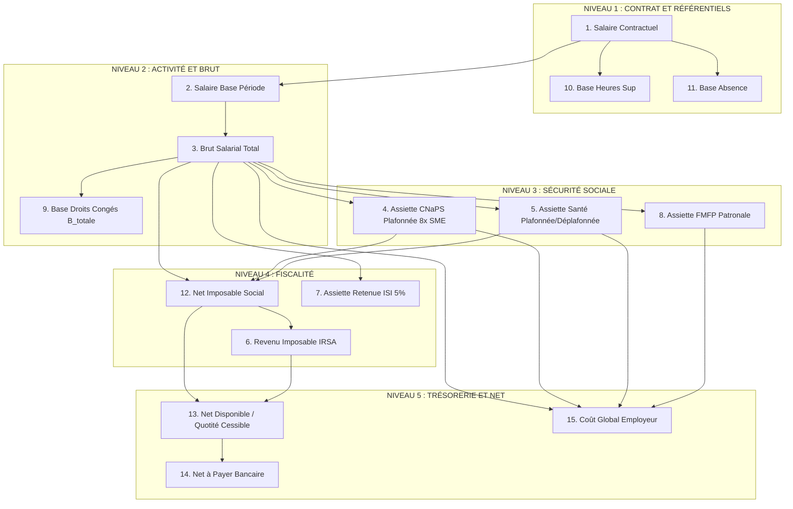

# Pipeline Canonique de Calcul de la Paie Galaxam

**Référence du document :** GAL-SIRH-PAYROLL-AUDIT-03
**Statut :** Spécification formelle du pipeline de calcul et des dépendances d'assiettes
**Date d'émission :** 29 Septembre 2026
**Auteur :** Antigravity AI — Pair Programming Ingénierie SIRH

---

## 1. Cartographie Exhaustive des 14 Assiettes de Calcul

Un des anti-patterns majeurs des moteurs de paie défaillants est de supposer qu'il existe une variable unique nommée `brut` sur laquelle s'appliquent tous les taux.

Chez GALAXAM, l'assujettissement légal malagasy et les pratiques d'entreprise imposent de distinguer rigoureusement **14 assiettes distinctes**.

---

### Dictionnaire Détaillé des 14 Assiettes

#### Assiette 1 : Salaire Contractuel de Référence ($S_{\text{contrat}}$)

- **Définition** : Rémunération forfaitaire mensuelle convenue dans le contrat de travail ou le dernier avenant de carrière pour 40 heures hebdomadaires.
- **Éléments inclus** : Salaire de base contractuel brut.
- **Éléments exclus** : Toutes primes, heures supplémentaires, indemnités et majorations.
- **Ordre de calcul** : Étape 1 (Point d'entrée du pipeline).
- **Règles incertaines / Risques** : Risque de conflit si plusieurs avenants se chevauchent sur la période. Nécessite une résolution temporelle stricte à la date de fin de période.

#### Assiette 2 : Salaire de Base de Période ($S_{\text{base\_periode}}$)

- **Définition** : Rémunération de base due pour la présence sous contrat au cours du mois.
- **Éléments inclus** : $S_{\text{contrat}}$ si mois complet ; prorata temporis en cas d'embauche ou de départ en cours de période.
- **Éléments exclus** : Déductions pour absences non payées ou congés pris.
- **Ordre de calcul** : Étape 5.
- **Formule canonique** :

  $$
  \text{Si Entrée/Sortie en cours de mois : } S_{\text{base\_periode}} = S_{\text{contrat}} \times \frac{\text{Jours Calendaires sous Contrat}}{30{,}0}
  $$

  $$
  \text{Sinon : } S_{\text{base\_periode}} = S_{\text{contrat}}
  $$
- **Règles incertaines** : Prorata sur base de 30 jours calendaires (règle standard Galaxam) vs jours ouvrables réels du mois. *Arbitrage confirmé : règle des 30 jours.*

#### Assiette 3 : Brut Salarial Total ($Brut$)

- **Définition** : Somme algébrique de tous les éléments de rémunération constitutifs du salaire brut de la période.
- **Éléments inclus** :
  - $S_{\text{base\_periode}}$
  - $(-)$ Retenue absence décomptée ($\text{Minutes} \times \frac{\text{Base}}{173{,}33 \times 60}$)
  - $(-)$ Déduction congé de base ($\text{Jours} \times \frac{\text{Base}}{30}$)
  - $(+)$ Indemnité congé payé ($\text{Jours} \times \text{TCONGE}$)
  - $(+)$ Heures supplémentaires 30% et 50%
  - $(+)$ Majorations nuit (+30%), dimanche (+40%), férié (+100%)
  - $(+)$ Primes brutes (Performance, Assiduité, Ancienneté, Exceptionnelle)
  - $(+)$ Indemnités imposables payées en fin de mois (Repas, Déplacement)
  - $(+)$ Rappels et régularisations brutes positives
  - $(+)$ Avantages en nature valorisés.
- **Éléments exclus** : Remboursements de notes de frais professionnels, indemnités de déplacement expressément non imposables, indemnités d'éloignement ou de mission.
- **Ordre de calcul** : Étape 11.
- **Règles incertaines** : L'inclusion des indemnités de repas et transport dans le brut est confirmée dans le SIRH actuel, mais doit être formellement alignée avec la doctrine fiscale sur les frais d'emploi réels.

#### Assiette 4 : Brut Cotisable CNaPS ($Assiette_{\text{CNaPS}}$)

- **Définition** : Assiette de calcul des cotisations de sécurité sociale (retraite, accidents du travail, prestations familiales).
- **Éléments inclus** : Tous les éléments du Brut salarial assujettis à la sécurité sociale.
- **Éléments exclus** : Indemnités représentatives de frais réels, indemnités de rupture (licenciement).
- **Ordre de calcul** : Étape 12.
- **Formule canonique** :
  $$
  Assiette_{\text{CNaPS}} = \min(Brut_{\text{soumis}}, \; 8 \times \text{SME})
  $$

  *(Plafond mensuel légal 2026 : $8 \times 300\,000\text{ Ar} = 2\,400\,000\text{ Ar}$ à compter de mars 2026 ; $2\,101\,440\text{ Ar}$ antérieurement).*
- **Règles incertaines** : Régularisation trimestrielle de l'assiette plafonnée dans la déclaration DNTS (en cas de rémunération variable fluctuant autour du plafond).

#### Assiette 5 : Assiette Médicale Santé au Travail ($Assiette_{\text{Santé}}$)

- **Définition** : Assiette de calcul des cotisations médicales d'entreprise (OSTIE ou OMSI).
- **Éléments inclus** : Rémunérations brutes soumises.
- **Éléments exclus** : Frais professionnels réels.
- **Ordre de calcul** : Étape 12.
- **Formule canonique** :

  $$
  \text{Si Organisme Plafonné (OSTIE / OMSI) : } Assiette_{\text{Santé}} = \min(Brut_{\text{soumis}}, \; 8 \times \text{SME})
  $$

  $$
  \text{Si Déplafonné : } Assiette_{\text{Santé}} = Brut_{\text{soumis}}
  $$
- **Règles incertaines** : Vérifier si certains organismes interentreprises appliquent un plafond spécifique différent du plafond CNaPS. Dans le SIRH actuel, OSTIE et OMSI sont paramétrés comme plafonnés à $8 \times \text{SME}$.

#### Assiette 6 : Revenu Net Imposable Social ($Net_{\text{Social}}$)

- **Définition** : Salaire net avant impôt servant de base de départ à la fiscalité sur le revenu.
- **Éléments inclus** : $Brut$ salarial diminué des cotisations sociales obligatoires à la charge du salarié.
- **Formule canonique** :
  $$
  Net_{\text{Social}} = Brut - Cotisation_{\text{CNaPS\_Sal}} - Cotisation_{\text{Santé\_Sal}}
  $$
- **Ordre de calcul** : Étape 15.

#### Assiette 7 : Revenu Imposable IRSA ($Assiette_{\text{IRSA}}$)

- **Définition** : Base taxable soumise au barème progressif de l'Impôt sur les Revenus Salariaux et Assimilés.
- **Éléments inclus** : $Net_{\text{Social}}$.
- **Éléments déduits / Exclus** :
  - **Exonération fiscale des Heures Supplémentaires** : Rémunération des HS effectuées dans la limite de 20 heures par mois pour les non-cadres (CGI Art. 01.03.03-9°).
  - Frais professionnels réels exonérés.
- **Arrondi réglementaire obligatoire** : **Centaine d'Ariary inférieure** (`CENTAINE_INF`).
- **Formule canonique** :
  $$
  Assiette_{\text{IRSA}} = \left\lfloor \frac{Net_{\text{Social}} - HS_{\text{Exonérées}}}{100} \right\rfloor \times 100
  $$
- **Ordre de calcul** : Étape 17.

#### Assiette 8 : Assiette de Retenue ISI 5% ($Assiette_{\text{ISI}}$)

- **Définition** : Montant brut des rémunérations ou honoraires versés aux intervenants extérieurs (consultants seniors +60 ans, prestataires temporaires).
- **Éléments inclus** : Total des honoraires bruts ou vacations convenues.
- **Éléments exclus** : Retenues sociales (inapplicables au régime indépendant).
- **Ordre de calcul** : Étape 17 (pour les profils sous régime ISI uniquement).
- **Formule canonique** :
  $$
  \text{Retenue ISI} = Assiette_{\text{ISI}} \times 5{,}00\,\%
  $$

#### Assiette 9 : Assiette FMFP Patronale ($Assiette_{\text{FMFP}}$)

- **Définition** : Assiette de calcul de la contribution patronale à la formation professionnelle (1%).
- **Formule canonique** : $Assiette_{\text{Sociale}} \times 1{,}00\,\%$.
- **Règles incertaines** : Doctrine FMFP stipulant une assiette déplafonnée vs pratique déclarative adossée à l'assiette plafonnée CNaPS. *Voir Livrable 6 pour arbitrage.*

#### Assiette 10 : Base des Droits à Congés ($B_{\text{totale}}$)

- **Définition** : Assiette financière cumulée mensuellement dans le grand-livre `conge_journal_droit` pour valoriser le coût moyen d'un jour de congé lors du cycle suivant.
- **Éléments inclus** :

  - Salaire net de base : $S_{\text{net\_base}} = S_{\text{base}} - M_{\text{abs}} + M_{\text{conge\_pris}}$
  - Total des Heures Supplémentaires rémunérées du mois ($M_{\text{hs}}$)
- **Éléments exclus** :

  - Indemnités de repas
  - Indemnités de déplacement / transport
  - Primes exceptionnelles
  - Notes de frais remboursées.
- **Ordre de calcul** : Étape 23 (Post-validation du bulletin).
- **Formule canonique** (Modèle `OHATRA KAJY DROITS CONGES`) :

  $$
  B_{\text{totale}} = S_{\text{net\_base}} + M_{\text{hs}}
  $$

  $$
  V_m = \frac{B_{\text{totale}} \times D_m}{30{,}0} \quad \text{où } D_m = 2{,}5 \times \frac{30 - \max(0, J_{\text{abs}} - J_{\text{conge}})}{30}
  $$

#### Assiette 11 : Base Taux Horaire ($TH$)

- **Définition** : Rémunération d'une heure de travail normale, servant de base au décompte des absences et des majorations d'heures supplémentaires.
- **Formule canonique** :
  $$
  TH = \frac{S_{\text{contrat}}}{\text{Diviseur Mensuel Heures}} = \frac{S_{\text{contrat}}}{173{,}33}
  $$
- **Ordre de calcul** : Étape 4.

#### Assiette 12 : Base Retenue Absence

- **Définition** : Heures ou minutes d'absence non payée valorisées au taux horaire exact sans arrondi prématuré.
- **Formule** : $\text{Minutes} \times \frac{S_{\text{contrat}}}{173{,}33 \times 60}$.

#### Assiette 13 : Net Disponible Avant Trésorerie & Quotités Cessibles

- **Définition** : Salaire net disponible pour le salarié après impôt et cotisations, servant de plafond de recouvrement des dettes internes.
- **Formule canonique** :
  $$
  Net_{\text{Disponible}} = Net_{\text{Social}} - Impôt + Indemnités_{\text{Net}}
  $$
- **Plafonds légaux d'imputation** :
  1. **Acompte de quinzaine** : Déductible jusqu'à $100\,\%$ de $Net_{\text{Disponible}}$.
  2. **Avance employeur (Art. 68)** : Déductible dans la limite stricte de **$1/10^{\text{e}}$ ($10\,\%$)** du net après acompte.
  3. **Prêt d'entreprise (Art. 72)** : Déductible dans la limite de la quotité cessible de **$1/3$ ($33{,}33\,\%$)** du net après acompte, diminuée des avances déjà prélevées.

#### Assiette 14 : Coût Global Employeur

- **Définition** : Charge financière totale supportée par l'entreprise pour l'emploi du collaborateur sur la période.
- **Formule canonique** :
  $$
  \text{Coût Global} = Brut + Cotisations_{\text{Patronales}} + Indemnités_{\text{Non Imposables}}
  $$
- **Ordre de calcul** : Étape 22.

---

## 2. Le Pipeline Officiel en 25 Étapes Canoniques

Le calcul de la paie s'exécute selon une séquence ordonnée sans dépendance circulaire. Chaque étape dispose d'un contrat d'entrée immuable et produit une sortie typée.

```mermaid
flowchart TD
    E01[1. Résolution du Salarié & État Civil] --> E02[2. Résolution du Contrat & Carrière]
    E02 --> E03[3. Résolution du Référentiel Légal Daté]
    E03 --> E04[4. Calcul du Taux Horaire & Trentième]
    E04 --> E05[5. Consommation du Snapshot Pointage Scellé]
    E05 --> E06[6. Calcul du Salaire de Base Proratisé]
    E06 --> E07[7. Retenue pour Absences Décomptées]
    E07 --> E08[8. Valorisation Duale des Congés Payés]
    E08 --> E09[9. Heures Supplémentaires & Sujétions Spéciales]
    E09 --> E10[10. Primes Opérationnelles Proratisées & Fixes]
    E10 --> E11[11. Indemnités Journalières de Présence]
    E11 --> E12[12. Intégration des Avantages en Nature]
    E12 --> E13[13. Consolidation du Total Brut Salarial]
    E13 --> E14[14. Construction des Assiettes Sociales CNaPS/Santé]
    E14 --> E15[15. Calcul des Cotisations Sociales Salariales]
    E15 --> E16[16. Calcul du Net Imposable Social]
    E16 --> E17[17. Exonération Fiscale des HS Art. 01.03.03-9°]
    E17 --> E18[18. Calcul de l'IRSA Barème ou Retenue ISI 5%]
    E18 --> E19[19. Intégration des Indemnités Nettes & Frais Pro]
    E19 --> E20[20. Calcul du Net Disponible Avant Trésorerie]
    E20 --> E21[21. Imputation Prioritaire Acomptes & Avances Art. 68]
    E21 --> E22[22. Amortissement Prêts d'Entreprise Art. 72]
    E22 --> E23[23. Retenues Téléphonie & Diverses Nettes]
    E23 --> E24[24. Arrondi Monétaire Réglementaire à la Dizaine]
    E24 --> E25[25. Consolidation Patronale & Scellement du Bulletin]
```

---

### Description Détaillée des 25 Étapes

|    Étape    | Intitulé Métier                              | Entrées Consommées                                                                                                             | Sorties Produites                                                                                                                | Contrôle Bloquant (Fail-Fast)                                                      |
| :----------: | :--------------------------------------------- | :------------------------------------------------------------------------------------------------------------------------------- | :------------------------------------------------------------------------------------------------------------------------------- | :---------------------------------------------------------------------------------- |
| **01** | **Résolution du Salarié**              | `idEmploye`, date période                                                                                                     | Identité, CIN, matricule, personnes à charge éligibles.                                                                       | Salarié inactif ou supprimé.                                                      |
| **02** | **Résolution Contrat & Affectation**    | Carrière, filiale, site                                                                                                         | Statut (`CDI`, `CDD`, etc.), site (`TNR`/`TMM`), catégorie (`AGENT`/`CADRE`), mode calcul, salaire contractuel.     | Absence d'affectation active couvrant la période (`NO_ACTIVE_ASSIGNMENT`).       |
| **03** | **Résolution Référentiel Légal**     | Date fin période                                                                                                                | Millésime légal applicable, SME/SMIG, barème IRSA, taux majorations HS/Nuit/Dimanche/Férié, taux CNaPS/Santé.              | Absence d'exercice légal ou chevauchement de versions (`LEGAL_CONFIG_MISSING`).  |
| **04** | **Calcul Taux Dérivés**                | Salaire base, diviseur légal (173.33)                                                                                           | Taux horaire plein ($S/173{,}33$) et taux trentième ($S/30$).                                                               | Taux horaire négatif ou nul.                                                       |
| **05** | **Consommation Snapshot Pointage**       | Période, salarié                                                                                                               | Heures travaillées, minutes retard, minutes absence, HS 30/50 scellées, heures nuit, dimanche, férié, jours repas/transport. | Absence de snapshot scellé en mode calcul réel (`MISSING_ATTENDANCE_SNAPSHOT`). |
| **06** | **Salaire de Base de Période**          | Salaire contractuel, dates contrat                                                                                               | Salaire base échu (proratisé au 30e si embauche/départ en cours de mois).                                                     | Date début contrat > date fin contrat.                                             |
| **07** | **Retenue pour Absences**                | Minutes absence du snapshot, taux horaire                                                                                        | Ligne`RETENUE_ABSENCE` déduite du brut.                                                                                       | Retenue supérieure au salaire de base échu.                                       |
| **08** | **Valorisation Duale Congés**           | Jours congés validés, taux trentième, TCONGE                                                                                  | Ligne`DEDUCTION_CONGE_BASE` (débit) et ligne `INDEMNITE_CONGE_PAYE` (crédit).                                              | Jours de congés négatifs.                                                         |
| **09** | **Heures Sup & Sujétions**              | Tranches HS snapshot, taux majoration                                                                                            | Lignes`HEURES_SUP_30`, `HEURES_SUP_50`, `MAJORATION_NUIT`, `HEURES_DIMANCHE`, `MAJORATION_FERIE`.                      | Présence de HS pour un statut Cadre exclu.                                         |
| **10** | **Primes Opérationnelles**              | Variables DAF approuvées, pointage                                                                                              | Lignes`PRIME_PERFORMANCE` (proratisée avec malus retard/congé), `PRIME_ASSIDUITE`, `PRIME_ANCIENNETE`.                   | Variable`EN_ATTENTE` non arbitrée.                                               |
| **11** | **Indemnités de Présence**             | Jours présence snapshot, barèmes site                                                                                          | Lignes`INDEMNITE_REPAS` (2 000 Ar à TNR, 0 Ar cantine TMM) et `INDEMNITE_TRANSPORT` (avec réduction 1 000 Ar à TMM).      | Configuration d'indemnité de site manquante.                                       |
| **12** | **Avantages en Nature**                  | Déclarations avantages                                                                                                          | Valorisation forfaitaire brute et ligne miroir de déduction nette.                                                              | Avantage négatif.                                                                  |
| **13** | **Consolidation du Brut Salarial**       | Somme algébrique des étapes 06 à 12                                                                                           | Total Gains Bruts ($Brut$).                                                                                                    | Total Brut négatif (bloqué à 0 minimum).                                         |
| **14** | **Assiettes Cotisations Sociales**       | $Brut$, règles d'assujettissement | Assiette brute cotisable CNaPS ($8 \times \text{SME}$) et Assiette Santé (OSTIE/OMSI). | —                                                                                                                               |                                                                                     |
| **15** | **Cotisations Sociales Salariales**      | Assiettes sociales, taux légaux                                                                                                 | Lignes`COTISATION_CNAPS_SAL` (1%), `COTISATION_OSTIE_SAL` (1%) ou `COTISATION_OMSI_SAL` (1.5%).                            | Cotisation salariale supérieure au Brut.                                           |
| **16** | **Net Imposable Social**                 | $Brut$ - Cotisations salariales                                                                                                | Salaire Net Imposable Social.                                                                                                    | —                                                                                  |
| **17** | **Exonération Fiscale HS**              | Heures HS 30/50, statut non-cadre, plafond 20h                                                                                   | Part de rémunération HS exonérée d'IRSA (CGI Art. 01.03.03-9°).                                                             | Exonération accordée à un Cadre.                                                 |
| **18** | **Fiscalité (IRSA ou ISI 5%)**          | Net imposable social, exonération HS, barème, enfants                                                                          | Ligne`IMPOT_IRSA_NET` (avec détail tranches et min 3 000 Ar) OU Ligne `RETENUE_ISI_5` (consultants).                        | Régime fiscal indéterminé.                                                       |
| **19** | **Indemnités Nettes & Frais Pro**       | Notes de frais approuvées, extras                                                                                               | Lignes`REMBOURSEMENT_NOTE_FRAIS`, `EXTRA_DEPLACEMENT`.                                                                       | Note de frais sans justificatif.                                                    |
| **20** | **Net Disponible Avant Trésorerie**     | Net imposable - Impôt + Indemnités nettes                                                                                      | Base de calcul des plafonds de quotité cessible.                                                                                | Net négatif.                                                                       |
| **21** | **Acomptes & Avances (Art. 68)**         | Acomptes confirmés, avances en cours                                                                                            | Lignes`RETENUE_ACOMPTE_15` (100% prioritaire) et `RETENUE_AVANCE_SPECIALE` (max 10% du net restant).                         | Dépassement du plafond légal de 1/10e.                                            |
| **22** | **Prêts d'Entreprise (Art. 72)**        | Échéance active, quotité 1/3                                                                                                  | Ligne`RETENUE_ECHEANCE_PRET` (max capacité restante du tiers).                                                                | Dépassement de la quotité cessible légale de 1/3.                                |
| **23** | **Retenues Diverses & Téléphonie**     | Consommations privées                                                                                                           | Ligne`RETENUE_CALL_PERSO`, `RETENUE_DIVERSE`.                                                                                | —                                                                                  |
| **24** | **Arrondi Monétaire Réglementaire**    | Net théorique avant arrondi                                                                                                     | Net à Payer Bancaire (arrondi dizaine Ar la plus proche) et ligne`AJUSTEMENT_ARRONDI`.                                        | Écart d'arrondi$> 5{,}00\text{ Ar}$.                                             |
| **25** | **Consolidation Patronale & Scellement** | Cotisations patronales CNaPS (13%), Santé (5% ou 5.5%), FMFP (1%)                                                               | Coût Global Employeur, scellement du bulletin immuable, alimentation différée du grand-livre des congés.                     | Tentative d'écriture sur bulletin déjà validé/clôturé.                        |

---

## 3. Analyse des Dépendances et Absence de Boucle Circulaire

Le pipeline respecte un ordre topologique strict garantissant l'absence totale de référence circulaire :

$$
\text{Présences} \longrightarrow \text{Brut} \longrightarrow \text{Cotisations} \longrightarrow \text{Net Imposable} \longrightarrow \text{IRSA} \longrightarrow \text{Net Disponible} \longrightarrow \text{Trésorerie} \longrightarrow \text{Net à Payer}
$$

### Points de vigilance démontrés :

1. **Congés payés** : La valorisation du congé pris au mois $M$ utilise le $TCONGE$ arrêté au cycle de référence $N-1$. Il n'y a donc **aucune dépendance circulaire** avec les gains du mois $M$.
2. **Exonération HS** : L'exonération fiscale des heures supplémentaires ne modifie pas le brut ni les cotisations sociales ; elle n'intervient qu'en déduction de l'assiette IRSA (Étape 17).
3. **Plafond d'avance Art. 68** : Il est assis sur le Net après acompte, évitant toute rétroaction sur le brut.
4. **Grand-livre des congés ($B_{\text{totale}}$)** : Il est alimenté en **sortie de pipeline** (post-bulletin) et n'impacte que les cycles futurs.
