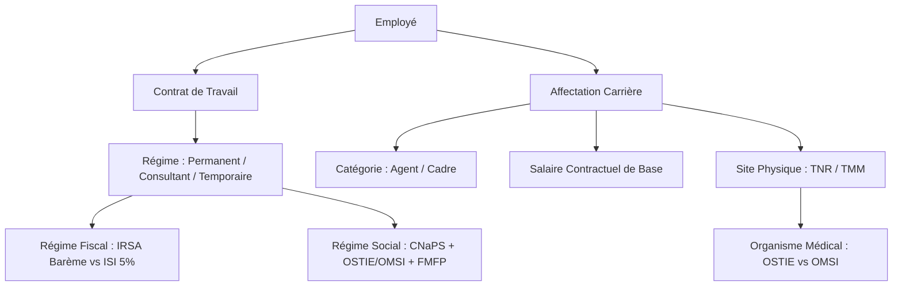
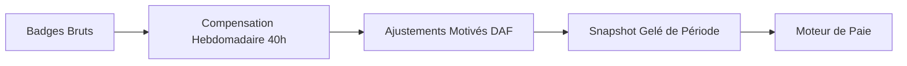

# Audit du Modèle Conceptuel et Métier de la Paie Galaxam

**Référence du document :** GAL-SIRH-PAYROLL-AUDIT-01  
**Statut :** Document d'ingénierie et de cadrage conceptuel canonique  
**Date d'émission :** 29 Septembre 2026  
**Auteur :** Antigravity AI — Pair Programming Ingénierie SIRH  
**Validation cible :** Direction Administrative et Financière (DAF) / Direction Générale  

---

## 1. Introduction et Objectif d'Excellence

Le présent document pose les **fondations conceptuelles et le vocabulaire canonique** du domaine de la paie chez GALAXAM LOGISTICS, indépendamment de toute contrainte technique ou implémentation logicielle existante.

L'objectif n'est pas de rationaliser le code existant ou de calquer la terminologie sur des classes Java actuelles, mais de déterminer **comment un moteur de paie moderne, rigoureux, déterministe et conforme au droit malagasy doit être modélisé**.

### Exigences fondamentales du moteur cible
1. **Explicabilité totale** : chaque ariary sur le bulletin doit être justifié par une formule, une quantité, une assiette, un taux et un texte légal ou conventionnel.
2. **Déterminisme pur** : à entrées identiques (contrat, présences, variables, référentiel légal daté), le résultat du calcul est mathématiquement identique, sans effet de bord.
3. **Vérité historique** : un bulletin calculé et validé à une date $T_0$ doit être reproductible à l'identique à $T_n$, même si le SMIG, le barème IRSA ou les affiliations de site ont changé entre-temps.
4. **Zéro constante cachée** : aucune valeur monétaire, diviseur ou taux n'est codé en dur sans date d'effet ni traçabilité en base de données.
5. **Zéro fallback silencieux** : un paramètre manquant déclenche un refus métier explicite et auditable plutôt qu'une valeur approximative par défaut.
6. **Étanchéité des rôles** : découplage strict entre la collecte des faits (temps, présences, contrats), la décision administrative (approbation des variables), la valorisation financière (moteur pur) et la persistance comptable (scellement).

---

## 2. Vocabulaire Métier Canonique

| Terme Métier | Définition Conceptuelle | Unité / Format | Rôle dans la Paie |
| :--- | :--- | :---: | :--- |
| **Période de Paie** | Intervalle calendaire borné $[D_{debut}, D_{fin}]$ durant lequel l'activité est mesurée et rémunérée (généralement du 26 du mois $M-1$ au 25 du mois $M$, ou mois civil). | Dates $(D_1, D_2)$ | Délimite l'assiette temporelle et fiscale. |
| **Salarié / Collaborateur** | Personne physique liée à une entité juridique du groupe par un contrat de travail ou une convention de prestation. | Identifiant unique, Matricule | Bénéficiaire de la rétribution. |
| **Contrat Applicable** | État contractuel en vigueur sur la période considérée (CDI, CDD, Prestation, Stage, Temporaire). | Référence contrat, Dates d'effet | Fixe le salaire contractuel, le régime social et fiscal. |
| **Catégorie Professionnelle** | Classification du collaborateur (Agent d'exécution vs Cadre dirigeant). | Code (AGENT, CADRE) | Détermine l'éligibilité aux HS et à l'exonération fiscale Art. 01.03.03-9°. |
| **Régime Social / Fiscal** | Ensemble des obligations sociales (CNaPS, OSTIE/OMSI, FMFP) et fiscales (IRSA progressif vs ISI 5%). | Enumération | Règle l'assujettissement des lignes du bulletin. |
| **Site d'Affectation** | Localisation géographique d'exécution du travail (TNR = Antananarivo, TMM = Toamasina). | Code site | Détermine l'organisme médical (OSTIE vs OMSI), les forfaits transport et repas. |
| **Temps Normal Attendu** | Durée contractuelle et légale de travail due par le collaborateur sur une semaine ou une période (40h/semaine). | Minutes / Heures | Base de comparaison pour les déficits et les heures supplémentaires. |
| **Diviseur Horaire Conventionnel** | Facteur de conversion officiel mensualisant la durée hebdomadaire : $\frac{40\text{ h} \times 52\text{ sem}}{12\text{ mois}} = 173{,}33\text{ h}$. | Heures (173.33) | Sert au calcul du taux horaire contractuel pour les absences et les HS. |
| **Taux Trentième ($1/30^{\text{e}}$)** | Méthode conventionnelle malagasy découpant le mois forfaitaire en 30 parts égales pour les congés et proratas. | Facteur $1/30$ | Valorise la déduction de salaire lors de la prise de congés payés ou entrées/sorties. |
| **Snapshot de Pointage** | Ensemble immuable des compteurs d'heures et présences scellés par la DAF pour une période donnée. | Enregistrement scellé | Donnée d'entrée exclusive de la paie pour le temps de travail. |
| **TCONGE** | Taux journalier moyen de valorisation des congés payés, calculé sur les 12 mois du cycle de référence précédent. | Ariary / jour | Assure le maintien du salaire moyen lors des congés (Art. 90 Code du Travail). |
| **SME / SMIG** | Salaire Minima d'Embauche national fixé par décret gouvernemental. | Ariary / mois | Plafonne la cotisation CNaPS à $8 \times \text{SME}$. |

---

## 3. Données Contractuelles et Structurelles

Toute paie repose sur la résolution préalable de l'état contractuel du salarié à la date de la période.



### 3.1 Inventaire des Données Contractuelles Cibles

| Donnée | Type / Format | Influence sur la Paie | Comportement si Absent / Invalide |
| :--- | :--- | :--- | :--- |
| **Salaire de base contractuel** | `BigDecimal` (Ariary) | Détermine le point de départ du brut, le taux horaire ($S/173{,}33$) et le taux journalier ($S/30$). | **Erreur bloquante** (`CONTRACT_SALARY_MISSING`). |
| **Type de contrat** | Code (`CDI`, `CDD`, `PRESTATION`, `STAGE`, `TEMPORAIRE`) | Conditionne l'assujettissement social, la gestion de fin de contrat et les droits à congés. | **Erreur bloquante** (`CONTRACT_TYPE_UNKNOWN`). |
| **Mode de rémunération** | Code (`MENSUEL`, `HORAIRE`, `JOURNALIER`) | Indique si le salaire est forfaitaire mensuel avec déduction d'absences, ou payé à l'heure réelle pointée. | Défaut métier documenté : `MENSUEL`. |
| **Catégorie professionnelle** | Code (`AGENT`, `CADRE`) | Conditionne le paiement des heures supplémentaires (les cadres en sont exclus) et l'exonération fiscale IRSA Art. 01.03.03-9°. | **Erreur bloquante** (`PROFESSIONAL_CATEGORY_REQUIRED`). |
| **Régime fiscal & social** | Code (`PERMANENT`, `CONSULTANT`, `TEMPORAIRE`, `STAGIAIRE`) | - Salarié Permanent : CNaPS (1%/13%), Santé (1%/5% ou 1.5%/5.5%), FMFP (1%), IRSA progressif.<br>- Consultant (+60 ans) : Retenue ISI 5%, pas de CNaPS, Santé selon contrat.<br>- Temporaire : Retenue ISI 5% ou IRSA selon statut fiscal. | **Erreur bloquante** (`INTERVENANT_REGIME_MISSING`). |
| **Site d'affectation** | Code (`TNR`, `TMM`) | Fixe l'organisme de santé (TNR = OSTIE, TMM = OMSI), les barèmes d'indemnité repas et les règles de transport. | **Erreur bloquante** (`EMPLOYEE_SITE_UNASSIGNED`). |
| **Calendrier de travail** | Référentiel jours ouvrés/chômés | Calcule le nombre exact de jours ouvrables de la période et les jours fériés légaux. | Résolu à partir du calendrier légal d'entreprise. |
| **Horaire contractuel** | Durée hebdo (ex: 40h) | Fixe le seuil de déclenchement des heures supplémentaires hebdomadaires. | 40,00 h par défaut légal malagasy. |
| **Personnes à charge** | Entier $\ge 0$ | Détermine la réduction fiscale pour charges de famille (2 000 Ar par enfant de moins de 21 ans). | 0 enfant si non renseigné. |
| **Coordonnées bancaires** | RIB / Banque / Mode | Détermine le mode de règlement (Virement, Chèque, Espèces) et l'ordre de virement. | `VIREMENT` si RIB valide, sinon `CHEQUE`/`ESPECES`. |

---

## 4. Données de Temps, Présence et Pointage

Le moteur de paie ne lit **JAMAIS** directement les badgeages bruts de la pointeuse. Il consomme un **snapshot scellé de pointage** produit après compensation hebdomadaire et arbitrage des anomalies.

### 4.1 Données issues du Snapshot de Pointage



| Donnée temporelle | Unité | Source | Rôle dans le Brut | Rôle dans les Droits Congés | Rôle Fiscal |
| :--- | :---: | :---: | :---: | :---: | :---: |
| **Heures normales travaillées** | Minutes / Heures | Pointage scellé | Justifie le salaire de base échu. | Temps effectif assimilé. | Salaire imposable normal. |
| **Absences décomptées** | Minutes / Heures | Pointage scellé | Retenue monétaire : $\text{Minutes} \times \frac{\text{Base}}{173{,}33 \times 60}$. | Réduit l'acquisition des congés si injustifiée. | Réduit le brut imposable. |
| **Retards cumulés** | Minutes | Pointage scellé | Déclenche les malus sur prime d'assiduité ($\ge 45\text{ min}$) et performance ($> 70\text{ min}$). | Neutre. | Neutre directement (impacte les primes). |
| **Congés payés pris** | Jours calendaires | Module Congés | Retenue au 30ème ($\text{Base}/30 \times J$) + versement indemnité ($\text{TCONGE} \times J$). | Période assimilée à du travail effectif. | Imposable IRSA / Soumis cotisations. |
| **Congés sans solde** | Jours calendaires | Module Congés | Retenue de salaire intégrale. | Suspend l'acquisition de congés payés. | Réduit le brut imposable. |
| **HS Tranche 1 (41e à 48e h)** | Minutes / Heures | Pointage scellé | Majoration de **+30%** appliquée au taux horaire. | Inclus dans $B_{totale}$ valorisant les futurs congés. | Exonéré d'IRSA dans la limite de 20h/mois (non-cadres). |
| **HS Tranche 2 (> 48e h)** | Minutes / Heures | Pointage scellé | Majoration de **+50%** appliquée au taux horaire. | Inclus dans $B_{totale}$ valorisant les futurs congés. | Exonéré d'IRSA pour la part imputée dans les 20h max. |
| **Heures de nuit (22h - 05h)** | Minutes / Heures | Pointage scellé | Majoration de **+30%** (sujétion horaire). | Sujétion incluse dans la rémunération brute. | Imposable IRSA. |
| **Heures du dimanche** | Minutes / Heures | Pointage scellé | Majoration de **+40%** (sujétion repos hebdo). | Sujétion incluse dans la rémunération brute. | Imposable IRSA. |
| **Heures jours fériés** | Minutes / Heures | Pointage scellé | Majoration de **+100%** (jour chômé travaillé). | Sujétion incluse dans la rémunération brute. | Imposable IRSA. |
| **Jours de repas éligibles** | Jours entiers | Pointage scellé | Alloue l'indemnité repas forfaitaire journalière. | **Exclu** de l'assiette des droits à congés. | Imposable et cotisable si payé en fin de mois. |
| **Jours de déplacement** | Jours entiers | Pointage scellé | Alloue l'indemnité de transport forfaitaire. | **Exclu** de l'assiette des droits à congés. | Imposable et cotisable selon les règles fiscales. |

---

## 5. Familles Canoniques de Variables de Paie

Pour éliminer toute ambiguïté sur le traitement des rubriques, chaque composante d'un bulletin appartient à l'une des **huit grandes familles** suivantes :

```
                                  RÉMUNÉRATION GLOBALE
                                           │
         ┌─────────────────────────────────┴─────────────────────────────────┐
         ▼                                                                   ▼
     ÉLÉMENTS DU BRUT                                                ÉLÉMENTS HORS BRUT
         │                                                                   │
 ┌───────┴───────┐                                                   ┌───────┴───────┐
 ▼               ▼                                                   ▼               ▼
GAINS        RETENUES TRAVAIL                                   CHARGES/IMPÔTS   TRÉSORERIE/NETS
- Salaire base  - Absence heure                                 - CNaPS (1%/13%) - Acomptes
- Congé ind.    - Retenue congé (1/30)                          - Santé (1%/5%)  - Avances (1/10)
- HS 30/50%     - Retard pénalité                               - FMFP (1% pat)  - Prêts (1/3)
- Sujétions                                                     - IRSA barème    - Frais pro
- Primes                                                        - Retenue ISI 5% - Arrondi Net
```

### 5.1 Famille 1 : Gains (Composantes Positives du Brut)
- **Salaire de base** : rémunération forfaitaire mensuelle ou horaire contractuelle.
- **Indemnité de congés payés** : maintien du salaire moyen historique ($J \times \text{TCONGE}$).
- **Heures supplémentaires** : rémunération des heures excédant 40h hebdomadaires (majoration +30% et +50%).
- **Majorations pour sujétions spéciales** : travail de nuit (+30%), travail dominical (+40%), travail de jour férié (+100%).
- **Primes d'activité et d'assiduité** : prime de performance (proratisée à la présence), prime d'assiduité (forfaitaire si retards < 45 min), prime d'ancienneté (+1%/an à partir de 3 ans).
- **Gratifications et primes exceptionnelles** : gratification de fin d'année (13ème mois), prime de bilan, bonus exceptionnel DAF.
- **Indemnités journalières d'exploitation** : indemnité de repas, indemnité de transport/déplacement (si versées sur bulletin).
- **Rappels et régularisations positives** : rattrapage sur période antérieure, réajustement salarial rétroactif.

### 5.2 Famille 2 : Retenues Liées au Travail (Déductions du Brut)
- **Retenue pour absence décomptée** : déduction exacte à la minute sur la base du diviseur légal 173,33 h : $\text{Montant} = \text{Salaire Base} \times \frac{\text{Minutes Absence}}{173{,}33 \times 60}$.
- **Déduction pour congés pris (Trentième)** : déduction de la part de base mensualisée couverte par l'indemnité : $\text{Montant} = \text{Salaire Base} \times \frac{J_{\text{conge}}}{30}$.
- **Retenues pour congé sans solde** : suspension complète de rémunération.
- **Régularisations négatives de temps** : trop-perçu d'heures sur mois précédent.

### 5.3 Famille 3 : Cotisations Sociales Salariales
- **Cotisation CNaPS Salariale** : 1 % du brut cotisable, plafonnée à $8 \times \text{SME}$.
- **Cotisation Santé Salariale** :
  - TNR (Siège Antananarivo) : OSTIE = 1 % du brut cotisable (plafonnée à $8 \times \text{SME}$).
  - TMM (Agence Toamasina) : OMSI = 1,5 % du brut cotisable (plafonnée à $8 \times \text{SME}$).

### 5.4 Famille 4 : Cotisations et Charges Patronales
- **Cotisation CNaPS Patronale** : 13 % du brut cotisable, plafonnée à $8 \times \text{SME}$.
- **Cotisation Santé Patronale** :
  - TNR : OSTIE = 5 % du brut cotisable (plafonnée à $8 \times \text{SME}$).
  - TMM : OMSI = 5,5 % du brut cotisable (plafonnée à $8 \times \text{SME}$).
- **Cotisation FMFP Patronale** : 1 % du brut cotisable (Fonds Malgache de Formation Professionnelle).

### 5.5 Famille 5 : Impôts sur le Revenu
- **IRSA (Impôt sur les Revenus Salariaux et Assimilés)** :
  - Calculé sur le **Revenu Net Imposable Fiscal** : $\text{Net Imposable Social} - \text{HS Exonérées (Art. 01.03.03-9°)}$.
  - Assiette arrondie à la **centaine d'Ariary inférieure**.
  - Barème progressif officiel à 6 tranches (Loi de Finances 2026).
  - Déduction pour charge de famille : 2 000 Ar par enfant à charge éligible.
  - Minimum de perception légal : 3 000 Ar (en 2026, anciennement 2 000 Ar).
- **Retenue ISI (Impôt Synthétique Intermédiaire / Intermittent - 5 %)** :
  - Prélèvement libératoire à la source de 5 % sur le montant brut des prestations des consultants seniors (+60 ans) et travailleurs temporaires indépendants.
  - Exclusif de l'IRSA et de la CNaPS.

### 5.6 Famille 6 : Retenues Financières et de Trésorerie
- **Acompte de quinzaine** : avance sur salaire déjà échu (versé le 15 du mois), déductible à 100 % en priorité sur le net disponible.
- **Avance exceptionnelle sur salaire** : crédit consenti par l'employeur sur travail futur, strictement plafonné par l'Article 68 du Code du Travail à **1/10e (10%) du salaire net disponible**.
- **Échéance de prêt d'entreprise** : remboursement échelonné de prêt consenti au salarié, strictement plafonné par l'Article 72 à la **quotité cessible de 1/3 (33,33%) du salaire net disponible**.
- **Retenues pour consommations privées (Call perso)** : refacturation de communications téléphoniques privées excédant le forfait professionnel.
- **Saisie-arrêt sur salaire** : opposition judiciaire de tiers (pension alimentaire, créance), prioritaire sur la quotité cessible.

### 5.7 Famille 7 : Éléments Nets et Remboursements
- **Remboursement de notes de frais** : indemnisation de frais professionnels réels justifiés (carburant, hébergement, missions), non imposable et non cotisable.
- **Indemnités forfaitaires exonérées** : indemnités répondant strictement aux conditions d'exonération de l'Art. 01.03.03 CGI.
- **Ajustement d'arrondi monétaire** : écart de centimes ou d'unités d'Ariary résultant de l'arrondissement bancaire réglementaire à la **dizaine d'Ariary la plus proche**.

### 5.8 Famille 8 : Avantages en Nature (Traitement Spécifique)
L'avantage en nature (véhicule de fonction, logement, domesticité) requiert un cycle comptable tripartite :
1. **Valorisation forfaitaire** : estimée selon les barèmes fiscaux officiels CGI.
2. **Intégration au Brut et aux Assiettes** : augmente le brut imposable (IRSA) et cotisable (CNaPS/Santé).
3. **Déduction au Net** : l'avantage ayant été perçu en nature, sa valeur est intégralement déduite avant le calcul du net à payer pour ne pas être versée deux fois en argent.

---

## 6. Synthèse des Exigences Métier pour la Conception

1. **Orthogonalité stricte** : un gain n'est pas cotisable simplement parce qu'il est imposable. Chaque rubrique possède des indicateurs d'assujettissement indépendants (`soumis_cnaps`, `soumis_sante`, `soumis_irsa`, `inclus_droits_conges`).
2. **Plafonnement dynamique** : le plafond CNaPS ($8 \times \text{SME}$) et le plafond Santé doivent être résolus dynamiquement à la date d'effet de la période de paie.
3. **Non-substitution des absences** : une absence non payée et un jour de congé payé ne s'annulent pas. Ils génèrent deux lignes distinctes, documentées avec leurs unités respectives (heures vs jours).
4. **Plafond légal des retenues** : l'employeur ne peut pas récupérer l'intégralité d'une avance sur un seul bulletin si cela viole le plafond de 1/10e de l'Article 68. Le reliquat non recouvré reste en solde débiteur pour les mois suivants.
5. **Autonomie des régimes** : un bulletin de consultant sous ISI 5% produit un bordereau e-Hetra (ISINT), sans ligne de CNaPS ni barème IRSA, tout en traçant les sujétions de site si le contrat le stipule.
