# Audit Technique et Cartographie de l'Implémentation Actuelle de la Paie

**Référence du document :** GAL-SIRH-PAYROLL-AUDIT-04  
**Statut :** Rapport d'audit exhaustif du code source et de l'architecture existante  
**Date d'émission :** 29 Septembre 2026  
**Auteur :** Antigravity AI — Pair Programming Ingénierie SIRH  

---

## 1. Cartographie Complète des Composants Existants

L'analyse du code source Java backend (`backend/src/main/java/mg/galaxam/sirh/paie`, `paieconfig`, `pointage`, `conge`, `contrat`) et de la base de données PostgreSQL (`backend/conception/bdd/06_schema_paie.sql`, `02_schema_referentiels_rh.sql`) révèle la structure opérationnelle suivante :

```mermaid
graph TD
    subgraph "APPLICATION & WORKFLOW"
        PW[PayrollPeriodWorkflowService.java]
        PS[PayrollService.java - 112 KB]
        SS[StcService.java - 60 KB]
        PLCR[PayrollLegalContextResolver.java]
        PPR[PayrollPopulationResolver.java]
        PCG[PayrollConfigurationGuard.java]
    end

    subgraph "CALCULATEURS PURS (DOMAIN ENGINE)"
        PEE[PayrollExecutionEngine.java - 58 KB]
        OPC[OvertimePayCalculator.java - 21 KB]
        IC[IrsaCalculator.java]
        SCC[SocialContributionCalculator.java]
        MRP[MoneyRoundingPolicy.java]
        ISIC[IsiCalculator.java]
        IBR[IrsaBracketResolver.java]
        TCR[TaxConfigurationResolver.java]
    end

    subgraph "PERSISTANCE & ACCÈS DONNÉES (RAW JDBC / BEAN)"
        BP[BulletinPaie.java]
        BPL[BulletinPaieLigne.java]
        PAA[PaieAvanceAcompte.java]
        PP[PaiePret.java / PaiePretEcheance.java]
        PCL[PaieConfigLegale.java]
        PR[PaieRubrique.java]
        PSTC[PaieStc.java]
        CJD[(Table conge_journal_droit)]
        PCP[(Table pointage_cumul_periode)]
    end

    PW --> PS
    PS --> PLCR
    PS --> PPR
    PS --> PCG
    PS --> PEE
    PEE --> OPC
    PEE --> IC
    PEE --> SCC
    PEE --> MRP
    PEE --> ISIC
    SS --> IC
    SS --> SCC
    SS --> OPC
    PS --> BP
    PS --> BPL
    PS --> PAA
    PS --> PP
    PS --> CJD
```



### 1.1 Matrice des Responsabilités par Composant

| Domaine / Fonction | Composant Actuel | Localisation Fichier | Rôle Constaté |
| :--- | :--- | :--- | :--- |
| **Orchestration Campagne** | [`PayrollPeriodWorkflowService`](file:///Users/andriamalalatojo/Documents/GALAXAM/GALAXAM-SIRH/backend/src/main/java/mg/galaxam/sirh/paie/application/workflow/PayrollPeriodWorkflowService.java) | `paie.application.workflow` | Gestion des états de période (`BROUILLON`, `EN_COURS`, `TRANSMIS_DAF`, `VALIDEE`, `CLOTUREE`), vérification des prérequis, verrouillage optimiste. |
| **Résolution Population** | [`PayrollPopulationResolver`](file:///Users/andriamalalatojo/Documents/GALAXAM/GALAXAM-SIRH/backend/src/main/java/mg/galaxam/sirh/paie/application/PayrollPopulationResolver.java) | `paie.application` | Résout la liste des salariés éligibles pour une période en croisant contrats actifs et affectations non ambiguës. |
| **Contexte Légal Daté** | [`PayrollLegalContextResolver`](file:///Users/andriamalalatojo/Documents/GALAXAM/GALAXAM-SIRH/backend/src/main/java/mg/galaxam/sirh/paie/application/PayrollLegalContextResolver.java) | `paie.application` | Charge à la date de fin de période la configuration légale (`paie_config_legale`), le SME, les taux CNaPS, FMFP, Santé par site, et les tranches IRSA. |
| **Service Monolithique** | [`PayrollService`](file:///Users/andriamalalatojo/Documents/GALAXAM/GALAXAM-SIRH/backend/src/main/java/mg/galaxam/sirh/paie/application/PayrollService.java) | `paie.application` | **Monolithe de 1 936 lignes (112 KB)** : prépare l'input, exécute le moteur, sauvegarde le bulletin, insère dans le grand-livre congés, impute les avances et prêts. |
| **Solde de Tout Compte** | [`StcService`](file:///Users/andriamalalatojo/Documents/GALAXAM/GALAXAM-SIRH/backend/src/main/java/mg/galaxam/sirh/paie/application/StcService.java) | `paie.application` | **Service de 1 057 lignes (60 KB)** : calcule le prorata, l'ICCP, le préavis, le licenciement, et réimplémente ses propres requêtes de cotisations et IRSA. |
| **Moteur d'Exécution Pur** | [`PayrollExecutionEngine`](file:///Users/andriamalalatojo/Documents/GALAXAM/GALAXAM-SIRH/backend/src/main/java/mg/galaxam/sirh/paie/domain/engine/PayrollExecutionEngine.java) | `paie.domain.engine` | **1 005 lignes (58 KB)** : calcule en 7 paliers le salaire brut, les cotisations, le net imposable, l'IRSA, l'exonération HS, les déductions de trésorerie et le net à payer. |
| **Calculateur d'Heures Sup**| [`OvertimePayCalculator`](file:///Users/andriamalalatojo/Documents/GALAXAM/GALAXAM-SIRH/backend/src/main/java/mg/galaxam/sirh/paie/domain/engine/OvertimePayCalculator.java) | `paie.domain.engine` | Valorise les tranches HS (+30%, +50%) et applique les politiques de collision sur les sujétions (Nuit, Dimanche, Férié). |
| **Calculateur d'IRSA** | [`IrsaCalculator`](file:///Users/andriamalalatojo/Documents/GALAXAM/GALAXAM-SIRH/backend/src/main/java/mg/galaxam/sirh/paie/domain/engine/IrsaCalculator.java) | `paie.domain.engine` | Calcule l'impôt par tranches successives avec arrondi centaine inf sur assiette, dizaine sup sur brut, déduction enfants et min 3 000 Ar. |
| **Calculateur Cotisations** | [`SocialContributionCalculator`](file:///Users/andriamalalatojo/Documents/GALAXAM/GALAXAM-SIRH/backend/src/main/java/mg/galaxam/sirh/paie/domain/engine/SocialContributionCalculator.java) | `paie.domain.engine` | Calcule CNaPS (1%/13% plafonné à 8x SME), Santé (plafonnée ou déplafonnée) et FMFP (1%). |
| **Politique d'Arrondi** | [`MoneyRoundingPolicy`](file:///Users/andriamalalatojo/Documents/GALAXAM/GALAXAM-SIRH/backend/src/main/java/mg/galaxam/sirh/paie/domain/engine/MoneyRoundingPolicy.java) | `paie.domain.engine` | Centralise les méthodes d'arrondi : montants (2 décimales), base IRSA (centaine inf), IRSA brut (dizaine sup). |
| **Grand-Livre Congés** | [`CongeTauxApplicableService`](file:///Users/andriamalalatojo/Documents/GALAXAM/GALAXAM-SIRH/backend/src/main/java/mg/galaxam/sirh/conge/application/CongeTauxApplicableService.java) | `conge.application` | Résout le TCONGE applicable pour la paie et clôture les périodes annuelles de 12 mois. |

---

## 2. Inventaire et Analyse Critique des Anti-Patterns

### 2.1 Monolithes Multifonctions (« God Classes »)
- **Constat** : [`PayrollService.java`](file:///Users/andriamalalatojo/Documents/GALAXAM/GALAXAM-SIRH/backend/src/main/java/mg/galaxam/sirh/paie/application/PayrollService.java) cumule une multiplicité de responsabilités non ségrégées :
  1. Requêtes JDBC directes de chargement de l'employé, affectation, contrat, RIB, enfants.
  2. Rapprochement et décodage du snapshot de pointage scellé.
  3. Résolution des taux légaux et dynamiques via `payrollLegalContextResolver`.
  4. Chargement des avances, acomptes et prêts via SQL avec verrouillage `FOR UPDATE`.
  5. Appel du moteur pur [`PayrollExecutionEngine`](file:///Users/andriamalalatojo/Documents/GALAXAM/GALAXAM-SIRH/backend/src/main/java/mg/galaxam/sirh/paie/domain/engine/PayrollExecutionEngine.java).
  6. Insertion et mise à jour de la table `conge_journal_droit` (mutation collatérale dans un domaine tiers !).
  7. Sauvegarde du bulletin et de chaque ligne de bulletin en base.
  8. Déclenchement d'événements de journalisation et audit.
- **Risque** : Haute fragilité, impossibilité de tester la préparation des données sans connexion JDBC, couplage fort avec le module Congés.

### 2.2 Duplication des Calculs Fiscaux et Sociaux dans `StcService`
- **Constat** : Au lieu de réutiliser le pipeline standard du moteur de paie, [`StcService.java`](file:///Users/andriamalalatojo/Documents/GALAXAM/GALAXAM-SIRH/backend/src/main/java/mg/galaxam/sirh/paie/application/StcService.java) réimplémente :
  - Ses propres requêtes SQL pour interroger `ref_type_cotisation` pour CNaPS et FMFP (lignes 374-399).
  - Sa propre requête SQL pour chercher l'affiliation médicale du site (lignes 415-430).
  - Sa propre logique de calcul d'impôt ISI ou IRSA (lignes 473-485).
- **Risque** : Risque majeur de divergence de calcul entre le dernier bulletin de paie mensuel ordinaire et le reçu de Solde de Tout Compte. Si la formule CNaPS ou Santé évolue, elle doit être corrigée à deux endroits distincts.

### 2.3 Divergence Mathématique dans `OvertimePayCalculator` (Heures Dimanche)
- **Constat dans le code** :
  - Dans la méthode principale par tranches horaires (buckets scellés, lignes 222-234) :
    ```java
    BigDecimal sundayPremiumAmount = hours.multiply(hourlyRate).multiply(sundayRate); // sundayRate = 0.40
    // total additionnel = overtimeBaseAmount + overtimePremiumAmount + sundayPremiumAmount;
    ```
    Si les heures de dimanche sont des heures normales, `overtimeBaseAmount = 0` car la base est déjà payée dans le `SALAIRE_BASE`. Seul le complément de +40% est ajouté.
  - Dans la méthode de repli agrégée (lignes 336-344) :
    ```java
    BigDecimal rateDimanche = BigDecimal.ONE.add(nz(input != null ? input.getMajorationDimanche() : null)); // 1.40
    return new Result(..., MoneyRoundingPolicy.amount(sunday.multiply(rate).multiply(rateDimanche)));
    ```
    Ici, le code multiplie par **1,40** (100% de base + 40% de majoration) !
- **Conséquence** : **Double paiement de la base horaire** dans le mode agrégé si les heures du dimanche font partie des 40 heures hebdomadaires normales du forfait mensuel !

### 2.4 Constantes Métier Codées en Dur et Valeurs Implicites
Plusieurs valeurs clés apparaissent sous forme de constantes littérales au lieu d'être lues depuis `paie_config_legale` ou `parametre_global` :
1. `PayrollExecutionEngine.DIVISEUR_HEURES_MENSUELLES = new BigDecimal("173.33")` (ligne 36).
2. `PayrollExecutionEngine.DIVISEUR_JOURS_TRENTIEME = new BigDecimal("30.0")` (ligne 37).
3. `PayrollExecutionEngine.MULTIPLICATEUR_PLAFOND_CNAPS = new BigDecimal("8.0")` (ligne 38).
4. `PayrollExecutionEngine.PLAFOND_QUOTITE_CESSIBLE = new BigDecimal("0.33333333")` (ligne 34).
5. `PayrollExecutionEngine.PLAFOND_AVANCE_EMPLOYEUR_DIXIEME = new BigDecimal("0.10")` (ligne 35).
6. Taux ISI fixé à `5.00` ou `5%` dans plusieurs migrations et contrôleurs.
7. Déduction pour enfant fixée implicitement à `2000.00` en cas d'omission.

### 2.5 Calculs Utilisant des Types Flottants Inappropriés
- Bien que le moteur utilise massivement `BigDecimal` pour les montants monétaires, plusieurs DTOs ou entités d'anciennes couches conservent des types primitifs ou wrappers :
  - `double` dans certains filtres de congés (`CongeService.java` lignes 150-155 : `Double`, `mapToDouble`, `sum()`).
  - `Float` ou conversions via `Double.parseDouble()` dans `ParametreGlobal.java` pour certains seuils.
  - Les minutes d'absence sont converties en heures via `PayrollAttendanceInput.minutesToHours(minutes)` avec une division à 8 décimales, mais l'arrondi final dans certains écrans frontend tronque à 2 décimales avant réinjection.

### 2.6 Effets de Bord Collatéraux Pendant le Calcul de Paie
- **Constat** : Dans [`PayrollService.java`](file:///Users/andriamalalatojo/Documents/GALAXAM/GALAXAM-SIRH/backend/src/main/java/mg/galaxam/sirh/paie/application/PayrollService.java) lignes 1237-1350 :
  Lors de la validation d'un bulletin, `PayrollService` appelle `congeService.enregistrerAcquisitionMensuelle()` et insère directement dans `conge_journal_droit`.
- **Anomalie** : Si une période est calculée, réouverte puis recalculée, cette écriture directe risque de fausser les cumuls du grand-livre de congés ou d'exiger des rollbacks manuels complexes. La mise à jour des droits à congés doit être une phase post-validation scellée, et non un sous-produit du calcul de bulletin.

---

## 3. Audit de l'Historisation Temporelle

### 3.1 Gestion des Dates d'Effet dans les Tables Référentielles

| Table | Champs de Période | Comportement Actuel | Risque Identifié |
| :--- | :--- | :--- | :--- |
| `paie_config_legale` | `date_debut`, `date_fin` | `findActiveAt(date)` sélectionne la version couvrant la date cible. Index partiel sur `(date_debut, date_fin)` où `date_fin IS NULL`. | Aucun verrou d'exclusion PostgreSQL (`EXCLUDE USING gist`) n'empêche physiquement d'insérer deux configurations dont les intervalles $[date\_debut, date\_fin]$ se chevauchent. |
| `bareme_irsa` | `date_debut`, `date_fin` | `IrsaBracketResolver` sélectionne par date. Index unique sur `(id_config_legale, numero_tranche, date_debut)`. | Si deux tranches actives portent le même numéro à la même date mais avec des `date_fin` différentes, risque d'ambiguïté. |
| `ref_taux_majoration` | `date_debut`, `date_fin` | `RefTauxMajoration.resolveApplicableFromList` filtre en mémoire Java. | Pas de contrainte SQL de non-chevauchement. |
| `site_cotisation` | `est_actif` | Booléen simple ! | **Aucune date d'effet dans `site_cotisation`** ! Si un site change d'organisme médical en cours d'année, l'historique ancien est écrasé. |
| `employe_affectation_carriere` | `date_debut`, `date_fin` | Résolution temporelle stricte à la date de fin de période. | Conflits multiples gérés par `ORDER BY date_debut DESC LIMIT 1` (peut masquer une anomalie d'affectation concurrente). |

### 3.2 Reproductibilité d'un Ancien Bulletin
- **Situation actuelle** : Si l'on recalcule aujourd'hui un bulletin de janvier 2026 :
  - Le système utilise `findActiveAt(dateFinPeriode)`, ce qui est correct pour `paie_config_legale`.
  - En revanche, si la table `site_cotisation` a été modifiée (ex: changement de taux de médecine du travail), le recalcul utilisera la nouvelle affiliation car `site_cotisation` n'est pas datée !
  - De même, si le statut d'un salarié dans `employe` ou `ref_categorie_professionnelle` a été édité, le résultat peut diverger.

---

## 4. Audit de la Notion de Snapshot et d'Immuabilité

### 4.1 Ce qui est effectivement figé au moment de la validation
1. **L'en-tête du bulletin (`bulletin_paie`)** : stocke le salaire de base, le taux horaire, les totaux de gains bruts, cotisations salariales, patronales, assiette IRSA, IRSA net, net avant arrondi et net à payer.
2. **Les lignes de détail (`bulletin_paie_ligne`)** : chaque ligne de gain, retenue, cotisation et impôt est sauvegardée avec son montant, sa base et son taux.
3. **Le statut du bulletin** : passe à `VALIDE` ou `CLOTURE`.
4. **Trigger PostgreSQL d'immutabilité** : `fn_bulletin_paie_immutabilite()` et `fn_bulletin_paie_ligne_immutabilite()` interdisent tout `UPDATE` ou `DELETE` sur un bulletin clôturé sans motif de réouverture formel.

### 4.2 Ce qui N'EST PAS figé (Dette Technique de Snapshotting)
1. **Les paramètres légaux au moment du calcul** : Le bulletin ne stocke que la clé étrangère `id_config_legale`. Si un administrateur modifie ultérieurement le champ `sme_national` de cet enregistrement en base, l'explication du plafond CNaPS historique devient incohérente.
2. **Le contexte complet d'entrée** : Il n'existe pas de champ `payload_input_snapshot` (JSONB) stockant l'intégralité du `PayrollCalculationInput` consommé.
3. **Les règles d'arrondi appliquées** : Elles ne sont pas tracées dans une table de métadonnées du bulletin.

---

## 5. Audit de l'Explicabilité Ligne par Ligne

### 5.1 État Actuel du DTO d'Explication
Le système dispose d'une avancée remarquable initiée dans `PayrollExecutionEngine.java` :
- `BulletinPaieComplet.ExplicationPaieDTO` stocke le détail du calcul d'absence (minutes, diviseur, taux horaire, montant), du congé (base, trentième, TCONGE, indemnité, déduction) et des heures sup (tranches, majorations, montants).
- `BulletinPaieComplet.ExplicationFiscaliteDTO` stocke le détail tranche par tranche du barème IRSA.

### 5.2 Limites Constatées de l'Explicabilité
- **Indemnités de repas et transport** : Les lignes de bulletin `INDEMNITE_REPAS` et `INDEMNITE_TRANSPORT` ne contiennent pas dans leur commentaire la formule détaillée (ex: "22 jours × 2 000 Ar - réduction cantine 1 000 Ar").
- **CNaPS et Santé** : Les lignes `COTISATION_CNAPS_SAL` indiquent le taux (1%) et l'assiette plafonnée, mais n'affichent pas le montant brut avant plafonnement ni le montant du SME utilisé.
- **Primes de performance** : Le libellé indique le malus appliqué, mais ne consigne pas le nombre exact de minutes de retard ni le nombre de jours de congé ayant déclenché la pénalité.
