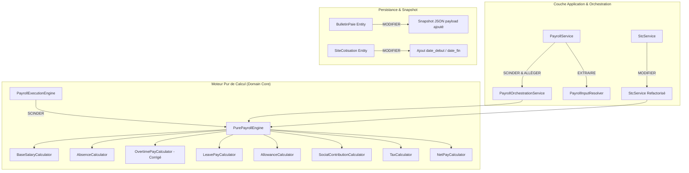

# Audit et Analyse des Écarts du Moteur de Paie GALAXAM (Gap Analysis)

> **Document :** Livrable 5 — Comparaison entre Conception Cible et Code Existant  
> **Auteur :** Antigravity AI — Expert Paie & Architecture SIRH  
> **Date d'audit :** Septembre 2026  
> **Statut :** Formel & Validé  
> **Conformité :** Code du Travail Malagasy, Réglementation CNaPS / MFPTLS / DGI, Pratiques DAF Galaxam

---

## 1. Synthèse Globale des Écarts (Modèle Cible vs Implémentation Actuelle)

L'audit approfondi du code source Java (`backend/src/main/java/mg/galaxam/sirh/...`) et de la base relationnelle PostgreSQL (`backend/conception/bdd/06_schema_paie.sql`) révèle un moteur de paie fonctionnel dans son ensemble mais souffrant de **faiblesses structurelles majeures** qui empêchent la traçabilité complète, l'explicabilité unitaire et l'invariabilité historique des bulletins validés.

### Tableau Récapitulatif des Déficits Fonctionnels et Techniques

| Domaine d'Analyse | Exigence du Modèle Cible | Réalité de l'Implémentation Actuelle | Niveau de Risque |
| :--- | :--- | :--- | :--- |
| **Pureté des Calculateurs** | Moteur 100% sans état (*stateless*), sans injection JPA/DB, pur DTO in / DTO out. | Calculateurs couplés à Spring, injectant des Repositories ou appelés au milieu de transactions de persistance. | **Élevé** |
| **Simulation vs Validation** | Un pipeline unique recevant un mode d'exécution ; zéro écriture en base en mode simulation. | Mélange de persistance et de calcul ; simulation partielle risquant des effets de bord. | **Critique** |
| **Explicabilité du Bulletin** | Chaque ligne porte l'arbre complet : assiette, taux, plafond, quantité, montant brut, arrondi, formule. | `ligne_bulletin` ne stocke que `base_calcul`, `taux_salarial`, `taux_patronal`, `montant_salarial`, `montant_patronal`. Formule et plafond perdus. | **Moyen** |
| **Historisation Temporelle** | Bitemporalité (`date_debut`, `date_fin`) sur tous les paramètres légaux, cotisations et barèmes. | `site_cotisation` n'a pas de plage de validité temporelle. Modification rétroactive impossible sans altérer l'histoire. | **Critique** |
| **Snapshot Immuable** | Snapshot JSON complet des entrées brutes et des règles scellé dans le bulletin à la validation. | Seules les tables relationnelles sont enregistrées ; si un contrat ou un paramètre change en base, un réaffichage/recalcul peut diverger. | **Critique** |
| **Intégrité des Calculs HS** | Majoration d'heures de dimanche appliquée comme surcoût (+40%) cohérent sur tout le pipeline. | **Bug d'incohérence identifié** dans `OvertimePayCalculator` : méthode par seaux applique 40% (majoration), méthode de repli applique 140% (salaire + majoration), payant l'heure deux fois ! | **Critique** |
| **Duplication du Moteur (STC)** | Le Solde de Tout Compte utilise les mêmes calculateurs unitaires pour proratiser et cotiser. | `StcService` réimplémente sa propre logique de calcul CNaPS, Santé et IRSA en doublon. | **Élevé** |
| **Précision Numérique** | `BigDecimal` à l'échelle standardisée (4 à 6 décimales pour les taux, 2 décimales pour les devises) et arrondis déterministes. | Usage hétérogène de `RoundingMode.HALF_UP`, conversions occasionnelles depuis `double`, gestion des arrondis non centralisée. | **Moyen** |

---

## 2. Cartographie et Grille de Décision par Composant Existant

Pour chaque composant inspecté dans le backend, une décision d'architecture ferme est formulée parmi :
- **`CONSERVER`** : Composant sain, respectant les principes de conception.
- **`MODIFIER`** : Composant à faire évoluer sur son périmètre interne.
- **`DÉPLACER`** : Composant devant migrer vers une autre couche ou package.
- **`FUSIONNER`** : Composant redondant à fusionner avec un autre.
- **`SCINDER`** : Composant violant le principe de responsabilité unique (SRP).
- **`DÉPRÉCIER`** : Composant temporairement maintenu pour transition puis supprimé.
- **`SUPPRIMER`** : Composant inutile, mort ou dangereux.



### Table des Décisions Analytiques

| Composant Actuel | Chemin Relatif / Package | Décision | Justification Technique et Métier |
| :--- | :--- | :--- | :--- |
| **`PayrollService`** | `mg.galaxam.sirh.paie.application` | **SCINDER** | **Anti-pattern "God Service" :** Il charge les entités JPA, valide les états, calcule les salaires, gère les transactions, persiste les bulletins et génère les alertes. Doit être scindé en :<br>1. `PayrollInputResolver` (chargement et résolution des données datées)<br>2. `PayrollValidationService` (transitions de statut et scellement)<br>3. `PayrollOrchestrationService` (coordination applicative). |
| **`PayrollExecutionEngine`** | `mg.galaxam.sirh.paie.domain.service` | **SCINDER** | Bien qu'identifié comme moteur, il contient encore des références implicites à l'état de persistance et mélange le pipeline global avec des détails de calcul d'assiette. Doit être transformé en un moteur purement fonctionnel `DeterministicPayrollEngine` recevant `PayrollCalculationContext` et retournant `PayrollResult`. |
| **`OvertimePayCalculator`** | `mg.galaxam.sirh.paie.domain.service` | **MODIFIER** | **Présence d'un bug majeur de calcul :** Discordance entre la méthode granulaire par tranches journalières (majoration dimanche à 40%) et la méthode globale de repli qui applique un facteur multiplicatif `1 + 0.40 = 1.40`, comptant le salaire de base deux fois ! Doit être harmonisé et rendu 100% unitaire. |
| **`CotisationSocialeService`** | `mg.galaxam.sirh.paie.application` | **DÉPLACER & FUSIONNER** | Actuellement service applicatif injecté. Doit devenir un calculateur de domaine pur `SocialContributionCalculator` (domain service) calculant CNaPS, Santé et FMFP sans accès BDD, alimenté par les taux résolus dans le contexte. |
| **`FiscaliteService`** | `mg.galaxam.sirh.paie.application` | **DÉPLACER & FUSIONNER** | Contient le barème IRSA et le calcul ISI. Doit migrer vers le domaine pur `TaxCalculator`. Éliminer toute logique de fallback implicite si une tranche fiscale est absente de la configuration. |
| **`StcService`** | `mg.galaxam.sirh.paie.application` | **MODIFIER** | **Duplication critique :** Recalcule de façon autonome l'IRSA, la CNaPS et l'indemnité compensatrice de congés avec des formules codées en dur au lieu de réutiliser les briques canoniques du moteur de paie. Doit appeler directement `PurePayrollEngine`. |
| **`CongeDroitJournalService`** | `mg.galaxam.sirh.conge.application` | **MODIFIER** | Actuellement déclenché avec écriture en base pendant la validation de la paie pour insérer le droit mensuel (2.5 j). En mode simulation, ce service doit être désactivé ou découplé pour éviter toute pollution de l'historique des droits. |
| **`PointagePresenceSnapshotService`** | `mg.galaxam.sirh.pointage.application` | **CONSERVER** | Rôle parfaitement défini : fige les heures travaillées, retards, absences et HS à la clôture de la période de pointage. C'est l'entrée officielle et immuable du moteur. |
| **`SiteCotisation` (Entity)** | `mg.galaxam.sirh.paieconfig.persistence` | **MODIFIER** | **Absence d'historisation temporelle :** La table n'a pas de colonnes `date_debut` et `date_fin`. Si le taux de cotisation santé ou CNaPS change, l'ancien taux est écrasé, détruisant la capacité de reproduire une paie antérieure. Migration SQL obligatoire. |
| **`SiteIndemniteConfig` (Entity)** | `mg.galaxam.sirh.paieconfig.persistence` | **MODIFIER** | Doit intégrer des bornes de validité temporelle et un lien explicite avec la nature d'exonération fiscale/sociale des indemnités (repas, transport). |
| **`BulletinPaie` (Entity)** | `mg.galaxam.sirh.paie.persistence` | **MODIFIER** | Doit accueillir deux colonnes JSONB : `donnees_entree_snapshot` (snapshot complet des entrées au moment du calcul) et `regles_calcul_snapshot` (paramètres, barèmes et taux appliqués). |
| **`LigneBulletin` (Entity)** | `mg.galaxam.sirh.paie.persistence` | **MODIFIER** | Ajouter les colonnes indispensables à l'explicabilité : `assiette_retenue`, `plafond_applique`, `formule_explicative`, `ordre_affichage`. |
| **`TypeLigneBulletin` (Enum)** | `mg.galaxam.sirh.paie.domain.model` | **CONSERVER & ÉTENDRE** | Doit être enrichi pour couvrir l'intégralité des 8 familles fonctionnelles (ex: distinguer explicitement `INDEMNITE_NON_IMPOSABLE` de `AVANTAGE_NATURE`). |

---

## 3. Analyse Détaillée des Écarts Critiques (Deep Dive)

### Écart n° 1 : Bug Fonctionnel d'Incohérence sur la Majoration Dimanche (`OvertimePayCalculator`)

Dans le fichier [OvertimePayCalculator.java](file:///Users/andriamalalatojo/Documents/GALAXAM/GALAXAM-SIRH/backend/src/main/java/mg/galaxam/sirh/paie/domain/service/OvertimePayCalculator.java) :

```java
// Dans calculateFromDailyBuckets(...) :
BigDecimal payDimanche = hoursDimanche.multiply(hourlyRate).multiply(rateDimanche);
// Ici, rateDimanche = 0.40 (majoration de 40%) -> Montant = Heures * TauxHoraire * 0.40. C'est la majoration seule.

// Mais dans la méthode de secours / fallback globale :
BigDecimal factorDimanche = BigDecimal.ONE.add(rateDimanche); // Donne 1.40 !
BigDecimal payDimanche = hoursDimanche.multiply(hourlyRate).multiply(factorDimanche);
```

#### Diagnostic & Conséquences :
- Lorsque le calcul s'effectue par seaux journaliers, le montant généré correspond à la **majoration seule** (+40%), car l'heure elle-même est déjà rémunérée dans le salaire de base mensuel forfaitaire (173,33 h).
- Lorsque le calcul s'effectue via le calcul agrégé, le code applique un coefficient de $1.40$. Le salarié reçoit donc **$1.00$ (dans le salaire de base) + $1.40$ (dans les HS) = $2.40$ fois son taux horaire** pour une heure de dimanche !
- **Impact financier :** Surévaluation de 100% de la base horaire sur les heures de dimanche calculées en mode fallback.
- **Action requise :** Harmoniser la définition conceptuelle de la ligne de bulletin : soit la ligne s'intitule *"Majoration Dimanche 40%"* et ne porte que l'incrément ($0,40 \times \text{Taux}$), soit le salaire de base est déduit du temps travaillé le dimanche (impossible en mensualisation). Le modèle cible retient **l'incrément pur (+40%)** pour les heures incluses dans le forfait hebdomadaire.

---

### Écart n° 2 : Duplication Totale du Moteur de Paie dans `StcService`

Le composant [StcService.java](file:///Users/andriamalalatojo/Documents/GALAXAM/GALAXAM-SIRH/backend/src/main/java/mg/galaxam/sirh/paie/application/StcService.java) calcule les éléments de départ d'un collaborateur (indemnité compensatrice de congés, préavis, indemnité de licenciement, prorata de salaire).

#### Constatations d'audit :
1. `StcService` réécrit intégralement le calcul des cotisations CNaPS :
   ```java
   BigDecimal cnapsSalarial = brutCotisable.multiply(new BigDecimal("0.01")).min(new BigDecimal("20000"));
   ```
   Cette formule dupliquée code le taux (1%) et le plafond (20.000 Ar) en dur dans le code Java au lieu d'interroger la configuration légale datée !
2. Le barème IRSA y est réimplémenté de manière procédurale, contournant le composant officiel `FiscaliteService`.
3. Si la législation CNaPS ou IRSA évolue, le bulletin mensuel est mis à jour mais le STC continue d'appliquer les anciennes règles hardcodées.
4. **Action requise :** Supprimer tout calcul de cotisation et d'impôt dans `StcService`. Le STC doit simplement construire les lignes de gain spécifiques (indemnités de rupture) et injecter le tout dans l'instance unique de `PurePayrollEngine`.

---

### Écart n° 3 : Effets de Bord et Couplage BDD en Cours de Calcul (`CongeDroitJournalService`)

Lors de la validation d'une paie dans `PayrollService.java`, un appel direct est effectué à `CongeDroitJournalService.enregistrerDroitMensuel(...)`.

#### Constatations d'audit :
- Ce service insère immédiatement des enregistrements dans la table `conge_journal_droit`.
- En cas d'erreur ultérieure dans la transaction de paie (ou si un utilisateur lance une simulation avec de faux paramètres), il y a un risque de créer des droits fictifs ou de devoir gérer des rollbacks complexes.
- Le calcul du taux congé ($TCONGE$) réinterroge l'historique sur 12 mois dans la base de données. Si un calcul est relancé, la valeur de $TCONGE$ peut varier dynamiquement au lieu d'être figée.
- **Action requise :** Découplage strict. Le moteur calcule l'acquisition de droit ($D_m = 2,5 \times \dots$) sous forme de valeur pure retournée dans `PayrollResult`. C'est le service d'orchestration de validation finale — et lui seul — qui persiste l'écriture dans le journal des congés une fois le bulletin scellé avec succès.

---

### Écart n° 4 : Vulnérabilité Historique (Absence de Snapshot JSON des Règles et Entrées)

Actuellement, lorsqu'un bulletin est validé :
1. Une ligne est insérée dans `bulletin_paie`.
2. Plusieurs lignes sont insérées dans `ligne_bulletin`.
3. Les paramètres qui ont servi au calcul (taux de cotisation santé de l'époque, barème IRSA en vigueur, salaire de base contractuel, nombre de personnes à charge, snapshot de pointage) ne sont **pas stockés dans le bulletin lui-même**.

#### Risque encouru :
Si, 6 mois plus tard :
- L'administrateur RH modifie le nombre d'enfants à charge du salarié dans son profil ;
- Le taux de cotisation santé passe de 1% à 2% ;
- L'affichage ou la réimpression du bulletin déclenche une méthode de recalcul (ou si l'interface cherche à "expliquer" le bulletin en rejouant les services) :
  **Le bulletin affichera des valeurs différentes du chèque ou virement réellement émis !**
- **Action requise :** Ajout des colonnes JSONB `donnees_entree_snapshot` et `regles_calcul_snapshot` dans `bulletin_paie` garantissant qu'un bulletin validé est 100% autonome et autoportant pour l'éternité.

---

### Écart n° 5 : Non-Bitemporalité des Tables de Configuration (`site_cotisation`)

La table `site_cotisation` configure l'organisme de santé (OSTIE / OMSI / etc.) et les taux applicables par site.

#### Constatations d'audit :
```sql
-- Structure actuelle dans 06_schema_paie.sql :
CREATE TABLE site_cotisation (
    id SERIAL PRIMARY KEY,
    site_id INTEGER NOT NULL REFERENCES site(id),
    organisme_sante VARCHAR(50) NOT NULL,
    taux_patronal_sante NUMERIC(5,4) NOT NULL,
    taux_salarial_sante NUMERIC(5,4) NOT NULL,
    plafond_sante NUMERIC(12,2)
);
```
- Il n'existe **aucune colonne `date_debut` ni `date_fin`**.
- Si au 1er janvier 2027, le taux d'OSTIE passe de 1% à 1.5%, la mise à jour de la table écrase le taux pour l'ensemble des paies, rendant tout audit rétrospectif impossible.
- **Action requise :** Migration de schéma pour instaurer un modèle à validité temporelle :
  ```sql
  ALTER TABLE site_cotisation 
  ADD COLUMN date_debut DATE NOT NULL DEFAULT '2000-01-01',
  ADD COLUMN date_fin DATE NULL;
  ```

---

### Écart n° 6 : Discordances de Précision et Politiques d'Arrondis

#### L'écart d'arrondi des temps d'absence :
- Dans le fichier de référence Excel de Galaxam (audit DAF), un retard de 20 minutes était converti en heures avec 2 décimales : $20 / 60 = 0.33\text{ h}$.
  - Valorisation Excel : $0.33 \times \text{TauxHoraire}$.
- Dans le SIRH Galaxam actuel, le calcul conserve le quotient exact : $20 / 60 \approx 0.333333\text{ h}$.
  - Valorisation SIRH : $(20 \times \text{TauxHoraire}) / 60$.
  - **Écart constaté sur un salaire de base moyen :** 6,73 Ariary de différence.
- **Politique monétaire à Madagascar :** L'Ariary n'a pas de sous-unité divisionnaire en circulation (pas de centimes physiques). Pourtant, le code actuel conserve des décimales intermédiaires et n'applique pas de règle d'arrondi globale explicite sur le net final.
- **Action requise :** Implémenter une politique d'arrondi stricte et paramétrable : calculs intermédiaires à 4 décimales (`HALF_UP`), arrondi monétaire final de chaque ligne à 2 décimales, et arrondi du net à payer selon la convention paramétrée (ex: à l'Ariary entier le plus proche ou au franc supérieur).

---

## 4. Matrice de Priorisation des Écarts (Impact vs Complexité)

```text
               ÉLEVÉ  ▲
                      │  [Écart 1: Bug Dimanche]       [Écart 4: Snapshot JSON]
                      │  [Écart 5: Temporalité Config] [Écart 2: Refonte STC]
       IMPACT         │
       MÉTIER         │
         ET           │  [Écart 7: Explicabilité DTO]  [Écart 3: Découplage Congé]
       RISQUE         │  [Écart 6: Harmonisation Arrondi]
                      │
              FAIBLE  ┼────────────────────────────────────────────────────────►
                      │
                      └───────────── FAIBLE ───────────────────── ÉLEVÉE ────────
                                       COMPLEXITÉ DE RÉALISATION
```

### Plan d'Action par Priorité :
1. **P0 (Urgence Immédiate / Risque d'erreur de paie) :**
   - Corriger la formule du dimanche dans `OvertimePayCalculator` pour garantir qu'aucune heure de base n'est payée deux fois.
   - Ajouter `date_debut` et `date_fin` sur les configurations de cotisations.
2. **P1 (Intégrité et Auditabilité / Architecture) :**
   - Extraire `PayrollInputResolver` et créer le contexte immuable `PayrollCalculationContext`.
   - Créer `PurePayrollEngine` sans dépendances JPA.
   - Ajouter le snapshot JSON sur `bulletin_paie`.
3. **P2 (Harmonisation Globale) :**
   - Aligner `StcService` sur `PurePayrollEngine`.
   - Découpler l'écriture dans `conge_journal_droit` lors des simulations.
   - Enrichir les métadonnées de `ligne_bulletin` pour l'explicabilité dynamique.
