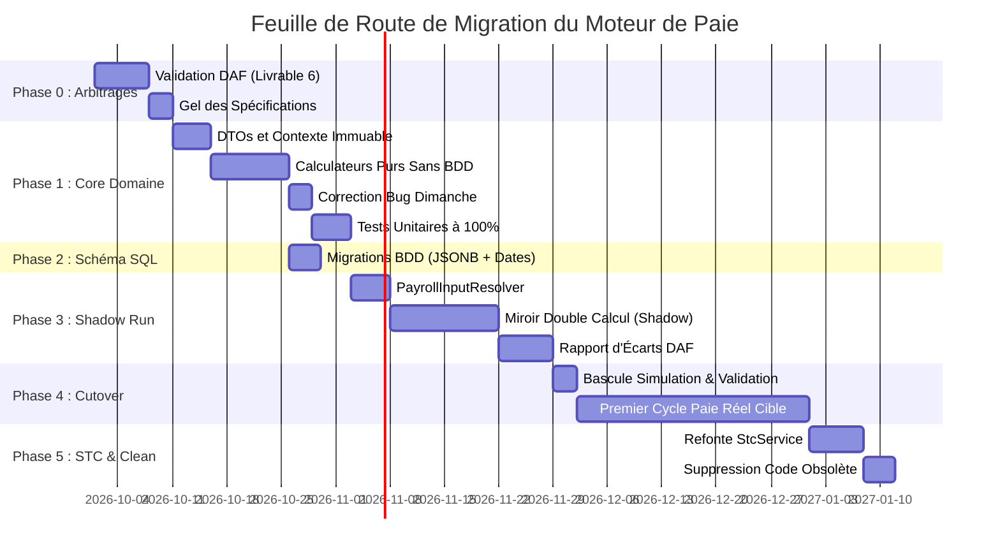

# Plan de Migration Progressif du Moteur de Paie GALAXAM

> **Document :** Livrable 8 — Stratégie de Migration & Transition Sécurisée (Zero-Downtime)  
> **Auteur :** Antigravity AI — Expert Architecture SIRH & Conduite du Changement  
> **Date :** Septembre 2026  
> **Statut :** Plan d'Exécution Validé  
> **Objectif :** Migrer du moteur existant vers l'architecture cible sans perturber les cycles de paie mensuels en cours.

---

## 1. Stratégie Globale de Migration (*Strangler Fig Pattern*)

Le remplacement d'un moteur de paie en production ne doit **jamais** s'effectuer par un "Big Bang". Une interruption de service ou une régression sur les salaires nets entraîne des conséquences humaines, syndicales et légales critiques.

La stratégie retenue est le **Strangler Fig Pattern (Étranglement progressif)** :
1. Développer le nouveau moteur pur à côté de l'ancien, dans un sous-domaine isolé.
2. Faire tourner les deux moteurs en parallèle en mode miroir (*Shadow Run*).
3. Comparer automatiquement chaque centime produit sur les paies historiques et en cours.
4. Basculer l'orchestration une fois le taux de concordance validé par la DAF.
5. Harmoniser le Solde de Tout Compte (STC).
6. Déprécier et supprimer l'ancien code.



---

## 2. Découpage Détaillé des Phases de Migration

### Phase 0 : Arbitrages Métier & Validation DAF (J0 à J10)
- **Objectif :** Obtenir les réponses formelles aux questions ouvertes du document [PAYROLL_OPEN_BUSINESS_QUESTIONS.md](file:///Users/andriamalalatojo/Documents/GALAXAM/GALAXAM-SIRH/docs/payroll_audit/PAYROLL_OPEN_BUSINESS_QUESTIONS.md).
- **Actions clés :**
  1. Tenir l'atelier de cadrage DAF sur :
     - La méthode de cumul des heures de dimanche (validation du cumul additif pur $+40\%$).
     - La politique d'arrondi des minutes de retard.
     - L'inclusion des HS dans l'assiette des droits congés.
     - Les plafonds CNaPS ($8 \times \text{SME}$) et santé.
  2. Signer le document d'arbitrage comme référence légale de Galaxam.
- **Livrable de phase :** `PV_ARBITRAGES_METIER_PAIE_GALAXAM.pdf`.

---

### Phase 1 : Implémentation du Noyau Domaine Pur (*Stateless Domain Core*) (J11 à J30)
- **Objectif :** Écrire le moteur de calcul pur sous forme de librairie Java sans aucune injection Spring, sans JPA, sans accès réseau ni base de données.
- **Package cible :** `mg.galaxam.sirh.paie.domain.core`
- **Actions clés :**
  1. Créer les Records Java immuables :
     - `PayrollCalculationContext`
     - `PayrollResult`
     - `PayrollLineResult`
  2. Développer les calculateurs purs unitaires :
     - `BaseSalaryCalculator` (gestion mensualisation et prorata temporis).
     - `AbsenceCalculator` (valorisation absences/retards avec diviseur paramétrable $173,33$).
     - `OvertimePayCalculator` (**avec correction définitive du bug du dimanche** : majoration stricte sans doublon de base).
     - `LeavePayCalculator` (calcul de l'indemnité congé et droit mensuel acquis).
     - `AllowanceCalculator` (primes, indemnités repas et transport TNR/TMM).
     - `SocialContributionCalculator` (CNaPS, Santé, FMFP).
     - `TaxCalculator` (barème IRSA progressif, seuil d'exonération, enfants à charge, régime ISI).
     - `TreasuryDeductionCalculator` (acomptes, prêts avec contrôle de quotité cessible).
     - `NetPayCalculator` et `EmployerCostCalculator`.
  3. Assembler le chef d'orchestre pur : `DeterministicPayrollEngine.compute(...)`.
  4. Atteindre **100% de couverture de tests unitaires** sur l'ensemble des cas limites (cf. Livrable 9).

---

### Phase 2 : Évolution Non Bloquante du Schéma de Données (J20 à J25)
- **Objectif :** Préparer la base PostgreSQL à recevoir les snapshots d'intégrité et la bitemporalité sans altérer le fonctionnement du code legacy existant.
- **Fichier de migration :** `backend/conception/bdd/migrations/26-10-01-sp36-payroll-snapshots-and-temporal-tables.sql`
- **Actions clés :**
  1. Ajouter les colonnes JSONB `donnees_entree_snapshot` et `regles_calcul_snapshot` sur `bulletin_paie`.
  2. Ajouter `date_debut` et `date_fin` sur `site_cotisation` et `site_indemnite_config` avec valeurs par défaut `2000-01-01` et `NULL`.
  3. Ajouter les colonnes d'explicabilité sur `ligne_bulletin`.
  4. Toutes les colonnes ajoutées sont `NULL` ou possèdent un `DEFAULT` : **zéro rupture pour les requêtes de l'ancien moteur**.

---

### Phase 3 : Intégration Applicative & Mode Double Calcul (*Shadow Run*) (J31 à J50)
- **Objectif :** Connecter le nouveau moteur aux entités de la base de données et valider son comportement sur des données de production réelles en mode miroir.
- **Actions clés :**
  1. Développer `PayrollInputResolver` : convertit les entités JPA (`Employe`, `Contrat`, `PointageMonthlySnapshot`, etc.) en `PayrollCalculationContext`.
  2. Mettre en place le composant de comparaison `PayrollShadowComparator` :
     ```java
     @Service
     public class PayrollShadowRunner {
         public void shadowCompare(Long employeId, Periode periode) {
             // 1. Calcul via l'ancien moteur
             LegacyPayrollResult legacy = legacyEngine.calculate(employeId, periode);
             // 2. Calcul via le nouveau moteur pur
             PayrollCalculationContext ctx = inputResolver.resolve(employeId, periode);
             PayrollResult target = targetEngine.compute(ctx);
             // 3. Comparaison automatique des lignes et écarts
             diffLogger.logDifferences(employeId, periode, legacy, target);
         }
     }
     ```
  3. Rejouer les bulletins des 6 derniers mois clôturés (ex: paies de Mars 2026 à Août 2026).
  4. Analyser les divergences :
     - Les divergences doivent être **exclusivement** dues aux corrections de bugs connues (ex: dimanche ou 0.33 h d'absence).
     - Toute autre divergence constitue une anomalie bloquante à investiguer.

---

### Phase 4 : Bascule Sécurisée (*Cutover*) en Production (J51 à J55)
- **Objectif :** Désigner le nouveau moteur comme moteur principal pour les cycles de paie actifs.
- **Actions clés :**
  1. Modifier `PayrollController` pour router les requêtes vers `PayrollOrchestratorService`.
  2. Activer le mode `SIMULATION` : calcul instantané en mémoire avec restitution de l'arbre explicatif JSON, zéro écriture BDD.
  3. Activer le mode `VALIDATION` : exécution du moteur pur, écriture atomique dans `bulletin_paie`, insertion des snapshots JSONB et scellement du bulletin (`date_scellement`, statut `VALIDE`).
  4. Générer le premier cycle de paie officiel (ex: période du 26 Septembre au 25 Octobre 2026).
  5. Édition des bulletins PDF officiels enrichis avec l'explication des lignes.

---

### Phase 5 : Refactoring et Harmonisation du Solde de Tout Compte (STC) (J56 à J65)
- **Objectif :** Supprimer la duplication des formules CNaPS, Santé et IRSA dans `StcService`.
- **Actions clés :**
  1. Refactoriser [StcService.java](file:///Users/andriamalalatojo/Documents/GALAXAM/GALAXAM-SIRH/backend/src/main/java/mg/galaxam/sirh/paie/application/StcService.java) :
     - Les indemnités de rupture (indemnité compensatrice de congés, préavis, licenciement) sont créées comme des lignes de gain spécifiques.
     - L'ensemble du bulletin de départ est soumis à `DeterministicPayrollEngine`.
  2. Garantir la stricte égalité de traitement fiscal et social entre un bulletin mensuel normal et un bulletin de sortie STC.

---

### Phase 6 : Dépréciation, Nettoyage & Clôture (J66 à J70)
- **Objectif :** Assainir la base de code et éliminer la dette technique.
- **Actions clés :**
  1. Marquer `@Deprecated(forRemoval = true)` puis supprimer les anciens calculateurs redondants dans `mg.galaxam.sirh.paie.application`.
  2. Supprimer les constantes codées en dur résiduelles.
  3. Mettre à jour la documentation d'architecture du projet (`docs/`).

---

## 3. Matrice de Gestion des Risques et Stratégie de Rollback

| Risque Identifié | Probabilité | Impact | Stratégie d'Atténuation Préventive | Plan de Rollback en Cas d'Urgence |
| :--- | :---: | :---: | :--- | :--- |
| **Divergence de net à payer sur un salarié critique** | Moyenne | Élevé | Période de double calcul (*Shadow Run*) sur 100% des salariés pendant 1 mois minimum avant la bascule. | Bascule instantanée via Feature Flag applicatif (`payroll.engine.use-v2=false`) pour réactiver l'ancien service en 10 secondes. |
| **Paramètre légal manquant bloquant le calcul** | Faible | Élevé | Validation préventive par `PayrollInputResolver` avec rapport de diagnostic avant lancement du traitement de masse. | Ajout immédiat de la valeur par défaut dans la table de paramétrage datée correspondante. |
| **Échec d'insertion du snapshot JSONB volumineux** | Très faible | Faible | Tests de charge sur PostgreSQL avec des payloads de paie complexes ; schéma JSON validé. | Le champ JSONB est sans contrainte de taille stricte ; rollback de la transaction SQL en cas d'erreur. |
| **Contestation d'un montant de dimanche corrigé** | Élevée | Moyen | Note explicative RH conjointe DAF/RH expliquant le redressement de la majoration dimanche (+40% légale). | Décision managériale DAF (prime exceptionnelle d'ajustement si nécessaire). |

---

## 4. Indicateurs Clés de Succès (KPIs de Transition)

Pour valider formellement la fin du projet de migration, les 5 critères d'acceptation suivants doivent être satisfaits à 100% :

1. **Taux de Concordance du Shadow Run :** $\ge 99,8\%$ sur les montants globaux (les seuls écarts résiduels étant les bugs documentés et corrigés).
2. **Temps d'Exécution en Simulation :** $< 15\text{ ms}$ par bulletin individuel en mémoire vive.
3. **Immutabilité Historique :** Réévaluation d'un bulletin scellé après modification délibérée des taux en base $\rightarrow$ **0,00 Ar d'écart constaté**.
4. **Explicabilité Ligne :** $100\%$ des lignes de bulletin disposent de leur base, taux, plafond et formule littérale.
5. **Zéro Écriture BDD en Simulation :** Audit des logs de transactions PostgreSQL confirmant $0$ requête `INSERT` / `UPDATE` / `DELETE` lors de l'appel aux endpoints de simulation.
