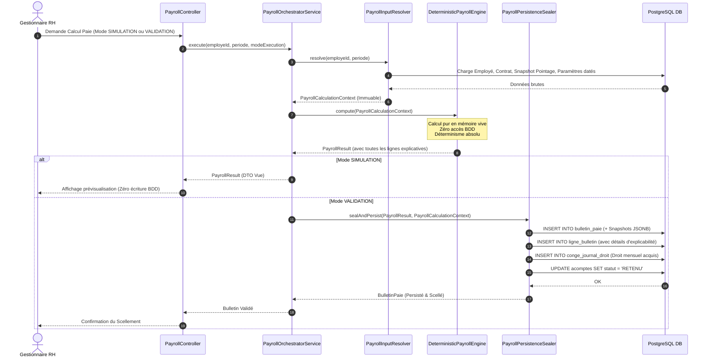

# Architecture Cible Recommandée pour le Moteur de Paie GALAXAM

> **Document :** Livrable 7 — Architecture Cible & Spécifications Logicielles  
> **Auteur :** Antigravity AI — Expert Architecture SIRH & Domain-Driven Design (DDD)  
> **Date :** Septembre 2026  
> **Statut :** Formel — Modèle de Référence

---

## 1. Principes Fondateurs de l'Architecture Cible

Pour répondre aux 10 exigences non négociables exprimées dans la mission d'audit, l'architecture cible du moteur de paie Galaxam repose sur les 5 piliers de l'ingénierie logicielle financière :

1. **Pureté Fonctionnelle & Déterminisme (*Stateless Domain Core*) :**  
   Aucun composant de calcul ne réalise de requête SQL, d'appel réseau ou de modification d'état. À un jeu d'entrées $E$ donné, le moteur produit toujours le même résultat $R$, à la décimale près, sans aucune dépendance envers l'environnement d'exécution.
2. **Unification Stricte Simulation / Validation :**  
   Il n'existe qu'une seule et unique méthode d'évaluation mathématique : `PurePayrollEngine.compute(PayrollCalculationContext) -> PayrollResult`. La simulation exécute cette méthode en mémoire vive. La validation exécute la même méthode puis scelle le résultat en base relationnelle avec son snapshot.
3. **Immutabilité Historique par Snapshots Autoportants :**  
   Un bulletin validé stocke dans deux colonnes JSONB l'intégralité des données d'entrée brutes (`donnees_entree_snapshot`) et des paramètres/barèmes appliqués (`regles_calcul_snapshot`). Toute modification ultérieure des tables de configuration ou des fiches employés n'a strictement aucun impact sur un bulletin scellé.
4. **Explicabilité Intrinsèque (*Self-Explaining Engine*) :**  
   Le moteur ne calcule pas de simples montants flottants : chaque ligne produite est un objet riche (`PayrollLineResult`) documentant sa quantité, son assiette, son taux, son plafond, sa formule littérale, son montant avant arrondi et la règle d'arrondi appliquée.
5. **Absence Totale de Fallbacks Silencieux :**  
   Si un paramètre indispensable est manquant (ex: taux de santé non configuré sur un site, barème fiscal absent pour l'année), le moteur stoppe immédiatement le calcul et lève une exception typée explicite (`MissingPayrollParameterException`).

---

## 2. Diagramme d'Architecture Globale (Architecture Hexagonale / Clean Architecture)

```mermaid
graph TD
    subgraph "Couche Interface & Présentation (REST API)"
        API_SIM["POST /api/payroll/simulate"]
        API_VAL["POST /api/payroll/validate"]
        API_BUL["GET /api/payroll/payslips/{id}"]
    end

    subgraph "Couche Application & Orchestration"
        ORCH["PayrollOrchestratorService"]
        RESOLVER["PayrollInputResolver"]
        SEALER["PayrollPersistenceSealer"]
    end

    subgraph "Noyau Domaine Pur (Domain Core - Stateless)"
        CTX["PayrollCalculationContext (Immutable)"]
        ENGINE["DeterministicPayrollEngine"]
        
        subgraph "Calculateurs Purs de Domaine"
            C_BASE["BaseSalaryCalculator"]
            C_ABS["AbsenceCalculator"]
            C_OT["OvertimePayCalculator"]
            C_LEAVE["LeavePayCalculator"]
            C_ALLOW["AllowanceCalculator"]
            C_GROSS["GrossPayCalculator"]
            C_SOC["SocialContributionCalculator"]
            C_TAX["TaxCalculator (IRSA / ISI)"]
            C_DED["TreasuryDeductionCalculator"]
            C_NET["NetPayCalculator"]
            C_EMP["EmployerCostCalculator"]
        end
        
        RES["PayrollResult (Immutable)"]
    end

    subgraph "Couche Infrastructure & Persistance (JPA / PostgreSQL)"
        REPO_EMP[EmployeRepository]
        REPO_CTR[ContratRepository]
        REPO_PTG[PointageSnapshotRepository]
        REPO_PAR[ParametreBaremeRepository]
        REPO_BUL[BulletinPaieRepository]
        DB[(PostgreSQL - BDD GALAXAM)]
    end

    API_SIM --> ORCH
    API_VAL --> ORCH
    API_BUL --> REPO_BUL

    ORCH --> RESOLVER
    RESOLVER --> REPO_EMP
    RESOLVER --> REPO_CTR
    RESOLVER --> REPO_PTG
    RESOLVER --> REPO_PAR

    RESOLVER -->|Produit| CTX
    CTX --> ENGINE
    ENGINE --> C_BASE
    ENGINE --> C_ABS
    ENGINE --> C_OT
    ENGINE --> C_LEAVE
    ENGINE --> C_ALLOW
    ENGINE --> C_GROSS
    ENGINE --> C_SOC
    ENGINE --> C_TAX
    ENGINE --> C_DED
    ENGINE --> C_NET
    ENGINE --> C_EMP
    ENGINE -->|Produit| RES

    ORCH -->|Si Validation| SEALER
    SEALER -->|Scelle Bulletin + Snapshot| REPO_BUL
    REPO_BUL --> DB
```



---

## 3. Décomposition et Responsabilités des Composants

### 3.1. `PayrollInputResolver` (Couche Application)
- **Rôle unique :** Récupérer, valider et agréger l'ensemble des données nécessaires au calcul pour un salarié et une période donnés.
- **Opérations :**
  1. Charge l'employé, son contrat actif sur la période (`date_paie`), son site de rattachement et son statut fiscal/social.
  2. Récupère le snapshot validé et immuable de pointage (`PointageMonthlySnapshot`).
  3. Interroge les tables de configuration datées (`site_cotisation`, `parametre_bareme`, `site_indemnite_config`) valides à `date_paie`.
  4. Récupère les retenues de trésorerie du mois (acomptes validés, échéances de prêt).
  5. **Validation d'intégrité :** Vérifie que chaque paramètre légal obligatoire est présent. Si un élément manque, lève immédiatement `MissingPayrollParameterException`.
  6. Construit l'objet immuable `PayrollCalculationContext`.

### 3.2. `PayrollCalculationContext` (Objet de Valeur Immuable)
Contient l'état complet nécessaire au calcul sans aucune méthode métier autre que la consultation :
- `PeriodePaie` : Dates de début, de fin et date d'effet du bulletin.
- `DonneesSalarie` : ID, matricule, nom, nombre de personnes à charge, régime fiscal (`IRSA` ou `ISI`).
- `DonneesContractuelles` : Salaire contractuel ($S_{\text{contrat}}$), type de contrat, mode de rémunération, heures théoriques de la période.
- `DonneesPointageSnapshot` : Heures normales travaillées, minutes d'absence, minutes de retard, jours de congé payé pris, détail des heures supplémentaires par tranche (30%, 50%), heures de nuit, heures de dimanche, heures de jours fériés.
- `DonneesVariablesSaisies` : Primes exceptionnelles, commissions, ajustements positifs/négatifs.
- `DonneesTresorerie` : Acomptes versés, retenues de prêt, saisies.
- `ReglesEtTauxApplicables` :
  - Diviseur horaire mensuel ($173,33$).
  - Taux CNaPS salarié ($1\%$) et patronal ($13\%$) + plafond ($8 \times \text{SME}$).
  - Organisme santé, taux salarié ($1\%$ ou $2\%$), taux patronal ($1\%$ ou $2\%$), plafond éventuel.
  - Taux FMFP ($1\%$).
  - Barème IRSA actif (tranches, taux, minimum de perception, déduction par enfant).
  - Taux ISI ($5\%$).
  - Forfaits déplacement (TNR 50.000 Ar / TMM 25.000 Ar) et indemnités repas configurées.

### 3.3. `DeterministicPayrollEngine` & Calculateurs Purs de Domaine

Le moteur exécute les calculateurs selon un flux séquentiel strict en 11 étapes sans dépendance circulaire :

```text
1. BaseSalaryCalculator        -> Salaire de base de période (prorata éventuel)
2. AbsenceCalculator           -> Retenues pour absence et retard
3. LeavePayCalculator          -> Maintien de salaire pour congés payés
4. OvertimePayCalculator       -> Rémunération des HS, nuits, dimanches et fériés
5. AllowanceCalculator         -> Primes, gratifications et indemnités de transport/repas
6. GrossPayCalculator          -> Agrégation du Brut Salarial Total
7. SocialContributionCalculator-> Cotisations CNaPS, Santé et FMFP (Salarié + Employeur)
8. TaxCalculator               -> Impôt sur le revenu (IRSA par tranches ou ISI fixe)
9. TreasuryDeductionCalculator -> Imputation des acomptes et prêts (avec contrôle quotité)
10. NetPayCalculator           -> Calcul du Net avant impôt, Net imposable et Net à payer
11. EmployerCostCalculator     -> Coût global total employeur
```

Chaque calculateur implémente l'interface fonctionnelle de domaine :
```java
public interface DomainCalculator<TInput, TOutput> {
    TOutput calculate(TInput input, CalculationEnvironment env);
}
```

### 3.4. `PayrollResult` & L'Arbre d'Explicabilité

L'objet retourné contient non seulement les totaux financiers, mais également une liste ordonnée d'objets `PayrollLineResult` :

```java
public record PayrollLineResult(
    String codeLigne,              // Ex: "COT_CNAPS_SAL"
    String libelle,                // Ex: "Cotisation CNaPS Salariée (1%)"
    FamilleVariable famille,       // COTISATION_SALARIALE
    BigDecimal baseCalcul,         // Ex: 2000000.00 (Assiette retenue)
    BigDecimal baseInitiale,       // Ex: 2450000.00 (Brut réel)
    BigDecimal taux,               // Ex: 0.0100
    BigDecimal plafond,            // Ex: 2000000.00
    BigDecimal quantite,           // Ex: 1.00
    BigDecimal montantBrut,        // Ex: 20000.00
    String formuleExplicative,     // Ex: "min(Brut, 8*SME) * 1%"
    TypeArrondi arrondiApplique,   // HALF_UP_CENTIME
    BigDecimal montantFinal,       // Ex: 20000.00
    SensImpact sens                // RETENUE_SALARIALE
) {}
```

---

## 4. Diagramme de Séquence : Traitement d'une Paie (Simulation vs Validation)



---

## 5. Évolution du Modèle de Données (Schéma Cible)

Pour supporter l'invariabilité historique et l'explicabilité sans régression de performance, les extensions SQL suivantes sont intégrées :

### 5.1. Extension de la Table `bulletin_paie`
```sql
ALTER TABLE bulletin_paie 
ADD COLUMN IF NOT EXISTS donnees_entree_snapshot JSONB NOT NULL DEFAULT '{}'::jsonb,
ADD COLUMN IF NOT EXISTS regles_calcul_snapshot JSONB NOT NULL DEFAULT '{}'::jsonb,
ADD COLUMN IF NOT EXISTS arbre_explication_snapshot JSONB NOT NULL DEFAULT '{}'::jsonb,
ADD COLUMN IF NOT EXISTS date_scellement TIMESTAMP WITH TIME ZONE NULL,
ADD COLUMN IF NOT EXISTS scelle_par VARCHAR(100) NULL;

COMMENT ON COLUMN bulletin_paie.donnees_entree_snapshot IS 'Snapshot JSON complet des données d entrée (pointage, contrat, salaires) au moment du calcul';
COMMENT ON COLUMN bulletin_paie.regles_calcul_snapshot IS 'Snapshot JSON de tous les barèmes, taux légaux et plafonds appliqués';
```

### 5.2. Extension de la Table `ligne_bulletin`
```sql
ALTER TABLE ligne_bulletin
ADD COLUMN IF NOT EXISTS assiette_brute NUMERIC(12,2) NULL,
ADD COLUMN IF NOT EXISTS plafond_applique NUMERIC(12,2) NULL,
ADD COLUMN IF NOT EXISTS formule_explicative VARCHAR(255) NULL,
ADD COLUMN IF NOT EXISTS ordre_affichage INTEGER NOT NULL DEFAULT 0;
```

### 5.3. Bitemporalité sur `site_cotisation` et `site_indemnite_config`
```sql
ALTER TABLE site_cotisation
ADD COLUMN IF NOT EXISTS date_debut DATE NOT NULL DEFAULT '2000-01-01',
ADD COLUMN IF NOT EXISTS date_fin DATE NULL;

ALTER TABLE site_indemnite_config
ADD COLUMN IF NOT EXISTS date_debut DATE NOT NULL DEFAULT '2000-01-01',
ADD COLUMN IF NOT EXISTS date_fin DATE NULL;

-- Contrainte d'unicité temporelle pour éviter les chevauchements
CREATE UNIQUE INDEX IF NOT EXISTS uq_site_cotisation_temporelle 
ON site_cotisation (site_id, organisme_sante, date_debut);
```

---

## 6. Structure Canonique des Snapshots JSON

### Exemple du JSON `donnees_entree_snapshot` scellé dans le bulletin :
```json
{
  "contrat": {
    "reference": "CTR-2024-0012",
    "type": "CDI",
    "salaireContractuel": 2500000.00,
    "regimeFiscal": "IRSA",
    "regimeSocial": "CNAPS_ET_SANTE",
    "personnesACharge": 2
  },
  "pointage": {
    "snapshotId": 842,
    "heuresNormales": 173.33,
    "minutesAbsence": 0,
    "minutesRetard": 20,
    "heuresSupp30": 8.00,
    "heuresSupp50": 4.50,
    "heuresNuit": 2.00,
    "heuresDimanche": 0.00,
    "joursCongesPris": 1.00
  },
  "indemnitesFixes": {
    "forfaitDeplacement": 50000.00,
    "forfaitRepasJournalier": 5000.00,
    "joursPresenceRepas": 21
  }
}
```

### Exemple du JSON `regles_calcul_snapshot` scellé dans le bulletin :
```json
{
  "moteurVersion": "2.0.0-PROD",
  "diviseurHoraire": 173.33,
  "cnaps": {
    "tauxSalarial": 0.0100,
    "tauxPatronal": 0.1300,
    "plafond": 2000000.00,
    "smeReference": 250000.00
  },
  "sante": {
    "organisme": "OSTIE",
    "tauxSalarial": 0.0100,
    "tauxPatronal": 0.0100,
    "plafond": null
  },
  "fmfp": {
    "tauxPatronal": 0.0100
  },
  "irsa": {
    "tranches": [
      { "min": 0, "max": 350000, "taux": 0.00 },
      { "min": 350001, "max": 400000, "taux": 0.05 },
      { "min": 400001, "max": 500000, "taux": 0.10 },
      { "min": 500001, "max": 600000, "taux": 0.15 },
      { "min": 600001, "max": null, "taux": 0.20 }
    ],
    "minimumPerception": 2000.00,
    "reductionParEnfant": 2000.00
  }
}
```
