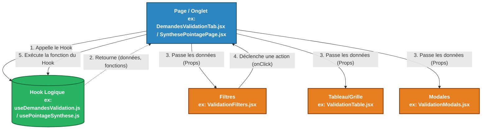

# Guide d'Architecture Front-End : GALAXAM SIRH

Ce document explique la nouvelle architecture en 3 couches (Pages / Hooks / Components) mise en place pour résoudre le problème des "composants monolithiques". Il vous guidera pas à pas si vous souhaitez apporter des modifications (ex: ajouter un filtre, modifier un appel API, changer l'affichage).

---

## 1. Schéma Visuel de l'Architecture

Voici comment les fichiers communiquent entre eux. Le flux de données est **unidirectionnel** : la logique descend vers l'affichage.

---

## 2. Qui fait quoi ? (Les 3 Couches)

### 1. Le Hook Logique (`src/hooks/...`)

**C'est le cerveau.** Il ne contient aucun code HTML/JSX.

- Il stocke les états (`useState`) : page actuelle, termes de recherche, filtres actifs.
- Il fait les appels à l'API (`axios`, `congeService.js`, `pointageSyntheseService.js`).
- Il prépare et trie les données (`useMemo`).
- **Ce qu'il exporte** : Les données prêtes à l'emploi et les fonctions pour agir dessus.

### 2. Le Conteneur (`src/components/...` ou `src/pages/...`)

**C'est le chef d'orchestre.**

- Il appelle le Hook pour récupérer le cerveau.
- Il assemble les briques visuelles (les sous-composants).
- Il passe les données du Hook aux briques visuelles via des `props`.

### 3. Les Sous-Composants UI (`src/components/.../sous-dossier/`)

**Ce sont les membres (les bras, les jambes).** Ils sont purs (Pure Components).

- Ils ne font aucun appel API.
- Ils ne contiennent que du rendu visuel (JSX, Tailwind).
- Ils reçoivent les données (ex: `demandes={demandes}`) et les affichent.
- Ils préviennent le chef d'orchestre quand l'utilisateur clique sur un bouton (via `onClick={onRefresh}`).

---

## 3. Guide Pratique : "Comment faire si je veux..."

### Cas A : Je veux ajouter un nouveau filtre (ex: filtrer par type de congé)

1. **Modifier le Hook Logique (Le Cerveau)**
   - Ouvrez `useDemandesValidation.js`.
   - Ajoutez l'état : `const [activeType, setActiveType] = useState('ALL');`
   - Modifiez `loadData()` pour envoyer ce paramètre à l'API : `if (activeType !== 'ALL') params.type = activeType;`
   - N'oubliez pas de retourner `activeType` et `setActiveType` à la fin du hook.
2. **Modifier le Conteneur (Le Chef d'Orchestre)**
   - Ouvrez `DemandesValidationTab.jsx`.
   - Récupérez vos nouvelles variables depuis le hook : `const { activeType, setActiveType } = useDemandesValidation();`
   - Passez ces variables au composant visuel des filtres : `<ValidationFilters activeType={activeType} setActiveType={setActiveType} ... />`
3. **Modifier le Composant UI (Le Visuel)**
   - Ouvrez `ValidationFilters.jsx`.
   - Ajoutez `activeType` et `setActiveType` dans les props en haut du fichier.
   - Ajoutez le code HTML/Tailwind pour votre menu déroulant de types, et liez `onChange={(e) => setActiveType(e.target.value)}`.

### Cas B : Je veux rajouter une colonne dans le tableau

1. **Modifier uniquement le Composant UI (Le Visuel)**
   - Ouvrez `ValidationTable.jsx`.
   - Ajoutez un `<Th>Nouvelle Colonne</Th>` dans le Header (`<Thead>`).
   - Ajoutez un `<Td>{d.nouvelleDonnee}</Td>` dans le Body (`<Tbody>`).
   - Si la donnée existait déjà dans ce que l'API renvoie, vous n'avez besoin de toucher ni au Hook, ni au Conteneur.

### Cas C : Workflow Asynchrone & Réactivité Globale (Exemple Synthèse Pointage)

1. **Orchestration dans la Page Conteneur (`SynthesePointagePage.jsx`)**
   - La page consomme `usePointageSynthese` et orchestre le calcul global 1-clic, la transmission et l'arbitrage DAF.
   - Après chaque mutation réussie (transmission, validation ou rejet avec motif), la page réactualise la synthèse via `loadSynthese()` et synchronise le semainier.
2. **Événements Globaux de Notification**
   - Lors d'une transition d'état, la page émet l'événement `window.dispatchEvent(new Event('refresh-notifications'))`.
   - Le menu déroulant des notifications intercepte cet événement et met immédiatement à jour son compteur sans nécessiter de rechargement de page.

---

## 4. Pourquoi cette architecture ?

Avant, lorsqu'un fichier faisait 600 lignes, modifier une simple couleur de bouton nécessitait de scroller au milieu des requêtes API, et ajouter un filtre risquait de casser la pagination.

Avec cette architecture :
- Si l'affichage présente un défaut, la modification est localisée dans le dossier UI (`ValidationTable.jsx`).
- Si les données sont incohérentes, la vérification s'effectue dans le Hook (`useDemandesValidation.js`, `usePointageSynthese.js`).
- Le code est modulaire, testable, et robuste face aux régressions.
